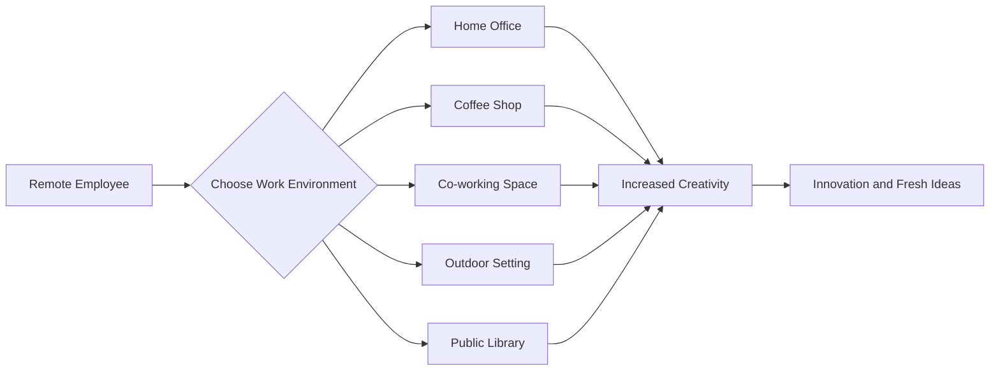
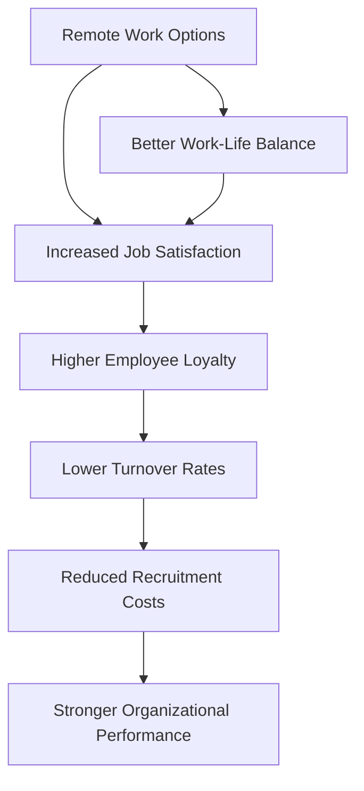
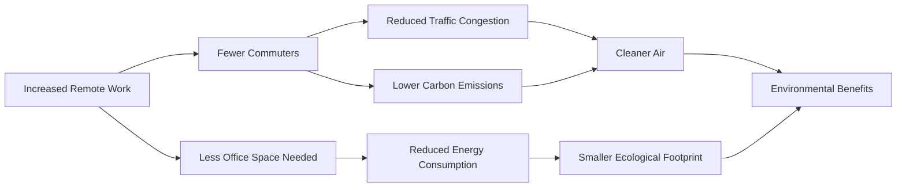
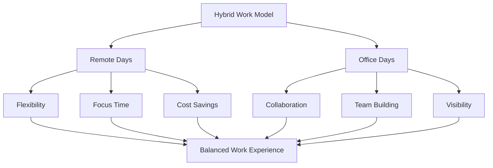
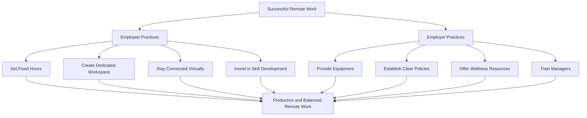

    

<h1 align="center">ADVANTAGES OF WORKING FROM HOME FOR EMPLOYEES IN METROPOLITAN AND COSMOPOLITAN CITIES</h1>

    

    

  
 
## Introduction

In today's digital age, working from home has become increasingly common, especially in large cities where daily life moves quickly and commuting takes up a significant portion of the day. Remote work offers a major shift in how professionals approach their careers, combining productivity, well-being, and flexibility in ways that traditional office settings often cannot match.

For employees living in busy metropolitan and cosmopolitan cities, the benefits of working from home go beyond simple convenience. They represent a significant lifestyle improvement that can positively influence both personal and professional satisfaction.

This document explores the key advantages of remote work for urban professionals, providing clear insights for employees, employers, and anyone interested in understanding the modern work revolution. It also addresses practical considerations, challenges, and future trends to present a complete and balanced view.

 

## Part 1: Employee Benefits

 

## Section 1: Personal Well-Being and Quality of Life

### 1.1 Flexibility: Designing Your Ideal Day

Remote work offers a level of flexibility that is simply not possible in a traditional office setting. Employees can adjust their schedules to meet both work and personal responsibilities, creating a better balance between their professional and personal lives.

In cities like New York, Tokyo, or London, where commutes are long and daily routines are demanding, the ability to shape one's day around core working hours promotes both productivity and personal satisfaction. Whether it means picking up children from school, running errands, or simply avoiding rush-hour traffic, remote work allows individuals to take control of their time and energy.

**Key Benefits of Flexibility:**

| Benefit | Description |
|---------|-------------|
| Customized schedules | Employees can choose when to start and end their workday |
| Personal time management | Time previously spent commuting can be redirected to personal activities |
| Reduced time pressure | Less stress from rigid office hours and strict schedules |
| Better family engagement | More opportunities to participate in family activities and responsibilities |

### 1.2 Improved Work-Life Balance

In metropolitan areas where time is often limited, working from home provides the opportunity to create a healthier balance between professional duties and personal life. Employees can plan their day in a way that aligns with their personal goals, whether that means spending more time with loved ones, pursuing hobbies, or focusing on self-care.

For working parents or those with caregiving responsibilities, this balance is extremely valuable. It helps them fulfill both family and career obligations without having to sacrifice one for the other.

### 1.3 Reduced Stress and Commuting Time

One of the biggest challenges of working in a metropolitan setting is the daily commute. Research shows that long commutes can negatively affect mental health, contributing to stress, anxiety, and even burnout. Working from home eliminates this burden, leading to improved mental well-being.

In cities like Los Angeles or São Paulo, where traffic congestion is a daily challenge, remote work offers the gift of time. Employees can now spend the hours once wasted in traffic on more meaningful activities such as exercise, hobbies, or quality time with family.

**Time Savings from Eliminated Commute:**

| City Type | Average Daily Commute Time | Annual Time Saved (Working From Home) |
|-----------|---------------------------|---------------------------------------|
| Major metropolitan | 60-90 minutes | 240-360 hours |
| Large city | 45-60 minutes | 180-240 hours |
| Medium city | 30-45 minutes | 120-180 hours |

### 1.4 Improved Health and Well-Being

The home environment often allows employees to manage their health more effectively. Remote workers can integrate exercise into their daily routine, prepare healthier meals, and avoid the health risks associated with sedentary office work. Additionally, the reduced stress from avoiding long commutes and a high-pressure office environment has a positive impact on mental well-being.

In fast-paced cities where mental and physical health often take a back seat to professional demands, working from home creates opportunities for a healthier lifestyle.

**Health Benefits Summary:**

| Health Aspect | How Remote Work Helps |
|---------------|----------------------|
| Physical health | More time for exercise, healthier meal preparation |
| Mental health | Reduced commute stress, comfortable environment |
| Illness prevention | Less exposure to workplace illnesses |
| Sleep quality | More time for rest due to eliminated commute |

### 1.5 Improved Mental Health

Beyond physical health benefits, remote work significantly impacts mental health. Avoiding the exhaustion from commuting and office stressors reduces anxiety and creates an environment where employees feel more comfortable and secure.

With mental health becoming a top priority for employers, especially in demanding urban environments, remote work offers a valuable solution for maintaining psychological well-being.

**Mental Health Resources and Support:**

Employers can further support remote worker mental health by providing:

| Resource | Description |
|----------|-------------|
| Employee Assistance Programs (EAPs) | Confidential counseling and support services |
| Online therapy platforms | Access to licensed therapists via video calls |
| Mental health apps | Guided meditation, stress management tools |
| Virtual support groups | Peer connections for shared experiences |
| Wellness webinars | Educational sessions on mental health topics |

 

## Section 2: Productivity and Professional Growth

### 2.1 Increased Productivity: A Custom Environment

Many people report increased productivity while working from home. Employees can customize their workspace, creating an environment that suits their needs, which leads to fewer distractions. The absence of office noise, interruptions from colleagues, or unnecessary meetings provides space for deep, focused work.

Furthermore, employees save energy that would otherwise be spent on commuting, leaving them refreshed and focused on the tasks ahead. For metropolitan professionals accustomed to juggling tight schedules, this optimized workflow can make a substantial difference in their output and efficiency.

**Productivity Factors in Remote Work:**

| Factor | Impact on Productivity |
|--------|----------------------|
| Customized workspace | Higher comfort leads to better focus |
| Fewer interruptions | More time for deep, meaningful work |
| Reduced meetings | Less time wasted, more time for tasks |
| Saved commute energy | More mental and physical energy for work |

### 2.2 Enhanced Focus and Fewer Office Politics

Office politics and social distractions can undermine productivity and affect morale. Working from home allows employees to escape these dynamics, enhancing their ability to concentrate on work. The freedom to focus without interruption results in improved task completion and overall job satisfaction.

For workers in large corporate environments, where office politics can be particularly pervasive, the ability to focus on one's responsibilities without unnecessary distractions is a major advantage.

### 2.3 Expanded Learning Opportunities and Skill Development

Remote work allows employees to take advantage of the extra time gained from not commuting by investing in personal and professional development. Online courses, webinars, and workshops can easily be integrated into their schedule.

This access to continuous learning, especially in knowledge-based industries, helps employees upskill and grow, contributing to both individual and organizational success.

**Learning Opportunities Enabled by Remote Work:**

- Online certification programs
- Professional webinars and virtual conferences
- Self-paced courses in new technologies
- Language learning applications
- Industry-specific training modules

**Real-World Example:**

> A software developer in Bangalore saves two hours daily by working from home. Using that time for professional certification courses, they earned a promotion and a 30 percent salary increase within one year.

### 2.4 Stronger Digital Skills and Technological Proficiency

The shift to remote work encourages employees and organizations to embrace digital tools and platforms. Over time, this leads to stronger technological proficiency across the workforce.

Employees become skilled at using project management software, communication tools, and other digital platforms that are essential for remote collaboration. This digital transformation is particularly important for businesses in fast-evolving industries.

**Essential Digital Skills Developed Through Remote Work:**

| Skill Category | Tools and Platforms |
|----------------|---------------------|
| Communication | Video conferencing, instant messaging |
| Project management | Task tracking, team collaboration software |
| Documentation | Cloud-based document sharing |
| Time management | Digital calendars, productivity apps |

### 2.5 Increased Autonomy and Responsibility

Working from home often requires employees to manage their own time and workload more effectively. This increased responsibility can foster greater autonomy, building trust between employers and employees.

In fast-paced, competitive environments like those in major cities, having the freedom to manage your own tasks can enhance motivation, as employees feel empowered and trusted.

### 2.6 Innovation and Creativity

Remote work fosters creativity by allowing employees to break out of traditional work environments and find inspiration in new and diverse settings. Some remote workers thrive in non-office environments, finding that they generate their best ideas while working from a café, park, or co-working space.

This freedom to choose one's surroundings is crucial for fostering innovation.

**Creative Work Environments for Remote Employees:**

### 2.7 Better Work Relationships through Effective Digital Communication

While physical distance may seem like a barrier, working remotely often enhances the quality of communication. Employees tend to have more structured and meaningful interactions when they do connect, whether through video conferencing, collaborative tools, or instant messaging platforms.

This can lead to more focused and efficient conversations, reducing the likelihood of miscommunication.

 

## Section 3: Financial Benefits

### 3.1 Cost Savings: From Commutes to Coffee

Working from home in a major city translates to significant financial savings. Employees no longer need to spend money on commuting costs, whether it is fuel, public transportation, or ride-sharing services. Additionally, they save on other daily expenses like work attire, lunches, and coffee breaks.

In cities where the cost of living is high, these savings add up, providing remote workers with more disposable income to allocate toward leisure or personal investments.

**Typical Monthly Savings for Remote Workers:**

| Expense Category | Estimated Monthly Savings |
|------------------|--------------------------|
| Transportation | $100 - $300 |
| Meals and coffee | $150 - $400 |
| Work attire | $50 - $150 |
| Parking fees | $50 - $200 |
| **Total Potential Savings** | **$350 - $1,050** |

### 3.2 Reduced Commuting Costs

With no daily commute, remote workers save on transportation expenses, including fuel, public transportation fares, or parking fees. This financial relief can significantly add to their disposable income.

For employees in expensive metropolitan areas, these savings can amount to thousands of dollars annually, providing greater financial flexibility and security.

### 3.3 Access to Local Amenities

Living in a large city comes with numerous advantages, including access to cultural experiences, high-quality healthcare, dining, and educational opportunities. By working from home, employees in cities like Paris or San Francisco can more easily integrate these local amenities into their daily life, enhancing both personal satisfaction and productivity.

**City Amenities Accessible to Remote Workers:**

- Museums and cultural centers during off-peak hours
- Local restaurants and cafes for lunch breaks
- Fitness centers and parks for exercise
- Community events and networking opportunities
- Educational institutions for continued learning

 

## Section 4: Career and Professional Opportunities

### 4.1 Access to a Broader Talent Pool

Employers can benefit significantly from remote work arrangements, especially in cosmopolitan cities. By eliminating the need for employees to be physically present in one location, businesses can attract talent from all over the world.

This access to a global talent pool is a game-changer for industries that require specialized skills, allowing companies to diversify their workforce and tap into a range of perspectives.

For employees, it means they are not limited to local job opportunities, and they can pursue positions in companies worldwide without the need to relocate.

**Global Talent Pool Benefits:**

| For Employers | For Employees |
|---------------|---------------|
| Access to specialized skills worldwide | More job opportunities globally |
| Diverse workforce perspectives | Ability to work for international companies |
| Competitive hiring advantage | No need to relocate for career growth |
| Expanded recruitment reach | Exposure to different work cultures |

### 4.2 Global Opportunities and Cultural Diversity

Remote work allows employees to engage with international teams and projects, broadening their professional experience. The ability to work with a culturally diverse team is not only enriching but also essential in today's interconnected global economy.

For employees in cosmopolitan cities, remote work often means exposure to new ideas, global perspectives, and collaborations across borders, all from the comfort of their home.

### 4.3 Remote Work as a Competitive Advantage in Recruitment

Offering remote work can give companies an edge when recruiting top talent, especially in cities with competitive job markets. Candidates increasingly seek flexibility, and businesses that provide remote work options are likely to attract more applicants and have a higher chance of securing top-tier talent.

In metropolitan areas with high living costs, remote work can also help employers recruit individuals who may otherwise avoid relocating.

### 4.4 Lower Turnover and Better Employee Retention

Offering remote work options is a key factor in employee satisfaction, especially in cosmopolitan cities where work-life balance can feel elusive. When employees have the freedom to work remotely, job satisfaction tends to rise, which can lead to lower turnover rates.

Employees are less likely to look for new jobs if they feel their current employer supports a flexible and balanced lifestyle.

**Employee Retention Factors:**

 

## Section 5: Work-Life Integration

### 5.1 Work-Life Integration vs. Work-Life Balance

While many advocate for work-life balance, some remote workers find that the concept of work-life integration resonates more. In metropolitan areas, rigid boundaries between work and personal life can be hard to maintain.

Remote work allows employees to blend their professional and personal responsibilities in a way that feels natural, fostering a lifestyle where both realms coexist more harmoniously.

**Comparison: Work-Life Balance vs. Work-Life Integration:**

| Aspect | Work-Life Balance | Work-Life Integration |
|--------|-------------------|----------------------|
| Approach | Separation of work and life | Blending of work and life |
| Schedule | Fixed work hours | Flexible work hours |
| Boundaries | Clear lines | Fluid transitions |
| Best for | Those who prefer structure | Those who value flexibility |

 

## Part 2: Employer Benefits and Responsibilities

 

## Section 6: Employer Advantages

### 6.1 Access to a Broader Talent Pool

Remote work enables employers to hire the best talent regardless of location, allowing them to access a diverse and skilled workforce globally. This is particularly beneficial for companies in competitive markets where finding specialized skills locally can be challenging.

### 6.2 Cost Savings for Employers

Working from home can lead to significant cost savings for employers. Companies can reduce expenses related to office space, utilities, and other overheads.

**Employer Cost Savings from Remote Work:**

| Expense Category | Potential Savings |
|------------------|-------------------|
| Office rent | 30-50% reduction |
| Utilities | 20-40% reduction |
| Office supplies | 15-30% reduction |
| Maintenance | 25-45% reduction |

### 6.3 Boosted Company Reputation

Businesses that embrace remote work often gain a reputation as progressive, employee-centric organizations. This is especially attractive in metropolitan job markets where competition for talent is fierce.

A positive remote work policy can enhance a company's employer brand, making it a more attractive place to work.

## Section 7: Employer Responsibilities in Supporting Remote Work

For remote work to succeed, employers must provide proper support. The following checklist outlines key responsibilities:

**Employer Support Checklist:**

| Responsibility | Description |
|----------------|-------------|
| Provide equipment | Supply necessary hardware and technology stipends |
| Establish clear policies | Define remote work guidelines and expectations |
| Offer wellness resources | Provide mental health and wellness support |
| Create virtual team building | Organize online social and collaborative activities |
| Set performance metrics | Define measurable goals and outcomes |
| Train managers | Equip leaders to manage remote teams effectively |
| Ensure equal advancement | Provide fair career growth opportunities for remote workers |

 

## Part 3: Broader Impact

 

## Section 8: Inclusivity and Accessibility

### 8.1 Greater Work Inclusivity

Remote work can benefit individuals with disabilities, caregiving responsibilities, or other constraints that might make traditional office-based work challenging. It fosters a more inclusive work environment by accommodating a broader range of needs.

### 8.2 Inclusivity and Accessibility

Remote work opens doors for individuals with disabilities or health issues that make commuting or working in an office difficult. By accommodating these individuals, companies create a more inclusive environment.

Remote work enables a more diverse workforce, offering opportunities to those who may have been marginalized in traditional work settings.

**Groups Benefiting from Remote Work Inclusivity:**

| Group | Benefit |
|-------|---------|
| People with disabilities | Reduced physical barriers to employment |
| Caregivers | Ability to manage care responsibilities |
| Parents | Better integration of work and family |
| Older workers | Comfortable working environment |
| Rural residents | Access to urban job markets |

 

## Section 9: Environmental and Societal Impact

### 9.1 Environmental Benefits

With less commuting, fewer cars are on the road, resulting in reduced carbon emissions and a smaller ecological footprint. Cities known for high levels of pollution, such as Beijing or Mexico City, could benefit greatly from a widespread shift to remote work.

The environmental benefits extend beyond just emissions. Reduced office space and energy consumption also contribute to sustainability. As metropolitan areas work toward greener, more sustainable futures, remote work can be a key contributor to reducing environmental strain.

**Environmental Impact of Remote Work:**

### 9.2 Eco-Friendly Impact

Fewer commuters mean reduced traffic congestion and carbon emissions, contributing to a greener environment. Embracing remote work on a large scale can have a positive impact on sustainability and climate change efforts.

 

## Section 10: Crisis Management and Business Continuity

### 10.1 Crisis Management and Business Continuity

In metropolitan cities, disruptions like public transportation strikes, extreme weather, or even political events can disrupt traditional work setups. Remote work acts as a safeguard, ensuring that business continues uninterrupted regardless of external circumstances.

This is particularly relevant for companies operating in cities prone to crises or sudden disruptions.

**Business Continuity Scenarios:**

| Disruption Type | How Remote Work Helps |
|-----------------|----------------------|
| Transportation strikes | Employees can work without commuting |
| Extreme weather | No need to travel to office |
| Health emergencies | Work continues without physical contact |
| Political events | Business operations remain stable |
| Infrastructure failures | Work continues from alternative locations |

 

## Part 4: Practical Considerations

 

## Section 11: Customized Workspace and Personal Comfort

### 11.1 Customized Workspace: Personal Comfort, Increased Efficiency

Unlike a generic office cubicle, employees working from home have the luxury of designing their workspace according to their preferences. Whether it is a cozy corner filled with plants, a standing desk setup, or a home office with a scenic view, personalizing a workspace can lead to increased comfort and, consequently, higher productivity.

In cities where space is often at a premium, remote work also offers the flexibility to choose where to work. Coffee shops, co-working spaces, or even outdoor settings can become creative environments.

**Workspace Options for Remote Workers:**

| Workspace Type | Best For |
|----------------|----------|
| Home office | Focus and privacy |
| Coffee shop | Creative work and networking |
| Co-working space | Collaboration and community |
| Outdoor setting | Fresh air and inspiration |
| Public library | Quiet and resources |

 

## Section 12: Technology Infrastructure Requirements

Successful remote work depends on reliable technology. The following table outlines essential requirements:

| Technology Category | Examples | Purpose |
|--------------------|----------|---------|
| Hardware | Laptop, monitor, headset | Core work tools |
| Internet | High-speed broadband | Reliable connectivity |
| Software | VPN, project management apps | Security and collaboration |
| Security | Antivirus, password managers | Data protection |
| Ergonomics | Ergonomic chair, standing desk | Physical comfort |

 

## Section 13: Remote Work Suitability by Job Role

Different roles benefit differently from remote work. The following table provides a general guide:

| Job Type | Remote Work Suitability | Key Benefits |
|----------|------------------------|--------------|
| Software Development | High | Focus time, global collaboration |
| Customer Support | High | Flexible hours, reduced stress |
| Sales | Medium-High | Reduced travel, CRM access |
| Healthcare | Low-Medium | Telemedicine opportunities |
| Education | Medium | Online teaching platforms |
| Creative Fields | High | Flexible inspiration sources |

 

## Section 14: Challenges and Limitations

A balanced view of remote work requires acknowledging potential challenges. The following table presents common issues and their mitigation strategies:

| Challenge | Mitigation Strategy |
|-----------|---------------------|
| Social isolation | Virtual team meetings, co-working spaces |
| Blurred work-life boundaries | Set fixed working hours, dedicated workspace |
| Communication gaps | Regular check-ins, clear response time expectations |
| Home distractions | Create a dedicated workspace, establish family guidelines |
| Career visibility concerns | Proactive updates, virtual networking |

 

## Part 5: The Future of Remote Work

 

## Section 15: Hybrid Work Model

Many companies are adopting hybrid models that combine remote and in-office work. This approach addresses some limitations of fully remote work while preserving key advantages.

**Hybrid Work Benefits:**

 

## Section 16: Future Trends in Remote Work

The remote work landscape continues to evolve. The following trends are shaping the future:

| Trend | Description |
|-------|-------------|
| Workation | Working while traveling |
| Asynchronous work | Flexible hours across time zones |
| AI-powered tools | Enhanced productivity and collaboration |
| Virtual reality meetings | Immersive remote collaboration |
| Four-day work weeks | Increased flexibility and well-being |

 

## Part 6: Additional Considerations

 

## Section 17: Legal and Tax Considerations

Remote workers and employers should be aware of legal and tax implications:

| Consideration | Description |
|---------------|-------------|
| Tax implications | Understanding home office deductions |
| Employment laws | Jurisdiction-specific regulations |
| Data privacy | Compliance with GDPR, HIPAA, and similar laws |
| Workers' compensation | Coverage for home-based injuries |

 

## Summary: Key Advantages at a Glance

| Category | Advantage | Primary Benefit |
|----------|-----------|-----------------|
| Personal | Flexibility | Control over schedule |
| Personal | Work-Life Balance | Harmony between work and life |
| Personal | Reduced Stress | Better mental health |
| Personal | Health and Well-Being | Physical and mental wellness |
| Productivity | Increased Productivity | Better output and efficiency |
| Productivity | Enhanced Focus | Fewer distractions |
| Productivity | Skill Development | Continuous learning |
| Financial | Cost Savings | More disposable income |
| Career | Global Opportunities | International exposure |
| Career | Talent Pool Access | More job options |
| Employer | Retention | Lower turnover |
| Employer | Recruitment | Competitive advantage |
| Societal | Environmental Benefits | Reduced carbon footprint |
| Societal | Inclusivity | Broader workforce participation |
| Operational | Business Continuity | Resilience during disruptions |

 

## Conclusion: Embracing the Future of Work

As metropolitan and cosmopolitan cities continue to evolve, so do the ways we work. Remote work is not just a temporary trend. It is a movement that is reshaping the workforce. By eliminating commutes, providing flexibility, and fostering inclusivity, remote work creates an environment where both productivity and well-being can flourish.

For employees, the advantages of working from home are undeniable. It offers the opportunity to redefine work-life balance, reduce stress, and enjoy greater personal and professional fulfillment. This ultimately creates a happier, more efficient, and engaged workforce.

For employers, embracing remote work means accessing a broader talent pool, reducing overhead costs, and building a more resilient and satisfied team.

In today's fast-paced world, the shift toward remote work represents a significant opportunity for professionals to balance their personal and professional lives while thriving in the modern workplace.

 

## Quick Reference Guide

### Top 10 Advantages of Working From Home

1. **Flexibility** - Control over your daily schedule
2. **Increased Productivity** - Custom environment for focused work
3. **Cost Savings** - Reduced commuting and daily expenses
4. **Reduced Stress** - No commute, less office pressure
5. **Better Work-Life Balance** - More time for personal priorities
6. **Improved Health** - Time for exercise and healthy habits
7. **Global Opportunities** - Access to international jobs
8. **Environmental Benefits** - Smaller carbon footprint
9. **Inclusivity** - Opportunities for diverse groups
10. **Career Growth** - Continuous learning and skill development

 

### Summary of Recommended Practices

    
 
