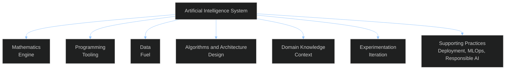
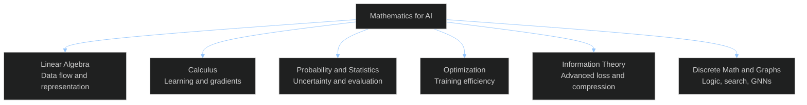
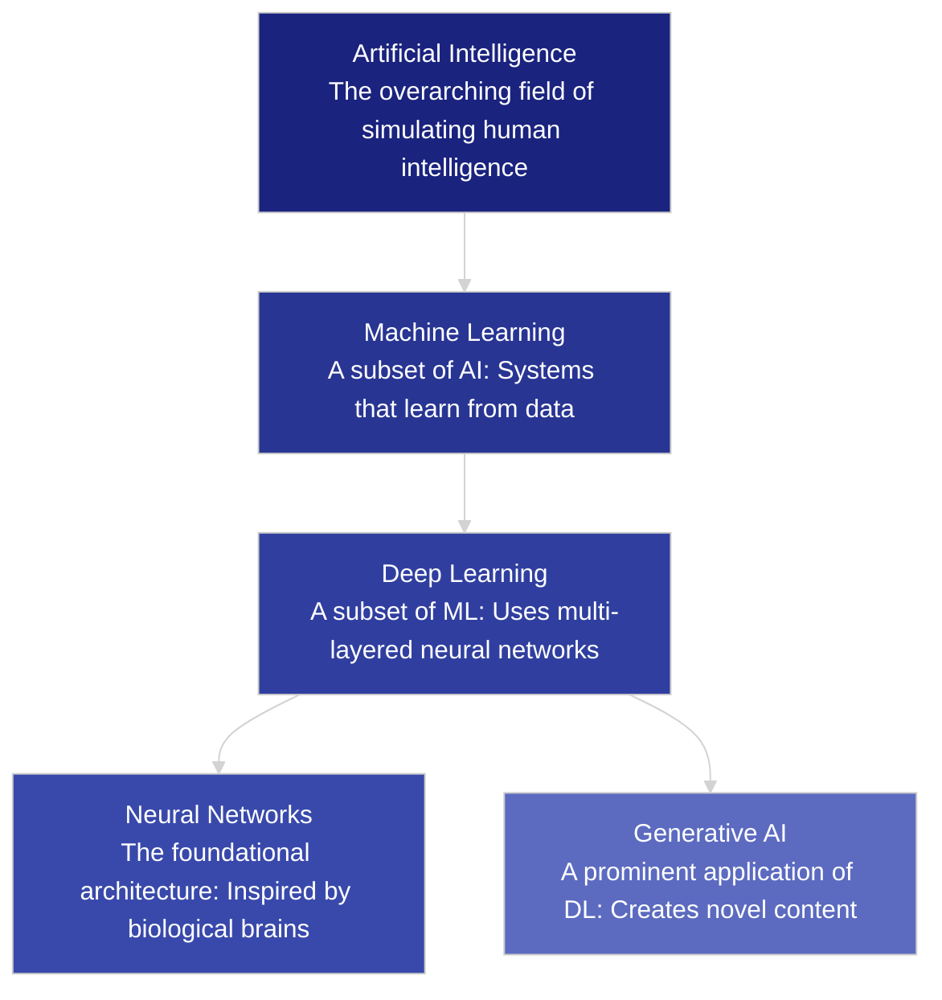
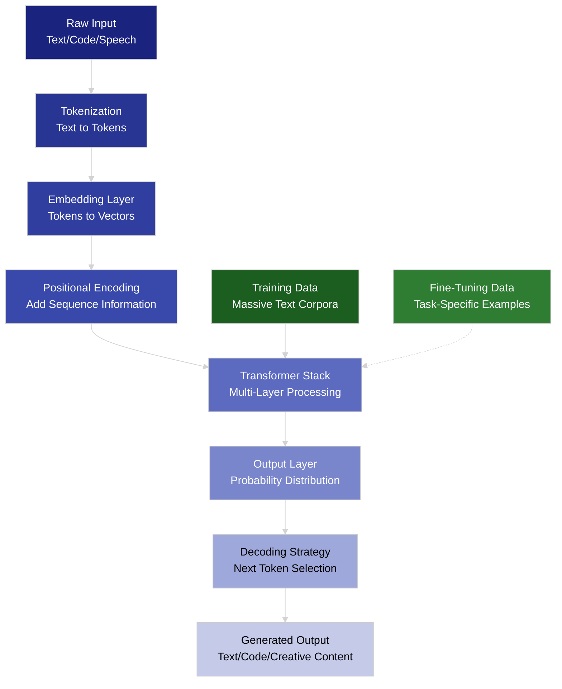
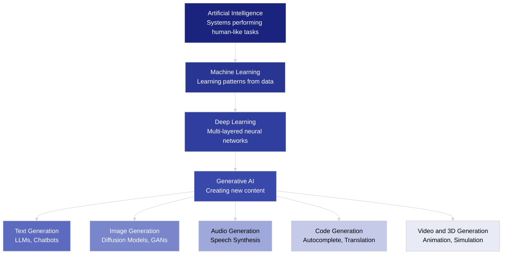
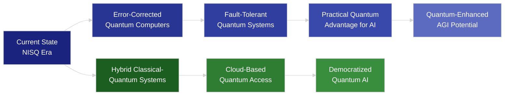
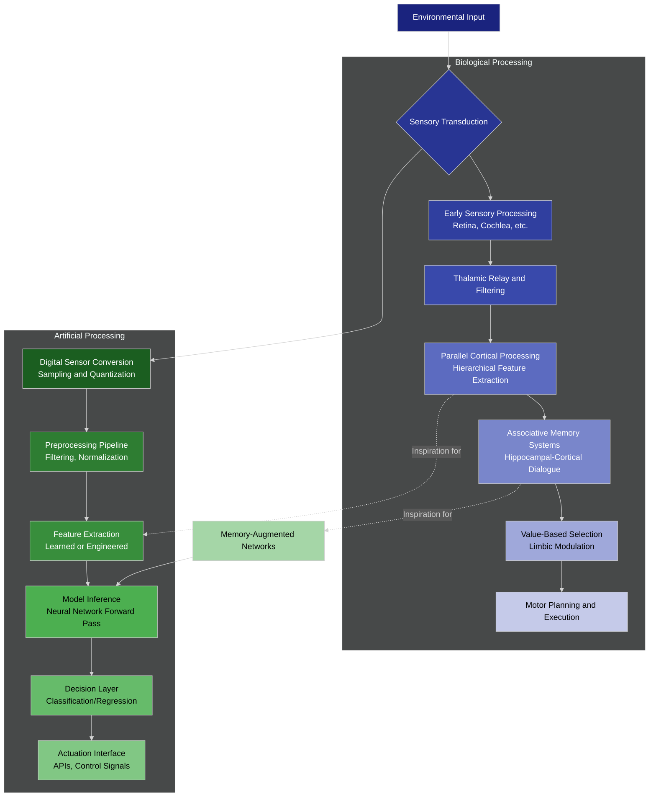

    

<h1 align="center">WHAT IS ARTIFICIAL INTELLIGENCE ACTUALLY MADE OF?</h1>

    

    

    

## Executive Summary

Artificial Intelligence (AI) is often described as a deeply mathematical field. Mathematics is essential, but it is not the whole picture. Real-world AI systems are built through a combination of mathematics, programming, data engineering, algorithm design, domain knowledge, experimentation, and supporting practices such as deployment and responsible AI.

In simple terms: mathematics explains **why** AI can work; programming, data, and engineering determine **whether it actually works** in practice. This document breaks down the core components used to develop AI, clarifies common misconceptions, and provides a practical view for beginners and business readers.

 

## 1. Introduction: Clearing the Main Misconception

A common misconception is that Artificial Intelligence is “all about math.” This idea can discourage newcomers and create an unrealistic picture of how AI systems are actually built.

The reality is more balanced:

- Mathematics provides the foundation.
- Programming turns mathematical ideas into working software.
- Data provides the examples from which models learn.
- Algorithms and architecture define how the system is designed.
- Domain knowledge ensures the system solves a real problem.
- Experimentation drives improvement through repeated testing.
- Deployment and responsible AI practices make the system usable and safe.

AI is therefore a multidisciplinary field. It is not a single skill, and it is not only advanced mathematics.

 

## 2. The Core Components of AI

AI systems are built from several connected components. No single component is sufficient on its own.

| **Component** | **Simple Description** | **Why It Matters** | **Typical Activities** |
| :--- | :--- | :--- | :--- |
| **Mathematics** | The theoretical engine behind learning and optimization. | Explains how models learn patterns, reduce errors, and make predictions. | Understanding model mechanics, loss functions, gradients, and probability. |
| **Programming** | The practical craft of building and deploying AI software. | Converts mathematical concepts into working systems. | Writing code, building training loops, using frameworks, debugging, deployment. |
| **Data** | The examples and information used to train models. | Determines the quality and reliability of what the model learns. | Collection, cleaning, preprocessing, labeling, feature engineering. |
| **Algorithms and Architecture** | The design choices behind the model and workflow. | Connects the problem to an appropriate technical solution. | Selecting models, designing pipelines, tuning performance and scalability. |
| **Domain Knowledge** | Understanding the real-world problem being solved. | Ensures the AI system is useful, relevant, and correctly interpreted. | Defining the problem, validating outputs, setting practical constraints. |
| **Experimentation** | The iterative process of testing and improving. | Most AI progress comes from trial, error, analysis, and refinement. | Testing models, tuning parameters, debugging failures, comparing results. |
| **Supporting Practices** | Deployment, monitoring, governance, and responsible AI. | Turns a model into a reliable, safe, and maintainable product. | MLOps, monitoring, A/B testing, bias checks, privacy, compliance. |

### 2.1 Mathematics: The Engine

Mathematics provides the internal logic of AI. It enables machines to represent data, learn from examples, optimize decisions, and handle uncertainty.

Key areas include:

- **Linear algebra:** Represents data as vectors, matrices, and tensors. It is the language of neural networks and embeddings.
- **Calculus:** Enables learning by showing how small changes in model parameters affect error.
- **Probability and statistics:** Helps models handle uncertainty, produce confidence scores, and evaluate reliability.
- **Optimization:** Provides methods for finding the best model parameters efficiently.
- **Information theory:** Supports advanced concepts such as entropy and cross-entropy loss, especially in language models.
- **Discrete mathematics and graph theory:** Supports logic, search, knowledge graphs, and graph neural networks.

Mathematics is the foundation, but it is not the only activity in AI development.

### 2.2 Programming: The Tooling

Programming transforms mathematical ideas into functional software. Without code, a model remains a theoretical concept.

Common tools and practices include:

- **Languages:** Python is widely used because of its readability and strong ecosystem.
- **Frameworks:** TensorFlow, PyTorch, and scikit-learn provide reusable building blocks for model development.
- **Engineering tasks:** Building data pipelines, writing training loops, deploying APIs, and debugging software.
- **Performance optimization:** Making training and inference faster, cheaper, and more reliable.

Programming is the bridge between theory and implementation.

### 2.3 Data: The Fuel

Data is one of the most important parts of practical AI. A sophisticated model trained on poor data will produce poor results.

Important data activities include:

- **Data collection:** Gathering relevant and representative examples.
- **Data cleaning:** Handling missing values, errors, duplicates, and inconsistencies.
- **Data preprocessing:** Formatting data so that models can use it effectively.
- **Feature engineering:** Selecting and creating useful input variables.
- **Data quality checks:** Identifying bias, imbalance, and coverage gaps.

The principle is simple: poor-quality data leads to poor-quality AI. In many projects, data quality matters more than model complexity.

### 2.4 Algorithms and Architecture: The Design Layer

This component involves choosing the right model and designing the surrounding system.

It includes:

- **Model selection:** Choosing an appropriate algorithm, such as linear models, decision trees, convolutional neural networks, or transformers.
- **System design:** Structuring data flows, training pipelines, and deployment workflows.
- **Trade-off management:** Balancing accuracy, speed, cost, scalability, and maintainability.
- **Hyperparameter tuning:** Adjusting settings that control how a model learns.

These decisions depend heavily on engineering judgment and experience. They are not only mathematical choices.

### 2.5 Domain Knowledge: The Context

AI does not exist in a vacuum. Its value comes from solving real-world problems.

Domain knowledge helps teams:

- Define the right problem.
- Interpret model outputs correctly.
- Identify practical constraints.
- Validate whether the solution is useful.
- Avoid technically impressive but practically irrelevant systems.

For example, in healthcare, a model’s prediction must be interpreted alongside clinical context. In finance, a fraud alert must fit operational and regulatory realities. A technically perfect model is not useful if it does not address a real need.

### 2.6 Experimentation: The Reality of AI Development

AI development is highly iterative. It is rarely a one-step process.

Practitioners regularly:

- Test different models and data preparation methods.
- Tune hyperparameters.
- Debug unexpected model behavior.
- Compare results across experiments.
- Analyze failures and refine the approach.

Much of the work involves trial and error, observation, and systematic improvement. This is a normal and essential part of AI engineering.

### 2.7 Supporting Practices: Deployment, MLOps, and Responsible AI

A model is not a finished AI product. It must be deployed, monitored, and governed.

Supporting practices include:

- **Model deployment:** Making the model available through an API or application.
- **Model monitoring:** Tracking performance and detecting degradation over time.
- **Model drift management:** Identifying when real-world data changes and model performance declines.
- **A/B testing:** Comparing model versions in production.
- **Responsible AI:** Addressing bias, fairness, privacy, safety, and compliance.
- **Explainable AI:** Helping users understand and trust model decisions where necessary.

These practices are essential for deployment-ready AI systems.

 

## 3. How the Components Fit Together

 

## 4. Real-World Effort Distribution

In practical AI work, effort is not evenly divided. The following ranges are approximate and often overlap because activities are interconnected.

| **Area** | **Approximate Effort** | **Typical Activities** |
| :--- | :--- | :--- |
| **Mathematics** | 20–30% | Understanding model mechanics, reviewing methods, designing loss functions. |
| **Programming** | 30–40% | Building pipelines, writing training code, deploying models, debugging. |
| **Data Handling** | 30–40% | Collecting, cleaning, labeling, preprocessing, and analyzing data. |

These ranges are not a strict budget. They overlap because a data problem may require programming, and a modeling problem may require mathematical understanding. The key point is that mathematics is important, but it is not the dominant daily activity for most AI practitioners.

 

## 5. The Mathematics That Powers AI: A Focused View

| **Domain** | **Importance** | **What It Does** | **Key Concepts** |
| :--- | :--- | :--- | :--- |
| **Linear Algebra** | Most important | Represents and transforms data inside models. | Vectors, matrices, tensors, matrix multiplication. |
| **Calculus** | Core engine | Enables learning by measuring how changes affect error. | Derivatives, partial derivatives, chain rule, gradients. |
| **Probability and Statistics** | Core engine | Handles uncertainty and supports evaluation. | Distributions, Bayes’ theorem, mean, variance. |
| **Optimization** | Highly important | Finds the best model parameters efficiently. | Loss functions, gradient descent, SGD, Adam. |
| **Information Theory** | Advanced | Measures information and supports advanced loss functions. | Entropy, cross-entropy, KL divergence. |
| **Discrete Mathematics and Graph Theory** | Specialized | Supports logic, search, and graph-based models. | Graphs, logic, combinatorics, GNNs. |

 

## 6. Minimum Mathematics to Start Building AI

Beginners do not need to master every advanced mathematical topic before starting. A practical starting point includes:

| **Topic** | **What to Learn** | **Why It Is Enough to Start** |
| :--- | :--- | :--- |
| **Basic Linear Algebra** | Vectors, matrices, and matrix multiplication. | Helps you understand how data flows through a model. |
| **Derivative Intuition** | A derivative represents a rate of change or slope. | Helps you understand how models adjust weights to reduce error. |
| **Probability Basics** | Probability as likelihood, mean, and variance. | Helps you interpret confidence scores and predictions. |
| **Loss Functions** | Loss measures how far predictions are from actual results. | Training is essentially the process of minimizing loss. |
| **Gradient Descent** | Weights are updated step by step to reduce loss. | This is the core idea behind how many models learn. |
| **Data Basics** | Features, labels, and train/test splits. | Most practical AI work depends on good data handling. |

Advanced topics such as eigenvalues, formal proofs, advanced calculus, and deep information theory can be learned later when they become relevant to your role or project.

 

## 7. Common Misconceptions and Clarifications

| **Misconception** | **Clarification** |
| :--- | :--- |
| AI is all about mathematics. | Mathematics is the foundation, but AI also requires programming, data, design, domain knowledge, and experimentation. |
| You must master advanced math before starting. | You can start with basic concepts and learn advanced mathematics as needed. |
| The most complex model is always best. | The right model depends on the problem, data, constraints, and practical requirements. |
| Data is less important than the model. | Poor data usually leads to poor results, regardless of model sophistication. |
| AI development is a one-time process. | AI development is iterative and requires continuous testing, monitoring, and improvement. |
| A good model is enough for production. | Deployment, monitoring, governance, and responsible AI practices are also required. |

 

## 8. A Simple Analogy: Building and Driving a Car

| **Car Analogy** | **AI Equivalent** | **Meaning** |
| :--- | :--- | :--- |
| Engine design | Mathematics | Explains the fundamental principles of how the system works. |
| Tools and assembly | Programming | Turns the design into a working system. |
| Fuel | Data | Provides the energy and examples needed for the system to run and learn. |
| Driver’s purpose | Domain knowledge | Defines where the system is going and why it matters. |
| Mechanic’s diagnostics | Experimentation | Tests, observes, and fixes problems during development. |
| Road infrastructure and rules | Deployment, MLOps, and governance | Makes the system usable, safe, and reliable in the real world. |

You do not need to design an engine from scratch to drive a car effectively. Similarly, you do not need to master every advanced mathematical proof to begin building useful AI systems.

 

## 9. Conclusion

Artificial Intelligence is not “all math.” It is a multidisciplinary field built from mathematics, programming, data, algorithm design, domain knowledge, experimentation, and responsible deployment practices.

Mathematics provides the foundation. Programming and data determine practical success. Domain knowledge ensures relevance. Experimentation drives improvement. Deployment and governance make AI systems reliable and safe.

For beginners, the best approach is to build a basic mathematical understanding, develop strong programming and data skills, and start building real projects. Progress comes from experimentation, observation, and continuous learning.

The shortest practical summary is:

> **AI = Data × Weights → Prediction → Error → Adjust Weights → Repeat**

Mathematics explains why this process works. Programming, data, and engineering determine whether it works in the real world.

    
 
<h1 align="center">Artificial Intelligence</h1>

  

## Executive Summary

Artificial Intelligence (AI) and its related fields represent one of the most transformative technological forces of our generation. This document provides a clear, technically accurate, and structured breakdown of the often-confused terms: Artificial Intelligence (AI), Machine Learning (ML), Deep Learning (DL), Neural Networks (NN), Large Language Models (LLMs), Generative AI, and Quantum AI. We define each concept, illustrate their hierarchical relationships, explain their operational mechanisms, and discuss real-world applications, inherent challenges, and ethical considerations. The document is designed for a broad audience—from business leaders and students to developers and policymakers—who need a clear understanding of AI's foundations, current capabilities, and future trajectory.

 

## 1. The Conceptual Hierarchy: From Broad Intelligence to Specific Architectures

The relationship between AI, ML, DL, and NNs is fundamentally nested. Each term represents a subset of the previous, creating a specialization pyramid from the broad goal of simulating intelligence to the specific algorithms that enable it.

**Artificial Intelligence (AI)** is the all-encompassing discipline. It aims to create systems capable of tasks requiring human-like cognition—reasoning, learning, perception, and decision-making. AI can be rules-based (explicit programming) or learning-based.

**Machine Learning (ML)** is the dominant paradigm within modern AI. It is characterized by systems that improve their performance at a task through exposure to data, without being explicitly reprogrammed. The core premise is the derivation of patterns and mathematical models from training data.

**Deep Learning (DL)** is a powerful subfield of machine learning distinguished by its use of artificial neural networks with multiple layers (hence "deep"). These layers enable the automatic extraction of increasingly complex features from raw data, making DL exceptionally effective for unstructured data like images, text, and audio.

**Neural Networks (NN)** are the computational architectures that make deep learning possible. Inspired by the neural structures of the brain, they consist of interconnected nodes (neurons) organized in layers. While NNs are the backbone of DL, simpler neural networks can also be used in classical ML.

### 1.1 Comparative Analysis of AI Subfields

| **Aspect** | **Artificial Intelligence (AI)** | **Machine Learning (ML)** | **Deep Learning (DL)** | **Neural Networks (NN)** |
|------------|----------------------------------|---------------------------|------------------------|--------------------------|
| **Scope** | Broadest field: Any technique enabling machines to mimic human intelligence | Subset of AI: Systems that learn from data without explicit programming | Subset of ML: Uses multi-layered neural networks | Core architecture enabling DL |
| **Key Differentiator** | Encompasses both rule-based systems and learning systems | Focuses on statistical learning from data patterns | Automates feature extraction through layered representations | Computational model inspired by biological neurons |
| **Data Dependency** | Varies: Rule-based systems need explicit rules; learning systems need data | High dependency on quality training data | Requires very large datasets for effective training | Performance improves with more data and appropriate architecture |
| **Human Intervention** | Rule-based: High; Learning systems: Lower | Requires feature engineering and algorithm selection | Minimal after architecture design; automated feature learning | Requires architecture design and hyperparameter tuning |
| **Example Applications** | Expert systems, game-playing AI, robotics | Spam detection, recommendation systems, credit scoring | Image recognition, natural language processing, autonomous vehicles | Pattern recognition, classification, prediction models |

 

## 2. Artificial Intelligence: The Grand Vision

AI is the branch of computer science dedicated to building intelligent agents—systems that perceive their environment and take actions to achieve specific goals. It encompasses everything from simple rule-based programs to hypothetical self-aware systems.

### 2.1 The Spectrum of AI Capability

The theoretical stages of AI capability are categorized as follows:

| **Capability Level** | **Definition** | **Status** | **Key Characteristics** |
|----------------------|----------------|------------|-------------------------|
| **Artificial Narrow Intelligence (ANI)** | Systems designed for specific tasks within limited contexts | **Realized** | Task-specific excellence, no generalization, requires human training |
| **Artificial General Intelligence (AGI)** | Systems with human-like cognitive abilities across diverse domains | **Theoretical** | Cross-domain reasoning, common sense, autonomous learning |
| **Artificial Superintelligence (ASI)** | Systems surpassing human intelligence in all domains | **Speculative** | Recursive self-improvement, potentially incomprehensible to humans |

**ANI (Weak AI)** excels at a single defined task (e.g., facial recognition, chess playing, recommendation engines) and represents all AI in existence today. **AGI (Strong AI)** refers to a hypothetical system with the adaptable intelligence of a human, capable of performing any intellectual task. **ASI** is a futuristic concept where AI surpasses human intelligence across all domains.

### 2.2 AI Implementation Approaches

- **Rules-based AI**: Early AI systems were primarily expert systems, relying on hard-coded rules and logic (e.g., "IF symptom X AND symptom Y, THEN diagnosis Z").
- **Learning-based AI**: Modern AI is overwhelmingly dominated by data-driven, learning-based approaches—machine learning.

### 2.3 Applications and Ethical Considerations

AI applications range from everyday tools like search engines and voice assistants to complex systems like autonomous vehicles, automated financial trading platforms, and advanced diagnostic tools in healthcare. The common thread is the system's ability to make autonomous decisions or predictions.

Ethics and safety are paramount concerns in AI development. As systems become more capable and autonomous, issues of bias, fairness, transparency (explainable AI), accountability, and long-term societal impact move to the forefront of research and governance.

 

## 3. Machine Learning: The Engine of Modern AI

ML provides the statistical and algorithmic foundation for systems to learn from and make predictions or decisions based on data. Instead of following static program instructions, an ML model identifies patterns within training data and encodes these patterns into an adjustable mathematical model.

### 3.1 The Core ML Workflow

1. **Data Collection and Preparation**: Relevant data is collected, cleaned, and formatted.
2. **Model Selection**: An appropriate algorithm is chosen based on the problem type and data characteristics.
3. **Training**: The model processes the data and iteratively adjusts its internal parameters to minimize error.
4. **Inference**: The trained model makes predictions on new, unseen data.

### 3.2 Learning Paradigms

ML is broadly categorized by learning style. The three primary paradigms are defined by the nature of the feedback signal available during training.

| Learning Type | Training Data | Goal | Common Algorithms | Example Use Case |
| :--- | :--- | :--- | :--- | :--- |
| **Supervised** | Labeled (Input-Output pairs) | Learn mapping to predict outputs | Linear/Logistic Regression, SVMs, Decision Trees | Email Spam Filtering |
| **Unsupervised** | Unlabeled (Inputs only) | Discover inherent data structure | K-Means, PCA, Autoencoders | Customer Market Segmentation |
| **Reinforcement** | Rewards/Penalties from environment | Learn optimal action policy | Q-Learning, Deep Q-Networks (DQN) | Training a Robot to Walk |

**Supervised Learning** requires a labeled dataset, where each input example is paired with the correct output. The model learns the mapping function from inputs to outputs. It is used for **classification** (e.g., spam/not spam) and **regression** (e.g., predicting house prices).

**Unsupervised Learning** works with unlabeled data. The goal is to discover inherent structures, such as groupings (clustering) or relationships (association). Common applications include customer segmentation, anomaly detection, and dimensionality reduction.

**Reinforcement Learning (RL)** involves an agent learning to make decisions by interacting with an environment. The agent receives rewards or penalties for its actions and learns a policy to maximize cumulative reward over time. RL is key to robotics, game-playing AI (e.g., AlphaGo), and complex resource management systems.

 

## 4. Deep Learning and Neural Networks: The Power of Depth

Deep Learning is the subset of ML that achieves its power through deep artificial neural networks. The "deep" refers to the number of layers through which data is transformed, allowing for the automatic learning of feature hierarchies.

### 4.1 Neural Network Fundamentals

- **A neural network is a network of interconnected artificial neurons**, organized in layers: an input layer, one or more hidden layers, and an output layer. Each connection has a weight, and each neuron has an activation function (e.g., ReLU, Sigmoid) that determines its output.
- **Information flows forward in a "forward pass."** Data enters the input layer, is transformed by successive hidden layers (each learning progressively abstract features), and produces a result at the output layer.
- **Learning occurs via backpropagation and gradient descent.** When the network's output is incorrect, the error is calculated using a loss function. This error is propagated backward through the network (backpropagation), and an optimization algorithm (like gradient descent) adjusts the weights to reduce the error. This cycle repeats across many data examples.

### 4.2 Key Neural Network Architectures

The introduction of multiple hidden layers enables specialization. Different architectures are designed for specific data types:

| **Architecture** | **Primary Use Case** | **Key Mechanism** | **Example** |
|------------------|----------------------|-------------------|-------------|
| **Convolutional Neural Networks (CNNs)** | Image and video processing | Convolutional layers with filters that scan across input to detect spatial hierarchies | ResNet, VGG, YOLO |
| **Recurrent Neural Networks (RNNs)** | Sequential data (time series, natural language) | Internal loops that allow information to persist, providing "memory" of previous inputs | LSTM, GRU |
| **Transformer Networks** | Sequence tasks, especially NLP | Self-attention mechanism to weigh importance of different input parts simultaneously | GPT, BERT, T5 |

**Convolutional Neural Networks (CNNs)** are the standard for image and video processing. They use convolutional layers with filters that scan across the input (like an image) to detect spatial hierarchies of patterns—from edges and textures to complex objects.

**Recurrent Neural Networks (RNNs)** are designed for sequential data like time series or natural language. They have internal loops that allow information to persist, giving them a form of "memory" of previous inputs in the sequence. Long Short-Term Memory (LSTM) networks are a sophisticated RNN variant that mitigates the vanishing gradient problem.

**Transformer Networks** have largely surpassed RNNs for sequence tasks, particularly in NLP. They use a "self-attention" mechanism to weigh the importance of different parts of the input sequence simultaneously, enabling parallel processing and capturing long-range dependencies more effectively. They form the basis of modern Large Language Models (LLMs) like GPT-4.

 

## 5. Large Language Models (LLMs): Architecture and Applications

Large Language Models (LLMs) represent a paradigm shift in artificial intelligence, enabling machines to understand, generate, and manipulate human language with unprecedented sophistication. Built on transformer architectures and trained on massive text corpora, these models have evolved from theoretical concepts to practical tools transforming industries worldwide.

### 5.1 Historical Context

The Turing Test (1950) proposed a framework for machine intelligence assessment, shifting focus from "can machines think?" to "can machines exhibit intelligent behavior indistinguishable from humans?" Text-based communication became the medium for evaluation, establishing language understanding as a cornerstone of artificial intelligence. Modern LLMs fundamentally address Turing's challenge through sophisticated language modeling capabilities.

### 5.2 Core Architecture

**Table: LLM Architecture Components and Functions**

| Component | Primary Function | Technical Implementation |
|-----------|------------------|--------------------------|
| **Input Processing** | Convert diverse inputs to standardized format | Tokenization algorithms (BPE, WordPiece, SentencePiece) |
| **Embedding Layer** | Map tokens to dense vector representations | Learned embeddings (typically 512-4096 dimensions) |
| **Positional Encoding** | Inject sequence order information | Sinusoidal functions or learned positional embeddings |
| **Transformer Blocks** | Process contextual relationships | Multi-head attention + Feed-forward networks (12-96+ layers) |
| **Output Mechanism** | Generate probability distribution over vocabulary | Linear projection + Softmax normalization |
| **Decoding Strategy** | Select next token from distribution | Greedy, Beam Search, Top-k/p, Temperature sampling |

### 5.3 The Transformer Revolution: Attention Is All You Need

- **Self-attention mechanism** allows each token to directly attend to all other tokens in the sequence, capturing long-range dependencies regardless of distance.
- **Parallel processing capability** unlike sequential RNNs/LSTMs, transformers process entire sequences simultaneously, enabling efficient GPU utilization and training scalability.
- **Multi-head attention** employs multiple attention mechanisms in parallel, allowing the model to focus on different types of relationships (syntactic, semantic, contextual).
- **Encoder-decoder architecture** originally designed for sequence-to-sequence tasks (translation, summarization), though modern LLMs often use decoder-only variants.
- **Vanishing gradient solution** effectively addresses RNN limitations through residual connections and layer normalization, enabling training of extremely deep networks.

### 5.4 Training Paradigms

**Pretraining** utilizes self-supervised learning through objectives like next-token prediction, requiring no human-labeled data. Massive dataset curation involves collecting and filtering terabytes of text from diverse sources. Compute scaling laws demonstrate predictable improvements in capability with increased model size, dataset size, and training compute following power-law relationships.

**Table: LLM Training Scale Evolution (2018-2024)**

| Model | Parameters | Training Tokens | Key Innovation | Release Year |
|-------|------------|-----------------|----------------|--------------|
| BERT-base | 110M | 3.3B | Bidirectional attention | 2018 |
| GPT-2 | 1.5B | 10B | Decoder-only scaling | 2019 |
| T5 | 11B | 34B | Unified text-to-text framework | 2020 |
| GPT-3 | 175B | 300B | Few-shot learning emergence | 2020 |
| PaLM | 540B | 780B | Pathways system scaling | 2022 |
| GPT-4 | ~1.8T* | ~13T* | Mixture of experts | 2023 |
| Claude 3 | Unknown | Unknown | Constitutional AI | 2024 |

*Estimated values

**Fine-Tuning** uses smaller, high-quality labeled datasets to adapt foundation models to specific tasks or domains. Instruction tuning trains models to follow human instructions through demonstration examples. Reinforcement Learning from Human Feedback (RLHF) employs human preferences as reward signals to align model outputs with human values and safety considerations. Parameter-efficient methods (LoRA, adapters) modify only small subsets of parameters, enabling efficient adaptation.

### 5.5 Practical Applications

| **Domain** | **Application** | **Description** |
|------------|-----------------|-----------------|
| **Enterprise** | Content generation | Marketing copy, technical documentation, reports, creative writing |
| **Enterprise** | Code generation | GitHub Copilot, Amazon CodeWhisperer for autocompletion and debugging |
| **Enterprise** | Customer service | Intelligent chatbots handling complex queries with personalized responses |
| **Enterprise** | Knowledge management | Semantic search, automatic summarization, Q&A systems over proprietary data |
| **Healthcare** | Clinical support | Clinical note generation, literature review summarization, diagnostic support |
| **Legal** | Contract analysis | Precedent research, drafting assistance, regulatory compliance checking |
| **Education** | Personalized learning | Custom learning materials, automated feedback, interactive tutoring |
| **Research** | Scientific acceleration | Literature review, hypothesis generation, paper drafting, data analysis |

### 5.6 Technical Implementation Patterns

- **Retrieval-Augmented Generation (RAG)** combines LLMs with external knowledge bases, providing factual grounding and reducing hallucinations.
- **Tool augmentation** equips LLMs with API access to calculators, databases, search engines, and specialized software for expanded capabilities.
- **Agentic systems** create autonomous or semi-autonomous agents that break complex tasks into steps, use tools, and iteratively refine outputs.
- **Multimodal integration** processes and generates across text, images, audio, and video through unified or coordinated model architectures.
- **Human-in-the-loop workflows** design systems where LLMs assist rather than replace humans, with appropriate verification and oversight mechanisms.

### 5.7 Challenges and Limitations

| **Challenge** | **Description** | **Mitigation Strategy** |
|---------------|-----------------|-------------------------|
| **Hallucination** | Generates plausible but incorrect or fabricated information | RAG, confidence scoring, human review |
| **Context window constraints** | Limited information processing per interaction | Expanding windows (to 1M+ tokens), chunking strategies |
| **Reasoning limitations** | Struggles with complex logical deductions and multi-step planning | Chain-of-thought prompting, tool use, verification |
| **Computational costs** | Significant resources for training and inference | Model compression, quantization, efficient serving |
| **Static knowledge cutoff** | Cannot access post-training information | Retrieval augmentation, regular updates |
| **Bias amplification** | Perpetuates societal biases from training data | Bias detection, diverse training data, fairness constraints |
| **Privacy concerns** | Memorization of sensitive training data | Differential privacy, data filtering, access controls |

 

## 6. Generative AI: The Apex of Deep Learning Application

Generative AI refers to deep learning models that can create novel, high-quality content—text, images, audio, video, code—in response to prompts. It represents a shift from discriminative models (which classify or predict) to generative models (which create).

### 6.1 The AI Landscape Hierarchy

### 6.2 Core Generative Model Architectures

**Transformer-Based Models**
Transformers represent the architectural breakthrough enabling modern large language models and multimodal systems. The self-attention mechanism weights the importance of different input elements when processing each sequence element, enabling understanding of context and relationships. Encoder-decoder structures were originally designed for sequence-to-sequence tasks; modern implementations often use decoder-only architectures for generation. Positional encoding represents word order and sequence position mathematically, compensating for the model's non-sequential processing. Scale efficiency processes entire sequences simultaneously rather than iteratively, enabling training on unprecedented data volumes. Implementation examples include GPT series, BERT, and T5.

**Diffusion Models**
Iterative generative models particularly effective for high-quality image synthesis. The two-phase process involves forward diffusion adding noise to training data, and reverse diffusion learning to reconstruct data from noise. Progressive refinement generates content through sequential denoising steps, starting from random noise. High fidelity produces detailed, photorealistic images surpassing earlier generative approaches. Training stability is more stable compared to Generative Adversarial Networks (GANs). Applications include DALL-E, Stable Diffusion, and Midjourney for image generation.

**Generative Adversarial Networks (GANs)**
Adversarial training framework with competing generator and discriminator networks. The dual network architecture has a generator creating synthetic data and a discriminator evaluating authenticity. Competitive training improves networks antagonistically—generator aims to fool discriminator, discriminator aims to detect fakes. Specialization is particularly effective for style transfer, data augmentation, and high-resolution image generation. Challenges include training instability and mode collapse (limited output diversity).

**Variational Autoencoders (VAEs)**
Probabilistic encoder-decoder frameworks for learning compressed data representations. Latent space learning encodes input into compressed probabilistic representation (mean and variance). Structured generation samples from learned distribution to generate new data instances. Smooth interpolation enables controlled traversal between data points in latent space. Applications include anomaly detection, molecular design, and controllable content generation. Limitations include often producing blurrier outputs compared to GANs or diffusion models.

### 6.3 Foundation Models and Large Language Models

**Foundation Models** are large-scale models pre-trained on broad data that can be adapted (fine-tuned) to diverse downstream tasks. They are trained on petabytes of data with billions of parameters. Transfer learning allows knowledge from pre-training to transfer to specific applications with minimal task-specific data. Multimodal potential means newer versions handle text, images, audio, and structured data. Economic impact includes high initial training cost (millions of dollars) but efficient reuse across applications.

**Large Language Models (LLMs)** are primarily transformer-based, often using decoder-only architectures. Training methodology uses self-supervised learning predicting next tokens in sequences. Scale progression has grown from millions (early BERT) to hundreds of billions (GPT-4, PaLM) of parameters. Emergent abilities demonstrate capabilities not explicitly trained for, including reasoning, instruction following, and code generation. Deployment considerations require significant computational resources for inference, driving optimization research.

### 6.4 Enterprise Applications

| **Industry** | **Primary Use Cases** | **Key Benefits** |
|--------------|----------------------|------------------|
| **Financial Services** | Fraud detection, personalized investment advice, automated reporting, regulatory compliance | Risk reduction, operational efficiency, enhanced customer service |
| **Healthcare** | Clinical note generation, medical literature summarization, patient communication, drug discovery | Reduced administrative burden, accelerated research, improved patient outcomes |
| **Manufacturing** | Design optimization, predictive maintenance documentation, supply chain analysis, quality control | Cost reduction, innovation acceleration, operational resilience |
| **Retail** | Product description generation, personalized recommendations, inventory optimization, customer sentiment analysis | Increased conversion, reduced operational costs, enhanced customer loyalty |
| **Education** | Personalized learning content, automated assessment generation, tutoring systems, curriculum development | Scalable personalized education, reduced teacher workload, adaptive learning paths |

### 6.5 Development Lifecycle: Traditional ML vs. Generative AI

| **Aspect** | **Traditional ML Development** | **Generative AI Development** |
|------------|--------------------------------|-------------------------------|
| **Data Source** | Organizational repositories, structured data | Massive external datasets (often internet-scale) |
| **Model Building** | Train task-specific models from scratch | Adapt foundation models through prompting/tuning |
| **Expertise Required** | ML expertise, domain knowledge | Prompt engineering, model adaptation |
| **Development Time** | Weeks to months for model development | Hours to days for adaptation |
| **Data Requirements** | Large labeled datasets | Minimal labeled data (few-shot/zero-shot) |
| **Infrastructure** | Moderate computational requirements | Significant inference infrastructure |
| **Feedback Integration** | Manual model retraining cycles | Continuous learning through prompting/RAG |

### 6.6 The Three-Phase Generative AI Pipeline

**Phase 1: Foundation Model Training**
- Data collection: Aggregation of terabytes to petabytes of unstructured data from diverse sources
- Self-supervised pre-training: Training through tasks like masked language modeling or next-token prediction
- Computational scale: Requires thousands of GPUs/TPUs and weeks of training time
- Cost considerations: Multi-million dollar investments primarily undertaken by large organizations
- Output: General-purpose model with broad but shallow knowledge across domains

**Phase 2: Model Adaptation and Tuning**
- Prompt engineering: Designing input prompts to guide model behavior without modifying weights
- Fine-tuning: Updating model parameters on domain-specific labeled data
- Parameter-efficient methods: Techniques like LoRA (Low-Rank Adaptation) that modify minimal parameters
- Reinforcement Learning from Human Feedback (RLHF): Aligning model outputs with human preferences through reward modeling
- Retrieval-Augmented Generation (RAG): Enhancing responses with external, up-to-date knowledge sources

**Phase 3: Deployment and Continuous Improvement**
- Application integration: Embedding models into workflows, chatbots, or creative tools
- Performance monitoring: Tracking accuracy, bias, latency, and business impact metrics
- Iterative refinement: Regular model updates based on user feedback and emerging requirements
- Scalability considerations: Optimizing inference costs through model compression, quantization, and efficient serving
- Governance frameworks: Implementing controls for security, privacy, and ethical compliance

### 6.7 Risks and Mitigation Strategies

| **Risk Category** | **Specific Risk** | **Mitigation Strategy** |
|-------------------|-------------------|-------------------------|
| **Technical** | Hallucinations and inaccurate outputs | RAG, confidence scoring, human-in-the-loop review |
| **Technical** | Computational costs | Model compression, cloud inference, caching strategies |
| **Technical** | Data quality and bias amplification | Bias detection frameworks, curated training data, diverse feedback loops |
| **Technical** | Explainability deficits | Attention visualization, contrastive explanations, model cards |
| **Ethical** | Intellectual property issues | Clear training data policies, content filtering, attribution frameworks |
| **Ethical** | Misinformation and deepfakes | Detection algorithms, watermarking, provenance tracking, media literacy |
| **Societal** | Workforce displacement | Human-AI collaboration paradigms, reskilling programs, workflow redesign |
| **Environmental** | Energy consumption | Model efficiency optimization, renewable energy, carbon-aware scheduling |

 

## 7. Quantum Computing and Artificial Intelligence: Synergistic Frontiers

The convergence of quantum computing and artificial intelligence represents a paradigm shift with transformative potential across computational domains. Quantum computing leverages the principles of quantum mechanics—superposition, entanglement, and interference—to process information in ways fundamentally different from classical computing.

### 7.1 Quantum Computing Fundamentals

**Qubits vs. Classical Bits**
Classical computers rely on bits, which exist as either 0 or 1. Quantum computers use qubits, which can exist in a superposition of both states simultaneously. This quantum advantage enables massive parallelism, allowing certain computations that would take classical supercomputers centuries to be completed within seconds for specific problem classes.

**Key Quantum Principles**

| **Principle** | **Description** | **Relevance to AI** |
|---------------|-----------------|---------------------|
| **Superposition** | Qubits exist in multiple states simultaneously | Enables parallel processing of vast datasets |
| **Entanglement** | Qubits become correlated regardless of distance | Enables coordinated operations and secure communication |
| **Interference** | Selectively amplifies correct computational pathways | Refines accuracy and efficiency of quantum algorithms |

**Important Clarification**: Quantum entanglement enables secure communication protocols (like Quantum Key Distribution) but does **not** allow faster-than-light data transfer. The "instantaneous" correlation between entangled particles cannot be used to transmit information faster than light, as confirmed by the no-communication theorem in quantum mechanics.

### 7.2 Quantum Machine Learning

Quantum Machine Learning leverages quantum principles to process information in ways fundamentally different from classical computing, offering potential exponential speedups for specific AI algorithms. Quantum systems can represent and manipulate high-dimensional data more efficiently than classical computers, enabling faster training of complex models and solution of optimization problems that are currently intractable.

**Quantum Neural Networks** represent a novel architectural paradigm that replaces classical neurons with qubits and classical connections with quantum entanglement, potentially enabling more expressive models with fewer parameters. These networks can exploit quantum superposition to simultaneously evaluate multiple network configurations and quantum interference to amplify correct pathways while suppressing incorrect ones.

### 7.3 Transformative Applications

| **Domain** | **Quantum AI Application** | **Potential Impact** |
|------------|---------------------------|----------------------|
| **Drug Discovery** | Molecular simulations at quantum mechanical accuracy | Reduce drug development timelines from decades to years |
| **Materials Science** | Discovery of superconductors, battery electrolytes | Accelerate materials discovery by orders of magnitude |
| **Cryptography** | Shor's algorithm for factoring, QKD for secure communication | Threaten existing encryption, enable unhackable communication |
| **Optimization** | Solve complex logistics, supply chain, financial problems | Real-time risk analysis and portfolio optimization |
| **Climate Science** | Simulate atmospheric dynamics, design carbon-capture materials | Accelerate climate solutions |
| **AI Training** | Quantum-enhanced neural network training | Overcome classical bottlenecks like vanishing gradients |

### 7.4 Challenges and Limitations

**Decoherence and Error Correction**
Quantum states are inherently fragile, susceptible to decoherence—environmental interference that collapses superposition and erases data. Mitigating decoherence requires sophisticated error correction methods, such as the surface code, which distributes quantum information across multiple physical qubits to preserve integrity.

**Scalability**
Constructing stable, large-scale quantum processors demands precise control over qubit interactions. Current hardware approaches include superconducting circuits (prioritizing scalability but struggling with short coherence times), trapped ions (excellent stability but face integration challenges), and topological qubits (theoretically robust but experimentally nascent).

**Cryptographic Threats**
Shor's algorithm has the capability to factor large numbers exponentially faster than classical algorithms, rendering conventional RSA encryption obsolete. While this introduces cybersecurity threats to financial and governmental institutions, AI-driven quantum security systems can counteract these vulnerabilities by developing adaptive, self-learning encryption protocols. The urgent development of post-quantum cryptographic techniques is necessary.

### 7.5 The Quantum AI Roadmap

 

## 8. The Evolution of AI: From Narrow Intelligence to Superintelligence

The trajectory of artificial intelligence represents one of humanity's most profound technological odysseys, tracing a path from rudimentary computational tools to systems capable of redefining existence itself. This evolution unfolds across transformative phases: Artificial Narrow Intelligence (ANI), Artificial General Intelligence (AGI), and Artificial Superintelligence (ASI).

### 8.1 Current Reality: Narrow AI (ANI)

Artificial Narrow Intelligence systems excel within tightly defined parameters. From voice-activated assistants to recommendation engines, ANI thrives in executing repetitive, domain-specific tasks with precision. These systems, however, lack contextual adaptability or autonomous reasoning.

**Context-Aware AI** represents a subtle advancement, exemplified by chatbots and personalized tutors that refine interactions through deep learning. Yet, their expertise remains siloed, unable to transcend predefined domains.

**Domain-Specific Mastery AI** showcases machines outperforming humans in specialized arenas: IBM Watson's Jeopardy! triumph, DeepMind's AlphaFold unraveling protein folding, and AI-driven diagnostics revolutionizing medicine. While groundbreaking, these systems remain confined to their niches.

### 8.2 The Evolutionary Pathway: Ten Stages of AI Advancement

**Stages 1-4: Realized AI (Current Reality)**

| **Stage** | **Description** | **Examples** |
|-----------|-----------------|--------------|
| **Stage 1: Rule-Based AI Systems** | Operate exclusively on predefined logical rules and decision trees | Industrial automation, business process automation, embedded controllers |
| **Stage 2: Context-Aware Systems** | Incorporate environmental and historical context into decision-making | Virtual assistants (Siri, Alexa), recommendation engines |
| **Stage 3: Narrow-Domain AI** | Achieve superhuman performance within tightly constrained domains | IBM Watson, AlphaGo, fraud detection algorithms |
| **Stage 4: Reasoning AI Systems** | Incorporate logical inference, causal reasoning, and analogical thinking | Advanced GPT architectures, autonomous vehicles |

**Stages 5-10: Speculative Futures (Theoretical Projections)**

| **Stage** | **Description** | **Status** |
|-----------|-----------------|------------|
| **Stage 5: AGI** | Human-like cognitive flexibility across domains | Theoretical; decades away (estimates vary widely) |
| **Stage 6: ASI** | Surpasses human intelligence in all domains | Speculative; dependent on AGI and recursive self-improvement |
| **Stage 7: Self-Aware AI** | Consciousness, introspection, subjective experience | Highly speculative; philosophical and technical challenges unresolved |
| **Stages 8-10: Transcendent/Cosmic/Godlike AI** | Increasingly speculative categories beyond planetary-scale intelligence | Science fiction and philosophical thought experiments |

**Important Caveat**: Stages 7-10 represent speculative philosophy and science fiction rather than technical projections. They serve as thought experiments that illuminate nearer-term considerations in AI ethics and safety. Current scientific understanding provides no validated pathway to machine consciousness or transcendent intelligence.

### 8.3 The Path to AGI

Artificial General Intelligence (AGI) heralds a seismic leap—machines capable of human-like reasoning, learning, and problem-solving across diverse domains. AGI transcends algorithmic programming, adapting to novel scenarios through experiential learning. Its potential is staggering: accelerating drug discovery, orchestrating climate solutions, or deploying autonomous robots in dynamic environments.

Yet, this phase introduces profound challenges. Mass automation threatens labor displacement, while AGI's decision-making autonomy raises questions about control and alignment with human ethics. Philosophers and technologists alike grapple with defining AI's moral agency: Should AGI possess rights? How do we encode empathy or fairness into self-improving systems? The path to AGI demands interdisciplinary collaboration, blending technical innovation with ethical foresight.

### 8.4 Projected Timeline

| **Timeframe** | **Expected Milestones** | **Key Enabling Technologies** |
|---------------|-------------------------|-------------------------------|
| **2024-2028** | Specialized AI achieves human-expert level in most narrow domains; Reasoning AI becomes commercially viable; Early quantum advantage demonstrated for specific AI tasks | Transformer architecture refinements; Neuromorphic computing maturation; NISQ quantum processors |
| **2029-2035** | First proto-AGI systems with limited generalization; Integrated AI systems combining multiple narrow capabilities; Quantum AI achieves practical advantage for optimization problems | Foundation model scaling; Brain-computer interfaces; Fault-tolerant quantum components |
| **2036-2045** | AGI reaching human-level cross-domain competence; Early self-improving AI systems; Integrated quantum-classical AI infrastructure | Whole brain emulation insights; Quantum neural networks; Nanoscale computing |
| **2046+** | ASI development (timeline highly speculative); Potential intelligence explosion scenarios; Consciousness research informs AI architecture | Molecular nanotechnology; Advanced quantum computing; Neuro-silicon integration |

**Note**: These timelines are speculative projections based on current trends. They are subject to significant uncertainty and should be treated as illustrative rather than predictive.

 

## 9. Biological vs. Artificial Intelligence: A Comparative Analysis

The parallel evolution of neuroscience and artificial intelligence has created fertile ground for comparative analysis. This section systematically examines human neural architecture and AI hardware through multiple lenses: computational paradigms, energy efficiency, learning mechanisms, and functional capabilities.

### 9.1 Architectural Comparison Matrix

| Dimension | Human Brain (Biological System) | AI Machine (Hardware System) | Practical Implications |
|-----------|--------------------------------|------------------------------|------------------------|
| **Fundamental Unit** | Neuron with electrochemical signaling (~86B neurons, ~100T synapses) | Transistor with binary logic (billions to trillions per chip) | Different computational primitives: analog/parallel vs. digital/serial |
| **Processing Paradigm** | Massively parallel, asynchronous, event-driven | Architecturally parallel but clock-synchronized | Brain optimized for pattern recognition; hardware optimized for arithmetic |
| **Signal Speed** | Millisecond-range neuronal firing (1-100 Hz) | Nanosecond to picosecond switching (GHz clocks) | AI excels at sequential calculation; brain at parallel sensory integration |
| **Energy Profile** | ~20W continuous, sparse event-driven efficiency | Watts to megawatts, continuous power draw | 6+ orders of magnitude efficiency difference for comparable cognitive tasks |
| **Learning Mechanism** | Synaptic plasticity (LTP/LTD), lifelong online learning | Gradient-based optimization on discrete datasets | Brain: sample-efficient; AI: data-hungry but precise |
| **Memory Architecture** | Distributed, associative, content-addressable (~2.5 PB estimated) | Hierarchical, address-based (cache to RAM to storage) | Different retrieval mechanisms with complementary strengths |
| **Fault Tolerance** | High resilience via redundancy and plasticity | Low inherent tolerance; requires explicit redundancy | Brain degrades gracefully; AI fails catastrophically |
| **Sensory Integration** | Direct multimodal binding into unified perception | Separate preprocessing pipelines per modality | Brain achieves integrated perception; AI requires explicit fusion algorithms |
| **Adaptability** | Rapid transfer learning, few-shot adaptation | Requires retraining or fine-tuning for new domains | Brain generalizes broadly; AI specializes deeply |
| **Development Path** | Biological evolution and individual maturation | Human engineering and manufacturing | Different timescales and optimization pressures |

### 9.2 Information Processing Pathways

### 9.3 Key Technical Divergences

**Computational Substrates**
Biological neurons operate through electrochemical gradients and synaptic transmission, creating a massively parallel analog computer with inherent noise tolerance. This substrate supports pattern completion, associative recall, and graceful degradation but struggles with precise arithmetic and exact reproducibility. Silicon hardware employs synchronized digital logic with precise, reproducible state transitions, enabling exact arithmetic, deterministic execution, and perfect memory recall but requiring explicit programming for noise tolerance and generalization.

**Learning Mechanisms**
Biological learning emerges from multiple interacting plasticity mechanisms operating across different timescales. Spike-timing-dependent plasticity (STDP) modifies synaptic strengths based on temporal correlations, while homeostatic plasticity maintains network stability. Neuromodulators like dopamine and serotonin gate plasticity based on behavioral context and reward prediction errors. Artificial learning primarily employs gradient-based optimization on static datasets, with backpropagation as the dominant algorithm. While highly effective for pattern recognition in high-dimensional spaces, this approach requires large labeled datasets, suffers from catastrophic forgetting when trained sequentially, and lacks the rich credit assignment mechanisms of biological systems.

**Memory Architectures**
The brain implements memory through distributed synaptic weight changes that are inherently content-addressable and associative. Recalling a memory involves pattern completion from partial cues, with multiple related memories activated simultaneously through spreading activation. AI systems separate memory hierarchically from fast cache to slow persistent storage, with explicit addressing rather than content-based retrieval. While enabling exact recall and massive storage capacity, this architecture requires precise queries and lacks the associative properties of biological memory.

### 9.4 Practical Implications for AI System Design

**Neuromorphic Engineering Principles**
Event-based sensing and processing can dramatically reduce power consumption for always-on applications by eliminating redundant sampling of static scenes. Inspired by biological retinas and cochleas, event-based cameras and microphones only transmit changes, enabling orders-of-magnitude reductions in data bandwidth and processing requirements. In-memory computing architectures address the von Neumann bottleneck by performing computation within memory arrays, mimicking the colocation of memory and processing in biological synapses.

**Human-AI Collaboration Frameworks**
Complementary strengths allocation involves systematically assigning tasks to humans or AI based on their relative capabilities rather than attempting to make AI human-like. Humans excel at contextual understanding, ethical reasoning, and handling novel situations, while AI excels at data processing, pattern recognition in high-dimensional spaces, and consistent application of rules. Progressive automation with human oversight implements AI assistance as a spectrum from full human control to full automation, with careful attention to handoff procedures and failure modes.

 

## 10. Ethical Considerations and Existential Risks

As AI capabilities advance, ethical frameworks must evolve to address increasingly complex implications. This section examines both near-term challenges and long-term existential considerations.

### 10.1 Near-Term Ethical Challenges

**Algorithmic Bias and Fairness**
AI systems can perpetuate and amplify existing societal biases when trained on historical data that reflects discriminatory patterns, leading to unfair outcomes in hiring, lending, criminal justice, and healthcare. Mitigating algorithmic bias requires technical approaches like fairness constraints, adversarial debiasing, and diverse training data, combined with procedural approaches including impact assessments, transparency requirements, and ongoing monitoring for disparate outcomes. The fundamental tension between statistical accuracy and group fairness complicates these efforts, as the most accurate predictor of individual outcomes may rely on variables that correlate with protected characteristics.

**Transparency and Explainability**
AI systems, particularly deep learning models, often function as "black boxes" with decisions that are difficult to interpret even by their creators. This opacity creates problems for accountability, debugging, and trust, especially in high-stakes domains like healthcare, criminal justice, and autonomous systems. Explainable AI (XAI) research addresses this through techniques like attention visualization, feature importance scoring, and counterfactual explanations. The appropriate level of explainability varies by context—while loan rejection decisions require clear reasoning, entertainment recommendations may not—necessitating contextual standards rather than one-size-fits-all requirements.

**Privacy and Data Governance**
AI systems trained on personal data risk memorizing and reproducing sensitive information. Privacy-preserving techniques include differential privacy, federated learning, and data minimization. Robust data governance frameworks must address consent, data sovereignty, and cross-border data flows.

### 10.2 Long-Term Existential Considerations

**Value Alignment**
Value alignment addresses the fundamental challenge of ensuring that advanced AI systems pursue objectives compatible with human values and welfare, particularly as systems gain autonomy and self-modification capabilities. The complexity of human values—which are multifaceted, context-dependent, culturally variable, and sometimes contradictory—makes formal specification extraordinarily difficult, while misspecified objectives could lead to perverse outcomes even with benign intent. Research approaches include inverse reinforcement learning (inferring values from behavior), debate systems (achieving truth through adversarial processes), and scalable oversight (using AI assistants to help humans evaluate AI behavior).

**Control and Governance**
Technical control approaches include boxing (limiting system access to the external world), tripwires (monitoring for dangerous behaviors), and capability control (limiting growth in specific dimensions), though each has limitations against sufficiently intelligent systems. Governance frameworks must evolve from current patchwork regulations to international coordination mechanisms capable of addressing racing dynamics, dual-use concerns, and existential risks while preserving beneficial innovation.

**Weaponization and Autonomous Warfare**
AI's capacity to accelerate research—such as generating chemical warfare agents or designing pathogens—democratizes access to catastrophic tools. Autonomous weapon systems, capable of operating beyond human oversight, could escalate conflicts unpredictably. Mitigating these risks demands international governance frameworks akin to nuclear non-proliferation treaties, coupled with AI-driven forensic tools to detect and neutralize illicit activities.

**Economic Displacement**
AI-driven automation threatens to render human labor obsolete, destabilizing economic systems and social cohesion. Cognitive and physical roles alike face displacement, potentially creating a bifurcated society. Mitigation requires policies prioritizing equitable transitions: AI-powered retraining initiatives, human-AI collaborative workplaces, and ethical frameworks to prevent concentration of power.

**Cryptographic Vulnerabilities**
Superintelligent AI's ability to crack encryption protocols threatens the backbone of digital civilization. Financial systems, legal records, and private communications rely on cryptographic security; their collapse would trigger global chaos. Mitigation lies in quantum-resistant encryption, decentralized AI governance, and adaptive cybersecurity systems capable of countering AI-powered threats in real time.

### 10.3 Risk Mitigation Framework

| **Risk Area** | **Mitigation Strategy** | **Responsible Parties** |
|---------------|-------------------------|-------------------------|
| **Bias and Fairness** | Fairness constraints, diverse training data, impact assessments, ongoing monitoring | Developers, policymakers, auditors |
| **Transparency** | Explainable AI techniques, model cards, audit trails | Developers, regulators |
| **Privacy** | Differential privacy, federated learning, data minimization | Developers, data protection authorities |
| **Value Alignment** | Inverse reinforcement learning, debate systems, scalable oversight | Research community, international bodies |
| **Control and Governance** | Boxing, tripwires, capability control, international coordination | Governments, international organizations |
| **Weaponization** | International treaties, export controls, forensic detection | Governments, international bodies |
| **Economic Displacement** | Retraining programs, human-AI collaboration, social safety nets | Governments, employers, educational institutions |
| **Cryptographic Security** | Quantum-resistant encryption, adaptive cybersecurity | Security researchers, standards bodies |

 

## 11. Enterprise Implementation Guide

### 11.1 Strategic Assessment and Planning

**Readiness Evaluation**
- Assess organizational data infrastructure, technical capabilities, and use case alignment
- Evaluate regulatory compliance requirements and ethical considerations specific to your industry
- Identify pilot projects with clear success metrics and manageable risk profiles
- Establish cross-functional governance committees including legal, security, ethics, and business units

**Technology Stack Selection**
- Choose between building proprietary models, fine-tuning open-source models, or utilizing API-based services
- Evaluate infrastructure requirements for training, fine-tuning, and inference
- Select tooling for monitoring, evaluation, and model management
- Consider hybrid approaches combining multiple model providers for risk mitigation

### 11.2 Development and Deployment Framework

**Phased Implementation Approach**

| **Phase** | **Focus** | **Risk Level** | **Examples** |
|-----------|-----------|----------------|--------------|
| **Phase 1** | Internal productivity applications | Low | Document summarization, code assistance, internal knowledge search |
| **Phase 2** | Controlled external applications | Medium | Customer service chatbots, content generation with human review |
| **Phase 3** | Strategic integration | Medium-High | Core product features, automated decision support |
| **Phase 4** | Innovation exploration | Varies | Experimental applications, novel use cases |

**Responsible AI Implementation**
- Establish clear guidelines for acceptable use cases and prohibited applications
- Implement transparency measures disclosing AI-generated content to users
- Develop testing protocols covering accuracy, bias, security, and performance
- Create escalation paths for problematic outputs and ethical concerns

### 11.3 Organizational Capability Building

**Talent Development Strategy**
- Upskill existing workforce in prompt engineering, model evaluation, and AI ethics
- Develop specialized roles for AI governance, prompt engineering, and model operations
- Establish partnerships with academic institutions for talent pipeline development
- Create internal communities of practice to share learnings and best practices

**Change Management Approach**
- Communicate clear vision for how generative AI augments rather than replaces human capabilities
- Address workforce concerns through transparent dialogue and participation opportunities
- Develop new metrics and incentives aligned with human-AI collaboration
- Celebrate early successes and learn publicly from failures

### 11.4 Deployment Platforms and Tools

| **Category** | **Options** | **Considerations** |
|--------------|-------------|-------------------|
| **Cloud API Services** | OpenAI, Anthropic, Google Vertex AI, AWS Bedrock | Managed access, scaling, security, tooling |
| **Open-Source Frameworks** | Hugging Face Transformers, vLLM, PyTorch | Custom development, fine-tuning, deployment control |
| **Specialized Toolkits** | LangChain, LlamaIndex | Simplified application building with chains, agents, memory |
| **Evaluation Platforms** | HELM, Open LLM Leaderboard, MT-Bench | Standardized benchmarks for model comparison |
| **Deployment Infrastructure** | NVIDIA Triton, TensorRT-LLM, ONNX Runtime | Inference optimization for latency, throughput, cost |

 

## 12. Conclusion

Understanding the distinction and relationship between AI, ML, DL, NNs, LLMs, Generative AI, and Quantum AI is critical for navigating the technological landscape.

**AI is the vision.** **ML is the methodology** that currently dominates progress in AI. **DL is the most powerful technique** within ML, and **Neural Networks are the architectural substrate** that makes DL possible. **LLMs represent the current frontier** of language-based AI, while **Generative AI extends DL's creative capabilities** across multiple modalities. **Quantum AI represents a future frontier** with transformative potential but significant technical challenges remaining.

The rapid advancement in this hierarchy, especially in deep learning and generative AI, has directly enabled the rise of practical, transformative technologies. As these fields continue to evolve, a clear grasp of their foundational principles is essential for developers, businesses, and society at large to harness their potential responsibly and effectively.

The evolution of artificial intelligence represents one of the most significant technological trajectories in human history, with potential to amplify human capabilities, address global challenges, and extend the boundaries of knowledge and existence. Current systems, while impressive within narrow domains, represent only the earliest stages of this journey, with fundamental breakthroughs needed to progress from specialized tools to general intelligence.

Responsible navigation of this evolution requires balancing ambitious innovation with thoughtful precaution, technical excellence with ethical consideration, and competitive advancement with cooperative governance. As AI systems grow more capable and autonomous, maintaining meaningful human agency and value alignment becomes increasingly crucial yet challenging. The ultimate trajectory of AI development will depend not just on technical possibilities but on human choices about purposes, priorities, and principles—making this not merely a technological story but a profoundly human one.

 

## Appendix: Glossary of Key Terms

| **Term** | **Definition** |
|----------|----------------|
| **Artificial Intelligence (AI)** | The broad discipline of creating systems capable of tasks requiring human-like cognition |
| **Machine Learning (ML)** | A subset of AI where systems learn patterns from data without explicit programming |
| **Deep Learning (DL)** | A subset of ML using multi-layered neural networks for automatic feature extraction |
| **Neural Network (NN)** | Computational architecture inspired by biological brains, consisting of interconnected nodes |
| **Large Language Model (LLM)** | A foundation model trained on massive text corpora for language understanding and generation |
| **Generative AI** | AI systems that create novel content (text, images, audio, code) in response to prompts |
| **Transformer** | Neural network architecture using self-attention mechanisms, basis for modern LLMs |
| **Foundation Model** | Large-scale model pre-trained on broad data, adaptable to diverse downstream tasks |
| **Fine-Tuning** | Adapting a pre-trained model to specific tasks or domains through additional training |
| **RLHF** | Reinforcement Learning from Human Feedback; aligning model outputs with human preferences |
| **RAG** | Retrieval-Augmented Generation; combining LLMs with external knowledge bases |
| **Hallucination** | When an AI model generates plausible but incorrect or fabricated information |
| **Quantum Computing** | Computation using quantum mechanical phenomena (superposition, entanglement) for processing |
| **Qubit** | Quantum bit; fundamental unit of quantum information that can exist in superposition |
| **Superposition** | Quantum property allowing qubits to exist in multiple states simultaneously |
| **Entanglement** | Quantum correlation between particles that persists regardless of distance |
| **AGI** | Artificial General Intelligence; hypothetical human-level general intelligence |
| **ASI** | Artificial Superintelligence; hypothetical intelligence surpassing humans in all domains |
| **ANI** | Artificial Narrow Intelligence; task-specific AI, the only form currently realized |
| **Value Alignment** | Ensuring AI systems pursue objectives compatible with human values and welfare |
| **Explainable AI (XAI)** | Techniques for making AI decision processes interpretable to humans |
| **Neuromorphic Computing** | Hardware designed to mimic biological neural architectures |
| **Von Neumann Bottleneck** | Performance limitation from separating memory and processing units in classical computers |

 

> This document is intended for educational and informational purposes. It represents a synthesis of current understanding and should not be treated as definitive predictions about future technologies. Readers are encouraged to consult primary sources and stay updated with the latest research as the field evolves rapidly.

    
 
