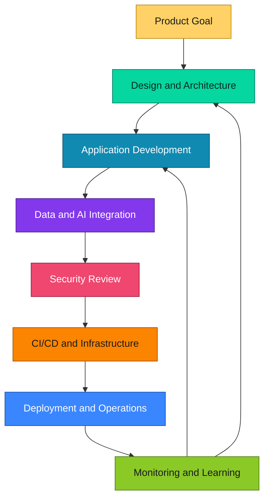
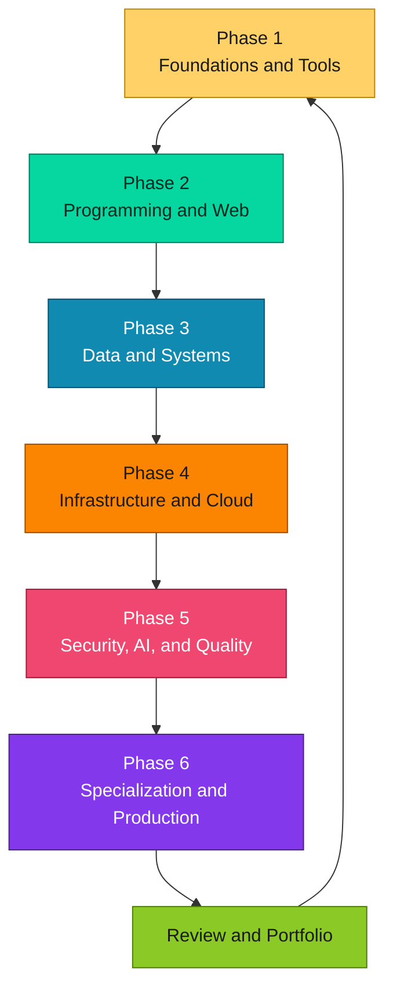

    

<h1 align="center">FROM CODE TO CLOUD TO CIRCUIT</h1>
<h3 align="center">THE FULL-SPECTRUM TECHNICAL CAPABILITY GUIDE</h3>

    

    

  

# How Full-Spectrum Tech Skills Turn AI From a Threat Into a Tool

If you spend any time online, you have probably seen the headlines: "AI Will Replace Coders," "AI Will Take White-Collar Jobs," "AI Is Coming for Your Career." The fear is understandable. But the evidence tells a different story. AI automates tasks, not jobs. It is powerful at pattern matching, but it lacks judgment, accountability, and the ability to handle novel situations. That gap is exactly where a new kind of professional thrives: the full-spectrum technical practitioner.

This is not about becoming an expert in everything. It is about developing broad working knowledge across software, systems, data, infrastructure, security, and hardware, plus production depth in two or three areas. People who learn this way do not compete with AI. They become the humans AI needs to function safely and effectively.

 

## Why AI Cannot Replace the Full-Spectrum Practitioner

AI systems operate on statistical correlation. They predict the next word, the next pixel, the next line of code. They do not understand cause and effect. They do not have a reliable model of the world. They fail on edge cases, novel problems, and anything that requires real accountability.

A full-spectrum practitioner handles exactly those gaps. They can trace a failure across the browser, the API, the database, the network, and the host. They can review AI-generated code for security flaws. They can challenge an AI-drafted system design, spot missing dependencies, and test the design against real constraints. When AI produces a plausible but wrong answer, the full-spectrum learner knows how to verify it.

This is the difference between passive acceptance and active oversight. Studies show that people who accept AI outputs without scrutiny perform 23 percent worse on analytical tasks. The full-spectrum practitioner does not fall into that trap. They use AI as a tool, not an oracle.

 

## The Skills That Matter Most

The "From Code to Cloud to Circuit" learning path builds skills that map directly to what AI cannot do. Here are the key areas:

- **Cross-layer debugging:** Tracing problems across application code, databases, networks, containers, and cloud infrastructure.
- **Architecture trade-off analysis:** Comparing monoliths, microservices, and serverless designs, and knowing when each makes sense.
- **Secure design:** Applying authentication, encryption, and threat modeling before vulnerabilities appear.
- **End-to-end delivery:** Taking a product from requirements to deployment and operation, with tests, pipelines, and monitoring.
- **Governance and oversight:** Designing the review gates, audit trails, and escalation protocols that keep organizations accountable.

These are not abstract skills. They come from shipping real systems, handling failures, and reviewing code with attention to correctness and security. They are the skills that let you govern AI-assisted work rather than be displaced by it.

 

## AI Needs a Human in the Loop. Be That Human.

The law does not recognize algorithms as legal persons. When an AI makes a mistake in healthcare, finance, aviation, or civil engineering, liability cascades to a human being. Regulators demand meaningful human review. Courts demand a rationale that a human can explain and defend.

Full-spectrum practitioners are prepared for that role. They understand governance because they have built CI/CD pipelines with quality gates. They have written infrastructure as code with security controls. They have operated systems with monitoring and incident response. They know when to automate a bounded task and when to keep a human in the loop.

This judgment is not soft. It is hard-earned. And it is exactly what employers pay for as routine cognitive work becomes commoditized.

 

## The Economics Favor Augmentation, Not Automation

The smartest organizations are not replacing people with AI. They are augmenting people with AI. This is not altruism. It is economics. Automation reduces costs, but that gain is finite. Augmentation expands capabilities, and that gain is unlimited.

Full-spectrum practitioners are perfectly positioned for augmentation. They can decompose jobs into tasks, automate the routine parts, and elevate the human elements. They can use AI to generate first drafts while applying domain expertise to validate, correct, and integrate. They can preserve cognitive diversity by using multiple models and structuring teams to challenge outputs.

These are the scarcity assets that command premium compensation. When everyone can generate a report in five seconds, the value shifts to the person who can ask the right questions, spot flawed assumptions, and weave disparate threads into a coherent strategy.

 

## Adaptability Is Your Safety Net

The only constant in technology is change. Full-spectrum practitioners learn new tools quickly because they understand fundamentals. They can move between languages, platforms, and domains. They can read research papers, evaluate new AI capabilities, and adjust their workflows accordingly. They are not locked into a single tool or role.

This adaptability makes them less vulnerable to displacement and more capable of leading through technological change. They are the integrators who turn AI output into reliable, valuable work. They are the human-in-the-loop that AI requires, the accountable decision-maker that law and regulation demand, and the partner that makes AI useful rather than dangerous.

 

## The Bottom Line

AI is not coming for your job. It is coming for your tasks. The people who thrive will be those who understand how to work with AI, not against it. They will have broad technical knowledge, production depth in a few areas, and the judgment to know when to trust the machine and when to trust themselves.

The "From Code to Cloud to Circuit" path is one way to build that capability. It is not about becoming an expert in everything. It is about becoming the kind of professional who can build, review, secure, deploy, and improve systems while knowing when to bring in specialist help. That is how you turn AI from a threat into a tool. And that is how you stay irreplaceable in a changing job market.

    

<h1 align="center">WHAT HAPPENS WHEN AN INDIVIDUAL OR A TEAM LEARNS THE COMPLETE TECHNICAL STACK?</h1>

  
 
## 1. Purpose and Scope

This document explains what happens when a person or a group learns the technical stack and skills described in this complete curriculum. It does not repeat every chapter or topic. It explains the practical capability that results from combining all areas into one learning path.

Several topics appear across multiple areas. Linux appears in systems, operations, cloud, and security. Git appears in programming, collaboration, and delivery. Containers and orchestration appear in infrastructure, operations, cloud, and system design. Database topics appear in application development, data work, and system design. This document treats repeated topics as one capability. It uses capability names rather than conflicting chapter numbers.

The key assumption is simple: learning means studied, practiced, and applied in real projects. Watching videos or collecting certificates is not treated as competence.

 

## 2. Executive Summary

Learning the full set of technical areas gives a person rare breadth across the software and systems lifecycle. It creates a practitioner who can move between application code, data storage, operating systems, networks, cloud infrastructure, security controls, automation, architecture, and user-facing design.

It does not create an instant expert in every field. Real expertise still requires production experience, repeated practice, failure handling, and judgment. The realistic outcome is a full-spectrum practitioner with broad working knowledge and production depth in two or three areas.

For a group, the outcome is stronger. A team that covers these areas can own a product from idea to operation with fewer handoff gaps. It can design, build, test, secure, deploy, monitor, and improve a system. It can also communicate across roles because the team shares a common technical language.

The central value is not knowing every tool. The central value is technical judgment across layers. The learner knows why a system fails, where to look, which trade-off matters, and when to bring in a specialist.

 

## 3. Capability Clusters Overview

The learning areas can be grouped into capability clusters. The table below shows what each cluster adds and what a learner can produce after real practice.

| Capability cluster | Learning areas included | Capability gained | Typical output | Realistic depth after full study |
|---|---|---|---|---|
| Computing foundations and algorithms | Computer science foundations, data structures and algorithms | Mathematical reasoning, complexity analysis, data structures, algorithm selection | Efficient code, algorithmic solutions, complexity notes | Working to production depth |
| Systems and low-level programming | C programming, C++ development, Linux and Bash | Memory model, pointers, processes, system calls, shell automation, performance awareness | System tools, scripts, low-level modules, debugging notes | Working depth, production in selected areas |
| Core application languages | Python, Java, Go, Rust, PHP | Multi-language programming, object design, concurrency, error handling, package management | Services, libraries, scripts, APIs, backend modules | Working depth across languages, production in one or two |
| Web, UI, and cross-platform development | HTML and CSS, JavaScript, TypeScript, Flutter and Dart, design systems | Browser behavior, responsive UI, typed frontend code, cross-platform mobile and desktop UI, reusable components | Web interfaces, mobile apps, component libraries, design tokens | Working to production depth |
| Data, storage, and persistence | Database development, Python data analysis, data structures and algorithms | Relational and NoSQL modeling, queries, indexing, transactions, data processing | Schemas, queries, migrations, data pipelines, reports | Working to production depth |
| Infrastructure, automation, and operations | Git and GitHub, Docker, Kubernetes, virtualization and containerization, DevOps, cloud computing, Terraform, Ansible | Version control, containers, orchestration, infrastructure as code, configuration management, cloud deployment | Repositories, CI/CD pipelines, infrastructure code, cluster deployments, runbooks | Working to production depth |
| Networking and distributed systems | Network engineering, system design, software design and architecture | Protocol behavior, routing and switching basics, distributed trade-offs, service boundaries, resilience | Network designs, architecture diagrams, service maps, failure analysis | Working depth, production in selected areas |
| AI and data intelligence | AI engineering, Python machine learning, selected C++ AI topics | Data preparation, model training, evaluation, deployment, MLOps basics | Models, evaluation reports, inference services, monitoring plans | Working depth, production in one specialty |
| Security and governance | Cybersecurity, DevSecOps topics, code review, compliance topics | Threat modeling, secure coding, identity, encryption basics, risk management, audit readiness | Threat models, secure pipelines, incident reports, policies | Working depth, production in selected areas |
| Quality, review, and product design | Code review, software design and architecture, design systems | Review discipline, architecture decision records, component consistency, accessibility awareness | Review checklists, ADRs, design system documentation, quality gates | Working to production depth |
| Hardware and mechatronics | Mechatronics | Sensors, actuators, control basics, embedded programming, hardware and software integration | Robot prototypes, sensor pipelines, control logic, hardware documentation | Working depth, production in selected areas |

 

## 4. What Learning Everything Realistically Means

A person cannot become an expert in every area at the same time. That would conflict with how expertise develops. The practical meaning of learning everything is:

1. Broad working knowledge across every cluster.
2. Production depth in two or three clusters.
3. The ability to read, discuss, and integrate work from other clusters.
4. The habit of checking assumptions with specialists when risk is high.

| Depth level | Meaning | What the learner can do |
|---|---|---|
| Awareness | Knows the concepts and vocabulary | Follows discussions and asks useful questions |
| Working | Has built small to medium examples | Contributes with guidance and reviews |
| Production | Has shipped and operated real systems | Owns work, handles failures, makes trade-offs |
| Expert | Has repeated production experience in complex contexts | Sets standards, mentors others, handles ambiguity |

The apparent contradiction in "learn everything" is resolved by this model. Full-spectrum learning means high breadth plus selective depth. It does not mean equal mastery everywhere.

 

## 5. Capability Outcomes

After genuine study and project work, the learner can do the following.

| Capability | What the learner can do | Why it matters | Evidence of capability |
|---|---|---|---|
| End-to-end delivery | Take a small product from requirements to deployment and operation | Reduces dependency on many separate handoffs | A deployed application with tests, pipeline, monitoring, and documentation |
| Cross-layer debugging | Trace issues across browser, API, database, network, container, and host | Finds root causes faster than layer-by-layer guessing | Incident notes showing diagnosis across layers |
| Architecture trade-off analysis | Compare monolith, microservices, serverless, and distributed patterns | Avoids over-engineering and wrong technology choices | Architecture decision record with alternatives and consequences |
| Secure design | Apply authentication, authorization, input validation, encryption, and threat modeling | Reduces common vulnerabilities early | Threat model, secure code review, dependency scan results |
| Automation | Use shell, Python, Git hooks, CI/CD, Terraform, and Ansible | Reduces manual error and repeat work | Reproducible pipeline and infrastructure code |
| Data handling | Design schemas, write queries, use indexes, and process data | Prevents slow queries and fragile data flows | Schema migration, query plan review, data pipeline |
| AI integration | Prepare data, train models, evaluate results, and deploy inference services | Connects AI work to real product needs | Model card, evaluation report, inference service |
| Systems awareness | Reason about memory, processes, system calls, and performance | Writes code that behaves well under load | Profiling report and memory analysis |
| Network awareness | Understand protocols, routing, DNS, firewalls, and load balancing | Diagnoses connectivity and latency problems | Packet capture analysis and network diagram |
| Hardware awareness | Connect software to sensors, actuators, and embedded constraints | Supports mechatronics and IoT work | Working prototype with control logic |
| Design consistency | Build reusable UI components and documentation | Improves product quality and team speed | Component library and usage guide |
| Review discipline | Give and receive technical feedback | Improves quality and spreads knowledge | Review comments, checklists, and merged improvements |

 

## 6. The Individual Practitioner Profile

A person who completes the full path with real projects becomes a **full-spectrum technical practitioner**. This is not a single job title. It is a capability profile.

The individual can:

- Write code in several languages and choose a language based on constraints.
- Read and modify system-level code when needed.
- Design a database schema and explain query performance.
- Build a web or mobile interface with accessible components.
- Containerize an application and deploy it to a cloud environment.
- Write infrastructure as code and configuration management.
- Set up a CI/CD pipeline with tests and security checks.
- Analyze a network problem and read a packet capture.
- Apply security controls and explain residual risk.
- Train and evaluate a basic machine learning model.
- Work with sensors, actuators, and embedded constraints at a practical level.
- Review code with attention to correctness, security, performance, and maintainability.

The individual also knows their limits. They can say: "This needs a database specialist", "This needs a security auditor", or "This needs a hardware engineer". That judgment is a sign of maturity, not weakness.

| Individual profile area | Observable behavior | Limit |
|---|---|---|
| Breadth | Can join any technical discussion and contribute | Not equally deep in every area |
| Integration | Connects frontend, backend, data, infrastructure, and security | Still needs team review for high-risk work |
| Debugging | Traces failures across layers | May need vendor or specialist support in rare failures |
| Delivery | Ships small to medium systems end to end | Large systems still need role specialization |
| Learning | Learns new tools quickly because fundamentals are strong | Tool churn still requires time |

 

## 7. The Group or Team Profile

A group that learns these areas together can form a cross-functional product and platform team. The group outcome is more valuable than the sum of individual outcomes because coverage can be distributed.

| Team function | Learning area coverage | Team outcome |
|---|---|---|
| Product engineering | Web, JavaScript, TypeScript, Python, Java, Go, Rust, PHP, Flutter | Builds user-facing and backend product features |
| Platform engineering | Linux, Docker, Kubernetes, Terraform, Ansible, cloud, DevOps | Provides reusable deployment and runtime platforms |
| Site reliability and operations | Linux, networking, DevOps, cloud, monitoring, Kubernetes | Operates systems, handles incidents, improves reliability |
| Security engineering | Cybersecurity, code review, DevSecOps, cloud security | Builds controls, reviews risk, responds to threats |
| Data and AI engineering | Database, Python data, AI engineering, MLOps | Builds data flows, models, and inference services |
| Architecture and design | System design, software architecture, design systems | Sets boundaries, patterns, and user experience standards |
| Embedded and mechatronics | C, C++, mechatronics, networking | Connects software to hardware and control systems |
| Quality and review | Code review, data structures and algorithms, testing, software design | Raises quality through review, tests, and standards |

The group can reduce handoff friction because members understand each other's constraints. A frontend developer who understands networking and security writes better API clients. A backend developer who understands Kubernetes and cloud cost designs better services. A security engineer who understands code review integrates controls earlier.

The main risk is role confusion. A group that says "everyone does everything" can create burnout and weak ownership. The group needs clear ownership, shared standards, and review paths.

 

## 8. Integrated Delivery Flow

The learning areas connect into one delivery flow. Foundations support languages. Languages support applications. Applications need data, infrastructure, security, and operations. Architecture and review connect the whole flow.

```mermaid
flowchart LR
  F[Foundations<br/>Math, DSA, CS]:::found --> P[Programming<br/>C, C++, Java, Python, Go, Rust, PHP]:::prog
  P --> W[Web and UI<br/>HTML, CSS, JS, TS, Flutter, Design Systems]:::web
  W --> D[Data<br/>SQL, NoSQL, Pipelines, AI]:::data
  D --> I[Infrastructure<br/>Linux, Docker, Kubernetes, Cloud, Terraform, Ansible]:::infra
  I --> S[Security<br/>Cybersecurity, DevSecOps, Review]:::sec
  S --> O[Operations<br/>DevOps, Monitoring, SRE]:::ops
  O --> A[Architecture<br/>System Design, Software Architecture]:::arch
  A --> P

  classDef found fill:#FFD166,stroke:#B8860B,color:#1A1A1A
  classDef prog fill:#06D6A0,stroke:#007A5E,color:#06281F
  classDef web fill:#118AB2,stroke:#0B4F6C,color:#FFFFFF
  classDef data fill:#8338EC,stroke:#4B1F8A,color:#FFFFFF
  classDef infra fill:#FB8500,stroke:#9C4E00,color:#1A1A1A
  classDef sec fill:#EF476F,stroke:#9E1B3A,color:#FFFFFF
  classDef ops fill:#3A86FF,stroke:#1B4FA8,color:#FFFFFF
  classDef arch fill:#8AC926,stroke:#4F7A12,color:#1A1A1A
```

 

## 9. Recommended Learning Sequence and Checkpoints

A full path should be sequenced. Jumping directly into advanced tools without foundations creates fragile knowledge. The sequence below balances breadth and depth.

| Phase | Focus | Main areas | Checkpoint evidence |
|---|---|---|---|
| 1 | Foundations and tools | Computer science foundations, data structures and algorithms, Linux and Bash, Git and GitHub | Algorithm solutions, shell scripts, clean Git history |
| 2 | Core programming and web | Python, Java, C, C++, Go, Rust, PHP, HTML and CSS, JavaScript, TypeScript | Working programs, web interface, tests, code review |
| 3 | Data and systems | Database, Python data, data structures and algorithms, system design basics | Schema design, queries, data report, architecture sketch |
| 4 | Infrastructure and cloud | Docker, Kubernetes, virtualization, DevOps, cloud, Terraform, Ansible | Containerized app, cloud deployment, infrastructure code, CI/CD pipeline |
| 5 | Security, AI, and quality | Cybersecurity, AI engineering, code review, software architecture | Threat model, model evaluation, review checklist, architecture decision record |
| 6 | Specialization and production | Selected deep area plus mechatronics or product design as needed | Production-grade project with monitoring, security, and documentation |

 

## 10. Assessment and Evidence

Competence should be judged by evidence, not by course completion.

| Capability area | Evidence of competence | Minimum acceptable evidence |
|---|---|---|
| Programming | Readable code, tests, error handling, reviews | A maintained project with tests and review comments |
| Data | Schema design, query optimization, migrations | A database project with query plans and migration files |
| Infrastructure | Reproducible deployment, infrastructure code, pipeline | A deployment that can be recreated from code |
| Security | Threat model, secure coding, dependency checks | A threat model and secure review notes |
| Architecture | Trade-off analysis, diagrams, decision records | An architecture decision record with alternatives and consequences |
| Operations | Monitoring, incident notes, runbooks | A runbook and one incident analysis |
| AI | Data preparation, evaluation, deployment | Model evaluation and inference service notes |
| Mechatronics | Working prototype with control logic | A prototype report with wiring and code |
| Design systems | Reusable components and documentation | A component library with usage guidance |
| Review | Constructive, specific, prioritized feedback | Review samples with accepted improvements |

 

## 11. Career Pathways and Role Fit

The full learning path does not replace specialization. It improves mobility and system judgment. The table below shows common role fits after full study with real projects.

| Role | Fit from the learning path | Typical scope | Depth needed |
|---|---|---|---|
| Full-stack engineer | Strong | Product features across frontend, backend, and database | Production depth in one stack |
| Platform engineer | Strong | Internal platforms, deployment, developer experience | Production depth in cloud, Kubernetes, infrastructure code |
| DevOps engineer | Strong | CI/CD, automation, infrastructure, operations | Production depth in pipelines and cloud |
| Site reliability engineer | Moderate to strong | Reliability, monitoring, incident response | Production depth in operations and networking |
| Cloud architect | Moderate | Cloud design, cost, security, migration | Production depth in one cloud and architecture |
| Security engineer | Moderate to strong | Secure design, review, monitoring, response | Production depth in security controls |
| Data engineer | Moderate | Data pipelines, storage, processing | Production depth in data systems |
| AI engineer | Moderate | Model training, evaluation, deployment | Production depth in machine learning and MLOps |
| Embedded or mechatronics engineer | Moderate | Hardware and software integration | Production depth in embedded systems |
| Software architect | Moderate to strong | System boundaries, patterns, trade-offs | Production depth in architecture and delivery |
| Design systems engineer | Strong | Component libraries, tokens, documentation | Production depth in UI engineering |
| Technical lead | Strong | Delivery ownership, review, mentoring | Production depth in one or two domains |

 

## 12. Risks, Limits, and Guardrails

| Risk | Why it happens | Guardrail |
|---|---|---|
| Breadth without depth | Trying to finish every area quickly | Require production depth in at least two areas |
| Tool churn | New tools appear constantly | Teach fundamentals and selection criteria |
| Security shortcuts | Security is treated as a final step | Build threat modeling and review into each phase |
| Cloud cost surprises | Infrastructure is created without cost controls | Add budgets, tagging, and cost review to cloud work |
| Burnout | "Learn everything" becomes an endless checklist | Use phases, rest periods, and portfolio goals |
| Role confusion in teams | Everyone claims every task | Define ownership, review paths, and escalation |
| Certification trap | Certificates replace project evidence | Require deployed work and incident analysis |
| Outdated knowledge | Old tutorials and stale tool versions | Use official documentation and versioned notes |
| Weak communication | Technical skill grows without writing practice | Require documentation, architecture decision records, and review writing |

 

## 13. Publishing Readiness Checklist

- Confirm the title, subtitle, and section headings match the website style guide.
- Verify all diagrams render correctly in the target publishing platform.
- Check that tables are readable on mobile and desktop.
- Remove duplicate chapter numbering and contradictory topic labels from published text.
- Confirm no em dashes, emojis, or promotional jargon remain.
- Check technical terms against current official documentation.
- Add internal links to related learning paths and role pages.
- Add accessibility labels to diagrams and tables where the platform supports them.
- Include a version date and change log.
- Review the document for plain English and short sentence structure.

 

## 14. Conclusion

Learning the complete technical stack creates a rare profile: a practitioner who can connect code, data, systems, infrastructure, security, AI, design, and hardware. The individual gains breadth, debugging range, delivery ability, and technical judgment. The group gains a cross-functional team that can own a product from idea to operation.

The outcome is not "expert in everything". The outcome is full-spectrum capability with selective depth. That is more useful, more realistic, and more valuable in real work. The learner becomes an integrator who can build, review, secure, deploy, and improve systems, and who knows when to bring in deeper specialist help.

    
 
# PYTHON PROGRAMMING MASTERY

CLICK HERE TO READ MORE.

  
 

## Table of Contents

1. Introduction
2. Why Learn Python
3. Curriculum Architecture
4. Volume I: Python Fundamentals and Core Programming
5. Volume II: Advanced Python Development
6. Volume III: Specialization Domains
7. Volume IV: Professional Development and Best Practices
8. Optional Specialization: Network and Systems Administration
9. Puzzle-Based Learning and Skill Assessment
10. Consolidated Topic Coverage Matrix
11. Frequently Asked Questions
12. Appendices
13. Conclusion

 

## 1. Introduction

Python is widely regarded as a gateway to programming. It has earned a reputation as an accessible language because of its simplicity, versatility, and extensive ecosystem. Created by Guido van Rossum and first released in 1991, Python has grown steadily to become one of the most widely used programming languages today. Its clear, readable syntax, combined with its expansive libraries and frameworks, has made it the preferred language for beginners and experienced professionals alike.

From web development and automation to artificial intelligence and scientific computing, Python plays a central role in numerous industries. This document presents a complete developer roadmap that guides learners from absolute beginner level through to professional mastery. The curriculum is organized into four volumes, each containing parts and chapters that build on one another. An optional specialization in network and systems administration is also included.

The roadmap follows a progressive learning path. Foundational concepts are established first, followed by intermediate topics, domain specializations, and finally professional engineering practices. Each chapter includes clear learning outcomes, topic coverage, and where appropriate, practical projects.

 

## 2. Why Learn Python

Choosing a programming language is an important first step in any development journey. Python stands out as one of the most accessible yet capable languages available. The following ten reasons explain why Python is worth learning.

### 2.1 Beginner-Friendly and Easy to Learn

Python was designed with readability in mind. Its syntax closely mirrors natural language, making it easier for new programmers to grasp core concepts. Compared to languages such as C++ or Java, Python does not require understanding complex syntax rules. This allows beginners to focus on learning programming logic rather than wrestling with intricate code structures.

### 2.2 Versatility Across Multiple Domains

Python is suitable for a wide variety of applications:

| Domain | Tools and Frameworks |
|--------|---------------------|
| Web Development | Django, Flask |
| Data Science | Pandas, NumPy, Matplotlib |
| Machine Learning and AI | TensorFlow, Keras, PyTorch, Scikit-learn |
| Automation and Scripting | Standard library, subprocess, os |
| Desktop Applications | Tkinter, PyQt |
| Systems Administration | PySNMP, Boto, Paramiko |

### 2.3 Strong Career Opportunities

Learning Python opens doors to a wide range of career opportunities across industries such as technology, finance, healthcare, and research. Organizations including Google, Meta, NASA, and Spotify rely heavily on Python for various applications. Salaries for Python developers remain competitive in the job market.

### 2.4 Comprehensive Libraries and Frameworks

Python's rich ecosystem of libraries and frameworks is a major reason for its widespread adoption. The Python Package Index (PyPI) hosts hundreds of thousands of packages, allowing developers to add functionality to their applications easily. Libraries such as NumPy for numerical computing, OpenCV for computer vision, and Flask for web development enable developers to build complex systems efficiently.

### 2.5 Strong Community and Support

Python's active, global community is one of its greatest strengths. Whether you are seeking advice on a problem or learning how to implement a new feature, support is readily available. Numerous forums, Stack Overflow discussions, blogs, and free resources exist to help resolve issues quickly. The community also contributes to Python's continual improvement and documentation, making the language more approachable for learners.

### 2.6 Cross-Platform and Open Source

Python is cross-platform, meaning Python programs can run on Windows, macOS, and Linux without modification. Its open-source nature ensures that developers can freely use, modify, and distribute Python without licensing costs. This has led to widespread adoption in both academic and professional settings.

### 2.7 Rapid Development and Prototyping

Python is known for its quick development cycle. It allows developers to build functional prototypes in a short time. Whether designing an application, a data model, or an automation script, Python's simplicity enables faster iteration and testing. This makes it a preferred language for startups, research projects, and rapid prototyping.

### 2.8 Scalability and Performance

Although Python is an interpreted language and therefore slower than compiled languages such as C or Java, it can handle substantial workloads when used with the right tools. Libraries such as Dask and Celery support distributed computing. For performance-critical applications, Python can integrate seamlessly with C and C++ modules to optimize speed.

### 2.9 Integration with Other Technologies

Python excels at integrating with other programming languages and technologies. Python can call code written in C, C++, Java, and more, allowing developers to leverage existing systems or optimize performance when necessary. It also has built-in support for interacting with APIs, databases (SQL and NoSQL), and cloud platforms, making it suitable for modern, distributed systems.

### 2.10 Open Source, Free, and Continuously Improving

Python's open-source nature means it is freely available for anyone to use and contribute to. Over the years, Python has been continually refined and improved. The Python Software Foundation (PSF) manages the language's development, ensuring it remains relevant and evolves to meet the demands of the programming community.

 

## 3. Curriculum Architecture

The curriculum is organized into four volumes and an optional specialization track. The following diagram illustrates the complete structure of the Python Developer Roadmap.

```mermaid
%%{init: {'theme': 'dark', 'themeVariables': {'primaryColor': '#1e293b', 'primaryTextColor': '#f1f5f9', 'primaryBorderColor': '#475569', 'lineColor': '#94a3b8', 'secondaryColor': '#0f172a', 'tertiaryColor': '#1e293b'}}}%%
flowchart TD
    A["Python Developer Roadmap"] --> B["Volume I<br/>Python Fundamentals"]
    A --> C["Volume II<br/>Advanced Python"]
    A --> D["Volume III<br/>Specialization Domains"]
    A --> E["Volume IV<br/>Professional Practices"]
    A --> F["Optional Specialization<br/>Network and Systems Administration"]
    A --> G["Puzzle-Based Learning<br/>Skill Assessment"]

    B --> B1["Part 1<br/>Introduction to Python"]
    B --> B2["Part 2<br/>Intermediate Concepts"]
    B1 --> B1a["Ch 1-4"]
    B2 --> B2a["Ch 5-7"]

    C --> C1["Part 3<br/>Advanced Language Features"]
    C --> C2["Part 4<br/>File Handling and Persistence"]
    C1 --> C1a["Ch 8-10"]
    C2 --> C2a["Ch 11-12"]

    D --> D1["Part 5<br/>Scientific Computing"]
    D --> D2["Part 6<br/>Web Development"]
    D --> D3["Part 7<br/>Machine Learning"]
    D --> D4["Part 8<br/>GUI Development"]
    D1 --> D1a["Ch 13-15"]
    D2 --> D2a["Ch 16-17"]
    D3 --> D3a["Ch 18-19"]
    D4 --> D4a["Ch 20"]

    E --> E1["Part 9<br/>Software Engineering"]
    E --> E2["Part 10<br/>Workflow and Tools"]
    E1 --> E1a["Ch 21-23"]
    E2 --> E2a["Ch 24-25"]

    style A fill:#1e3a5f,stroke:#60a5fa,color:#f1f5f9
    style B fill:#1e3a5f,stroke:#60a5fa,color:#f1f5f9
    style C fill:#1e3a5f,stroke:#60a5fa,color:#f1f5f9
    style D fill:#1e3a5f,stroke:#60a5fa,color:#f1f5f9
    style E fill:#1e3a5f,stroke:#60a5fa,color:#f1f5f9
    style F fill:#1e3a5f,stroke:#60a5fa,color:#f1f5f9
    style G fill:#1e3a5f,stroke:#60a5fa,color:#f1f5f9
```

### Volume and Chapter Overview

| Volume | Part | Chapters | Focus Area | Recommended Duration |
|--------|------|----------|------------|---------------------|
| I | 1 | 1-4 | Python basics, syntax, control flow, functions | 6-8 weeks |
| I | 2 | 5-7 | Data structures, OOP, exception handling | 5-7 weeks |
| II | 3 | 8-10 | Functional programming, iterators, metaprogramming | 4-6 weeks |
| II | 4 | 11-12 | File I/O, serialization, persistence | 3-4 weeks |
| III | 5 | 13-15 | NumPy, Pandas, visualization | 6-8 weeks |
| III | 6 | 16-17 | Web development with Django and Flask | 6-8 weeks |
| III | 7 | 18-19 | Machine learning and deep learning | 10-14 weeks |
| III | 8 | 20 | Desktop GUI development | 4-6 weeks |
| IV | 9 | 21-23 | Testing, packaging, performance | 5-7 weeks |
| IV | 10 | 24-25 | Version control, deployment | 3-4 weeks |
| Optional | 11 | 26-36 | Network and systems administration | 8-10 weeks |
| Optional | 12 | — | Puzzle-based learning and skill assessment | 2-3 weeks |

 

## 4. Volume I: Python Fundamentals and Core Programming

This volume establishes the foundation of Python programming. It covers everything a beginner needs to write functional Python programs.

### Part 1: Introduction to Python Programming

#### Chapter 1: Getting Started with Python

| Topic | Description |
|-------|-------------|
| What is Python | History, design philosophy, and use cases |
| Installation and Setup | Installing Python on Windows, macOS, and Linux; configuring IDLE and VS Code |
| First Program | Writing and running a "Hello, World" program |
| Variables and Data Types | Integers, floats, strings, booleans, and type conversion |
| Input and Output | Using `input()` and `print()` effectively |
| Comments and Documentation | Single-line, inline, and multi-line comments; docstrings |

#### Chapter 2: Basic Syntax and Operations

| Topic | Description |
|-------|-------------|
| Arithmetic Operators | Addition, subtraction, multiplication, division, floor division, modulus, exponentiation |
| Comparison Operators | Equal to, not equal to, greater than, less than, and chained comparisons |
| Logical Operators | `and`, `or`, `not`; short-circuit evaluation |
| Bitwise Operators | AND, OR, XOR, NOT, left shift, right shift |
| Assignment Operators | Standard and in-place operators |
| Ternary Operator | Conditional expressions in a single line |
| Identity and Membership Operators | `is`, `is not`, `in`, `not in` |
| Operator Overloading | Defining operator behaviour for custom classes |
| Operator Functions | Using the `operator` module |
| `any()` and `all()` | Evaluating iterables for truthiness |

**Key clarification:** In Python, `a += b` is not always equivalent to `a = a + b`. For mutable objects such as lists, `+=` modifies the object in place, while `a = a + b` creates a new object. This distinction matters for understanding side effects and memory behaviour.

**Key clarification:** The `==` operator compares values, while the `is` operator compares object identity. Two distinct objects can be equal in value but not identical in memory.

#### Chapter 3: Control Flow and Loops

| Topic | Description |
|-------|-------------|
| `if`, `elif`, `else` | Conditional branching |
| `for` Loops | Iterating over sequences and iterables |
| `while` Loops | Condition-based repetition |
| `break`, `continue`, `pass` | Loop control statements |
| `else` with Loops | Executing code when a loop completes without `break` |
| `range()` | Generating numeric sequences |
| Looping Techniques | `enumerate()`, `zip()`, `reversed()`, `sorted()` |
| Pattern Printing | Pyramid and triangle patterns using nested loops |
| Chained Comparisons | Writing `0 < x < 10` in Python |

**Key clarification:** In Python 2, `range()` returned a list and `xrange()` returned a lazy sequence. In Python 3, `range()` returns an immutable sequence object, and `xrange()` no longer exists.

**Key clarification:** Python 3.10 introduced the `match`/`case` statement, which provides pattern-matching functionality similar to `switch` statements in other languages. For earlier versions, dictionaries of functions or `if`/`elif` chains are common alternatives.

#### Chapter 4: Functions and Modular Programming

| Topic | Description |
|-------|-------------|
| Defining Functions | `def`, parameters, return values |
| Arguments | Positional, keyword, default, `*args`, `**kwargs` |
| Returning Multiple Values | Returning tuples and unpacking |
| Scope and Lifetime | Local, global, and nonlocal variables |
| First-Class Functions | Assigning functions to variables, passing as arguments |
| Higher-Order Functions | `map()`, `filter()`, `reduce()` |
| Lambda Functions | Anonymous inline functions |
| Closures | Capturing enclosing scope variables |
| Decorators | Modifying function behaviour without changing source code |
| Decorators with Parameters | Decorator factories |
| Memoization | Caching function results using decorators |
| Partial Functions | Using `functools.partial()` |
| `yield` vs `return` | Generator functions versus standard functions |
| Recursion | Functions calling themselves; base cases and recursion limits |
| Modules | Creating and importing modules |
| Packages | Organizing modules into packages |

**Key clarification:** The `range()` function does not return an iterator. It returns an immutable sequence object that is iterable. An iterator is created when `iter()` is called on the range object. This distinction matters because iterators are consumed once, while range objects can be iterated multiple times.

### Part 2: Intermediate Python Concepts

#### Chapter 5: Data Structures in Python

| Topic | Description |
|-------|-------------|
| Lists | Creation, indexing, slicing, methods, comprehensions |
| Tuples | Immutability, packing and unpacking, named tuples |
| Sets | Operations, uniqueness, set comprehensions |
| Dictionaries | Key-value pairs, methods, comprehensions, merging |
| Choosing the Right Structure | Performance and use-case considerations |
| Nested Structures | Lists of dictionaries, dictionaries of lists |
| Sorting and Searching | `sorted()`, `sort()`, `bisect` |

#### Chapter 6: Object-Oriented Programming

| Topic | Description |
|-------|-------------|
| Classes and Objects | Defining classes, creating instances |
| Members | Attributes (instance and class) and methods |
| Constructors and Destructors | `__init__()` and `__del__()` |
| Data Hiding | Name mangling with double underscores |
| Object Printing | `__str__()` and `__repr__()` methods |
| Inheritance | Base and derived classes; `super()` and `issubclass()` |
| Multiple Inheritance | Method resolution order (MRO) |
| Polymorphism | Duck typing and method overriding |
| Abstract Base Classes | Using the `abc` module |
| Mixins | Reusable class components |
| Class Variables vs Instance Variables | Shared state versus per-object state |
| Class Methods | `@classmethod` decorator; alternative constructors |
| Static Methods | `@staticmethod` decorator; utility functions |
| Properties | `@property` decorator for getters, setters, and deleters |
| Descriptors | Customizing attribute access |
| Metaclasses | Creating classes dynamically; `type` as the default metaclass |
| Reflection | `getattr()`, `setattr()`, `hasattr()`, `dir()` |
| Garbage Collection | Reference counting and cyclic garbage collection |
| Singleton Pattern | Ensuring a single instance using metaclasses or decorators |

#### Chapter 7: Error and Exception Handling

| Topic | Description |
|-------|-------------|
| `try`, `except`, `else`, `finally` | Structured error handling |
| Raising Exceptions | Using `raise` to signal errors |
| Built-in Exceptions | `ValueError`, `TypeError`, `KeyError`, `IndexError`, `FileNotFoundError` |
| Exception Hierarchy | Understanding the base `Exception` class |
| Clean-up Actions | Using `finally` for resource cleanup |
| Context Managers | The `with` statement for automatic resource management |
| User-Defined Exceptions | Creating custom exception classes |
| Chaining Exceptions | Using `raise ... from ...` |
| Best Practices | Avoiding bare `except` clauses; logging exceptions |
| Re-raising Exceptions | Propagating exceptions after partial handling |
| NZEC Errors | Understanding Non-Zero Exit Code errors in competitive programming platforms |

**Key clarification:** NZEC (Non-Zero Exit Code) is not a Python exception type. It is an error reported by competitive programming platforms when a program terminates with a non-zero exit status. Common causes include unhandled exceptions, recursion limit exhaustion, or memory errors.

 

## 5. Volume II: Advanced Python Development

This volume deepens the learner's understanding of Python's advanced features and data persistence mechanisms.

### Part 3: Advanced Language Features

#### Chapter 8: Functional Programming in Python

| Topic | Description |
|-------|-------------|
| Pure Functions and Side Effects | Functional programming principles |
| `map()`, `filter()`, `reduce()` | Functional building blocks |
| List Comprehensions | Concise transformation and filtering |
| Generator Expressions | Lazy evaluation |
| `functools` Module | `partial`, `lru_cache`, `total_ordering` |
| `operator` Module | Functional alternatives to operators |
| Single Dispatch | Generic functions with `functools.singledispatch` |
| Immutability | Working with immutable data structures |

#### Chapter 9: Iterators, Generators, and Coroutines

| Topic | Description |
|-------|-------------|
| Iterables vs Iterators | Understanding the distinction and the iteration protocol |
| `__iter__()` and `__next__()` | Implementing custom iterators |
| Generators | Creating generators with `yield` |
| Generator Expressions | Lazy evaluation using parenthesized expressions |
| `itertools` Module | `count`, `cycle`, `repeat`, `chain`, `product`, `permutations`, `combinations` |
| Coroutines | Cooperative multitasking using `async`/`await` |
| Asynchronous Programming | `asyncio` and event-driven architecture |

#### Chapter 10: Metaprogramming and Reflection

| Topic | Description |
|-------|-------------|
| The `ast` Module | Parsing and analyzing Python code |
| Dynamic Code Execution | `exec()` and `eval()` |
| Introspection | Inspecting objects at runtime |
| Reflection | `getattr()`, `setattr()`, `hasattr()`, `dir()` |
| Decorators | Creating and using decorators |
| Descriptors | Controlling attribute access |
| Metaclasses | Creating classes dynamically |
| Monkey Patching | Modifying classes at runtime |

### Part 4: File Handling and Data Persistence

#### Chapter 11: File Input and Output

| Topic | Description |
|-------|-------------|
| Reading from Files | `open()`, `read()`, `readline()`, `readlines()` |
| Writing to Files | `write()`, `writelines()` |
| File Modes | `r`, `w`, `a`, `b`, `+` |
| Working with Paths | `os.path` and `pathlib` |
| Directory Operations | Creating, listing, and removing directories |
| CSV and JSON Files | Reading and writing structured data |
| Context Managers | Using `with` for automatic file closing |

#### Chapter 12: Data Serialization and Storage

| Topic | Description |
|-------|-------------|
| JSON | Encoding and decoding JSON data |
| Pickle | Serializing and deserializing Python objects |
| CSV | Reading and writing tabular data |
| XML | Parsing and generating XML |
| SQLite | Embedded database storage |
| Shelve | Persistent dictionary storage |
| Compression | Working with ZIP, GZIP, and TAR files |

 

## 6. Volume III: Specialization Domains

This volume allows learners to specialize in high-demand domains: data science, web development, machine learning, and desktop applications.

### Part 5: Scientific Computing and Data Analysis

#### Chapter 13: Numerical Computing with NumPy

| Topic | Description |
|-------|-------------|
| Introduction to NumPy | Arrays, vectorization, and performance benefits |
| Creating Arrays | `array()`, `zeros()`, `ones()`, `arange()`, `linspace()` |
| Data Type Objects (dtype) | Specifying and converting data types |
| Indexing and Slicing | Accessing and modifying array elements |
| Iterating Over Arrays | `nditer()` and vectorized operations |
| Binary Operations | Element-wise arithmetic, broadcasting |
| Linear Algebra | Matrix multiplication, determinants, eigenvalues |
| Sorting, Searching, and Counting | `sort()`, `argsort()`, `where()`, `count_nonzero()` |

#### Chapter 14: Data Analysis with Pandas

| Topic | Description |
|-------|-------------|
| Introduction to Pandas | Series and DataFrame objects |
| Creating DataFrames | From dictionaries, lists, CSV files, and databases |
| Selecting and Indexing | `loc`, `iloc`, boolean indexing |
| Dealing with Rows and Columns | Adding, removing, and renaming |
| Handling Missing Data | `isna()`, `fillna()`, `dropna()` |
| Conversion Functions | `astype()`, `to_numeric()`, `to_datetime()` |
| Iterating Over DataFrames | `iterrows()`, `itertuples()`, vectorized operations |
| Data Analysis | Grouping, aggregation, merging, and pivoting |
| Reading and Writing Data | CSV, Excel, JSON, and SQL |

#### Chapter 15: Data Visualization

| Topic | Description |
|-------|-------------|
| Matplotlib | Line plots, bar charts, histograms, scatter plots; saving plots to files |
| Seaborn | Statistical data visualization with attractive defaults |
| Bokeh | Interactive web-based visualizations |
| Plotly | Interactive charts and dashboards |
| Chart Selection | Matching chart types to data and audience |
| Exploratory Data Analysis (EDA) | Summary statistics, distribution analysis, correlation |
| Scales of Measurement | Nominal, ordinal, interval, and ratio scales |
| Jupyter Notebook | Setting up and using Jupyter for interactive analysis |

### Part 6: Web Development with Python

#### Chapter 16: Web Development Fundamentals

| Topic | Description |
|-------|-------------|
| HTTP and the Web | Request-response cycle, methods, status codes |
| Introduction to Flask | Routing, views, templates, static files |
| Introduction to Django | MTV pattern, project structure, models, views, templates |
| URL Routing | Mapping URLs to views |
| Forms and Validation | Handling user input |
| Database Integration | ORM basics with Django and SQLAlchemy |
| Template Engines | Jinja2 and Django templates |
| Template Inheritance | Reusing templates with `` and `` |

#### Chapter 17: Advanced Web Development

| Topic | Description |
|-------|-------------|
| Django Models and Migrations | Schema evolution |
| Class-Based Views | Reusable view logic |
| User Authentication | Login, logout, registration, permissions |
| REST APIs | Building APIs with Django REST Framework and Flask-RESTful |
| Middleware and Signals | Request/response processing |
| Caching | Improving performance |
| Deployment | Serving Django/Flask applications in production |
| Security Best Practices | CSRF, XSS, SQL injection prevention |

**Practical projects for this part:**

| Project | Description |
|---------|-------------|
| To-Do Web App | CRUD operations, user authentication, and task management |
| Weather App | Integrating third-party APIs and displaying real-time data |
| IP Address Accounting App | Managing IP address records with full CRUD and database schema design |
| DHCP Integration | Extending the IP address app with DHCP network data and address pools |
| Apache Virtual Host Manager | Maintaining virtual host configurations through a Django interface |

### Part 7: Machine Learning and Artificial Intelligence

#### Chapter 18: Machine Learning Fundamentals

| Topic | Description |
|-------|-------------|
| Introduction to Machine Learning | Supervised, unsupervised, and reinforcement learning |
| History and Evolution | From statistics and data mining to modern ML |
| Data Preprocessing | Feature scaling, encoding categorical data, handling missing values |
| Model Evaluation | Train-test split, cross-validation, confusion matrix, accuracy, precision, recall, F1-score, ROC curves |
| Overfitting and Underfitting | Bias-variance trade-off; regularization |
| Optimal Probability Cutoff | Choosing the right threshold for classification |
| Imbalanced Datasets | Resampling techniques and their trade-offs |
| Simple Linear Regression | Fitting a line to data; interpreting coefficients |
| Multiple Linear Regression | Multiple predictors; multicollinearity and VIF |
| Polynomial Regression | Modeling nonlinear relationships |
| Regularization | Ridge, Lasso, and Elastic Net |
| Regression Diagnosis | Residual analysis, influence measures |
| Gradient Descent | Batch, stochastic, and mini-batch variants |
| Time-Series Forecasting | VAR and VARMAX models |
| Logistic Regression | Binary and multi-class classification; SGD; regularization |
| Naive Bayes | Probabilistic classification; SMS spam detection |
| K-Nearest Neighbors | Distance-based classification |
| Decision Trees | Tree-based learning; information gain |
| Support Vector Machines | Maximum margin classification; kernel trick |
| Random Forests | Ensemble of decision trees |
| Model Selection | Practical considerations for algorithm choice |
| K-Means Clustering | Partitioning data into clusters; finding optimal k |
| Hierarchical Clustering | Dendrogram-based clustering |
| DBSCAN | Density-based clustering |
| Principal Component Analysis (PCA) | Dimensionality reduction |
| Linear Discriminant Analysis (LDA) | Supervised dimensionality reduction |
| Kernel PCA | Nonlinear dimensionality reduction |
| Cross-Validation | K-fold, stratified K-fold, nested CV |
| Learning Curves | Diagnosing bias and variance |
| Validation Curves | Addressing overfitting and underfitting |
| Hyperparameter Tuning | GridSearch, RandomSearch |
| Ensemble Methods | Bagging, boosting, stacking, voting |
| AdaBoost, Gradient Boosting, XGBoost | Boosting algorithms and tuning parameters |
| Feature Importance | Random forest feature importance |
| Text Preprocessing | Tokenization, lowercasing, noise removal, stemming, lemmatization |
| Bag of Words (BoW) | Representing text as feature vectors |
| TF-IDF | Term frequency-inverse document frequency |
| Text Exploration | Frequency charts, word clouds, lexical dispersion, co-occurrence matrices |
| Text Similarity and Clustering | Cosine similarity, LSA |
| Topic Modeling | Latent Dirichlet Allocation (LDA), NMF |
| Sentiment Analysis | Classifying opinions in text |
| Word Embeddings | Word2Vec, GloVe |
| Deep NLP | Attention mechanisms and transformers |
| Content-Based Filtering | Recommending items similar to user preferences |
| Collaborative Filtering | User-based and item-based recommendation |
| Hybrid Approaches | Combining content and collaborative signals |

**Note on datasets:** The Boston Housing dataset has been removed from Scikit-learn due to ethical concerns. The California Housing dataset is the recommended alternative for regression exercises.

#### Chapter 19: Deep Learning and Neural Networks

| Topic | Description |
|-------|-------------|
| Artificial Neural Networks | Perceptrons, activation functions, backpropagation |
| Multilayer Perceptrons | Feedforward networks; MNIST classification |
| Restricted Boltzmann Machines | Generative stochastic networks |
| Autoencoders | Dimensionality reduction and denoising |
| Convolutional Neural Networks (CNNs) | Image classification on MNIST, CIFAR-10, and CelebA |
| Recurrent Neural Networks (RNNs) | Sequence modeling; LSTM cells |
| Transfer Learning | Leveraging pre-trained models |
| Generative Adversarial Networks (GANs) | Synthesizing new data; DCGAN, WGAN-GP |
| Reinforcement Learning | Markov decision processes, Q-learning, deep Q-learning |
| MLOps Introduction | Data lifecycle and model lifecycle |
| Model Saving | Using `pickle` and `joblib` |
| Cloud Essentials | AWS EC2, S3, RDS, IAM |
| SageMaker Pipelines | End-to-end ML automation |
| Model Deployment | Serving models via Flask and APIs |
| Monitoring | Tracking model performance in production |

**Practical machine learning projects:**

| Project | Description |
|---------|-------------|
| Linear Regression Assignment | Predicting car prices for market entry |
| Telecom Churn Prediction | Binary classification for customer retention |
| Lending Club Case Study | Credit risk assessment |
| Cancer Cell Classification | Binary classification with Scikit-learn |
| Movie Recommender System | Collaborative and content-based filtering |
| News Recommender System | NLP and recommendation techniques |
| Credit Card Fraud Detection | Imbalanced classification |
| Image Captioning | CNN plus RNN for accessibility |
| Sales Forecasting | Time-series prediction for pharmaceutical sales |
| Style Transfer with GANs | MRI image conversion |
| Gesture Recognition | Smart TV control with hand gestures |

### Part 8: GUI Application Development

#### Chapter 20: Desktop GUI Development

| Topic | Description |
|-------|-------------|
| GUI Libraries in Python | Overview of Tkinter, PyQt, Kivy, and wxPython |
| Event-Driven Programming | Understanding events, callbacks, and the event loop |
| Widgets | Labels, buttons, entry boxes, text areas, checkboxes, radio buttons, scales |
| Layout Management | `pack()`, `grid()`, and `place()` geometry managers |

**Tkinter core concepts:**

| Topic | Description |
|-------|-------------|
| Widget Classes and Hierarchy | Understanding the widget tree and window hierarchy |
| Configuration Options | Setting and querying widget options |
| Geometry Management | The problem of layout and how Tkinter solves it |
| Event Handling | Command callbacks and event bindings |
| Virtual Events | Custom event generation and multiple bindings |

**Tkinter basic widgets:**

| Widget | Description |
|--------|-------------|
| Frame | Container for grouping widgets; padding, borders, and styles |
| Label | Displaying text and images |
| Button | Text or image buttons; command callbacks and state management |
| Checkbutton | Toggle options with widget values |
| Radiobutton | Mutually exclusive options |
| Entry | Single-line text input; passwords and validation |
| Combobox | Dropdown selection with predefined values |

**Tkinter grid geometry manager:**

| Topic | Description |
|-------|-------------|
| Columns and Rows | Organizing widgets in a grid |
| Spanning Multiple Cells | `rowspan` and `columnspan` |
| Layout within Cells | Sticky options and alignment |
| Handling Resize | Responsive grid layouts |
| Padding | Internal and external padding |
| Nested Layouts | Combining grid with other geometry managers |

**Tkinter additional widgets:**

| Widget | Description |
|--------|-------------|
| Listbox | Displaying and selecting from a list; extra item data |
| Scrollbar | Scrolling through content |
| SizeGrip | Resizable window corner |
| Text | Multi-line text editing with tags and marks |
| Progressbar | Determinate and indeterminate progress |
| Scale | Slider input |
| Spinbox | Numeric input with increment/decrement |

**Tkinter menus and dialogs:**

| Topic | Description |
|-------|-------------|
| Menubars | Creating application menus |
| Menu Widgets and Hierarchy | Nested menus and submenus |
| Types of Menu Items | Commands, checkbuttons, radiobuttons, separators |
| Accelerator Keys | Keyboard shortcuts |
| Platform Menus | Mac OS X application menu, Windows and X11 conventions |
| Contextual Menus | Right-click menus |
| Creating and Destroying Windows | Window lifecycle management |
| Window Title, Size, and Location | Configuring window appearance |
| Stacking Order | Z-order and focus |
| Resizing Behavior | Minimum and maximum sizes |
| Standard Dialogs | File selection, color selection, alerts, confirmations |
| Organizing Complex Interfaces | Multiple windows, white space, separators, label frames, paned windows, notebooks |

**Tkinter fonts, colors, and images:**

| Topic | Description |
|-------|-------------|
| Fonts | Standard fonts, platform-specific fonts, named fonts, font descriptions |
| Colors | Specifying and using colors |
| Images | Loading and displaying images with PIL/Pillow |

**Tkinter canvas and text widget:**

| Topic | Description |
|-------|-------------|
| Canvas Items | Lines, rectangles, ovals, polygons, text, images |
| Item Attributes | Configuring appearance |
| Bindings and Tags | Event handling and grouping |
| Modifying Items | Updating and deleting canvas items |
| Scrolling | Canvas scrolling with scrollbars |
| Text Widget Initial Content | Setting and retrieving text |
| Scrolling and Wrapping | Controlling text display |
| Disabling and Modifying | Read-only mode and programmatic editing |
| Text Positions and Indices | Line and character indexing |
| Formatting with Tags | Applying styles to text ranges |
| Marks | Bookmarks and insertion points |
| Images and Widgets | Embedding rich content |
| Search and Replace | Finding and modifying text |
| Undo and Redo | Implementing editing history |

**Tkinter styles and themes:**

| Topic | Description |
|-------|-------------|
| Widget Class and State | Understanding style definitions |
| Style and Themes | Using `ttk` styles and built-in themes |
| Elements and Layout | Inside a style |
| Changing Style Options | Modifying and deriving styles |

**PyQt fundamentals:**

| Topic | Description |
|-------|-------------|
| Introduction to PyQt | Signals, slots, and the Qt event model |
| Designing Forms with Qt Designer | Drag-and-drop interface design |
| Building a Simple Application | Combining widgets and layouts |

**GUI projects:**

| Project | Description |
|---------|-------------|
| Simple GUI Calculator | Grid layout, button events, and expression evaluation |
| Registration Form | Form validation and data collection |
| Stopwatch | Timer events and state management |
| Color Game | Randomization and user interaction |
| Notepad Application | File I/O and text editing |
| Message Encode-Decode | String manipulation and GUI feedback |
| Real-Time Currency Converter | API integration and dynamic updates |
| Tic-Tac-Toe | Grid-based game with win detection |

 

## 7. Volume IV: Professional Development and Best Practices

This volume transforms capable programmers into professional engineers.

### Part 9: Software Engineering Practices

#### Chapter 21: Testing and Quality Assurance

| Topic | Description |
|-------|-------------|
| Unit Testing Basics | `unittest`, `pytest`, assertions |
| Test Fixtures | Setup and teardown |
| Mocking | Replacing dependencies with `unittest.mock` |
| Test Scenarios | Parameterized tests |
| Test Coverage | Measuring and improving coverage |
| Continuous Integration | Automated testing pipelines |
| Code Quality Tools | `flake8`, `pylint`, `black`, `mypy` |

#### Chapter 22: Package Management and Distribution

| Topic | Description |
|-------|-------------|
| Creating Modules and Packages | Structuring reusable code |
| Virtual Environments | `venv`, `virtualenv`, `tox` |
| Dependency Management | `requirements.txt`, `pyproject.toml`, lock files |
| Packaging with `setuptools` | `setup.py` and `setup.cfg` |
| Wheel Format | Binary distributions |
| Publishing to PyPI | Sharing packages with the world |
| Entry Points | Console scripts and plugins |

#### Chapter 23: Performance Optimization

| Topic | Description |
|-------|-------------|
| Profiling | `cProfile`, `line_profiler`, `memory_profiler` |
| Data Structures | Choosing the right structure for performance |
| Algorithmic Complexity | Big O notation in practice |
| Caching and Memoization | `functools.lru_cache`, custom caches |
| Vectorization | Using NumPy for speed |
| Interfacing with C | `ctypes`, `cffi`, C extensions |
| Concurrency | Threads, processes, and async for performance |
| The Global Interpreter Lock (GIL) | Understanding its impact and workarounds |

### Part 10: Development Workflow and Tools

#### Chapter 24: Version Control and Collaboration

| Topic | Description |
|-------|-------------|
| Git Fundamentals | Repositories, commits, branches, merges |
| GitHub and GitLab | Remote repositories, pull requests, code review |
| Branching Strategies | Git Flow, GitHub Flow, trunk-based development |
| Collaborative Workflows | Forking, cloning, contributing to open source |
| Git Hooks | Automating checks before commit and push |
| Documentation | README files, wikis, Sphinx |

#### Chapter 25: Production Deployment

| Topic | Description |
|-------|-------------|
| Deployment Options | Virtual machines, containers, serverless |
| Docker | Containerizing Python applications |
| WSGI and ASGI | Serving Python web applications |
| Nginx and Gunicorn | Production web server setup |
| Environment Variables | Configuration management |
| Logging and Monitoring | `logging`, Sentry, Prometheus |
| Security Best Practices | Secrets management, HTTPS, dependency scanning |
| CI/CD Pipelines | Automated deployment with GitHub Actions, Jenkins |

 

## 8. Optional Specialization: Network and Systems Administration

This specialization applies Python to real-world infrastructure tasks. It is recommended for learners interested in DevOps, site reliability engineering, or systems administration.

### Part 11: Network and Systems Administration

| Chapter | Topic | Description |
|---------|-------|-------------|
| 26 | SNMP and Monitoring | Querying network devices, RRDTool, Jinja2 templating |
| 27 | SOAP API Management | WSDL, connecting to devices, automating administration |
| 28 | Infrastructure Web Apps | Django applications for IP address accounting and DHCP integration |
| 29 | Apache Configuration Management | Maintaining virtual hosts through a web interface |
| 30 | Log Analysis | Parsing Apache logs, plug-in frameworks, complex searches |
| 31 | Nagios Check Scripts | Web site availability checks, Beautiful Soup, user login emulation |
| 32 | Monitoring Subsystems | XML-RPC, CherryPy, SQLite3, schedulers |
| 33 | Remote Monitoring Agents | ConfigParser, subprocess, binary data with XML-RPC |
| 34 | Statistics Gathering | NumPy, Matplotlib, timescale graphs |
| 35 | MySQL Performance Tuning | Producer and consumer plug-ins, configuration checks |
| 36 | AWS EC2/S3 Automation | Boto, custom AMIs, data warehousing |

Detailed topic breakdown for this specialization:

| Topic | Description |
|-------|-------------|
| SNMP Fundamentals | Protocol fundamentals, OIDs, and MIBs |
| System and Interface Variables | Querying system health and network interfaces |
| SNMP Authentication | Community strings and SNMPv3 |
| Command Line Querying | Using `snmpget` and `snmpwalk` |
| PySNMP Library | Querying SNMP devices from Python |
| RRDTool | Storing time-series data in RoundRobin databases |
| Creating and Reading RRD Files | Writing and retrieving performance metrics |
| Plotting Graphs with RRDTool | Visualizing monitoring data |
| Jinja2 Templating | Generating web pages from templates |
| SOAP Fundamentals | Message structure, WSDL, and service requests |
| SOAP Support in Python | Using `zeep` and `suds` |
| Converting WSDL to Python | Generating helper modules |
| Connecting to Devices | Creating connection objects and logging in |
| Reading Performance Statistics | Gathering health and service status data |
| Automating Administration | Setting service states and device configuration |
| Logging and Error Handling | Using the `logging` module and handling exceptions |
| Application Design | Requirements, database schema, and workflow |
| Django Framework Basics | Model/View/Controller pattern and project structure |
| Database Models | Defining and migrating models |
| URL Configuration and Views | Routing and request handling |
| Management Interface | Admin interface customization |
| CRUD Operations | Adding, modifying, and deleting records |
| Extending Database Schema | Adding DHCP network data |
| Address Pools | Modeling and displaying DHCP pools |
| URL Structure | Generating URLs in models and reverse resolution |
| Client Classification | Rules management and template inheritance |
| Generating DHCP Configuration | Producing configuration files from the database |
| Virtual Host Requirements | Functional requirements and high-level design |
| Admin Interface Customization | Improving class and object lists; custom actions |
| Generating Configuration Files | Producing Apache configuration from the database |
| Plug-in Framework | Implementing a plug-in architecture in Python |
| Log File Parsing | Reading and interpreting Apache log formats |
| Plug-in Modules | Writing and loading plug-in code |
| Parsing Complex Logs | Understanding exception stack traces |
| Handling Multiple Files | Using generators and the `bz2` library |
| Traversing Large Data Files | Memory-efficient iteration |
| Detecting Exceptions | Filtering and fingerprinting |
| Storing Data in Structures | Organizing exception data |
| Producing Reports | Grouping and formatting output |
| Nagios Plug-in Architecture | How check scripts work |
| Site Navigation Check | Retrieving and parsing web pages |
| Beautiful Soup | HTML parsing in Python |
| User Login Emulation | Handling sessions and forms |
| Adding Checks to Nagios | Registering custom checks |
| System Design | Components, data objects, and data structures |
| Data Normalization | Configuration and performance data |
| Communication Flows | XML-RPC for information exchange |
| CherryPy | Lightweight web framework |
| SQLite3 Storage | Storing monitoring data |
| Scheduler | Running actions at intervals; cron-like scheduling |
| Ticket Dispatcher | Managing work items |
| Remote Agent Design | Passive component and security model |
| ConfigParser | Reading configuration files |
| Sensor Design | Running external processes and controlling them |
| subprocess Library | Launching and communicating with external programs |
| Auto-Updating Sensor Code | Sending and receiving binary data with XML-RPC |
| File and Archive Handling | Working with TAR and BZip2 |
| NumPy for Statistics | Array operations and mathematical functions |
| Matplotlib for Visualization | Plotting graphs and saving to files |
| Graphing Statistical Data | Collating data from databases and drawing timescale graphs |
| MySQL Requirements | Application requirements and system design |
| Producer Plug-ins | Accessing MySQL from Python; querying configuration and status variables |
| Consumer Plug-ins | Checking version, buffer sizes, and slow query counters |
| EC2 and S3 Concepts | Authentication, security, storage, and computing |
| Creating Custom EC2 Images | Reusing and modifying AMIs |
| Boto Python Module | Initializing instances, transferring data, and destroying instances programmatically |
| AWS User Interfaces | AWS Management Console and command-line tools |

 

## 9. Puzzle-Based Learning and Skill Assessment

This section introduces a deliberate-practice approach to mastering Python through code puzzles and skill measurement. It complements the conceptual chapters with active, hands-on problem solving.

### 9.1 The Case for Puzzle-Based Learning

| Principle | Description |
|-----------|-------------|
| Overcome the Knowledge Gap | Puzzles expose gaps between reading and doing |
| Embrace the Eureka Moment | Insightful solutions reinforce learning |
| Divide and Conquer | Breaking problems into smaller parts |
| Immediate Feedback | Running code provides instant validation |
| Measure Your Skills | Quantifying progress through rating systems |
| Individualized Learning | Adapting difficulty to the learner's level |
| Small is Beautiful | Short, focused puzzles build mastery incrementally |
| Active Beats Passive Learning | Doing is more effective than reading |
| Code as a First-Class Citizen | Writing code is the primary activity |

### 9.2 The Elo Rating for Python

| Topic | Description |
|-------|-------------|
| How the Rating Works | Skill measurement based on puzzle difficulty and success rate |
| Using the Rating | Tracking progress and selecting appropriate puzzles |
| The Ideal Code Puzzle | Characteristics of effective practice problems |
| Habit Formation | Building a consistent practice routine |
| Testing and Training | Regular assessment and deliberate practice |

### 9.3 The Puzzle Curriculum

The following fifty puzzles progress from absolute beginner to intermediate level. Each puzzle targets a specific concept.

| Number | Puzzle Title | Concept |
|--------|-------------|---------|
| 1 | Hello World | Basic output |
| 2 | Variables and Float Division | Data types and arithmetic |
| 3 | Basic Arithmetic Operations | Operators |
| 4 | Comments and Strings | String literals and documentation |
| 5 | Index and Concatenate Strings | String indexing and concatenation |
| 6 | List Indexing | List access by position |
| 7 | Slicing in Strings | Substring extraction |
| 8 | Integer Division | Floor division and modulo |
| 9 | String Manipulation Operators | String methods and operators |
| 10 | Implicit String Concatenation | Adjacent string literals |
| 11 | Sum and Range Functions | Iteration and aggregation |
| 12 | Append Function for Lists | List mutation |
| 13 | Overshoot Slicing | Slicing beyond bounds |
| 14 | Modulo Operator | Remainders and cycles |
| 15 | Branching Statements | `if`/`elif`/`else` |
| 16 | Negative Indices | Reverse indexing |
| 17 | The For Loop | Iteration over sequences |
| 18 | Functions and Naming | Defining and calling functions |
| 19 | Concatenating Slices | Combining subsequences |
| 20 | Arbitrary Arguments | `*args` and `**kwargs` |
| 21 | Indirect Recursion | Functions calling each other |
| 22 | String Slicing | Advanced substring extraction |
| 23 | Slice Assignment | Modifying lists via slices |
| 24 | Default Arguments | Optional parameters |
| 25 | Slicing and `len()` | Length-aware slicing |
| 26 | Nested Lists | Multi-dimensional data |
| 27 | Clearing Sublists | In-place modification |
| 28 | The Fibonacci Series | Recursive and iterative generation |
| 29 | `continue` and Modulo | Loop control |
| 30 | Indexing Revisited and `range` | Sequence generation |
| 31 | Searching in Sorted Matrix | 2D search algorithms |
| 32 | Maximum Profit Algorithm | Optimization |
| 33 | Bubble Sort Algorithm | Sorting fundamentals |
| 34 | Joining Strings | String aggregation |
| 35 | Arithmetic Calculations | Expression evaluation |
| 36 | Binary Search | Logarithmic search |
| 37 | Modifying Lists in Loops | Iteration and mutation |
| 38 | The Lambda Function | Anonymous functions |
| 39 | Multi-line Strings and Newlines | String formatting |
| 40 | Escaping | Escape sequences |
| 41 | Fibonacci Arithmetic | Mathematical sequences |
| 42 | Quicksort | Divide-and-conquer sorting |
| 43 | Unpacking Keyword Arguments | Dictionary-based function calls |
| 44 | Infinity | Floating-point special values |
| 45 | Graph Traversal | BFS and DFS |
| 46 | Lexicographical Sorting | String ordering |
| 47 | Chaining of Set Operations | Set algebra |
| 48 | Basic Set Operations | Union, intersection, difference |
| 49 | Simple Unicode Encryption | Character encoding |
| 50 | The Guess and Check Framework | Systematic problem solving |

 

## 10. Consolidated Topic Coverage Matrix

The following tables provide a complete reference of all topics covered in the curriculum, organized by module.

### Modules 1-3: Foundations, OOP, and Exceptions

| Submodule | Topic | Covered |
|-----------|-------|---------|
| 1.1 | What is Python | Yes |
| 1.1 | Installation and setup | Yes |
| 1.2 | Basic operators | Yes |
| 1.2 | Logical and bitwise NOT | Yes |
| 1.2 | Ternary operator | Yes |
| 1.2 | Division operator | Yes |
| 1.2 | Operator overloading | Yes |
| 1.2 | `any()` and `all()` | Yes |
| 1.2 | In-place vs standard operators | Yes |
| 1.2 | Operator functions | Yes |
| 1.2 | Logic gates implementation | Yes |
| 1.2 | `a += b` vs `a = a + b` | Yes |
| 1.2 | `==` vs `is` | Yes |
| 1.2 | Membership and identity operators | Yes |
| 1.3 | Loops (`for`, `while`) | Yes |
| 1.3 | Control statements | Yes |
| 1.3 | Looping techniques | Yes |
| 1.3 | `range()` vs `xrange()` | Yes |
| 1.3 | Pyramid patterns | Yes |
| 1.3 | Chained comparisons | Yes |
| 1.3 | `else` with `for` loops | Yes |
| 1.3 | `switch` alternative | Yes |
| 1.3 | Effective iteration | Yes |
| 1.3 | `itertools` | Yes |
| 1.3 | `__iter__()` and `__next__()` | Yes |
| 1.3 | Iterable vs iterator | Yes |
| 1.3 | Generators | Yes |
| 1.3 | Generator expressions | Yes |
| 1.4 | Function definition and use | Yes |
| 1.4 | Empty functions with `pass` | Yes |
| 1.4 | `yield` vs `return` | Yes |
| 1.4 | Returning multiple values | Yes |
| 1.4 | Partial functions | Yes |
| 1.4 | First-class functions | Yes |
| 1.4 | Handling precision | Yes |
| 1.4 | `*args` and `**kwargs` | Yes |
| 1.4 | Closures | Yes |
| 1.4 | Function decorators | Yes |
| 1.4 | Decorators with parameters | Yes |
| 1.4 | Memoization with decorators | Yes |
| 1.4 | `help()` function | Yes |
| 1.4 | `__import__()` function | Yes |
| 1.4 | `range()` and iterators | Yes |
| 1.4 | Coroutines | Yes |
| 1.4 | Bit functions | Yes |
| 1.4 | Modules and packages | Yes |
| 2.1 | Classes, objects, members | Yes |
| 2.1 | Data hiding and object printing | Yes |
| 2.1 | Inheritance | Yes |
| 2.1 | `object`, `issubclass`, `super` | Yes |
| 2.1 | Polymorphism | Yes |
| 2.1 | Class and static variables | Yes |
| 2.1 | Class methods and static methods | Yes |
| 2.1 | Modifying class members | Yes |
| 2.1 | Constructors and destructors | Yes |
| 2.1 | Metaprogramming with metaclasses | Yes |
| 2.1 | Class vs instance attributes | Yes |
| 2.1 | Reflection | Yes |
| 2.1 | Garbage collection | Yes |
| 3.1 | Exception handling implementation | Yes |
| 3.1 | User-defined exceptions | Yes |
| 3.1 | Common built-in exceptions | Yes |
| 3.1 | Clean-up actions | Yes |
| 3.1 | NZEC error handling | Yes |
| 3.1 | `try` and `except` blocks | Yes |

### Modules 4-6: Django, Data Analysis, NumPy and Pandas

| Submodule | Topic | Covered |
|-----------|-------|---------|
| 4.1 | Introduction to Django | Yes |
| 4.1 | Installation and setup | Yes |
| 4.1 | Django forms | Yes |
| 4.1 | Django views | Yes |
| 4.1 | Django models | Yes |
| 4.1 | Django templates | Yes |
| 4.1 | URL routing | Yes |
| 4.1 | Admin interface | Yes |
| 4.1 | Template inheritance | Yes |
| 4.2 | To-Do web app | Yes |
| 4.2 | Weather app | Yes |
| 4.2 | IP address accounting app | Yes |
| 4.2 | DHCP integration | Yes |
| 4.2 | Apache virtual host manager | Yes |
| 5.1 | Bokeh visualization | Yes |
| 5.1 | Exploratory Data Analysis | Yes |
| 5.1 | Chart types | Yes |
| 5.1 | Mathematical operations | Yes |
| 5.1 | Jupyter Notebook | Yes |
| 5.1 | Scales of measurement | Yes |
| 6.1 | Introduction to NumPy | Yes |
| 6.1 | Creating and manipulating ndarrays | Yes |
| 6.1 | Array creation methods | Yes |
| 6.1 | Data type objects | Yes |
| 6.1 | Indexing and slicing | Yes |
| 6.1 | Iterating over arrays | Yes |
| 6.1 | Binary operations | Yes |
| 6.1 | Linear algebra operations | Yes |
| 6.1 | Sorting, searching, counting | Yes |
| 6.2 | Introduction to Pandas | Yes |
| 6.2 | Creating and manipulating DataFrames | Yes |
| 6.2 | Dealing with rows and columns | Yes |
| 6.2 | Data indexing and selection | Yes |
| 6.2 | Boolean indexing | Yes |
| 6.2 | Conversion functions | Yes |
| 6.2 | Iterating over DataFrames | Yes |
| 6.2 | Handling missing data | Yes |
| 6.2 | Pandas Series | Yes |
| 6.2 | Data analysis with Pandas | Yes |
| 6.2 | Reading CSV files | Yes |

### Modules 7-9: Machine Learning, GUI, and Ecosystem

| Submodule | Topic | Covered |
|-----------|-------|---------|
| 7.1 | Introduction to machine learning | Yes |
| 7.1 | History and evolution | Yes |
| 7.1 | Feature scaling | Yes |
| 7.1 | Model evaluation | Yes |
| 7.1 | Bias-variance trade-off | Yes |
| 7.2 | Linear regression | Yes |
| 7.2 | Multiple and polynomial regression | Yes |
| 7.2 | Regularization | Yes |
| 7.2 | Time-series forecasting | Yes |
| 7.3 | Logistic regression | Yes |
| 7.3 | Naive Bayes | Yes |
| 7.3 | K-nearest neighbors | Yes |
| 7.3 | Decision trees and random forests | Yes |
| 7.3 | Support vector machines | Yes |
| 7.4 | K-means clustering | Yes |
| 7.4 | Hierarchical clustering | Yes |
| 7.4 | DBSCAN | Yes |
| 7.4 | PCA and LDA | Yes |
| 7.5 | Cross-validation | Yes |
| 7.5 | Learning and validation curves | Yes |
| 7.5 | GridSearch and RandomSearch | Yes |
| 7.5 | Ensemble methods | Yes |
| 7.5 | XGBoost | Yes |
| 7.6 | Text preprocessing | Yes |
| 7.6 | Bag of Words and TF-IDF | Yes |
| 7.6 | Topic modeling | Yes |
| 7.6 | Sentiment analysis | Yes |
| 7.6 | Word embeddings | Yes |
| 7.6 | Transformers | Yes |
| 7.7 | Content-based filtering | Yes |
| 7.7 | Collaborative filtering | Yes |
| 7.8 | Artificial neural networks | Yes |
| 7.8 | Multilayer perceptrons | Yes |
| 7.8 | Autoencoders | Yes |
| 7.8 | CNNs | Yes |
| 7.8 | RNNs and LSTMs | Yes |
| 7.8 | Transfer learning | Yes |
| 7.8 | GANs | Yes |
| 7.8 | Reinforcement learning | Yes |
| 7.9 | MLOps introduction | Yes |
| 7.9 | Model saving and deployment | Yes |
| 7.9 | AWS and SageMaker | Yes |
| 7.10 | Practical ML projects | Yes |
| 8.1 | GUI libraries | Yes |
| 8.1 | Event-driven programming | Yes |
| 8.1 | Widgets and layout managers | Yes |
| 8.2 | Tkinter core concepts | Yes |
| 8.3 | Tkinter basic widgets | Yes |
| 8.4 | Grid geometry manager | Yes |
| 8.5 | More widgets | Yes |
| 8.6 | Menus | Yes |
| 8.7 | Windows and dialogs | Yes |
| 8.8 | Fonts, colors, images | Yes |
| 8.9 | Canvas | Yes |
| 8.10 | Text widget | Yes |
| 8.11 | Tree widget | Yes |
| 8.12 | Styles and themes | Yes |
| 8.13 | PyQt fundamentals | Yes |
| 8.14 | GUI projects | Yes |
| 9.1 | Standard library modules | Yes |
| 9.2 | Database connectivity | Yes |
| 9.3 | Packaging and distribution | Yes |

### Modules 10-12: Puzzles, Systems Administration, and Professional Practices

| Submodule | Topic | Covered |
|-----------|-------|---------|
| 10.1 | Puzzle-based learning principles | Yes |
| 10.2 | Elo rating system | Yes |
| 10.3 | Fifty code puzzles | Yes |
| 11.1 | SNMP and RRDTool | Yes |
| 11.1 | Jinja2 templating | Yes |
| 11.2 | SOAP API and WSDL | Yes |
| 11.3 | Django IP address app | Yes |
| 11.4 | DHCP integration | Yes |
| 11.5 | Apache virtual host management | Yes |
| 11.6 | Apache log analysis | Yes |
| 11.7 | Complex log searches | Yes |
| 11.8 | Nagios check scripts | Yes |
| 11.9 | Monitoring subsystem | Yes |
| 11.10 | Remote monitoring agents | Yes |
| 11.11 | Statistics gathering | Yes |
| 11.12 | MySQL performance tuning | Yes |
| 11.13 | AWS EC2/S3 and Boto | Yes |
| 12.1 | Project structure and standards | Yes |
| 12.2 | Modules and libraries | Yes |
| 12.3 | Virtual environments | Yes |
| 12.4 | Unit testing and QA | Yes |
| 12.5 | Functional programming | Yes |
| 12.6 | Metaprogramming and AST | Yes |
| 12.7 | Performance and optimization | Yes |
| 12.8 | Scaling and architecture | Yes |
| 12.9 | Distribution and deployment | Yes |

 

## 11. Frequently Asked Questions

### General Questions

**What is Python?**
Python is a high-level, interpreted programming language known for its clear syntax and readability. It supports multiple programming paradigms, including procedural, object-oriented, and functional programming.

**Who created Python, and when?**
Python was created by Guido van Rossum and first released in 1991.

**Is Python free to use?**
Yes. Python is open source and freely available under the Python Software Foundation License. It can be used, modified, and distributed without licensing costs.

**What is the Python Software Foundation?**
The Python Software Foundation (PSF) is a non-profit organization that manages the development of the Python language and its documentation. It also organizes the annual PyCon conference.

**Why is it called Python?**
The name is a reference to the British comedy series "Monty Python's Flying Circus," not the snake. Guido van Rossum was a fan of the show.

**Do I have to like "Monty Python's Flying Circus" to use Python?**
No. The name is simply a cultural reference. Python users are not required to enjoy the show.

### Learning and Career

**Is Python a good language for beginners?**
Yes. Python's readable syntax and gentle learning curve make it an excellent first language. It allows beginners to focus on programming concepts rather than complex syntax.

**How long does it take to learn Python?**
The time required depends on prior experience and learning goals. A beginner can learn the basics in four to six weeks of consistent study. Reaching proficiency in a specialized domain such as machine learning or web development typically takes six to twelve months.

**What jobs use Python?**
Python is used in web development, data science, machine learning, automation, DevOps, scientific computing, and many other fields. Common job titles include Python Developer, Data Scientist, Machine Learning Engineer, and DevOps Engineer.

**How many people use Python?**
Python is consistently ranked among the most popular programming languages in global developer surveys. Millions of developers use it worldwide.

**Have any significant projects been built in Python?**
Yes. Python is used by Google, Meta, NASA, Spotify, Instagram, Dropbox, and many other organizations. Notable projects include the Django web framework, the TensorFlow machine learning library, and the Anaconda data science platform.

### Technical Questions

**What is the difference between Python 2 and Python 3?**
Python 3 is the current version and is not backward-compatible with Python 2. Key changes include improved Unicode support, the `print()` function, and changes to integer division. Python 2 reached end-of-life in 2020 and is no longer supported.

**What is the difference between a list and a tuple?**
Lists are mutable (can be changed after creation), while tuples are immutable (cannot be changed). Tuples are generally faster and can be used as dictionary keys.

**What is the difference between `==` and `is`?**
`==` compares values, while `is` compares object identity (memory address). Two objects can be equal in value but not identical in memory.

**What is the Global Interpreter Lock (GIL)?**
The GIL is a mutex that protects access to Python objects, preventing multiple threads from executing Python bytecode simultaneously. This means that multithreading in Python is best suited for I/O-bound tasks, while multiprocessing is preferred for CPU-bound tasks.

**How does garbage collection work in Python?**
Python uses reference counting as its primary memory management mechanism. When an object's reference count drops to zero, it is deallocated. Python also has a cyclic garbage collector to handle reference cycles.

### Version and Setup

**How does the Python version numbering scheme work?**
Python uses semantic versioning: `major.minor.patch`. Major versions introduce breaking changes, minor versions add features, and patch versions contain bug fixes.

**How do I install Python?**
Download the installer from python.org and follow the platform-specific instructions. On Linux and macOS, Python may already be installed. Package managers such as `apt`, `brew`, or `conda` can also be used.

**How do I install third-party packages?**
Use `pip`, the Python package manager: `pip install package-name`. It is recommended to use virtual environments to isolate project dependencies.

**How do I get documentation on Python?**
Official documentation is available at docs.python.org. The `help()` function and `pydoc` module provide in-console documentation.

### Practice and Skill Assessment

**What is the Elo rating for Python?**
The Elo rating is a skill measurement system adapted from chess. It tracks a learner's progress by adjusting a numerical rating based on the difficulty of solved puzzles and success rate.

**How many puzzles should I solve?**
The curriculum includes fifty puzzles. Solving them consistently, with deliberate attention to concepts, builds strong foundational skills.

**How do I know when I am ready for advanced topics?**
When you can solve intermediate puzzles reliably and explain your solutions, you are ready to progress to domain-specific modules.

 

## 12. Appendices

### Appendix A: Learning Resources and Support

| Resource | Description |
|----------|-------------|
| Official Documentation | docs.python.org |
| Python Package Index | pypi.org |
| Stack Overflow | Community-driven Q&A |
| Real Python | Tutorials and articles |
| Python Weekly | Newsletter |
| PyCon | Annual conference |
| Local User Groups | Community meetups |

### Appendix B: Pedagogical Features

| Feature | Implementation |
|---------|----------------|
| Learning Outcomes | Each chapter begins with clear outcomes |
| Topic Tables | Structured coverage of every topic |
| Key Clarifications | Technical corrections and updates |
| Practical Projects | Hands-on application of concepts |
| Progressive Difficulty | Concepts build on previous chapters |
| Skill Assessment | Puzzle-based learning and Elo rating |
| Self-Check Questions | End-of-chapter review questions |

### Appendix C: Target Audience and Prerequisites

| Audience | Prerequisites |
|----------|---------------|
| Absolute Beginners | Basic computer literacy |
| Career Switchers | Logical thinking, problem-solving aptitude |
| Students | None beyond high school mathematics |
| Professionals | Programming experience in another language is helpful |
| Data Analysts | Basic statistics knowledge recommended for Volume III |

### Appendix D: Implementation Guidelines

| Guideline | Description |
|-----------|-------------|
| Study Schedule | 10-15 hours per week recommended |
| Practice | Complete all exercises and projects |
| Spaced Repetition | Review previous chapters regularly |
| Community Engagement | Join forums and user groups |
| Portfolio Building | Publish projects on GitHub |
| Continuous Learning | Follow Python enhancement proposals (PEPs) |

 

## 13. Conclusion

Python's simplicity, versatility, and extensive ecosystem make it an excellent language for anyone interested in programming. This complete developer roadmap takes learners from absolute beginner level through to professional mastery, covering core language features, advanced concepts, domain specializations, and engineering best practices.

The curriculum is structured to build competence progressively. Foundational chapters establish syntax and control flow. Intermediate chapters introduce data structures, object-oriented programming, and error handling. Advanced chapters cover functional programming, metaprogramming, and file persistence. Specialization tracks in data science, web development, machine learning, and GUI development allow learners to apply their skills to real-world domains. Professional chapters address testing, packaging, performance, version control, and deployment.

The optional specialization in network and systems administration extends the curriculum into infrastructure automation and monitoring. The puzzle-based learning track provides a structured method for deliberate practice and skill measurement.

The journey to Python mastery is continuous. The language evolves, new libraries emerge, and best practices change. Staying curious, reading documentation, contributing to open-source projects, and practicing deliberately are effective ways to keep skills sharp and current.

Start your Python journey today and unlock the door to endless possibilities in the world of programming and technology.

 

    

<h3 align="center">STAY TUNED FOR THE LATEST UPDATES!</h3>

    
