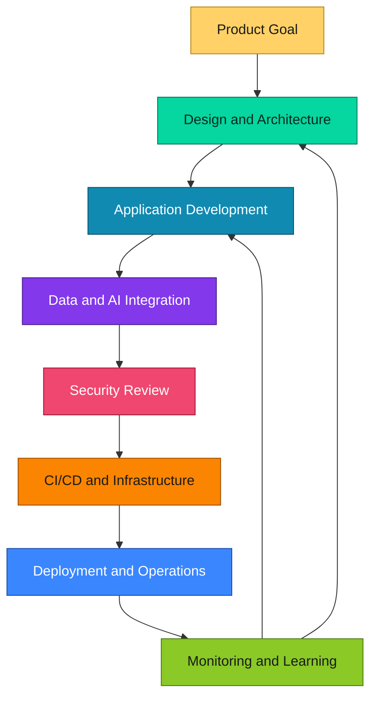
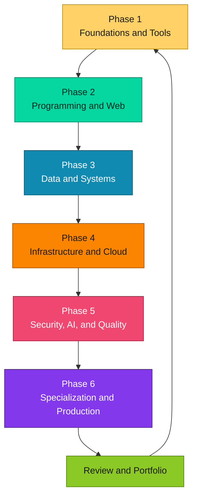

    

<h1 align="center">FROM CODE TO CLOUD TO CIRCUIT</h1>
<h3 align="center">THE FULL-SPECTRUM TECHNICAL CAPABILITY GUIDE</h3>

    

    

  

# How Full-Spectrum Tech Skills Turn AI From a Threat Into a Tool

If you spend any time online, you have probably seen the headlines: "AI Will Replace Coders," "AI Will Take White-Collar Jobs," "AI Is Coming for Your Career." The fear is understandable. But the evidence tells a different story. AI automates tasks, not jobs. It is powerful at pattern matching, but it lacks judgment, accountability, and the ability to handle novel situations. That gap is exactly where a new kind of professional thrives: the full-spectrum technical practitioner.

This is not about becoming an expert in everything. It is about developing broad working knowledge across software, systems, data, infrastructure, security, and hardware, plus production depth in two or three areas. People who learn this way do not compete with AI. They become the humans AI needs to function safely and effectively.

 

## Why AI Cannot Replace the Full-Spectrum Practitioner

AI systems operate on statistical correlation. They predict the next word, the next pixel, the next line of code. They do not understand cause and effect. They do not have a reliable model of the world. They fail on edge cases, novel problems, and anything that requires real accountability.

A full-spectrum practitioner handles exactly those gaps. They can trace a failure across the browser, the API, the database, the network, and the host. They can review AI-generated code for security flaws. They can challenge an AI-drafted system design, spot missing dependencies, and test the design against real constraints. When AI produces a plausible but wrong answer, the full-spectrum learner knows how to verify it.

This is the difference between passive acceptance and active oversight. Studies show that people who accept AI outputs without scrutiny perform 23 percent worse on analytical tasks. The full-spectrum practitioner does not fall into that trap. They use AI as a tool, not an oracle.

 

## The Skills That Matter Most

The "From Code to Cloud to Circuit" learning path builds skills that map directly to what AI cannot do. Here are the key areas:

- **Cross-layer debugging:** Tracing problems across application code, databases, networks, containers, and cloud infrastructure.
- **Architecture trade-off analysis:** Comparing monoliths, microservices, and serverless designs, and knowing when each makes sense.
- **Secure design:** Applying authentication, encryption, and threat modeling before vulnerabilities appear.
- **End-to-end delivery:** Taking a product from requirements to deployment and operation, with tests, pipelines, and monitoring.
- **Governance and oversight:** Designing the review gates, audit trails, and escalation protocols that keep organizations accountable.

These are not abstract skills. They come from shipping real systems, handling failures, and reviewing code with attention to correctness and security. They are the skills that let you govern AI-assisted work rather than be displaced by it.

 

## AI Needs a Human in the Loop. Be That Human.

The law does not recognize algorithms as legal persons. When an AI makes a mistake in healthcare, finance, aviation, or civil engineering, liability cascades to a human being. Regulators demand meaningful human review. Courts demand a rationale that a human can explain and defend.

Full-spectrum practitioners are prepared for that role. They understand governance because they have built CI/CD pipelines with quality gates. They have written infrastructure as code with security controls. They have operated systems with monitoring and incident response. They know when to automate a bounded task and when to keep a human in the loop.

This judgment is not soft. It is hard-earned. And it is exactly what employers pay for as routine cognitive work becomes commoditized.

 

## The Economics Favor Augmentation, Not Automation

The smartest organizations are not replacing people with AI. They are augmenting people with AI. This is not altruism. It is economics. Automation reduces costs, but that gain is finite. Augmentation expands capabilities, and that gain is unlimited.

Full-spectrum practitioners are perfectly positioned for augmentation. They can decompose jobs into tasks, automate the routine parts, and elevate the human elements. They can use AI to generate first drafts while applying domain expertise to validate, correct, and integrate. They can preserve cognitive diversity by using multiple models and structuring teams to challenge outputs.

These are the scarcity assets that command premium compensation. When everyone can generate a report in five seconds, the value shifts to the person who can ask the right questions, spot flawed assumptions, and weave disparate threads into a coherent strategy.

 

## Adaptability Is Your Safety Net

The only constant in technology is change. Full-spectrum practitioners learn new tools quickly because they understand fundamentals. They can move between languages, platforms, and domains. They can read research papers, evaluate new AI capabilities, and adjust their workflows accordingly. They are not locked into a single tool or role.

This adaptability makes them less vulnerable to displacement and more capable of leading through technological change. They are the integrators who turn AI output into reliable, valuable work. They are the human-in-the-loop that AI requires, the accountable decision-maker that law and regulation demand, and the partner that makes AI useful rather than dangerous.

 

## The Bottom Line

AI is not coming for your job. It is coming for your tasks. The people who thrive will be those who understand how to work with AI, not against it. They will have broad technical knowledge, production depth in a few areas, and the judgment to know when to trust the machine and when to trust themselves.

The "From Code to Cloud to Circuit" path is one way to build that capability. It is not about becoming an expert in everything. It is about becoming the kind of professional who can build, review, secure, deploy, and improve systems while knowing when to bring in specialist help. That is how you turn AI from a threat into a tool. And that is how you stay irreplaceable in a changing job market.

    

<h1 align="center">WHAT HAPPENS WHEN AN INDIVIDUAL OR A TEAM LEARNS THE COMPLETE TECHNICAL STACK?</h1>

  
 
## 1. Purpose and Scope

This document explains what happens when a person or a group learns the technical stack and skills described in this complete curriculum. It does not repeat every chapter or topic. It explains the practical capability that results from combining all areas into one learning path.

Several topics appear across multiple areas. Linux appears in systems, operations, cloud, and security. Git appears in programming, collaboration, and delivery. Containers and orchestration appear in infrastructure, operations, cloud, and system design. Database topics appear in application development, data work, and system design. This document treats repeated topics as one capability. It uses capability names rather than conflicting chapter numbers.

The key assumption is simple: learning means studied, practiced, and applied in real projects. Watching videos or collecting certificates is not treated as competence.

 

## 2. Executive Summary

Learning the full set of technical areas gives a person rare breadth across the software and systems lifecycle. It creates a practitioner who can move between application code, data storage, operating systems, networks, cloud infrastructure, security controls, automation, architecture, and user-facing design.

It does not create an instant expert in every field. Real expertise still requires production experience, repeated practice, failure handling, and judgment. The realistic outcome is a full-spectrum practitioner with broad working knowledge and production depth in two or three areas.

For a group, the outcome is stronger. A team that covers these areas can own a product from idea to operation with fewer handoff gaps. It can design, build, test, secure, deploy, monitor, and improve a system. It can also communicate across roles because the team shares a common technical language.

The central value is not knowing every tool. The central value is technical judgment across layers. The learner knows why a system fails, where to look, which trade-off matters, and when to bring in a specialist.

 

## 3. Capability Clusters Overview

The learning areas can be grouped into capability clusters. The table below shows what each cluster adds and what a learner can produce after real practice.

| Capability cluster | Learning areas included | Capability gained | Typical output | Realistic depth after full study |
|---|---|---|---|---|
| Computing foundations and algorithms | Computer science foundations, data structures and algorithms | Mathematical reasoning, complexity analysis, data structures, algorithm selection | Efficient code, algorithmic solutions, complexity notes | Working to production depth |
| Systems and low-level programming | C programming, C++ development, Linux and Bash | Memory model, pointers, processes, system calls, shell automation, performance awareness | System tools, scripts, low-level modules, debugging notes | Working depth, production in selected areas |
| Core application languages | Python, Java, Go, Rust, PHP | Multi-language programming, object design, concurrency, error handling, package management | Services, libraries, scripts, APIs, backend modules | Working depth across languages, production in one or two |
| Web, UI, and cross-platform development | HTML and CSS, JavaScript, TypeScript, Flutter and Dart, design systems | Browser behavior, responsive UI, typed frontend code, cross-platform mobile and desktop UI, reusable components | Web interfaces, mobile apps, component libraries, design tokens | Working to production depth |
| Data, storage, and persistence | Database development, Python data analysis, data structures and algorithms | Relational and NoSQL modeling, queries, indexing, transactions, data processing | Schemas, queries, migrations, data pipelines, reports | Working to production depth |
| Infrastructure, automation, and operations | Git and GitHub, Docker, Kubernetes, virtualization and containerization, DevOps, cloud computing, Terraform, Ansible | Version control, containers, orchestration, infrastructure as code, configuration management, cloud deployment | Repositories, CI/CD pipelines, infrastructure code, cluster deployments, runbooks | Working to production depth |
| Networking and distributed systems | Network engineering, system design, software design and architecture | Protocol behavior, routing and switching basics, distributed trade-offs, service boundaries, resilience | Network designs, architecture diagrams, service maps, failure analysis | Working depth, production in selected areas |
| AI and data intelligence | AI engineering, Python machine learning, selected C++ AI topics | Data preparation, model training, evaluation, deployment, MLOps basics | Models, evaluation reports, inference services, monitoring plans | Working depth, production in one specialty |
| Security and governance | Cybersecurity, DevSecOps topics, code review, compliance topics | Threat modeling, secure coding, identity, encryption basics, risk management, audit readiness | Threat models, secure pipelines, incident reports, policies | Working depth, production in selected areas |
| Quality, review, and product design | Code review, software design and architecture, design systems | Review discipline, architecture decision records, component consistency, accessibility awareness | Review checklists, ADRs, design system documentation, quality gates | Working to production depth |
| Hardware and mechatronics | Mechatronics | Sensors, actuators, control basics, embedded programming, hardware and software integration | Robot prototypes, sensor pipelines, control logic, hardware documentation | Working depth, production in selected areas |

 

## 4. What Learning Everything Realistically Means

A person cannot become an expert in every area at the same time. That would conflict with how expertise develops. The practical meaning of learning everything is:

1. Broad working knowledge across every cluster.
2. Production depth in two or three clusters.
3. The ability to read, discuss, and integrate work from other clusters.
4. The habit of checking assumptions with specialists when risk is high.

| Depth level | Meaning | What the learner can do |
|---|---|---|
| Awareness | Knows the concepts and vocabulary | Follows discussions and asks useful questions |
| Working | Has built small to medium examples | Contributes with guidance and reviews |
| Production | Has shipped and operated real systems | Owns work, handles failures, makes trade-offs |
| Expert | Has repeated production experience in complex contexts | Sets standards, mentors others, handles ambiguity |

The apparent contradiction in "learn everything" is resolved by this model. Full-spectrum learning means high breadth plus selective depth. It does not mean equal mastery everywhere.

 

## 5. Capability Outcomes

After genuine study and project work, the learner can do the following.

| Capability | What the learner can do | Why it matters | Evidence of capability |
|---|---|---|---|
| End-to-end delivery | Take a small product from requirements to deployment and operation | Reduces dependency on many separate handoffs | A deployed application with tests, pipeline, monitoring, and documentation |
| Cross-layer debugging | Trace issues across browser, API, database, network, container, and host | Finds root causes faster than layer-by-layer guessing | Incident notes showing diagnosis across layers |
| Architecture trade-off analysis | Compare monolith, microservices, serverless, and distributed patterns | Avoids over-engineering and wrong technology choices | Architecture decision record with alternatives and consequences |
| Secure design | Apply authentication, authorization, input validation, encryption, and threat modeling | Reduces common vulnerabilities early | Threat model, secure code review, dependency scan results |
| Automation | Use shell, Python, Git hooks, CI/CD, Terraform, and Ansible | Reduces manual error and repeat work | Reproducible pipeline and infrastructure code |
| Data handling | Design schemas, write queries, use indexes, and process data | Prevents slow queries and fragile data flows | Schema migration, query plan review, data pipeline |
| AI integration | Prepare data, train models, evaluate results, and deploy inference services | Connects AI work to real product needs | Model card, evaluation report, inference service |
| Systems awareness | Reason about memory, processes, system calls, and performance | Writes code that behaves well under load | Profiling report and memory analysis |
| Network awareness | Understand protocols, routing, DNS, firewalls, and load balancing | Diagnoses connectivity and latency problems | Packet capture analysis and network diagram |
| Hardware awareness | Connect software to sensors, actuators, and embedded constraints | Supports mechatronics and IoT work | Working prototype with control logic |
| Design consistency | Build reusable UI components and documentation | Improves product quality and team speed | Component library and usage guide |
| Review discipline | Give and receive technical feedback | Improves quality and spreads knowledge | Review comments, checklists, and merged improvements |

 

## 6. The Individual Practitioner Profile

A person who completes the full path with real projects becomes a **full-spectrum technical practitioner**. This is not a single job title. It is a capability profile.

The individual can:

- Write code in several languages and choose a language based on constraints.
- Read and modify system-level code when needed.
- Design a database schema and explain query performance.
- Build a web or mobile interface with accessible components.
- Containerize an application and deploy it to a cloud environment.
- Write infrastructure as code and configuration management.
- Set up a CI/CD pipeline with tests and security checks.
- Analyze a network problem and read a packet capture.
- Apply security controls and explain residual risk.
- Train and evaluate a basic machine learning model.
- Work with sensors, actuators, and embedded constraints at a practical level.
- Review code with attention to correctness, security, performance, and maintainability.

The individual also knows their limits. They can say: "This needs a database specialist", "This needs a security auditor", or "This needs a hardware engineer". That judgment is a sign of maturity, not weakness.

| Individual profile area | Observable behavior | Limit |
|---|---|---|
| Breadth | Can join any technical discussion and contribute | Not equally deep in every area |
| Integration | Connects frontend, backend, data, infrastructure, and security | Still needs team review for high-risk work |
| Debugging | Traces failures across layers | May need vendor or specialist support in rare failures |
| Delivery | Ships small to medium systems end to end | Large systems still need role specialization |
| Learning | Learns new tools quickly because fundamentals are strong | Tool churn still requires time |

 

## 7. The Group or Team Profile

A group that learns these areas together can form a cross-functional product and platform team. The group outcome is more valuable than the sum of individual outcomes because coverage can be distributed.

| Team function | Learning area coverage | Team outcome |
|---|---|---|
| Product engineering | Web, JavaScript, TypeScript, Python, Java, Go, Rust, PHP, Flutter | Builds user-facing and backend product features |
| Platform engineering | Linux, Docker, Kubernetes, Terraform, Ansible, cloud, DevOps | Provides reusable deployment and runtime platforms |
| Site reliability and operations | Linux, networking, DevOps, cloud, monitoring, Kubernetes | Operates systems, handles incidents, improves reliability |
| Security engineering | Cybersecurity, code review, DevSecOps, cloud security | Builds controls, reviews risk, responds to threats |
| Data and AI engineering | Database, Python data, AI engineering, MLOps | Builds data flows, models, and inference services |
| Architecture and design | System design, software architecture, design systems | Sets boundaries, patterns, and user experience standards |
| Embedded and mechatronics | C, C++, mechatronics, networking | Connects software to hardware and control systems |
| Quality and review | Code review, data structures and algorithms, testing, software design | Raises quality through review, tests, and standards |

The group can reduce handoff friction because members understand each other's constraints. A frontend developer who understands networking and security writes better API clients. A backend developer who understands Kubernetes and cloud cost designs better services. A security engineer who understands code review integrates controls earlier.

The main risk is role confusion. A group that says "everyone does everything" can create burnout and weak ownership. The group needs clear ownership, shared standards, and review paths.

 

## 8. Integrated Delivery Flow

The learning areas connect into one delivery flow. Foundations support languages. Languages support applications. Applications need data, infrastructure, security, and operations. Architecture and review connect the whole flow.

```mermaid
flowchart LR
  F[Foundations<br/>Math, DSA, CS]:::found --> P[Programming<br/>C, C++, Java, Python, Go, Rust, PHP]:::prog
  P --> W[Web and UI<br/>HTML, CSS, JS, TS, Flutter, Design Systems]:::web
  W --> D[Data<br/>SQL, NoSQL, Pipelines, AI]:::data
  D --> I[Infrastructure<br/>Linux, Docker, Kubernetes, Cloud, Terraform, Ansible]:::infra
  I --> S[Security<br/>Cybersecurity, DevSecOps, Review]:::sec
  S --> O[Operations<br/>DevOps, Monitoring, SRE]:::ops
  O --> A[Architecture<br/>System Design, Software Architecture]:::arch
  A --> P

  classDef found fill:#FFD166,stroke:#B8860B,color:#1A1A1A
  classDef prog fill:#06D6A0,stroke:#007A5E,color:#06281F
  classDef web fill:#118AB2,stroke:#0B4F6C,color:#FFFFFF
  classDef data fill:#8338EC,stroke:#4B1F8A,color:#FFFFFF
  classDef infra fill:#FB8500,stroke:#9C4E00,color:#1A1A1A
  classDef sec fill:#EF476F,stroke:#9E1B3A,color:#FFFFFF
  classDef ops fill:#3A86FF,stroke:#1B4FA8,color:#FFFFFF
  classDef arch fill:#8AC926,stroke:#4F7A12,color:#1A1A1A
```

 

## 9. Recommended Learning Sequence and Checkpoints

A full path should be sequenced. Jumping directly into advanced tools without foundations creates fragile knowledge. The sequence below balances breadth and depth.

| Phase | Focus | Main areas | Checkpoint evidence |
|---|---|---|---|
| 1 | Foundations and tools | Computer science foundations, data structures and algorithms, Linux and Bash, Git and GitHub | Algorithm solutions, shell scripts, clean Git history |
| 2 | Core programming and web | Python, Java, C, C++, Go, Rust, PHP, HTML and CSS, JavaScript, TypeScript | Working programs, web interface, tests, code review |
| 3 | Data and systems | Database, Python data, data structures and algorithms, system design basics | Schema design, queries, data report, architecture sketch |
| 4 | Infrastructure and cloud | Docker, Kubernetes, virtualization, DevOps, cloud, Terraform, Ansible | Containerized app, cloud deployment, infrastructure code, CI/CD pipeline |
| 5 | Security, AI, and quality | Cybersecurity, AI engineering, code review, software architecture | Threat model, model evaluation, review checklist, architecture decision record |
| 6 | Specialization and production | Selected deep area plus mechatronics or product design as needed | Production-grade project with monitoring, security, and documentation |

 

## 10. Assessment and Evidence

Competence should be judged by evidence, not by course completion.

| Capability area | Evidence of competence | Minimum acceptable evidence |
|---|---|---|
| Programming | Readable code, tests, error handling, reviews | A maintained project with tests and review comments |
| Data | Schema design, query optimization, migrations | A database project with query plans and migration files |
| Infrastructure | Reproducible deployment, infrastructure code, pipeline | A deployment that can be recreated from code |
| Security | Threat model, secure coding, dependency checks | A threat model and secure review notes |
| Architecture | Trade-off analysis, diagrams, decision records | An architecture decision record with alternatives and consequences |
| Operations | Monitoring, incident notes, runbooks | A runbook and one incident analysis |
| AI | Data preparation, evaluation, deployment | Model evaluation and inference service notes |
| Mechatronics | Working prototype with control logic | A prototype report with wiring and code |
| Design systems | Reusable components and documentation | A component library with usage guidance |
| Review | Constructive, specific, prioritized feedback | Review samples with accepted improvements |

 

## 11. Career Pathways and Role Fit

The full learning path does not replace specialization. It improves mobility and system judgment. The table below shows common role fits after full study with real projects.

| Role | Fit from the learning path | Typical scope | Depth needed |
|---|---|---|---|
| Full-stack engineer | Strong | Product features across frontend, backend, and database | Production depth in one stack |
| Platform engineer | Strong | Internal platforms, deployment, developer experience | Production depth in cloud, Kubernetes, infrastructure code |
| DevOps engineer | Strong | CI/CD, automation, infrastructure, operations | Production depth in pipelines and cloud |
| Site reliability engineer | Moderate to strong | Reliability, monitoring, incident response | Production depth in operations and networking |
| Cloud architect | Moderate | Cloud design, cost, security, migration | Production depth in one cloud and architecture |
| Security engineer | Moderate to strong | Secure design, review, monitoring, response | Production depth in security controls |
| Data engineer | Moderate | Data pipelines, storage, processing | Production depth in data systems |
| AI engineer | Moderate | Model training, evaluation, deployment | Production depth in machine learning and MLOps |
| Embedded or mechatronics engineer | Moderate | Hardware and software integration | Production depth in embedded systems |
| Software architect | Moderate to strong | System boundaries, patterns, trade-offs | Production depth in architecture and delivery |
| Design systems engineer | Strong | Component libraries, tokens, documentation | Production depth in UI engineering |
| Technical lead | Strong | Delivery ownership, review, mentoring | Production depth in one or two domains |

 

## 12. Risks, Limits, and Guardrails

| Risk | Why it happens | Guardrail |
|---|---|---|
| Breadth without depth | Trying to finish every area quickly | Require production depth in at least two areas |
| Tool churn | New tools appear constantly | Teach fundamentals and selection criteria |
| Security shortcuts | Security is treated as a final step | Build threat modeling and review into each phase |
| Cloud cost surprises | Infrastructure is created without cost controls | Add budgets, tagging, and cost review to cloud work |
| Burnout | "Learn everything" becomes an endless checklist | Use phases, rest periods, and portfolio goals |
| Role confusion in teams | Everyone claims every task | Define ownership, review paths, and escalation |
| Certification trap | Certificates replace project evidence | Require deployed work and incident analysis |
| Outdated knowledge | Old tutorials and stale tool versions | Use official documentation and versioned notes |
| Weak communication | Technical skill grows without writing practice | Require documentation, architecture decision records, and review writing |

 

## 13. Publishing Readiness Checklist

- Confirm the title, subtitle, and section headings match the website style guide.
- Verify all diagrams render correctly in the target publishing platform.
- Check that tables are readable on mobile and desktop.
- Remove duplicate chapter numbering and contradictory topic labels from published text.
- Confirm no em dashes, emojis, or promotional jargon remain.
- Check technical terms against current official documentation.
- Add internal links to related learning paths and role pages.
- Add accessibility labels to diagrams and tables where the platform supports them.
- Include a version date and change log.
- Review the document for plain English and short sentence structure.

 

## 14. Conclusion

Learning the complete technical stack creates a rare profile: a practitioner who can connect code, data, systems, infrastructure, security, AI, design, and hardware. The individual gains breadth, debugging range, delivery ability, and technical judgment. The group gains a cross-functional team that can own a product from idea to operation.

The outcome is not "expert in everything". The outcome is full-spectrum capability with selective depth. That is more useful, more realistic, and more valuable in real work. The learner becomes an integrator who can build, review, secure, deploy, and improve systems, and who knows when to bring in deeper specialist help.

    

<h3 align="center">STAY TUNED FOR THE LATEST UPDATES!</h3>

    
