<br><br><br><br>
    
<h1 align="center">THE EVOLUTION AND ARCHITECTURE OF MODERN COMPUTING SYSTEMS.</h1>

<br><br><br><br>

<p align="center">
    <a href="https://github.com/advancedscientificcomputing" target="_blank" rel="noopener noreferrer">
        
    </a>
</p>

<br><br>

### Table of Contents

1. [Executive Summary](#1-executive-summary)
2. [Historical Evolution of Computing Technology](#2-historical-evolution-of-computing-technology)
   - 2.1 [Pre-Mechanical Computing Foundations](#21-pre-mechanical-computing-foundations)
   - 2.2 [The Conceptual Birth of Programmable Computing](#22-the-conceptual-birth-of-programmable-computing)
   - 2.3 [Generational Progression of Electronic Computers](#23-generational-progression-of-electronic-computers)
   - 2.4 [Contemporary Computer Classification](#24-contemporary-computer-classification)
3. [Computer System Architecture and Components](#3-computer-system-architecture-and-components)
   - 3.1 [Holistic System Perspective](#31-holistic-system-perspective)
   - 3.2 [Hardware: The Physical Foundation](#32-hardware-the-physical-foundation)
   - 3.3 [Software: The Logical Layer](#33-software-the-logical-layer)
   - 3.4 [Human and Organizational Elements](#34-human-and-organizational-elements)
4. [Core Computational Functions and Processes](#4-core-computational-functions-and-processes)
   - 4.1 [The Information Processing Cycle](#41-the-information-processing-cycle)
   - 4.2 [Essential Computing Characteristics](#42-essential-computing-characteristics)
5. [Modern Computing Infrastructure and Future Directions](#5-modern-computing-infrastructure-and-future-directions)
   - 5.1 [Convergence of Computing Paradigms](#51-convergence-of-computing-paradigms)
   - 5.2 [Emerging Technological Frontiers](#52-emerging-technological-frontiers)
   - 5.3 [Sustainability and Ethical Considerations](#53-sustainability-and-ethical-considerations)
6. [Conclusion](#6-conclusion)
7. [References](#7-references)

<br>

## 1. Executive Summary

Computing has evolved from simple counting tools to sophisticated systems capable of artificial intelligence and quantum computation. This comprehensive documentation explores the historical development, architectural components, functional principles, and modern implementations of computer systems. Through detailed analysis of hardware, software, and their synergistic interactions, we present a holistic view of computing technology suitable for both technical professionals and informed enthusiasts.

The documentation covers five major generations of computing evolution, examines the core components that constitute modern computer systems, and explores the architectural principles that govern their operation. It also addresses emerging technologies and the growing importance of sustainability and ethical considerations in computing infrastructure development.

<br>

## 2. Historical Evolution of Computing Technology

### 2.1 Pre-Mechanical Computing Foundations

The journey of computational devices began millennia before electronic computers, with early tools establishing fundamental principles of calculation and data representation.

**The Abacus (c. 2000 BC):**
This ancient calculating frame, consisting of beads sliding on rods, represented one of humanity's first systematic approaches to arithmetic computation. While limited to basic operations, the abacus introduced concepts of positional notation and manual calculation that would inform later mechanical devices. Its enduring legacy persists in educational contexts and as a cultural artifact demonstrating early computational thinking.

**John Napier's Contributions (1550–1617):**
The Scottish mathematician revolutionized calculation through his invention of logarithms, which transformed complex multiplication and division problems into simpler addition and subtraction operations. His supplementary device, "Napier's Bones," consisting of numbered rods that could be arranged to perform multiplication and division, represented an important step toward mechanical calculation aids that reduced human computational error and effort.

**Blaise Pascal's Pascaline (1642):**
As one of the first mechanical calculators, Pascal's device employed a series of gears and wheels to perform addition and subtraction automatically. While limited in functionality and prone to mechanical limitations, the Pascaline demonstrated that machines could execute arithmetic operations without human intervention during the calculation process, establishing foundational principles for automated computation.

### 2.2 The Conceptual Birth of Programmable Computing

The 19th century witnessed the conceptualization of machines that would define modern computing architecture, though technological limitations prevented their full realization during their era.

**Charles Babbage's Vision (1791–1871):**
Often called the "father of the computer," Babbage designed two revolutionary machines—the Difference Engine and the Analytical Engine. The Difference Engine, intended to calculate polynomial functions and produce mathematical tables, demonstrated that complex calculations could be mechanized. His more ambitious Analytical Engine incorporated concepts remarkably similar to modern computers: a central processing unit (the "mill"), memory (the "store"), and programmability via punched cards, establishing the architectural blueprint for subsequent computing development.

**Ada Lovelace's Algorithmic Insight (1815–1852):**
Collaborating with Babbage, Lovelace authored what is considered the first algorithm specifically designed for machine execution. Her notes on the Analytical Engine extended beyond mere calculation, envisioning computers as general-purpose symbol manipulation devices capable of processing music, art, and abstract concepts. This foresight established her as the first computer programmer and articulated a vision of computing that would take nearly a century to realize fully.

### 2.3 Generational Progression of Electronic Computers

The evolution of electronic computers can be categorized into distinct generations, each marked by transformative technological breakthroughs that exponentially increased capabilities while reducing size and cost.

#### Table 1: Generations of Computer Evolution

| Generation | Timeline | Key Technology | Characteristics | Representative Systems |
|------------|----------|----------------|-----------------|------------------------|
| **First** | 1940-1956 | Vacuum Tubes | Room-sized, single-tasking, machine language programming, high heat output | ENIAC, UNIVAC I, EDSAC |
| **Second** | 1956-1963 | Transistors | Smaller size, reduced heat, assembly language, early high-level languages | IBM 7090, UNIVAC II, IBM 1401 |
| **Third** | 1964-1971 | Integrated Circuits | Miniaturization, multitasking, keyboards/monitors, operating systems | IBM System/360, PDP-8, DEC-10 |
| **Fourth** | 1972-2010 | Microprocessors | Personal computing, GUIs, networks, VLSI technology | Apple II, IBM PC, Intel-based systems |
| **Fifth** | 2010-Present | AI & Quantum | Parallel processing, machine learning, quantum bits, neural networks | IBM Watson, Google TPUs, Quantum processors |

#### 2.3.1 First Generation: Vacuum Tube Era (1940-1956)

The first electronic computers employed vacuum tubes as switching elements, enabling digital computation but with significant limitations in reliability, size, and power consumption. These systems typically occupied entire rooms, required specialized environments with extensive cooling, and operated at speeds measured in thousands of operations per second. Programming occurred directly in machine language or through physical reconfiguration of circuitry, making software development exceptionally challenging. Despite these constraints, first-generation computers proved invaluable for scientific calculations, cryptographic analysis, and early business data processing, demonstrating the potential of electronic computation.

#### 2.3.2 Second Generation: Transistor Revolution (1956-1963)

The invention of the solid-state transistor fundamentally transformed computing by replacing bulky, failure-prone vacuum tubes with smaller, more reliable semiconductor devices. This technological shift enabled computers to become more compact, energy-efficient, and affordable. Concurrently, software development advanced through the introduction of assembly languages and early high-level programming languages like FORTRAN and COBOL, which abstracted hardware complexities and improved programmer productivity. These developments expanded computing from specialized scientific and military applications into commercial and administrative domains.

#### 2.3.3 Third Generation: Integrated Circuit Integration (1964-1971)

The development of integrated circuits, which packaged multiple transistors and other components onto a single silicon chip, initiated an era of exponential miniaturization known as Moore's Law. This integration enabled substantial increases in computational speed and reliability while reducing costs. Operating systems emerged as essential software layers managing hardware resources and providing standardized interfaces for applications. The combination of integrated circuitry and sophisticated software made computing accessible to medium-sized businesses, universities, and research institutions, fostering widespread adoption.

#### 2.3.4 Fourth Generation: Microprocessor Democratization (1972-2010)

The creation of the microprocessor—an entire central processing unit on a single chip—catalyzed the personal computing revolution. Systems like the Apple II and IBM Personal Computer brought computational power directly to individuals, small businesses, and educational institutions. Graphical user interfaces replaced command-line interactions, making computers approachable for non-technical users. Concurrent developments in networking, particularly the emergence of the internet, transformed computers from isolated calculation devices into communication and information-access platforms with global reach.

#### 2.3.5 Fifth Generation: Intelligent and Quantum Systems (2010-Present)

Current computing development focuses on artificial intelligence, machine learning, and quantum computation. AI systems employ neural networks and deep learning algorithms to perform pattern recognition, natural language processing, and decision-making tasks that traditionally required human intelligence. Quantum computing, while still in early stages, leverages quantum mechanical phenomena like superposition and entanglement to solve specific problem classes exponentially faster than classical computers. These technologies converge in systems capable of autonomous operation, predictive analytics, and solving previously intractable problems in optimization, materials science, and cryptography.

### 2.4 Contemporary Computer Classification

Modern computing devices span a spectrum of capabilities tailored to specific applications, from individual productivity tools to systems solving global-scale problems.

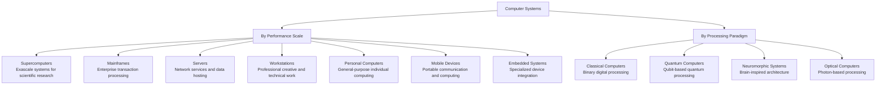

**Supercomputers:**
These represent the pinnacle of classical computational power, employing massive parallel architectures with hundreds of thousands of processing cores to perform exascale calculations (quintillions of operations per second). Applications include climate modeling, molecular dynamics simulation, astrophysical modeling, and cryptographic analysis where problem complexity exceeds the capabilities of conventional systems. Modern examples like Frontier and Fugaku consume megawatts of power and require specialized cooling infrastructures, representing substantial investments reserved for national laboratories and research institutions.

**Mainframe Computers:**
Designed for reliability, security, and high-volume transaction processing, mainframes remain foundational to global financial systems, government operations, and large-scale enterprise resource planning. Their architecture emphasizes input/output throughput, fault tolerance through redundant components, and continuous availability measured in "five nines" (99.999%) uptime. While less visible than consumer devices, mainframes process the majority of the world's financial transactions and critical database operations daily.

**Quantum Computers:**
Leveraging quantum mechanical principles, these systems employ qubits that can exist in superposition states (representing both 0 and 1 simultaneously) and entanglement correlations that enable exponential parallelism for specific algorithms. Current implementations face challenges including decoherence, error rates, and extreme environmental requirements (near absolute zero temperatures). Despite these limitations, quantum computers have demonstrated "quantum supremacy" for specialized tasks and promise revolutionary advances in cryptography, materials discovery, and complex system optimization once technological hurdles are overcome.

<br>

## 3. Computer System Architecture and Components

### 3.1 Holistic System Perspective

A computer system constitutes an integrated ecosystem of interacting components that collectively transform input data into meaningful output through controlled processing. This ecosystem extends beyond physical hardware to encompass software layers, human operators, and interconnection frameworks that enable coordinated functionality.

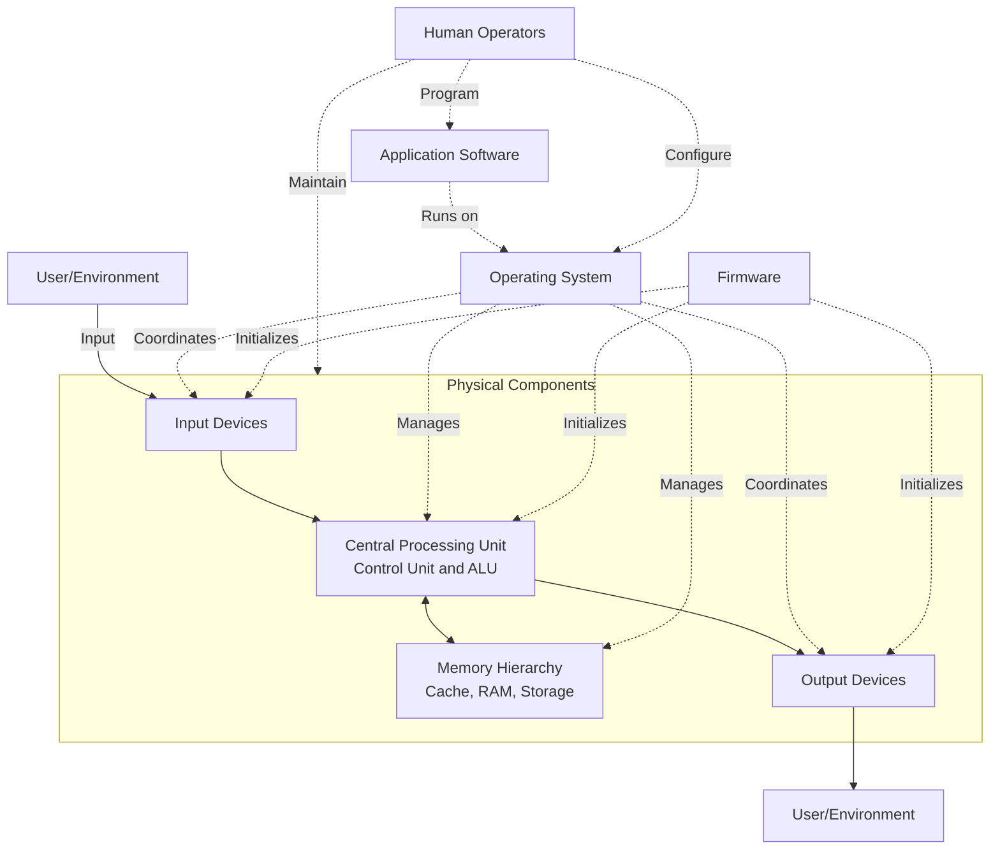

### 3.2 Hardware: The Physical Foundation

Hardware encompasses the tangible electronic and mechanical components that constitute a computer's physical presence and computational capabilities.

#### 3.2.1 Central Processing Unit (CPU)

The CPU serves as the primary computational engine, executing instruction sequences fetched from memory. Modern CPUs incorporate multiple processing cores on a single die, each capable of independent instruction execution, while hyper-threading technology allows each physical core to manage multiple instruction threads simultaneously. Key architectural elements include:

- **Control Unit:** Coordinates instruction fetching, decoding, and execution across the processor pipeline, managing data movement between components and implementing security boundaries between processes.
- **Arithmetic Logic Unit (ALU):** Performs mathematical calculations and logical comparisons, with modern implementations featuring multiple specialized ALUs for integer, floating-point, and vector operations.
- **Cache Hierarchy:** Multi-level memory structures (L1, L2, L3) integrated directly with the CPU cores provide low-latency access to frequently used data and instructions, with sizes ranging from kilobytes to megabytes per core.
- **Instruction Set Architecture (ISA):** The interface definition between software and hardware, with dominant architectures including x86 (Intel/AMD), ARM (mobile/embedded), and RISC-V (emerging open standard).

#### 3.2.2 Memory Subsystem

Computer memory exists in a hierarchical organization balancing speed, capacity, and cost, with faster, smaller memories closer to the CPU and larger, slower storage further removed.

- **Random Access Memory (RAM):** Volatile primary memory providing working storage for active programs and data. Modern DDR5 SDRAM modules offer transfer rates exceeding 50 GB/s with capacities up to 128GB per module. RAM characteristics significantly influence system responsiveness, particularly for memory-intensive applications and multitasking environments.

- **Storage Systems:** Non-volatile secondary storage preserves data when power is removed, with solid-state drives (SSDs) using NAND flash memory increasingly replacing mechanical hard disk drives (HDDs). NVMe (Non-Volatile Memory Express) interfaces directly connect SSDs to the CPU via PCIe lanes, achieving transfer speeds exceeding 7,000 MB/s compared to SATA's 600 MB/s limitation.

#### 3.2.3 Motherboard and Interconnect Infrastructure

The motherboard provides the physical and electrical foundation connecting all system components through layered communication pathways.

- **Chipset:** Manages data flow between CPU, memory, and peripheral devices, with modern implementations integrating previously separate northbridge (memory/GPU interface) and southbridge (I/O functions) components.
- **Expansion Slots:** PCIe (Peripheral Component Interconnect Express) slots provide configurable lane allocations (x1, x4, x8, x16) for graphics cards, storage controllers, network adapters, and specialized acceleration cards, with PCIe 5.0 offering 128 GB/s bandwidth in x16 configuration.
- **Power Delivery:** Voltage regulator modules (VRMs) convert and condition power supply output to precise voltages required by sensitive components, with multi-phase designs distributing electrical load and thermal stress across multiple circuits for stability.

#### Table 2: Hardware Component Specifications and Functions

| Component | Primary Function | Key Specifications | Modern Examples |
|-----------|-----------------|-------------------|-----------------|
| **CPU** | Instruction execution | Cores/threads, clock speed, cache size, TDP | Intel Core i9, AMD Ryzen 9, Apple M2 |
| **GPU** | Parallel processing, graphics rendering | CUDA/Stream processors, VRAM, bandwidth | NVIDIA RTX 4090, AMD Radeon RX 7900 |
| **RAM** | Temporary data storage | Capacity, speed, latency, channels | DDR5-6400, 32GB dual-channel kits |
| **SSD** | Persistent data storage | Capacity, interface, read/write speeds | NVMe Gen4, 2TB, 7000/5000 MB/s |
| **Motherboard** | Component interconnection | Chipset, form factor, expansion slots | ATX, Z790 chipset, PCIe 5.0 x16 |
| **PSU** | Power conversion and delivery | Wattage, efficiency rating, modularity | 850W, 80+ Platinum, fully modular |

### 3.3 Software: The Logical Layer

Software provides the instructions that direct hardware operation, creating abstraction layers that simplify complex operations and enable application development.

#### 3.3.1 Operating Systems

The operating system serves as an intermediary between applications and hardware, managing resources and providing essential services:

- **Kernel:** Core component managing memory, processes, devices, and system calls. Modern kernels support modular architecture with loadable drivers and real-time capabilities for time-sensitive applications.
- **File Systems:** Organize persistent data storage with metadata structures tracking file attributes, permissions, and physical allocation. Advanced file systems like ZFS and Btrfs incorporate integrity verification, snapshots, and software RAID capabilities.
- **Security Subsystems:** Implement access control, encryption, audit logging, and malware protection through integrated frameworks like SELinux, Windows Defender, and Apple's Gatekeeper.

#### 3.3.2 Application Software Categories

- **Productivity Software:** Office suites, database management systems, and development environments that enable creation, analysis, and communication of information across personal and professional domains.
- **Specialized Applications:** Domain-specific software for computer-aided design, scientific simulation, financial modeling, and creative media production that leverage hardware acceleration and specialized algorithms.
- **Middleware:** Software bridges enabling communication between disparate applications and systems, including database connectors, message queues, and web application servers that facilitate distributed computing.

### 3.4 Human and Organizational Elements

Computing systems exist within human contexts that significantly influence their design, operation, and effectiveness.

- **Human-Computer Interaction (HCI):** The study and design of interfaces between humans and computers, encompassing input methods, visual design, accessibility considerations, and user experience optimization. Modern HCI incorporates voice recognition, gesture control, and adaptive interfaces that respond to user behavior and context.
- **Accessibility Technologies:** Software and hardware adaptations enabling users with diverse physical, sensory, and cognitive abilities to effectively utilize computing resources. These include screen readers, voice control systems, alternative input devices, and interface customization frameworks mandated by regulations like Section 508 and WCAG guidelines.
- **Organizational Integration:** The processes, policies, and training that enable effective technology utilization within institutional contexts, including change management, cybersecurity awareness, and continuous skill development in rapidly evolving technical landscapes.

<br>

## 4. Core Computational Functions and Processes

### 4.1 The Information Processing Cycle

All computer operations fundamentally involve the transformation of input data into output information through systematic processing stages.

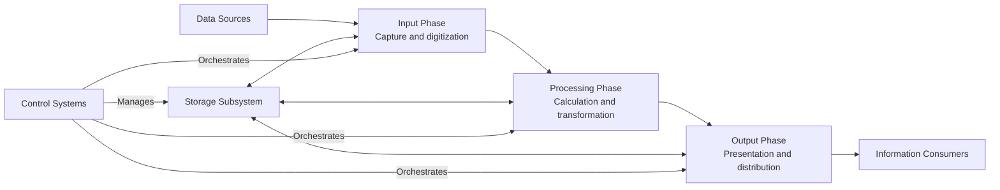

#### 4.1.1 Input Operations

Input mechanisms translate real-world phenomena into digital representations processable by computing systems. Modern input extends beyond traditional keyboards and mice to encompass:

- **Sensor Networks:** Distributed arrays of environmental, biological, and industrial sensors providing continuous data streams for monitoring and control applications.
- **Biometric Interfaces:** Fingerprint readers, facial recognition systems, and iris scanners that authenticate identity while collecting biological data for security and personalization.
- **Natural Language Input:** Voice recognition systems converting spoken language to text with increasing accuracy through machine learning models trained on vast linguistic datasets.

#### 4.1.2 Processing Operations

The CPU executes stored program instructions that manipulate data according to algorithmic logic, with modern processors employing several optimization strategies:

- **Pipelining:** Dividing instruction execution into sequential stages (fetch, decode, execute, memory access, writeback) allowing multiple instructions to be processed simultaneously like an assembly line.
- **Speculative Execution:** Predicting program branches and pre-executing likely instruction paths to avoid pipeline stalls, though this introduces security considerations like Spectre and Meltdown vulnerabilities.
- **Parallel Processing:** Simultaneous execution across multiple cores, with synchronization mechanisms ensuring data consistency while maximizing computational throughput for parallelizable workloads.

#### 4.1.3 Output Operations

Output systems translate processed digital information into human-perceivable forms or machine-actionable commands:

- **Visual Output:** Display technologies including LCD, OLED, and emerging microLED panels with resolutions up to 8K, refresh rates exceeding 360Hz for gaming, and HDR (High Dynamic Range) for enhanced contrast and color fidelity.
- **Haptic Feedback:** Tactile response systems simulating physical sensations through vibration, resistance, and temperature variation in controllers, touchscreens, and virtual reality interfaces.
- **Machine-to-Machine Output:** Automated signals directing external systems including industrial robots, building controls, and vehicular systems through standardized communication protocols.

### 4.2 Essential Computing Characteristics

Modern computers exhibit several defining attributes that distinguish them from earlier computational aids and enable their transformative societal impact.

- **Automation Capability:** Once programmed, computers execute complex sequences without human intervention, enabling continuous operation in monitoring, manufacturing, and data analysis applications where consistency and endurance surpass human capabilities. This automation extends through robotic process automation (RPA) that mimics human interaction with software interfaces and industrial control systems that manage physical processes.

- **Precision and Reliability:** Digital computers perform calculations with exactness determined by their numerical representation systems (typically IEEE 754 floating-point standard), with error rates substantially below those of human computation. Hardware reliability is ensured through error-correcting codes in memory, redundant components in critical systems, and thermal monitoring that prevents damage from overheating.

- **Speed and Scalability:** Modern processors execute billions of instructions per second, with performance scaling across multiple dimensions: clock frequency (GHz), parallel cores, vector processing width, and distributed computing networks. This scalability enables applications ranging from real-time video processing to decade-long climate simulations through appropriate resource allocation.

- **Storage Capacity and Hierarchy:** Contemporary systems manage data across storage tiers from CPU registers (nanosecond access) through cache, RAM, SSDs, HDDs, to cloud storage (millisecond to second access). Automated tiering systems migrate frequently accessed data to faster storage while archiving less active data to more economical mediums, optimizing both performance and cost.

- **Versatility and Programmability:** Unlike single-purpose devices, general-purpose computers execute diverse software applications without hardware modification. This programmability enables rapid adaptation to new tasks through software updates rather than physical replacement, though specialized accelerators (GPUs, TPUs, FPGAs) provide optimized performance for specific computational patterns.

<br>

## 5. Modern Computing Infrastructure and Future Directions

### 5.1 Convergence of Computing Paradigms

Contemporary computing architecture integrates multiple processing approaches within unified systems:

- **Heterogeneous Computing:** Combining general-purpose CPUs with specialized processors (GPUs, AI accelerators, FPGAs) that efficiently handle particular workload types. Unified memory architectures and high-bandwidth interconnects like NVLink enable seamless data sharing between these components.
- **Edge-Cloud Continuum:** Distributing computation across device-local processing (edge), intermediate fog nodes, and centralized cloud data centers based on latency requirements, privacy considerations, and bandwidth constraints. This continuum supports applications from autonomous vehicles requiring instant decisions to big data analytics benefiting from cloud-scale resources.
- **Quantum-Classical Hybrid Systems:** Emerging architectures that delegate appropriate subproblems to quantum processors while managing overall workflow on classical systems, recognizing that quantum advantage applies to specific algorithmic patterns rather than general computation.

### 5.2 Emerging Technological Frontiers

Several developing technologies promise to redefine computing capabilities in coming decades:

- **Neuromorphic Computing:** Hardware designs mimicking biological neural networks through spiking neurons and synaptic connections, offering potentially dramatic efficiency improvements for pattern recognition and sensory processing tasks. Research systems like Intel's Loihi demonstrate orders-of-magnitude power reduction for suitable workloads compared to conventional architectures.
- **Photonic Computing:** Using light rather than electricity for computation and interconnection, with potential advantages in speed, bandwidth, and power consumption for specific applications like matrix multiplication fundamental to neural network operations. Integrated silicon photonics enables increasingly complex optical circuits alongside electronic control logic.
- **Molecular and DNA Computing:** Exploring computation using biological molecules, with DNA-based systems offering extraordinary density for archival storage (theoretically exabytes per gram) and chemical reaction networks performing parallel processing through molecular interactions.

### 5.3 Sustainability and Ethical Considerations

As computing permeates society, its environmental and social impacts demand systematic consideration:

- **Energy Efficiency:** While computational efficiency has improved exponentially (Koomey's Law describes doubling of computations per kilowatt-hour approximately every 1.5 years), absolute energy consumption continues rising with increased deployment. Advanced cooling technologies, renewable energy integration, and algorithmic efficiency improvements represent critical research directions.
- **Electronic Waste Management:** With rapid hardware obsolescence cycles, responsible recycling and circular economy approaches for computing equipment are essential to limit environmental contamination from heavy metals and rare earth elements while recovering valuable materials.
- **Algorithmic Fairness and Transparency:** As automated decision-making systems influence employment, finance, justice, and healthcare, ensuring they operate without harmful bias and with appropriate human oversight represents both technical challenge and ethical imperative requiring interdisciplinary collaboration.

<br>

## 6. Conclusion

The evolution of computing represents one of humanity's most transformative technological narratives, progressing from manual calculation aids to systems exhibiting aspects of intelligence and approaching fundamental physical limits of computation. Each generational shift—from mechanical to vacuum tube, transistor to integrated circuit, microprocessor to intelligent system—has expanded what questions can be computationally addressed while making these capabilities increasingly accessible.

Contemporary computing architecture reflects this evolutionary history through layered abstraction: quantum phenomena manipulated at physical layers, transistors organized into logic gates, gates assembled into functional units, units coordinated as processors, processors managed by operating systems, and systems directed by human intent through increasingly natural interfaces. This stratification enables specialization and innovation at each level while maintaining compatibility across the stack.

Future development will likely continue along multiple parallel trajectories: classical systems approaching atomic-scale limits while employing three-dimensional integration and specialized accelerators; quantum systems progressing from noisy intermediate-scale devices toward fault-tolerant universal computation; and biological-inspired architectures reimagining fundamental computational paradigms. Throughout these technical advancements, the most profound impacts may emerge not from raw computational power alone, but from sophisticated integration of these systems with human society through intuitive interfaces, equitable access, and thoughtful application to pressing global challenges.

As computing continues its exponential progression, maintaining perspective on its human purposes—augmenting intellect, facilitating communication, automating routine tasks, and exploring complex systems—remains essential. The most significant measure of computational evolution may ultimately be not teraflops or qubit counts, but how effectively these systems extend human capabilities, deepen understanding, and improve quality of life while respecting planetary boundaries and ethical considerations.

<br>

## 7. References

1. Aspray, W. (2016). *The History of Computing: A Very Short Introduction*. Oxford University Press.
2. Ceruzzi, P. E. (2012). *Computing: A Concise History*. MIT Press.
3. Hennessy, J. L., & Patterson, D. A. (2017). *Computer Architecture: A Quantitative Approach*. Morgan Kaufmann.
4. NIST Special Publication 800-125: *Guide to Security for Full Virtualization Technologies* (2011).
5. IEEE Computer Society. (2020). *2020 Report on Computer Architecture and Engineering*.
6. National Academies of Sciences, Engineering, and Medicine. (2019). *Quantum Computing: Progress and Prospects*. The National Academies Press.
7. OpenAI. (2023). *GPT-4 Technical Report*. arXiv:2303.08774.
8. Bernstein, D. J., & Lange, T. (2017). *Post-quantum cryptography*. Nature, 549(7671), 188-194.
 


<br><br><br><br>
 


<h1 align="center">THE MOTHERBOARD: THE FOUNDATION AND ORCHESTRATOR OF YOUR PC.</h1>

<br><br>

## Executive Summary: The Central Nervous System of Computing

The **motherboard**, often termed the mainboard or system board, is the fundamental printed circuit board (PCB) at the heart of every computer. It acts as the **central nervous system**, providing the critical electrical pathways and physical interfaces that enable all core components—the CPU, memory, storage, and expansion cards—to communicate and function as a unified whole. More than just a passive connector, the motherboard determines your system's compatibility, performance ceiling, and upgrade path. As we move through 2026, this component is undergoing a quiet revolution, integrating artificial intelligence, next-generation connectivity, and smarter power management to meet the demands of modern gaming, content creation, and professional workloads. This document provides a comprehensive analysis of motherboard technology, from its historical evolution and core architecture to the current landscape of form factors, platforms, and leading manufacturers.

<br>

## 1. Introduction

The motherboard serves as the backbone of every personal computer. Without it, the most powerful processor and fastest memory modules remain inert components incapable of interacting with one another. This document aims to demystify the motherboard, explaining its role, evolution, and the critical decisions involved in selecting one for your next build. Whether you are a first-time builder or a seasoned enthusiast, understanding the motherboard is the first step toward constructing a system that meets your performance, connectivity, and upgrade requirements.

<br>

## 2. Historical Evolution: From Backplanes to Integrated Intelligence

The development of the motherboard is a story of relentless **miniaturization and integration**, moving from collections of discrete cards to a single, sophisticated orchestrator of system resources.

### 2.1 The Backplane Era (Pre-1980s)

Before the microprocessor became dominant, computers often used a **backplane** system. This was a passive board with slots into which individual, separate circuit boards for the CPU, memory, and input/output (I/O) functions were inserted. This modular design offered flexibility but resulted in bulky, complex, and expensive systems.

### 2.2 The First True Motherboard (1981)

A landmark shift occurred with the original **IBM Personal Computer** in 1981. Its "Planar Breadboard" integrated the CPU (an Intel 8088), memory (16KB), and core connectors onto a single PCB. This innovation is widely recognized as the first true motherboard, setting the blueprint for the future of personal computing.

### 2.3 Standardization: The AT and Baby-AT Era (1984-1989)

IBM's 1984 **AT (Advanced Technology) form factor** established a recognizable layout for desktop PCs. Its large size (approximately 12" x 13") was later addressed by the more compact **Baby-AT** form factor in the late 1980s, which maintained functionality while fitting into slimmer cases.

### 2.4 The ATX Revolution (1995)

A major leap forward came in 1995 when Intel introduced the **ATX (Advanced Technology eXtended) specification**. Its key innovations—integrating common I/O ports directly onto the board and rotating the CPU/memory module orientation—dramatically improved airflow, simplified case design, and enhanced reliability. ATX remains the dominant standard for desktop PCs today.

### 2.5 The Rise of High Integration and Diversification (1990s-Present)

Throughout the late 1990s and 2000s, it became standard to integrate functions like audio, networking, and USB controllers directly onto the motherboard. This era also saw the proliferation of specialized form factors like **MicroATX (1997)** and **Mini-ITX (2001)** to serve markets ranging from budget desktops to ultra-compact home theater and gaming systems.

### 2.6 The Modern Era of Intelligence (2020s and Beyond)

Today's trend is toward **smarter, more efficient integration**. The traditional two-chip chipset design (Northbridge/Southbridge) has been replaced by architectures where the CPU manages high-speed connections directly. The latest frontier includes the integration of **AI-driven optimization** for real-time tuning of power, cooling, and performance, marking the beginning of a new, intelligent phase in motherboard evolution.

<br>

## 3. Core Architecture: From Bridges to an Integrated Hub

A modern motherboard is a complex ecosystem. Its architectural design has evolved from a distributed "bridge" model to a centralized, efficient hub centered on the CPU.

### 3.1 The Classic Northbridge/Southbridge Architecture

For decades, the motherboard's chipset was split into two primary components managing different speed domains:

| Component | Position | Function |
|:---|:---|:---|
| **Northbridge (Memory Controller Hub)** | Positioned "north" of the PCI bus, physically close to the CPU | Handled all high-speed communications: connection to the CPU (via the Front-Side Bus), system RAM, and the primary graphics port (AGP, later PCIe) |
| **Southbridge (I/O Controller Hub)** | Positioned "south" of the PCI bus | Managed lower-speed peripherals and legacy interfaces, including SATA ports, USB controllers, Ethernet, audio codecs, and BIOS/UEFI firmware |

This design had inherent bottlenecks, as all data between the CPU and Southbridge had to pass through the Northbridge.

### 3.2 Modern Integrated Architecture

In contemporary systems, starting with platforms like Intel's Core i-series and AMD's Ryzen, the functions of the **Northbridge have been absorbed directly into the CPU package**. The CPU now contains the integrated memory controller and provides direct PCIe lanes for graphics and storage. The remaining I/O functions are consolidated into a single **Platform Controller Hub (PCH)** on Intel platforms or a **unified chipset** on AMD platforms, which connects to the CPU via a high-speed link like Direct Media Interface (DMI) or Infinity Fabric.

The following diagram illustrates this modern data flow architecture:

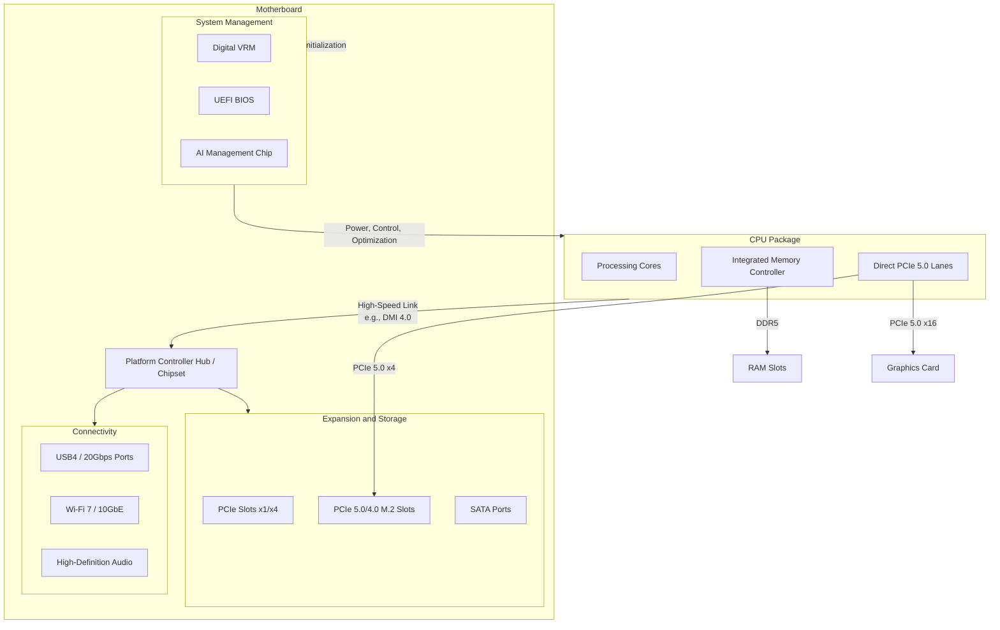

### 3.3 Critical Subsystems and Components

| Subsystem | Function | Importance |
|:---|:---|:---|
| **Voltage Regulator Module (VRM)** | Converts 12V power from PSU to ultra-low voltage (0.8V-1.3V) required by CPU. Uses multiple power phases with high-quality components. | Essential for system stability, especially with high-end processors or overclocking. A robust VRM prevents thermal throttling and system crashes. |
| **BIOS/UEFI Firmware** | Low-level software stored on non-volatile memory. Performs Power-On Self-Test (POST), initializes hardware, and provides interface for system configuration. | Critical for hardware initialization and system configuration. Enables features like XMP for memory and overclocking adjustments. |
| **Expansion Slots** | Primary standard is PCI Express (PCIe) 5.0 or 4.0. Slots configured with different lane counts (x1, x4, x16) for various bandwidth needs. | Determines the graphics card and expansion card compatibility. Key for future upgrades and multi-GPU configurations. |
| **Storage Interfaces** | M.2 slots for ultra-fast NVMe SSDs (PCIe 5.0/4.0). Legacy SATA ports for 2.5"/3.5" drives. | Defines storage speed and capacity options. M.2 PCIe 5.0 offers the fastest storage performance available. |
| **Integrated Connectivity** | High-definition audio codecs, 2.5 Gigabit Ethernet (10GbE on premium models), Wi-Fi 6E/7 support, and high-speed USB ports (USB 3.2 Gen 2x2 at 20 Gbps, USB4/Thunderbolt 4 at 40 Gbps). | Eliminates need for separate add-in cards. Critical for modern networking, peripheral connectivity, and multimedia experiences. |

<br>

## 4. Form Factors: Choosing Your PC's Footprint

The form factor defines a motherboard's physical dimensions, layout, and mounting points. It is the single most important factor determining your PC case size and expansion potential.

| Form Factor | Dimensions | Key Characteristics | Ideal Use Case |
|:---|:---|:---|:---|
| **E-ATX (Extended ATX)** | ~305x330 mm (12"x13") | Offers the most PCIe slots (often 4+), space for 8 RAM slots, and extreme VRM setups. Requires large cases. | Enthusiast and Workstation. Multi-GPU builds, content creation stations, and high-end overclocking. |
| **ATX (Standard)** | 305x244 mm (12"x9.6") | The most popular choice for full-size desktops. Typically features 4-7 PCIe slots and 4 RAM slots. Offers the best balance of expansion, compatibility, and cooling. | The Versatile Standard. Gaming and general-use PCs. |
| **MicroATX (mATX)** | 244x244 mm (9.6"x9.6") | A square variant that fits in both mATX and ATX cases. Has fewer expansion slots than ATX but supports the same CPUs and RAM. | The Value-Oriented Compact. Budget-conscious or space-aware builds where maximum expansion isn't needed. |
| **Mini-ITX** | 170x170 mm (6.7"x6.7") | The choice for Small Form Factor (SFF) builds. Typically has just one PCIe slot and two RAM slots. Prioritizes space efficiency over expandability. | Ultra-Compact Specialist. HTPCs, portable LAN rigs, or minimalist desktops. |

> **Form Factor Tip:** Your choice is a direct trade-off between size and expandability. A full ATX or E-ATX board offers the most room for future upgrades (additional GPUs, capture cards, more storage), while mATX and Mini-ITX boards allow you to build a much smaller, more portable system, albeit with limited upgrade paths.

<br>

## 5. 2026 Platform Landscape: AMD and Intel Ecosystems

The combination of **CPU socket** and **chipset** defines a motherboard's platform, dictating processor compatibility, feature sets, and overclocking support.

### 5.1 AMD AM5 Platform

AMD's current platform centers on the **AM5 socket** (an LGA design), supporting Ryzen 7000, 8000, and 9000 series processors exclusively with DDR5 memory and PCIe 5.0.

| Chipset | Target Segment | Key Features | Example Motherboard |
|:---|:---|:---|:---|
| **X870/X870E** | High-End Enthusiast | Maximum connectivity, mandatory USB4 support on X870E, multiple PCIe 5.0 lanes for storage, robust power delivery. | Asus ROG Crosshair X870E Extreme |
| **B850** | Mainstream Value | PCIe 5.0 for GPU and one M.2 slot, modern I/O, excellent features for most users. | MSI MAG B850 Tomahawk MAX WiFi |

### 5.2 Intel LGA 1851 and LGA 1700 Platforms

Intel's platform is currently in transition, with a new socket for its latest generation.

| Platform | Socket | Target CPU Series | Key Chipsets | Notes |
|:---|:---|:---|:---|:---|
| **LGA 1851** | 15th Gen Core "Arrow Lake" | Z890 (Enthusiast), B860 (Mainstream) | Enables overclocking, offers PCIe 5.0, Wi-Fi 7, and Thunderbolt 4. | MSI Z890 Godlike represents the pinnacle. |
| **LGA 1700** | 12th-14th Gen Core | Z790, B760, H610 | Mature platform. Remains a strong and often more affordable choice. | ASRock Z790 Taichi Lite offers excellent value. |

### 5.3 Platform Comparison

| Feature | Current AMD (AM5) | Current Intel (LGA 1851) |
|:---|:---|:---|
| **Target CPU Series** | Ryzen 7000 / 8000 / 9000 | Core 15th Gen (Arrow Lake) |
| **Memory Support** | DDR5 only | DDR5 only |
| **Key 2026 Chipsets** | X870/X870E (High-End), B850 (Mainstream) | Z890 (Enthusiast), B860 (Mainstream) |
| **CPU Overclocking** | Available on B/X series chipsets | Available on Z-series chipsets only |
| **Platform Longevity** | Socket support promised through 2027+ | Socket typically changes every 2-3 generations |
| **PCIe 5.0 Support** | GPU and M.2 on B850/X870+ | GPU and M.2 on Z890/B860 |

<br>

## 6. The Modern Market: Leading Brands and Selection Strategy

The consumer motherboard market is dominated by a handful of Taiwanese manufacturers, each with distinct brand identities targeting different segments.

| Brand | Sub-Brands | Known For | Target Audience |
|:---|:---|:---|:---|
| **ASUS** | ROG (Republic of Gamers), TUF Gaming, Prime | Innovation, premium build quality, extensive BIOS options. | Gamers, enthusiasts, mainstream users |
| **MSI** | MEG, MPG, MAG | Strong performance, gaming aesthetics, advanced cooling solutions. | Gamers and enthusiasts |
| **Gigabyte** | AORUS | "Ultra Durable" construction, innovative features, robust power delivery. | Gamers and enthusiasts |
| **ASRock** | Taichi, Steel Legend, Pro | Compelling features at aggressive prices, unique designs, packed connectivity. | Value-oriented enthusiasts |

### 6.1 How to Choose Your Motherboard in 2026: A Strategic Guide

1.  **Lock Down Your CPU First:** The choice of processor dictates everything. Select your CPU (e.g., Ryzen 7 9700X or Core Ultra 9 285K), then find a motherboard with the **correct socket** (AM5 or LGA 1851/1700).

2.  **Balance Chipset with Actual Needs:** Don't pay for a high-end X870E or Z890 chipset if you won't use multiple PCIe 5.0 SSDs, USB4, or extreme overclocking. A **B850** or **B860** board often provides 95% of the needed features for significantly less money.

3.  **Prioritize Connectivity for Future-Proofing:** Look for features you may need: multiple **M.2 slots** (especially PCIe 5.0), a **USB4/Thunderbolt 4** header, modern networking (**Wi-Fi 6E/7, 2.5Gb+ Ethernet**), and ample fan/pump headers for cooling.

4.  **Match the Form Factor to Your Case and Vision:** An ATX board won't fit in a Mini-ITX case. Decide on your desired PC size and choose a compatible motherboard and case pair.

5.  **Assess Power Delivery for Your CPU:** If using a high-core-count CPU (Ryzen 9, Core i9) or planning to overclock, invest in a board with a **robust VRM** (look for more phases and large heatsinks). Reviews from trusted sources like Tom's Hardware are invaluable here.

<br>

## 7. The Future: AI Integration, Sustainability, and Market Growth

The motherboard continues to evolve from a simple interconnect into an intelligent platform manager.

### 7.1 AI Integration

The most significant trend for 2026 and beyond is the incorporation of **AI-driven optimization**. Motherboards are beginning to feature dedicated AI processors (NPUs) or use CPU-based AI to manage fan curves, power delivery, and network traffic in real-time based on workload, promising quieter, more efficient, and higher-performing systems.

### 7.2 Next-Generation Connectivity

**Wi-Fi 7** and **10 Gigabit Ethernet** are transitioning from luxury to mainstream features on high-end boards, essential for handling large file transfers and high-bandwidth applications.

### 7.3 Sustainable Manufacturing

Leading manufacturers are increasingly focused on **eco-friendly practices**, using recyclable materials, reducing packaging waste, and adhering to strict environmental regulations like RoHS during production.

### 7.4 Market Growth

The global home computer motherboard market is experiencing robust growth, valued at approximately **$1.4 billion in 2026** and projected to grow at a significant rate. This growth is driven by the expanding PC gaming segment, demand for high-performance computing in content creation, and the enduring popularity of custom PC builds.

<br>

## 8. Conclusion: The Indispensable Foundation

The motherboard has journeyed from a simple backplane to the essential, intelligent foundation of modern computing. It is the critical component that orchestrates the symphony of hardware in your PC, defining its capabilities, stability, and potential. Understanding its evolution, architecture, and the nuances of contemporary platforms is empowering, whether you are building a compact living room PC, a no-compromises gaming rig, or a professional workstation.

By making an informed choice about your motherboard, you lay the groundwork for a system that meets your needs today and remains adaptable for the innovations of tomorrow. The motherboard is not merely a component; it is the foundation upon which your entire computing experience is built.

<br>

## References and Further Reading

1.  Intel Corporation. (2025). *Platform Controller Hub (PCH) Architecture Overview*.
2.  AMD. (2025). *AM5 Platform Technical Documentation*.
3.  Tom's Hardware. (2026). *Best Motherboards 2026*.
4.  PCMag. (2026). *Motherboard Buying Guide*.
5.  Industry Research Reports. (2026). *Global Motherboard Market Analysis*.
 

<br><br><br><br>
 


<h1 align="center">THE CENTRAL PROCESSING UNIT (CPU): THE BRAIN OF THE DIGITAL AGE.</h1>

<br><br>
 
### **Executive Summary**

The Central Processing Unit (CPU) is the fundamental, indispensable engine at the heart of every modern computing device. From the smartphone in your pocket to the supercomputers modeling climate change, the CPU executes the instructions that power our digital world. This document provides a comprehensive analysis of CPU technology, exploring its core operational principles, the low-level assembly languages that command it, the competing architectural philosophies that define its design, and the dynamic landscape of manufacturers. Understanding the CPU’s evolution—from simple calculators of data to sophisticated systems-on-a-chip (SoCs) integrating artificial intelligence—is key to appreciating the technological foundation of contemporary society. We will delve into its internal mechanisms, its language, its varied forms, and the relentless innovation that continues to push the boundaries of performance and efficiency.

<br>

### **1. The CPU: Core Functions and Architectural Principles**

At its essence, a CPU is a hardware component designed to execute sequences of stored instructions, known as programs. It performs this role through the relentless, coordinated operation of specialized sub-units, transforming input data into meaningful output.

*   **The Fetch-Execute Cycle: The Heartbeat of Computation**
    The primary operation of every CPU is governed by the **fetch-decode-execute cycle**, a continuous loop that is the fundamental pulse of computation. This process begins when the **Control Unit** retrieves an instruction from the computer's main memory (RAM). This instruction, represented as a binary number, is then decoded to determine the required operation—whether it be an arithmetic calculation, a logical comparison, or a data movement. The decoded command directs the **Arithmetic Logic Unit (ALU)** to perform the specific task. The ALU carries out basic arithmetic like addition and subtraction, and logical operations like AND/OR comparisons. The results are subsequently written back to the system's memory or to internal, ultra-fast storage locations called **registers**. This cycle repeats billions of times per second, synchronized by the CPU's clock signal. Supporting this core operation is the **bus interface unit**, which manages all communication between the CPU and the rest of the computer system over the front-side bus or modern interconnects.

*   **Measuring Performance: Beyond Clock Speed**
    CPU performance is a multifaceted metric influenced by several interlinked factors. **Clock speed**, measured in gigahertz (GHz), indicates how many cycles a CPU can complete per second and has traditionally been a simple gauge of speed. However, it is not the sole determinant. Modern CPUs contain multiple independent processing units called **cores**. A multi-core processor can execute several instruction streams in true parallel, dramatically improving performance for multitasking and software specifically engineered for concurrency. Furthermore, technologies like **Hyper-Threading (Intel) or Simultaneous Multithreading (SMT, AMD)** allow a single physical core to manage two separate "threads" of execution simultaneously. This improves overall efficiency by making better use of the core's execution resources, such as allowing one thread to use the arithmetic units while another accesses memory, thereby increasing throughput.

*   **The Memory Hierarchy: The Critical Role of Cache**
    Accessing the main system memory (RAM) is relatively slow compared to the CPU's execution speed. To mitigate this bottleneck, CPUs integrate small amounts of extremely fast **cache memory** directly onto the processor die. This memory hierarchy typically includes three levels. The **L1 cache** is the smallest (often 32-64KB per core) and fastest, dedicated to each core and split into separate caches for instructions and data. The **L2 cache** is larger (e.g., 512KB-1MB per core) and slightly slower, and may be shared between a small cluster of cores. The **L3 cache** is the largest (tens of megabytes) and slowest of the three, but still vastly faster than RAM, and is shared across all cores on a chip. The CPU uses sophisticated algorithms to store frequently accessed data and instructions in this cache, drastically reducing latency and avoiding performance stalls. Larger cache sizes, particularly L3 cache, are strongly correlated with improved performance in latency-sensitive tasks like gaming and complex computational simulations.

*   **Thermal Design Power (TDP) and Cooling**
    As CPUs perform work, they dissipate electrical energy as heat. The **Thermal Design Power (TDP)**, measured in watts, specifies the maximum amount of heat a cooling system must be able to dissipate. Effective **thermal management** is non-negotiable; excessive heat can cause thermal throttling (where the CPU reduces its clock speed to cool down) or permanent silicon degradation. Cooling solutions range from simple **heat sinks and fans** for standard builds to advanced **liquid cooling systems** for high-performance and overclocked machines. Proper cooling, combined with adequate case airflow, is absolutely essential for maintaining system stability, achieving advertised performance levels, and ensuring hardware longevity.

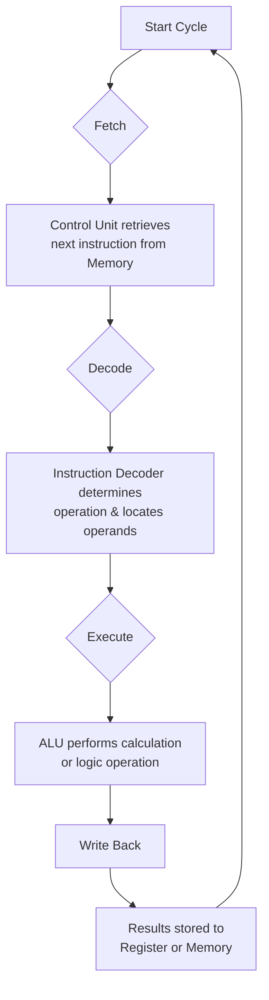

<br>

### **2. The Language of Hardware: Assembly Programming**

Between human-readable high-level code (like Python or Java) and the binary machine code (1s and 0s) executed by the CPU lies **assembly language**. It is a low-level programming language that provides a symbolic, one-to-one representation of a processor's machine code instructions, offering programmers unparalleled hardware control.

*   **Fundamental Purpose and Operation**
    Each assembly language is intrinsically tied to a specific **CPU architecture** and its **Instruction Set Architecture (ISA)**, such as x86-64 or AArch64 (ARM). Its primary role is to give programmers direct, precise command over hardware components like registers, memory addresses, and I/O ports. An assembly program is written using mnemonics—short, readable codes that correspond to machine instructions (e.g., `MOV` to move data, `ADD` for addition, `CMP` for compare). This textual source code is translated into executable machine code by a special program called an **assembler**. While not portable across different CPU families, assembly is indispensable for tasks where maximum performance, minimal resource use, or direct hardware manipulation is required. These tasks include writing operating system kernels, device drivers, firmware for embedded systems, and performance-critical sections of code in game engines or scientific computing libraries.

*   **Key Components and Syntax**
    An assembly program is built from several core elements. **Registers**, such as `RAX` or `R0`, are the CPU's internal, ultra-fast storage locations used for immediate data manipulation. **Instructions** are the mnemonic commands that tell the CPU what operation to perform. Each instruction operates on **operands**, which can be immediate data values (e.g., `5`), register names, or memory addresses. Programmers use **labels** to mark locations in the code for jumps and loops, and **directives** (or pseudo-ops) to guide the assembler itself, such as defining constants or reserving memory space. Assemblers can be **one-pass** or **multi-pass**, with the latter being more common in modern toolchains as they resolve forward references by building a symbol table first. The following table categorizes major assembly languages by their underlying architecture.

*   **A Taxonomy of Assembly Languages**

| Architecture Type | Assembly Language | Primary ISA | Typical Use Cases & Notes |
| :--- | :--- | :--- | :--- |
| **CISC** | x86/x86-64 Assembly | x86 (Intel, AMD) | Dominant in desktop, laptop, and server environments. Supports complex, variable-length instructions. |
| **RISC** | AArch64 / ARM Assembly | ARM (Apple Silicon, Qualcomm, AWS Graviton) | Ubiquitous in mobile, embedded, and increasingly in laptops/servers. Known for efficiency and load/store model. |
| **RISC** | RISC-V Assembly | RISC-V | Open-standard ISA gaining traction in embedded systems, research, and custom accelerators. |
| **RISC** | MIPS Assembly | MIPS | Historically significant in networking hardware, embedded systems (e.g., routers), and older consoles. |
| **RISC** | PowerPC Assembly | PowerPC | Legacy architecture used in older Apple Macintosh computers, game consoles (Wii, PlayStation 3), and IBM servers. |
| **Embedded** | AVR Assembly | AVR (Atmel/Microchip) | Extremely popular in microcontrollers (e.g., Arduino boards) for education and simple embedded control. |
| **Embedded** | PIC Assembly | PIC (Microchip) | Family of microcontrollers common in low-power embedded systems, automation, and consumer electronics. |
| **Legacy** | Z80 Assembly | Z80 | Iconic 8-bit ISA used in vintage systems like the ZX Spectrum and early CP/M computers. |
| **Legacy/Mainframe** | IBM System/360 Assembly | z/Architecture | Designed for IBM mainframe computers, focused on enterprise reliability and transaction processing. |

*   **Advantages, Disadvantages, and Modern Relevance**
    The principal advantage of assembly is **direct hardware control and optimization**. Programmers can write code that is perfectly tailored to the underlying hardware, squeezing out every bit of performance and minimizing memory footprint. This makes it crucial for **reverse engineering, cybersecurity analysis, bootloader development, and embedded systems programming** for microcontrollers and IoT devices where resources are extremely constrained. However, this power comes with significant trade-offs: assembly code is **not portable** between architectures, is **complex, time-consuming, and error-prone** to write and debug, and is notoriously difficult to maintain for large projects. Consequently, it is rare to write entire applications in assembly today. Instead, it is most often used for short, critical routines (often called "hot paths") within programs written primarily in higher-level languages like C, C++, or Rust, where these languages can interface with assembly via **inline assembly** or linking separate object files.

<br>

### **3. Architectural Philosophies and Classifications**

CPU architecture defines the fundamental design philosophy and instruction set that a processor uses. These philosophies dictate how software interacts with hardware and how performance and efficiency are balanced.

*   **The CISC vs. RISC Dichotomy**
    The two dominant historical paradigms are **Complex Instruction Set Computing (CISC)** and **Reduced Instruction Set Computing (RISC)**.
    *   **CISC (e.g., x86)**: Exemplified by the ubiquitous **x86 architecture** from Intel and AMD, the CISC philosophy employs a rich, varied set of instructions. Some instructions are powerful and can perform multi-step operations (like loading data from memory, performing a calculation, and storing the result back) in a single command. This design, which originated when memory was expensive, aimed to make compilers' work simpler and create more compact programs. Execution of these complex instructions is managed internally by **microcode**. While flexible and powerful for certain tasks, it can lead to more complex chip design, higher power consumption, and variable instruction execution times.
    *   **RISC (e.g., ARM, RISC-V)**: In contrast, the **RISC** philosophy, championed by architectures like **ARM**, **MIPS**, and the open-standard **RISC-V**, uses a smaller, highly optimized set of simple instructions. Each instruction is designed to execute in a single clock cycle whenever possible. RISC architectures enforce a **load/store** model, where only specific instructions (`LOAD`, `STORE`) access memory, and all calculations are performed on data already loaded into registers. This simplicity allows for more efficient pipelining, higher potential clock speeds, and generally superior performance-per-watt, which is why RISC designs like ARM dominate the mobile and embedded device markets.

*   **Flynn's Taxonomy: Classifying Parallel Processing**
    Beyond instruction set design, computer architectures can be classified by how they handle parallel processing of instructions and data. **Flynn's Taxonomy**, proposed by Michael J. Flynn in 1966, provides a seminal framework based on the number of concurrent **instruction streams** and **data streams**.
    *   **SISD (Single Instruction, Single Data)**: The traditional, sequential model. A single processor executes one instruction on one piece of data at a time. Early uniprocessor systems fit this model.
    *   **SIMD (Single Instruction, Multiple Data)**: A single instruction is applied to multiple data points simultaneously. This is crucial for vectorized operations common in graphics processing, scientific simulation, and multimedia. Modern CPU instruction set extensions like **AVX (x86)** and **NEON (ARM)** are SIMD units.
    *   **MISD (Multiple Instruction, Single Data)**: A rare architecture where multiple instructions operate on the same data stream, primarily used for fault tolerance in specialized systems like flight control computers.
    *   **MIMD (Multiple Instruction, Multiple Data)**: The most common and versatile architecture for general-purpose parallel computing. Multiple processors (or cores) operate independently on different data streams. All modern multi-core CPUs (Intel Core, AMD Ryzen), as well as distributed computing clusters, are MIMD systems.

*   **The Convergence and Modern Hybrid Designs**
    The distinction between CISC and RISC has blurred significantly in practice. Modern x86 processors translate their complex CISC instructions into smaller, RISC-like internal micro-operations (μops) for execution, gaining the benefits of RISC design internally. Conversely, RISC architectures like ARM have added more specialized and powerful instructions over time. The dominant trend today is **heterogeneous/hybrid architectures**. Designs like ARM's **big.LITTLE/DynamIQ**, Apple's **M-series**, and Intel's **Performance (P-core) + Efficiency (E-core)** designs combine high-performance cores with power-efficient cores on the same die. The operating system scheduler dynamically assigns demanding foreground tasks to the performance cores and background tasks to the efficiency cores, striking an optimal balance between peak speed and battery life.

The table below summarizes these key architectural approaches:

| Architecture Model | Key Philosophy / Trait | Example Implementations | Common Use Cases |
| :--- | :--- | :--- | :--- |
| **CISC** | Complex, multi-step instructions; microcode; memory-to-memory operations. | x86 (Intel Core, AMD Ryzen) | Desktop PCs, laptops, servers (legacy software compatibility). |
| **RISC** | Simple, single-cycle instructions; load/store architecture; register-heavy. | ARM (Apple M-series, Qualcomm Snapdragon), RISC-V | Mobile devices, embedded systems, modern efficiency-focused servers & laptops. |
| **Hybrid (Heterogeneous)** | Mix of high-performance & high-efficiency cores on one chip. | ARM big.LITTLE, Apple M-series, Intel 12th+ Gen Core | Smartphones, ultraportable laptops, performance-per-watt optimized desktops. |
| **SIMD (Flynn's)** | Single instruction applied to multiple data points. | CPU Vector Extensions (AVX, NEON), GPUs | Graphics rendering, video encoding, scientific data processing, machine learning inference. |
| **MIMD (Flynn's)** | Multiple independent processors/cores. | All modern multi-core CPUs, computer clusters. | General-purpose computing, multitasking, parallelized software (web servers, databases). |

<br>

### **4. The Competitive Landscape: Major CPU Brands and Markets**

The global CPU market is defined by intense competition between key players with distinct strategies, driving relentless innovation in performance, efficiency, and features.

*   **Intel Corporation: The x86 Pioneer**
    The long-time leader in the PC and server space, Intel is synonymous with the **x86 architecture**. Its consumer lines have evolved from the classic Core i-series to the new **Core Ultra series**, featuring hybrid core architectures (P-cores and E-cores) and integrated AI accelerators called **Neural Processing Units (NPUs)**. Its **Xeon** processors are designed for the reliability, scalability, and multi-socket capabilities demanded by servers and workstations. Intel also manufactures chips under its **foundry services** and produces **Atom** processors for low-power edge and embedded devices.

*   **Advanced Micro Devices (AMD): The Resilient Challenger**
    AMD has mounted a formidable challenge to Intel with its **Ryzen** series processors based on the **Zen architecture**. AMD's strategy has emphasized higher core and thread counts at competitive prices. Key innovations include the **chiplet design** (separating CPU cores from I/O dies for cost and yield efficiency), **3D V-Cache technology** (stacking additional L3 cache for gaming performance), and aggressive adoption of advanced manufacturing nodes. For the professional market, AMD offers the ultra-high-core-count **Ryzen Threadripper** for workstations and the **EPYC** series for servers, where it has captured significant market share.

*   **ARM Holdings: The Architecture Licensor**
    ARM represents a unique, fabless model in the industry. Unlike Intel and AMD, ARM does not manufacture chips. Instead, it **designs and licenses** its energy-efficient RISC processor cores and architectures to other companies. This business model has made the ARM ISA the undisputed standard for smartphones and tablets. Its influence has expanded into the PC market with **Apple's M-series** and into servers with Amazon's **Graviton**, Ampere Computing, and others. Companies like **Qualcomm** (Snapdragon), **Samsung** (Exynos), and **MediaTek** design system-on-chips (SoCs) using ARM cores.

*   **Apple Silicon: The Vertical Integrator**
    With its **Apple Silicon** (M1, M2, M3, M4 series), Apple has successfully transitioned its Mac ecosystem from Intel x86 to its own custom ARM-based SoCs. These chips are notable for their exceptional **performance-per-watt**, **unified memory architecture**, and deep integration of specialized processors (CPU, GPU, NPU, media engines) onto a single die. Apple's control over both hardware and software allows for optimizations that have redefined expectations for laptop battery life and silent performance.

*   **Market Dynamics and Specialized Players**
    The market is in a state of flux. AMD has achieved record desktop CPU market share, surpassing one-third of the x86 market against Intel. Simultaneously, ARM's share in client computing (PCs) is growing, primarily driven by Apple's success. Beyond these giants, companies like **IBM** (POWER processors for high-end servers), **Qualcomm** (pushing ARM into Windows PCs), and numerous manufacturers of **microcontrollers** (Microchip, STMicroelectronics, Renesas) for embedded systems play critical roles in specialized segments.

<br>

### **5. From Sand to Silicon: Manufacturing and Future Horizons**

Creating a modern CPU is one of humanity's most complex manufacturing feats. The process, known as **semiconductor fabrication**, involves building a chip with nanoscopic precision over months in multibillion-dollar facilities called "fabs."

*   **The Fabrication Process**
    It begins with purifying sand into crystalline silicon ingots, which are sliced into thin **wafers**. Through hundreds of repeated cycles of **photolithography**, **etching**, **deposition**, and **ion implantation**, billions of transistors and their interconnects are constructed layer by layer. **Extreme Ultraviolet (EUV) lithography** machines, produced almost exclusively by ASML, are essential for defining the smallest features on leading-edge nodes. The size of these features is denoted by the **process node** (e.g., 3nm, 2nm), with smaller nodes enabling more transistors in the same area, improving performance and efficiency. After fabrication, the wafer is tested, cut into individual dies, packaged, and tested again.

*   **The Rise of Chiplet-Based Design**
    As monolithic chip scaling faces physical and economic challenges, **chiplet-based design** has become a transformative trend. Instead of one large die, a processor is composed of smaller, specialized chiplets (e.g., CPU cores, I/O die, GPU) integrated into a single package using advanced interconnects like **AMD's Infinity Fabric** or universal standards such as **UCIe** (Universal Chiplet Interconnect Express). This approach improves manufacturing yield, allows mixing of process technologies (e.g., CPU chiplets on 3nm with I/O on 6nm), and accelerates design modularity. The chiplet market is projected to grow significantly, from tens of billions in revenue to potentially hundreds of billions by 2030.

*   **Future Directions**
    *   **AI Integration**: Dedicated **Neural Processing Units (NPUs)** are now standard in client CPUs from all major vendors, enabling efficient on-device AI for features like background blur and speech recognition.
    *   **Advanced Packaging**: 3D stacking technologies, such as **Foveros** (Intel) and chip-on-wafer-on-substrate, are enabling even denser integration by stacking chiplets vertically.
    *   **Material Science & Transistor Innovation**: Research into new materials (e.g., Gate-All-Around RibbonFET transistors) and paradigms like **optical computing** and **neuromorphic computing** aim to sustain progress beyond traditional silicon scaling.
    *   **Quantum & Heterogeneous Computing**: While **quantum processors** are specialized co-processors for specific problem classes, the broader trend is toward **heterogeneous computing**, where CPUs work seamlessly with a diverse array of accelerators (GPUs, FPGAs, DPUs) within a system.

<br>

### **Conclusion**

The Central Processing Unit remains the foundational engine of the digital age, but its role is evolving. It is no longer just a solitary "brain" executing serial instructions but has become the **orchestrator** within a heterogeneous system of specialized processing units. Its journey—from the simple, sequential fetch-execute cycle to the complex, parallel, and AI-infused systems of today—is a testament to relentless engineering innovation. By understanding the interplay between ISA, microarchitecture, manufacturing, and software, we gain a deeper appreciation for the technology that powers our world. As the lines between CPU, GPU, and NPU blur, and as new computing paradigms emerge, the principles of efficient computation, parallel execution, and intelligent architecture will continue to guide the heart of computing's future.


<br><br><br><br>
 

<h1 align="center">THE GRAPHICS PROCESSING UNIT: FROM VISUAL ENGINE TO AI SUPERCOMPUTER.</h1>

<br><br>

## Executive Summary

The Graphics Processing Unit (GPU) has undergone a radical transformation, evolving from a specialized graphics accelerator into the indispensable parallel-processing powerhouse for modern computing. Far beyond rendering stunning visuals for games, contemporary GPUs serve as the computational backbone for artificial intelligence training, scientific simulation, and real-time data analytics. This shift is reflected in explosive market growth and fundamental changes in GPU architecture.

The technology is now central to what industry experts call "AI factories," with data center infrastructure being re-engineered to support rack-scale systems exceeding one megawatt of power consumption. NVIDIA's upcoming 800 VDC power architecture exemplifies this trend, designed to support the enormous energy demands of next-generation AI clusters.

This document provides a comprehensive analysis of GPU architecture, the competitive landscape, and the technological trends shaping the future of accelerated computing. It serves as a reference for technical professionals, business decision-makers, and technology enthusiasts seeking to understand this critical component of the modern computing ecosystem.

<br>

## 1. Architectural Foundations: Parallelism and Specialization

### 1.1 Core Design Philosophy

At its core, a GPU is a massively parallel processor designed to execute thousands of threads simultaneously. Unlike a Central Processing Unit (CPU), which excels at complex, sequential tasks with low latency, a GPU's architecture is built for throughput over latency. This design philosophy makes it ideal for processing large blocks of data where the same operation can be applied in parallel across many data elements.

The fundamental difference between CPU and GPU architectures can be summarized as follows:

| **Characteristic** | **CPU** | **GPU** |
| :--- | :--- | :--- |
| **Core Count** | 8-64 powerful cores | Thousands of simpler cores |
| **Thread Handling** | Optimized for single-thread performance | Optimized for massive multi-threading |
| **Memory Latency** | Low-latency cache hierarchy | High-bandwidth, higher-latency memory |
| **Control Logic** | Complex branch prediction and out-of-order execution | Simple control logic, focus on data parallelism |
| **Ideal Workload** | Sequential, branch-intensive tasks | Data-parallel, compute-intensive tasks |

### 1.2 Core Architectural Components

A modern GPU integrates several key subsystems that work in concert to deliver exceptional computational performance.

#### Streaming Multiprocessors (SMs) or Compute Units (CUs)

These are the fundamental building blocks of a GPU, each containing dozens of simple processing cores. NVIDIA refers to these as Streaming Multiprocessors (SMs), while AMD uses the term Compute Units (CUs). Each SM or CU operates independently, executing multiple threads in parallel.

For example, NVIDIA's enterprise-grade A100 GPU contains 108 SMs, each housing 64 CUDA cores, resulting in a total of 6,912 CUDA cores. This massive parallelism enables the GPU to handle complex computational workloads efficiently.

#### Specialized Accelerator Cores

Beyond general-purpose cores, modern GPUs incorporate fixed-function hardware designed specifically for certain workloads:

**Tensor Cores / AI Accelerators:** Dedicated to matrix multiplication operations, these cores dramatically speed up deep learning training and inference. They perform mixed-precision matrix operations, enabling faster AI model training while maintaining accuracy.

**Ray Tracing (RT) Cores:** These specialized units accelerate the complex calculations needed for realistic lighting and reflections by efficiently computing ray-triangle intersections. This enables real-time ray tracing in games and professional visualization applications.

#### Memory Hierarchy

GPU performance is often constrained by memory bandwidth rather than computational power. The memory hierarchy is designed to feed the many processing cores with data as quickly as possible.

**GDDR6/GDDR7 Memory:** High-speed graphics memory used in consumer graphics cards, offering excellent bandwidth for gaming and content creation workloads.

**High Bandwidth Memory (HBM):** Used in professional and data center GPUs, HBM offers exceptional throughput through a wide interface. For instance, the Intel Data Center GPU Max 1550 utilizes 128 GB of HBM2e memory with a massive 8192-bit bus, achieving a bandwidth of 3.28 TB/s.

### 1.3 The Graphics Pipeline

The traditional graphics pipeline illustrates how a GPU processes visual data from vertices to pixels:

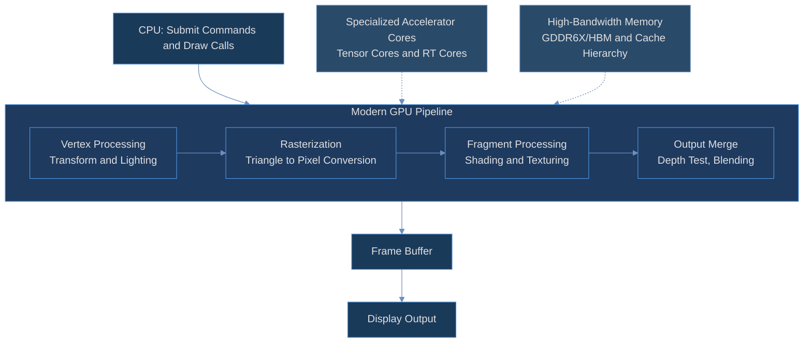

<br>

## 2. The Competitive Landscape: NVIDIA, AMD, and Intel

The GPU market is a dynamic three-way contest, with each player leveraging distinct architectures and market strategies to capture different segments of the market.

### 2.1 NVIDIA: The Performance and Ecosystem Leader

NVIDIA is the dominant force in the GPU market, particularly in high-performance gaming and the AI data center segments. Its strength lies in a powerful combination of cutting-edge silicon and a mature, proprietary software ecosystem that includes CUDA, cuDNN, and TensorRT.

**Current Architecture:** The Blackwell architecture powers NVIDIA's latest data center products and the high-end GeForce RTX 5090 for consumers. NVIDIA has announced its next-generation Vera Rubin architecture, promising a further 2.5x performance leap over previous generations.

**Enterprise Dominance:** In AI, products like the H100 and A100 Tensor Core GPUs are industry standards. The H100 introduces features like a Transformer Engine for optimized transformer model training and Confidential Computing for secure data processing. It offers 2-3x the performance of the A100 for large language model training.

**Key Strengths:**
- Comprehensive software ecosystem (CUDA, cuDNN, TensorRT)
- First-mover advantage in AI acceleration
- Strong enterprise relationships and support
- Continuous architectural innovation

### 2.2 AMD: The Value Contender

AMD competes aggressively on price-to-performance ratio and offers strong alternatives, especially in the consumer gaming market with its Radeon RX series.

**Current Architecture:** The RDNA architecture family powers AMD's gaming GPUs, with RDNA 3 representing the latest generation. AMD also produces the Instinct MI300 series for data centers, a direct competitor to NVIDIA's H100.

**Market Position:** AMD's strategy often involves offering more video memory (VRAM) at competitive price points, appealing to gamers and creators focused on high-resolution workloads. The company has also made significant strides in the data center market with its MI300 series.

**Key Strengths:**
- Competitive price-to-performance ratio
- Generous VRAM allocation
- Open-source software initiatives
- Strong gaming performance

### 2.3 Intel: The Disruptive Challenger

Intel has re-entered the discrete GPU arena with its Arc series and offers competitive data center products that leverage its manufacturing and packaging expertise.

**Current Architecture:** The Xe architecture family spans from integrated graphics to high-performance computing. The Data Center GPU Max 1550, based on the Ponte Vecchio GPU, is designed for AI and HPC workloads.

**Technical Approach:** The Max 1550 exemplifies Intel's strategy, integrating 47 active tiles using advanced 2.5D and 3D packaging technologies (EMIB, Foveros). It features 128 dedicated ray tracing units and competes with NVIDIA's A100, offering superior memory bandwidth (3,277 GB/s vs. 2,039 GB/s) but at a significantly higher power draw (600W vs. 250-400W).

**Key Strengths:**
- Advanced packaging and manufacturing capabilities
- Competitive memory bandwidth
- Growing software ecosystem
- Strong presence in integrated graphics

### 2.4 Product Comparison Tables

**Table 1: Performance Positioning of Select Current-Generation Consumer GPUs**

| Graphics Card | Approx. MSRP | Architecture | Key Positioning |
| :--- | :--- | :--- | :--- |
| NVIDIA GeForce RTX 5090 | $1,999 | Blackwell | Flagship gaming and creator performance; features 32GB GDDR7 memory |
| AMD Radeon RX 7900 XTX | ~$999 | RDNA 3 | High-end gaming competitor, strong 4K performance |
| Intel Arc B580 | ~$249 | Xe-HPG (Alchemist) | Budget to mid-range challenger, focused on value |

**Table 2: Comparison of Enterprise-Grade AI and HPC GPUs**

| Specification | NVIDIA A100 80GB | NVIDIA H100 | Intel Data Center GPU Max 1550 |
| :--- | :--- | :--- | :--- |
| Architecture | Ampere | Hopper | Xe-HPC (Ponte Vecchio) |
| Memory | 80 GB HBM2e | 80 GB HBM3 | 128 GB HBM2e |
| Memory Bandwidth | 2,039 GB/s | ~3.35 TB/s | 3,277 GB/s |
| FP32 Performance | 19.5 TFLOPS | ~67 TFLOPS | 52.4 TFLOPS |
| Tensor Cores | 432 | Next-Gen | 1024 (XMX Engines) |
| Ray Tracing Cores | N/A | N/A | 128 |
| Typical TDP | 250W - 400W | Up to 700W | 600W |
| Key Differentiator | Versatile AI and workload balance | Optimized for LLM training and scale | Extreme memory bandwidth and capacity |

<br>

## 3. Performance Analysis and Purchase Considerations

Selecting a GPU requires balancing performance, features, budget, and intended use case. This section provides guidance for different application scenarios.

### 3.1 For Gaming and Creative Work

Prioritize rasterization performance (traditional polygon rendering) for most games, and VRAM capacity for high-resolution textures and creative workloads.

**Key Considerations:**
- **Rasterization Performance:** Determines frame rates in traditional games
- **VRAM Capacity:** 16GB or more is ideal for 4K gaming and content creation
- **AI Upscaling:** Technologies like NVIDIA's DLSS, AMD's FSR, or Intel's XeSS can significantly boost frame rates
- **Ray Tracing Performance:** Important for modern games with realistic lighting effects

### 3.2 For AI Development and Data Science

Focus shifts to Tensor Core performance, memory bandwidth, and VRAM capacity for handling large models.

**Key Considerations:**
- **Tensor Core Performance:** Critical for deep learning training and inference
- **Memory Bandwidth:** Determines how quickly data can be fed to the processing cores
- **VRAM Capacity:** Essential for loading large models and batch sizes
- **Software Ecosystem:** NVIDIA's CUDA ecosystem currently has the broadest software support
- **Deployment Flexibility:** Cloud rental of instances with A100 or H100 GPUs is a common, flexible entry point

### 3.3 For Professional Simulation and HPC

Evaluate double-precision (FP64) performance, high-bandwidth memory, and inter-GPU communication capabilities.

**Key Considerations:**
- **FP64 Performance:** Critical for scientific simulations requiring high precision
- **High-Bandwidth Memory:** Essential for large datasets and complex simulations
- **Inter-GPU Communication:** Technologies like NVLink enable efficient multi-GPU scaling
- **Software Certification:** Driver stability and ISV certifications are important for professional workflows

### 3.4 Total Cost of Ownership (TCO) Analysis

A key consideration is total cost of ownership. While a more powerful GPU like the H100 has a higher hourly cloud cost, its ability to complete training jobs 2-3x faster than an A100 can lead to lower overall project cost and time.

**Factors in TCO Calculation:**
- Hardware acquisition or rental costs
- Power consumption and cooling requirements
- Time to completion for computational tasks
- Software licensing and support costs
- Maintenance and operational overhead

<br>

## 4. Future Trajectories and Industry Impact

The GPU's evolution is accelerating, driven by the demands of artificial intelligence and the exponential growth in computational requirements.

### 4.1 AI as the Primary Driver

The need to train ever-larger models is fundamentally shaping GPU design, leading to architectures like Blackwell and Rubin that are optimized for AI workloads from the ground up.

**Key Trends:**
- **Transformer Optimization:** Hardware-level support for transformer model architectures
- **Mixed Precision Training:** Support for FP8 and other low-precision formats
- **Scale-out Capabilities:** Enhanced inter-GPU communication for large clusters
- **Memory Capacity Expansion:** Increasing VRAM to accommodate trillion-parameter models

NVIDIA's DGX Spark desktop AI supercomputer brings petaflop-scale performance to developers' desks, blurring the line between data center and workstation.

### 4.2 Re-engineering the Data Center

GPU power demands are forcing fundamental infrastructure changes. NVIDIA's 800 VDC architecture, slated for 2027, aims to support 1 MW AI racks by moving to higher-voltage direct current distribution.

**Expected Benefits:**
- 45% reduction in copper usage
- Up to 5% improvement in end-to-end efficiency
- Simplified power distribution for dense compute clusters
- Reduced cooling infrastructure requirements

### 4.3 The Rise of AI Factories

GPUs are no longer just components but the core of new computing paradigms. Systems like the Blackwell GB200 NVL72, which connects 72 GPUs to act as a single giant GPU, are designed to host trillion-parameter models.

**Characteristics of AI Factories:**
- Industrial-scale AI training and inference
- Specialized infrastructure for massive parallelism
- Integration of compute, networking, and cooling
- Optimized for continuous operation and high utilization

<br>

## 5. Historical Evolution: From Fixed Function to General Purpose

The journey of the GPU highlights a relentless drive toward greater programmability and parallel compute capability.

### 5.1 The Early Era (Pre-2000)

Graphics hardware consisted of fixed-function pipelines for specific tasks like vertex transformation and pixel rasterization. Programmers had minimal control over the rendering process, and graphics capabilities were limited to what the hardware designers had implemented.

**Key Characteristics:**
- Fixed-function pipeline with little programmability
- Limited to graphics-specific operations
- Minimal developer control
- Rapidly increasing performance through transistor scaling

### 5.2 The Programmable Shader Revolution (2000s)

The introduction of programmable vertex and pixel shaders was a watershed moment. Architects like NVIDIA's Curie (2004) and Tesla (2006) began this transition, allowing developers to write small programs for lighting and effects.

**Key Developments:**
- Programmable vertex and pixel shaders
- Increased developer creativity and control
- Growing importance of graphics APIs (DirectX, OpenGL)
- Emergence of shader programming languages

### 5.3 Unified Shaders and GPGPU (Late 2000s)

Architectures like NVIDIA's Fermi (2010) introduced a unified shader model, where the same cores could process any type of graphics task. This flexibility, coupled with the launch of the CUDA parallel computing platform, opened the door for General-Purpose computing on GPUs (GPGPU).

**Key Developments:**
- Unified shader architecture
- CUDA programming platform launch
- GPGPU for scientific simulation and non-graphics tasks
- Growing use in financial modeling, medical imaging, and oil exploration

### 5.4 The AI and Ray Tracing Era (2018-Present)

Modern architectures are defined by the addition of dedicated accelerator cores. NVIDIA's Turing (2018) introduced the first RT and Tensor Cores for real-time ray tracing and AI.

**Key Developments:**
- Dedicated Tensor Cores for AI acceleration
- RT Cores for real-time ray tracing
- Heterogeneous compute architecture
- AI-driven rendering techniques (DLSS, denoising)
- Integration of AI and graphics workflows

<br>

## 6. Technical Glossary

For readers new to GPU technology, this glossary defines key terms used throughout this document.

| Term | Definition |
| :--- | :--- |
| **CUDA** | NVIDIA's parallel computing platform and programming model for GPUs |
| **FP32** | 32-bit floating point precision, the standard for most graphics and AI workloads |
| **FP64** | 64-bit double precision, used for scientific simulations requiring high accuracy |
| **GDDR6/GDDR7** | Graphics Double Data Rate memory, used in consumer graphics cards |
| **HBM** | High Bandwidth Memory, used in professional and data center GPUs |
| **LLM** | Large Language Model, AI models trained on massive text datasets |
| **Rasterization** | The process of converting 3D geometry into pixels on a 2D display |
| **Ray Tracing** | A rendering technique that simulates the physical behavior of light |
| **SM/CU** | Streaming Multiprocessor (NVIDIA) or Compute Unit (AMD), the fundamental processing block of a GPU |
| **Tensor Core** | Specialized hardware for matrix multiplication operations in AI workloads |
| **TFLOP** | Trillion floating-point operations per second, a measure of computational performance |
| **VRAM** | Video RAM, the dedicated memory on a graphics card |
| **XMX** | Xe Matrix Extension, Intel's matrix multiplication acceleration engine |

<br>

## 7. Conclusion

The GPU has decisively cemented its role as the king of visuals and the engine of the AI revolution. Its evolution from a fixed-function graphics chip to a general-purpose parallel powerhouse demonstrates the power of architectural specialization for massive throughput.

Today's landscape offers targeted solutions to meet diverse requirements:
- **NVIDIA's performance-leading ecosystem** for AI and high-end gaming
- **AMD's compelling gaming value** with generous VRAM allocations
- **Intel's disruptive high-bandwidth compute cards** with advanced packaging

For professionals and businesses, the choice increasingly hinges on AI capabilities, software support, and total infrastructure efficiency, as seen in the industry's move toward megawatt-scale AI factories. As the demand for intelligent computing grows exponentially, the GPU's architecture will continue to define the pace of technological progress across the global digital economy.

The integration of AI and graphics capabilities, combined with ongoing advancements in memory technology, manufacturing processes, and power efficiency, ensures that the GPU will remain at the forefront of computing innovation for years to come. Organizations that understand and leverage these capabilities will be well-positioned to compete in an increasingly compute-intensive world.
 


<br><br><br><br>
 


<h1 align="center">RANDOM ACCESS MEMORY (RAM): THE SPEEDY WORKBENCH OF YOUR CPU.</h1>

<br><br>

## Introduction and Fundamentals of RAM Technology

Random Access Memory (RAM) serves as the essential, high-speed workspace that your computer's processor utilises to hold active data and instructions at any given moment. Unlike permanent storage solutions such as Solid-State Drives (SSDs) or Hard Disk Drives (HDDs), RAM constitutes a form of **volatile memory**, meaning it requires continuous electrical power to retain its contents. When the system powers off, all data stored in RAM is irretrievably lost. This design is intentional and forms a cornerstone of modern computer architecture.

When you launch a program or open a file, your operating system copies the necessary data from slower storage media into the fast, volatile RAM. The Central Processing Unit (CPU) can then access this data at speeds orders of magnitude greater than if it had to read directly from a drive. This process dramatically reduces processor idle time and enables smooth, responsive system performance.

The term "random access" signifies a key operational advantage: the time required to read from or write to any memory cell remains constant, regardless of its physical location within the memory array. This stands in stark contrast to sequential-access storage devices like older tape drives, where retrieval time depends on the data's physical position. Modern RAM is physically implemented through **integrated circuit (IC) chips** containing billions of microscopic memory cells, primarily constructed using metal-oxide-semiconductor (MOS) technology.

### Volatility and the Critical Workflow

The volatile nature of RAM defines its role in the data workflow. The CPU operates exclusively on data loaded into RAM, and any changes made must be deliberately saved back to non-volatile storage for permanent retention. This underscores why sufficient RAM capacity is critical for system performance. When the system exhausts available RAM, it is forced to utilise a slower **page file** on the storage drive as virtual memory, constantly swapping data back and forth. This process causes severe performance degradation, noticeable as system stutters, freezing, and slowdowns—a state commonly referred to as "thrashing."

### The Hierarchy of Memory

To optimally balance speed, capacity, and cost, modern computers employ a tiered **memory hierarchy**. At the apex are the CPU's internal registers, which are minuscule in size but offer the fastest possible access speeds. Next comes the CPU cache, built from Static RAM (SRAM), which is exceptionally fast but relatively small and expensive. The main system memory, built from Dynamic RAM (DRAM), occupies the middle tier of this hierarchy. It offers substantially larger capacity at lower cost but with higher latency than cache. At the base lies secondary storage (SSDs and HDDs), which is non-volatile, offers vast capacity at the lowest cost, but has the highest access latency by far. The system's memory controller and prefetch algorithms work continuously to maintain the data the CPU needs most frequently as high up in this hierarchy as possible.

<br>

## 1. SRAM vs. DRAM: The Core Architectural Divide

All modern RAM falls into two primary categories, defined by the fundamental design of their memory cells. Understanding this division is essential for comprehending the broader memory hierarchy.

### Static RAM (SRAM)

An SRAM cell employs a **circuit of several transistors (typically 4 to 6)** to form a bistable latching circuit that holds a state (representing either a binary 1 or 0). This design is inherently stable and does not require periodic refreshing to maintain data, making it exceptionally fast with very low latency. However, the multi-transistor cell is physically larger, more expensive to manufacture, and consumes more static power per bit. Consequently, SRAM is reserved for mission-critical, speed-sensitive applications where capacity is secondary, most notably the **CPU cache memory (L1, L2, L3)** and processor registers.

### Dynamic RAM (DRAM)

A DRAM cell is architecturally simpler and significantly denser, consisting of just **one transistor and one capacitor**. The capacitor holds an electrical charge to represent a bit of data (charged equals 1, discharged equals 0), while the transistor acts as a switch to read or modify that charge. This 1T1C design allows for extremely high density and low cost per bit, making DRAM ideal for the gigabytes of main system memory. The critical trade-off is that capacitors leak their charge over milliseconds. Therefore, DRAM requires a dedicated **refresh circuit** to read and rewrite the data in each cell thousands of times per second to prevent data loss. This refresh process introduces latency and complexity and is the defining "dynamic" characteristic that gives DRAM its name.

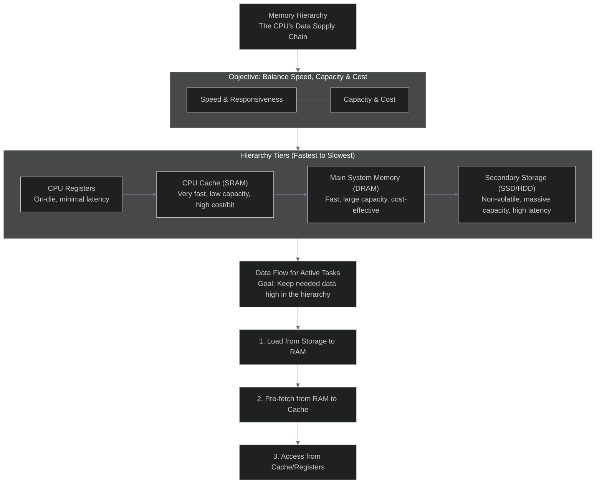

<br>

## 2. The Evolution of DDR SDRAM: A Generational Leap

Synchronous Dynamic RAM (SDRAM) synchronised memory operations with the CPU's clock, enabling precise and efficient data transfers. The groundbreaking innovation was Double Data Rate (DDR) SDRAM, first demonstrated by Samsung in 1997 and commercially released in 1998. DDR technology enables data transfer on **both the rising and falling edges of the clock signal**, effectively doubling the data rate without increasing the base clock frequency. This foundational principle has driven all successive generations, each delivering increased speed, improved efficiency, and greater capacity. A critical rule to remember is that **DDR generations are not cross-compatible**; each possesses distinct electrical parameters and physical keying to prevent installation in an incompatible motherboard.

The table below charts the progression of DDR technology, highlighting the key improvements with each generation.

| Generation | Introduction Year | Key Innovation & Prefetch | Data Rate (MT/s) | Peak Transfer Rate (per 64-bit channel) | Operating Voltage | Status & Notes |
| :--- | :--- | :--- | :--- | :--- | :--- | :--- |
| **SDR SDRAM** | 1992 | 1-bit Prefetch, Synchronous clocking | 100 - 166 | 0.8 - 1.3 GB/s | 3.3V | **Obsolete**. The pre-DDR standard for 1990s PCs. |
| **DDR / DDR1** | 2000 | **2-bit Prefetch**, **2x Clock Edge Transfer** | 200 - 400 | 2.1 - 3.2 GB/s | 2.5V-2.6V | **Obsolete**. Powered early 2000s systems. |
| **DDR2** | 2003 | **4-bit Prefetch**, Improved bus signalling | 400 - 800 | 4.2 - 6.4 GB/s | 1.8V | **Obsolete**. Common in mid-2000s systems. |
| **DDR3** | 2007 | **8-bit Prefetch**, ~40% lower power vs. DDR2 | 800 - 2133 | 8.5 - 14.9+ GB/s | 1.35V-1.5V | **Legacy**. Dominant for ~7 years; still in older systems. |
| **DDR4** | 2014 | **Bank Groups** (for parallel ops), Higher density | 1600 - 3200+ (JEDEC) | 17 - 25.6+ GB/s | 1.2V | **Current Mainstream**. Standard from ~2015-2021. |
| **DDR5** | 2020/2021 | **16-bit Prefetch**, **Dual 32-bit Sub-Channels**, On-DIMM PMIC | 4800 - 8400+ (JEDEC) | 38.4 - 51.2+ GB/s | 1.1V | **Current High-Performance Standard**. For modern platforms. |

### The March from DDR to DDR4

Each generation from DDR1 through DDR4 achieved higher peak bandwidth primarily by doubling the **internal prefetch buffer** size (from 2n to 4n, then 8n). This allows the memory's internal array to fetch more data per operation for the I/O interface to transmit. A concurrent and critical trend has been the steady **reduction in operating voltage**, from 2.5V for DDR1 down to 1.2V for DDR4, directly lowering power consumption and heat output. DDR4 introduced **bank groups**, allowing different sections of a memory chip to operate in parallel, which significantly improved real-world efficiency for multi-core processors.

### DDR5: A Revolutionary Architectural Shift

DDR5 represents the most significant architectural change since the inception of DDR. Its cornerstone innovation is splitting the traditional 64-bit data channel per DIMM into **two independent 32-bit sub-channels**. This dramatically increases concurrency and improves memory controller efficiency. Furthermore, DDR5 relocates voltage regulation from the motherboard to a **Power Management Integrated Circuit (PMIC)** on the module itself. This provides cleaner, more stable power, which is crucial for signal integrity at extremely high data rates. DDR5 also features **On-Die ECC (Error-Correcting Code)** , a mechanism that detects and corrects bit errors within the DRAM chip to improve reliability (distinct from full system-level ECC used in servers).

<br>

## 3. Technical Specifications: Capacity, Speed, and Latency

Selecting the appropriate RAM requires balancing three interdependent key specifications: capacity, speed (data rate), and latency.

### Capacity (Measured in Gigabytes - GB)

This defines the size of the CPU's immediate "workbench." Insufficient RAM leads to constant disk swapping and "thrashing." For modern systems, **8GB is considered the baseline for basic computing**. **16GB is the recommended standard for comfortable gaming, general productivity, and multitasking**. For demanding workloads like high-resolution video editing, 3D rendering, software development, heavy data processing, or extreme multitasking, **32GB or more is highly advisable**. The advent of high-density DDR5 chips now enables kits of 48GB, 96GB, and even 192GB for enthusiast and workstation platforms.

### Data Rate / Speed (Measured in MT/s or effective MHz)

Commonly listed as "DDR5-6000," the number (6000) refers to **Megatransfers per second (MT/s)** , indicating how many million data transfers can occur each second. A higher MT/s rating translates to higher potential bandwidth. It is critical to note that **motherboards and CPUs have official memory speed limits**. Speeds beyond these limits are considered overclocks and typically require enabling a built-in performance profile in the BIOS, such as **Intel's Extreme Memory Profile (XMP)** or **AMD's EXPO (Extended Profiles for Overclocking)** .

### Latency (CAS Latency - CL)

Represented by timings like "CL30" or "30-38-38-96," CAS Latency measures the delay (in clock cycles) between the memory controller requesting data and that data being available on the module's output pins. **Lower CAS latency is better**, as it indicates quicker response time. There exists a common trade-off between maximum speed (MT/s) and tight timings. A kit with a slightly lower speed but significantly lower latency can sometimes deliver better real-world responsiveness than a higher-speed kit with looser timings. The actual delay in nanoseconds is calculated as (CL / Clock Frequency in MHz).

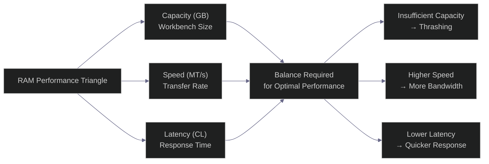

<br>

## 4. Form Factors, Compatibility, and Channels

### Physical Form Factors

RAM modules come in standardised physical packages designed for different system types.

- **DIMM (Dual In-line Memory Module)** : The standard long module used in desktop PCs and servers. DDR4 and DDR5 DIMMs both have 288 pins but are keyed differently to prevent insertion into the wrong slot.
- **SO-DIMM (Small Outline DIMM)** : A much shorter module used in laptops, compact desktops, and small form-factor systems.
- **LPCAMM (Low-Power Compression Attached Memory Module)** : An emerging, compact form factor that offers a solderable alternative to SO-DIMMs for space-constrained devices like modern laptops, providing benefits in power efficiency and potentially easier upgrades.

### Memory Channels (Dual, Quad, etc.)

Modern desktop CPUs support **dual-channel memory** architecture. When two identical modules are installed in the correct motherboard slots, the memory controller can access them in parallel, effectively doubling the available bandwidth compared to a single module. High-end desktop (HEDT) and server platforms often support quad-channel or even octal-channel configurations for massive bandwidth. Always install memory in matched pairs (or sets of four) to enable multi-channel mode.

### ECC vs. Non-ECC

Error-Correcting Code (ECC) memory includes extra bits to detect and correct single-bit data corruption. It is crucial for servers, workstations, and mission-critical systems where data integrity is paramount. Most standard consumer motherboards and CPUs support only non-ECC memory.

<br>

## 5. Market Analysis and Application-Specific Recommendations

The RAM market consists of a few major DRAM chip manufacturers (Samsung, SK Hynix, Micron) who produce the silicon dies, and numerous module vendors (Corsair, G.Skill, Kingston, Crucial, TeamGroup, ADATA, etc.) who assemble these chips onto PCBs, add heat spreaders, test performance profiles, and market the final kits. The "best" RAM is entirely dependent on your specific platform (CPU/motherboard) and primary workloads.

Based on current market analysis and performance testing, here are tailored recommendations:

| Use Case | Platform | Recommended Speed | Recommended Capacity | Target Timings | Representative Kits |
| :--- | :--- | :--- | :--- | :--- | :--- |
| **General Productivity & Mainstream Gaming** | DDR4 (Intel 10th/11th Gen, AMD Ryzen 3000/5000) | DDR4-3200 to DDR4-3600 | 16GB (2x8GB) or 32GB (2x16GB) | CL16 to CL18 | Corsair Vengeance LPX, Crucial Ballistix, TeamGroup T-Force Vulcan Z |
| **High-Performance Gaming & Content Creation** | DDR5 (Intel Core Ultra, AMD Ryzen 7000/9000) | DDR5-6000 | 32GB (2x16GB) | CL30 to CL32 | G.Skill Trident Z5 Neo RGB (AMD EXPO), G.Skill Trident Z5 RGB (Intel XMP), Klevv Cras XR5 RGB |
| **Enthusiast Overclocking** | DDR5 (High-end platforms) | DDR5-6400 and beyond | 32GB (2x16GB) or higher | CL32 to CL36 | G.Skill Trident Z5 RGB DDR5-6400, Corsair Dominator Platinum RGB DDR5-6600 |
| **Workstations & Maximum Capacity** | DDR5 (Professional platforms) | DDR5-5200 to DDR5-6400 | 96GB (2x48GB) to 192GB (4x48GB) | CL30 to CL40 | Corsair Vengeance 192GB (4x48GB), G.Skill Trident Z5 RGB 96GB (2x48GB) |
| **No-Frills Reliability & OEM Upgrades** | DDR4 or DDR5 (Standard platforms) | JEDEC Standard Speeds (e.g., DDR5-4800) | Varies by need | JEDEC Standard Timings | Crucial DDR5 Pro, Samsung DDR5-4800 UDIMMs |

<br>

## 6. Future Directions: DDR6 and Beyond

The relentless demand for bandwidth from artificial intelligence, high-performance computing, and advanced graphics continues to drive memory technology forward.

### DDR6

The next-generation standard is in active development, with key players like Samsung, Micron, and SK Hynix targeting a launch window around **2027**. Early specifications point to a monumental leap:

- **Data Rates**: Expected to start at **8,800 MT/s**, scaling to **17,600 MT/s and beyond**, effectively doubling the ceiling of mainstream DDR5.
- **Architecture**: A move to a **4x24-bit sub-channel architecture** per DIMM for even greater internal concurrency and efficiency.
- **Form Factor**: DDR6's adoption may be closely tied to the **CAMM2 (Compression Attached Memory Module, 2nd generation)** form factor. CAMM2 offers a compact, flat design that is better suited for maintaining signal integrity at these extreme speeds and is expected to see early adoption in servers and high-end notebooks.

### Specialised Memory and Integration

The lines between system memory, cache, and processing are blurring. Technologies like **AMD's 3D V-Cache** stack large amounts of SRAM directly on top of the CPU die, drastically reducing latency for specific workloads.

**LPDDR5/6** standards continue to evolve for extreme power efficiency in mobile and edge devices.

Interfaces like **Compute Express Link (CXL)** are emerging to allow for memory pooling and expansion beyond traditional motherboard slots, enabling more flexible system architectures.

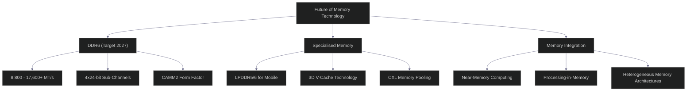

<br>

## Conclusion

RAM remains a dynamically evolving and critical cornerstone of computing performance. From its fundamental role as the CPU's volatile, high-speed workspace to the cutting-edge, channel-splitting architecture of DDR5, understanding its principles is essential for making informed decisions. Selecting the right memory involves a careful balance of capacity, speed, latency, and compatibility, all evaluated against the specific demands of your hardware platform and applications.

As we look toward the horizon at DDR6 and novel form factors like CAMM2, the trajectory is clear: memory will continue to become faster, more efficient, more capacious, and more intelligently integrated into the fabric of computing. The rapid advancement of artificial intelligence, machine learning, and data-intensive applications will only accelerate this evolution, ensuring that RAM technology remains at the forefront of computing innovation for decades to come.


<br><br><br><br>
 


<h1 align="center">STORAGE: THE KEEPERS OF YOUR DIGITAL LIFE.</h1>

<br><br>

## Executive Summary

Digital storage technology forms the indispensable bedrock of the modern information age, silently preserving everything from personal memories to global datasets. This comprehensive guide explores the complete ecosystem of data storage, tracing its evolution from electromechanical beginnings to solid-state marvels and beyond. We examine the fundamental binary units that encode our world, the sophisticated architectures that retrieve information at lightning speed, and the practical considerations for deploying these technologies effectively.

As artificial intelligence, immersive computing, and big data analytics demand unprecedented performance and scale, a clear understanding of storage is no longer a specialization but a fundamental component of digital literacy for engineers, researchers, and informed users alike. This document provides the foundational knowledge and strategic framework necessary to navigate the present and future landscape of digital memory.

<br>

## 1. Foundational Concepts: The Hierarchy and Language of Storage

At its core, digital storage is a hierarchy of compromises, balancing the competing demands of speed, capacity, cost, and persistence. Understanding this hierarchy and the basic units of measurement is essential to grasping more complex architectures.

### 1.1 The Storage and Memory Hierarchy

Effective computer design relies on a cascading structure known as the memory hierarchy. At the pinnacle are the CPU registers and caches (L1, L2, L3), offering nanosecond access times but microscopic capacity, measured in kilobytes to a few megabytes. Below this sits the main system memory (DRAM), providing gigabytes of workspace with microsecond access, but at the cost of volatility—it loses all data when power is removed.

Finally, we reach the domain of **persistent storage devices**: Solid-State Drives (SSDs) and Hard Disk Drives (HDDs). These provide terabytes to petabytes of non-volatile capacity, with access times ranging from microseconds to milliseconds. The system's memory controller and operating system work tirelessly to move the most relevant data up this hierarchy, ensuring performance while leveraging the economy of high-capacity storage.

### 1.2 Binary Foundations and Capacity Units

All digital data, regardless of complexity, is built upon the binary digit, or **bit**. A single bit represents one of two states, conventionally labeled 0 or 1. Eight bits are grouped into a **byte**, which is sufficient to represent a single alphanumeric character.

Capacity scales upward using binary (base-2) prefixes:

| Unit | Abbreviation | Size in Bytes |
|------|--------------|---------------|
| Kilobyte | KB | 1,024 bytes |
| Megabyte | MB | 1,024 kilobytes (1,048,576 bytes) |
| Gigabyte | GB | 1,024 megabytes |
| Terabyte | TB | 1,024 gigabytes |
| Petabyte | PB | 1,024 terabytes |
| Exabyte | EB | 1,024 petabytes |
| Zettabyte | ZB | 1,024 exabytes |

This exponential scale reflects the explosive growth of digital data. The journey from megabyte-scale personal computers in the 1980s to terabyte-capacity smartphones today illustrates the relentless progress of storage density—a trend that must continue as global data creation accelerates into the zettabyte range annually.

<br>

## 2. Architectural Evolution: From Spinning Platters to Quantum Tunnels

Storage technology has progressed through distinct architectural paradigms, each overcoming the limitations of its predecessor to unlock new applications and performance levels.

### 2.1 Magnetic Storage: The Hard Disk Drive (HDD)

The Hard Disk Drive (HDD) is a masterpiece of precision mechanical engineering that has dominated bulk storage for decades. Data is stored by magnetizing microscopic regions on the surface of one or more rapidly spinning platters, typically coated with a cobalt-based alloy.

**Components and Operation:**

An HDD contains platters that spin at speeds of 5,400 to 15,000 revolutions per minute (RPM). An actuator arm, analogous to the tonearm of a record player, positions a read/write head nanometers above the platter surface. To write data, the head generates a magnetic field that flips the polarity of a region on the platter. To read, it detects the minute magnetic fields emanating from these regions. The entire assembly operates in a sealed, dust-free environment, as a single particle could be catastrophic for the sub-10-nanometer gap between head and platter.

**Density Scaling Technologies:**

HDD capacity has soared through several innovations:

- **Perpendicular Magnetic Recording (PMR):** Aligned magnetic domains vertically for greater density.
- **Shingled Magnetic Recording (SMR):** Increased track density by writing new tracks that overlap portions of previous ones, much like roofing shingles.
- **Heat-Assisted Magnetic Recording (HAMR):** Uses a nanoscale laser to momentarily heat a tiny spot on the platter, allowing the writing of smaller, more stable magnetic grains. These technologies have pushed consumer HDDs beyond 20TB.

### 2.2 The Solid-State Revolution: Flash Memory and SSDs

The Solid-State Drive (SSD) represents a paradigm shift, eliminating all moving parts and leveraging quantum-mechanical phenomena for storage. This results in dramatically lower latency, higher throughput, and improved resistance to physical shock.

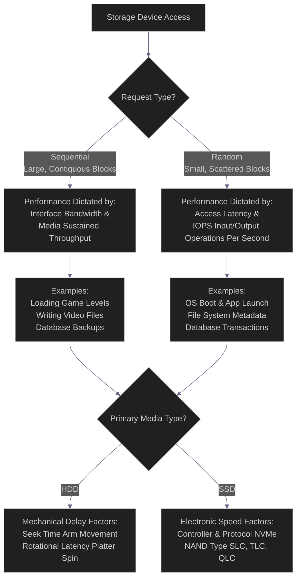

**NAND Flash Cell Fundamentals:**

SSDs are built on NAND flash memory cells, which are transistors with a special "floating gate." Electrical charge is trapped on this gate to represent data. The number of distinct charge levels a cell can discriminate determines how many bits it can store:

| Cell Type | Bits per Cell | States | Characteristics |
|-----------|---------------|--------|------------------|
| SLC (Single-Level Cell) | 1 bit | 2 states | Highest endurance, speed, and cost |
| MLC (Multi-Level Cell) | 2 bits | 4 states | Balanced performance and cost |
| TLC (Triple-Level Cell) | 3 bits | 8 states | Common in consumer drives; good balance |
| QLC (Quad-Level Cell) | 4 bits | 16 states | High capacity, lower endurance |
| PLC (Penta-Level Cell) | 5 bits | 32 states | Emerging technology for maximum density |

**3D NAND Architecture:**

To overcome the physical limits of shrinking transistors on a flat plane, manufacturers stack memory cells vertically. Modern 3D NAND features over 200 layers. Cells are organized into "strings," grouped into "pages" (the smallest unit for a read or write operation, typically 16KB), which are aggregated into "blocks" (the smallest unit for an erase operation). This three-dimensional fabrication allows for extraordinary densities, enabling multi-terabyte capacities on a chip the size of a fingernail.

### 2.3 Hybrid and Specialized Architectures

Beyond pure HDDs and SSDs, several architectures target specific niches:

**Solid-State Hybrid Drives (SSHDs):**

These combine a conventional HDD with a small amount of high-speed flash memory (typically 8-64GB) acting as a cache. The drive firmware identifies frequently accessed data and copies it to the flash for faster retrieval. While their value proposition has diminished with falling SSD prices, they represented an intelligent stopgap solution.

**Storage-Class Memory (SCM):**

Technologies like Intel's discontinued Optane (based on 3D XPoint memory) aimed to bridge the latency gap between DRAM and storage. SCM offers near-DRAM speeds with data persistence, opening new architectural possibilities for high-performance databases and caching layers, highlighting a future direction for the industry.

<br>

## 3. Interfaces, Form Factors, and Real-World Performance

The potential of a storage device is only realized through its connection to the rest of the system. The interface and physical form factor are critical determinants of compatibility and performance.

### 3.1 Interface Protocols: From SATA to NVMe

The protocol governing how the CPU communicates with the storage device is as important as the storage media itself.

| Interface / Protocol | Max Theoretical Bandwidth | Real-World Performance | Best For | Key Limitation |
| :--- | :--- | :--- | :--- | :--- |
| **SATA III (AHCI)** | 6 Gb/s (~600 MB/s) | ~550 MB/s sequential | Budget builds, secondary bulk storage, legacy systems | Shared bus; single command queue with 32 commands depth |
| **PCIe 3.0 x4 (NVMe)** | ~4 GB/s | ~3,500 MB/s sequential | Mainstream systems (circa 2017-2020) | Being superseded by PCIe 4.0/5.0 |
| **PCIe 4.0 x4 (NVMe)** | ~8 GB/s | ~7,000-7,450 MB/s sequential | High-end gaming, content creation (circa 2020-2023) | Higher power consumption and thermal output |
| **PCIe 5.0 x4 (NVMe)** | ~16 GB/s | ~14,000-15,000 MB/s sequential | Enthusiast workstations, cutting-edge performance (2023+) | Significant heat generation, often requiring active cooling |
| **USB4 / Thunderbolt 4** | 40 Gb/s (~5 GB/s) | ~3,000-4,000 MB/s | High-performance external storage, professional docks | Performance dependent on cable quality and host controller implementation |

**The NVMe Revolution:**

The **Non-Volatile Memory Express (NVMe)** protocol was designed from the ground up for flash memory. Unlike the older AHCI protocol used for SATA—which has a single queue capable of holding 32 commands—NVMe supports **up to 64,000 queues**, each holding up to 64,000 commands. This massive parallelism perfectly matches the intrinsic parallelism of NAND flash, reducing latency and unlocking immense input/output operations per second (IOPS) potential. As noted by the NVMe consortium, this architecture allows efficient data access beneficial to a wide range of workloads in client, cloud, and enterprise markets.

### 3.2 Form Factors and Physical Design

Storage devices come in standardized shapes and sizes to fit different systems:

| Form Factor | Dimensions | Common Interfaces | Typical Use Cases |
|-------------|------------|-------------------|-------------------|
| **3.5-inch** | 146 x 101 x 26 mm | SATA | Desktop HDDs, NAS drives |
| **2.5-inch** | 100 x 70 x 7-15 mm | SATA, SAS | Laptop HDDs/SSDs, enterprise SSDs |
| **M.2** | Various (e.g., 2280 = 22mm x 80mm) | SATA, PCIe NVMe | Internal SSDs for laptops and desktops |
| **U.2 / U.3** | 2.5-inch form factor | PCIe NVMe | Enterprise servers, hot-swappable drives |
| **EDSFF ("Ruler")** | Long rectangular | PCIe NVMe | Enterprise data centers, high-density storage |

**M.2 Drives:**

M.2 drives are described by a four-digit size code (e.g., 2280 = 22mm wide, 80mm long). They can support either SATA or, more commonly, PCIe NVMe interfaces.

<br>

## 4. The Contemporary Landscape: Selecting Storage for the Task

With a grasp of the underlying technologies, we can now examine how they map to real-world applications, from personal computing to enterprise data centers.

### 4.1 Internal Storage Solutions

**Operating System and Gaming:**

For a responsive OS and fast game level loads, a PCIe 4.0 or 5.0 NVMe SSD is ideal. The critical metric is high **random read performance (IOPS)** for snappy system responsiveness, coupled with strong sequential read speeds for loading large game assets.

**Content Creation and Workstations:**

Video editing, 3D rendering, and scientific computing demand **high sustained write throughput** and large capacities. PCIe 4.0/5.0 SSDs with robust thermal solutions are essential to prevent throttling during long, intensive writes. Professionals often use multi-drive RAID configurations for even greater performance or redundancy.

**High-Capacity and Archival Storage:**

When the lowest cost per terabyte is paramount, and performance is secondary, high-capacity HDDs remain unchallenged. Drives utilizing HAMR technology offer 20TB+ for bulk media libraries, backups, and cold archival storage.

### 4.2 External and Networked Storage

**Portable SSDs:**

Portable SSDs offer near-internal SSD speeds over USB or Thunderbolt in rugged, pocket-sized enclosures. They are indispensable for field professionals needing to transfer or back up large projects quickly.

**Network-Attached Storage (NAS):**

A dedicated, networked storage appliance containing multiple drives (often in a RAID configuration). It provides centralized, shared storage for a home or small office, accessible by all devices on the network.

**Cloud Storage:**

Services like AWS S3, Google Cloud Storage, and Azure Blob represent the ultimate abstraction, offering seemingly infinite, managed storage over the internet. They operate on a global scale using the underlying physical technologies discussed here but present them as a simple, pay-as-you-go service.

### 4.3 Decision Framework: Matching Technology to Need

Selecting the right storage requires analyzing your workload's characteristics:

| Primary Use Case | Recommended Technology | Capacity Sweet Spot | Critical Performance Metric |
| :--- | :--- | :--- | :--- |
| **OS / Boot Drive** | PCIe 4.0/5.0 NVMe SSD | 1TB - 2TB | Random 4K Read IOPS, Low Latency |
| **Gaming Library** | PCIe 4.0 NVMe SSD | 2TB - 4TB | Sequential Read Speed, Random Read IOPS |
| **Content Creation** | PCIe 4.0/5.0 SSD with Heatsink | 2TB - 8TB | Sustained Write Throughput, Capacity |
| **Bulk Media / Archive** | High-Capacity HDD (7200 RPM) | 8TB+ | Cost per Terabyte, Reliability |
| **Portable/Backup** | External NVMe SSD | 1TB - 4TB | Interface Speed (USB4/TB4), Durability |

**Key Selection Considerations:**

| Factor | What to Check | Why It Matters |
|--------|---------------|----------------|
| **Compatibility** | Physical slots (M.2 length), supported interface (PCIe 3.0/4.0/5.0), available lanes | A PCIe 5.0 drive will function in a PCIe 3.0 slot but at Gen3 speeds |
| **Endurance (SSDs)** | Terabytes Written (TBW) or Drive Writes Per Day (DWPD) | For most consumers, even a moderate TBW rating will last years |
| **Maintenance (SSDs)** | Free space (10-20% recommended) | Aids the SSD's internal garbage collection and wear-leveling algorithms |
| **Reliability (HDDs)** | Mean Time Between Failures (MTBF) | Indicates expected operational lifespan; ensure stable power and proper cooling |

<br>

## 5. Future Horizons and Strategic Directions

Storage technology continues to evolve, driven by insatiable demand from AI, IoT, and the digitization of everything.

### 5.1 Near-Term Evolution (2025-2030)

**AI-Optimized Storage:**

Generative AI and massive machine learning models are reshaping requirements. Training workloads need petabyte-scale datasets delivered with immense sequential bandwidth. In contrast, inference and **Retrieval-Augmented Generation (RAG)** systems demand ultra-low latency for random reads to query vector databases. This is driving development of computational storage (processing data on the drive itself) and new controller architectures.

**QLC/PLC and Continued 3D Scaling:**

Quad-Level Cell (QLC) NAND is becoming mainstream in consumer drives, pushing capacities higher. Penta-Level Cell (PLC) NAND looms on the horizon, promising even greater density at the expected cost of reduced write endurance. 3D stacking will continue to add layers, with 300+ layer NAND already in development.

### 5.2 Long-Term Transformational Visions

**DNA Data Storage:**

Biological storage represents the theoretical apex of density, with the potential to store **exabytes** of data per gram within the molecules of DNA. While currently laboratory-bound, prohibitively expensive, and slow, it presents a visionary path for ultra-long-term (centuries) archival storage.

**Advanced System Architecture:**

The lines between memory and storage are blurring. Technologies like **Compute Express Link (CXL)** enable a coherent memory space that can incorporate persistent memory devices. **Zoned Namespaces (ZNS)** is an NVMe feature that allows the host system to manage flash storage more efficiently by aligning data placement with the media's physical characteristics, improving performance and longevity for specific workloads.

### 5.3 Enterprise and Systemic Trends

Enterprise storage is being shaped by several convergent forces:

| Trend | Description | Impact |
|-------|-------------|--------|
| **Next-Gen Data Protection** | A shift to a "cyber focus, recovery first" mindset with immutable snapshots and guaranteed rapid recovery | Counter ransomware threats effectively |
| **Hybrid Multi-Cloud Storage** | Seamless data mobility between on-premises private cloud and multiple public clouds (AWS, Azure) | Ultimate flexibility and cost optimization |
| **Automation and Optimization** | Intense focus on storage efficiency—reducing physical footprint, power consumption, and management overhead | Lower operational costs through intelligent, automated software |

<br>

## 6. Conclusion: The Central Pillar of Computation

Storage technology has evolved from a peripheral component to a central determinant of system capability, user experience, and business viability. The transition from mechanical to solid-state architectures removed a fundamental bottleneck, enabling the real-time, data-intensive applications that define our current era.

There is no single "best" storage technology, only the most appropriate one for a given set of constraints: performance, capacity, endurance, cost, and form factor. The optimal strategy is a **tiered architecture**: employing blindingly fast NVMe storage for active workloads, cost-effective high-capacity SSDs or HDDs for warm data, and highly efficient archival solutions for cold data.

As we stand at the precipice of an AI-driven future, the role of storage will only become more critical. For researchers, engineers, and technology leaders, a deep and nuanced understanding of storage architecture is not optional—it is foundational. The keepers of our digital life will continue to advance, from the quantum mechanics of flash cells to the molecular biology of DNA, ensuring that our growing digital universe has a place to reside.

<br><br><br><br>
 
----------------

<br><br><br><br>

<h1 align="center">POWER SUPPLY UNIT (PSU): THE UNSUNG HERO OF YOUR PC</h1>

<br><br>

## 1. Introduction

The Power Supply Unit (PSU) is arguably the most underappreciated component inside a computer system. While processors, graphics cards, and storage drives often receive the spotlight, the PSU works silently behind the scenes, performing the essential function of converting the alternating current (AC) electricity from your wall outlet into the direct current (DC) voltages that your computer's internal components require to function properly.

Without a reliable PSU, even the most powerful hardware configuration is rendered useless. This documentation aims to provide a comprehensive, accessible overview of PSU technology, covering its fundamental principles, key specifications, efficiency standards, safety features, and future trends. Whether you are building a new system or upgrading an existing one, understanding the role and characteristics of your PSU is critical to ensuring system stability, longevity, and performance.

<br>

## 2. Core Principles of Power Supply Units

### 2.1 What Does a PSU Actually Do?

At its most basic level, a PSU performs a single but vital task: it transforms the high-voltage AC power from your electrical outlet into the low-voltage DC power that your computer's components need to operate. The process involves several stages, including rectification (converting AC to DC), voltage transformation (stepping down the voltage to usable levels), and regulation (ensuring the output remains stable despite fluctuations in input or load).

The PSU distributes three primary voltages to various components:

| Voltage Rail | Primary Usage |
|--------------|----------------|
| **+12V** | CPU, Graphics Card (GPU), and some motherboard power delivery circuits |
| **+5V** | USB ports, hard drives (HDDs), and solid-state drives (SSDs) |
| **+3.3V** | Motherboard chipsets, RAM, and peripheral controllers |

Each voltage rail is independently regulated to ensure that the output remains consistent, as fluctuations can lead to system instability or component damage.

### 2.2 The Power Conversion Process

The diagram below illustrates the general flow of power conversion within a modern switched-mode power supply (SMPS), which is the design used in virtually all contemporary computer PSUs.

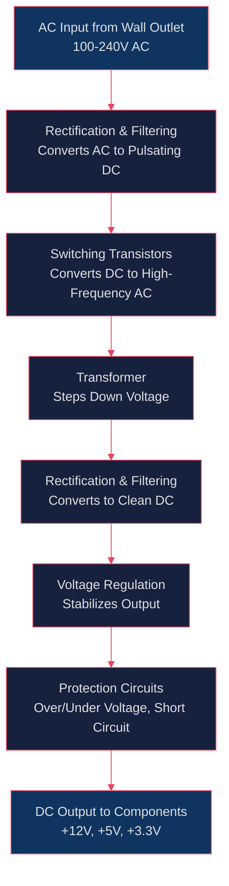

<br>

## 3. Key Technical Specifications

When selecting a PSU, several specifications require careful consideration. Understanding these parameters will help you make an informed decision that balances performance, cost, and compatibility.

### 3.1 Wattage Rating

The wattage rating, measured in Watts (W), indicates the maximum amount of power a PSU can deliver continuously under normal operating conditions. This is not a measure of how much power the PSU consumes, but rather how much it can supply to your components.

Selecting a PSU with insufficient wattage for your system can lead to:
- System crashes or unexpected shutdowns under load
- Reduced component lifespan due to unstable power delivery
- Inability to boot or operate high-performance components

Conversely, purchasing a PSU with excessive wattage beyond your requirements is generally not harmful, but it may result in lower efficiency at idle loads and a higher upfront cost.

The following flowchart can guide the wattage selection process:

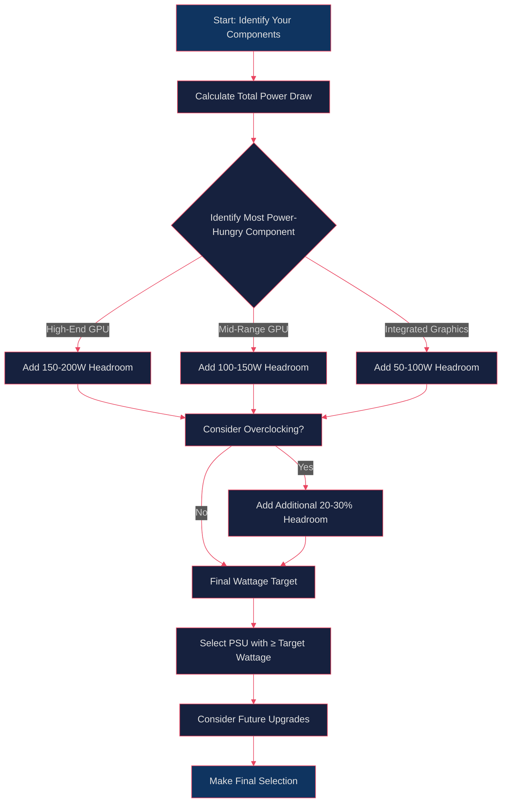

### 3.2 Form Factor

PSUs are manufactured in various physical sizes to accommodate different computer case designs. Selecting the correct form factor is essential for physical compatibility.

| Form Factor | Dimensions (W x H x D) | Typical Usage |
|-------------|------------------------|---------------|
| **ATX** | 150mm x 86mm x 140-160mm | Standard desktop PCs, full-tower and mid-tower cases |
| **SFX** | 125mm x 63.5mm x 100mm | Compact builds, mini-ITX systems, small form factor (SFF) cases |
| **SFX-L** | 125mm x 63.5mm x 125-130mm | SFF builds requiring additional wattage or quieter operation |
| **Flex ATX** | 81.5mm x 40.5mm x 150mm | Small servers, industrial PCs, ultra-compact builds |

### 3.3 Efficiency and 80 PLUS Certification

Efficiency is a measure of how much power drawn from the wall is successfully converted into usable DC power for your components. The remaining power is dissipated as heat. A more efficient PSU generates less heat, reduces electricity costs, and contributes to a quieter system due to lower fan speeds.

The 80 PLUS certification program provides an industry-standard rating system for PSU efficiency. The following table outlines the efficiency requirements for each certification level:

| Certification Level | Efficiency at 20% Load | Efficiency at 50% Load | Efficiency at 100% Load |
|----------------------|------------------------|------------------------|-------------------------|
| **80 PLUS** (Standard) | 80% | 80% | 80% |
| **80 PLUS Bronze** | 82% | 85% | 82% |
| **80 PLUS Silver** | 85% | 88% | 85% |
| **80 PLUS Gold** | 87% | 90% | 87% |
| **80 PLUS Platinum** | 90% | 92% | 89% |
| **80 PLUS Titanium** | 92% | 94% | 90% |

Note: The efficiency values are measured at a nominal input voltage of 115V. Higher efficiency ratings generally correlate with better component quality, improved voltage regulation, and lower operating temperatures.

### 3.4 Power Factor and Active PFC

The power factor (PF) is a measure of how effectively a PSU utilizes the electrical power drawn from the wall outlet. It is expressed as a ratio between 0 and 1, where 1 represents perfect utilization. A low power factor indicates that the PSU draws more current than necessary, placing unnecessary strain on your electrical system.

Modern PSUs incorporate Active Power Factor Correction (Active PFC), which actively adjusts the input current waveform to match the voltage waveform, achieving a power factor typically above 0.95. This reduces reactive power and improves overall efficiency.

<br>

## 4. Cable Management and Modularity

One of the most significant practical considerations when selecting a PSU is its cable configuration. The choice between modular, semi-modular, and non-modular designs affects build quality, airflow, and ease of installation.

### 4.1 Modular PSUs

In a modular PSU, all cables are detachable from the power supply unit. This design offers several advantages:

- **Reduced Cable Clutter**: Users connect only the cables they actually need, minimizing unused wires inside the case.
- **Improved Airflow**: Fewer cables obstruct airflow paths, leading to better cooling performance.
- **Aesthetic Flexibility**: The ability to use custom aftermarket cables for personalized appearances.
- **Easier Installation**: No excess cables to manage or hide.

### 4.2 Non-Modular PSUs

Non-modular PSUs have all cables permanently attached to the unit. While this design is typically more affordable, it presents certain challenges:

- **Excess Cable Management**: All cables are present regardless of whether they are needed, requiring careful routing and hiding.
- **Reduced Airflow**: More cables can block airflow and increase case temperatures.
- **Less Aesthetic Control**: Permanent cables limit customization options.

### 4.3 Semi-Modular PSUs

Semi-modular PSUs offer a compromise between the two designs. The essential cables (typically the 24-pin motherboard and 4/8-pin CPU cables) are permanently attached, while peripheral cables (SATA, PCIe, Molex) are detachable. This approach reduces costs while still providing flexibility for most builds.

| Cable Type | Modular | Semi-Modular | Non-Modular |
|------------|---------|--------------|-------------|
| 24-pin Motherboard | Detachable | Attached | Attached |
| 4/8-pin CPU | Detachable | Attached | Attached |
| PCIe (GPU) | Detachable | Detachable | Attached |
| SATA | Detachable | Detachable | Attached |
| Molex (Peripheral) | Detachable | Detachable | Attached |
| **Cost** | Highest | Moderate | Lowest |
| **Flexibility** | Highest | Moderate | Lowest |
| **Airflow Impact** | Lowest | Moderate | Highest |

<br>

## 5. Safety Features and Protection Mechanisms

A high-quality PSU incorporates multiple protection circuits to safeguard your components from electrical anomalies. Understanding these features can help you appreciate the importance of selecting a reputable power supply.

| Protection Feature | Abbreviation | Function |
|--------------------|--------------|----------|
| **Over Voltage Protection** | OVP | Shuts down the PSU if any output voltage exceeds safe limits, preventing component damage. |
| **Under Voltage Protection** | UVP | Shuts down the PSU if any output voltage drops below acceptable levels, protecting against unstable operation. |
| **Over Current Protection** | OCP | Limits or shuts down output current on individual rails to prevent damage from excessive current draw. |
| **Short Circuit Protection** | SCP | Shuts down the PSU in the event of a short circuit, preventing fires and component destruction. |
| **Over Power Protection** | OPP | Shuts down the PSU if total output power exceeds the rated capacity, preventing overload conditions. |
| **Over Temperature Protection** | OTP | Shuts down the PSU if internal temperatures exceed safe thresholds, preventing thermal damage. |

<br>

## 6. Connectors and Compatibility

Modern PSUs must accommodate a variety of connectors to support different generations of hardware. The following table provides an overview of common connectors and their applications:

| Connector Type | Pin Count | Voltage Rails | Primary Usage |
|----------------|-----------|---------------|---------------|
| **Motherboard (ATX)** | 24-pin (or 20+4) | +3.3V, +5V, +12V, -12V, +5VSB | Main motherboard power |
| **CPU (EPS/ATX12V)** | 8-pin (or 4+4) | +12V | CPU power delivery |
| **PCIe (GPU)** | 8-pin (or 6+2) | +12V | Graphics card power |
| **SATA Power** | 15-pin | +3.3V, +5V, +12V | SSDs, HDDs, optical drives |
| **Molex (Peripheral)** | 4-pin | +5V, +12V | Older drives, fans, accessories |
| **PCIe 12VHPWR (12V-2x6)** | 16-pin (12+4) | +12V | High-end graphics cards (up to 600W) |

### 6.1 Future Connector Standards

The industry is transitioning toward the 12VHPWR (12V High Power) connector, also known as the 12V-2x6 connector, which consolidates multiple PCIe power connections into a single cable capable of delivering up to 600W to graphics cards. This standard reduces cable clutter and simplifies installation for high-performance GPUs.

<br>

## 7. Installation and Placement Best Practices

Proper installation of your PSU ensures optimal performance, safety, and longevity. Follow these guidelines for a successful build:

### 7.1 Orientation

Most modern cases mount the PSU at the bottom rear, either with the fan facing down (drawing cool air from outside the case) or facing up (drawing warmer air from inside). The optimal orientation depends on your case design:
- **Fan Down**: Preferred for cases with a bottom dust filter, as it draws cool external air.
- **Fan Up**: Suitable for cases where bottom ventilation is obstructed or for builds where internal airflow is prioritized.

### 7.2 Cable Routing

Route cables through dedicated channels behind the motherboard tray to minimize obstruction of airflow paths. Secure cables with zip ties or velcro straps to prevent them from contacting fan blades or heating components.

### 7.3 Airflow Considerations

Ensure that the PSU's intake and exhaust paths are unobstructed. The PSU should not be tightly confined in a space that restricts airflow, as adequate cooling is essential for maintaining efficiency and longevity.

<br>

## 8. Advanced Topics and Future Trends

### 8.1 Clean Power Delivery

Modern components, particularly high-performance CPUs and GPUs, are increasingly sensitive to voltage ripple and noise. Ripple refers to the small AC component that remains after rectification; excessive ripple can cause instability or reduce component lifespan.

Advancements in power delivery technology, including improved filtering capacitors and tighter voltage regulation, are enabling PSUs to deliver cleaner power. This trend is expected to continue, with future PSUs incorporating more sophisticated regulation circuits.

### 8.2 Higher Wattage Capacities

The power demands of flagship CPUs and GPUs continue to rise. High-end configurations can now draw in excess of 800W under full load, and future generations may approach or exceed 1,000W. Consequently, PSU manufacturers are expanding their higher-wattage product lines to accommodate these requirements.

### 8.3 Smart Monitoring and Digital Control

Emerging PSU models are incorporating digital monitoring and control capabilities, often accessible through USB or Bluetooth interfaces. These smart PSUs allow users to:
- Monitor real-time power consumption, efficiency, and thermal data
- Adjust fan curves for optimized cooling
- Receive alerts for abnormal operating conditions
- Log historical performance data for system optimization

### 8.4 Sustainability and Environmental Considerations

As environmental awareness grows, PSU manufacturers are focusing on:
- Achieving higher efficiency certifications to reduce electricity waste
- Using recyclable materials and sustainable packaging
- Designing for longer operational life to reduce electronic waste
- Implementing eco-friendly manufacturing processes

<br>

## 9. Conclusion

The Power Supply Unit is the foundation upon which a stable, reliable, and efficient computer system is built. Despite its critical role, it is often the most overlooked component in system planning. Understanding the specifications, efficiency ratings, safety features, and future trends of PSU technology empowers users to make informed decisions that protect their investment and ensure optimal performance.

When selecting a PSU, consider the following key factors:
- **Wattage**: Match your system's power requirements with sufficient headroom for future upgrades.
- **Efficiency**: Higher 80 PLUS certifications translate to lower electricity costs and reduced heat output.
- **Modularity**: Choose a cable configuration that balances flexibility, airflow, and budget.
- **Protection Features**: Ensure the PSU includes comprehensive safety mechanisms.
- **Brand Reputation**: Select a PSU from a reputable manufacturer with a proven track record of quality and reliability.

As hardware continues to evolve with increasing power demands and more stringent stability requirements, the importance of the PSU will only grow. By investing in a quality power supply today, you lay the groundwork for a system that will serve you reliably for years to come.

<br>

## 10. Glossary of Terms

| Term | Definition |
|------|------------|
| **AC (Alternating Current)** | An electric current that reverses direction periodically; the type of power supplied by wall outlets. |
| **Active PFC (Active Power Factor Correction)** | A circuit that actively adjusts the input current waveform to match the voltage waveform, improving the power factor. |
| **DC (Direct Current)** | An electric current that flows in only one direction; the type of power used by computer components. |
| **Form Factor** | The physical dimensions and mounting specifications of a PSU, determining compatibility with cases. |
| **Ripple** | The residual AC component present in a DC output; lower ripple values indicate cleaner power. |
| **SATA (Serial ATA)** | A standard interface for connecting storage devices; also refers to the power connector used by these devices. |
| **SMPS (Switched-Mode Power Supply)** | The type of power supply used in modern computers, characterized by high efficiency and compact size. |
| **Voltage Rail** | A specific voltage output line from a PSU, such as +12V, +5V, or +3.3V. |

 
<br><br><br><br>
 
 

<h1 align="center">COOLING SYSTEMS: KEEPING YOUR PC CHILL.</h1>

<br><br>

## 1. Introduction

Effective thermal management stands as one of the most critical factors in maintaining computer system performance, stability, and component longevity. As processing power continues to increase and hardware densities grow, the importance of sophisticated cooling solutions has never been more pronounced. This documentation provides a comprehensive examination of modern cooling technologies, from traditional air cooling to advanced liquid systems, and explores emerging innovations that shape the future of thermal management.

The fundamental principle governing all cooling systems remains consistent: heat must be transferred away from heat-generating components—primarily the Central Processing Unit (CPU) and Graphics Processing Unit (GPU)—and dissipated into the surrounding environment. The efficiency of this heat transfer directly impacts system performance, component lifespan, and operational noise levels.

<br>

## 2. Air Cooling Systems

### 2.1 Overview

Air cooling represents the most widely adopted cooling methodology in personal computing. This approach utilizes fans and heat sinks to facilitate convective heat transfer, drawing heat away from components and exhausting it from the system chassis. The simplicity, reliability, and cost-effectiveness of air cooling make it the standard solution for the majority of computer systems.

### 2.2 CPU Cooling Solutions

#### 2.2.1 Tower Coolers

Tower-style air coolers represent the premium segment of air cooling solutions. These units feature an array of heat pipes that transfer thermal energy from the CPU's integrated heat spreader (IHS) to a large aluminum or copper fin stack. A fan mounted on this fin stack then disperses the accumulated heat into the case airflow.

**Key Characteristics:**
- Multiple heat pipes (typically 4-8) for efficient thermal conduction
- Large surface area fin arrays for maximum heat dissipation
- Suitable for high-performance CPUs and overclocked systems
- Popular among gaming enthusiasts and professional users
- Often include dual-fan configurations for enhanced airflow

#### 2.2.2 Stock Coolers

Stock coolers, included with retail CPU packages, provide adequate thermal management for standard computing workloads. These units are designed to meet the thermal design power (TDP) specifications of their associated processors at default clock speeds.

**Key Characteristics:**
- Compact form factor suitable for standard cases
- Lower thermal dissipation capacity compared to aftermarket solutions
- Sufficient for general productivity and casual computing
- Typically quieter at idle but louder under sustained load
- Cost-effective for budget-conscious builds

### 2.3 Case Fans and Airflow Management

#### 2.3.1 Placement and Airflow Optimization

Strategic fan placement creates a directed airflow path that efficiently removes heat from the system. A well-designed airflow configuration typically follows the principle of positive or neutral pressure.

**Standard Configuration Guidelines:**

| Fan Position | Function | Recommended Orientation |
|--------------|----------|------------------------|
| Front Panel | Intake | Pull cool air into chassis |
| Bottom Mount | Intake | Draw air from beneath (case-dependent) |
| Top Panel | Exhaust | Release rising hot air |
| Rear Panel | Exhaust | Remove warm air from CPU area |
| Side Panel | Intake/Exhaust | Supplementary cooling for GPU (case-dependent) |

#### 2.3.2 Fan Sizes and Performance Characteristics

Fan size directly influences airflow capacity, static pressure, and acoustic performance. Larger fans move greater volumes of air at lower rotational speeds, resulting in quieter operation.

| Fan Size | Typical Speed Range | Airflow Capacity | Noise Characteristics | Best Application |
|----------|-------------------|------------------|----------------------|------------------|
| 80mm | 2000-3500 RPM | Low | High-pitched, noticeable | Legacy cases, compact builds |
| 92mm | 1500-2800 RPM | Low-Medium | Audible, moderate pitch | Small form factor cases |
| 120mm | 800-2000 RPM | Medium | Balanced, commonly acceptable | Universal application |
| 140mm | 600-1500 RPM | High | Quieter, deeper tone | Performance builds |
| 200mm | 400-1000 RPM | Very High | Very quiet | Large chassis, low-noise builds |

**Fan Control Methods:**
- **Pulse Width Modulation (PWM):** Allows dynamic speed adjustment based on temperature sensors
- **Voltage Control:** Simpler method using variable voltage to regulate speed
- **Fixed Speed:** Constant operation at specified RPM

<br>

## 3. Liquid Cooling Systems

### 3.1 Overview

Liquid cooling systems utilize a coolant fluid to transfer heat from components to a remote radiator, where the heat is expelled into the ambient air. This method offers superior thermal performance compared to air cooling, particularly in high-performance and overclocked systems. The physical properties of liquid—specifically its higher specific heat capacity and thermal conductivity—enable more efficient heat transfer than air alone.

### 3.2 Types of Liquid Cooling Systems

#### 3.2.1 Closed-Loop Systems (All-in-One / AIO)

All-in-One liquid coolers represent the most accessible entry point into liquid cooling. These factory-sealed units include all necessary components—pump, cold plate, tubing, and radiator—in a pre-filled, maintenance-free configuration.

| AIO Radiator Size | Radiator Dimensions | Typical Fan Count | Cooling Capacity | Case Compatibility |
|-------------------|-------------------|-------------------|------------------|-------------------|
| 120mm | 120mm x 120mm | 1 | Low-Medium | Compact cases |
| 240mm | 240mm x 120mm | 2 | Medium | Mid-tower cases |
| 280mm | 280mm x 140mm | 2 | High | Larger mid-tower cases |
| 360mm | 360mm x 120mm | 3 | Very High | Full-tower cases |
| 420mm | 420mm x 140mm | 3 | Maximum | Large full-tower cases |

**Advantages of AIO Systems:**
- Pre-filled and sealed; no maintenance required
- Straightforward installation compared to custom loops
- Consistent factory-tested performance
- Reduced risk of leaks
- Compact and self-contained design

**Limitations:**
- Limited customization and upgrade options
- Fixed tube lengths may restrict placement
- Potential pump noise over extended use
- Non-serviceable; entire unit replacement required for failure

#### 3.2.2 Custom Loop Systems

Custom liquid cooling loops provide the ultimate thermal performance and aesthetic customization. Users select individual components—pump, reservoir, radiator(s), tubing, fittings, and water blocks—to create a tailored cooling solution.

| Component | Function | Selection Considerations |
|-----------|----------|--------------------------|
| Pump | Circulates coolant through loop | Flow rate, head pressure, noise level |
| Reservoir | Holds excess coolant, allows air bleeding | Capacity, mounting options, aesthetics |
| Radiator | Dissipates heat to ambient air | Size, fin density, material (aluminum/copper) |
| CPU Water Block | Transfers heat from CPU to coolant | Material (copper/nickel), cold plate design |
| GPU Water Block | Cools graphics card | GPU compatibility, VRM/memory coverage |
| Tubing | Transports coolant between components | Material (PVC/acrylic/PETG), diameter |
| Fittings | Connect tubing to components | Size, angle, material, sealing mechanism |

**Advantages of Custom Loops:**
- Superior cooling potential for extreme overclocking
- Unmatched aesthetic customization
- Expandable to include multiple components
- Repairable and serviceable
- Exceptional cooling performance

**Considerations:**
- Higher initial investment
- Requires significant technical expertise
- Ongoing maintenance required
- Risk of leaks if improperly assembled
- More complex installation process

### 3.3 Radiator Performance and Configuration

Radiator performance depends on several interrelated factors:

1. **Surface Area:** Larger radiators provide more surface area for heat dissipation
2. **Fin Density:** Higher fin density increases surface area but restricts airflow
3. **Fan Static Pressure:** Higher pressure fans force air through dense fin arrays
4. **Coolant Flow Rate:** Faster flow improves heat transfer efficiency
5. **Ambient Temperature:** Cooler room temperature improves dissipation capacity

**Radiator Thickness Comparison:**

| Thickness | FPI Range | Fan Requirement | Performance | Application |
|-----------|-----------|-----------------|-------------|-------------|
| 20-25mm (Slim) | 15-20 | Standard | Good | Space-limited builds |
| 30-35mm (Standard) | 12-18 | Standard | Excellent | Most applications |
| 45-60mm (Thick) | 8-12 | High Static Pressure | Superior | Performance-focused builds |

<br>

## 4. Advanced Cooling Technologies

### 4.1 Modern AIO Cooler Innovations

Contemporary AIO liquid coolers incorporate several technological improvements over earlier designs:

**Enhanced Pump Architecture:**
- Improved motor designs reducing acoustic signature
- Variable-speed pumps for dynamic performance adjustment
- Copper cold plates with optimized micro-fin patterns
- Integration of temperature sensors for intelligent control

**Radiator Efficiency Improvements:**
- Optimized fin spacing for balanced airflow and thermal performance
- Enhanced tube-to-fin bonding for better thermal transfer
- Reduced flow restriction through improved manifold design

**Aesthetic Integration:**
- Addressable RGB lighting on pump housing
- Illuminated fan designs
- Synchronized lighting ecosystem compatibility
- Customizable display panels on premium models

### 4.2 Advanced Materials and Thermal Interface Technologies

#### 4.2.1 Graphene-Based Heat Sinks

Graphene, a single-layer carbon allotrope, exhibits exceptional thermal conductivity (approximately 5300 W/m·K) compared to copper (401 W/m·K) and aluminum (237 W/m·K). Applications include:

- Heat sink coating for improved heat spreading
- Graphene composite thermal pads for vertical heat transfer
- Integration into thermal interface materials

#### 4.2.2 Liquid Metal Thermal Interface Materials

Liquid metal compounds offer significantly higher thermal conductivity than conventional thermal pastes:

| Material Type | Thermal Conductivity | Application Method | Electrical Conductivity |
|---------------|---------------------|-------------------|------------------------|
| Silicon-based paste | 3-8 W/m·K | Standard application | Non-conductive |
| Carbon-based paste | 8-12 W/m·K | Standard application | Non-conductive |
| Liquid Metal (Gallium Alloy) | 70-80 W/m·K | Precise application | Conductive - requires care |
| High-performance paste | 10-15 W/m·K | Standard application | Non-conductive |

**Considerations for Liquid Metal Use:**
- Requires careful application technique
- Potential for short circuits if spilled
- Reacts with aluminum components (use copper/nickel only)
- Requires more frequent reapplication than paste
- Higher thermal performance but higher risk

#### 4.2.3 Vapor Chamber Technology

Vapor chambers utilize phase-change principles to distribute heat effectively:

**Operational Principle:**
1. Liquid in the chamber vaporizes at hot spots
2. Vapor spreads uniformly throughout the chamber
3. Vapor condenses at cooler surfaces
4. Condensed liquid returns via capillary action
5. Cycle repeats continuously

**Advantages Over Traditional Heat Pipes:**
- More uniform heat distribution
- Reduced hot spot formation
- Improved contact area with the heat source
- Enhanced performance on larger components

<br>

## 5. Cooling System Performance Comparison

### 5.1 Comparative Analysis

| Cooling Solution | Thermal Performance | Noise Level | Cost Range | Maintenance Requirement | Installation Complexity |
|------------------|---------------------|-------------|------------|------------------------|------------------------|
| Stock Air Cooler | Low | Moderate | $0-20 | None | Low |
| Mid-Range Air Cooler | Medium | Low-Medium | $30-60 | Periodic cleaning | Low |
| Premium Air Cooler | High | Low | $60-120 | Periodic cleaning | Medium |
| 120mm AIO Liquid | Medium | Low | $60-90 | None | Medium |
| 240mm AIO Liquid | High | Low | $80-140 | None | Medium |
| 360mm AIO Liquid | Very High | Low | $120-200 | None | Medium |
| Custom Liquid Loop | Maximum | Very Low | $300+ | Regular maintenance | High |

### 5.2 Application Recommendations

| Use Case | Recommended Solution | Rationale |
|----------|---------------------|-----------|
| Home Office / Basic Computing | Stock or budget air cooler | Adequate performance, minimal cost |
| Gaming (Stock Clocks) | Mid-range air or 240mm AIO | Balanced performance and value |
| Gaming (Overclocked) | Premium air or 280mm AIO | Sustained high thermal load capacity |
| Professional Workstation | 360mm AIO or custom loop | Consistent performance under heavy loads |
| Extreme Overclocking | Custom liquid loop | Maximum thermal headroom |
| Small Form Factor | Low-profile air or 120mm AIO | Space-constrained optimization |
| Silent Operation | Large air cooler or multi-fan AIO | Low-speed fan operation |

<br>

## 6. Cooling System Selection Flowchart

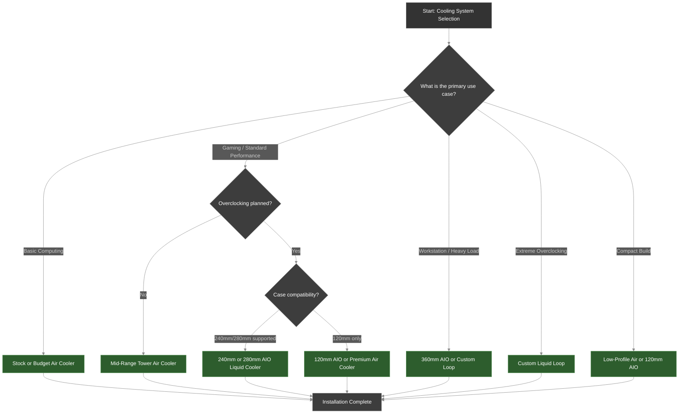

<br>

## 7. Future Trends in Cooling Technology

### 7.1 Noise Reduction Innovations

**Advanced Fan Technologies:**
- Magnetic bearing systems for reduced friction and noise
- Optimized blade geometry for improved airflow-to-noise ratios
- Serrated and notched blade edges for aerodynamic efficiency
- Fluid dynamic bearing designs for extended silent operation

**Intelligent Fan Control:**
- AI-driven thermal prediction algorithms
- Coordinated system-wide fan control
- Temperature-reactive fan curves with hysteresis management
- Zero-RPM modes for silent operation at low loads

### 7.2 Case Integration and Design Evolution

**Manufacturer-Integrated Cooling Solutions:**
- Pre-installed mounting points for AIO radiators
- Built-in cable management channels for clean installations
- Optimized internal layouts for unimpeded airflow
- Removable dust filters for easy maintenance

**Airflow-Optimized Case Designs:**
- Open-front mesh designs for unrestricted intake
- Bottom-to-top airflow paths (natural convection assisted)
- Modular internal layouts accommodating various cooling configurations
- Increased ventilation with dust-protected intake areas

### 7.3 Emerging Technologies

**Hybrid Cooling Solutions:**
- Combined air and liquid cooling for component-specific optimization
- Phase-change materials for thermal buffering during peak loads
- Thermo-electric cooling integration for targeted spot cooling
- Dual-loop configurations for CPU and GPU independent temperature control

**Advanced Monitoring and Control Systems:**
- Real-time temperature mapping using embedded sensors
- Predictive thermal management based on workload patterns
- Mobile application integration for remote monitoring
- Cloud-based analytics for system health assessment
- Comprehensive dashboard interfaces for detailed system information

**Emerging Materials Research:**
- Carbon nanotube composites for enhanced thermal interfaces
- Diamond-coated surfaces for improved heat spreading
- Phase-change materials for thermal energy storage
- Advanced metal-matrix composites for heat sink construction

<br>

## 8. Installation and Maintenance Guidelines

### 8.1 Best Practices for Cooling System Installation

**Pre-Installation Checklist:**
1. Verify component compatibility (socket type, case dimensions)
2. Ensure adequate case clearance for radiator or tower cooler height
3. Confirm sufficient power supply connections for fans and pumps
4. Prepare workspace with anti-static precautions
5. Review manufacturer instructions for specific guidance

**Air Cooler Installation:**
1. Apply thermal interface material correctly (pea-sized or line method)
2. Ensure even mounting pressure across the CPU
3. Orient cooler for optimal airflow direction
4. Secure mounting hardware to manufacturer specifications
5. Connect fan headers to appropriate motherboard ports

**Liquid Cooler Installation (AIO):**
1. Mount radiator in optimal position (tubes at bottom recommended for longevity)
2. Install fans in push or push-pull configuration as space allows
3. Apply thermal paste to CPU before pump/block installation
4. Mount pump/block with uniform pressure
5. Route tubing to avoid kinks and maintain gravity-assisted flow
6. Connect pump to dedicated header or CPU fan header
7. Configure fan curves in BIOS for optimal performance

### 8.2 Routine Maintenance Schedule

| Component | Frequency | Maintenance Activity |
|-----------|-----------|---------------------|
| Air Cooler Heat Sinks | 3-6 months | Compressed air cleaning, fin straightening if damaged |
| Case Fans | 3-6 months | Dust removal from blades and motor housing |
| Radiator (AIO/Custom) | 6-12 months | Dust removal, fin cleaning with appropriate brush |
| Thermal Paste | 2-3 years | Replacement when thermal performance degrades |
| Custom Loop Coolant | 12-24 months | Drain and replace; inspect components |
| Tubing (Custom Loop) | 24-36 months | Inspect for discoloration, rigidity, or cracking |
| Pump (Custom Loop) | Continuous | Monitor flow rate and listen for unusual noise |

### 8.3 Troubleshooting Common Cooling Issues

| Symptom | Possible Causes | Recommended Actions |
|---------|-----------------|---------------------|
| High CPU temperature at idle | Poor thermal paste application, improper cooler seating, pump failure (liquid) | Reapply thermal paste, verify mounting, check pump operation |
| Excessive fan noise | Dust accumulation, bearing wear, aggressive fan curve | Clean fans, lubricate bearings (if applicable), adjust fan curve |
| Liquid cooler not cooling | Pump failure, air bubble in system, coolant level low | Check pump connection, bleed air from system, refill coolant |
| System shutdown under load | Overheating, insufficient cooling capacity | Upgrade cooling solution, reduce overclock, improve case airflow |
| Fan not spinning | Power connection loose, dead fan, BIOS configuration issue | Verify connections, test fan on different header, replace if failed |
| Coolant leak (liquid system) | Loose fitting, damaged tubing, compromised seal | Immediately power off system, identify leak source, repair/replace |

<br>

## 9. Conclusion

Effective cooling systems are fundamental to the performance, stability, and longevity of modern computer systems. The evolution from simple air cooling to sophisticated liquid and hybrid solutions reflects the increasing thermal demands of high-performance components and user expectations for quiet, efficient operation.

### Key Takeaways:

1. **Understanding Cooling Methods:** Both air and liquid cooling have distinct advantages, applications, and considerations that must be evaluated in the context of specific use cases.

2. **System-Specific Selection:** No single cooling solution fits all applications. Component selection must consider performance requirements, physical space constraints, budget, and user preference.

3. **Technological Advancements:** Innovations in materials science, thermal interface compounds, and cooling system design continue to push the boundaries of thermal management capabilities.

4. **Strategic Investment:** While premium cooling solutions represent additional cost, the benefits in terms of performance headroom, system longevity, and user experience often justify the investment for high-performance systems.

5. **Maintenance Importance:** Regular maintenance—including dust cleaning, thermal interface renewal, and system monitoring—plays a critical role in maintaining cooling performance over the system's lifetime.

6. **Future Developments:** Ongoing research and development in materials, control systems, and cooling methodologies promise continued improvements in thermal management efficiency, noise reduction, and system integration.

The appropriate cooling solution depends on user requirements, system configuration, and performance objectives. By understanding the principles, options, and trade-offs outlined in this documentation, users and system builders can make informed decisions to ensure their systems operate at optimal temperatures, delivering reliable performance for years to come.

<br>

## 10. References and Further Reading

### Technical Resources
- Thermal Engineering: Principles and Practices
- JEDEC Standards for Semiconductor Thermal Management
- ASHRAE Guidelines for Data Center Cooling
- International Electrotechnical Commission (IEC) Standards

### Manufacturer Documentation
- AIO and air cooler user manuals
- Case manufacturer thermal specifications
- Motherboard sensor and fan control documentation

### Online Resources
- Technical reviews and benchmarks
- Thermal performance databases
- Build guides and installation tutorials
- Technical forums and community discussions
 

<br><br><br><br>
 

<h1 align="center">PERIPHERALS: EXPANDING YOUR PC'S CAPABILITIES.</h1>

<br><br>

## Document Overview

This documentation provides a structured examination of computer peripherals, their classifications, technical specifications, and emerging trends. The content is organized to facilitate understanding for both technical and non-technical audiences while maintaining engineering precision.

<br>

## 1. Introduction to Computer Peripherals

### 1.1 Definition and Scope

Computer peripherals are external hardware devices that connect to a computer system to extend its core functionality, enable user interaction, and enhance overall computing experience. Unlike internal components such as the motherboard, processor, or RAM, peripherals operate outside the primary processing unit and communicate through established interface protocols.

### 1.2 Classification Framework

Peripherals are systematically categorized based on their primary function within the computing ecosystem:

- **Input Devices**: Translate user actions into digital signals
- **Output Devices**: Present processed information to users
- **Storage Devices**: Provide persistent data retention
- **Communication Devices**: Enable network connectivity and data exchange

```mermaid
flowchart TD
    A[Computer Peripherals] --> B[Input Devices]
    A --> C[Output Devices]
    A --> D[Storage Devices]
    A --> E[Communication Devices]
    
    B --> B1[Keyboards]
    B --> B2[Mice]
    B --> B3[Touchscreens]
    B --> B4[Audio Input]
    B --> B5[Game Controllers]
    B --> B6[Graphics Tablets]
    
    C --> C1[Monitors]
    C --> C2[Printers]
    C --> C3[Speakers]
    C --> C4[Headphones]
    
    D --> D1[External HDDs]
    D --> D2[External SSDs]
    D --> D3[USB Flash Drives]
    
    E --> E1[Network Adapters]
    E --> E2[Bluetooth Adapters]
    
    style A fill:#2d2d2d,stroke:#ffffff,color:#ffffff
    style B fill:#3d3d3d,stroke:#ffffff,color:#ffffff
    style C fill:#3d3d3d,stroke:#ffffff,color:#ffffff
    style D fill:#3d3d3d,stroke:#ffffff,color:#ffffff
    style E fill:#3d3d3d,stroke:#ffffff,color:#ffffff
    style B1 fill:#4d4d4d,stroke:#ffffff,color:#ffffff
    style B2 fill:#4d4d4d,stroke:#ffffff,color:#ffffff
    style B3 fill:#4d4d4d,stroke:#ffffff,color:#ffffff
    style B4 fill:#4d4d4d,stroke:#ffffff,color:#ffffff
    style B5 fill:#4d4d4d,stroke:#ffffff,color:#ffffff
    style B6 fill:#4d4d4d,stroke:#ffffff,color:#ffffff
    style C1 fill:#4d4d4d,stroke:#ffffff,color:#ffffff
    style C2 fill:#4d4d4d,stroke:#ffffff,color:#ffffff
    style C3 fill:#4d4d4d,stroke:#ffffff,color:#ffffff
    style C4 fill:#4d4d4d,stroke:#ffffff,color:#ffffff
    style D1 fill:#4d4d4d,stroke:#ffffff,color:#ffffff
    style D2 fill:#4d4d4d,stroke:#ffffff,color:#ffffff
    style D3 fill:#4d4d4d,stroke:#ffffff,color:#ffffff
    style E1 fill:#4d4d4d,stroke:#ffffff,color:#ffffff
    style E2 fill:#4d4d4d,stroke:#ffffff,color:#ffffff
```

### 1.3 Connection Interfaces

Modern peripherals utilize several standardized connection methods:

| Interface Type | Data Transfer Rate | Primary Use Case |
|----------------|-------------------|------------------|
| USB 2.0 | 480 Mbps | Basic peripherals, legacy devices |
| USB 3.2 Gen 1 | 5 Gbps | External storage, high-speed devices |
| USB 3.2 Gen 2 | 10 Gbps | High-performance storage, video capture |
| USB4 | 40 Gbps | Advanced peripherals, docking stations |
| Thunderbolt 4 | 40 Gbps | Professional peripherals, multiple displays |
| Bluetooth 5.3 | Up to 2 Mbps | Wireless peripherals, low-power devices |
| Wi-Fi 6E | Up to 9.6 Gbps | Network adapters, wireless docking |

<br>

## 2. Input Devices: User-to-Computer Communication

### 2.1 Keyboards

Keyboards remain the primary text input mechanism for computers. Current market offerings span three principal categories:

#### 2.1.1 Membrane Keyboards

Membrane keyboards utilize a pressure-sensitive layer beneath the keys to register input. These devices feature low manufacturing costs, reduced acoustic output, and adequate functionality for general computing tasks. The tactile response is uniform across all keys, and the construction typically offers moderate resistance to liquid spills.

**Technical Characteristics:**
- Actuation Force: 55-75 grams
- Key Travel: 2.5-4.0 millimeters
- Operating Life: 5-10 million keystrokes
- Switch Type: Rubber dome over membrane circuit

#### 2.1.2 Mechanical Keyboards

Mechanical keyboards employ individual mechanical switches beneath each keycap. These switches provide distinct tactile feedback, audible clicking or silent operation, and enhanced durability. Professional users and gaming enthusiasts predominantly favor this category.

**Common Switch Types:**

| Switch Type | Tactile Feedback | Audible Click | Actuation Force | Primary Application |
|-------------|------------------|---------------|-----------------|---------------------|
| Cherry MX Blue | Tactile | Yes | 50 grams | Typing, Gaming |
| Cherry MX Brown | Tactile | Minimal | 45 grams | Hybrid Use |
| Cherry MX Red | Linear | No | 45 grams | Gaming |
| Cherry MX Black | Linear | No | 60 grams | Heavy Typing |
| Razer Green | Tactile | Yes | 50 grams | Gaming |
| Logitech GX Blue | Tactile | Yes | 50 grams | Gaming |

**Technical Specifications:**
- Actuation Force: 45-60 grams (switch dependent)
- Key Travel: 3.0-4.0 millimeters
- Operating Life: 50-100 million keystrokes
- Switch Type: Mechanical spring and stem

#### 2.1.3 Ergonomic Keyboards

Ergonomic keyboards incorporate design principles to reduce repetitive strain injuries and improve typing comfort. These devices typically feature split layouts, adjustable tenting angles, and contoured key arrangements to maintain natural wrist and forearm positions.

**Design Features:**
- Split halves with independent angle adjustment
- Negative slope or reverse tilt
- Dvorak or Colemak layout support
- Integrated wrist rests with gel or memory foam padding

### 2.2 Pointing Devices

#### 2.2.1 Mice

Computer mice provide cursor control and selection functionality. Current offerings include:

**Wired Mice:**
- Zero latency connectivity
- Unlimited operation time
- Cost-effective
- Cable management required

**Wireless Mice:**
- Operating Frequency: 2.4 GHz (proprietary) or Bluetooth 5.0+
- Battery Life: 70-200 hours (rechargeable) or 12-24 months (replaceable)
- Latency: 1-5 milliseconds (gaming grade)
- Effective Range: 10 meters (Bluetooth) / 25 meters (proprietary)

**Gaming Mice:**
- Sensor Resolution: 16,000-26,000 DPI
- Polling Rate: 1,000-8,000 Hz
- Acceleration: 50 G maximum
- Programmable Buttons: 5-20
- Weight Range: 50-130 grams (adjustable)

**Ergonomic Mice:**
- Vertical orientation: 45-75 degree tilt
- Vertical mice: 20-45 degree tilt
- Trackball operation for reduced wrist movement
- Customizable contouring for multiple grip styles

#### 2.2.2 Touchscreens

Touchscreen technology enables direct manipulation of graphical user interfaces through capacitive or resistive sensing mechanisms.

**Capacitive Touch:**
- Detection Method: Electrical field distortion
- Multi-Touch Support: Up to 10 simultaneous touches
- Response Time: < 10 milliseconds
- Technology: Projected capacitive (most common)

**Resistive Touch:**
- Detection Method: Pressure activation
- Single-Touch Support: Standard
- Activation Force: 15-100 grams
- Technology: Resistive film layers

### 2.3 Audio Input Devices

**Webcams:**
- Resolution: 720p (standard) to 4K (professional)
- Frame Rate: 30-60 FPS
- Autofocus: Standard on premium models
- Field of View: 60-120 degrees
- Connectivity: USB 2.0/3.0

**Microphones:**
- Condenser: High sensitivity, studio quality
- Dynamic: Lower sensitivity, durable
- USB: Plug-and-play, built-in ADC
- XLR: Professional standard, external interface required
- Noise Cancellation: Active or beamforming

### 2.4 Specialized Input Devices

**Drawing Tablets:**
- Pressure Sensitivity: 2,048 - 8,192 levels
- Tilt Recognition: ±60 degrees (advanced models)
- Resolution: 2,540 - 5,080 LPI
- Active Area: Various sizes from S (6x4") to L (13x9")

**Game Controllers:**
- Connectivity: Wired USB-C, Wireless 2.4 GHz / Bluetooth
- Battery Life: 20-40 hours (wireless)
- Features: Hall effect sensors, adaptive triggers, gyroscope
- Platforms: PC, Xbox, PlayStation, Nintendo Switch

<br>

## 3. Output Devices: Information Presentation

### 3.1 Monitors

Display technology has evolved significantly, with current offerings categorized by panel technology, resolution, and refresh rate.

#### 3.1.1 Panel Technologies

**IPS (In-Plane Switching):**
- Color Gamut: 95-100% sRGB, 90-95% DCI-P3
- Viewing Angle: 178° horizontal / 178° vertical
- Response Time: 1-5 milliseconds (GTG)
- Contrast Ratio: 1000:1 to 1300:1
- Applications: Professional design, general use, office work

**TN (Twisted Nematic):**
- Color Gamut: 90-100% sRGB
- Viewing Angle: 160° horizontal / 170° vertical
- Response Time: 0.5-1 milliseconds (GTG)
- Contrast Ratio: 600:1 to 1000:1
- Applications: Competitive gaming, budget displays

**OLED (Organic Light Emitting Diode):**
- Color Gamut: 100% DCI-P3 minimum
- Viewing Angle: Perfect (self-emissive)
- Response Time: < 0.1 milliseconds
- Contrast Ratio: Infinite (true black)
- Applications: Professional media, premium gaming, HDR content

**VA (Vertical Alignment):**
- Color Gamut: 95-100% sRGB
- Viewing Angle: 178° horizontal / 178° vertical
- Response Time: 4-10 milliseconds (GTG)
- Contrast Ratio: 2500:1 to 4000:1
- Applications: Media consumption, budget-friendly curved displays

#### 3.1.2 Resolution and Refresh Rate Standards

| Resolution | Pixel Count | Aspect Ratio | Common Sizes | Primary Use |
|------------|-------------|--------------|--------------|-------------|
| 1920x1080 (FHD) | 2.07 MP | 16:9 | 24-27" | General use, gaming |
| 2560x1440 (QHD) | 3.68 MP | 16:9 | 27-32" | Productivity, gaming |
| 3840x2160 (4K UHD) | 8.29 MP | 16:9 | 27-43" | Content creation, media |
| 5120x2880 (5K) | 14.75 MP | 16:9 | 27-32" | Professional design |
| 7680x4320 (8K) | 33.18 MP | 16:9 | 32-65" | Professional media |

**Refresh Rate Specifications:**
- 60 Hz: Standard operation, office work
- 144 Hz: Gaming, smooth motion
- 240 Hz: Competitive gaming
- 360 Hz+: Professional esports
- Variable Refresh Rate: Adaptive-Sync (FreeSync / G-SYNC)

#### 3.1.3 HDR Capabilities

High Dynamic Range (HDR) technology enhances contrast and color accuracy:

| HDR Level | Peak Brightness | Color Depth | Certification |
|-----------|----------------|-------------|---------------|
| HDR400 | 400 nits | 8-bit | DisplayHDR 400 |
| HDR600 | 600 nits | 10-bit | DisplayHDR 600 |
| HDR1000 | 1000 nits | 10-bit | DisplayHDR 1000 |
| HDR1400 | 1400 nits | 10-bit | DisplayHDR 1400 |

### 3.2 Printers

**Inkjet Printers:**
- Technology: Thermal or piezoelectric ink ejection
- Resolution: 4800 x 1200 dpi (consumer) to 9600 x 2400 dpi (photo)
- Color Support: CMYK (4-color) or CMYK+ (6-12 colors)
- Print Speed: 10-30 pages per minute
- Ideal Applications: Photo printing, color documents, graphic design
- Cost: Low initial purchase, higher consumable costs

**Laser Printers:**
- Technology: Electrostatic laser toner transfer
- Resolution: 600-2400 dpi
- Color Support: Monochrome or CMYK
- Print Speed: 20-50 pages per minute
- Ideal Applications: High-volume text documents, business use
- Cost: Higher initial purchase, lower consumable costs

### 3.3 Audio Output Devices

**Speakers:**
- Frequency Response: 20 Hz - 20 kHz (full range)
- Driver Size: 2" to 8" (typical desktop)
- Power Output: 5-200 watts RMS
- Connectivity: 3.5mm analog, USB, Bluetooth 5.0+
- Channel Configurations: Stereo (2.0), 2.1 (w/subwoofer), 5.1 surround

**Headphones and Earbuds:**
- Frequency Response: 20-40,000 Hz (studio grade)
- Impedance: 16-600 ohms
- Driver Types: Dynamic, Planar Magnetic, Balanced Armature
- Noise Cancellation: Passive (isolation) or Active (ANC)
- Connectivity: Wired (3.5mm, USB-C), Wireless (Bluetooth 5.0+)
- Codec Support: SBC, AAC, aptX, LDAC, LC3

<br>

## 4. Storage Devices: Data Persistence

### 4.1 External Hard Disk Drives (HDDs)

Traditional spinning disk storage remains relevant for backup and archival purposes.

**Technical Specifications:**
- Storage Capacity: 1 TB - 20 TB (consumer)
- Rotation Speed: 5,400 - 7,200 RPM
- Cache Size: 64-512 MB
- Data Transfer: 100-200 MB/s (sequential)
- Interface: USB 3.0 / 3.1, Thunderbolt
- Cost: Lowest cost per gigabyte
- Durability: Shock-sensitive, moving parts
- Lifespan: 5-10 years (mechanical wear)

### 4.2 External Solid State Drives (SSDs)

SSDs leverage flash memory for superior performance characteristics.

**Technical Specifications:**
- NAND Types: QLC, TLC, MLC, SLC
- Storage Capacity: 256 GB - 8 TB
- Interface: USB 3.2 Gen 2, USB4, Thunderbolt
- Read Speed: 500-3,500 MB/s (USB), 3,000-7,000 MB/s (Thunderbolt)
- Write Speed: 400-3,000 MB/s (USB), 2,800-6,500 MB/s (Thunderbolt)
- Durability: No moving parts, shock-resistant
- Lifespan: 300-3,000 TBW (depending on NAND type)
- Cost: Higher per gigabyte than HDDs

### 4.3 USB Flash Drives

Portable solid-state storage for file transfer and portable applications.

| Form Factor | Capacity Range | Read Speed | Write Speed | Typical Application |
|-------------|---------------|------------|-------------|---------------------|
| Standard | 8 GB - 2 TB | 100-400 MB/s | 20-200 MB/s | File transfer |
| High-Performance | 64 GB - 4 TB | 400-1,000 MB/s | 300-900 MB/s | Professional use |
| Ultra-Compact | 16-256 GB | 100-300 MB/s | 20-100 MB/s | Portable convenience |
| Dual-Interface | 32 GB - 2 TB | 100-400 MB/s | 30-200 MB/s | Mobile device support |

<br>

## 5. Communication Devices: Network Connectivity

### 5.1 Network Interface Adapters

**Wired Adapters (Ethernet):**
| Standard | Speed | Cable Type | Distance Limitation |
|----------|-------|------------|---------------------|
| Fast Ethernet | 100 Mbps | Cat5 | 100 meters |
| Gigabit Ethernet | 1 Gbps | Cat5e/Cat6 | 100 meters |
| 2.5GBASE-T | 2.5 Gbps | Cat5e/Cat6 | 100 meters |
| 5GBASE-T | 5 Gbps | Cat6 | 100 meters |
| 10GBASE-T | 10 Gbps | Cat6a/Cat7 | 55-100 meters |

**Wireless Adapters:**
| IEEE Standard | Frequency Bands | Max Speed | Channel Width | Range |
|---------------|----------------|-----------|---------------|-------|
| Wi-Fi 5 (802.11ac) | 5 GHz | 1.3 Gbps | 80-160 MHz | 35 meters |
| Wi-Fi 6 (802.11ax) | 2.4/5 GHz | 9.6 Gbps | 20-160 MHz | 45 meters |
| Wi-Fi 6E | 2.4/5/6 GHz | 9.6 Gbps | 20-160 MHz | 45 meters |
| Wi-Fi 7 | 2.4/5/6 GHz | 46 Gbps | 20-320 MHz | 50 meters |

<br>

## 6. Emerging Technologies and Advancement

### 6.1 Wireless Charging Integration

Selected peripherals now incorporate wireless charging capabilities using Qi or proprietary magnetic alignment systems. This technology reduces cable clutter and enables convenient power delivery for input devices.

**Implementation Examples:**
- Wireless charging mousepads with integrated Qi transmitters
- Keyboards with Qi-compatible battery modules
- Docking stations with integrated wireless charging pads

### 6.2 Advanced Sensor Technologies

Modern pointing devices utilize high-precision sensors with advanced tracking capabilities:

- **Optical Sensors**: 16,000-26,000 DPI resolution
- **Laser Sensors**: 20,000-30,000 DPI resolution
- **Motion Synchronization**: Reduced jitter
- **Smart Tracking**: Surface compensation and lift-off distance adjustment

### 6.3 High-Fidelity Mechanical Switches

Mechanical switch technology continues to evolve with:

- **Optical Switches**: 0.2 millisecond response time
- **Magnetic Hall Effect Switches**: Wear-free operation, 100+ million actuations
- **Hot-Swappable Sockets**: User-customizable switch replacement
- **Lubrication Pre-Application**: Factory-lubricated for smooth operation

<br>

## 7. Future Outlook and Trends

### 7.1 Connectivity Evolution

**Wi-Fi 7 (IEEE 802.11be)**
- 320 MHz channel bandwidth (doubling Wi-Fi 6)
- 4096-QAM modulation (20% speed improvement)
- Multi-Link Operation (MLO) for aggregated throughput
- 46 Gbps theoretical peak speed
- Enhanced Deterministic Latency

**USB4 Version 2.0**
- 80 Gbps bidirectional bandwidth (doubling USB4)
- 120 Gbps asymmetric bandwidth
- Compatible with Thunderbolt 4
- Enhanced display and data prioritization

### 7.2 Customization and Personalization

| Feature | Technical Implementation | User Benefit |
|---------|-------------------------|--------------|
| RGB Lighting | Addressable RGB LEDs, synchronization protocols | Aesthetic personalization, status indication |
| Macro Programming | On-board memory, software-configurable sequences | Productivity automation, gaming execution |
| Profile Storage | Multiple profiles with independent settings | Context-specific configuration switching |
| Modular Design | Interchangeable components, hot-swappable parts | Customization, repairability |

### 7.3 Software Integration

Peripherals increasingly integrate with system software for enhanced functionality:

- **Game Integration**: Peripherals responding to in-game events
- **Productivity Tools**: Automated macro creation and management
- **Monitoring and Alerting**: Peripheral status and health indicators
- **Cloud Configuration**: Settings synchronization across multiple systems

<br>

## 8. Peripheral Ecosystem Summary

| Category | Primary Function | Key Metrics | Example Use Cases |
|----------|------------------|-------------|-------------------|
| Input | User-to-device communication | Latency, accuracy, durability | Text entry, cursor control, content creation |
| Output | Information presentation | Resolution, clarity, quality | Visual display, document printing, audio output |
| Storage | Data persistence | Capacity, speed, reliability | Backup, file transfer, portable data |
| Network | Connectivity and data exchange | Speed, range, stability | Internet access, file sharing, peripheral communication |

<br>

## 9. Conclusion

Peripherals constitute an essential component of the computing ecosystem, bridging the gap between user intent and system execution. The continuous evolution of input devices, output displays, storage solutions, and network adapters drives improvements in productivity, creativity, and user experience.

Key developments to monitor include:
- Proliferation of wireless connectivity standards (Wi-Fi 7, Bluetooth LE Audio)
- Increased adoption of high-resolution displays (5K, 8K) with HDR
- Integration of AI capabilities in input devices for predictive operations
- Enhanced interoperability through universal standards (USB-C, USB4)

The peripheral landscape will continue to diversify, providing specialized solutions for professional, gaming, creative, and general-purpose computing applications. Organizations and individual users should evaluate their specific requirements when selecting peripherals to ensure optimal performance and value.

<br>

## References and Further Reading

1. USB Implementers Forum. "USB4 Specification." 2023.
2. VESA. "DisplayHDR Specifications." 2022.
3. IEEE. "802.11be - Wi-Fi 7 Standard." 2024.
4. Bluetooth SIG. "Bluetooth Core Specification v5.4." 2023.
5. VESA. "DisplayPort 2.0 Standard." 2022.
 
 
<br><br><br><br>
 
 
<h1 align="center">THE MODERN OPERATING SYSTEMS: ARCHITECTURE, EVOLUTION, AND FUTURE DIRECTIONS.</h1>

<br><br>

## Executive Summary

Operating systems constitute the foundational software layer that abstracts hardware complexity and delivers efficient, secure, and manageable computing environments. This document offers a systematic examination of operating system principles, architectures, and implementations, serving as a consolidated reference for researchers, engineers, and IT practitioners. It synthesizes historical context, core technical mechanisms, contemporary deployments, and emerging paradigms into a unified framework for understanding this critical computing component.

The guide covers process and memory management, file systems, I/O handling, security models, virtualization, containerization, and performance optimization, while also exploring AI-integrated, quantum, decentralized, extended reality, and security-first OS architectures that are shaping the next generation of computing.

<br>

## 1. Foundational Concepts and Historical Evolution

### 1.1 Definition and Core Purpose

An operating system (OS) is system software that mediates between computer hardware and application software, providing essential services for program execution and user interaction. It manages hardware resources including processors, memory, storage, and peripheral devices while offering a consistent environment for applications through standardized interfaces.

The OS enables efficient resource sharing among multiple processes, ensures security and isolation, and provides the user experience layer through graphical or command-line interfaces. Its core responsibilities encompass process scheduling, memory allocation, file system management, device control, and access protection, all coordinated via the kernel.

### 1.2 Historical Progression: Seven Evolutionary Levels

The evolution of operating systems can be visualized as a progression through seven distinct levels, each characterized by new abstractions and capabilities.

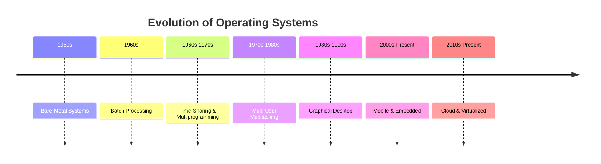

**Level 1: Bare-Metal Systems (1950s).** Early computers lacked any operating system; programs were entered directly through physical switches, plugboards, or punched cards, and executed sequentially with no abstraction between hardware and software. The machine operator manually loaded programs, set initial addresses, and monitored execution, meaning that a single user had exclusive control over the entire system. There was no concept of multitasking, memory protection, or device management—every program had to include its own I/O routines and hardware initialization. Representative machines like the IBM 701 required programmers to understand low-level timing and physical characteristics. The fundamental limitation was low utilization and extreme difficulty of use, prompting the development of the first rudimentary supervisory programs that could automate job-to-job transitions. This era established the need for a software layer that could manage resources and simplify programming, setting the stage for batch processing.

**Level 2: Batch Processing Systems (1960s).** To improve hardware utilization, batch processing introduced automated job sequencing through job control languages and card readers, allowing a stream of jobs to be submitted and executed one after another without manual intervention between tasks. The operating system now provided a resident monitor that handled job transitions, basic I/O spooling, and error recovery. IBM's OS/360 exemplified this generation, offering a comprehensive suite of control programs that could manage tape drives, disk storage, and printers. While batch systems eliminated human idle time, they still processed jobs sequentially and offered no interactivity; debugging a program often meant waiting hours for a printout. Nevertheless, they introduced fundamental concepts such as memory protection between the monitor and user programs, interrupt handling, and peripheral device management. The batch paradigm dominated mainframe computing and laid the groundwork for multiprogramming, where multiple jobs could reside in memory simultaneously.

**Level 3: Time-Sharing and Multiprogramming (1960s–1970s).** The drive for interactive computing led to time-sharing systems that virtualized CPU time through rapid context switching, allowing multiple concurrent users to each perceive they had a dedicated machine. Multiprogramming kept several jobs in main memory and switched the CPU among them whenever one blocked for I/O, dramatically improving system throughput. Pioneering systems like CTSS and UNIX introduced the notion of a process, terminal-driven command interfaces, and hierarchical file systems. The operating system now had to manage memory partitioning, CPU scheduling policies, and interprocess communication, while guaranteeing fairness and responsiveness. This era produced the UNIX philosophy of small, composable tools and the hierarchical process tree, which remain influential. The shift to interactive, multi-user operation transformed computing from a batch-oriented utility into a dynamic, development-friendly environment.

**Level 4: Multi-User Multitasking Systems (1970s–1980s).** Building on time-sharing, these systems added preemptive scheduling, robust process isolation, and rich interprocess communication mechanisms. The kernel enforced strict protection between user processes and the kernel itself, using hardware memory management units to create private virtual address spaces. UNIX System V and later Windows NT implemented full multitasking with background daemons and services, job control, and sophisticated shell scripting environments. Network connectivity became a first-class service, with TCP/IP stacks integrated into the kernel, enabling remote login, file sharing, and distributed computing. File systems gained hierarchical directory structures, permission bits (read, write, execute), and support for multiple users and groups. This level established the classic server and workstation OS design, where the system managed hundreds of concurrent processes while maintaining stability and security—a model that still underlies modern data-center servers.

**Level 5: Graphical Desktop Systems (1980s–1990s).** The introduction of bitmapped displays and pointing devices brought the WIMP (Windows, Icons, Menus, Pointer) paradigm to the mainstream, transforming user interaction. Operating systems like macOS, Windows 95, and the X Window System on UNIX layered a graphical shell over the kernel, providing a desktop metaphor that allowed users to manage files, launch applications, and configure settings visually. Plug-and-play hardware support automated device detection and driver loading, significantly easing peripheral installation. Preemptive multitasking and protected memory remained underneath, but the focus shifted to usability, with event-driven GUI frameworks, clipboard sharing, and drag-and-drop interaction. This period saw the OS become a consumer platform, with multimedia extensions, 3D graphics APIs, and extensive compatibility layers. The graphical desktop OS cemented the personal computer as a universal tool, making computing accessible to non-experts.

**Level 6: Mobile and Embedded Systems (2000s–Present).** The mobile revolution redefined OS requirements around touch-first interfaces, power efficiency, and sensor integration. Operating systems such as iOS and Android adapted traditional kernels (XNU and Linux) with aggressive power management, background process restrictions, and hardware-accelerated user interface rendering. New abstractions for location, accelerometer, camera, and biometric data required permission models that protect user privacy while enabling rich app experiences. Resource constraints on mobile devices drove innovations in memory compression, app lifecycle management, and just-in-time compilation (later ahead-of-time). Real-time operating systems (RTOS) like FreeRTOS and VxWorks became essential in embedded domains, offering deterministic scheduling and minimal latencies for automotive, industrial, and IoT applications. This level demonstrated how the OS can be tailored for specific form factors and usage patterns, merging connectivity with constrained power envelopes.

**Level 7: Cloud and Virtualized Ecosystems (2010s–Present).** The ascendancy of virtualization and cloud computing shifted the OS role from managing a single physical machine to orchestrating vast pools of virtual resources. Type 1 hypervisors like KVM, Xen, and VMware ESXi provide near-native performance by running directly on hardware, while containerization (Docker, containerd) uses kernel namespaces and cgroups for lightweight isolation. Kubernetes emerged as the standard for automating deployment, scaling, and management of containerized applications across clusters. Immutable infrastructure principles, where OS images are built once and never modified, have improved consistency and security. Serverless computing further abstracts the OS away, allowing developers to run functions without managing any underlying server. In this paradigm, the operating system is both a virtualized resource and a distributed system component, with its traditional boundaries extended by software-defined networking, storage, and observability tools.

<br>

## 2. Core Architectural Components and Mechanisms

### 2.1 Process Management and Scheduling

The operating system abstracts a running program as a **process**—an entity with its own address space, execution context, and system resources. Process management encompasses creation, scheduling, synchronization, and termination.

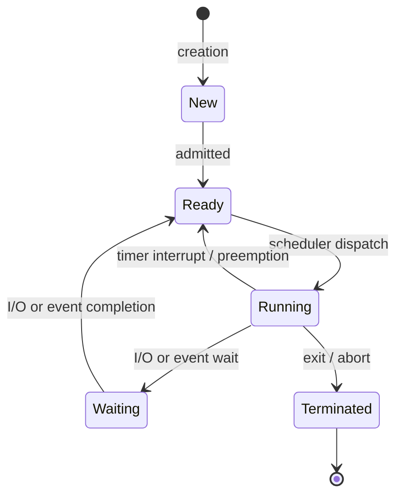

**Scheduling algorithms** determine which ready process gets the CPU next. The following table compares the fundamental approaches.

| Algorithm | Type | Key Mechanism | Advantages | Limitations |
|-----------|------|---------------|------------|-------------|
| First-Come, First-Served (FCFS) | Non-preemptive | Simple FIFO queue; runs to completion or block | Easy to implement, starvation-free | Poor average wait time; convoy effect |
| Shortest Job First (SJF) | Non-preemptive | Selects process with smallest next CPU burst | Optimal average waiting time | Requires precise burst prediction; starvation |
| Round Robin (RR) | Preemptive | Fixed time quantum; cyclic rotation | Fairness, good response time | High overhead with small quantum; no priority |
| Priority Scheduling | Preemptive or non | Priority assigned statically or dynamically | Flexibility for real-time and critical tasks | Starvation of low-priority processes |
| Multilevel Queue | Preemptive | Multiple queues with different scheduling policies | Separation of process classes | Inflexible; processes fixed to one queue |
| Multilevel Feedback Queue | Preemptive | Dynamic priority adjustment based on CPU usage pattern | Adaptive, balances I/O and CPU-bound tasks | Complexity in tuning parameters |

**First-Come, First-Served (FCFS) Scheduling.** FCFS is the simplest scheduling algorithm, where the process that requests the CPU first is allocated the CPU first, implemented via a straightforward FIFO queue. While it guarantees that every process will eventually run (no starvation) and requires minimal overhead, its non-preemptive nature causes short jobs to wait behind long-running tasks, leading to the "convoy effect" and high average waiting times. In interactive systems, FCFS produces unacceptable response times, so it is rarely used as a standalone policy. It does, however, form the baseline against which other algorithms are compared and can be found in batch-oriented systems where long sequential execution is acceptable.

**Shortest Job First (SJF) Scheduling.** SJF selects the waiting process with the smallest estimated next CPU burst, thus minimizing the average waiting time across all processes. In its non-preemptive form, once a process starts it runs to completion; preemptive SJF (also called Shortest Remaining Time First) can interrupt the current process if a new job with even shorter expected burst arrives. The main challenge lies in accurately predicting the next CPU burst length, often achieved through exponential averaging of past behavior. SJF is provably optimal for minimizing mean response time, but long-running processes can suffer indefinite starvation if shorter jobs keep arriving. It is frequently used in long-term scheduling (admission control) and in environments where job lengths are known in advance, such as batch data processing.

**Round Robin (RR) Scheduling.** Round Robin allocates the CPU to each ready process for a fixed time quantum, cycling through the ready queue cyclically. If a process does not complete within its quantum, it is preempted and placed at the back of the queue, ensuring rapid context switching and fair distribution of CPU time. The choice of quantum is critical: too small causes excessive context-switch overhead, while too large degrades to FCFS behavior. RR is especially suited for time-sharing environments where interactive responsiveness matters, as no single process can monopolize the CPU. While average waiting time may be higher than SJF, RR's simplicity and inherent fairness make it a default in general-purpose operating systems, often combined with priority levels.

**Priority Scheduling.** Each process is assigned a priority, and the CPU is allocated to the highest-priority ready process. Priorities can be static, set by the system administrator or based on resource requirements, or dynamic, adjusted at runtime to reflect aging and prevent starvation. This algorithm can be either preemptive, where a newly arrived higher-priority process immediately preempts the running one, or non-preemptive. Priority scheduling is indispensable for real-time systems, where critical tasks must meet deadlines. The major downside is starvation of low-priority processes; a common remedy is "aging," gradually increasing the priority of long-waiting processes.

**Multilevel Feedback Queue (MLFQ) Scheduling.** MLFQ maintains several queues, each with a different priority level and time quantum, and moves processes between queues based on their CPU usage patterns. Processes that use their full quantum are demoted to lower-priority queues (indicating CPU-bound behavior), while processes that frequently block for I/O are promoted, keeping interactive jobs responsive. This self-tuning mechanism eliminates the need for a priori job classification and achieves a balance between short response times for I/O-bound processes and good throughput for CPU-bound ones. MLFQ is used in practice by many operating systems (e.g., the Linux CFS with dynamic priority, Windows NT scheduling) because it adapts to varying workloads. The main complexity lies in setting the number of queues, quanta, and promotion and demotion rules.

**Interprocess Communication (IPC)** mechanisms allow processes to exchange data and synchronize.

- **Shared Memory** maps a segment of physical memory into the address spaces of multiple processes, enabling the fastest possible data exchange because no kernel intervention is needed for reads and writes. However, synchronization must be managed by the processes themselves using mutexes, semaphores, or condition variables, which introduces the risk of race conditions and deadlocks. Shared memory is ideal for high-throughput scenarios like multimedia processing or in-memory databases, where large volumes of data must flow between processes with minimal latency.

- **Message Passing** relies on the kernel to transfer structured messages between processes through mailboxes, pipes, or sockets. The OS enforces isolation and provides synchronization implicitly, as receiving processes block until a message arrives (or use non-blocking variants). This model simplifies reasoning about concurrency but incurs overhead due to data copying and system calls. Message passing underpins microkernel designs (e.g., Mach, QNX) where all services, including device drivers, communicate via messages, promoting fault isolation and modularity.

- **Semaphores** are integer-based synchronization primitives that support two atomic operations, wait (P) and signal (V), to protect critical sections and coordinate resource access. They can be binary (mutexes) or counting, and are used to solve classic synchronization problems like producer-consumer and reader-writer. While powerful, semaphores are low-level and error-prone; incorrect ordering can lead to deadlocks or starvation. They serve as building blocks for higher-level constructs like monitors and condition variables.

- **Monitors** provide a high-level language construct that encapsulates shared data, the procedures that operate on it, and the synchronization mechanisms, so that only one process can execute inside the monitor at any time. Condition variables within monitors allow processes to wait for specific conditions and be signalled, avoiding busy-waiting. Monitors greatly reduce synchronization errors compared to raw semaphores, and are adopted in Java (`synchronized`), C# (`lock`), and Python threading. The OS itself may use monitor-like patterns in kernel subsystems to manage complex concurrent data structures.

### 2.2 Memory Management Architecture

Memory management divides physical RAM among the OS and multiple processes, providing the illusion of a large, private, contiguous address space through virtual memory.

**Physical memory allocation** strategies include fixed partitions, which waste space due to internal fragmentation, and variable partitions that suffer from external fragmentation. The buddy system allocates memory in power-of-two blocks, making splitting and coalescing efficient, and is widely used in kernel memory allocators. Compaction can reduce external fragmentation but is expensive as it requires copying data and updating references.

**Virtual memory** combines paging, where the address space is divided into fixed-size pages mapped to physical frames, with segmentation, which reflects logical program divisions such as code, data, and stack. Modern systems predominantly use paging with multi-level page tables to handle large 64-bit address spaces efficiently, and **Translation Lookaside Buffers (TLBs)** cache recent virtual-to-physical translations to avoid multiple memory accesses per instruction. The OS implements demand paging, loading pages only when accessed, and manages the page table structure, including permission bits (read, write, execute) that enforce memory protection.

**Page replacement algorithms** decide which page to evict when memory is full. The following table summarizes the primary algorithms.

| Algorithm | Key Principle | Advantages | Disadvantages |
|-----------|---------------|------------|---------------|
| Optimal (MIN) | Replace the page that will not be used for the longest time | Lower bound on page faults | Requires future knowledge, not realizable |
| Least Recently Used (LRU) | Replace the page unused for the longest period | Good approximation of optimal | Expensive to implement in hardware and software |
| First-In, First-Out (FIFO) | Replace the oldest page | Simple, low overhead | Suffers from Belady's anomaly; poor hit rate |
| Clock (Second Chance) | Reference bit checked in a circular buffer; page with bit 0 replaced, bit 1 cleared and arm moves | Efficient LRU approximation | Not as accurate as true LRU |

**Least Recently Used (LRU) Replacement.** LRU selects the page that has not been referenced for the longest time, capitalizing on temporal locality. While it typically yields a low page-fault rate close to the optimal algorithm, implementing exact LRU with timestamps or a stack is expensive. Most systems approximate LRU using hardware reference bits and the clock algorithm, which scans pages cyclically and clears reference bits, evicting those that remain unreferenced. LRU-like policies form the backbone of modern virtual memory managers in Linux (via active and inactive lists) and Windows (working-set trimming), striking a balance between performance and overhead.

**Clock (Second Chance) Replacement.** The clock algorithm maintains a circular list of pages and a reference bit for each, set by hardware on access. The clock hand sweeps through the list; if the reference bit is 1, it is cleared and the hand advances, effectively giving the page a second chance; if it is 0, the page is selected for replacement. This simple mechanism approximates LRU without complex data structures and is efficient enough to be implemented in heavily optimized kernel paths. Variants like the enhanced clock consider both reference and modify bits to reduce write-back overhead. The clock algorithm is the basis for page replacement in many Unix-like systems and has been adapted to work with multiple memory zones.

### 2.3 File System Implementation

File systems organize data on persistent storage, providing a hierarchical namespace, access control, and reliability guarantees.

**Structural components** include volume management (partition tables, LVM) that pools physical drives, directory organization that maps human-readable names to file metadata, and allocation strategies that decide how file blocks are placed. **Inode-based** systems (ext4, XFS) separate file metadata from data, while **FAT** uses a simple file allocation table. Modern file systems like **ext4**, **XFS**, **Btrfs**, and **ZFS** employ extent-based allocation to reduce metadata overhead for large contiguous files.

**Journaling and copy-on-write (COW)** techniques provide crash consistency. Write-ahead logging records metadata changes before they are applied, allowing quick recovery. COW file systems (ZFS, Btrfs) never overwrite data in place; instead they write new blocks and update pointers atomically, naturally supporting snapshots and continuous integrity checking. Checksums for both data and metadata guard against silent data corruption, while RAID configurations integrated in ZFS offer flexible redundancy.

**Copy-on-Write (COW) File Systems.** COW file systems treat storage as a pool of blocks that are never modified in place; any update allocates new blocks and redirects references. This design enables efficient point-in-time snapshots by preserving the old block tree, and clones can share unchanged data without duplication. ZFS and Btrfs leverage COW to provide built-in data checksums, compression, and self-healing capabilities through RAID-Z or mirroring. The trade-off includes write amplification and fragmentation, which may require intelligent data placement and periodic rebalancing (defragmentation). COW is the foundation of next-generation storage architectures, tightly integrated with container and VM image management.

**Snapshots and Deduplication.** Snapshots capture a read-only point-in-time state of the file system, essential for backup, recovery, and testing. Online deduplication identifies identical blocks and stores them only once, reducing physical storage consumption in virtualized environments where many similar OS images exist. Both features rely on COW or block-sharing metadata and can be implemented inline or as a post-process. While snapshots impose minimal I/O overhead in COW systems, deduplication can be CPU-intensive and requires careful sizing of deduplication tables to avoid performance degradation.

### 2.4 Device and I/O Management

The OS abstracts the diversity of hardware devices through layered driver models, presenting uniform interfaces to user applications.

The **abstraction layers** start with hardware registers and interrupt lines at the bottom, followed by device drivers that translate kernel requests into device-specific commands. The device-independent I/O subsystem provides a common system call interface (open, read, write, ioctl) and manages buffering, caching, and error handling. User-level libraries such as the C standard I/O add further convenience.

**Performance optimizations** include buffering to smooth speed mismatches between fast CPUs and slow devices, caching to reuse recently read data, and spooling for serial devices like printers. Double buffering overlaps computation and I/O, while **Direct Memory Access (DMA)** allows devices to transfer data directly to and from memory, freeing the CPU for other tasks. **Memory-mapped I/O** maps device registers into the virtual address space, and **interrupt-driven I/O** replaces wasteful polling with asynchronous event notification.

**DMA and Interrupt Coalescing.** DMA engines handle bulk data movement, dramatically improving throughput for storage and network controllers. The OS sets up descriptor rings with buffer addresses, and the device triggers an interrupt only when a batch of transfers completes. Interrupt coalescing reduces the CPU overhead of high-rate interrupts by grouping several events into a single interrupt, a critical optimization for 10GbE and faster networks. Advanced storage protocols like NVMe further exploit multiple I/O queues and per-queue interrupts to scale with multi-core CPUs, eliminating the bottleneck of a single submission queue.

### 2.5 Security and Protection Mechanisms

Operating systems enforce security at multiple levels, from hardware privilege rings to per-process access controls.

**Access control models** include Discretionary Access Control (DAC), where file owners set permissions; Mandatory Access Control (MAC), enforced system-wide by policies (SELinux, AppArmor); and Role-Based Access Control (RBAC), which assigns permissions to roles rather than individuals. Capability-based security uses unforgeable tokens to grant access, providing fine-grained control.

**Implementation mechanisms** rely on processor modes (user and kernel), where transitions are mediated by system calls. **Address Space Layout Randomization (ASLR)** randomizes the location of key memory regions to thwart exploitation of buffer overflows, while **Data Execution Prevention (DEP)** marks data pages as non-executable. Sandboxing via Linux namespaces and cgroups, or macOS App Sandbox, restricts a process's view of the system and resource consumption, containing potential compromises.

**SELinux and Mandatory Access Control (MAC).** SELinux implements a label-based MAC system where every subject (process) and object (file, socket) carries a security context, and all access attempts are checked against a centralized policy. This allows administrators to enforce complex rules such as ensuring a web server can only read its own content and cannot execute arbitrary binaries. The policy is distributed in compiled form and can operate in permissive or enforcing mode, enabling gradual deployment. Although configuration complexity is a barrier, SELinux dramatically reduces the attack surface of a Linux system and is a cornerstone of security in Android (SEAndroid) and Red Hat distributions. AppArmor, by contrast, uses path-based profiles and is often simpler to manage.

<br>

## 3. Contemporary Operating System Families

### 3.1 Desktop and Server Systems

A comparative overview of the three dominant families illustrates their architectural philosophies.

| Feature | Windows (NT Kernel) | macOS (XNU Kernel) | Linux (Monolithic) |
|---------|---------------------|--------------------|--------------------|
| Kernel Type | Hybrid (microkernel with monolithic influences) | Hybrid (Mach microkernel with BSD) | Monolithic with loadable modules |
| Default File System | NTFS, ReFS | APFS | ext4, XFS, Btrfs, and others |
| Primary Security | DAC, ACLs, Mandatory Integrity Control | DAC, Gatekeeper, Notarization, SIP | DAC, LSMs (SELinux, AppArmor) |
| Package Management | MSI, Winget, Windows Update | App Store, Homebrew (third-party) | apt, yum/dnf, pacman, flatpak, snap |
| Container Support | Windows Containers, WSL2 | Hypervisor.framework, Docker Desktop | Native cgroups/namespaces, containerd |
| Init System | Session Manager (smss), Service Control | launchd | systemd, SysVinit, OpenRC |

**Windows NT Architecture.** The Windows NT kernel is a hybrid design that blends a layered executive with object-oriented principles. Hardware abstraction is provided by the HAL, while the kernel itself manages threads, interrupts, and synchronization. Executive services (I/O manager, memory manager, process manager, security reference monitor) run in kernel mode and communicate via well-defined interfaces. The Win32 subsystem, together with the modern Universal Windows Platform (UWP), preserves API compatibility, and the Windows Registry serves as a centralized configuration store. The introduction of the Windows Subsystem for Linux (WSL2) runs a real Linux kernel inside a lightweight VM, bridging the Windows and Linux ecosystems. Active Directory, Group Policy, and Mandatory Integrity Control layers add enterprise-grade identity and security management.

**macOS and the Darwin Foundation.** macOS is built on Darwin, an open-source core that combines the XNU kernel—incorporating Mach 3.0 microkernel concepts for IPC and scheduling with a FreeBSD-based system call interface—and an I/O Kit driver framework. Grand Central Dispatch (GCD) abstracts thread pools and work queues to simplify multicore programming, while the APFS file system brings encryption-first design, snapshots, and clone support optimized for Flash and SSD storage. Security is layered: Gatekeeper and notarization verify code signatures on first launch, System Integrity Protection (SIP) restricts even root from modifying certain system areas, and a dedicated Secure Enclave processor handles cryptographic operations. The vertical integration of hardware and software allows Apple to deliver seamless handoff, power management, and user experience across devices.

**Linux Ecosystem and Distributions.** The Linux kernel is monolithic, yet its modular design with loadable kernel modules provides runtime extensibility without rebooting. Systemd has become the predominant init system, offering parallel service startup, socket activation, and dependency tracking. Distributions differentiate themselves through package management (dpkg and apt on Debian and Ubuntu, RPM and yum or dnf on RHEL and Fedora, pacman on Arch), default configurations, and support lifecycles. Linux is the foundation of modern cloud and container infrastructure; it natively supplies cgroups, namespaces, and overlay filesystems that enable Docker and Kubernetes. Security modules (SELinux, AppArmor) and seccomp-bpf allow fine-grained containment, making Linux the operating system of choice for both enterprise servers and embedded systems.

### 3.2 Mobile and Embedded Platforms

**Android Architecture.** Android layers a custom Linux kernel with power management (wakelocks), Binder IPC for inter-process communication, and Hardware Abstraction Layers (HAL) that standardize vendor interfaces. The Android Runtime (ART) performs ahead-of-time compilation from bytecode to native code, improving performance over the earlier Dalvik JIT. Project Treble modularized the OS framework, separating vendor implementation from the Android framework to accelerate updates. Security relies on application sandboxing with per-app Linux UIDs, mandatory access control via SEAndroid, and verified boot. Google Play Services extend platform capabilities, while the growing Fuchsia OS represents a future direction with a microkernel-based design.

**iOS and Apple Mobile Ecosystem.** iOS derives from macOS's XNU kernel, heavily tuned for ARM-based SoCs with aggressive power management and GPU co-processing. The Swift and Objective-C runtimes execute apps in a sandboxed environment where each app's container restricts file system access, and App Transport Security enforces encrypted network connections. APFS is optimized for flash memory with features like TRIM support and instant cloning. A dedicated Secure Enclave manages biometric data and cryptographic keys, while the App Store review process and code signing form a strict application distribution model. This tight vertical integration yields consistent performance and security across iPhones and iPads.

**Real-Time Operating Systems (RTOS).** RTOSs provide deterministic behavior by guaranteeing interrupt latency and scheduling deadlines, often using priority-based preemptive schedulers with priority inheritance to prevent unbounded priority inversion. Memory Protection Units (MPU) offer lightweight task isolation without the overhead of a full MMU. Examples such as FreeRTOS and Zephyr target resource-constrained microcontrollers, while VxWorks and QNX are used in safety-critical aerospace, automotive, and medical systems. The POSIX-compliant QNX microkernel passes messages between isolated processes, enabling fault recovery and dynamic upgrades—a design that exemplifies the microkernel promise.

### 3.3 Specialized and Legacy Systems

**UNIX Derivatives and BSD Variants.** Solaris pioneered the advanced ZFS file system and DTrace dynamic tracing, while FreeBSD contributed a high-performance TCP/IP stack adopted by many network appliances. OpenBSD focuses on security through code auditing, proactive exploit mitigations, and a minimal attack surface. NetBSD's emphasis on portability ("Of course it runs NetBSD") results in extensive hardware support. These systems remain relevant in research, networking, and storage appliances, with features like ZFS and DTrace later influencing Linux and other platforms.

**Container-Optimized Operating Systems.** Immutable infrastructure designs like CoreOS (now Fedora CoreOS), RancherOS, and Bottlerocket ship minimal host images with read-only root filesystems and transactional, automatic updates. They run all workloads in containers, reducing the attack surface and improving consistency across deployments. Kubernetes-native integration, including kubelet and container runtime pre-configured, enables quick cluster bootstrapping. Such OSes embody the cloud-native philosophy, treating the operating system as a disposable component in a larger orchestrated system.

<br>

## 4. Virtualization and Cloud Integration

### 4.1 Hypervisor Architectures

Hypervisors enable multiple operating system instances to share a single physical machine, with distinct trade-offs between type 1 and type 2 designs.

| Feature | Type 1 (Bare-Metal) | Type 2 (Hosted) |
|---------|---------------------|-----------------|
| Installation | Directly on hardware | As an application on a host OS |
| Performance | Near-native, minimal overhead | Overhead of host OS and device emulation |
| Examples | VMware ESXi, Microsoft Hyper-V, KVM, Xen | VMware Workstation, VirtualBox, Parallels Desktop |
| Use Case | Data-center servers, enterprise consolidation | Development, testing, desktop virtualization |
| Hardware Support | Leverages CPU virtualization extensions (VT-x and AMD-V) directly | Relies on host OS drivers and management |

**Paravirtualization** modifies the guest OS to call hypervisor-friendly APIs, reducing the complexity of emulating privileged instructions. **Hardware-assisted virtualization** with Intel VT-x and AMD-V eliminates the need for binary translation, trapping sensitive instructions directly to the hypervisor. **SR-IOV** allows a single physical PCIe device to be presented as multiple virtual functions, enabling direct assignment to VMs for near-native I/O performance.

**KVM and QEMU Integration.** The Kernel-based Virtual Machine (KVM) converts the Linux kernel into a type-1 hypervisor by loading kernel modules that use hardware virtualization extensions. Each virtual machine appears as a regular QEMU process, leveraging Linux's scheduler, memory management, and networking stack. This tight integration enables advanced features like live migration, CPU pinning, and memory ballooning while benefiting from the extensive hardware support of the Linux kernel. KVM forms the backbone of many cloud platforms, including Google Compute Engine and OpenStack.

### 4.2 Containerization Technology Stack

Containers provide lightweight OS-level virtualization by partitioning kernel resources rather than emulating hardware.

**Namespace isolation** creates separate views of system resources:
- **PID namespaces** give containers their own process trees, with init process PID 1.
- **Network namespaces** provide independent network stacks, virtual interfaces, and routing tables.
- **Mount namespaces** allow per-container filesystem roots, enabling layered images.
- **User namespaces** map root inside the container to unprivileged UIDs on the host, strengthening security.
- **UTS namespaces** isolate hostname and domain names.

**Control groups (cgroups)** enforce resource limits and accounting on CPU, memory, block I/O, and the number of processes. They prevent a single container from starving the host and enable fine-grained QoS. The unified cgroup hierarchy (v2) simplifies management and integrates better with systemd.

**Container runtimes and standards:** The Open Container Initiative (OCI) defines image and specification standards. containerd is the industry-standard daemon that manages the container lifecycle, while CRI-O implements the Kubernetes Container Runtime Interface directly, leveraging OCI runtimes like runc or crun. Podman offers a daemonless alternative that supports both rootless and rootfull container management, aligning with security best practices.

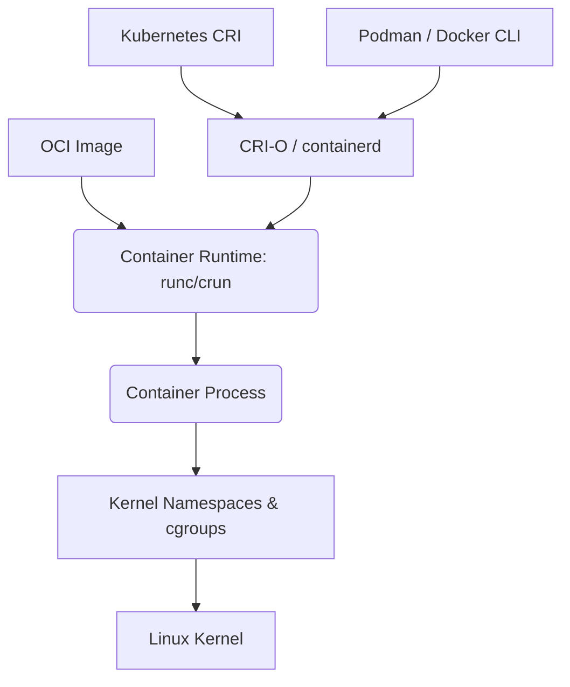

**Container Networking with CNI.** The Container Network Interface (CNI) specifies how network plugins configure container interfaces. Plugins such as bridge, macvlan, or flannel create virtual networks that enable pod-to-pod communication. More advanced solutions like Calico or Cilium use eBPF for kernel-level policy enforcement and observability, providing service mesh capabilities without sidecar proxies. This pluggability allows Kubernetes clusters to span complex network topologies with BGP peering or VXLAN overlays.

### 4.3 Orchestration and Cluster Management

Kubernetes has become the dominant platform for scheduling and managing containerized workloads.

**Control plane components**—etcd (distributed key-value store), API server, scheduler, and controller manager—continuously reconcile the desired state with the cluster's current state. **Node components** include the kubelet, container runtime, and kube-proxy (which manages network rules). **Persistent volumes** and storage classes abstract underlying storage systems, enabling dynamic provisioning. **Service meshes** like Istio inject sidecar proxies to provide advanced traffic management, mutual TLS, and telemetry without application changes. eBPF-based tools further enhance networking, security, and performance monitoring directly in the kernel.

<br>

## 5. Emerging Paradigms and Research Directions

**AI-Integrated Operating Systems.** Machine learning models are being embedded within the OS to predict workload patterns, enabling proactive resource scaling and intelligent power management. Reinforcement learning can dynamically tune scheduler parameters and memory reclamation thresholds based on observed performance metrics. These systems can detect anomalies in system call traces or network flows, improving security through behavioral analysis. The goal is a self-driving operating system that continuously optimizes itself with minimal human intervention, potentially using natural language interfaces for administrative tasks. Research prototypes like Decima (learned scheduling in Spark) and various cache replacement policies demonstrate the feasibility of learned components. The challenge lies in ensuring safety, interpretability, and low-latency inference within the kernel.

**Quantum Computing Operating Systems.** A quantum OS must manage hybrid classical-quantum resources, scheduling quantum circuits across noisy intermediate-scale quantum (NISQ) processors while handling error correction and qubit mapping. It needs to coordinate classical preprocessing and postprocessing with quantum execution, managing shared coherent time. Early frameworks like Qiskit Runtime and Cirq provide the groundwork, but future systems will require real-time calibration, dynamic circuit recompilation, and fault-tolerant management. The operating system will present a hardware-agnostic programming model, enabling portable quantum applications.

**Decentralized and Blockchain-Based Systems.** Trusted Execution Environments (TEEs) such as Intel SGX and AMD SEV enable confidential computing by encrypting memory regions and attesting code integrity to remote parties. Operating systems can leverage TEEs to build decentralized resource markets where computation is securely verified. Blockchain-based identity and permission systems may replace centralized authentication, allowing peer-to-peer access control for distributed clusters. Combined with zero-knowledge proofs, such OSes could provide verifiable computation without revealing the data or the program code.

**Extended Reality (XR) Operating Systems.** AR and VR environments demand spatial computing frameworks that manage 3D scene graphs, low-latency rendering pipelines, and concurrent sensor streams (cameras, IMUs, eye trackers). The OS must prioritize the "time warp" compositor to reduce motion-to-photon latency to sub-20ms, ensuring comfort. Multi-modal input, from hand tracking to neural interfaces, requires new driver models and permission systems. Persistent world-state synchronization across devices and users introduces distributed consistency challenges akin to multiplayer gaming systems but at OS level.

**Security-First Architectural Innovations.** Microkernel architectures like seL4 have been formally verified to eliminate entire classes of bugs. Unikernels compile the application and the minimum necessary kernel services into a single address space running directly on the hypervisor, drastically reducing the trusted computing base. Zero-trust operating systems assume no implicit trust, continuously re-authenticating users and applications, logging every access for provenance. Hardware-backed enclaves and capability-based addressing are key enablers, leading to designs where even a compromised kernel component cannot violate the integrity of other services.

<br>

## 6. Performance Analysis and Optimization

### 6.1 Benchmarking Methodologies

Effective performance tuning begins with repeatable, representative benchmarks. Workload characterization distinguishes CPU-intensive, I/O-bound, and memory-intensive profiles. Key metrics include throughput (transactions per second), latency percentiles (p50, p95, p99), and resource utilization (CPU, memory, IOPS, network bandwidth). Benchmarks such as SPEC CPU, TPC-C, fio (storage), and iperf (network) provide standardized comparisons, but real-world application traces yield the most actionable insights.

### 6.2 Kernel and System Optimization

**Lock Contention Reduction.** Fine-grained locking replaces a single global lock with per-data-structure locks, reducing contention in high-concurrency subsystems like the network stack or virtual file system. Read-copy-update (RCU) mechanisms allow readers to proceed without blocking writers, dramatically improving scalability on many-core systems. Lock-free algorithms using atomic operations further minimize overhead in critical paths. Profiling tools like perf and lockstat help pinpoint bottlenecks.

**Filesystem Tuning.** Adjusting journaling modes (writeback vs. ordered vs. data) shifts the balance between consistency guarantees and write throughput. Read-ahead and write-behind caching increase sequential throughput but must be tuned for the expected access pattern. Compression (e.g., LZ4, ZSTD) can improve effective IOPS at the cost of CPU, while deduplication saves space but may increase metadata overhead. Aligning filesystem parameters with the underlying storage geometry (stripe size, RAID level) is essential for maximum performance.

**Network Stack Optimization.** TCP auto-tuning dynamically adjusts buffer sizes based on connection characteristics. Selecting an appropriate congestion control algorithm (BBR, Cubic) can dramatically improve throughput on paths with packet loss. Interrupt moderation balances latency and CPU load by batching arrival events. Zero-copy networking (sendfile, splice) eliminates CPU copies between kernel and user space, critical for static content serving and proxy workloads. eBPF enables programmable packet processing, allowing custom load balancing and filtering without kernel modifications.

<br>

## 7. Deployment Considerations and Best Practices

**System Selection Criteria.** Begin with a thorough analysis of application compatibility, required libraries, and toolchain support. Evaluate performance characteristics: a real-time control system demands a deterministic RTOS, while a microservice architecture thrives on a container-optimized OS. Security and compliance requirements (e.g., FIPS 140-2, Common Criteria) may dictate specific hardened distributions. Operational factors such as in-house expertise, community support, and the availability of monitoring agents heavily influence long-term maintainability. Plan for lifecycle management—LTS releases, patching cadence, and upgrade paths—to avoid technical debt.

**Configuration and Hardening.** Apply the principle of least privilege: run services under dedicated, unprivileged user accounts and use MAC to confine their capabilities. Remove all unnecessary packages, disable unused kernel modules, and close open network ports. Configure audit logging to track administrative actions and anomalous behaviors. Follow CIS benchmarks or STIG guidelines to establish a repeatable security baseline. Automate configuration with tools like Ansible, Puppet, or cloud-init to ensure consistency across deployments.

**Monitoring and Observability.** Deploy a comprehensive observability stack: metrics (Prometheus, Grafana) for resource trends, distributed tracing (Jaeger, Zipkin) for request-level analysis, and centralized logging (ELK, Loki) for troubleshooting. Define alerts on latency spikes, error rates, and saturation indicators. Implement proactive health checks and readiness probes, especially in orchestrators like Kubernetes, to automatically restart or drain failing instances. Regular chaos engineering experiments can validate resilience under real-world failure scenarios.

**Update and Patch Management.** Adopt a staged rollout strategy: apply patches to a canary set, verify functionality and performance, then proceed to broader clusters. Maintain rollback plans by snapshotting virtual machines or leveraging dual-bank partition schemes in embedded systems. Validate updates against integration tests that mimic production traffic. Document change management procedures to satisfy audit requirements and facilitate incident response.

<br>

## 8. Conclusion and Future Outlook

Operating systems continue to evolve in response to changing hardware capabilities, application demands, and security challenges. The trajectory suggests increasing specialization, with general-purpose systems coexisting alongside domain-optimized implementations. Key trends shaping the next decade include:

1. **Vertical Integration** – deeper coupling between hardware features (TEEs, accelerators) and OS capabilities, delivering unprecedented security and performance.
2. **Horizontal Distribution** – seamless operation across edge, fog, and cloud layers, with the OS acting as a distributed resource manager rather than a single-node authority.
3. **Intelligent Automation** – AI-driven self-management that predicts failures, optimizes resource allocation, and reduces human administration.
4. **Hardware-Assisted Security** – standard deployment of confidential computing, formal verification, and zero-trust architectures across all device classes.
5. **Proliferation of Domain-Specific OSes** – optimized environments for AI and ML training, quantum execution, extended reality, and decentralized applications.

The fundamental role of the operating system—as the indispensable intermediary between hardware and software—remains constant, even as its implementations diversify and its boundaries expand into the network and beyond. Future research and development will balance performance, security, and usability across increasingly complex, heterogeneous, and intelligent computing ecosystems.


<br><br><br><br>
 
 
<h1 align="center">DIGITAL FILE FORMATS: STRUCTURE, FUNCTION, AND SELECTION.</h1>

<br><br> 

## Executive Summary

Digital file formats are the foundational protocols that govern how data is encoded, stored, transported, and interpreted across all layers of modern computing. Every format embodies a deliberate engineering trade-off between competing priorities—fidelity versus file size, compatibility versus feature richness, editability versus immutability.

This guide provides a rigorous technical analysis of prevalent file formats across every major digital domain, illuminating their internal structures, operational characteristics, and optimal use cases. It is designed as an authoritative reference for system administrators, software engineers, DevOps practitioners, and content professionals who need to make informed, performance-critical decisions about data representation.

<br>

## 1. Foundational Concepts

### 1.1 Core Technical Dichotomies

Mastery of file formats begins with a clear understanding of the fundamental categories and the principles that separate them.

**Raster versus Vector Graphics**

Raster images are constructed from a fixed-resolution grid of pixels, each containing discrete color values. The spatial resolution is defined at creation time; any subsequent upscaling interpolates new pixel data, inevitably introducing blur or aliasing artifacts because no new information is added. This makes raster formats fundamentally resolution-dependent. They are optimal for continuous-tone imagery such as photographs, where natural textures and gradients dominate.

In contrast, vector graphics are defined by mathematical descriptions of geometric primitives—paths, curves, polygons—expressed in a textual language, most commonly XML. Because the visual representation is rendered algorithmically for any output resolution, vector graphics remain infinitely scalable with zero loss of sharpness or detail. This property makes them indispensable for logos, typography, technical illustrations, and any asset that must adapt across vastly different display sizes, from smartwatch screens to billboard prints.

**Lossless versus Lossy Compression**

Lossless compression algorithms exploit statistical redundancy in data to reduce file size while preserving the exact original bitstream upon decompression. Techniques include run-length encoding (RLE), dictionary-based methods such as LZ77 and LZ78, and entropy coding like Huffman coding or arithmetic coding. The DEFLATE algorithm used in ZIP and PNG combines LZ77 with Huffman coding.

Lossy compression goes further by irreversibly discarding data that is perceptually less significant to human senses. For images, the Discrete Cosine Transform (DCT) converts spatial pixel blocks into frequency components; high-frequency details below a quantization threshold are dropped, as in JPEG. For audio, psychoacoustic models identify and remove frequency components masked by louder ones, as in MP3 and AAC.

Lossy codecs achieve compression ratios one or two orders of magnitude higher than lossless equivalents, but each re-encoding cycle compounds the discarded information, leading to generational loss. The choice between them is a deliberate trade of irreversible fidelity for storage and bandwidth efficiency.

**Codec versus Container**

A codec, short for coder/decoder, is the algorithm that compresses a raw media stream for storage or transmission and decompresses it for playback. It operates on a single type of data—video, such as H.264, VP9, or AV1, or audio, such as AAC, Opus, or FLAC.

A container, conversely, is a metafile format that interleaves one or more compressed streams along with metadata, including timestamps, synchronization tables, subtitles, and chapter marks, into a single coherent file. The container does not define how the essence data is compressed; it specifies how streams are multiplexed and indexed. Thus, a single container like MP4 or Matroska (MKV) can carry an array of codec combinations, and the choice of container affects streaming support, seekability, and metadata richness independently of the codec's compression performance.

### 1.2 Key Quality Parameters

**Images**: Color space such as sRGB, Adobe RGB, or ProPhoto RGB for screen display, and CMYK variants for print; bit depth, where 8-bit yields 256 levels per channel while 16-bit provides 65,536 levels, essential for smooth gradients and heavy editing; alpha channel for compositing transparency; and spatial resolution measured in pixels per inch (PPI) or dots per inch (DPI).

**Audio**: Sample rate, such as 44.1 kHz for CD-quality, 48 kHz for video production, or up to 192 kHz for archival; bit depth, where 16-bit gives 96 dB dynamic range and 24-bit provides 144 dB, critical for low-noise recording and mastering; and bitrate, either constant or variable, controlling the bits allocated per second of audio.

**Video**: Spatial resolution from 480p to 8K and beyond; frame rate such as 24 fps for cinematic look, 30 or 60 fps for smooth motion, or 120 fps for slow-motion; and bitrate, along with chroma subsampling ratios such as 4:2:0, 4:2:2, or 4:4:4 that trade color detail against data size.

<br>

## 2. Comprehensive File Format Catalog

### 2.1 Document and Text Formats

Documents encode textual information, from unformatted plain text to semantically rich, precisely laid-out publications.

| Extension | Full Name | Description and Key Characteristics |
|:----------|:----------|:-------------------------------------|
| `.txt` | Plain Text | Unadorned character data with no style metadata. Universally readable, minimal storage overhead. Foundation for source code, system logs, and configuration files. |
| `.rtf` | Rich Text Format | Early cross-platform formatted text. Uses ASCII escape sequences. Largely superseded by modern XML-based formats but still found in legacy systems. |
| `.doc` | Legacy Word Document | Binary Compound File Format. Complex structure; prone to corruption. Best migrated to `.docx`. |
| `.docx` | Office Open XML Document | ZIP-compressed XML archive conforming to the ISO/IEC 29500 standard. Modular, recoverable, and widely supported. Superior for collaborative editing and automation. |
| `.odt` | OpenDocument Text | Open standard using ISO/IEC 26300 and ZIP-compressed XML. Guarantees long-term, vendor-neutral accessibility; primary format of LibreOffice and OpenOffice. |
| `.pdf` | Portable Document Format | Page-description language encoding fonts, vectors, and rasters into a fixed-layout document. Non-reflowable final-form output; supports encryption, signatures, and interactive forms. |
| `.md` | Markdown | Human-readable plain text markup syntax that transpiles to HTML. Ubiquitous in software documentation, static site generators, and technical note-taking. |
| `.epub` | Electronic Publication | Open standard from IDPF for reflowable e-books. Container of XHTML, CSS, and media assets. Enables adaptive reading across screens. |
| `.tex` | LaTeX Source | Plain-text typesetting system that compiles to DVI or PDF. Preferred for scientific papers, mathematical notation, and precision-controlled document engineering. |

**Selection Insights:**

For knowledge management and documentation pipelines, Markdown combined with version control systems such as Git offers the highest signal-to-noise ratio. The text is readable without rendering, merges cleanly, and can be automatically deployed as HTML or PDF via static site generators. Its constraints enforce structural clarity, making it ideal for README files, wikis, and technical blogs.

When a document must appear identically on every screen and printer worldwide, PDF is the only responsible choice. It encapsulates fonts as embedded subsets, locks positional layout regardless of OS rendering engines, and provides cryptographic signing and permission controls. Use PDF/A for long-term archival and PDF/X for prepress exchange. However, it is fundamentally a terminal format. Never archive only a PDF if you must continue editing the content; always preserve the source `.docx` or `.odt`.

The Office Open XML (`.docx`) and OpenDocument (`.odt`) formats both use ZIP-compressed XML structures, allowing programmatic manipulation with standard tools and even manual repair. `.docx` is preferable in Microsoft-centric environments; `.odt` in open-source or government settings where vendor neutrality is mandated by policy. Both store embedded media natively and support change tracking, but `.docx` has richer programmability via Office Scripts and Power Automate.

### 2.2 Image Formats

| Extension | Type | Compression | Key Characteristics and Best Use |
|:----------|:-----|:------------|:----------------------------------|
| `.jpg/.jpeg` | Raster | Lossy (DCT) | Optimal for continuous-tone photographs. Quality-to-size sweet spot; no transparency. Generational loss with repeated editing and saving. |
| `.png` | Raster | Lossless (DEFLATE) | Robust transparency via alpha channel. Perfect for text-heavy screenshots, line art, logos, and any image requiring exact pixel preservation across edits. |
| `.gif` | Raster | Lossless (LZW) | Legacy indexed-color format. Supports binary transparency and simple frame-based animations. Palette limited to 256 colors, causing banding in photos. |
| `.webp` | Raster | Lossy or Lossless | Modern derivative of VP8. Offers superior compression ratios over JPEG and PNG. Includes animation and alpha transparency. Broad browser support for web delivery. |
| `.svg` | Vector | None (text) | XML-based description of shapes. Fully scriptable with JavaScript and stylable with CSS. Resolution-independent; essential for responsive icons, diagrams, and data visualizations. |
| `.tiff/.tif` | Raster | Lossless (various) | Professional imaging workhorse. Supports multiple layers, pages, color spaces including CMYK, and high bit depths. Uncompressed files are enormous; use LZW or ZIP compression variants. |
| `.raw` | Raster | None/sensor-native | Unprocessed photosite data direct from the camera sensor. Provides maximal dynamic range and white-balance flexibility. Proprietary per manufacturer such as `.NEF`, `.CR2`, or `.ARW`. |
| `.bmp` | Raster | None (typical) | Simple Device Independent Bitmap. Uncompressed pixel array with a header. Largely obsolete; avoid for web or distribution due to massive file size. |
| `.ico` | Raster | Varies | Microsoft icon format storing multiple resolutions and bit depths within a single file. Required for favicon.ico and application shortcuts. |

**Selection Insights:**

For web deployment, the choice has consolidated around a dual strategy. Use WebP, or the newer AVIF, for photographic content and raster illustrations, falling back to JPEG and PNG for older browser compatibility via `<picture>` element source sets. This reduces bandwidth by 25 to 35 percent without perceptual quality loss, directly improving Core Web Vitals and SEO rankings.

Archival and intermediate image master files must never be stored in lossy formats. A TIFF file with LZW compression preserves every pixel exactly across repeated opens and saves, supports 16-bit deep color for delicate gradient editing, and embeds ICC profiles for accurate color reproduction. For scientific or forensic imaging where even a single bit error is unacceptable, TIFF remains the gold standard.

SVG files are not merely images; they are live DOM documents. As such, they inherit all the security considerations of XML and JavaScript. When serving user-uploaded SVGs, ensure proper sanitization against script injection, external entity attacks, and billion-laughs expansion bombs. Strip inline scripting and restrict to static paths and declarative styling for zero-trust delivery.

### 2.3 Audio Formats

| Extension | Compression | Key Characteristics and Best Use |
|:----------|:------------|:----------------------------------|
| `.mp3` | Lossy (MPEG-1 Layer III) | Perceptual coding removing masked frequencies. Near-universal support. Quality ceilings at 320 kbps CBR. Ideal for mass distribution where bandwidth is constrained. |
| `.aac` | Lossy (MPEG-4 Audio) | More efficient than MP3, especially at low bitrates. Default for YouTube, iOS, and streaming services. Often in `.m4a` container. |
| `.wav` | Uncompressed (PCM) | Raw waveform samples with a RIFF header. Zero quality degradation, but file sizes are enormous, approximately 10 MB per minute of stereo CD-quality. Standard in DAWs for recording and processing. |
| `.flac` | Lossless | Compresses audio by 50 to 70 percent with no data loss. Supports metadata tagging and high-resolution audio up to 32-bit and 384 kHz. Recommended for audiophile archival and private music collections. |
| `.alac` | Lossless | Apple's equivalent to FLAC, typically embedded in `.m4a`. Tight integration with Apple hardware and software ecosystem. |
| `.ogg` | Lossy (Vorbis) typically | Open, patent-free format. Superior psychoacoustic model to MP3 at equivalent bitrates. Prevalent in Linux environments, game engines, and streaming radio. |
| `.m4a` | Container | MPEG-4 Part 14 audio-only container, generally holding AAC or ALAC. Standardized audio format for Apple Music and podcasts. |

**Selection Insights:**

For a production-grade audio pipeline, the workflow must maintain a lossless source track, either WAV or FLAC, from recording through mastering. Only the final distributed render should be transcoded to a lossy delivery codec. This architecture avoids cumulative compression artifacts and allows re-encoding for different target bitrates without climbing the generational-loss ladder.

The decision between FLAC and ALAC is dictated by ecosystem lock-in, not technical merit. FLAC enjoys broader open-source tooling and hardware support, including most Android devices, network streamers, and Hi-Fi components. ALAC is mandatory only if you require bit-perfect integration with iTunes Home Sharing or iOS's Core Audio.

Modern streaming platforms increasingly deploy adaptive bitrate codecs like Opus inside WebM or Ogg which outperform both MP3 and Vorbis across the entire quality spectrum. Opus is RFC 6716 standard, royalty-free, and with exceptionally low latency, making it the de facto codec for real-time voice over IP and gaming audio.

### 2.4 Video Formats

Video files are defined by the combination of a container and the codecs used for the video and audio streams they multiplex.

| Extension | Container | Common Codecs (Video / Audio) | Key Characteristics |
|:----------|:----------|:-------------------------------|:---------------------|
| `.mp4` | MPEG-4 Part 14 | H.264/AVC, H.265/HEVC / AAC, MP3 | Ubiquitous delivery format. Near-universal hardware decoding support. Optimal for streaming, social media, and consumer-level capture. |
| `.mkv` | Matroska | H.264, H.265, VP9, AV1 / AAC, Opus, FLAC, PCM | Open, extensible container. Stores unlimited audio, video, and subtitle tracks. Preferred for high-fidelity archival and fan-made remuxes. |
| `.mov` | QuickTime | ProRes, H.264, HEVC / AAC, PCM | Apple's professional container. Commonly used in Final Cut Pro and post-production workflows. Supports edit-friendly intermediate codecs. |
| `.avi` | AVI | DivX, XviD, MJPEG / MP3, PCM | Legacy Microsoft container. Limited interleaving, inefficient overhead, and no native streaming support. Strongly deprecated. |
| `.webm` | WebM | VP8, VP9, AV1 / Vorbis, Opus | Royalty-free container designed for the web. Natively supported by all modern browsers without plugins. The standard for HTML5 video embedding. |

**Selection Insights:**

In professional video post-production, the editing workflow should never use highly compressed inter-frame codecs like H.264. Instead, intermediate mezzanine formats such as Apple ProRes in `.mov` or DNxHD/HR in `.mxf` are used, which encode each frame independently, intra-frame, drastically reducing CPU load during timeline scrubbing and effects rendering. The final export is then transcoded to an efficient delivery codec like H.265 for distribution.

The Matroska container (`.mkv`) is architecturally superior for archival because it supports embedded attachments such as cover art and fonts, chapter points, and soft subtitle tracks that can be toggled without re-encoding. However, its compatibility with consumer hardware and smart TVs is inconsistent; for maximum plug-and-play interoperability, `.mp4` remains the safer cross-device choice.

The AV1 codec, developed by the Alliance for Open Media, represents the next generation of royalty-free video compression, achieving 30 percent better efficiency than H.265/HEVC. Combined with the WebM container, it is poised to become the dominant streaming format as hardware decoding support proliferates in CPUs and GPUs. Transitioning to AV1 for HD and UHD web delivery significantly reduces CDN egress costs.

### 2.5 Archive and Compression Formats

| Extension | Description and Characteristics |
|:----------|:--------------------------------|
| `.zip` | Deflate-based universal archiver. Supported natively by Windows, macOS, and Linux. Weak encryption, ZipCrypto, by default; use AES-256 variant. |
| `.rar` | Proprietary format with advanced recovery records and volume splitting. Often achieves higher compression ratios than ZIP on multimedia and large text corpora. |
| `.7z` | Open-source 7-Zip format using LZMA/LZMA2. Delivers the highest compression ratios in many benchmarks. Supports solid compression and AES-256 encryption with SHA-256 file hashing. |
| `.tar` | POSIX-standard archiver that concatenates files without compression. Almost always paired with external compression: `.tar.gz` (gzip), `.tar.xz` (xz/LZMA2), or `.tar.zst` (Zstandard). |
| `.gz` | Single-stream compressor using DEFLATE. Often used to compress log files or individual database dumps. Not an archive format on its own; lacks file concatenation. |
| `.iso` | Sector-by-sector image of an optical disc using ISO 9660 or UDF. Bootable OS distribution images; mountable as a loop device on Linux. |
| `.dmg` | Apple Disk Image, a mountable volume container supporting compression, encryption, and ECC checksums. Used exclusively for macOS software distribution. |

**Selection Insights:**

On Linux servers and pipelines, the `.tar.gz` and `.tar.xz` combinations are idiomatic because they preserve Unix file permissions, ownership when extracted as root, and symbolic links, which `.zip` does not. Using `tar` with `zstd`, Zstandard, yields compression speeds orders of magnitude faster than gzip while maintaining competitive ratios, ideal for fast backup windows.

When distributing software to end users across operating systems, `.zip` is the only safe default. Its native integration with Windows Explorer and macOS Finder eliminates friction. For internal backups or archival, `.7z` with AES-256 encryption and a solid archive activated provides both space efficiency and strong confidentiality, though at the cost of slower random access to individual files within the archive.

An `.iso` file is not merely a container for data; it is a complete filesystem image. To verify integrity after generation or download, compare checksums, such as SHA256, rather than relying on file size. On Linux, the `isoinfo` and `mount -o loop` commands allow inspection and modification without burning physical media, which is essential for automated cloud image generation pipelines.

### 2.6 Executable and System Files

| Extension | Platform | Description |
|:----------|:---------|:------------|
| `.exe` | Windows | Portable Executable (PE) format. Contains native x86/x64 or ARM64 machine code plus resource sections. |
| `.msi` | Windows | Structured installation database for Windows Installer. Supports transactional installs, rollback, and group-policy deployment. |
| `.app` | macOS | Application bundle: a directory structure, `.app` folder, encapsulating executable, frameworks, and `Info.plist`. |
| `.apk` | Android | ZIP-based package containing Dalvik bytecode (`.dex`), native libraries, and manifest. Signed for verification. |
| `.sh` | Unix/Linux | Shell script, Bourne-again or compatible, interpreted by a shell binary. First line shebang, `#!/bin/bash`, specifies interpreter. |
| `.bat/.cmd` | Windows | Batch file executed by `cmd.exe`. `.cmd` provides errorlevel extensions. |
| `.dll` | Windows | Dynamic Link Library; PE file exporting functions consumed by other executables. |
| `.so` | Unix/Linux | Shared Object, an ELF dynamic library loaded at runtime via `ld.so`. |
| `.sys` | Windows | Kernel-mode driver, typically a PE file with a special subsystem type. |

### 2.7 Web Development Files

| Extension | Language | Purpose |
|:----------|:---------|:--------|
| `.html` | HyperText Markup Language | Semantic document structure. The backbone of every web page; parsed into a DOM tree by browsers. |
| `.css` | Cascading Style Sheets | Presentation layer controlling layout, colors, typography, and responsive breakpoints. |
| `.js` | JavaScript | ECMAScript runtime for client-side interactivity, DOM manipulation, and asynchronous network requests. |
| `.json` | JavaScript Object Notation | Minimal data-interchange format. Subset of JavaScript object literal syntax; strict UTF-8 encoding required. Standard for REST API payloads. |

### 2.8 Data and Configuration Files

| Extension | Description |
|:----------|:------------|
| `.csv` | Tabular data as comma-separated values. No type metadata; relies on schema agreement. Universally ingested by spreadsheet and database tools. |
| `.xml` | Hierarchical markup language with DTD or schema validation. Verbose but self-describing. Used heavily in SOAP services, RSS feeds, and office document internals. |
| `.yml/.yaml` | Human-friendly data serialization with indentation-based scoping. Preferred for configuration management such as Ansible, Docker Compose, and Kubernetes manifests. |
| `.sqlite/.db` | Zero-configuration transactional SQL database in a single cross-platform file. Ideal for embedded, mobile, and desktop application storage. |
| `.ini` | Simple section-key-value configuration file. Legacy Windows standard, still used for many cross-platform application configs. |
| `.log` | Plain text event stream appended by processes. Rotation and aggregation are handled by tools like logrotate, rsyslog, or ELK stack. |

### 2.9 Specialized and Design Formats

| Extension | Domain | Description |
|:----------|:-------|:------------|
| `.psd` | Raster Graphics | Adobe Photoshop layered document. Preserves adjustment layers, masks, and editable text for non-destructive editing. |
| `.ai` | Vector Graphics | Adobe Illustrator native format. Contains both vector paths and embedded raster images. |
| `.stl` | 3D Printing/CAE | Stereolithography format representing 3D surface geometry as a mesh of triangular facets. Binary and ASCII variants. |
| `.ttf/.otf` | Typography | TrueType, TTF, uses quadratic Bézier curves; OpenType, OTF, uses PostScript cubic curves and supports advanced OpenType features like ligatures and alternates. |
| `.woff/.woff2` | Web Typography | Web Open Font Format with Brotli compression for WOFF2. Loaded via CSS `@font-face`, dramatically reducing font file size for web delivery. |

<br>

## 3. File Identification and Internals

### 3.1 Magic Numbers and File Signatures

On Unix-like systems, the file type is not determined by the filename extension but by inspecting the binary contents using a magic number database. This database, typically `/usr/share/misc/magic` or `/etc/magic`, maps byte sequences at fixed offsets to MIME types and human-readable descriptions.

- **Command**: `file <filename>` queries the magic database and outputs the detected type.
- **Hexdump inspection**: `xxd <filename> | head` or `hexdump -C <filename>` reveals the raw signature.

| Format | Signature (hex) | Offset | Description |
|:-------|:----------------|:-------|:------------|
| PNG | `89 50 4E 47 0D 0A 1A 0A` | 0 | 8-byte signature preventing accidental text-mode corruption. |
| JPEG | `FF D8 FF` | 0 | Start of Image marker; followed by JFIF or Exif APP1 segments. |
| GIF | `47 49 46 38` (`GIF8`) | 0 | Followed by version `7a` or `9a`. |
| PDF | `25 50 44 46` (`%PDF`) | 0 | ASCII header; version following such as `1.7`. |
| ZIP-based (DOCX, ODT, APK) | `50 4B 03 04` (`PK..`) | 0 | Local file header signature. |
| ELF executable | `7F 45 4C 46` (`\x7FELF`) | 0 | Executable and Linkable Format for Linux/Unix. |
| MP4/M4A | `... 66 74 79 70` (`ftyp`) appears within first 8 bytes | 4–7 | Box type `ftyp` indicates ISOBMFF container. |
| WAV | `52 49 46 46 xx xx xx xx 57 41 56 45` (`RIFF....WAVE`) | 0 | RIFF container with WAVE format tag. |

This signature-based identification is fundamental to security. Malware frequently attempts to disguise itself by using fake extensions. An administrator should always trust the output of `file` over the filename.

### 3.2 Structural Paradigms

**Chunked Formats (PNG, RIFF, MOV/MP4)**

Data is organized into discrete chunks, atoms or boxes, each with a four-character code type and a length field. This design allows parsers to skip unknown or unwanted chunks gracefully, enabling extensibility and forward compatibility.

**Streaming Formats (MPEG-TS, raw MP3)**

Designed for broadcast and network streaming, these formats embed periodic sync patterns and metadata inline so that a decoder can join a continuous broadcast mid-stream and recover without a file header.

**Archival Compounds (ZIP, TAR)**

Central directory or header structures list contained files, enabling random extraction. ZIP places a central directory at the end of the file for efficiency in appending files without rewriting the entire archive.

<br>

## 4. Format Selection Decision Framework

Choosing a format is a multi-dimensional optimization problem. The following decision tree provides a systematic approach for image media; analogous logic applies to audio and video.

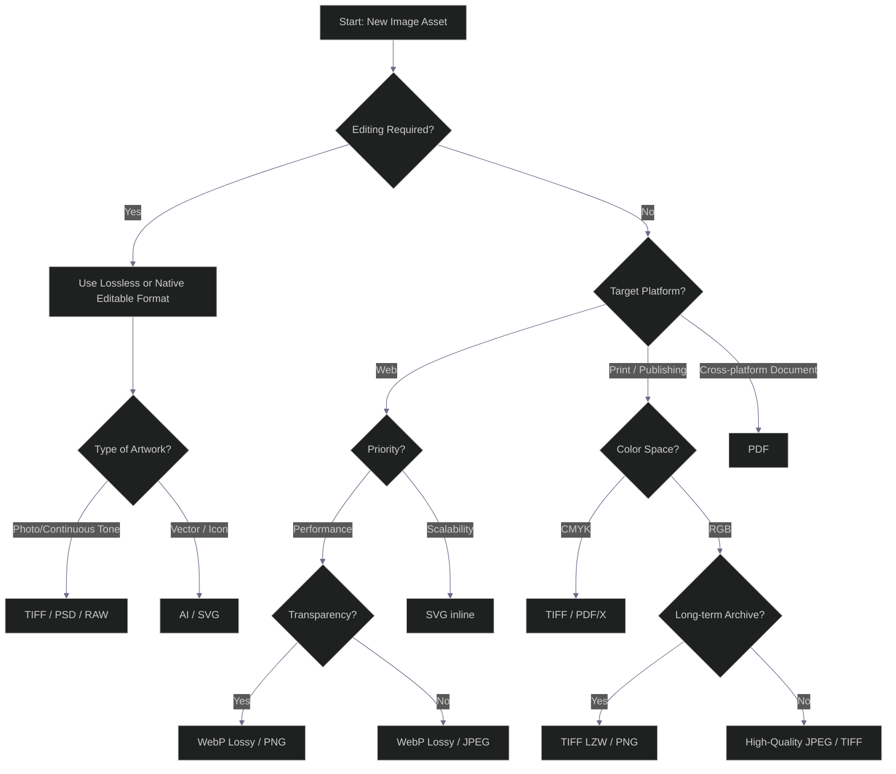

**Verbose Selection Heuristics:**

Before selecting a format, formalize the lifecycle of the asset: creation, review, distribution, storage, and potential future re-purposing. An image intended for a website banner today may later appear in a print brochure; if you discard the working master after exporting a lossy JPEG, you limit its future usability. Always separate working, editable, formats from delivery, consumption, formats as distinct pipeline stages.

When targeting web performance, consider using a `<picture>` element with multiple `<source>` types, offering WebP or AVIF to modern browsers and a JPEG fallback to legacy ones. Combine this with responsive `srcset` sizing to avoid transferring a 4K image to a 320px-wide viewport. This approach aligns file format selection with real user conditions, minimizing bytes over the wire.

For multimedia archivists, the ideal storage format is the one with the greatest tooling independence. A 24-bit 48 kHz PCM WAV file for audio, a FFV1 MKV losslessly compressed master for video, and a PDF/A for documents ensure that no vendor toolchain is required to recover the content fifty years hence. Favor open standards ratified by ISO/IEC with multiple independent implementations.

<br>

## 5. Best Practices and Tooling for Linux Administrators

### 5.1 Command-Line File Analysis Toolkit

- **`file`**: Identify the true type of any file by magic number, ignoring extension.
- **`stat`**: Show inode metadata: permissions, timestamps, size, and blocks consumed.
- **`xxd` / `hexdump`**: Hex viewer for inspecting headers and footers.
- **`mediainfo`** or **`ffprobe`**: Extract detailed codec, bitrate, stream mapping, and container parameters from media files. Non-interactive; ideal for scripting.
- **`exiftool`**: Read, write, and edit metadata in images, audio, and video. Supports batch processing of thousands of formats.
- **`pdfinfo`** and **`pdftotext`**: Extract metadata and text from PDFs from the poppler-utils package.
- **`unzip -l`**, **`tar -tvf`**, **`7z l`**: List archive contents without extraction for integrity checks.

### 5.2 Automated Validation and Sanitization

In server environments, user-uploaded files must be validated both by extension and by content:

```bash
# Reject non-PNG files disguised as .png using magic number
if ! file -b --mime-type "$1" | grep -q 'image/png'; then
    echo "Invalid PNG file" >&2
    exit 1
fi
```

- Implement **Content-Disposition** headers to force browsers to download rather than execute potentially dangerous files.
- Use **ClamAV** with up-to-date signatures to scan for embedded malware within common formats.
- Convert user-uploaded images to a safe canonical format, for example, re-encoding JPEG to JPEG at a known quality with ImageMagick, to strip malicious scripts hidden in metadata or comment segments.

### 5.3 Streamlining Conversion Workflows

- Image resizing and format conversion: `convert` from ImageMagick, `ffmpeg` for video/audio transcoding, `pandoc` for document format transformation.
- Leverage parallel processing with `xargs -P` or `GNU parallel` when batch-converting large media libraries.
- Always specify codec parameters explicitly in scripts; default settings can produce suboptimal results. For example, `ffmpeg -i input.wav -c:a libfdk_aac -b:a 128k output.m4a` ensures a high-quality AAC encoder.

<br>

## 6. Conclusion

The file format ecosystem is a meticulously engineered landscape where every extension is a contract: a promise of structure, behavior, and compatible interpretation. Understanding these contracts at the byte level, not just their superficial application, empowers engineers to build robust systems, optimize storage and transmission, and ensure the longevity of digital assets.

This guide has traversed the spectrum from foundational compression theory to pragmatic selection trees and Linux-native tooling. Whether you are designing a content pipeline, hardening a file upload service, or curating a personal media archive, the principles remain the same: identify your priorities explicitly, respect the immutable trade-offs of each format, and always preserve a lossless master as insurance against future requirements. Mastery of digital file formats is not a peripheral skill; it is a core competency of serious computing practice.


<br><br><br><br>
 
----------------

<br><br><br><br>


<h1 align="center">THE HETEROGENEOUS COMPUTING ECOSYSTEM: A COMPREHENSIVE GUIDE TO MODERN PROCESSING ARCHITECTURES.</h1>

<br><br>

## 1. Introduction: The Paradigm Shift to Heterogeneous Computing

The computing landscape is undergoing a fundamental transformation, moving away from reliance on a single, general-purpose Central Processing Unit (CPU) toward integrated systems that strategically combine specialized processors. This shift, driven by the slowdown of transistor scaling (Moore's Law) and the end of Dennard scaling, is a direct response to the explosive growth of data-intensive workloads, particularly in artificial intelligence (AI), high-performance computing (HPC), and real-time analytics. A one-size-fits-all processor is no longer efficient for the diverse demands of modern applications.

**Heterogeneous computing** refers to systems that utilize more than one kind of processor or core. These systems integrate specialized coprocessors—such as Graphics Processing Units (GPUs), Tensor Processing Units (TPUs), or Data Processing Units (DPUs)—alongside traditional CPUs to handle specific tasks with superior performance and energy efficiency. The core principle is **task-specific optimization**: assigning each computational workload to the processor architecture best suited for it. This approach yields significant benefits in performance, energy efficiency, and scalability, enabling continued progress in fields like AI and scientific simulation even as traditional semiconductor scaling slows.

This guide provides a detailed examination of the key processing units defining this new era, their underlying architectures, primary roles, and ideal applications.

<br>

## 2. Central Processing Unit (CPU): The System Orchestrator

The CPU remains the indispensable **control center** of any computing system. Its primary role is the execution of general-purpose software instructions through the fetch-decode-execute cycle, managing the operating system, application logic, and coordinating tasks across all other system components.

### 2.1 Core Architecture and Evolution

At its heart, a CPU core contains an **Arithmetic Logic Unit (ALU)** for mathematical and logical operations, and a **Control Unit (CU)** that directs instruction flow. To mitigate the high latency of accessing main memory (RAM), modern CPUs dedicate substantial silicon area to a **multi-level cache hierarchy** (L1, L2, and often shared L3), as well as ultra-fast registers for temporary data storage.

CPU design has evolved from single-core processors to today's **multi-core** and **many-core** architectures. A key advancement is the adoption of **heterogeneous CPU topologies** within a single chip, such as ARM's big.LITTLE or Intel's hybrid designs, which combine high-performance "P-cores" with energy-efficient "E-cores" to dynamically balance power and performance based on workload. Techniques like **superscalar execution**, **speculative branch prediction**, and **simultaneous multithreading** (e.g., Intel Hyper-Threading) are employed to maximize instruction-level parallelism and core utilization.

### 2.2 Applications and Limitations

CPUs excel at **sequential processing**, tasks with **complex control flow**, and **frequent branching**. They are ideal for running operating systems, databases, web servers, and application logic. Their strength lies in **low-latency execution** of serial tasks and their versatility.

However, CPUs are relatively inefficient for **massively parallel**, **vectorized operations**. With a limited number of cores (typically 8-64 in servers) and constrained memory bandwidth compared to accelerators, they consume more power and deliver lower throughput for parallelizable workloads like large matrix multiplications, which are foundational to AI and scientific computing.

<br>

## 3. Graphics Processing Unit (GPU): The Parallel Processing Workhorse

Originally designed for rendering 3D graphics, GPUs have become the cornerstone of **general-purpose parallel computing** (GPGPU). Their architecture is fundamentally different from CPUs, prioritizing high **throughput** over low latency for individual tasks.

### 3.1 Architecture: From Graphics Pipeline to Compute Engine

A GPU comprises thousands of smaller, simpler cores (e.g., NVIDIA CUDA Cores, AMD Stream Processors) designed to execute many calculations **concurrently**. These cores are organized into streaming multiprocessors that operate on a **Single Instruction, Multiple Threads (SIMT)** model, allowing numerous threads to execute the same instruction on different data elements.

To feed this immense parallel compute capacity, GPUs are paired with **high-bandwidth memory** (HBM, GDDR) offering terabytes per second of bandwidth—far exceeding typical CPU memory subsystems. The programming model is stream-based, where a computational kernel is applied to all elements in a data stream (e.g., an image or matrix).

### 3.2 Applications and Deployment

GPUs dominate any **data-parallel** workload. Beyond graphics rendering, their primary applications now include:

- **AI and Deep Learning:** Training and inference for neural networks, accelerated by frameworks like CUDA and ROCm.
- **Scientific Computing and HPC:** Simulations for climate modeling, computational fluid dynamics, and molecular dynamics.
- **Data Analytics and Finance:** Real-time analytics, risk modeling, and Monte Carlo simulations.

In data centers, GPUs are deployed in dense servers and interconnected into **GPU grids** using high-speed links like NVLink and InfiniBand, forming the computational backbone for training large language models like GPT-4. Their main limitations are **high power consumption** (hundreds of watts per chip) and lower efficiency on serial or branching-heavy code.

<br>

## 4. Specialized AI Accelerators: TPU and NPU

### 4.1 Tensor Processing Unit (TPU): The Cloud AI Accelerator

The TPU is an **Application-Specific Integrated Circuit (ASIC)** custom-designed by Google to accelerate **tensor operations** (n-dimensional array manipulations), the core computation in neural networks.

Its key innovation is the **systolic array** architecture—a grid of multiply-accumulate (MAC) units that stream data through the processor, minimizing memory access and maximizing throughput for matrix multiplication. TPUs heavily leverage **lower-precision arithmetic** (BF16, INT8) which is sufficient for neural network training and inference, yielding exceptional performance-per-watt for targeted AI workloads.

TPUs are deployed at scale in Google Cloud within **pods** of thousands of chips, delivering exaflop-scale performance for training models like Gemini. Their use is primarily confined to Google's ecosystem and optimized for TensorFlow/JAX frameworks.

### 4.2 Neural Processing Unit (NPU): The Edge Intelligence Unit

NPUs are dedicated accelerators integrated into **System-on-Chips (SoCs)** to efficiently execute neural network **inference** on power-constrained edge devices.

Designed for extreme **energy efficiency**, NPUs typically feature many optimized MAC units, support for low-precision computation (INT8, INT4), and on-chip memory to minimize data movement. They enable **on-device AI** features such as real-time photo processing, facial recognition, and voice assistants in smartphones (e.g., Apple Neural Engine), cameras, and IoT devices, offering benefits in latency, privacy, and bandwidth by processing data locally without relying on the cloud.

<br>

## 5. Data Processing Unit (DPU): The Infrastructure Offloader

The DPU is a specialized processor designed to offload and accelerate **data center infrastructure tasks**—networking, storage, and security—from the host CPU and GPU.

### 5.1 Architecture and Core Function

A DPU is essentially a **highly integrated system on a chip** that typically combines:

- **Multi-core CPU** (often ARM-based) running a full OS.
- **High-performance network interfaces** (200/400 GbE, InfiniBand).
- **Hardware accelerators** for cryptography, compression, and packet processing.

Its primary role is to process **data in motion**. By handling virtualization, software-defined networking (Open vSwitch), storage protocols (NVMe-over-Fabrics), and inline security (encryption, firewalling) at line rate, the DPU frees the host CPU to focus on application logic. This provides **security isolation** (the DPU can inspect and filter traffic even if the host is compromised) and improves overall system efficiency.

### 5.2 Deployment and Differentiation from SmartNICs

DPUs are critical in cloud-scale architectures, with products like NVIDIA BlueField and the AWS Nitro System being prominent examples. They are distinguished from simpler SmartNICs by their ability to not only accelerate the data plane in hardware but also run the **control plane software** (e.g., hypervisor, storage controller) on their embedded, programmable cores. This makes them a foundational element for a **zero-trust security model** and composable infrastructure in modern data centers.

<br>

## 6. Other Specialized and Emerging Processing Units

- **Vision Processing Unit (VPU):** Optimized for machine vision pipelines from camera inputs, executing algorithms for object detection and SLAM with high energy efficiency for drones, robotics, and smart cameras (e.g., Intel Movidius).

- **Field-Programmable Gate Array (FPGA):** Provides **reconfigurable hardware** that can be programmed post-manufacturing for specific algorithms. FPGAs offer a balance of flexibility, parallelism, and low-latency, making them valuable for prototyping, network acceleration, and niche HPC workloads where algorithms may evolve. They are generally more power-efficient than GPUs for fixed, bit-level operations but less efficient than final ASIC designs.

- **Quantum Processing Unit (QPU):** Represents a paradigm shift, leveraging quantum mechanical phenomena (**superposition, entanglement**) via qubits to solve specific classes of problems (e.g., quantum chemistry, optimization) that are intractable for classical computers. Currently accessed via cloud platforms (e.g., IBM Quantum), QPUs are experimental and require cryogenic cooling.

<br>

## 7. Architectural Comparison and Selection Guidelines

### 7.1 Processing Unit Architectural Comparison

| **Metric** | **CPU** | **GPU** | **TPU** | **NPU** | **DPU** |
| :--- | :--- | :--- | :--- | :--- | :--- |
| **Primary Role** | General-purpose orchestration & serial logic | Massively parallel compute | AI tensor operations (Cloud) | AI inference (Edge) | Infrastructure offload |
| **Core Architecture** | Few complex cores; large cache hierarchy | Thousands of simple cores; SIMT execution | Systolic array of MAC units | Array of optimized MAC units | Multi-core CPU + HW accelerators + NIC |
| **Key Strength** | Low-latency, complex branching | Data-parallel throughput | Matrix math throughput & efficiency | Energy efficiency for AI inference | I/O processing & security isolation |
| **Typical Precision** | FP64, FP32 | FP32, FP16, INT8 | BF16, FP16, INT8 | INT8, INT4 | N/A (varies by task) |
| **Power Envelope** | 5W - 300W+ | 10W - 700W+ | 75W - 300W+ | < 1W - 30W | 25W - 100W+ |
| **Dominant Workloads** | OS, databases, application logic | AI training, HPC, rendering | Large-scale AI training/inference | On-device AI (vision, speech) | Networking, storage virtualization, security |

### 7.2 Workload-to-Processor Selection Matrix

Selecting the right processing unit requires analyzing the workload's characteristics:

| **Workload Characteristic** | **Recommended Primary Processor** | **Rationale** |
| :--- | :--- | :--- |
| Complex serial logic, frequent branching, I/O coordination | **CPU** | Optimized for low-latency sequential execution and system management. |
| Large-scale, homogeneous, data-parallel computations (e.g., matrix math, SIMD) | **GPU** | Massive parallelism delivers highest throughput for aligned workloads. |
| Large-batch AI/ML training and inference in cloud environments | **TPU/GPU** | TPUs offer peak efficiency for tensor ops; GPUs offer greater flexibility. |
| Low-latency, low-power AI inference on edge devices | **NPU** | Extreme performance-per-watt for dedicated neural network execution. |
| High-speed network, storage, or security processing in data centers | **DPU** | Offloads and accelerates infrastructure tasks, freeing host CPUs/GPUs. |
| Evolving algorithms, niche protocols, or ultra-low-latency processing | **FPGA** | Post-deployment reconfigurability provides flexibility where ASICs are impractical. |

### 7.3 Decision Flowchart for Processor Selection

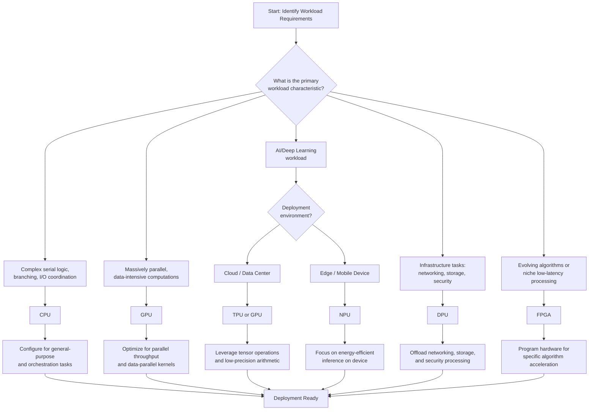

<br>

## 8. Recent Trends and Future Outlook

The trajectory of heterogeneous computing points toward greater **integration and specialization**:

- **Advanced Packaging:** Technologies like 2.5D and 3D chiplets allow CPUs, GPUs, and memory to be integrated into a single package with ultra-high-bandwidth interconnects, reducing latency and power consumption.

- **Software Unification:** Efforts like **SYCL**, **oneAPI**, and platform-specific ROCm aim to reduce programming complexity by providing unified models for heterogeneous systems, though fragmentation remains a challenge.

- **AI-Driven System Management:** Future systems may employ AI for **dynamic resource allocation**, automatically assigning tasks to the optimal processor (CPU, GPU, DPU) in real-time to optimize for performance, latency, or energy efficiency.

- **Quantum-Classical Hybridization:** Early research explores integrating QPUs as specialized co-processors within classical data centers to tackle specific problem segments, marking the beginning of a new, multi-paradigm computing era.

<br>

## 9. Conclusion

The end of universal performance scaling has given rise to a diverse and specialized **heterogeneous processing ecosystem**. No single processor type is optimal for all tasks. Instead, modern systems from edge devices to hyperscale data centers are built as **coordinated ensembles**: CPUs for control and serial tasks, GPUs for parallel compute, TPUs/NPUs for AI, and DPUs for infrastructure.

This architectural shift from general-purpose to **domain-specific computing** is the principal engine of continued performance and efficiency gains. Success in this new paradigm requires a deep understanding of each processing unit's intrinsic strengths and a strategic approach to mapping workloads to the most suitable silicon, a practice that will define computing system design for the foreseeable future.

<br>

## 10. References and Further Reading

For further exploration, consider investigating:

- **Programming Models:** CUDA, OpenCL, SYCL, oneAPI, ROCm
- **Architectural Details:** Specific chip generations from leading manufacturers (NVIDIA, AMD, Intel, Google, Apple)
- **Industry Standards:** PCIe, NVLink, CXL, InfiniBand
- **Emerging Technologies:** Quantum computing, neuromorphic computing, photonic computing


<br><br><br><br>
