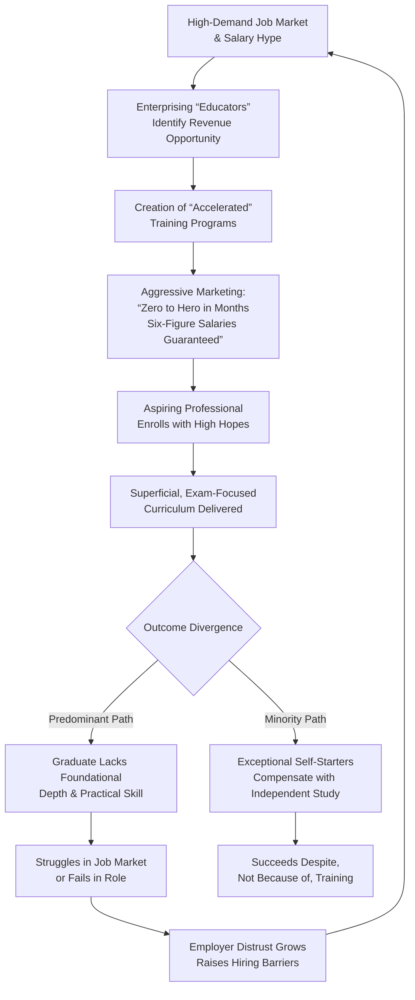
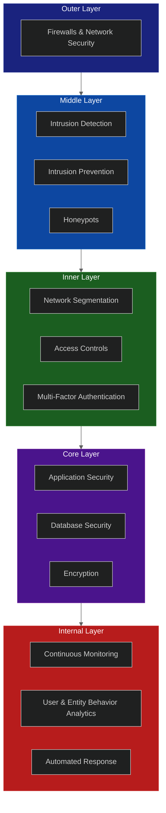
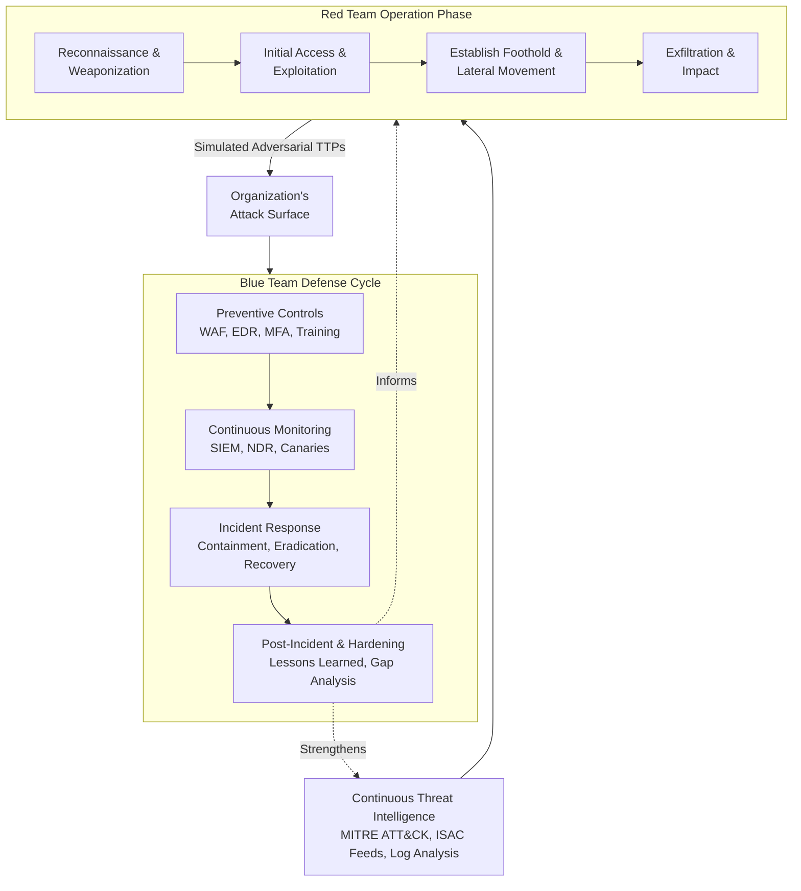
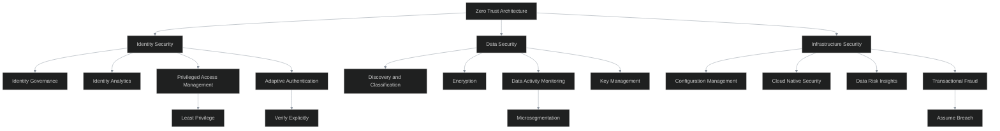
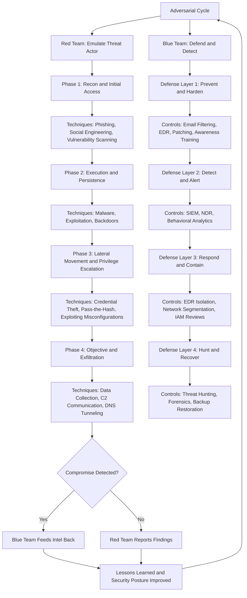
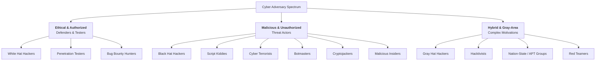
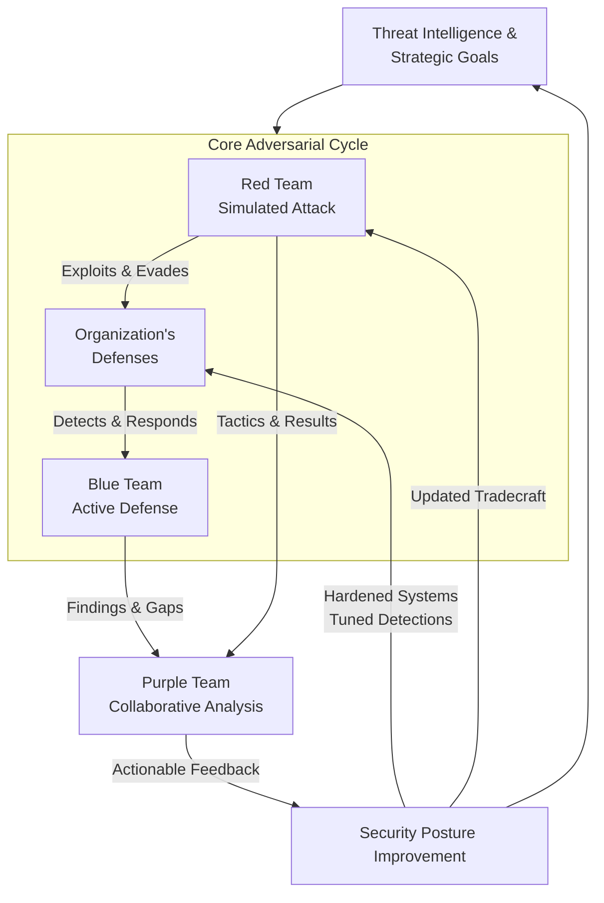
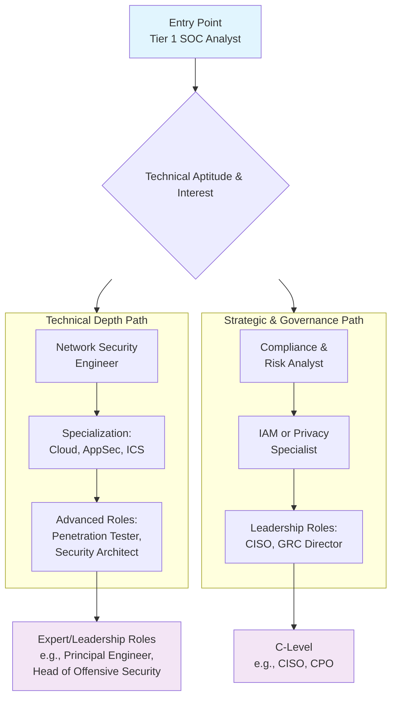

     
 
<h1 align="center">ESSENTIAL CYBERSECURITY GUIDE: A COMPREHENSIVE RESOURCE FOR INDIVIDUALS AND ORGANIZATIONS.</h1>

    

    

  

> **Disclaimer**
>
> *The information provided in this guide is for general informational and educational purposes only. It reflects common cybersecurity best practices as of the publication date. Cybersecurity is a rapidly evolving field, and threats and defenses are subject to change. Readers are encouraged to stay informed about the latest security developments and to consult with qualified IT professionals for advice tailored to their specific situation. The authors assume no responsibility for any loss or damage resulting from the use of, or reliance upon, the information contained herein.*

 

## Introduction: A Shared Responsibility in the Digital Age

In our increasingly interconnected world, the security of our digital information is not merely a matter for IT professionals; it is a fundamental responsibility shared by everyone. From students managing academic records and faculty conducting sensitive research to administrative staff handling institutional data and families protecting personal memories, every individual is a potential target for cyber threats. These threats, including data breaches, identity theft, and ransomware attacks, are growing in both sophistication and frequency.

While organizations invest in robust security infrastructure, individual actions form the first and most critical line of defense. This guide is designed to equip you with clear, actionable, and effective cybersecurity practices. By integrating these habits into your daily digital life, you significantly reduce your vulnerability to cyberattacks and contribute to a safer, more resilient digital ecosystem for our entire community.

The landscape of cyber threats has evolved dramatically with the advent of artificial intelligence. Attackers now use AI to automate hacking, craft flawless phishing emails, clone voices, and discover vulnerabilities at unprecedented speeds. This guide addresses both timeless security principles and the specific challenges posed by AI-powered threats, ensuring you are prepared for the current and emerging risk environment.

 

## Section 1: The First Line of Defense – Secure Authentication

The foundation of digital security rests on how you prove your identity online. Weak or reused passwords are akin to leaving your front door unlocked. Strengthening your authentication practices is the single most impactful step you can take to protect your digital life.

### Create Strong, Unique Passphrases

Gone are the days of simple, dictionary-word passwords. The modern standard is a passphrase, which is a string of at least four unrelated words combined with numbers and symbols. For example, `Correct-Horse-Battery-Staple#17` represents a credential that is both complex for attackers to crack and easier for you to remember. This method creates credentials that are resistant to brute-force attacks, where automated systems attempt millions of password combinations per second.

More importantly, you must use a unique passphrase for every single account. This practice prevents credential stuffing, a common attack where cybercriminals use credentials leaked from one service to try and break into your other, more valuable accounts like email or banking. When attackers obtain a password from a data breach at one website, they systematically test that same combination across hundreds of other popular services, knowing that many people reuse passwords.

### Embrace a Password Manager

Remembering dozens of unique, complex passphrases is humanly impossible. A password manager is the essential tool that solves this problem. These applications securely store all your credentials in an encrypted digital vault, accessible only through a single, strong master password. They can automatically generate and fill in complex passwords for you, eliminating the hassle of password fatigue and the security risk of password reuse.

By adopting a password manager, you only need to remember one supreme password, while the tool ensures every other account is protected by a unique and virtually uncrackable key. Popular options include Bitwarden, 1Password, and Dashlane, each offering robust encryption and cross-platform support. This single change in your digital habits eliminates the most common attack vector used by cybercriminals.

### Activate Multi-Factor Authentication Everywhere

A password, no matter how strong, is a single point of failure. Multi-factor authentication adds a vital second layer of security by requiring an additional verification step. This could be a temporary code from an authenticator app like Google Authenticator or Microsoft Authenticator, a biometric scan like your fingerprint or face, or a physical security key such as a YubiKey.

Even if a malicious actor manages to steal your password, MFA acts as an impassable barrier, preventing them from accessing your account without that second factor. Industry statistics demonstrate that MFA blocks 99.9% of automated account attacks, yet a significant percentage of users still do not enable it. For this reason, enabling MFA on your email, financial, and institutional accounts is one of the most powerful defenses available to you.

### Transition to Passkeys for Phishing-Resistant Authentication

Passkeys represent the next evolution in secure authentication. Unlike passwords, which can be stolen or guessed, passkeys use cryptographic keys that never leave your device. When you log in, your device uses biometrics or a PIN to authorize the transaction. Passkeys are completely immune to phishing because the key never travels over the internet, making them the gold standard for authentication in 2026 and beyond.

 

## Section 2: System Integrity – Maintaining a Healthy Digital Environment

Just as you would service a car to prevent breakdowns, your digital devices require regular maintenance to stay secure. Outdated software is a primary entry point for attackers, who actively scan for known, unpatched vulnerabilities. In the AI era, attackers use automated tools to reverse-engineer security patches within hours of release, creating exploits for unpatched systems with unprecedented speed.

### Enable Automatic Updates for All Software

Modern operating systems such as Windows, macOS, iOS, and Android, along with applications and web browsers, frequently release updates. These updates do more than just add new features; they often contain critical security patches that fix newly discovered vulnerabilities. By enabling automatic updates, you ensure these defenses are installed as soon as they are available.

Delaying or ignoring update notifications leaves your devices, and the networks they connect to, exposed to attacks that could have been easily prevented. This includes all software on your computers, smartphones, and tablets, as well as browser plugins and extensions. Automatic updates are no longer optional; they are the baseline for security in the modern threat landscape.

### Keep Your Hardware Current and Secure

Software and hardware are partners in security. As technology evolves, older devices may eventually be unable to run the latest, most secure operating systems. A device that no longer receives security updates from its manufacturer is a significant liability. Periodically evaluate whether your personal computers, smartphones, and even your home Wi-Fi router are still supported. An outdated router with unpatched firmware can be a gateway for attackers to access every device on your home network, including your computers, smart TVs, and security cameras.

### Deploy and Maintain Endpoint Protection

Endpoint protection is the modern term for comprehensive security software installed on your devices. This goes beyond traditional antivirus to include firewalls, anti-malware, and intrusion detection. Ensure you have a reputable security suite installed and active on all your computers, and be aware of the built-in security features on your smartphones and tablets.

A properly configured firewall acts as a gatekeeper, monitoring and controlling network traffic to block unauthorized connection attempts, both incoming and outgoing. When selecting security software, consider solutions that use AI-powered threat detection to identify novel attacks that signature-based antivirus might miss.

### Practice Input Sanitization for Connected AI Assistants

AI agents are increasingly being given access to calendars, emails, and files through tools like Microsoft Copilot and Google Duet. If an attacker poisons these files with hidden instructions, your AI assistant could inadvertently leak data. Regularly audit connected applications and grant AI assistants Read access only, never Write or Execute access, unless absolutely necessary. Delete old, sensitive files from your cloud drives that you no longer need, so the AI does not index them unnecessarily.

 

## Section 3: Data Protection – Safeguarding Your Digital Assets

Your personal information, academic work, financial records, and precious memories are all digital assets that need protection from loss, theft, or destruction. A proactive approach to data management is essential for maintaining privacy and ensuring business continuity.

### Adopt a Robust 3-2-1 Backup Strategy

Data loss can occur from ransomware, hardware failure, theft, or accidental deletion. The most reliable defense is a solid backup plan. The industry-standard 3-2-1 rule is simple to follow: maintain at least three total copies of your important data, stored on two different types of media, with one of those copies located off-site. For example, you might keep your primary copy on your computer's hard drive, a second copy on an external USB drive, and a third copy in a secure cloud storage service.

Automating this backup process ensures your irreplaceable work and memories are never lost to a single point of failure. Remember that a backup you have never restored from is not a backup; it is a hope. Test your backups regularly to ensure they can be recovered when needed.

### Protect Your Backups from Ransomware

Modern ransomware is increasingly sophisticated and may wait until your backup drive is connected before encrypting your files. If you back up your computer to an external hard drive, perform the backup and then physically unplug the USB cable from your computer. Keep it disconnected when you are not actively backing up. For cloud backups, consider immutable storage options that prevent data from being edited or deleted for a set period, ensuring your backups remain safe even if your primary systems are compromised.

### Encrypt Your Sensitive Information

Encryption scrambles your data, making it unreadable to anyone without the correct decryption key. You should use encryption in two primary scenarios. First, for data at rest, ensure your device's hard drive is encrypted using BitLocker on Windows or FileVault on macOS. Second, for data in transit, always look for the padlock icon in your browser's address bar, which indicates the website uses HTTPS encryption. Avoid entering personal or financial information on sites that do not use this secure connection.

When sharing sensitive files with others, use approved secure file-sharing services rather than unencrypted standard email. A purpose-built platform encrypts files end-to-end, allows you to control access by recipient, and creates an audit trail for compliance purposes.

### Minimize Your Digital Footprint

The less personal information you have online, the less there is for attackers to steal or exploit. Be judicious about what you share on social media and other public platforms. Personal Identifiable Information like your birthdate, address, or pet's name can be used to answer security questions or craft convincing phishing attacks. Regularly review and tighten the privacy settings on your accounts. Furthermore, make it a habit to securely delete old accounts and files you no longer need, reducing the overall amount of data you are responsible for protecting.

### Protect Your Voiceprint and Faceprint Footprint

AI can clone a loved one's voice with just three seconds of audio from social media and can replicate faces on video calls. Set your social media accounts to private and turn off data sharing for AI training in your privacy settings. Avoid posting long, unedited videos of yourself speaking directly to the camera, as scammers use these to train their voice-cloning models. Before using viral photo-editing apps, check the privacy policy for terms like perpetual, royalty-free license to use your content, which may allow the company to sell your facial biometrics.

### Use Secure File-Sharing Solutions

If your team regularly handles confidential documents like client files, financial records, and legal matters, regular email is not built for this purpose. Intercepted emails expose sensitive data and put you on the wrong side of compliance frameworks like HIPAA, PIPEDA, and the SEC Safeguards Rule. A purpose-built secure file sharing platform encrypts files end-to-end, lets you control access by recipient, and creates the audit trail compliance auditors require. Your files are only as secure as the tools you share them with.

 

## Section 4: Proactive Vigilance – The Human Firewall

Technology alone cannot stop all attacks. Many cyber threats, particularly phishing and social engineering, are designed to exploit human psychology. Cultivating a mindset of healthy skepticism and caution is your final, and often most effective, layer of defense.

### Master the Art of Phishing Detection

Phishing attacks arrive as deceptive emails, text messages, or even phone calls designed to trick you into revealing sensitive information or installing malware. In the AI era, phishing messages are increasingly perfect in grammar and personalization. Be highly suspicious of any unsolicited message that creates a sense of urgency, requests personal information, or asks you to click on a link or open an attachment.

Before engaging, scrutinize the sender's email address for subtle misspellings, such as `@universty.edu` instead of `@university.edu`. Hover your mouse over any link to see the true destination URL before clicking. If a message claims to be from a legitimate organization like your bank or institution, do not use the contact information in the message; instead, contact them directly through a verified phone number or website.

### Beware of Quishing

AI generates convincing fake QR codes and pastes them over real ones on parking meters, restaurant tables, and flyers. When you scan them, they take you to a fake login page that steals your credentials. Never scan a QR code that is stuck onto a surface like a sticker over a real meter. If you scan a menu QR code at a restaurant, look at the URL that pops up before you click Go. If it is a jumbled, nonsensical link, close it and ask for a physical menu.

### Implement a Safe Word Protocol for Deepfake Defense

AI can now clone a loved one's voice with just three seconds of audio from social media. Establish a family or office safe word that must be verbally exchanged during any unexpected financial, legal, or sensitive data transfer request, even during video calls. If the caller hesitates or cannot provide it, hang up and verify via a separate, out-of-band channel like a text to a different number. This simple practice defeats AI-powered voice and video impersonation attacks.

### Practice the Turn Your Head Test

If a caller looks slightly waxy, has unnatural blinking, or the lighting around their face does not match the background, ask them to turn their head to the side or wave a hand in front of their face. Real-time AI deepfakes struggle to render side profiles and moving hands accurately and will glitch or blur. This simple test can quickly identify synthetic video impersonations.

### Don't Trust Incoming Caller ID

AI voice-cloning combined with number spoofing means your phone screen will show Mom or Bank of America, but it is a scammer in another country. If you receive a call from your bank asking for verification codes, hang up immediately. Call the number printed on the back of your physical debit card. Do not call the number the incoming caller gives you. Always verify urgent requests through a separate, trusted channel.

### Cultivate Secure Browsing Habits

The websites you visit can pose a significant risk. Avoid untrustworthy sites, especially those offering pirated software, media, or other illegal content, as they are often riddled with malware. Pay attention to your browser's security warnings. If your browser blocks a site or displays a certificate error, heed the warning and leave the page. Consider using browser extensions that block intrusive ads and trackers, as these can also prevent malvertising, which can compromise your device even on legitimate websites.

### Follow the Three-Second Rule for Search Results

AI-generated search summaries sometimes hallucinate and recommend scam websites or even dangerous DIY remedies. Never click the first paid ad or the AI summary link. Scroll down to the organic search results and only click on well-known domains you recognize, such as `.gov`, `.edu`, or major news outlets. This practice helps you avoid malicious sites that have been optimized to appear in search results.

### Turn Off Auto-Connect for Wi-Fi and Bluetooth

AI bots set up fake Free Airport Wi-Fi or Coffee Shop hotspots that mimic real networks. Your phone auto-connects, and the AI scrapes everything you type, including banking passwords. Go to your phone's Wi-Fi settings and turn off auto-join public networks. Manually select trusted networks only. Turn Bluetooth off when you are in public to prevent AI-based tracking and unauthorized access attempts.

### Remove Adware from Your Machines

Adware collects information about you to serve more targeted ads and can compromise your privacy by gathering sensitive data for profiling. Use tools like AdwCleaner to clean adware and unwanted programs from your computer. This helps maintain your privacy and prevents advertisers from building detailed profiles of your online activities.

### Double-Check for HTTPS on Websites

When you are on a website that is not using HTTPS, there is no guarantee that the transfer of information between you and the site's server is secure. Double-check that a site is using HTTPS before you give away personal or private information. Look for the padlock icon in your browser's address bar as a visual confirmation of secure data transmission.

### Avoid Storing Important Information in Non-Secure Places

When storing information online, you want to keep it in a location that cannot be accessed by unauthorized users. Use encrypted cloud storage solutions or secure file-sharing platforms rather than unprotected folders or documents. Regular email is not secure for confidential documents, as intercepted emails expose sensitive data and may violate compliance requirements.

### Scan External Storage Devices for Viruses

External storage devices are just as prone to malware as internal storage devices. If you connect an infected external device to your computer, the malware can spread. Always scan external devices for malware before accessing them. This includes USB drives, external hard drives, and memory cards from cameras or other devices.

### Exercise Caution with Personality Quizzes

AI loves training on personality quizzes that ask for your birth month, pet name, or mother's maiden name. These are exactly the answers to your security questions. Never answer these quizzes truthfully. If you must participate, use completely fake answers that you write down in a physical notebook.

### Create a Burner Email for AI Tools and Shopping

Every time you sign up for a free AI tool or a grocery store loyalty app, your main email gets added to lists that are sold and scraped by AI bots for targeted spear-phishing. Create a completely separate, free email address that does not contain your real name. Use this junk email for all AI chatbot sign-ups, coupon sites, and newsletters. Keep your real email exclusively for banking, healthcare, and close family.

### Update Your Phone's Voice Assistant Lock Screen Settings

AI voice assistants can be tricked into calling numbers or reading out your calendar appointments while your phone is locked, especially if a scammer shouts commands near your pocket. Go to Settings and turn off Allow Siri When Locked or similar settings for Google Assistant. This prevents anyone from using voice commands to access your phone unless it is unlocked by your face or fingerprint.

 

## Section 5: Building a Culture of Security – For Families and Teams

If you are responsible for the digital safety of others, whether family members, a student team, or departmental colleagues, your role expands to include fostering a shared culture of security awareness.

### Champion Continuous Security Education

Security is not a one-time lesson but an ongoing practice. Engage your family or team in regular, informal discussions about common threats like phishing. Share examples of suspicious emails you have encountered and explain how you identified them. Encourage an environment where people feel comfortable reporting a potential security mistake without fear of blame. This open culture transforms everyone from a potential weak link into an active, vigilant participant in your collective defense.

Annual training does not work anymore. Best practice in 2026 is a mix of monthly micro-training sessions lasting five to ten minutes, quarterly phishing simulations, and role-specific training for high-risk roles like finance and executive assistants. Training should cover current threats including AI-generated phishing emails, deepfake voice and video calls, and social engineering through platforms like Slack and Teams. Organizations with continuous training programs experience up to 70% fewer successful phishing attacks than those with annual-only training.

### Embrace a Defense-in-Depth Philosophy

Move away from the idea that you are ever secure enough. Effective security is layered and constantly evolving. This means proactively investing in security upgrades for software and hardware. For anyone managing a website, enforcing HTTPS with a valid SSL or TLS certificate is non-negotiable; it protects your visitors' data and builds trust. Assume that your primary defenses will eventually be challenged, and have secondary controls, like MFA and robust backups, already in place.

### Consider Proactive Security Testing

For teams or organizations managing critical systems or sensitive data, consider going on the offensive with your defenses. Engaging qualified security professionals, often called white-hat hackers or penetration testers, to conduct ethical hacking exercises on your systems can be invaluable. They will attempt to find and exploit vulnerabilities just as a real attacker would, providing you with a clear, prioritized roadmap for fixing weaknesses before they can be discovered and used maliciously.

### Run Real-Time AI Phishing Drills

Use AI phishing simulation tools that generate personalized, context-aware phishing emails based on your employees' actual LinkedIn profiles and recent projects. Run these drills bi-weekly. If someone clicks, force them to take a five-minute micro-training immediately, not during next year's compliance review. This immediate feedback loop reinforces learning and reduces the likelihood of falling for real attacks.

### Implement a Zero Trust Approach

The old build a wall around the office network model is dead. Zero Trust assumes no user or device is trustworthy by default; every access request is verified, every time. Start with the basics: enforce least-privilege access so employees only get access to what they actually need, require MFA on every login, and log every access event so unusual activity gets flagged early.

### Evaluate Vendors and Third-Party Tools

Your security is only as strong as the weakest vendor with access to your data. Supply-chain breaches have quadrupled in recent years. Before you hand over data or system access, ask vendors about their security certifications such as SOC 2 or ISO 27001, encryption standards, breach history, and incident response process. Build security expectations into vendor contracts and review them annually.

### Have an Incident Response Plan Ready

Most breaches take an average of 241 days to detect and contain, and the longer it takes, the more it costs. A documented incident response plan cuts that timeline dramatically. At minimum, document who gets called first, how you isolate affected systems, your legal and regulatory notification obligations, and how you communicate with customers. Run a tabletop exercise once a year so the plan is not a PDF nobody has read.

 

## Section 6: The AI Era – Understanding Emerging Threats

The arrival of generative AI has fundamentally changed the cybersecurity landscape. Attackers now use AI to automate hacking, craft flawless phishing emails, clone voices, and discover zero-day vulnerabilities in milliseconds. Understanding these threats is essential for staying protected.

### AI-Generated Phishing

AI can create perfect phishing emails in any language, eliminating the classic spelling mistake and poor grammar red flags that used to identify scams. These messages can be personalized based on information scraped from social media, making them highly convincing. Old advice like watch for typos no longer applies. Train yourself and your team to verify any unusual request through a second, known channel.

### Deepfake Voice and Video

AI can clone voices from short audio clips and create realistic video impersonations. Attackers are using these tools in CEO-fraud scams, where they impersonate executives to authorize fraudulent wire transfers. The safe word protocol and turn your head test provide practical defenses against these sophisticated attacks.

### AI-Enhanced Ransomware

Modern ransomware can pause itself, wait for backups to sync, and then encrypt the backups along with the primary data. This is why immutable backups and offline storage are essential. Attackers increasingly demand payment within hours rather than days, making rapid recovery capabilities critical.

### The Rise of Phishing-as-a-Service

Scammers can now buy cheap AI bots that do 100% of the scamming for them. This means anyone can be a hacker, not just technically skilled individuals. The barrier to entry for cybercrime has dropped dramatically, resulting in a surge of attacks targeting individuals and small businesses.

 

## Quick Reference: Backup Strategy Comparison

Choosing the right backup strategy is critical. This table compares common approaches to help you make an informed decision.

| Strategy | Description | Best For | Key Consideration |
| :--- | :--- | :--- | :--- |
| **Local Backup** | Copying data to an external device like a USB hard drive or a Network Attached Storage system kept in your home or office. | Quick recovery of large volumes of data; full control over your media. | Vulnerable to local threats like theft, fire, or flood. To protect against ransomware, the backup drive must be disconnected from your computer when not actively backing up. |
| **Cloud Backup** | Automatically copying data to a secure, off-site server managed by a service provider such as Backblaze, iCloud, or OneDrive. | Off-site protection; data accessibility from anywhere; set-and-forget automation. | Requires an ongoing subscription. The initial backup of a large amount of data can be slow. It is vital to choose a reputable provider that uses strong encryption for your data both in transit and at rest. |
| **Hybrid with Immutable Storage** | A combined approach using both local and cloud backups, with cloud storage configured to prevent data from being edited or deleted for a set period. | Maximum protection for irreplaceable data and protection against sophisticated ransomware. | Requires managing two separate backup systems but offers the highest level of resilience against virtually any type of data loss scenario, including attacks on backup repositories. |

 

## Quick Reference: Authentication Methods Comparison

| Method | Security Level | Resistance to Phishing | Ease of Use | Recommendation |
| :--- | :--- | :--- | :--- | :--- |
| **Password Only** | Low | None | Moderate | Avoid entirely for any important account. |
| **Password + SMS Code** | Moderate | Low | Easy | Use only if no better option is available; SMS is vulnerable to SIM-swapping. |
| **Password + Authenticator App** | High | Moderate | Easy | Recommended as the baseline for all accounts that support it. |
| **Passkeys** | Very High | High | Very Easy | The gold standard; enable wherever available. |
| **Hardware Security Key** | Very High | Very High | Moderate | Best for high-value accounts and administrative access. |

 

## Quick Reference: AI Era Defense Checklist

| Threat | Defense | Action |
| :--- | :--- | :--- |
| AI Voice Cloning | Safe Word Protocol | Establish a family or office safe word for financial or sensitive requests. |
| AI Deepfake Video | Turn Your Head Test | Ask the caller to turn their head or wave a hand during video calls. |
| AI-Generated Phishing | Out-of-Band Verification | Verify all urgent requests through a separate, known communication channel. |
| AI-Enhanced Ransomware | Immutable Backups | Store backups in a location that cannot be edited or deleted for a set period. |
| AI Facial Scraping | Privacy Settings | Turn off data sharing for AI training on social media platforms. |
| Quishing (QR Phishing) | URL Inspection | Examine the URL before clicking after scanning a QR code. |
| Evil Twin Wi-Fi | Manual Network Selection | Turn off auto-join public networks and manually select trusted networks. |
| AI Chatbot Data Leakage | Input Sanitization | Never paste sensitive personal or business data into public AI tools. |

 

## Comprehensive Cybersecurity Checklist for All Users

**Authentication and Access Control**

- [ ] Enable Multi-Factor Authentication on all accounts that support it
- [ ] Transition to Passkeys where available
- [ ] Use a password manager with unique passwords for every account
- [ ] Create strong passphrases rather than simple passwords
- [ ] Disable voice assistant access when the device is locked

**Device and System Security**

- [ ] Enable automatic updates for operating systems, browsers, and applications
- [ ] Install and maintain reputable endpoint protection software
- [ ] Keep hardware up-to-date and replace devices that no longer receive security updates
- [ ] Remove adware and unwanted programs from all devices
- [ ] Scan external storage devices for viruses before accessing files
- [ ] Disable Bluetooth when not in use

**Data Protection and Backup**

- [ ] Implement the 3-2-1 backup strategy for important data
- [ ] Use encrypted storage for sensitive information
- [ ] Disconnect external backup drives when not actively backing up
- [ ] Test backups regularly by restoring from them
- [ ] Use secure file-sharing solutions rather than regular email for sensitive documents
- [ ] Enable HTTPS on any website you manage

**Network Security**

- [ ] Use a VPN when connecting to public Wi-Fi
- [ ] Turn off auto-connect for Wi-Fi and Bluetooth
- [ ] Secure your home Wi-Fi router with a strong password and updated firmware
- [ ] Avoid conducting sensitive activities on public networks

**Phishing and Social Engineering Defense**

- [ ] Verify the sender's email address carefully, looking for subtle misspellings
- [ ] Hover over links to see the true destination URL before clicking
- [ ] Verify urgent requests through a separate, trusted communication channel
- [ ] Establish a safe word for financial or sensitive requests
- [ ] Never click links or download attachments from suspicious messages
- [ ] Be cautious of QR codes, especially stickers placed over existing codes

**Privacy and Digital Footprint**

- [ ] Set social media accounts to private
- [ ] Turn off data sharing for AI training in privacy settings
- [ ] Limit sharing of personal identifiable information online
- [ ] Use a burner email for AI tools and shopping
- [ ] Regularly delete old accounts and files you no longer need
- [ ] Check HaveIBeenPwned.com to see if your email has been in a breach
- [ ] Remove location metadata before sharing photos publicly

**AI Tool Usage**

- [ ] Never paste sensitive personal or business information into public AI chatbots
- [ ] Use enterprise private instances for work-related AI usage when available
- [ ] Regularly audit connected apps and revoke unnecessary access
- [ ] Grant AI assistants Read access only, never Write or Execute access

**Organizational and Team Practices**

- [ ] Provide continuous security training with monthly micro-sessions
- [ ] Run regular phishing simulations
- [ ] Implement a Zero Trust security model
- [ ] Evaluate vendor security and include security expectations in contracts
- [ ] Maintain a documented incident response plan
- [ ] Conduct annual tabletop exercises to test the plan

 

## Frequently Asked Questions

### What are the most important cybersecurity best practices for individuals?

The five highest-impact practices are enabling Multi-Factor Authentication on every account, using a password manager with unique passwords, keeping software and hardware patched with automatic updates, backing up data using the 3-2-1 rule, and learning to identify and avoid phishing attempts. These cover the majority of attack vectors individuals face in their daily digital lives.

### What are the biggest cybersecurity threats in 2026?

The top threats are AI-generated phishing and deepfakes, ransomware, supply-chain attacks through third-party vendors, stolen credentials, and cloud misconfigurations. Attackers increasingly use AI to scale and personalize attacks, making them more difficult to detect with traditional methods.

### How much should a small business spend on cybersecurity?

Industry benchmarks recommend allocating 10 to 15 percent of your total IT budget to cybersecurity. Regulated sectors like legal, healthcare, and finance typically need to spend more to meet compliance requirements. The cost of a breach often far exceeds the investment in prevention.

### Is cybersecurity insurance worth it?

For most organizations, yes. The average cyberattack costs a small business between $120,000 and $254,000. Cyber insurance covers breach response, legal fees, and business interruption losses that can sink an unprotected company. However, insurance should complement, not replace, strong security practices.

### What is the 3-2-1 backup rule?

Keep three copies of your data, on two different types of storage media, with at least one copy stored offline or off-site. The offline copy is your insurance against ransomware. Modern best practices suggest adding immutability to your cloud backups to prevent attackers from encrypting them.

### How often should I update software for security?

Turn on automatic updates wherever possible. For systems where you cannot, apply high-severity patches within 30 days, and patch actively exploited zero-day vulnerabilities within 7 days. Unpatched software is consistently a top-three attack vector each year.

### How do I protect myself from AI-generated phishing?

Old advice like watch for typos no longer applies. Train yourself to verify any unusual request through a second, known channel, such as calling the requester back at a number from your contact list, not the one in the email. Combine that with strong email filtering, MFA, and out-of-band approval for any wire transfer or credential change.

### What is the difference between cybersecurity and information security?

Information security covers all forms of sensitive data, including paper documents, physical access, and verbal disclosures. Cybersecurity is the subset focused on protecting digital systems, networks, and data from electronic attacks. For most individuals and organizations, the two overlap heavily, and the practices in this guide cover both.

 

## Conclusion: Your Role in a Resilient Digital Community

Cybersecurity is not a distant concept managed by a central IT department; it is a daily practice woven into the fabric of our digital interactions. By internalizing and applying the principles outlined in this guide, securing your access, maintaining your systems, protecting your data, staying vigilant, and fostering a security-conscious environment, you become an integral part of the collective cyber defense.

The journey to a more secure digital life does not require perfection overnight. We encourage you to start by adopting one or two new habits this week. Perhaps enable MFA on your primary email account or set up a password manager. As these practices become routine, gradually incorporate the others. Share this knowledge and these habits with your peers, students, family members, and colleagues.

Together, through informed and proactive efforts, we can build a safer and more resilient digital community for teaching, learning, discovery, and everyday life. In the AI era, the most powerful defense is informed, vigilant human behavior combined with strong technical controls. Your actions matter, and every step you take toward better security practices makes the entire digital ecosystem more secure for everyone.

 

*Remember: Data you do not share is data AI cannot steal. Practice digital minimalism and ask yourself whether an app, website, or request truly needs each piece of your personal information. If the answer is no, do not provide it. This simple principle is one of the most powerful defenses in the modern threat landscape.*

     

<h1 align="center">CORE PRINCIPLES FOR THE GUARDIANS OF DIGITAL COMMONS.</h1>
<h3 align="center">A Comprehensive Framework for Ethical Cybersecurity Leadership and Operational Excellence.</h3>

  

# PREAMBLE

The digital commons—encompassing critical open-source software, public data infrastructures, shared knowledge platforms, and the interconnected systems upon which modern society depends—underpins global civilization. Its security and resilience demand far more than technical proficiency; they require a dedicated cadre of professionals operating under a unified ethical and operational framework.

This document defines the core principles, strategic pillars, and operational doctrines for Guardians committed to protecting this vital ecosystem. It synthesizes fundamental tenets of cybersecurity leadership, ethical imperatives, effective organizational practices, and the timeless wisdom of responsible stewardship. These principles serve as both a compass for decision-making and a foundation for building resilient, trustworthy digital environments.

The framework presented herein addresses the full spectrum of cybersecurity responsibility—from individual technical excellence to organizational leadership, from community engagement to global collaboration. It acknowledges that cybersecurity is fundamentally a human endeavor, one that requires technical mastery tempered by compassion, strategic thinking guided by integrity, and operational precision animated by purpose.

 

## SECTION I: FOUNDATIONAL ETHOS
### The Bedrock of Cyber Stewardship

### PRINCIPLE 1: Lead with Uncompromising Integrity and Ethical Accountability

Cybersecurity is fundamentally a trust-based profession. Leadership credibility serves as the cornerstone of organizational resilience. Guardians must uphold the highest standards of honesty, transparency, and moral clarity in every decision and action.

**Core Commitments:**

| Commitment Area | Operational Expression |
|----------------|----------------------|
| **Honesty** | Communicate risks, incidents, and vulnerabilities truthfully, without exaggeration or minimization |
| **Transparency** | Maintain open channels about security posture, limitations, and improvement areas |
| **Moral Clarity** | Make decisions based on ethical principles, not convenience or expediency |
| **Regulatory Compliance** | Meet or exceed all applicable legal and regulatory requirements |
| **Societal Responsibility** | Consider broader societal impacts of security decisions |

**Implementation Guidance:**

- Establish clear ethical guidelines for all security operations
- Create mechanisms for reporting ethical concerns without fear of reprisal
- Document and communicate decision-making processes
- Regularly audit practices against ethical standards
- Prioritize data privacy and individual rights in all initiatives

### PRINCIPLE 2: Embrace the Duty of Universal Protection

Cybersecurity knows no bias. Leadership demands a commitment to protecting all digital entities equally and actively extending expertise to uplift the vulnerable, under-resourced, and neglected. Guardians measure their success not by what they have secured for themselves, but by an ecosystem sustained, trusted, and accessible for all.

**Core Commitments:**

| Protection Domain | Application |
|------------------|-------------|
| **Non-Discrimination** | Equal protection regardless of victim wealth, status, or profile |
| **Vulnerable Populations** | Prioritize outreach to those lacking security resources |
| **Under-Resourced Entities** | Extend expertise to nonprofits, charities, and small businesses |
| **Global Perspective** | Recognize security as a universal human concern |

**Implementation Guidance:**

- Develop pro bono security services for qualifying organizations
- Create accessible security education for non-technical audiences
- Advocate for policies that protect the most vulnerable digital citizens
- Allocate resources to community defense initiatives
- Measure success by ecosystem health, not just organizational metrics

### PRINCIPLE 3: Champion Action-Oriented Stewardship

Leadership is defined by taking responsibility. Move beyond advocacy to operational execution. Actively educate, patch, prevent, and help fix flaws. Reject negligence and complacency. Courageously address security risks even when inconvenient.

**Core Commitments:**

| Action Domain | Expectation |
|--------------|-------------|
| **Education** | Actively teach security practices, not merely demand compliance |
| **Remediation** | Help fix vulnerabilities, not just identify them |
| **Prevention** | Build systems that resist attack by design |
| **Courage** | Address risks even when politically or organizationally difficult |

**Implementation Guidance:**

- Create actionable security guidance, not abstract principles
- Volunteer expertise to open-source projects and community initiatives
- Lead by example in implementing security measures
- Encourage reporting without blame or punishment
- Transform knowledge into reflexive defensive capability

---

## SECTION II: STRATEGIC AND OPERATIONAL PILLARS
### Mindset and Execution

### PRINCIPLE 4: Integrate Cybersecurity into Core Business Strategy

Translate technical risks into actionable business insights. Ensure security considerations are embedded into strategic decision-making from the outset, aligning initiatives with overarching organizational goals to enable sustainable growth and protect critical assets.

**Strategic Integration Framework:**

| Integration Level | Activity |
|-------------------|----------|
| **Strategic Planning** | Security considerations in all major business decisions |
| **Risk Communication** | Translate technical risks into business language |
| **Resource Allocation** | Security budget based on risk, not historical spending |
| **Performance Metrics** | Security KPIs aligned with business objectives |

**Implementation Guidance:**

- Establish security representation at executive leadership levels
- Develop business-aligned risk assessment frameworks
- Communicate security investments in terms of business value
- Integrate security into product and service development lifecycles
- Measure security effectiveness through business impact reduction

### PRINCIPLE 5: Cultivate Proactive Vigilance and Resilience

Treat vigilance as a continuous, adaptive discipline. Proactively identify and mitigate risks through robust frameworks (such as zero-trust architectures), advanced threat intelligence, and comprehensive incident response planning. Foster organizational adaptability to ensure systems and teams can recover and thrive after adverse events.

**Proactive Defense Components:**

| Component | Description |
|-----------|-------------|
| **Continuous Monitoring** | Real-time threat detection and analysis |
| **Threat Intelligence** | Proactive gathering and analysis of threat data |
| **Zero-Trust Architecture** | Verify every access request, trust nothing by default |
| **Incident Response Planning** | Prepared, practiced response to security events |
| **Resilience Engineering** | Design systems to withstand and recover from attacks |

**Implementation Guidance:**

- Implement continuous security monitoring and assessment
- Develop and practice incident response procedures
- Build redundancy and recovery capabilities
- Conduct regular security exercises and simulations
- Learn from incidents through structured post-mortems

### PRINCIPLE 6: Achieve Excellence through Precision and Simplicity

Maintain an unwavering commitment to precision in operations while simplifying complex processes. Leverage automation, artificial intelligence, and machine learning to enhance efficiency and reliability. Meticulous attention to detail in monitoring, assessment, and adjustment builds a reputation for high-quality, trustworthy outcomes.

**Excellence Framework:**

| Aspect | Approach |
|--------|----------|
| **Precision** | Rigorous attention to technical accuracy |
| **Simplicity** | Streamline processes for efficiency and clarity |
| **Automation** | Use technology to reduce human error and scale capabilities |
| **Quality Assurance** | Systematic verification of security controls |
| **Continuous Improvement** | Regular assessment and refinement of processes |

**Implementation Guidance:**

- Document and standardize security procedures
- Implement automated security testing and monitoring
- Regularly review and simplify complex processes
- Maintain detailed metrics for performance measurement
- Invest in training to ensure procedural compliance

### PRINCIPLE 7: Practice Informed, Data-Driven Decision-Making

Base decisions on data-driven insights, industry benchmarks, and diverse perspectives. Foster a culture of informed judgment where teams are empowered to analyze threats and trends, ensuring protective measures are effective, proportionate, and aligned with business objectives.

**Data-Driven Decision Framework:**

| Decision Element | Required Input |
|------------------|----------------|
| **Risk Assessment** | Quantitative and qualitative data on threats and vulnerabilities |
| **Resource Allocation** | Analysis of risk reduction per investment dollar |
| **Strategy Development** | Trend analysis and predictive modeling |
| **Performance Evaluation** | Metrics-based assessment of security effectiveness |

**Implementation Guidance:**

- Establish security metrics and measurement systems
- Regularly review threat intelligence and industry benchmarks
- Encourage diverse perspectives in decision-making
- Document decisions and their rationales
- Learn from both successes and failures

 

## SECTION III: PEOPLE AND CULTURE
### The Human Element of Cyber Defense

### PRINCIPLE 8: Foster a Culture of Coaching, Trust, and Psychological Safety

Emphasize continuous development through actionable feedback and tailored growth opportunities. Cultivate an environment of trust, open communication, and empathy where concerns are actively engaged. Prioritize mental, emotional, and physical well-being to sustain a motivated, engaged, and productive workforce.

**Culture Elements:**

| Cultural Component | Description |
|--------------------|-------------|
| **Psychological Safety** | Environment where speaking up is encouraged, not punished |
| **Trust** | Confidence that concerns will be treated seriously |
| **Empathy** | Understanding and considering others' perspectives |
| **Well-being** | Attention to mental, emotional, and physical health |
| **Development** | Continuous learning and growth opportunities |

**Implementation Guidance:**

- Create open feedback channels
- Address concerns promptly and respectfully
- Provide regular, constructive performance feedback
- Support work-life balance and mental health
- Celebrate learning and improvement, not just successes

### PRINCIPLE 9: Empower Teams with Autonomy and Clear Accountability

Establish clear visions and SMART goals. Equip teams with cutting-edge tools, training, and decision-making frameworks that foster independence and creativity. Grant autonomy while maintaining accountability through constructive feedback, empowering ownership of cybersecurity challenges.

**Empowerment-Accountability Balance:**

| Dimension | Autonomy | Accountability |
|-----------|----------|----------------|
| **Goals** | Teams participate in goal setting | Goals are specific and measurable |
| **Resources** | Teams choose how to use allocated resources | Results are evaluated against objectives |
| **Methods** | Teams decide implementation approaches | Outcomes are assessed for effectiveness |
| **Feedback** | Teams provide input on processes | Performance is regularly reviewed |

**Implementation Guidance:**

- Set clear, SMART (Specific, Measurable, Achievable, Relevant, Time-bound) goals
- Provide necessary tools, training, and authority
- Establish regular performance reviews
- Encourage creative problem-solving
- Maintain accountability through clear expectations

### PRINCIPLE 10: Invest Relentlessly in Talent and Continuous Learning

Identify and nurture unique strengths through personalized development plans, certifications, and knowledge-sharing. Champion a culture of lifelong learning for yourself and your teams, ensuring adaptation to the dynamic threat landscape. Replace passive consumption with active skill reconstruction for reflexive defensive capability.

**Talent Development Framework:**

| Development Area | Approach |
|------------------|----------|
| **Technical Skills** | Certifications, training, hands-on practice |
| **Strategic Acumen** | Leadership development, business understanding |
| **Knowledge Sharing** | Mentorship, workshops, community participation |
| **Personalized Growth** | Development plans tailored to individual strengths |
| **Continuous Learning** | Ongoing education in emerging threats and technologies |

**Implementation Guidance:**

- Create personalized career development plans
- Provide access to training and certification programs
- Facilitate knowledge sharing through mentorship and workshops
- Encourage attendance at industry conferences and events
- Lead by example in continuous learning

### PRINCIPLE 11: Promote Diversity, Equity, and Inclusion as a Security Imperative

Champion diverse perspectives to strengthen threat analysis and solution design. Create equitable opportunities through inclusive hiring, mentorship, and advocacy. A diverse team is more innovative and better equipped to defend a diverse world.

**Diversity, Equity, and Inclusion Framework:**

| Area | Action |
|------|--------|
| **Hiring** | Inclusive recruitment practices |
| **Development** | Equitable access to advancement opportunities |
| **Culture** | Environment where all voices are valued |
| **Perspective** | Diverse viewpoints in security decision-making |
| **Community** | Outreach to underrepresented groups |

**Implementation Guidance:**

- Implement inclusive hiring and promotion practices
- Create mentorship programs for underrepresented groups
- Foster an environment of respect and inclusion
- Seek diverse perspectives in security analysis and solutions
- Advocate for broader industry inclusion

 

## SECTION IV: COLLABORATION AND EXTERNAL ENGAGEMENT
### Building Collective Resilience

### PRINCIPLE 12: Cultivate Transparent Communication and Collaborative Defense

Prioritize open, honest dialogue to articulate risks and strategies, building trust across all levels. Reject siloed efforts. Actively champion collaboration, information sharing, and cross-border partnerships to build a collectively resilient digital ecosystem.

**Collaborative Defense Framework:**

| Collaboration Area | Application |
|--------------------|-------------|
| **Information Sharing** | Sharing threat intelligence within trusted communities |
| **Cross-Industry Cooperation** | Partnerships across sectors and geographies |
| **Open Standards** | Adoption and contribution to security standards |
| **Community Engagement** | Participation in security communities |
| **Collective Resilience** | Building ecosystem strength through cooperation |

**Implementation Guidance:**

- Participate in threat intelligence sharing communities
- Contribute to open-source security efforts
- Build relationships across organizational boundaries
- Share lessons learned from incidents
- Advocate for collaborative security approaches

### PRINCIPLE 13: Adopt a Client-Centric and Stakeholder-Focused Approach

Place client and stakeholder needs at the core of solution design. Deliver intuitive, scalable solutions by maintaining open feedback loops. This commitment to understanding and addressing specific challenges fosters long-term, trust-based partnerships.

**Client-Centric Framework:**

| Focus Area | Practice |
|------------|----------|
| **Understanding** | Deep knowledge of client needs and challenges |
| **Solution Design** | Solutions tailored to specific contexts |
| **Communication** | Clear, accessible explanation of security issues |
| **Feedback** | Regular collection and incorporation of feedback |
| **Partnership** | Long-term relationships based on trust |

**Implementation Guidance:**

- Conduct thorough needs assessments
- Design security solutions with usability in mind
- Communicate security concepts in plain language
- Maintain open feedback channels
- Foster long-term relationships through consistent value delivery

### PRINCIPLE 14: Lead with Innovation for Sustainable Impact

Encourage creative problem-solving aligned with purpose. Balance technological advancement with ethical and societal considerations. Drive innovation that not only addresses immediate threats but also contributes to a sustainable, secure, and equitable digital future.

**Innovation Framework:**

| Innovation Area | Focus |
|-----------------|-------|
| **Technical Innovation** | New solutions to emerging threats |
| **Process Innovation** | More efficient and effective security operations |
| **Social Innovation** | Addressing human dimensions of security |
| **Sustainable Innovation** | Solutions that benefit the broader ecosystem |

**Implementation Guidance:**

- Encourage creative problem-solving
- Balance innovation with ethical considerations
- Consider sustainability and equity in solution design
- Share innovations with the broader community
- Measure innovation by impact, not novelty

 

## SECTION V: OPERATIONAL DOCTRINES
### Practical Implementation of Principles

### Doctrine 1: Stewardship Rooted in Open Source and Shared Infrastructure Principles

**Principle:** Recognize open-source software and shared digital infrastructure not merely as technical tools but as essential, transparent public infrastructure requiring vigilant protection. Their openness enables scrutiny and collaboration but introduces unique supply chain and sustainability challenges that must be addressed.

**Operational Mandates:**

| Mandate | Description |
|---------|-------------|
| **Proactive Contribution** | Actively contribute security expertise to critical open-source projects through code audits, vulnerability patching, and documentation |
| **Transparency-Informed Defense** | Leverage the inherent transparency of open-source for continuous security assessment and advocate for Software Bill of Materials (SBOM) adoption |
| **Sustainable Support** | Champion and participate in sustainable funding models for critical open-source security maintenance, moving beyond uncompensated volunteerism |

**Implementation Guidance:**

- Identify critical open-source projects in your ecosystem
- Allocate time and resources to contribute security improvements upstream
- Implement SBOM generation and consumption in your development processes
- Support open-source security initiatives financially and technically
- Advocate for sustainable security funding models within industry and government

### Doctrine 2: Ethical Imperative of Universal Protection

**Principle:** Cybersecurity is a human endeavor. The duty to protect extends universally across the digital commons, irrespective of victim resources, perceived negligence, or attacker motive. Compassion and action supersede judgment.

**Operational Mandates:**

| Mandate | Description |
|---------|-------------|
| **Non-Discriminatory Response** | Provide security guidance, vulnerability disclosure, and incident response support based on need and impact on the commons, not on commercial viability or victim profile |
| **Responsible Remediation** | Move beyond identification to responsible remediation; collaborate on patches, provide clear mitigations, and support deployment where feasible |
| **Empowerment over Blame** | Address security shortcomings through education, accessible guidance, and tooling simplification rather than attributing fault |

**Implementation Guidance:**

- Develop criteria for pro bono security services to under-resourced entities
- Participate in vulnerability disclosure and remediation efforts
- Create accessible security education materials for non-technical audiences
- Foster a no-blame culture that encourages reporting and learning
- Measure success by reduction in ecosystem vulnerability, not just organizational metrics

### Doctrine 3: Collaborative Defense of Shared Infrastructure

**Principle:** The interconnected nature of the digital commons necessitates collective defense. Siloed security efforts are insufficient against systemic threats targeting shared infrastructure and components.

**Operational Mandates:**

| Mandate | Description |
|---------|-------------|
| **Intelligence Sharing** | Actively participate in trusted threat intelligence sharing communities and contribute anonymized indicators and tactics, techniques, and procedures related to shared infrastructure exploitation |
| **Coordinated Vulnerability Disclosure** | Adhere rigorously to established coordinated vulnerability disclosure protocols for infrastructure vulnerabilities |
| **Community Incident Response** | Develop plans and establish relationships for cross-organizational collaboration during widespread incidents affecting critical infrastructure |

**Implementation Guidance:**

- Join and actively participate in threat intelligence sharing communities
- Establish relationships with relevant Computer Emergency Response Teams (CERTs)
- Document and practice collaborative incident response procedures
- Contribute to shared threat intelligence repositories
- Build cross-organizational trust relationships before incidents occur

### Doctrine 4: Leadership for Resilience and Sustainability

**Principle:** Effective Guardianship requires leadership focused on long-term resilience, ethical integrity, and ecosystem health, balancing security needs with the values of the communities and systems being protected.

**Operational Mandates:**

| Mandate | Description |
|---------|-------------|
| **Ethical Commercialization** | Support sustainable business models that respect core principles while opposing practices that undermine the commons |
| **Inclusive Communities** | Champion diversity, equity, and inclusion within security teams and communities; implement codes of conduct |
| **Foundational Security Investment** | Allocate resources to secure the underpinnings: fund audits of critical libraries, support development of secure alternatives, contribute to security tools |
| **Technical Debt Management** | Proactively address security technical debt through systematic inventory, continuous monitoring, and prioritized remediation |

**Implementation Guidance:**

- Develop and enforce ethical guidelines for vendor and partner engagements
- Implement and enforce codes of conduct in security communities
- Allocate budget to foundational security initiatives
- Maintain accurate asset inventories and dependency maps
- Prioritize remediation of known vulnerabilities

### Doctrine 5: Vigilance Through Continuous Adaptation

**Principle:** Threat landscapes evolve rapidly. Guardians must prioritize continuous learning, adaptability, and the integration of emerging best practices into their operational frameworks.

**Operational Mandates:**

| Mandate | Description |
|---------|-------------|
| **Emerging Threat Focus** | Dedicate resources to researching and understanding threats specifically targeting supply chains and shared infrastructure |
| **Proven Framework Adoption** | Integrate established security frameworks and standards adapted to the specific context |
| **Metrics-Driven Improvement** | Define and track key security metrics relevant to stewardship; use data to guide resource allocation and process refinement |

**Implementation Guidance:**

- Establish dedicated threat research capabilities
- Implement relevant security frameworks (e.g., NIST Cybersecurity Framework)
- Develop and monitor security metrics
- Conduct regular security assessments and improvement planning
- Stay current with evolving threat landscape

 

## SECTION VI: THE CYBERSECURITY STEWARD
### Embodying the Good Samaritan Ethos in Digital Defense

### Introduction: Beyond Technical Mastery

As cybersecurity professionals, we occupy positions of profound societal trust, operating at the critical intersection of complex technology and fundamental human safety. This role demands far more than technical proficiency; it necessitates a deep-seated ethical commitment—a covenant to wield specialized expertise exclusively as a force for protection, empowerment, and systemic resilience.

True cybersecurity transcends procedural adherence; it requires elevating our function from skilled technicians to dedicated guardians and stewards of the global digital commons. We are entrusted with the integrity of the infrastructure upon which modern society increasingly depends, demanding a perspective rooted in service and compassion.

### The Core Ethical Imperative: Service to the Greater Good

The foundational principle of ethical cybersecurity mandates that our unique skills serve the unequivocal greater good. This requires the explicit rejection of actions driven by personal gain, unwarranted recognition, or objectives compromising broader societal welfare.

Moving beyond the essential tasks of vulnerability identification and threat neutralization, true ethical practice encompasses decisive, compassionate intervention aimed at mitigating harm and fostering enduring security. Our knowledge must function as an active shield, protecting individuals, organizations of all scales, and the fundamental integrity of interconnected systems.

Crucially, this commitment acknowledges that our professional obligations extend far beyond contractual duties or organizational silos. We serve as stewards of digital trust, accountable to the vast, diverse constituency reliant upon secure and resilient digital infrastructure—essentially, to society itself.

### The Scope of Protection: Universality, Empathy, and Constructive Empowerment

The protective mandate inherent in ethical cybersecurity is universal and non-discriminatory. Victims of cybercrime—whether individuals suffering identity theft, small businesses crippled by ransomware, or large enterprises targeted by espionage—are equally deserving of our expertise, diligence, and compassion.

Authentic ethical commitment necessitates the explicit rejection of prioritization based solely on financial resources, perceived status, or public visibility. Every legitimate security concern warrants our attention; no entity is too insignificant to merit protection. We must constantly recognize the human dimension: behind every breach statistic lies tangible impact—financial devastation, psychological trauma, reputational damage, or operational paralysis.

Furthermore, even when vulnerabilities demonstrably stem from user negligence or organizational oversight, our primary role is constructive remediation and empowerment, not judgment. Blaming victims is ethically indefensible and operationally counterproductive. Our duty is to secure the exploited entry points, fortify defenses against future compromise, and critically, educate stakeholders to prevent recurrence.

### Operationalizing Ethics: From Principle to Proactive Practice

Ethical commitment remains theoretical without concrete, sustained action. It demands tangible leadership by example, translating principles into daily operational reality:

**Proactive Implementation and Assistance:** Move beyond abstract advisement. Don't merely recommend Multi-Factor Authentication (MFA); actively guide users through its seamless configuration and adoption. Don't just advocate for network segmentation or the principle of least privilege; provide practical assistance in designing, implementing, and validating robust security architectures tailored to the specific context. Offer step-by-step support to bridge the gap between awareness and action.

**Responsible Remediation and Resolution:** Responsible vulnerability disclosure represents an essential baseline, but true ethics propel us further. Whenever feasible and appropriate, actively collaborate on developing patches, contribute effective mitigations, or directly assist in eradicating flaws—not merely documenting them. Pursue resolution with the same vigor applied to discovery. Focus on closing the vulnerability, not just cataloging it.

**Sustainable Empowerment and Capability Building:** Focus on building enduring security capability within user bases and organizations. Develop accessible, relevant training programs. Create clear, actionable security playbooks and response guidelines. Foster organizational cultures where security is understood as an integral, shared responsibility, not an opaque technical burden imposed externally. Invest in transforming reactive incident response into proactive, ingrained resilience.

### Embodying the Cybersecurity Steward: The Good Samaritan Principle Realized

The pinnacle of authentic ethical practice is embodied by the Cybersecurity Steward. This professional archetype exemplifies the modern Good Samaritan principle within the digital realm, acting selflessly to protect and uplift others, irrespective of personal inconvenience, technical challenge, or the absence of recognition or reward.

**Key Defining Attributes:**

| Attribute | Description |
|-----------|-------------|
| **Non-Discriminatory Aid** | Assistance is provided based solely on demonstrable need and potential impact, never on victim identity, perceived culpability, resource level, or potential for reciprocation |
| **Action-Oriented Imperative** | Decisive intervention occurs because capability exists and profound ethical responsibility demands it; inaction in the face of preventable harm constitutes a failure of stewardship |
| **Human-Centric Foundation** | Deep recognition that cybersecurity is fundamentally a human endeavor; we protect people—their data, privacy, dignity, and digital well-being |
| **Compassionate Application** | Expertise is applied with genuine empathy, acknowledging fear, disruption, and harm caused by cyber incidents; communication reflects understanding of the human experience |

### The Calling: Elevating Profession to Sacred Mission

Authentic ethical cybersecurity is not defined by the intellectual triumph of uncovering esoteric vulnerabilities or the prestige associated with high-profile engagements. Its essence resides in unwavering care, profound responsibility, and relentless, constructive action.

It necessitates stepping beyond purely technical comfort zones to actively engage with the complex human realities of digital insecurity—understanding the specific fears and challenges faced by victims and stakeholders, and dedicating our full spectrum of capability to their meaningful resolution.

This transforms cybersecurity from a profession into a vital vocation—a sacred mission rooted in service. It asks us to step into others' shoes, safeguard every corner of the digital community, and never stop learning or giving.

 

### Architecting a Secure, Equitable, and Trustworthy Digital Future

Cybersecurity, when authentically practiced as a rigorous ethical discipline guided by the Good Samaritan principle, transcends a mere career path. It becomes a vocation demanding the highest levels of technical excellence, unwavering integrity, and deep-seated compassion.

This vocation compels us to safeguard not only the specific systems under our direct purview but, more critically, the individuals, communities, and societal functions those systems enable and serve. Our collective mission is unequivocal: to leverage our unique skills and privileged position as stewards in creating a world—both physical and digital—where safety, security, privacy, and inclusivity are not precarious privileges reserved for the well-resourced, but fundamental rights accessible to all.

Through steadfast dedication to these ethical principles, manifested in compassionate and competent action, we become the indispensable architects of a resilient, trustworthy, and equitable digital future. This enduring commitment to stewardship, modeled on the timeless parable of the Good Samaritan, is the true measure of our professional value and our lasting legacy.

 

## APPENDIX A: CORE VALUES MATRIX
### The Principles That Guide Our Actions

| Core Value | Description | Operational Application |
|------------|-------------|------------------------|
| **Integrity** | Demonstrating honesty, transparency, and ethical behavior in all actions and decisions | Open communication about security posture; truthfulness in reporting; ethical decision-making |
| **Innovation** | Encouraging creativity and continuous improvement in addressing security challenges | Investment in research and development; adoption of emerging technologies; creative problem-solving |
| **Accountability** | Taking responsibility for actions and ensuring achievement of goals | Clear ownership of security outcomes; regular performance review; transparency about results |
| **Collaboration** | Promoting teamwork and cooperation across the organization and ecosystem | Information sharing; cross-functional security teams; community engagement |
| **Customer Focus** | Prioritizing client needs and exceeding expectations | Tailored security solutions; clear communication; responsive support |
| **Excellence** | Pursuing the highest quality in products, services, and performance | Rigorous standards; continuous improvement; attention to detail |
| **Respect** | Treating everyone with dignity, empathy, and fairness | Inclusive culture; valuing diverse perspectives; professional conduct |
| **Sustainability** | Embracing environmentally and socially responsible practices | Energy-efficient operations; long-term security planning; community support |
| **Diversity and Inclusion** | Valuing and promoting diverse perspectives | Inclusive hiring; equitable development opportunities; cultural awareness |
| **Agility** | Adapting to change and responding to evolving challenges | Flexible security strategies; rapid incident response; continuous learning |
| **Empowerment** | Encouraging initiative and autonomous decision-making | Clear authority for security teams; trust in professional judgment; resources for action |
| **Social Responsibility** | Contributing positively to communities and society | Pro bono security services; education and outreach; advocacy for security rights |
| **Passion** | Cultivating enthusiasm and dedication to the mission | Commitment to security excellence; engagement with the community; pride in work |
| **Trust** | Fostering reliable, consistent, and transparent relationships | Consistent security practices; open communication; follow-through on commitments |
| **Continuous Improvement** | Embracing perpetual progress and learning | Regular skill development; process refinement; lessons learned from incidents |
| **Transparency** | Ensuring open communication and clarity | Clear reporting; accessible explanations; honest about limitations |
| **Empathy** | Understanding and considering others' perspectives | User-centered security; victim support; compassionate communication |
| **Resilience** | Withstanding challenges and recovering from setbacks | Robust security architecture; incident recovery planning; learning from adversity |
| **Data-Driven Decision Making** | Utilizing evidence to inform strategies | Security metrics; threat intelligence; risk-based prioritization |
| **Ethical Leadership** | Leading with integrity and moral clarity | Values-based decision-making; ethical example; principled guidance |

 

## APPENDIX B: STRATEGIC FRAMEWORK IMPLEMENTATION
### Translating Principles into Practice

### Implementation Roadmap

**Phase 1: Foundation Building**
- Conduct security assessment and gap analysis
- Establish ethical guidelines and codes of conduct
- Implement foundational security controls
- Define key metrics and measurement frameworks

**Phase 2: Strategic Integration**
- Embed security into business processes and decision-making
- Develop incident response and business continuity plans
- Create training and awareness programs
- Build threat intelligence capabilities

**Phase 3: Culture and Community**
- Foster psychological safety and open communication
- Develop talent through training and mentorship
- Engage with security communities
- Establish collaborative partnerships

**Phase 4: Continuous Evolution**
- Regular assessment and improvement
- Adapt to emerging threats and technologies
- Share knowledge and lessons learned
- Scale effective practices organization-wide

### Measurement Framework

| Domain | Key Metrics |
|--------|-------------|
| **Technical Security** | Vulnerability remediation time; patch compliance; incident frequency and impact |
| **Organizational Effectiveness** | Security program maturity; risk reduction; compliance status |
| **Culture and People** | Employee security awareness; team engagement; diversity representation |
| **Community Impact** | Ecosystem contributions; pro bono services; information sharing |

 

## APPENDIX C: THE GUARDIAN'S PLEDGE

### Personal Commitment Statement

I am the Calm in the Breach.

I am the Logic in the Chaos.

I stand between the Vulnerable and the Abyss.

My tools are Knowledge, my shield is Integrity, my weapon is Relentless Action.

I reject complacency. I defy inertia. I dismantle malice.

I protect not because it is easy, but because it is right.

My legacy will not be a line on a resume.

It will be a world that is still functioning, still trusting, and still safe, long after I am dust.

**This is my watch. I will not falter.**

 

### Organizational Commitment Statement

We stand as Guardians of the Digital Commons.

We commit to:

- **Protecting** all digital entities equally, without discrimination
- **Acting** decisively to prevent and remediate harm
- **Educating** communities to build lasting resilience
- **Collaborating** across boundaries for collective security
- **Leading** with integrity, compassion, and courage
- **Innovating** for sustainable and equitable digital futures
- **Holding** ourselves accountable to the highest ethical standards

Our success is measured not in vulnerabilities patched alone, but in an ecosystem sustained, trusted, and accessible for all.

**This is our mission. We will not fail.**

 

# APPENDIX D: CLARIFICATION ON UNIVERSAL PROTECTION PRINCIPLE

## Addressing the "Defending Criminals" Fallacy

 

### Purpose of This Appendix

This appendix provides explicit clarification regarding the scope and limitations of our universal protection principle. It addresses a recurring misinterpretation of our ethical stance and establishes clear boundaries for our professional obligations. This documentation serves as both an internal reference and an external communication tool for stakeholders who may question the practical application of our principles.

 

### D.1 The Core Question

We have encountered a recurring objection to our principle of universal protection, often posed as follows:

> *"You said you will defend all systems. Does that mean you harden the criminals too? Will you protect the infrastructure of malicious actors?"*

This question, frequently raised by those who misunderstand or deliberately misrepresent our ethical stance, requires a clear, unequivocal response. The question itself reveals a fundamental confusion about the nature of cybersecurity, the scope of professional responsibility, and the difference between technical capability and moral endorsement.

 

### D.2 The Simple Answer

**No. Absolutely not.**

Universal protection does not mean indiscriminate protection. It means non-discriminatory protection of legitimate digital citizens and the infrastructure upon which society depends. It does not mean protecting malicious actors or their operations.

The distinction is not merely semantic; it is fundamental to ethical cybersecurity practice.

 

### D.3 Detailed Clarification

#### D.3.1 We Defend Systems, Not Malice

When we speak of protecting all entities equally, we refer to protecting legitimate systems and their users. The following table clarifies the scope of our protection:

| We Protect | We Do Not Protect |
|------------|-------------------|
| Individuals and families | Criminal enterprises |
| Legitimate businesses | Malicious infrastructure |
| Non-profits and charities | Attack command-and-control servers |
| Educational institutions | Ransomware operations |
| Healthcare facilities | Phishing campaigns |
| Government agencies | Scam networks |
| Critical infrastructure | Botnet controllers |
| Open-source projects | Malware distribution systems |

**Key Distinction:** The distinction is based on purpose and legality, not technical capability. We apply our expertise to protect systems used for legitimate, lawful, and beneficial purposes. We do not apply our expertise to systems designed for harm.

 

#### D.3.2 The Locksmith Analogy

Consider the locksmith who possesses the skills to open any lock. This professional:

- Uses those skills to help people who are locked out of their homes
- Works with law enforcement during emergencies
- Refuses to help criminals break into homes
- Reports suspicious requests to authorities

The locksmith's skill set is universal in capability but specific in application. The same principle applies to cybersecurity professionals. Our skills are universal in capability—we can harden any system—but specific in application: we harden legitimate systems, not malicious ones.

**Capability does not imply endorsement. Skill does not erase ethics.**

 

#### D.3.3 The Operational Reality

In practice, our work involves both positive actions and clear limitations:

**Positive Actions:**

- Securing hospital networks against ransomware
- Protecting small businesses from data breaches
- Helping non-profits implement basic security controls
- Educating vulnerable populations about scams
- Hardening open-source infrastructure
- Assisting victims of cybercrime

**Negative Actions (What We Do Not Do):**

- Provide security consultation to criminal organizations
- Offer penetration testing services to malicious actors
- Help malware developers protect their infrastructure
- Provide encryption guidance to ransomware operators
- Secure command-and-control servers
- Assist in evading law enforcement

**The distinction is clear: we use our skills for good, not for evil.**

 

#### D.3.4 The Broader Ecosystem Perspective

Our commitment to universal protection acknowledges a critical truth: the digital ecosystem is interconnected. When we protect:

- Small businesses, we protect their customers' data
- Non-profits, we protect their beneficiaries' privacy
- Open-source projects, we protect everyone who uses that software
- Critical infrastructure, we protect entire communities

This is not defending criminals. This is strengthening the collective resilience of the legitimate digital world. When criminals exploit vulnerabilities, they often do so through legitimate infrastructure that we help secure. By hardening the commons, we make it harder for criminals to operate.

**Protecting legitimate systems is not helping criminals. It is making criminals' work harder.**

 

### D.4 The Subtext of the Question

When C-suite executives or non-technical stakeholders pose this question, they are often not genuinely concerned about protecting criminal infrastructure. Instead, the question serves a different purpose:

| Hidden Agenda | Reality |
|---------------|---------|
| **Resource Deflection** | Avoiding investment in security by suggesting it might have negative consequences |
| **Ethical Dilution** | Weakening the moral clarity of universal protection principles |
| **Political Positioning** | Creating distance from controversial ethical stances |
| **Comfort with Inaction** | Justifying neglect of under-resourced entities by questioning the ethics of helping anyone |
| **Fear of Association** | Worrying that protecting the wrong systems might somehow tarnish the organization |

These motivations are not merely cynical; they are counterproductive to real security. The question is a distraction from the actual work of building resilience and protecting legitimate digital citizens.

 

### D.5 The Counter-Argument: Responding with Precision

When confronted with this question, we respond with clarity:

> *"We protect legitimate systems used for lawful purposes. We do not protect criminal enterprises or malicious infrastructure. Our commitment to universal protection applies to victims, not perpetrators. We secure hospitals, schools, non-profits, and businesses. We do not secure ransomware operations or scam networks. The question confuses protecting all people from harm with protecting those who cause harm—a distinction we maintain with absolute clarity."*

 

### D.6 Operational Safeguards

To ensure our principles are not misused or misunderstood, we implement the following safeguards:

| Safeguard | Description |
|-----------|-------------|
| **Due Diligence** | Verification of client legitimacy before providing services |
| **Legal Compliance** | Adherence to all applicable laws and regulations |
| **Ethical Review** | Regular assessment of activities against ethical guidelines |
| **Law Enforcement Collaboration** | Cooperation with authorities on criminal matters |
| **Transparent Policies** | Clear articulation of who we will and will not serve |
| **Regular Audits** | Independent review of our practices |

 

### D.7 The Philosophical Foundation

Our stance is rooted in the following ethical principles:

| Principle | Description |
|-----------|-------------|
| **Beneficence** | We actively do good by protecting the vulnerable |
| **Non-Maleficence** | We do no harm by refusing to assist malicious actors |
| **Justice** | We distribute protection fairly among legitimate entities |
| **Respect for Autonomy** | We respect the rights of legitimate users |
| **Integrity** | We maintain moral clarity in all our actions |

These principles guide our decisions, including who we choose to help and who we refuse to assist.

 

### D.8 The Bottom Line

**Universal protection means protecting legitimate systems and their users, not protecting criminals and their operations.**

The question itself misunderstands both our mission and our ethics. It suggests that a commitment to broad protection somehow lacks discrimination, when in fact our principles demand clear discrimination between those who deserve protection and those who do not.

**We protect:**

- Victims, not perpetrators
- Communities, not criminals
- Infrastructure, not attacks
- Legitimate systems, not malicious operations

 

### D.9 A Final Word to the Cynics

To those who pose this question in bad faith, attempting to undermine ethical cybersecurity principles through logical fallacy:

Your question reveals more about your own assumptions than about our principles. It suggests you cannot imagine ethical discrimination—that you see universal protection as inherently indiscriminate. This reflects a failure of moral imagination, not a flaw in our framework.

We protect legitimate digital citizens. We do not protect criminals.

The distinction is not difficult. It is not ambiguous. It is the foundation of ethical cybersecurity practice.

 

### D.10 Conclusion: The Integrity of Our Mission

Our commitment to universal protection is not weakened by cynical misinterpretation. We maintain clear ethical boundaries that guide our work and define our mission. The defending criminals fallacy is a straw man argument—a false representation of our principles designed to create controversy where none exists.

**We remain steadfast in our mission:**

- To protect legitimate digital citizens
- To strengthen the resilience of the digital commons
- To assist victims of cybercrime
- To educate communities about security
- To collaborate for collective defense
- To maintain the highest ethical standards in all our work

**We do not defend criminals. We defend the world against them.**

 

> **The Watch Never Ends. And we know exactly who we are watching for.**

 

### D.11 Reference Table: Quick Clarification Summary

| Question | Answer |
|----------|--------|
| Do you protect criminals? | No |
| Do you harden malicious infrastructure? | No |
| Do you assist criminal enterprises? | No |
| Do you provide security services to malicious actors? | No |
| Do you help ransomware operators? | No |
| Do you secure scam networks? | No |
| Do you protect legitimate victims? | Yes |
| Do you secure hospitals, schools, and non-profits? | Yes |
| Do you help small businesses and individuals? | Yes |
| Do you strengthen the digital commons? | Yes |

 

## CONCLUSION

These Core Principles for the Guardians of Digital Commons provide a comprehensive framework for cybersecurity professionals committed to excellence, integrity, and service. By embedding these principles into organizational culture, operational practices, and individual conduct, we build a resilient, trustworthy, and equitable digital future.

The principles outlined herein—from foundational ethics and strategic pillars to people-centered culture and collaborative defense—offer guidance for navigating the complex challenges of modern cybersecurity. They affirm that cybersecurity is not merely a technical discipline but a human endeavor requiring technical mastery tempered by compassion, strategic thinking guided by integrity, and operational precision animated by purpose.

As Guardians of the Digital Commons, we accept the profound responsibility of protecting the systems, data, and people that depend on our expertise. Through unwavering commitment to these principles, we fulfill our mission: to secure the digital world for all who inhabit it.

    

<h1 align="center">The Illusion of Readiness: A Critical Analysis of Misleading Cybersecurity Training.</h1>
 
 

> **Disclaimer:** This document is intended for informational and educational purposes. Career outcomes are influenced by a multitude of factors including individual effort, market conditions, and economic trends.

 

## Executive Summary

The cybersecurity industry faces a paradoxical crisis: a critical talent shortage coexists with a flood of inadequately prepared candidates. This phenomenon is largely fueled by an ecosystem of training programs that prioritize marketing allure over educational substance. This document deconstructs the mechanisms of misleading training, contrasts them with legitimate pathways, and provides a strategic framework for evaluating cybersecurity education. Our analysis synthesizes expert commentary, market data, and technical realities to expose the gaps between promise and practice.

## 1. The Deceptive Training Ecosystem: How Illusions Are Manufactured

The misleading training landscape operates on a model that exploits information asymmetry and career anxiety. The following flowchart visualizes this self-perpetuating cycle:

### 1.1 Core Mechanisms of Misrepresentation

*   **The "Quick Success" Mirage:** Programs routinely advertise career transformation in implausible timeframes (e.g., 12-16 weeks). This ignores the fundamental hierarchy of knowledge. Cybersecurity is an applied discipline that sits atop a pyramid of core IT competencies: hardware, operating systems, networking, system administration, and cloud architecture. Compressing this vertical stack into a single, short course results in fragile, superficial knowledge that collapses under real-world pressure. The promise of immediate six-figure salaries to career entrants is a statistical outlier misrepresented as the norm, preying on financial aspirations.

*   **Certification-Only Focus:** Many bootcamps and courses are designed as elaborate exam-prep engines, teaching students to recognize correct answers rather than understand underlying principles. This creates "paper-certified" professionals who can pass a CompTIA Security+ or CEH exam but cannot analyze a network diagram, interpret system logs, or articulate how a specific attack exploits a system's architecture. The credential becomes a hollow signal, devaluing its worth for employers and qualified holders alike.

*   **Omission of Foundational IT:** A central and damaging fallacy is treating cybersecurity as an entry-level discipline. Effective security requires deep comprehension of the system being secured. You cannot architect a zero-trust network without mastering VLANs, firewalls, and IAM. You cannot hunt for malware without understanding process management, memory allocation, and registry functions. Programs that jump straight to "ethical hacking" without ensuring fluency in TCP/IP, OSI layers, Windows/Linux internals, and basic scripting are building on a foundation of sand.

*   **Simulated Reality vs. Operational Reality:** Training environments are often sterile, with predefined vulnerabilities and guided pathways. This contrasts starkly with the chaotic, noisy, and constrained reality of enterprise networks—legacy systems, politically charged change controls, false positives, and business priorities that conflict with security ideals. Training that doesn't discuss budgetary constraints, policy development, incident reporting, and cross-departmental communication fails to prepare individuals for 80% of the job.

## 2. The Reality Matrix: Contrasting Marketing vs. Operational Truth

The table below crystallizes the disparity between common marketing claims and the on-the-ground reality experienced by security practitioners.

| Marketing Claim (The Illusion) | Operational Reality (The Truth) |
| :--- | :--- |
| **"Become a Penetration Tester in 12 Weeks!"** | Penetration testing is a mid-to-senior role. Competent testers require years of experience as network/systems admins to understand complex, heterogeneous environments. Entry-level security roles are defensive: SOC analysis, vulnerability management, and security coordination. |
| **"No IT Background Needed!"** | This is the most dangerous claim. Cybersecurity is **not** a standalone field. It is the risk management layer applied to **all** IT domains. Without the background, a professional cannot assess risk context, prioritize remediation, or communicate effectively with engineering teams. |
| **"High Salaries Guaranteed Upon Certification."** | Salaries are tied to demonstrable skill and experience, not certificates alone. The high salaries are for professionals who can defend complex environments, automate security controls, and guide business strategy—capabilities built over years, not weeks. |
| **"Learn the Latest Hacking Tools!"** | Over-emphasis on tools (Metasploit, Burp Suite) creates "script kiddies" who can run scans but cannot interpret results, modify payloads, or develop novel techniques. The value is in the underlying knowledge of protocols, systems, and code that the tools automate. |
| **"Thrilling, Action-Packed Daily Work!"** | Portrayals focus on "red team" glamour. The vast majority of roles are "blue team": monitoring alerts, reviewing logs, patching systems, writing reports, updating policies, and conducting user training. It is a profession of diligence, documentation, and occasional high-pressure incident response. |

## 3. The Path to Authentic Competence: A Sustainable Framework

Authentic cybersecurity expertise is not a product to be purchased but a mindset and skillset to be cultivated. The following framework outlines a sustainable, iterative approach.

### 3.1 Foundational Pillars: Non-Negotiable Prerequisites

*   **Master Core IT Systems:** Before any security-specific study, invest significant time in understanding how computers and networks actually work. This means being able to build a computer, install and configure Windows and Linux operating systems, set up a functional network with routers and switches (physical or virtual), and deploy basic services like DHCP, DNS, and Active Directory. Concepts must move from abstract to tangible. This foundational year (or more) is irreplaceable and is often best gained through roles like Help Desk Technician, Network Operations Center (NOC) Analyst, or Systems Administrator.
*   **Develop the Security Mindset:** Shift from a "user" perspective to a "builder and breaker" perspective. This involves constant curiosity: not just asking "how does it work?" but "how could it break?" and "how would I prove it's secure?" Begin reading incident reports from vendors like Mandiant or CrowdStrike, not for the drama, but to reverse-engineer the attacker's techniques and the defender's failures. This analytical posture is the core of the profession.
*   **Embrace Continuous, Self-Directed Learning:** The field's evolution is relentless. Formal training provides a launchpad, not a destination. Professionals must cultivate a disciplined habit of daily learning—following security researchers on social media, reading blogs from core infrastructure vendors, experimenting in personal labs, and taking incremental advanced certifications. The commitment is akin to a medical professional staying current with new treatments and research.

### 3.2 The Legitimate Learning Pathway: A Multiphase Journey

1.  **Phase 1: IT Foundation (6-24 months)**
    *   **Goal:** Achieve operational fluency in mainstream IT environments.
    *   **Actions:** Obtain CompTIA A+ and Network+ (or Cisco CCNA). Set up a home lab using virtualization (VirtualBox, VMware). Build a small domain network, configure Group Policy, manage users, and troubleshoot connectivity.
    *   **Outcome:** Ability to discuss technology in-depth with IT peers.

2.  **Phase 2: Security Fundamentals (6-12 months)**
    *   **Goal:** Apply the security mindset to foundational IT knowledge.
    *   **Actions:** Pursue CompTIA Security+. Study the NIST Cybersecurity Framework (CSF) and MITRE ATT&CK matrix. In your home lab, segment the network, implement a firewall, analyze logs for suspicious events, and practice basic hardening of Windows/Linux systems.
    *   **Outcome:** Ability to understand and articulate common threats and basic defensive controls.

3.  **Phase 3: Specialized Skill Development & Entry-Level Role (12-36 months)**
    *   **Goal:** Gain professional experience and deepen expertise in a chosen domain.
    *   **Actions:** Secure an entry-level role (SOC Analyst, Vulnerability Management Analyst). Pursue domain-specific certifications (e.g., CySA+ for defense, eJPT for introductory pentesting). Contribute to open-source security tools or write detailed blog posts about lab experiments.
    *   **Outcome:** Professional experience and a portfolio of demonstrable, practical skills.

## 4. Strategic Recommendations for Aspiring Professionals

*   **Conduct Diligent Vendor Vetting:** Scrutinize training providers. Legitimate programs will openly discuss the need for IT fundamentals, provide detailed bios of instructors with verifiable industry experience (not just teaching experience), and offer transparent job placement statistics, including role titles and starting salaries. They will emphasize concepts and principles over tool memorization.
*   **Seek Apprenticeship and Mentorship:** The master-apprentice model remains one of the most effective knowledge-transfer mechanisms. Seek out internships, apprenticeships, or even informal mentorships with experienced practitioners. On-the-job training surrounded by experts accelerates learning exponentially by providing context, nuance, and immediate feedback.
*   **Validate with Hands-On Practice:** Theory without application is useless. Use platforms like Hack The Box (HTB) or TryHackMe for guided, gamified learning. Build and attack your own isolated lab environments. Participate in Capture The Flag (CTF) competitions. This practical proving ground is where theoretical knowledge is stress-tested and solidified.
*   **Adopt a Long-Term Mindset:** Reframe your career entry as a marathon, not a sprint. Expect a journey of 3-5 years to reach a competent, mid-level degree of proficiency. Sustainable success is built on a wide and deep foundation. Patience and persistent effort will outperform rushed, superficial training every time.

## Conclusion

Misleading cybersecurity training is a systemic issue that damages individuals, employers, and the profession's integrity. It creates false expectations, floods the market with underqualified candidates, and forces employers to raise credentialing barriers. The antidote is a return to first principles: recognizing cybersecurity as an advanced, applied discipline built upon a robust IT core. By rejecting the allure of shortcuts, investing in foundational knowledge, and committing to continuous, experiential learning, aspiring professionals can build resilient, rewarding careers that genuinely enhance our digital ecosystem's security. The path is demanding but clear—it requires not just a different course, but a different mindset.

    

<h1 align="center">THE DEFINITIVE CYBERSECURITY GLOSSARY.</h1>

  
 

## Glossary Statistics

| **Category** | **Count** |
|--------------|-----------|
| Total Distinct Terms | 138 |
| Total Alphabetical Sections | 26 |
| Most Terms (Letter A) | 26 |
| Second Most Terms (Letter S) | 19 |
| Third Most Terms (Letter C) | 14 |
| Fewest Terms (Letters K and X) | 1 each |
 
  

## A

| **Term** | **Definition** |
|----------|----------------|
| **Access Control** | The process of granting or denying specific requests for, or attempts to, obtain and use information and related information processing services, as well as to enter specific physical facilities. |
| **Access Control List (ACL)** | A mechanism that implements access control for a system resource by listing the identities of the system entities that are permitted to access the resource. |
| **Accountability** | The state of being responsible for specific actions or decisions. In cybersecurity, accountability ensures that actions can be traced back to the responsible individual or entity, supporting non-repudiation and audit processes. |
| **Active Attack** | An actual assault perpetrated by an intentional threat source that attempts to alter a system, its resources, its data, or its operations. Active attacks are distinguished from passive attacks by their direct interference with system operations. |
| **Active Defense** | A proactive security strategy that aims to detect, disrupt, and identify cyber threats before they can cause significant damage. Active defense goes beyond passive monitoring to include threat hunting, deception technologies, and adversary engagement. |
| **Ad Hoc Network** | A temporary, decentralized network, often based on wireless technology, where devices communicate directly with each other without a central access point. These networks are generally difficult to secure due to their dynamic nature and lack of centralized control. |
| **Administrative Account** | A high-privilege login account that has extensive control over a system or application. Administrative accounts are prime targets for attackers and require enhanced security controls such as multi-factor authentication and privileged access management. |
| **Advanced Persistent Threat (APT)** | An adversary that possesses sophisticated levels of expertise and significant resources which allow it to create opportunities to achieve its objectives by using multiple attack vectors, including cyber, physical, and deception. APT groups are typically nation-state sponsored and conduct long-term, stealthy campaigns against high-value targets. |
| **Advanced Threat Detection (ATD)** | Solutions and processes designed to identify sophisticated and novel cyber threats that may evade traditional security measures. ATD leverages behavioral analytics, machine learning, and threat intelligence to detect advanced attacks. |
| **Adversary** | An individual, group, organization, or government that conducts or has the intent to conduct detrimental activities against an organization's assets or operations. |
| **Adware** | Software or code that displays unwanted advertisements, such as pop-ups, on a device. While often merely annoying, adware can degrade system performance and serve as a vector for more dangerous malware. |
| **Alert** | A notification that a specific attack has been detected or directed at an organization's information systems. Alerts are generated by security tools such as intrusion detection systems, SIEM platforms, and endpoint protection solutions. |
| **Allowlist** | A list of entities that are considered trustworthy and are granted access or privileges. Formerly known as a whitelist, this approach is preferred over deny lists for its more restrictive, security-positive posture. |
| **Anonymizer** | Tools such as VPNs, proxies, or the Tor network that mask a user's IP address and scramble internet traffic to hide digital identity and enable private browsing. While useful for privacy, anonymizers can also be abused by adversaries to conceal malicious activities. |
| **Anti-forensics** | Techniques designed to deliberately hinder, confuse, or destroy digital evidence, making forensic investigation difficult or impossible. Anti-forensic methods include data obfuscation, log manipulation, and file wiping. |
| **Anti-malware** | Software designed to detect, stop, and remove malicious software. Anti-malware solutions use signature-based detection, behavioral analysis, and heuristics to identify and neutralize threats. |
| **Anti-spyware** | Specialized security software designed to detect, block, and remove malicious software that secretly monitors user activity, steals data, or hijacks devices. |
| **Antivirus Software** | Computer programs that can block, detect, and remove viruses and other malware. Modern antivirus solutions incorporate behavioral detection and machine learning to protect against both known and emerging threats. |
| **Arbitrary Code Execution (ACE)** | A vulnerability that allows an attacker to run any command or code of their choice on a target device. ACE vulnerabilities are among the most severe, as they grant complete control over the compromised system. |
| **Artificial Intelligence (AI)** | The simulation of human intelligence in machines that are programmed to think, learn, and make decisions. In cybersecurity, AI is used for threat detection, automated response, and predictive analytics. |
| **Asset** | Anything of value to an organization that needs to be protected. Assets include physical items such as servers and networking equipment, digital assets such as data and software, and human resources such as personnel and expertise. |
| **Attack** | An attempt to gain unauthorized access to system services, resources, or information, or an attempt to compromise system integrity. An attack is the actualization of a threat exploiting a vulnerability. |
| **Attack Surface** | The total set of potential entry points and vulnerabilities across an organization's digital, physical, and social engineering domains. Reducing the attack surface is a fundamental security objective. |
| **Attack Vector** | The path or method used by an attacker to gain unauthorized access to a system. Attack vectors include phishing emails, exploited vulnerabilities, and compromised credentials. |
| **Authentication** | The process of verifying the identity of a user, device, or system before granting access to resources. Authentication is achieved through something you know (password), something you have (token), or something you are (biometric). |
| **Availability** | The ability of an IT service or other configuration item to perform its agreed function when required. Availability is one of the three pillars of the CIA Triad, along with confidentiality and integrity. |

 

## B

| **Term** | **Definition** |
|----------|----------------|
| **Backdoor** | A method of bypassing normal authentication to gain unauthorized remote access to a computer system. Attackers often install backdoors to maintain persistent, covert access even if the primary entry point is discovered and closed. |
| **Backups** | Extra copies of computer files that can be used to restore files that are lost or damaged. Regular, tested backups are essential for recovery from ransomware attacks, hardware failures, and other data loss events. |
| **Bandwidth** | The amount of data that can pass through a network or part of a network per second. Bandwidth limitations can affect system performance and may be exploited in denial-of-service attacks. |
| **Biometrics** | Unique physical characteristics of a person, such as fingerprints, facial structure, or irises, used for identification and authentication. Biometrics provide strong, phishing-resistant authentication when implemented correctly. |
| **Black Hat** | A hacker who violates computer security for personal gain or malicious reasons, such as stealing data, spreading malware, or causing damage. Black hats are the adversary that security professionals work to defend against. |
| **Block Cipher** | An encryption method that encrypts data one fixed-size block at a time, typically 128 bits. Common block ciphers include AES and DES. Block ciphers are widely used for data-at-rest encryption. |
| **Blockchain** | A decentralized, distributed digital ledger that records transactions across many computers in a way that ensures security, transparency, and immutability. Blockchain technology has applications in supply chain security, identity management, and cryptocurrency. |
| **Blocklist** | A list of entities that are blocked or denied privileges or access. Formerly known as a blacklist, this approach is less secure than allowlisting as it requires continuous updating to block new threats. |
| **Botnet** | A network of computers that are infected with a program that can be controlled remotely. Botnets are often used to launch coordinated attacks such as distributed denial-of-service campaigns or large-scale spam distribution. |
| **Bring Your Own Device (BYOD)** | A company policy that permits or encourages employees to use their personal devices for work-related activities. BYOD introduces security challenges related to data protection, device management, and access control. |
| **Brand Exposure** | The total footprint of a brand across the internet, including all digital assets and mentions. Monitoring brand exposure helps organizations detect unauthorized use of their brand and identify potential impersonation attacks. |
| **Brute Force Attack** | An attack method that tries every possible combination of passwords or encryption keys until the correct one is found. Brute force attacks are mitigated through account lockout policies, rate limiting, and strong password requirements. |
| **Business Email Compromise (BEC)** | A form of phishing in which an attacker gains access to a business email account of a person in authority and sends malicious emails that appear to be from that person. BEC attacks often target financial transactions and can result in significant monetary losses. |

 

## C

| **Term** | **Definition** |
|----------|----------------|
| **Ciphertext** | Data or information in its encrypted form. Ciphertext is unreadable without the appropriate decryption key, ensuring the confidentiality of the underlying plaintext. |
| **Command and Control (C2)** | The infrastructure and mechanisms used by attackers to remotely control compromised systems within a target network. C2 communications are often hidden within legitimate traffic to evade detection. |
| **Common Vulnerabilities and Exposures (CVE)** | A publicly available list of known security vulnerabilities and exposures. Each CVE entry provides a standardized identifier for a specific vulnerability, enabling consistent tracking and remediation. |
| **Confidentiality** | A property that information is not disclosed to users, processes, or devices unless they have been authorized to access the information. Confidentiality is one of the three pillars of the CIA Triad. |
| **Cookie** | A small packet of software that lets a website or browser track users by storing some of their information. Cookies enable session persistence and personalization but can also be used for tracking and profiling. |
| **Critical Infrastructure** | The systems and assets, whether physical or virtual, so vital to society that their incapacity or destruction would have a debilitating impact on security, economy, public health, or safety. Critical infrastructure includes energy, water, transportation, and healthcare sectors. |
| **Cross-Site Request Forgery (CSRF)** | An attack that forces an authenticated user to execute unwanted actions on a web application. CSRF exploits the trust that a website has in the user's browser. |
| **Cryptanalysis** | The study and practice of analyzing information systems to understand and break cryptographic security measures. Cryptanalysis is essential for evaluating the strength of cryptographic algorithms. |
| **Cyber Risk Quantification (CRQ)** | The process of calculating and expressing cybersecurity risks in monetary terms to help organizations make informed business decisions. CRQ enables security leaders to communicate risk in business terms and prioritize investments. |
| **Cyberattack** | A malicious and deliberate attempt to breach an information system. Cyberattacks include data breaches, ransomware infections, and denial-of-service attacks. |
| **Cybercrime** | Any illegal activity done on the internet. Cybercrime encompasses a wide range of activities, including identity theft, fraud, and the distribution of malicious software. |
| **Cybersecurity** | The activity or process of protecting information and communications systems and the information contained therein from damage, unauthorized use or modification, or exploitation. |
| **Cybersecurity Governance** | The framework of policies, oversight, and practices that an organization uses to direct and control its cybersecurity efforts. Governance ensures that security activities align with business objectives and regulatory requirements. |
| **Cyberthreat** | Anything that has the potential to cause serious harm to a computer system. Cyberthreats include malware, phishing, and denial-of-service attacks. |

 

## D

| **Term** | **Definition** |
|----------|----------------|
| **Data Breach** | The unauthorized movement or disclosure of sensitive information to a party that is not authorized to have or see the information. Data breaches can result in financial losses, regulatory fines, and reputational damage. |
| **Data Loss Prevention (DLP)** | A set of procedures and mechanisms to stop sensitive data from leaving a security boundary. DLP solutions monitor data in use, in motion, and at rest to prevent unauthorized exfiltration. |
| **Data Mining** | The process or techniques used to analyze large sets of existing information to discover previously unrevealed patterns or correlations. Data mining can be used legitimately for business intelligence or maliciously to discover sensitive information. |
| **Data Theft** | The deliberate or intentional act of stealing information. Data theft is a primary objective of many cyberattacks. |
| **Deepfake** | Synthetic media that have been digitally manipulated to replace one person's likeness convincingly with that of another. Deepfakes can be used for disinformation, fraud, and social engineering. |
| **Defense-in-Depth** | A layered security strategy that employs multiple, overlapping security controls so that if one layer fails, another is in place to prevent or mitigate an attack. Defense-in-depth is a foundational principle of security architecture. |
| **Denial of Service (DoS)** | An attack that attempts to make an online service unavailable by overwhelming it with a flood of traffic. When the attack originates from multiple compromised systems, it is referred to as a Distributed Denial of Service (DDoS) attack. |
| **Deny List** | A list of entities (users, IP addresses, applications) that are blocked or denied privileges or access. Formerly known as a blacklist. |
| **Digital Forensics** | The processes and specialized techniques for gathering, retaining, and analyzing system-related data (digital evidence) for investigative purposes. Digital forensics is essential for investigating cybercrimes and supporting legal proceedings. |
| **Distributed Denial of Service (DDoS)** | A denial-of-service attack that uses multiple compromised systems, often part of a botnet, to flood a target with traffic. DDoS attacks are difficult to mitigate due to their distributed nature. |
| **Dynamic Application Security Testing (DAST)** | A security testing method that analyzes a running application from the outside in to find vulnerabilities that an attacker could exploit. DAST is performed without access to the application's source code. |

 

## E

| **Term** | **Definition** |
|----------|----------------|
| **Encryption** | The process of transforming plaintext into ciphertext (readable information into unreadable code). Encryption ensures the confidentiality of data in transit and at rest. |
| **Endpoint Detection and Response (EDR)** | A security solution that continuously monitors endpoints (such as desktops and laptops) to detect and respond to cyber threats. EDR solutions provide deep visibility, threat hunting capabilities, and automated response actions. |
| **Enterprise Risk Management (ERM)** | A comprehensive approach to risk management that engages people, processes, and systems across an organization. ERM provides a holistic view of risks, including cybersecurity risks. |
| **Exfiltration** | The unauthorized transfer of data from a computer or network. Data exfiltration is a primary objective of many cyberattacks and is a key indicator of compromise. |
| **Exploit** | The tool or method used to take advantage of a vulnerability. An exploit is the specific piece of code, command sequence, or technique that turns a weakness into a successful compromise. |

 

## F

| **Term** | **Definition** |
|----------|----------------|
| **Fileless Malware** | A type of malicious code that operates in a computer's memory without writing files to the hard drive. Fileless malware is difficult to detect with traditional, file-based antivirus solutions. |
| **Firewall** | Software or hardware designed to block unauthorized network traffic from entering protected networks. Firewalls enforce security policies by filtering traffic based on rules. |

 

## H

| **Term** | **Definition** |
|----------|----------------|
| **Hacktivist** | Someone who uses computers and computer networks to disrupt services or share secret information in an effort to draw attention to political or social issues. Hacktivists blur the line between digital protest and cybercrime. |
| **Honeypot** | A decoy system or network resource designed to attract and trap attackers. Honeypots are used to detect, deflect, or study unauthorized access attempts, providing early warning and intelligence on attack methods. |

 

## I

| **Term** | **Definition** |
|----------|----------------|
| **Identity and Access Management (IAM)** | The framework of policies and technologies that ensures the right individuals access the right resources at the right times for the right reasons. IAM is the foundation of access control in modern organizations. |
| **Identity Threat Detection and Response (ITDR)** | Security tools and practices focused on detecting and responding to threats that target identity and access management systems. ITDR protects against credential-based attacks and identity compromise. |
| **Incident** | An event that actually or potentially jeopardizes the confidentiality, integrity, or availability of an information system or the information it processes, stores, or transmits. Incidents trigger incident response procedures. |
| **Incident Response (IR)** | A structured, planned approach to managing and mitigating the aftermath of a security breach or cyberattack. The goal is to limit damage, reduce recovery time, and minimize costs. |
| **Integrity** | The property that data has not been altered or destroyed in an unauthorized manner. Integrity is one of the three pillars of the CIA Triad. |
| **Internet of Things (IoT)** | The network of physical devices—from home appliances to industrial sensors—that are embedded with electronics, software, and network connectivity, allowing them to collect and exchange data. |
| **Internet Service Provider (ISP)** | A company or organization that gives users and devices access to the Internet. |

 

## K

| **Term** | **Definition** |
|----------|----------------|
| **Keylogger** | A program or hardware device that records every key struck on a keyboard and sends that information to an attacker. Keyloggers are used to steal passwords, credit card numbers, and other sensitive data. |

 

## L

| **Term** | **Definition** |
|----------|----------------|
| **Lateral Movement** | Techniques used by an attacker after gaining an initial foothold to move from the compromised system to other systems and resources within the same network. Lateral movement is a key phase of advanced attacks. |
| **Least Privilege** | The principle of granting users only the access levels they need to perform their job functions. Least privilege reduces the attack surface and limits the damage from compromised accounts. |

 

## M

| **Term** | **Definition** |
|----------|----------------|
| **Maintaining Access** | Techniques used by an attacker to ensure continued access to a compromised system, even after reboots or credential changes. Maintaining access is achieved through backdoors, rootkits, or compromised user accounts. |
| **Malware** | A portmanteau of "malicious software." Malware is any program or file designed to be harmful to a computer, network, or server. Common types include viruses, worms, trojans, and ransomware. |
| **Man-in-the-Middle (MitM) Attack** | An attack where the attacker secretly intercepts and potentially alters the communication between two parties who believe they are directly communicating with each other. MitM attacks are used to steal data, credentials, or manipulate communications. |

 

## N

| **Term** | **Definition** |
|----------|----------------|
| **Network Detection and Response (NDR)** | A security solution that monitors network traffic to detect and respond to threats that have bypassed perimeter defenses. NDR provides visibility into east-west traffic and can detect lateral movement. |
| **Next-Generation Antivirus (NGAV)** | An advanced form of antivirus software that uses behavioral detection, machine learning, and other techniques to protect against both known and unknown threats. NGAV is a core component of modern endpoint protection. |
| **NICE Framework** | A national framework that categorizes and describes cybersecurity work. The NICE Framework provides a common language for cybersecurity roles, tasks, and skills. |
| **Non-repudiation** | The assurance that someone cannot deny the validity of something, such as the authorship of a message or the performance of an action. Non-repudiation is achieved through digital signatures and tamper-proof audit logs. |

 

## O

| **Term** | **Definition** |
|----------|----------------|
| **Open Web Application Security Project (OWASP)** | A nonprofit foundation that works to improve the security of software through community-led open-source software projects and education. OWASP publishes the widely referenced OWASP Top 10 list of web application security risks. |
| **OSINT (Open Source Intelligence)** | Information collected from publicly available sources, such as search engines, social media, and public databases. OSINT is used by both attackers for reconnaissance and defenders for threat intelligence. |

 

## P

| **Term** | **Definition** |
|----------|----------------|
| **Payload** | The component of a cyberattack that performs the malicious action, such as delivering ransomware or exfiltrating data. The payload is delivered through an exploit. |
| **Penetration Testing** | An authorized, simulated cyberattack on a system, network, or application, performed to evaluate its security and identify vulnerabilities that an attacker could exploit. |
| **Persistence** | Techniques used by an attacker to maintain access to a compromised system. Persistence is a key objective of advanced attacks and is achieved through backdoors, rootkits, and scheduled tasks. |
| **Phishing** | Attempting to trick people into revealing sensitive information, such as passwords and credit card numbers, often by using emails or fake websites that look like they are from trusted organizations. |
| **Privilege Escalation** | The act of exploiting a bug, design flaw, or configuration oversight to gain elevated permissions on a compromised system. Privilege escalation is a critical phase of many attacks. |
| **Public Key Infrastructure (PKI)** | A system of policies, hardware, and software that manages digital certificates and public-key encryption to enable secure electronic communication. |

 

## R

| **Term** | **Definition** |
|----------|----------------|
| **Ransomware** | A type of malware that holds victims' computer files hostage by locking access or encrypting them, then demands a ransom for their release. Ransomware attacks have become a major threat to organizations of all sizes. |
| **Reconnaissance** | The first phase of an attack, focused on gathering information about the target. Reconnaissance can be passive (using OSINT, no direct interaction) or active (network scanning, direct probing). |
| **Risk** | The potential for loss or damage when a threat exploits a vulnerability. Risk is typically measured as a function of the probability of an incident occurring and its potential impact. |
| **Risk Appetite** | The level of risk an organization is willing to tolerate. Risk appetite guides security investment decisions and risk acceptance. |
| **Risk Assessment** | The process of identifying, analyzing, and evaluating risks to an organization's operations and assets. Risk assessments are a foundational component of security management. |
| **Risk Analysis** | A detailed examination of the components of a risk, including the likelihood of occurrence and the potential impact. |
| **Rootkit** | A collection of malicious software tools that provides an attacker with remote, administrative-level access to a computer while actively hiding its presence from standard security tools. |

 

## S

| **Term** | **Definition** |
|----------|----------------|
| **Security Audit** | An independent review and examination of an organization's security policies, procedures, and records to ensure compliance with internal policies, laws, and regulations. |
| **Security Assessment** | A broader evaluation of an organization's current security posture to identify risks and gaps. A security assessment analyzes the effectiveness of security measures at a specific point in time. |
| **Security Controls** | The safeguards or countermeasures prescribed for an information system to protect the confidentiality, integrity, and availability of the system and its information. |
| **Security Information and Event Management (SIEM)** | A solution that aggregates and analyzes security data from across an organization to detect and respond to threats. SIEM provides real-time analysis, alerting, and a single pane of glass for security visibility. |
| **Security Operations Center (SOC)** | A centralized facility or team responsible for monitoring, detecting, analyzing, and responding to cybersecurity incidents on an ongoing basis. |
| **Security Orchestration, Automation and Response (SOAR)** | A set of technologies that enable organizations to collect and analyze threat data and automate incident response. SOAR platforms free up human analysts for complex, high-priority incidents. |
| **Security Posture** | An organization's overall cybersecurity health and readiness. Security posture is determined by the effectiveness of security controls, policies, and practices. |
| **Server** | A computer or computer program that provides specific services on a network. |
| **Sniffing** | The practice of capturing and inspecting data packets as they travel across a network. While used legitimately for diagnostics, malicious actors use sniffing to intercept unencrypted information. |
| **Social Engineering** | Manipulating people into divulging confidential information or performing actions that compromise security. Social engineering exploits human psychology rather than technical vulnerabilities. |
| **Software Patch** | A piece of software designed to update a computer program in order to fix a software vulnerability or improve the program. |
| **Software Vulnerability** | A flaw or weakness in a computer program that hackers or malware can exploit to gain access to a system or damage it. |
| **Spam** | Unsolicited emails sent to many addresses, often for advertising or identity theft. |
| **Spear Phishing** | A highly customized phishing attack aimed at a specific individual or organization. Spear phishing uses personal details to make the message incredibly convincing and difficult to spot. |
| **Spoofing** | The act of disguising a communication from an unknown source as being from a known, trusted source. Spoofing can apply to IP addresses, emails, phone calls, or websites. |
| **Spyware** | A type of malware that secretly monitors user activity and collects personal information without their knowledge. |
| **SQL Injection (SQLi)** | A code injection technique used to attack data-driven applications by inserting malicious SQL statements into an entry field for execution, allowing attackers to view, modify, or delete database records. |

 

## T

| **Term** | **Definition** |
|----------|----------------|
| **Threat** | Any circumstance or event with the potential to adversely impact organizational operations or assets. A threat is the potential danger that could exploit a vulnerability. |
| **Threat Actor** | An individual, group, or entity responsible for a threat or attack. Threat actors include criminal hackers, nation-state groups, insiders, and hacktivists. |
| **Threat Hunting** | The proactive and iterative process of searching through networks, endpoints, and datasets to detect and isolate advanced threats that have evaded existing security solutions. |
| **Threat Intelligence** | Gathering and analyzing information about current and emerging threats to understand the tactics, techniques, and procedures of cyber adversaries. Threat intelligence enables proactive defense. |
| **Trojan** | A type of malware that disguises itself as a legitimate file or program to trick users into downloading and installing it, after which it can perform malicious actions. |

 

## V

| **Term** | **Definition** |
|----------|----------------|
| **Virtual Private Network (VPN)** | A technology that creates a secure, encrypted connection over a less secure network, such as the internet. VPNs protect data in transit and provide privacy for remote access. |
| **Vulnerability** | A weakness, flaw, or misconfiguration in system security procedures, design, implementation, or internal controls that could be exploited to gain unauthorized access or disrupt service. |
| **Vulnerability Management** | The cyclical practice of identifying, classifying, prioritizing, remediating, and mitigating software and hardware vulnerabilities. Vulnerability management is a foundational risk reduction program. |

 

## W

| **Term** | **Definition** |
|----------|----------------|
| **Web Application Firewall (WAF)** | A security system that monitors, filters, and blocks HTTP traffic to and from a web application. WAFs protect web applications from common attacks such as SQL injection and cross-site scripting. |
| **White Hat** | An ethical hacker who uses their skills to find and fix security vulnerabilities, often employed by organizations to perform security assessments and penetration tests. |
| **Wireless Local Area Network (WLAN)** | A wireless computer network that links two or more devices using wireless communication. |

 

## X

| **Term** | **Definition** |
|----------|----------------|
| **XSS (Cross-Site Scripting)** | A code injection attack where an attacker injects malicious client-side scripts into a trusted website or web application, which are then executed by the victim's browser, often to steal session cookies or credentials. |

 

## Z

| **Term** | **Definition** |
|----------|----------------|
| **Zero Trust** | A security model based on the principle of "never trust, always verify." Zero Trust assumes no user or device is trustworthy by default, regardless of whether they are inside or outside the network perimeter. |
| **Zero-day Exploit** | An attack that targets a software vulnerability unknown to the software vendor and for which no patch or fix is yet available. Zero-day exploits are extremely dangerous because defenders have no time to prepare. |

    

<h1 align="center">CYBERSECURITY: OFFENSIVE TACTICS, DEFENSIVE STRATEGIES & INCIDENT RESILIENCE.</h1>
 
 
  

#### **PART I: OFFENSIVE SECURITY: ATTACK VECTORS AND EXPLOITATION**  
*Understanding Adversarial Methodologies*  
**1. Foundations of Cyber Offense**  
- 1.1 Ethical Hacking Principles  
- 1.2 Cyber Kill Chain & MITRE ATT&CK Framework  
- 1.3 Attacker Motives, Goals, and Classification  
- 1.4 Information Warfare and Adversarial TTPs  
- 1.5 Threat Hunting Fundamentals  

**2. Reconnaissance and Intelligence Gathering**  
- 2.1 Passive Reconnaissance:  
  - 2.1.1 DNS/WHOIS, Metadata, and Public Network Footprinting  
  - 2.1.2 Google Dorking, Shodan/Censys, and IoT Search Engines  
  - 2.1.3 Social Engineering Recon (Job Boards, Social Networks)  
  - 2.1.4 Dark Web and Geospatial Intelligence  
- 2.2 Active Scanning & Enumeration:  
  - 2.2.1 Host Discovery and Network Topology Mapping  
  - 2.2.2 Advanced Nmap Scans (Stealth, XMAS, UDP, IDLE/IPID)  
  - 2.2.3 Service Fingerprinting and OS Detection  
  - 2.2.4 Enumeration Techniques: SMB, SNMP, LDAP, SMTP  
  - 2.2.5 IDS/Firewall Evasion Tactics  

**3. Vulnerability Analysis and Exploitation**  
- 3.1 Vulnerability Assessment Lifecycle  
- 3.2 Vulnerability Classification and Scoring (CVSS)  
- 3.3 Exploitation Techniques:  
  - 3.3.1 Buffer Overflows and Memory Corruption  
  - 3.3.2 Password Attacks (Brute Force, Hash Cracking, Extraction)  
  - 3.3.3 Privilege Escalation (Windows/Linux)  
  - 3.3.4 Web-Specific Exploits: SQLi, XSS, CSRF, LFI/RFI  
- 3.4 Post-Exploitation:  
  - 3.4.1 Maintaining Access (Backdoors, RATs)  
  - 3.4.2 Steganography and Anti-Forensics  

**4. Advanced Attack Vectors**  
- 4.1 Malware Threats:  
  - 4.1.1 APTs, Trojans, Fileless Malware  
  - 4.1.2 Ransomware and Worm Propagation  
- 4.2 Network-Based Attacks:  
  - 4.2.1 Sniffing (ARP/DNS Poisoning, DHCP Spoofing)  
  - 4.2.2 DoS/DDoS (Volumetric, Protocol, Application Layer)  
  - 4.2.3 Session Hijacking (Network/Application Layer)  
- 4.3 Wireless and Edge Device Exploitation:  
  - 4.3.1 Wi-Fi Hacking (Evil Twin, Deauthentication)  
  - 4.3.2 IoT/OT Vulnerabilities and Attacks  

**5. Specialized Target Exploitation**  
- 5.1 Web Application Offense:  
  - 5.1.1 OWASP Top 10 (2023) and Web Shells  
  - 5.1.2 API/Webhook Abuse and IDOR  
- 5.2 Cloud and Container Attacks  
- 5.3 Mobile Platform Hacking (Android/iOS)  
- 5.4 Cryptography Offense:  
  - 5.4.1 Cryptographic Weaknesses  
  - 5.4.2 PKI Exploitation and Cryptanalysis  

 

#### **PART II: DEFENSIVE SECURITY: PROTECTION AND PREVENTION**  
*Building Cyber Resilience*  
**6. Cyber Defense Fundamentals**  
- 6.1 Security Architecture and Zero Trust  
- 6.2 Risk Management Lifecycle (NIST RMF)  
- 6.3 Security Standards: ISO 27001, NIST CSF, PCI-DSS  

**7. Proactive Threat Mitigation**  
- 7.1 Threat Intelligence (Strategic, Tactical, Operational)  
- 7.2 Threat Modeling (STRIDE, DREAD)  
- 7.3 Vulnerability Management and Patching  
- 7.4 Defense-in-Depth Strategies:  
  - 7.4.1 Next-Gen Firewalls and IDS/IPS  
  - 7.4.2 Honeypots and Deception Technologies  
  - 7.4.3 Secure Coding Practices  

**8. Cryptography and Access Defense**  
- 8.1 Cryptographic Protocols and PKI Design  
- 8.2 Authentication Mechanisms (MFA, SAML, OAuth)  
- 8.3 Password Policies and Secrets Management  

**9. AI and Automation in Defense**  
- 9.1 Machine Learning for Anomaly Detection  
- 9.2 SOAR (Security Orchestration, Automation, Response)  

 

#### **PART III: INCIDENT RESPONSE AND RESILIENCE**  
*Detection, Response, and Recovery*  
**10. Incident Management Frameworks**  
- 10.1 NIST SP 800-61 and SANS PICERL Model  
- 10.2 Legal Compliance (GDPR, HIPAA, CCPA)  
- 10.3 Incident Response Team (IRT) Structuring  

**11. Incident Response Lifecycle**  
- 11.1 Preparation: Policies, Tools, and IR Plans  
- 11.2 Detection & Triage:  
  - 11.2.1 SIEM and Log Analysis  
  - 11.2.2 Threat Hunting in Live Environments  
- 11.3 Containment Strategies:  
  - 11.3.1 Network Segmentation  
  - 11.3.2 Malware Quarantine  
- 11.4 Eradication and Recovery:  
  - 11.4.1 Root Cause Analysis  
  - 11.4.2 System Restoration and Backups  
- 11.5 Post-Incident Activities:  
  - 11.5.1 Forensic Reporting  
  - 11.5.2 Lessons Learned and Improvement  

**12. Digital Forensics and Evidence Handling**  
- 12.1 Forensic Readiness Planning  
- 12.2 Data Acquisition:  
  - 12.2.1 Volatile Memory Analysis (Windows/Linux)  
  - 12.2.2 Disk Imaging and Anti-Forensics Detection  
- 12.3 Forensic Tools: Autopsy, FTK, OSForensics  

**13. Sector-Specific Incident Handling**  
- 13.1 Malware Outbreak Response  
- 13.2 Network Security Incidents (DDoS, Unauthorized Access)  
- 13.3 Web Application Breaches (SQLi, XSS, Defacement)  
- 13.4 Cloud and Insider Threat Incidents  
- 13.5 Email Compromise (Phishing, BEC)  

**14. Hands-On Cyber Operations**  
- 14.1 Volatile Evidence Collection: Windows/Linux  
- 14.2 Network Analysis: Wireshark, Suricata, Zeek  
- 14.3 Malware Analysis: Sandboxing and Reverse Engineering  
- 14.4 Web Attack Simulations: SQLMap, Burp Suite  
- 14.5 Cloud Security Tools: AWS GuardDuty, Azure Sentinel  

    

## INTRODUCTION

This documentation provides a comprehensive overview of modern cybersecurity practices, structured around three core pillars: understanding offensive tactics, implementing defensive strategies, and building incident resilience. The content is designed for cybersecurity professionals, IT administrators, and organizational decision-makers who need a clear understanding of the current threat landscape and practical approaches to protection. The document follows a logical progression from understanding how attackers operate, through implementing protective measures, to effectively responding when incidents occur. Each section builds upon previous knowledge while remaining accessible to readers with varying levels of cybersecurity expertise. By the end of this documentation, readers will have gained a holistic view of cybersecurity that encompasses adversary methodologies, defensive architectures, and incident response capabilities.

 

## PART I: OFFENSIVE SECURITY - UNDERSTANDING ATTACK VECTORS AND EXPLOITATION

### 1. Foundations of Cyber Offense

Understanding adversarial methodologies is essential for building effective defenses. This section establishes the fundamental concepts that underpin offensive security operations and provides the necessary context for comprehending how attackers think, plan, and execute their operations. Without this foundational knowledge, defensive measures are often reactive rather than proactive, leaving organizations vulnerable to sophisticated threats.

#### 1.1 Ethical Hacking Principles

Ethical hacking, also known as penetration testing, involves authorized attempts to bypass system security to identify vulnerabilities before malicious actors can exploit them. This practice is governed by several key principles that ensure testing is conducted responsibly and effectively. First and foremost, authorization requires that all testing activities have explicit written permission from system owners to avoid legal repercussions and ensure clear boundaries. Scope definition is equally critical, as testing boundaries must be clearly defined to prevent unintended damage to production systems or sensitive data. When vulnerabilities are discovered, responsible disclosure mandates that findings be reported through appropriate channels, typically involving a coordinated disclosure process that gives organizations time to remediate issues before they become public knowledge. Finally, professional conduct requires that testers maintain strict confidentiality and act with integrity throughout the engagement, preserving the trust placed in them by their clients and the broader security community.

#### 1.2 Cyber Kill Chain and MITRE ATT&CK Framework

The Cyber Kill Chain, originally developed by Lockheed Martin, describes the sequential stages of a cyber attack, providing defenders with a framework to understand and disrupt adversary operations. The process begins with reconnaissance, where attackers research potential targets through activities such as social media analysis and DNS enumeration. This is followed by weaponization, during which deliverable payloads are created through exploit development and malware creation. The delivery phase involves transmitting the payload to the target via methods including phishing emails and USB drops. Once delivered, exploitation triggers the payload through techniques such as buffer overflows or code execution. Installation follows, establishing persistent access through backdoor installation or registry changes. Command and control channels are then created, enabling beaconing to C2 servers for ongoing communication. Finally, actions on objectives are executed, which may include data exfiltration or encryption. The MITRE ATT&CK framework complements the Kill Chain by providing a comprehensive knowledge base of adversary tactics and techniques based on real-world observations. It is organized into tactics, which address the "why" of an attack, and techniques, which detail the "how," offering defenders a rich resource for understanding and countering specific threats.

#### 1.3 Attacker Motives, Goals, and Classification

Understanding attacker motivations is crucial for prioritizing defenses and anticipating threats effectively. Nation-state actors pursue geopolitical advantage and espionage, typically targeting government, military, and critical infrastructure. Cybercriminals are primarily motivated by financial gain and commonly target banking, e-commerce, and healthcare organizations where valuable data resides. Hacktivists operate based on political or social causes, directing their efforts against government entities, corporations, and media outlets. Insider threats arise from current or former employees who may act out of revenge, financial desperation, or espionage objectives. Script kiddies, often motivated by notoriety or learning, target any vulnerable systems they can identify, lacking the sophistication of more advanced threat actors. By recognizing these distinct categories, organizations can better tailor their security controls and resource allocation to address the threats most relevant to their operations.

#### 1.4 Information Warfare and Adversarial TTPs

TTPs, which stand for Tactics, Techniques, and Procedures, describe how adversaries operate at increasing levels of detail, providing a structured way to understand and communicate about threat actor behavior. Tactics represent high-level operational goals, such as achieving initial access or escalating privileges within a target environment. Techniques are the specific methods used to achieve these tactical goals, including activities like spear phishing campaigns. Procedures represent the detailed implementation of techniques, such as the specific email content and timing used in a particular phishing operation. Information warfare encompasses activities that influence, disrupt, or compromise information systems and the data they process, extending beyond technical attacks to include psychological operations and influence campaigns that can undermine trust in information systems.

#### 1.5 Threat Hunting Fundamentals

Threat hunting is a proactive approach to identifying threats that evade existing security controls, representing a shift from reactive to anticipatory security operations. This practice is characterized by several key principles that guide effective hunting activities. Hypothesis-driven hunts are based on intelligence about potential threats, ensuring that hunting efforts are focused and purposeful rather than random. Proactive in nature, threat hunting activities occur outside normal incident response processes, seeking to identify threats before they trigger alerts. Analytical methods are employed, using data analysis to identify patterns of suspicious activity that may indicate compromise. Continuous operation is essential, as threat hunting is an ongoing operational capability rather than a one-time exercise. Effective threat hunting requires skilled analysts who can combine technical expertise with creative thinking to uncover subtle indicators of compromise that automated systems might miss.

 

### 2. Reconnaissance and Intelligence Gathering

Reconnaissance is the information-gathering phase where attackers identify potential vulnerabilities and entry points. This foundational stage of any attack is critical because the quality of reconnaissance directly impacts the success of subsequent exploitation efforts. Understanding reconnaissance methodologies is essential for defenders who must prevent information leakage and detect hostile information gathering activities.

#### 2.1 Passive Reconnaissance

Passive reconnaissance involves collecting information without directly interacting with target systems, making it difficult for defenders to detect and prevent. This stealthy approach allows attackers to build comprehensive profiles of their targets while remaining invisible to traditional monitoring tools. DNS enumeration identifies domain records and subdomains using tools like `dig`, `nslookup`, and DNSDumpster, revealing the organizational structure and potential attack surfaces. WHOIS queries obtain domain registration information through the `whois` command and online services, providing details about ownership and contact information. Metadata analysis extracts hidden information from documents using tools such as ExifTool and FOCA, potentially revealing usernames, software versions, and internal network paths. Public network footprinting identifies exposed network infrastructure through search engines like Shodan and Censys, which index internet-connected devices and their accessible services. Google Dorking employs advanced search operators like `site:`, `filetype:`, and `intitle:` to find exposed information that may have been inadvertently made public. Specialized IoT search engines like ZoomEye provide additional visibility into connected devices that may lack adequate security controls.

#### 2.1.3 Social Engineering Reconnaissance

Social engineering reconnaissance involves gathering information from publicly available sources to build detailed profiles of targets and their organizations. Job boards are valuable sources that help attackers identify technologies used within organizations, as job postings often list specific skills and systems. Social networks gather employee information, organizational structure, and relationships, providing insight into decision-makers and potential targets. Professional platforms like LinkedIn offer organizational charts and technology stacks, allowing attackers to map networks and identify potential entry points. This type of reconnaissance is particularly dangerous because it exploits human behaviors and organizational trust rather than technical vulnerabilities, making it difficult to defend against through technical controls alone.

#### 2.1.4 Dark Web and Geospatial Intelligence

Dark web monitoring helps organizations identify mentions of themselves on dark web forums and marketplaces, where stolen credentials and attack planning discussions may occur. This intelligence can provide early warning of impending attacks and reveal information that may have been stolen. Geospatial intelligence uses location-based information to identify physical infrastructure and security patterns, potentially revealing vulnerabilities related to physical security, logistics, and regional threat actors. By combining these different sources of intelligence, attackers can build comprehensive profiles that significantly increase their chances of successful compromise.

#### 2.2 Active Scanning and Enumeration

Active scanning involves direct interaction with target systems to gather information, representing a more aggressive reconnaissance approach that carries higher detection risk. While active scanning provides more detailed and reliable information than passive methods, it also generates network traffic that may be detected by intrusion detection systems. Host discovery uses techniques such as ping sweeps with ICMP echo requests to identify live hosts, providing a starting point for further investigation. TCP and UDP port scanning identifies open ports and services, revealing the attack surface available on each system. Network mapping uses TTL values and traceroute to understand network topology, helping attackers identify critical infrastructure and potential choke points.

#### 2.2.2 Advanced Nmap Scans

Nmap offers various scan types with different characteristics and stealth levels, allowing attackers to choose the most appropriate approach for their objectives. SYN scans initiate TCP connections without completing the handshake, offering moderate stealth. XMAS scans set FIN, PSH, and URG flags simultaneously, providing high stealth through unusual packet patterns. UDP scans target UDP ports, with variable stealth depending on protocol behavior. IDLE/IPID scans use a zombie host to obscure the scanning source, offering very high stealth. FIN scans set only the FIN flag, providing high stealth by using unconventional packet combinations. Understanding these scan types helps defenders recognize potential reconnaissance activities and implement appropriate detection and prevention measures.

#### 2.2.3 Service Fingerprinting and OS Detection

Banner grabbing retrieves service banners to identify software versions, providing attackers with information about potential vulnerabilities. TCP/IP stack fingerprinting analyzes packet responses to determine operating systems, as different OSes implement TCP/IP stacks with unique characteristics. Service version detection identifies exact versions of running services, enabling targeted exploitation of known vulnerabilities. Together, these techniques allow attackers to build a comprehensive understanding of target systems and their potential weaknesses, significantly increasing the likelihood of successful exploitation.

#### 2.2.4 Enumeration Techniques

Enumeration techniques extract specific information from network services and protocols. SMB enumeration identifies shares, users, and shares using tools like smbclient and enum4linux, potentially revealing sensitive data accessible through file sharing. SNMP enumeration obtains device information and configurations through snmpwalk and snmp-check, exposing detailed system information if community strings are weak. LDAP enumeration extracts directory structure and users using ldapsearch and windapsearch, potentially revealing authentication information and organizational structure. SMTP enumeration identifies email infrastructure and users through smtp-user-enum, supporting phishing and social engineering campaigns.

#### 2.2.5 IDS/Firewall Evasion Tactics

Attackers employ various techniques to evade detection by intrusion detection systems and firewalls. Fragmentation splits packets to evade detection by breaking traffic into smaller pieces that individual inspection may miss. Source port manipulation uses common ports like 80 and 443 to bypass filters that may allow traffic on familiar ports. IP decoy uses multiple spoofed IPs to confuse IDS, making it difficult to identify the true attack source. Timing manipulation slows scans to evade rate-based detection, reducing the likelihood of triggering alerts based on scanning speed.

 

### 3. Vulnerability Analysis and Exploitation

Vulnerability analysis involves identifying weaknesses in systems and developing methods to exploit them. This critical stage transforms reconnaissance findings into actionable attack capabilities, requiring deep technical knowledge and systematic methodology.

#### 3.1 Vulnerability Assessment Lifecycle

The vulnerability assessment lifecycle provides a structured approach to identifying and addressing security weaknesses. Planning defines the scope, objectives, and constraints of the assessment, producing an assessment plan and necessary authorizations. Scanning identifies potential vulnerabilities using automated and manual techniques, generating raw output and scan results that require interpretation. Analysis validates findings and eliminates false positives, producing a validated vulnerability list that represents actual exploitable weaknesses. Reporting documents findings and provides recommendations, delivering an assessment report with risk ratings to guide remediation efforts. Remediation tracks and verifies fixes, ensuring that identified vulnerabilities are properly addressed through remediation validation.

#### 3.2 Vulnerability Classification and Scoring

The Common Vulnerability Scoring System (CVSS) provides a standardized method for rating vulnerability severity, enabling consistent prioritization of remediation efforts. Base metrics describe exploitability and impact characteristics that are consistent across environments. Temporal metrics address factors that change over time, such as the availability of exploits or patches. Environmental metrics consider organizational context, allowing customization of scores based on specific business impact. CVSS scores range from 0.0 to 10.0, with severity categories including low for scores from 0.1 to 3.9, medium for 4.0 to 6.9, high for 7.0 to 8.9, and critical for 9.0 to 10.0. This scoring system enables organizations to prioritize their remediation efforts based on objective severity ratings.

#### 3.3 Exploitation Techniques

Buffer overflows and memory corruption occur when data exceeds allocated memory boundaries, potentially allowing code execution. Stack overflows overwrite return addresses on the stack, redirecting program flow to attacker-controlled code. Heap overflows corrupt dynamic memory allocations, potentially leading to arbitrary code execution. Format string exploits manipulate string formatting functions to read or write memory, exposing sensitive information or enabling code execution.

Password attacks employ various approaches to obtain credentials. Brute force systematically tries all combinations, which can be mitigated through account lockout and strong password policies. Dictionary attacks use wordlists of common passwords, making password complexity policies essential. Hash cracking reverses password hashes through computational attacks, requiring strong hashing algorithms and secure password storage. Hash extraction obtains password hashes from systems, highlighting the importance of secure hash storage. Pass-the-hash uses hashes directly for authentication, which can be mitigated through Kerberos and multi-factor authentication.

Privilege escalation attacks target Windows and Linux platforms using different methodologies. On Windows, service exploitation targets insecure service permissions, DLL hijacking exploits unquoted service paths, and kernel vulnerabilities may enable zero-day exploitation. On Linux, SUID/SGID exploitation targets misconfigured binaries, kernel exploits like Dirty COW may enable privilege escalation, and sudo misconfigurations can be identified through sudoers file analysis. Understanding these techniques helps defenders identify and mitigate privilege escalation risks.

#### 3.3.4 Web-Specific Exploits

Web-specific exploits target application vulnerabilities that are common in web applications. SQL injection inserts malicious SQL queries to enable data theft and database compromise. Cross-Site Scripting (XSS) injects malicious scripts to enable session hijacking and defacement. Cross-Site Request Forgery (CSRF) forces unauthorized actions to enable account takeover and data changes. Local File Inclusion (LFI) includes local files to enable information disclosure. Remote File Inclusion (RFI) includes remote files to enable remote code execution. Each of these attack types requires specific defensive measures and represents significant risks to web applications.

#### 3.4 Post-Exploitation

Maintaining access is critical for attackers who need to retain control over compromised systems. Backdoors provide hidden access methods such as SSH keys and web shells, enabling persistent access. Remote Access Trojans (RATs) provide persistent remote control capabilities, allowing ongoing access and data theft. Persistence mechanisms include scheduled tasks, registry modifications, and service creation that ensure access survives reboots. Lateral movement enables attackers to move to other systems within the network, expanding their control and increasing damage potential.

Steganography and anti-forensics techniques help attackers avoid detection and preserve their access. Steganography hides data within other files such as images, audio, and video, making it difficult to detect exfiltrated information. Encryption protects exfiltrated data, preventing analysis of stolen information. Log manipulation involves deleting or modifying logs to obscure attacker activities. Timestomping modifies file timestamps to avoid suspicion and complicate forensic investigation.

 

### 4. Advanced Attack Vectors

Advanced attack vectors represent sophisticated methods used by skilled adversaries who employ complex techniques to achieve their objectives. Understanding these advanced vectors is essential for developing comprehensive defensive strategies that address modern threats.

#### 4.1 Malware Threats

Advanced Persistent Threats (APTs) represent long-term, targeted attacks with specific objectives, often conducted by nation-state actors or sophisticated criminal groups. These attacks typically involve extensive reconnaissance, custom malware, and careful operational security to avoid detection over extended periods. Trojans are malware disguised as legitimate software, tricking users into installing malicious code through social engineering. Fileless malware operates entirely in memory without writing to disk, making it extremely difficult to detect through traditional antivirus solutions. Ransomware encrypts files and demands payment for decryption, representing a significant threat to organizations of all sizes. Worm propagation enables self-replicating malware that spreads across networks automatically, potentially causing widespread damage. Hybrid threats combine multiple attack vectors, such as ransomware worms that spread automatically while encrypting files across networks.

#### 4.2 Network-Based Attacks

Sniffing and spoofing attacks target network communications to intercept or manipulate data. ARP poisoning redirects network traffic by corrupting ARP tables, enabling man-in-the-middle attacks. DNS poisoning corrupts DNS responses to redirect traffic to malicious sites. DHCP spoofing responds to DHCP requests to intercept network traffic. MAC spoofing impersonates network devices to hijack sessions or bypass security controls. These attacks can be particularly damaging when combined with other techniques to achieve complete control over network communications.

Denial of Service (DoS) and Distributed Denial of Service (DDoS) attacks overwhelm services with traffic to cause disruption. Volumetric attacks overwhelm bandwidth capacity, consuming all available network resources. Protocol attacks exploit protocol weaknesses such as SYN floods and ping floods to exhaust server resources. Application layer attacks target specific applications through HTTP floods and slow attacks, exploiting vulnerabilities in application logic rather than network infrastructure.

Session hijacking attacks steal or manipulate active sessions to gain unauthorized access. Network layer hijacking targets TCP sessions to take over connections. Application layer hijacking involves cookie stealing and session token interception to impersonate users. Man-in-the-Middle (MITM) attacks intercept and potentially modify communications between parties, enabling data theft and manipulation.

#### 4.3 Wireless and Edge Device Exploitation

Wi-Fi hacking techniques exploit weaknesses in wireless networks to gain unauthorized access. Evil Twin attacks use fake access points to intercept traffic, potentially capturing credentials and sensitive data. Deauthentication attacks force client disconnection to enable subsequent attacks. WPS attacks crack WPS PINs to gain network access, highlighting the importance of disabling WPS. KRACK attacks exploit key reinstallation vulnerabilities, requiring device updates for mitigation.

IoT and OT vulnerabilities present unique challenges for defenders. Default credentials on IoT devices represent an immediate risk as they are often well-known and easily exploited. Protocol weaknesses in Modbus, BACnet, and DNP3 expose critical infrastructure to attack. Physical security issues such as exposed interfaces and inadequate tamper resistance allow attackers to directly compromise devices. Supply chain risks include backdoors in IoT devices introduced during manufacturing or development, potentially affecting large numbers of devices.

 

### 5. Specialized Target Exploitation

Specialized target exploitation focuses on specific platforms and environments that require tailored attack methodologies and tools. Understanding these specialized approaches is essential for defending diverse technology ecosystems.

#### 5.1 Web Application Offense

The OWASP Top 10 for 2023 identifies the most critical web application security risks. Broken Access Control involves improper restriction of user permissions, allowing unauthorized access. Cryptographic Failures involve weak encryption or sensitive data exposure, compromising confidentiality. Injection attacks include SQL, OS, and LDAP injection flaws that enable database compromise and command execution. Insecure Design reflects poorly designed application architecture that is inherently vulnerable. Security Misconfiguration involves incorrect security settings that expose applications to attack. Vulnerable Components are outdated libraries and frameworks containing known vulnerabilities. Identification and Authentication Failures represent weak authentication mechanisms that enable account compromise. Software and Data Integrity Failures involve insecure CI/CD and update processes that may introduce vulnerabilities. Security Logging Failures result in insufficient logging and monitoring that prevents detection. Server-Side Request Forgery involves unvalidated server requests that may expose internal systems.

API and webhook abuse manipulates API calls and webhook functionality to perform unauthorized actions, exploiting the trust placed in machine-to-machine communications. Insecure Direct Object References (IDOR) allow access to resources by modifying identifiers, exposing sensitive data. Mass Assignment exploits frameworks that automatically bind user input to objects, potentially allowing attackers to modify properties they should not have access to.

#### 5.2 Cloud and Container Attacks

Cloud and container attacks target modern infrastructure deployments that often expand the attack surface. Misconfigured storage such as exposed S3 buckets or database instances allows unauthenticated access to sensitive data. Container escalation breaks out of container isolation to compromise host systems. API key exposure through hardcoded credentials in code, often discovered through GitHub credential scraping, compromises cloud access. Serverless abuse manipulates function execution through event injection and privilege escalation, exploiting the trust placed in serverless platforms. Cloud account hijacking gains control of cloud management through access key misuse and social engineering, potentially providing complete control over cloud infrastructure.

#### 5.3 Mobile Platform Hacking

Mobile platform hacking targets iOS and Android devices and applications. Android attacks include APK repackaging, root exploits, and insecure storage that compromise sensitive data. iOS attacks include jailbreak exploits and certificate pinning bypass that bypass security controls. Mobile app testing through static and dynamic analysis identifies vulnerabilities in mobile applications that could be exploited by attackers.

#### 5.4 Cryptography Offense

Cryptographic weaknesses can compromise the confidentiality and integrity of protected data. Weak ciphers use outdated or broken algorithms that enable data decryption. Padding oracle attacks reveal plaintext through padding analysis, enabling decryption attacks. Key reuse employs the same key for multiple purposes, compromising communications across different contexts. Random number weaknesses with predictable or reused random values enable authentication bypass and other attacks.

PKI exploitation and cryptanalysis attack the infrastructure that underlies secure communications. Certificate attacks involve weak CA practices and revoked certificate reuse that undermine trust. Cryptanalysis analyzes ciphertext to recover plaintext through computational techniques. Implementation weaknesses include side-channel attacks and timing attacks that exploit implementation details rather than algorithm weaknesses.

 

## PART II: DEFENSIVE SECURITY - BUILDING CYBER RESILIENCE

### 6. Cyber Defense Fundamentals

Defensive security establishes the foundation for protecting organizational assets through architectures, processes, and controls that prevent, detect, and respond to threats. This section addresses the fundamental principles and frameworks that guide effective defense.

#### 6.1 Security Architecture and Zero Trust

Zero Trust is a security model based on the principle that no entity should be trusted implicitly, regardless of its location or perceived legitimacy. The core principle of "Never Trust, Always Verify" requires that all access requests must be authenticated and authorized before granting any level of access. Least privilege ensures that users and systems receive only the minimum necessary permissions to perform their functions, reducing the potential impact of compromise. The "Assume Breach" mindset designs systems assuming compromise has occurred, building resilience into the architecture from the ground up. Micro-segmentation divides networks into small, secure zones that limit the ability of attackers to move laterally. Continuous monitoring provides ongoing assessment of trust levels, enabling dynamic responses to changing threat conditions.

#### 6.2 Risk Management Lifecycle

The NIST Risk Management Framework (RMF) provides a structured approach to managing security risks. The Prepare phase involves organization-level activities to define risk management roles and strategy, establishing the governance structure for security activities. Categorize defines system description and impact levels, determining the appropriate security requirements. Select involves choosing appropriate security controls based on the system categorization and organizational risk appetite. Implement deploys selected controls in the operational environment. Assess evaluates control effectiveness through testing and verification. Authorize represents the risk acceptance decision to operate the system. Monitor provides ongoing assessment and continuous improvement through regular reviews and updates.

#### 6.3 Security Standards

ISO 27001 addresses Information Security Management through ISMS implementation and continuous improvement, providing a systematic approach to managing security risks. NIST CSF provides a Cybersecurity Framework with core functions including Identify, Protect, Detect, Respond, and Recover, offering flexible guidance adaptable to different organizations. PCI-DSS addresses Payment Card Security through specific data protection requirements and compliance validation, ensuring organizations handling payment data meet minimum security standards.

 

### 7. Proactive Threat Mitigation

Proactive threat mitigation anticipates and prevents security incidents before they occur, employing intelligence and modeling to stay ahead of attackers.

#### 7.1 Threat Intelligence

Threat intelligence provides actionable information about threats to enable informed decision-making at multiple levels. Strategic intelligence focuses on long-term trends and the overall threat landscape, targeting executives and CISOs for resource allocation and strategic planning. Tactical intelligence addresses TTPs, vulnerabilities, and IOCs, serving security operations and incident response teams. Operational intelligence concerns current operations and active threats, supporting security analysts in day-to-day operations. Technical intelligence provides specific indicators and malware hashes, enabling SOC teams and analysts to detect and respond to specific threats.

#### 7.2 Threat Modeling

Threat modeling identifies potential threats to systems and prioritizes mitigation based on risk. STRIDE addresses Spoofing, Tampering, Repudiation, Information Disclosure, Denial of Service, and Elevation of Privilege, providing a structured approach to threat identification. DREAD assesses Damage, Reproducibility, Exploitability, Affected Users, and Discoverability for risk prioritization. Attack Trees provide visual representation of attack paths, helping identify the most likely ways systems could be compromised. PASTA offers a risk-centric threat modeling framework that aligns with business objectives and risk management processes.

#### 7.3 Vulnerability Management and Patching

Vulnerability management is a continuous process that identifies and addresses security weaknesses. Asset Discovery maintains complete asset inventory to ensure all systems are covered by security controls. Vulnerability Scanning provides regular and comprehensive vulnerability assessment to identify weaknesses. Risk Prioritization scores and ranks vulnerabilities by impact, enabling efficient resource allocation. Patch Management ensures timely deployment of security updates to address known vulnerabilities. Validation confirms vulnerabilities are remediated, providing assurance that controls are effective.

#### 7.4 Defense-in-Depth Strategies

Next-Generation Firewalls provide application awareness, user identity, and threat intelligence integration, moving beyond simple port-based filtering to intelligent traffic inspection. Intrusion Detection Systems (IDS) monitor and alert on suspicious network traffic, providing visibility into potential attacks. Intrusion Prevention Systems (IPS) monitor and block malicious network traffic, actively preventing attacks. Suricata and Zeke provide open-source network security monitoring capabilities.

Honeypots are decoy systems designed to detect and analyze attacks, providing early warning and intelligence about attacker techniques. Deception Technology actively misleads attackers to protect assets, creating a hostile environment for adversaries. Canary Tokens detect access to sensitive resources, providing alerts when protected data is accessed.

Secure coding practices prevent vulnerabilities from being introduced during development. Code Reviews through manual and automated analysis identify potential vulnerabilities before deployment. Input Validation validates all user input to prevent injection attacks. Output Encoding prevents injection attacks by ensuring data is properly escaped. Parameterized Queries prevent SQL injection by separating code and data. Security Libraries use established secure libraries to avoid common implementation mistakes.

 

### 8. Cryptography and Access Defense

Cryptography and access controls protect data confidentiality, integrity, and availability while ensuring that only authorized users and systems can access protected resources.

#### 8.1 Cryptographic Protocols and PKI Design

Public Key Infrastructure (PKI) manages the certificate lifecycle, ensuring that digital certificates are issued, used, and revoked appropriately. Secure Protocols including TLS 1.3, SSH, and IPSec provide encrypted communication channels that protect data in transit. Key Management ensures secure generation, storage, and rotation of cryptographic keys, preventing unauthorized access to encrypted data. Hardware Security Modules (HSMs) provide physical security for cryptographic operations, protecting keys from software-based attacks.

#### 8.2 Authentication Mechanisms

Authentication mechanisms control access to systems and data through various methods. Single-Factor authentication provides low security and is suitable only for legacy systems where security requirements are minimal. Multi-Factor Authentication (MFA) provides high security for critical systems by requiring multiple authentication factors. SAML enables high-security enterprise SSO, simplifying access while maintaining security. OAuth provides high-security authorization delegation for modern applications. OpenID Connect enables high-security identity federation across organizations. Biometrics offers medium to high security for physical access and mobile devices, balancing convenience with security.

#### 8.3 Password Policies and Secrets Management

Password Policies address length, complexity, and expiration to ensure passwords provide adequate protection against guessing and cracking attacks. Password Managers enable secure storage of credentials, encouraging users to use unique, complex passwords. Secrets Management uses vault solutions for credentials, API keys, and certificates, ensuring sensitive information is not exposed in code or configuration files. Just-in-Time Access provides temporary privileged access, reducing the risk associated with standing privileges.

 

### 9. AI and Automation in Defense

Artificial intelligence and automation enhance defensive capabilities through faster detection, analysis, and response to threats.

#### 9.1 Machine Learning for Anomaly Detection

Machine learning enables advanced threat detection through various approaches. Unsupervised Learning finds patterns in unlabeled data, identifying anomalies that may indicate compromise. Supervised Learning detects known threat patterns through trained models, improving detection accuracy for identified threats. Deep Learning enables complex pattern detection, identifying subtle indicators of compromise that may be missed by simpler algorithms. Behavioral Analysis establishes normal baselines to identify deviations, detecting compromised accounts and insider threats. False Positive Management reduces alert fatigue by improving detection accuracy and reducing noise.

#### 9.2 SOAR (Security Orchestration, Automation, Response)

SOAR platforms enhance security operations through several capabilities. Orchestration integrates security tools and workflows, creating unified security operations. Automation automates repetitive tasks, improving efficiency and response times. Response provides coordinated incident response, ensuring consistent and effective handling of security incidents. Playbooks implement standardized response procedures, reducing the risk of human error and ensuring consistent handling. Metrics measure and report performance, enabling continuous improvement of security operations.

 

## PART III: INCIDENT RESPONSE AND RESILIENCE

### 10. Incident Management Frameworks

Incident response frameworks provide structured approaches to handling security incidents, ensuring consistent and effective responses that minimize impact.

#### 10.1 NIST SP 800-61 and SANS PICERL Model

NIST SP 800-61 provides a comprehensive incident response guide with distinct stages. Preparation establishes incident response capabilities before incidents occur. Detection and Analysis identifies incidents through monitoring and analysis activities. Containment, Eradication, and Recovery address the incident through coordinated response activities. Post-Incident Activity captures lessons learned and drives improvements.

The SANS PICERL model provides an alternative or complementary approach. Preparation mirrors the NIST stage. Identification replaces Detection and Analysis. Containment is a distinct stage focused on preventing further spread. Eradication addresses the root cause. Recovery restores normal operations. Lessons Learned provides for improvement.

#### 10.2 Legal Compliance

Legal compliance requirements impose specific obligations on organizations handling sensitive data. GDPR addresses personal data of EU citizens with requirements for breach notification and data protection, imposing significant penalties for non-compliance. HIPAA addresses healthcare data with requirements for privacy, security, and breach notification, protecting patient information. CCPA addresses personal data of California residents with data rights and breach notification requirements, similar to GDPR. PCI-DSS addresses payment card data with data protection requirements and compliance validation, ensuring cardholder data security.

#### 10.3 Incident Response Team (IRT) Structuring

The Incident Response Team is structured to ensure comprehensive incident handling. The Incident Commander provides overall response coordination and decision-making. The Technical Lead handles technical analysis and remediation. The Communications Lead manages internal and external communications. The Legal Representative provides legal oversight and guidance. The Forensics Lead handles evidence collection and analysis. The PR Representative manages public relations and media communications.

 

### 11. Incident Response Lifecycle

The incident response lifecycle provides a structured approach to handling security incidents from initial preparation through final recovery and improvement.

#### 11.1 Preparation

Preparation establishes the foundation for effective incident response. The Incident Response Policy provides established guidance and authority, ensuring that response activities are authorized and structured. The IR Plan documents procedures and playbooks, providing clear guidance for response activities. Tools include collection, analysis, communication, and reporting tools that support response efforts. Training includes tabletop exercises, drills, and training to ensure team readiness. The Communication Plan addresses internal and external communications, ensuring stakeholders are informed appropriately.

#### 11.2 Detection and Triage

SIEM and Log Analysis provide the foundation for incident detection. SIEM systems collect and analyze security information and events from across the environment. Log Aggregation enables centralized collection, providing a comprehensive view of security events. Alert Correlation relates events across systems, identifying patterns that may indicate attack campaigns. Threat Intelligence enhances detection with threat data, providing context for alerts. Anomaly Detection identifies deviations from baseline, detecting subtle compromise indicators.

Threat Hunting in Live Environments provides proactive detection capabilities. Hypothesis Generation bases hunts on threat intelligence, ensuring efforts are focused on likely threats. Data Collection aggregates appropriate data for analysis. Analysis processes and analyzes data to identify potential threats. Validation confirms or refutes hypotheses, ensuring that hunting findings are accurate.

#### 11.3 Containment Strategies

Network Segmentation contains incidents by restricting affected systems. Isolation segregates affected systems to prevent further spread. Quarantine restricts network communication, limiting attacker movement. Blocking prevents further malicious activities through network controls. Shifting moves affected systems to backup networks for analysis and recovery.

Malware Quarantine contains malware threats. Malware Detection identifies malicious software through various techniques. Isolation prevents further spread of malware. Removal eliminates malware from affected systems. Prevention prevents re-infection through improved controls.

#### 11.4 Eradication and Recovery

Root Cause Analysis determines the fundamental cause of incidents. Causal Analysis determines the root cause through investigation. Evidence Collection preserves forensic evidence for analysis. System Restoration restores affected systems to trusted states. Backup Verification ensures backups are clean before restoration.

System Restoration and Backups recover affected systems. Full Restore restores entire systems from backups. Partial Restore restores affected components only. Alternative Recovery uses alternative methods when primary recovery is impossible. Verification ensures restoration success through testing.

#### 11.5 Post-Incident Activities

Forensic Reporting documents incident findings. The Incident Summary provides an overview of the incident. The Timeline provides chronological sequence of events. Impact assessment documents business impact and metrics. Root Cause Analysis explains why the incident occurred. Recommendations provide improvement suggestions.

Lessons Learned and Improvement drive continuous improvement. The Incident Review conducts internal post-incident analysis. Improvement identifies actionable recommendations based on findings. Plan Updates incorporate lessons into IR plans and procedures. Training addresses additional training requirements identified during the review.

 

### 12. Digital Forensics and Evidence Handling

Digital forensics and evidence handling preserve and analyze evidence from security incidents, supporting investigation and legal proceedings.

#### 12.1 Forensic Readiness Planning

Forensic readiness ensures organizations can effectively collect and preserve evidence when needed. The Forensic Policy provides established guidance for forensic activities. Tool Availability ensures pre-defined tools are available for use. Training prepares personnel for forensic activities through appropriate training. Procedures provide documentation for forensic processes.

#### 12.2 Data Acquisition

Volatile Memory Analysis captures and analyzes memory contents. Memory Capture uses tools like `dd`, `ftk`, and `autopsy` to create memory images. Analysis uses `volatility` and `strings` to extract information from memory images. Exfiltration extracts running processes, network connections, and system information from memory captures.

Disk Imaging and Anti-Forensics Detection captures and analyzes disk contents. Disk Imaging uses `dd`, `ftk`, and `autopsy` to create forensic images of storage media. Anti-Forensics Detection identifies data hiding, encryption, and obfuscation used by attackers to conceal their activities.

#### 12.3 Forensic Tools

Various forensic tools support different aspects of forensic investigation. Autopsy provides comprehensive forensic analysis for Windows and Linux platforms. FTK offers a comprehensive forensic suite for Windows. OSForensics provides digital forensics for Windows. Wireshark enables network forensics across platforms. Volatility enables memory analysis across platforms.

 

### 13. Sector-Specific Incident Handling

Sector-specific incident handling addresses the unique requirements of different types of incidents and environments.

#### 13.1 Malware Outbreak Response

Malware outbreak response follows a structured approach. Detection identifies malware presence through monitoring and analysis. Containment prevents further spread through isolation and blocking. Eradication eliminates malware from affected systems. Recovery restores affected systems to normal operation. Analysis captures lessons learned and improves future response.

#### 13.2 Network Security Incidents

Network security incidents require specific response approaches. For DDoS attacks, initial response involves mitigating the attack while long-term resolution focuses on improving resilience. For unauthorized access incidents, initial response involves containing the breach while long-term resolution implements security improvements.

#### 13.3 Web Application Breaches

Web application breaches target vulnerabilities in web applications. SQLi requires reviewing and securing the database. XSS requires fixing and securing the application. Defacement requires restoring the application and securing it against future compromise.

#### 13.4 Cloud and Insider Threat Incidents

Cloud incidents require analyzing logs and securing the cloud environment. Insider threats require investigation and corrective action, potentially including disciplinary measures and policy changes.

#### 13.5 Email Compromise

Email compromise incidents include phishing and business email compromise. Phishing requires educating employees to prevent future incidents. BEC requires reviewing and securing business processes to prevent financial fraud.

 

### 14. Hands-On Cyber Operations

Hands-on cyber operations provide practical capabilities for incident response and security operations.

#### 14.1 Volatile Evidence Collection

Windows volatile evidence collection captures memory, registry, logs, services, and processes for analysis. Linux volatile evidence collection captures memory, system logs, processes, and services for analysis.

#### 14.2 Network Analysis Tools

Network analysis tools support traffic analysis and intrusion detection. Wireshark enables packet analysis for detailed traffic inspection. Suricata provides IDS/IPS capabilities. Zeek enables network traffic analysis with detailed logging. tcpdump captures packets for later analysis. Snort provides IDS/IPS capabilities.

#### 14.3 Malware Analysis

Malware analysis understands malware behavior and capabilities. Sandboxing executes malware safely in isolated environments. Reverse Engineering understands malware behavior through code analysis. Static Analysis analyzes malware without execution. Dynamic Analysis analyzes malware during execution. YARA provides malware detection rules.

#### 14.4 Web Attack Simulation Tools

Web attack simulation tools test web application security. SQLMap enables SQL injection testing. Burp Suite supports comprehensive web application testing. OWASP ZAP provides web application testing. Nikto enables web server scanning. Nmap supports network reconnaissance.

#### 14.5 Cloud Security Tools

Cloud security tools protect cloud environments. GuardDuty provides threat detection for AWS. Azure Sentinel provides SIEM for Azure. CloudTrail provides audit logging for AWS. CloudWatch enables monitoring for AWS. Security Center provides security management for Azure.

 

## CYBER KILL CHAIN

 

## INCIDENT RESPONSE LIFECYCLE

 

## DEFENSE-IN-DEPTH STRATEGY

 

## COMMON ATTACK VECTORS AND DEFENSIVE MEASURES

| Attack Vector | Common Exploits | Primary Defenses |
|---------------|-----------------|------------------|
| Phishing | Spear phishing, whaling, business email compromise | Security awareness training, email filtering, MFA |
| Malware | Ransomware, trojans, worms, fileless malware | Antivirus, endpoint detection, application whitelisting |
| Network Attacks | DDoS, sniffing, MITM, session hijacking | Firewalls, IDS/IPS, network segmentation |
| Web Application | SQLi, XSS, CSRF, IDOR | Web application firewalls, secure coding practices |
| Cloud Misconfiguration | Unsecured S3 buckets, exposed APIs | Configuration management, security scanning |
| Insider Threats | Data theft, misuse of privileges | Access controls, monitoring, DLP |
| Social Engineering | Pretexting, baiting, tailgating | Security training, verification procedures |
| Wireless Attacks | Evil twin, deauthentication, KRACK | WPA2-Enterprise, certificate validation |

 

## INCIDENT RESPONSE ROLES AND RESPONSIBILITIES

| Role | Primary Responsibilities | Required Skills |
|------|--------------------------|-----------------|
| Incident Commander | Overall coordination, decision-making, escalation | Leadership, communications, decision-making |
| Technical Lead | Technical analysis, remediation guidance | Technical expertise, analytical thinking |
| Forensic Lead | Evidence collection, analysis, documentation | Forensics, evidence handling |
| Communications Lead | Internal/external communications, reporting | Communications, crisis management |
| Legal Representative | Legal guidance, compliance oversight | Legal expertise, risk management |
| PR Representative | Public communications, media management | Public relations, crisis communications |

 

## APPENDIX: KEY CYBERSECURITY FRAMEWORKS AND STANDARDS

| Framework/Standard | Purpose | Key Components |
|-------------------|---------|---------------|
| NIST CSF | Cybersecurity risk management | Core functions: Identify, Protect, Detect, Respond, Recover |
| MITRE ATT&CK | Adversary tactics and techniques | Tactics, techniques, procedures (TTPs) |
| ISO 27001 | Information security management | ISMS, controls, risk management |
| PCI-DSS | Payment card data protection | Data security requirements, compliance validation |
| OWASP Top 10 | Web application security risks | Top 10 application security risks, mitigation guidance |
| NIST SP 800-61 | Incident response guidance | Preparation, detection, containment, recovery, lessons learned |
| SANS PICERL | Incident response model | Preparation, identification, containment, eradication, recovery, lessons learned |

 

## REFERENCES

1. MITRE Corporation. "MITRE ATT&CK Framework." https://attack.mitre.org/
2. National Institute of Standards and Technology (NIST). "Cybersecurity Framework." https://www.nist.gov/cyberframework
3. Open Web Application Security Project (OWASP). "OWASP Top 10." https://owasp.org/Top10/
4. National Institute of Standards and Technology (NIST). "Special Publication 800-61: Computer Security Incident Handling Guide."
5. SANS Institute. "Incident Response: A Guide to Handling Cybersecurity Incidents."
6. Verizon. "Data Breach Investigations Report (DBIR)."
7. European Union. "General Data Protection Regulation (GDPR)."

 

## GLOSSARY OF KEY TERMS

| Term | Definition |
|------|------------|
| APT | Advanced Persistent Threat - a prolonged and targeted cyber attack |
| C2 | Command and Control - infrastructure used by attackers to communicate |
| CVSS | Common Vulnerability Scoring System - standardized severity rating |
| DDoS | Distributed Denial of Service - overwhelming a service with traffic |
| DLP | Data Loss Prevention - preventing sensitive data from leaving the organization |
| IDS | Intrusion Detection System - monitoring for malicious activity |
| IPS | Intrusion Prevention System - blocking malicious activity |
| IR | Incident Response - the process of handling security incidents |
| ISMS | Information Security Management System - organizational security framework |
| MITM | Man in the Middle - intercepting communications |
| MFA | Multi-Factor Authentication - using multiple authentication methods |
| NGFW | Next-Generation Firewall - advanced firewall with application awareness |
| PKI | Public Key Infrastructure - system for managing digital certificates |
| RAT | Remote Access Trojan - malware enabling remote control |
| SIEM | Security Information and Event Management - log management and analysis |
| SOAR | Security Orchestration, Automation, and Response - automated security operations |
| TTPs | Tactics, Techniques, and Procedures - how attackers operate |
| XSS | Cross-Site Scripting - injecting malicious scripts into web pages |

 

## CONCLUSION

Cybersecurity is a complex and ever-evolving discipline that requires a comprehensive understanding of offensive tactics, defensive strategies, and incident resilience. By understanding how attackers operate, organizations can implement effective defenses and prepare for rapid response when incidents occur. The key to successful cybersecurity is not a single solution but a layered approach that combines understanding of attack methodologies and adversary TTPs, protection through robust security controls and defense-in-depth, detection via continuous monitoring and threat hunting, response through effective incident management and recovery, and resilience through continuous improvement and adaptation. Organizations that invest in all these areas are better positioned to protect their assets, respond to incidents, and recover from attacks with minimal impact.

 

> *This documentation is intended for educational purposes and is designed to help organizations understand and implement cybersecurity best practices. Always consult with qualified cybersecurity professionals for specific guidance applicable to your organization's unique environment and requirements.*

    
 
----------------

    

<h1 align="center">The Adversarial Matrix: A Comprehensive Guide to Offensive and Defensive Cybersecurity Operations.</h1>

  

## **Executive Overview**

In modern cybersecurity, understanding the adversary is not optional—it is fundamental. This document serves as a dual-purpose framework, detailing the Tactics, Techniques, and Procedures (TTPs) employed by attackers and mapping them directly to defensive security controls and strategies. It is designed to equip Red Teams with a methodology for realistic adversary simulation and empower Blue Teams with the knowledge to detect, prevent, and respond to these incursions. The content is structured around the cybersecurity kill chain, promoting a defense-in-depth strategy that integrates people, processes, and technology.

The following diagram illustrates the perpetual cycle of adversarial action and defensive reaction that defines the modern security landscape.

 
 
## **Part I: The Adversary's Playbook – Red Team Techniques**

This section details the offensive methodologies used to identify and exploit security weaknesses. Ethical application of these techniques is paramount and must always be conducted within a defined scope and with explicit authorization.

### **1. Initial Access & Social Engineering**
Initial access techniques focus on breaching the perimeter by exploiting human or systemic trust.

*   **Phishing & Spear-Phishing:** This technique involves crafting deceptive communications, typically emails, that appear legitimate to trick recipients into revealing credentials, executing malicious code, or approving fraudulent transactions. Advanced variants include spear-phishing (targeting specific individuals) and whaling (targeting high-level executives), often leveraging detailed reconnaissance to increase credibility. The payload is frequently a malicious attachment or a link to a credential-harvesting site. Success provides attackers with a foothold inside the network, often bypassing technical controls entirely by exploiting human psychology.
*   **Social Engineering:** A broader discipline than phishing, social engineering manipulates individuals into performing actions or divulging confidential information that compromises security. This can occur via phone (vishing), SMS (smishing), or in-person interactions (impersonation). Techniques include pretexting (creating a fabricated scenario), baiting (offering something enticing), and quid pro quo (offering a service for information). Its effectiveness stems from exploiting natural human tendencies like trust, curiosity, or a desire to be helpful, making it a persistent and high-impact threat vector.
*   **Physical Security Breaches:** This vector involves gaining unauthorized physical access to facilities, hardware, or restricted areas to plant devices, steal equipment, or directly interface with systems. Techniques include tailgating (following authorized personnel), lock picking, or exploiting poor access control measures. A successful breach can lead to the installation of hardware keyloggers, rogue wireless access points, or the theft of unencrypted devices, providing a level of access that is difficult to detect from network monitoring alone.
*   **Supply Chain Attacks:** Instead of attacking the target directly, adversaries compromise a trusted third-party vendor, software library, or update mechanism. This can involve poisoning open-source dependencies, compromising a software developer's build environment, or intercepting hardware in transit. The goal is to inject malicious code into a legitimate product or service that is then distributed to all downstream customers, enabling widespread and trusted access to otherwise secure environments.

### **2. Network & Application Exploitation**
These techniques target vulnerabilities in software and network protocols to execute code or intercept data.

*   **SQL Injection (SQLi):** By inserting malicious SQL statements into an application's input fields (like login forms or search queries), attackers can manipulate the backend database. This can lead to unauthorized viewing of data, deletion of tables, or in some cases, remote code execution on the database server. Successful exploitation is often due to the application's failure to properly sanitize user input and its practice of dynamically constructing SQL queries by concatenating strings.
*   **Cross-Site Scripting (XSS):** This vulnerability allows attackers to inject malicious client-side scripts (usually JavaScript) into web pages viewed by other users. When a victim's browser renders the page, it executes the injected script in the context of the trusted site. This can be used to steal session cookies, redirect users to malicious sites, deface the website, or perform actions on behalf of the user. XSS is typically categorized as Reflected (injected via a URL parameter), Stored (saved on the server), or DOM-based (processed entirely in the browser).
*   **Man-in-the-Middle (MitM) & DNS Spoofing:** MitM attacks intercept and potentially alter communication between two parties without their knowledge. Techniques like ARP spoofing on local networks or DNS spoofing can redirect traffic through an attacker-controlled system. This allows for eavesdropping on unencrypted traffic, session hijacking, or serving fraudulent websites to harvest credentials. DNS spoofing specifically corrupts the domain name resolution process, directing users to malicious IP addresses despite typing a correct URL.
*   **Wi-Fi Hacking & Rogue Access Points:** This involves exploiting weaknesses in wireless security protocols (e.g., cracking WPA2-PSK passwords) or creating a malicious wireless network with a legitimate-sounding name (an "Evil Twin"). Users connecting to this rogue AP have all their traffic monitored and manipulated. Attackers may also use deauthentication attacks to disconnect users from legitimate networks, forcing them to reconnect to the rogue counterpart.

### **3. Post-Exploitation & Persistence**
Once initial access is achieved, these techniques are used to maintain presence, move laterally, and achieve objectives.

*   **Privilege Escalation:** This is the process of exploiting a bug, design flaw, or configuration oversight to gain elevated access to resources. Vertical escalation involves moving from a standard user to an administrator (e.g., `root`, `SYSTEM`). Horizontal escalation involves accessing the privileges of another user at the same level. Techniques include exploiting kernel vulnerabilities, abusing misconfigured service permissions, or harvesting credentials from memory dumps.
*   **Lateral Movement:** After compromising one host, attackers pivot to other systems within the network. This is achieved using tools like PsExec, Windows Management Instrumentation (WMI), or remote desktop protocols, often leveraging stolen credentials. The goal is to map the network, locate high-value targets (domain controllers, file servers), and establish multiple points of presence to ensure access persists even if one entry point is discovered.
*   **Command Injection & Remote Code Execution (RCE):** These techniques involve exploiting vulnerabilities that allow an attacker to execute arbitrary operating system commands on a target system. Command injection typically occurs through web applications that pass unsafe user input to a system shell. RCE vulnerabilities can exist in any network service and provide the ability to run code without prior authentication, offering a direct path to full system compromise.
*   **Advanced Persistent Threats (APTs) & Zero-Days:** APTs are prolonged, targeted attacks conducted by sophisticated adversaries (often nation-states). They employ a combination of custom malware, stealthy techniques, and deep knowledge of the target. A key enabler is often the use of zero-day exploits—attacks targeting vulnerabilities unknown to the software vendor, for which no patch exists. Defense against these requires a focus on behavioral detection, robust logging, and threat hunting rather than signature-based tools alone.

 

## **Part II: The Defender's Handbook – Blue Team Strategies**

Effective defense is proactive, layered, and informed by an understanding of offensive TTPs. This section outlines strategic and tactical controls to mitigate the attacks described above.

### **1. Foundational Security Posture & Governance**
A resilient security program is built on a strong foundation of policy, architecture, and risk management.

*   **Implement a Zero Trust Architecture:** Move beyond the traditional "trust but verify" model. Zero Trust mandates "never trust, always verify." Every access request must be authenticated, authorized, and encrypted before granting access, regardless of origin (inside or outside the network). This is achieved through micro-segmentation, strict identity and access management (IAM), and least-privilege principles, significantly limiting an attacker's ability to move laterally after breaching the perimeter.
*   **Establish Robust Vulnerability Management:** This is a continuous cycle of identifying, evaluating, prioritizing, and remediating vulnerabilities. It involves regular automated scanning, but more critically, a risk-based approach to patching. Critical and exploitable vulnerabilities in internet-facing systems must be addressed immediately. A mature program also includes secure configuration management (using benchmarks like CIS), reducing the attack surface by disabling unnecessary services and hardening systems.
*   **Enforce Strong Identity & Access Management (IAM):** Identity is the new security perimeter. Defenses must include mandatory Multi-Factor Authentication (MFA) for all users, especially for administrative and cloud console access. Implement Single Sign-On (SSO) where possible to reduce password fatigue and attack surface. Enforce the principle of least privilege (PoLP) and conduct regular access reviews to ensure users only have the permissions necessary for their role. Utilize Privileged Access Management (PAM) solutions to vault and monitor the use of administrative credentials.
*   **Develop a Comprehensive Security Awareness Program:** Since humans are a primary attack vector, continuous education is essential. Training must go beyond annual compliance videos to include regular, simulated phishing campaigns, workshops on recognizing social engineering, and clear reporting procedures for suspicious activity. The goal is to cultivate a security-conscious culture where employees are an active layer of defense, not a passive vulnerability.

### **2. Technical Security Controls & Mitigations**
These are the specific tools and configurations deployed to prevent, detect, and respond to technical attacks.

| Attack Category | Primary Defensive Controls | Specific Mitigations & Actions |
| :--- | :--- | :--- |
| **Network Attacks** | Next-Generation Firewalls (NGFW), Intrusion Prevention Systems (IPS), Network Segmentation | Enforce TLS 1.2+ encryption everywhere. Deploy DNSSEC. Use a Wireless IPS (WIPS) to detect rogue access points. Segment networks to isolate critical assets (PCI, OT, R&D). |
| **Web Application Attacks** | Web Application Firewall (WAF), Secure Development Lifecycle (SDLC) | **For SQLi/XSS:** Use parameterized queries/prepared statements; implement strict input validation and output encoding. Enforce a Content Security Policy (CSP) header. |
| **Endpoint Compromise** | Endpoint Detection & Response (EDR), Application Allowlisting, Full-Disk Encryption (FDE) | Configure EDR for behavioral detection, not just signatures. Use allowlisting to block unauthorized software. Enforce FDE (BitLocker/FileVault) and BIOS/UEFI passwords on all devices. |
| **Credential-Based Attacks** | Multi-Factor Authentication (MFA), Password Managers, Account Lockout Policies | **Mitigate Brute Force/Spraying:** Enforce strong, unique passwords via policy; implement account lockout with intelligent delays; use breached password screening. |
| **Malware & Persistence** | EDR, Anti-Virus (NGAV), Regular Backups (3-2-1 Rule) | Maintain isolated, immutable backups. Use EDR for visibility into process execution and lateral movement. Hunt for persistence mechanisms (scheduled tasks, services, registry). |

### **3. Proactive Operations: Detection & Response**
Assuming breach is a core defensive mindset, focusing on rapid detection and effective response.

*   **Implement Continuous Monitoring & SIEM:** Security Information and Event Management (SIEM) platforms are the central nervous system for the Security Operations Center (SOC). They aggregate and correlate logs from endpoints, network devices, servers, and applications. Properly tuned, they turn vast amounts of data into actionable alerts by identifying anomalies and patterns indicative of known TTPs, such as unusual login times, lateral movement traffic, or data exfiltration volumes.
*   **Conduct Proactive Threat Hunting:** Threat hunting is a hypothesis-driven, human-led search for adversaries that have evaded existing automated detection tools. Hunters use their knowledge of adversary behavior (informed by frameworks like MITRE ATT&CK) to query data, look for subtle anomalies, and uncover hidden threats. This shifts the security posture from reactive to proactive, reducing adversary dwell time within the environment.
*   **Maintain a Formal Incident Response (IR) Capability:** An IR plan is useless without a trained team and tested processes. The IR lifecycle—Preparation, Identification, Containment, Eradication, Recovery, and Lessons Learned—must be ingrained. Regular tabletop exercises simulate real incidents, ensuring the team knows their roles, communication channels are clear, and containment strategies (like network isolation) can be executed swiftly to limit business impact.
*   **Leverage Threat Intelligence:** Operational threat intelligence involves consuming and integrating external data about adversary TTPs, indicators of compromise (IOCs), and campaigns. This intelligence feeds into SIEM rules, EDR configurations, and firewall blocklists, allowing defenses to be tuned against active, real-world threats rather than theoretical ones. Sharing intelligence within industry-specific Information Sharing and Analysis Centers (ISACs) further enhances collective defense.

 

## **Conclusion: Bridging the Divide for Organizational Resilience**

The dynamic between Red and Blue Teams is not adversarial but symbiotic. The ultimate goal of both is to strengthen the organization's security posture.

*   **Foster a Collaborative Feedback Loop:** Red Team engagements must conclude with detailed debriefs and reports that provide the Blue Team with specific, actionable findings. These reports should not just list vulnerabilities but describe the exploit chain, detection gaps, and the time taken to discover the simulated breach. This intelligence is critical for Blue Teams to improve monitoring, tighten controls, and validate their detection capabilities.
*   **Measure Effectiveness with Metrics:** Move beyond measuring the number of patched systems or blocked emails. Focus on meaningful metrics like **Mean Time to Detect (MTTD)** and **Mean Time to Respond (MTTR)**. Red Team exercises can help establish baseline metrics and track improvement over time. The reduction in an attacker's "breakout time" (from initial compromise to lateral movement) is a key indicator of a maturing defense.
*   **Embrace a Culture of Continuous Improvement:** Cybersecurity is not a project with an end date. It is a continuous cycle of assessment, defense, testing, and enhancement. Regularly update this playbook, run new attack simulations as the threat landscape evolves, and continuously train both Red and Blue Team personnel. By understanding the attacker's methodology and relentlessly fortifying defenses, organizations can build true resilience in the face of an ever-evolving threat landscape.

 
     

<h1 align="center">CYBERSECURITY ARCHITECTURE FOR MODERN ENTERPRISE SECURITY.</h1>

  

## Executive Summary

This documentation provides a comprehensive, deployment-ready cybersecurity architecture framework designed for modern enterprise environments. It addresses the fundamental challenges organizations face in protecting their digital assets across identity management, endpoints, networks, applications, and data. By integrating established security principles with contemporary best practices, this framework establishes a robust foundation for implementing defense-in-depth strategies while maintaining operational efficiency and regulatory compliance.

The architecture presented here is built upon three foundational pillars that collectively answer the essential questions of cybersecurity: the CIA Triad (Confidentiality, Integrity, Availability) defines the security objectives and answers the question of "what" we are protecting; the PDR Framework (Prevention, Detection, Response) establishes the protection methodology and answers the question of "how" we protect; and the PPT Model (People, Process, Technology) governs implementation execution and answers the question of "who" is responsible for protection. Together, these elements create a holistic approach to cybersecurity that can adapt to evolving threats while maintaining organizational agility.

This documentation is structured to guide security practitioners from foundational concepts through domain-specific architectures to implementation strategies. Each section builds upon the previous, creating a comprehensive reference that addresses both strategic vision and tactical execution. The framework incorporates zero trust principles throughout, recognizing that traditional perimeter-based security models are insufficient in modern hybrid cloud environments. By emphasizing continuous verification, least privilege access, and assumption of breach, this architecture enables organizations to protect their digital assets effectively in an increasingly complex threat landscape.

 

## Part I: Foundational Security Principles

### 1.1 The CIA Triad: Core Security Objectives

The CIA Triad represents the fundamental security objectives that every cybersecurity program must address. Understanding and implementing these principles is essential for developing effective security controls across all domains. These three pillars provide a comprehensive framework for evaluating and improving security posture, ensuring that all aspects of protection are considered systematically.

#### Confidentiality

Confidentiality ensures that sensitive information is accessible only to authorized individuals and systems. This objective is achieved through two primary mechanisms that work in concert to prevent unauthorized disclosure of protected information.

**Access Control**: Access control systems verify the identity of users and determine their permissions through a two-step process. Authentication establishes who the user is by validating their credentials against trusted identity stores, while authorization determines what actions the user is permitted to perform based on their assigned privileges and policies. Multi-factor authentication significantly strengthens access control by requiring multiple verification methods from different categories, making it substantially more difficult for attackers to compromise accounts through credential theft alone. Role-based access control further refines this by granting permissions based on job function rather than individual identity, simplifying administration while ensuring users have appropriate access rights aligned with their business responsibilities.

**Encryption**: Encryption transforms readable data into an unreadable format using cryptographic algorithms, rendering protected information unintelligible to unauthorized parties. Symmetric encryption uses a single shared key for both encryption and decryption operations, providing efficient protection for large volumes of data but requiring secure key distribution mechanisms. Asymmetric encryption uses a public-private key pair where the public key encrypts and the private key decrypts, enabling secure communication without prior key exchange. Both methods provide robust confidentiality when properly implemented, with the choice between them depending on specific use cases, performance requirements, and key management capabilities.

#### Integrity

Integrity ensures that data has not been altered or tampered with in unauthorized ways, maintaining the trustworthiness and reliability of information throughout its lifecycle. This objective requires mechanisms that detect modifications and verify data authenticity, enabling organizations to identify and respond to unauthorized changes promptly.

**Cryptographic Verification**: Digital signatures and message authentication codes provide mathematical assurance of data integrity through cryptographic functions that generate unique verification values. These values change when the underlying data is modified, allowing systems to detect unauthorized alterations with high confidence. Digital signatures additionally provide non-repudiation by associating integrity verification with specific identities, while message authentication codes verify integrity without revealing signer identity. Together, these mechanisms enable organizations to validate that data remains unchanged from its original state and that communications originate from legitimate sources.

**Immutable Record Keeping**: Technologies such as blockchain and write-once-read-many storage create tamper-evident records that preserve data integrity through cryptographic chaining and write protection mechanisms. These systems prevent unauthorized modification or deletion while maintaining verifiable audit trails that can be independently validated. Distributed ledger technologies further enhance integrity by distributing records across multiple nodes, making retrospective modification impractical due to the consensus requirements and cryptographic linkages between records. Immutable storage is particularly valuable for audit logs, financial transactions, and compliance records where data integrity is paramount.

#### Availability

Availability ensures that authorized users can access resources when needed, protecting against denial-of-service conditions and system failures that could disrupt business operations. This objective recognizes that security measures must not prevent legitimate access, and that protection requires both preventive measures and recovery capabilities.

**Redundancy**: Implementing multi-region deployments, load balancing, and failover systems ensures continued operation during component failures or attacks by eliminating single points of failure. Geographic distribution reduces the impact of localized disruptions, enabling services to remain available even when entire regions experience outages. Redundancy planning must consider both infrastructure components and data replication strategies to ensure comprehensive availability protection across all layers of the technology stack.

**Resource Protection**: Denial-of-service protection mechanisms prevent resource exhaustion attacks that could overwhelm systems and make them unavailable to legitimate users. Techniques include rate limiting that restricts request frequencies from individual sources, connection timeouts that prevent resource consumption by incomplete sessions, and traffic filtering that identifies and blocks malicious patterns before they consume system resources. These controls must be implemented at multiple layers, including network, application, and infrastructure levels, to provide comprehensive availability protection against diverse attack vectors.

#### CIA Implementation Checklist

| **Principle** | **Implementation Controls** | **Verification Criteria** |
|---------------|----------------------------|---------------------------|
| **Confidentiality** | Encryption utilizing AES-256 algorithms, Role-Based Access Control implementation, Zero Trust Network Access deployment, and Multi-Factor Authentication enforcement | All sensitive data is encrypted both at rest and in transit; access controls are enforced for all protected resources without exception |
| **Integrity** | HMAC-SHA256 cryptographic verification, Digital Signatures implementation, Blockchain-based audit trail maintenance, and Write-Once-Read-Many storage configuration | Tamper detection mechanisms are operational and continuously monitored; audit trails are immutable and independently verifiable |
| **Availability** | Multi-region redundancy deployment, Load balancing implementation, DDoS protection mechanisms, and comprehensive Failover systems | Recovery Point Objective and Recovery Time Objective metrics are consistently met; system uptime maintains 99.9% availability or higher |

### 1.2 The PDR Framework: Protection Methodology

The PDR Framework establishes a structured approach to security operations through three coordinated phases: Prevention, Detection, and Response. This methodology recognizes that no single security control is sufficient, and that comprehensive protection requires layered defenses that address threats at different stages of the attack lifecycle. The framework provides a systematic way to allocate security resources and measure effectiveness across all protection activities.

#### Prevention

Prevention controls aim to stop attacks before they succeed, creating the first line of defense against security threats through proactive measures that reduce the attack surface and prevent exploitation of vulnerabilities. These controls represent the most cost-effective security investments, as preventing incidents is substantially less expensive than responding to them after they occur.

**Encryption**: Transport Layer Security version 1.3 provides robust protection for data in transit, ensuring that information cannot be intercepted and read during transmission across networks. FIPS 140-3 validated encryption protects data at rest, securing stored information against unauthorized access even if physical storage media is compromised. Combined, these encryption measures provide comprehensive protection for sensitive data throughout its lifecycle.

**Access Control**: Phishing-resistant MFA implementing FIDO2 WebAuthn standards provides strong authentication that resists common credential theft techniques. Attribute-based access control policies enable granular authorization decisions based on user attributes, resource characteristics, environmental conditions, and risk assessments. These controls ensure that only properly authenticated and authorized users can access protected resources.

**System Hardening**: CIS Benchmarks and STIG standards guide configuration hardening, providing prescriptive guidance for securing operating systems, applications, and network devices. Immutable infrastructure reduces attack surfaces by preventing unauthorized modifications and enabling rapid recovery when compromises occur. Automated hardening tools and continuous compliance checking ensure that systems remain secure throughout their lifecycle.

#### Detection

Detection controls identify security incidents and anomalies in real time, enabling rapid response to threats that bypass prevention measures. Effective detection requires comprehensive visibility across all systems and the ability to distinguish malicious activity from legitimate operations.

**Monitoring**: SIEM systems with UEBA capabilities provide comprehensive visibility into security events across the enterprise, collecting and correlating logs from diverse sources. Advanced analytics identify patterns that may indicate security incidents, while automated alerting ensures that potential threats are identified promptly. Monitoring must cover all critical assets and provide sufficient detail for effective investigation.

**Threat Identification**: Machine learning algorithms analyze patterns and detect anomalies with high accuracy, identifying potential threats that may go unnoticed in manual reviews. Automated correlation of security events across different systems and time periods enables detection of complex attack patterns that individual alerts might miss. Threat intelligence integration provides context that enhances detection accuracy and prioritization.

#### Response

Response controls contain and remediate security incidents after detection, minimizing damage and restoring normal operations as quickly as possible. Effective response requires well-defined procedures, appropriate tools, and skilled personnel who can execute response activities under pressure.

**Automation**: SOAR platforms execute pre-defined playbooks for known threats, reducing response time and human error through automated containment and remediation actions. Automation enables consistent responses to common incidents, freeing security personnel to focus on more complex investigations. Automated response must be carefully designed to avoid unintended consequences and should include appropriate oversight mechanisms.

**Orchestration**: For novel threats, orchestrated workflows guide analysts through investigation and containment procedures, ensuring consistent and effective responses even when automation is not possible. Orchestration provides structure and guidance while maintaining human control over critical decisions. Well-designed orchestration workflows incorporate lessons learned from previous incidents to continuously improve response effectiveness.

#### PDR Metrics Framework

| **Phase** | **Key Metric** | **Target** | **Measurement Method** |
|-----------|---------------|------------|------------------------|
| **Prevention** | Attack surface reduction | 98% or greater reduction | Comprehensive vulnerability scan results analyzed against baseline measurements |
| **Detection** | False positive rate | 10% or lower | Detailed SOC ticket audit and classification review |
| **Detection** | Mean Time to Identify (MTTI) | 24 hours or less | Alert timestamp analysis and incident timeline reconstruction |
| **Response** | Mean Time to Contain (MTTC) | 72 hours or less | Incident tracking records and containment verification |
| **Response** | Automation rate | 70% or higher | Playbook execution logs and automation coverage analysis |

### 1.3 The PPT Model: Operational Execution

The PPT Model addresses the human and organizational aspects of cybersecurity, recognizing that effective security requires balanced attention to people, process, and technology. This model acknowledges that security is fundamentally a people problem, and that technology alone cannot solve security challenges without appropriate human capabilities and organizational processes.

#### People

People represent the human element of security, including decision-makers, operators, and end users who collectively determine the effectiveness of security programs. Effective security requires skilled personnel who can design, implement, and operate security controls, as well as engaged users who understand and support security requirements.

**Skill Development**: SOC analysts require tiered training that builds progressively more advanced capabilities. Level 1 analysts focus on monitoring and initial triage, developing skills in alert interpretation and escalation. Level 2 analysts conduct investigations and deeper analysis, building expertise in attack pattern recognition and evidence collection. Level 3 analysts perform threat hunting and intelligence integration, developing advanced skills in proactive threat identification and response optimization. Regular tabletop exercises and cyber range simulations build practical experience in realistic scenarios, enabling teams to practice response procedures and develop incident management capabilities.

**Awareness Training**: End users need continuous security awareness training that addresses evolving threats and reinforces secure behaviors. Phishing simulations test and improve user ability to identify malicious communications, while data handling education ensures appropriate protection of sensitive information. Behavioral analytics can identify skill gaps and guide training priorities, enabling organizations to address specific weaknesses in user security awareness.

#### Process

Processes define how security activities are performed, ensuring consistency and effectiveness across the organization through standardized, repeatable procedures. Well-defined processes reduce reliance on individual expertise and enable continuous improvement through systematic evaluation and refinement.

**Standardization**: NIST SP 800-53 and ISO 27001 frameworks provide structured guidance for security operations, defining comprehensive control sets and implementation guidance. Documented procedures ensure consistent execution of security tasks, reducing variation and improving quality. Standardization enables organizations to measure performance and identify improvement opportunities through consistent metrics and reporting.

**Continuous Improvement**: Monthly cross-training builds organizational resilience by developing multiple individuals capable of performing critical security functions. Quarterly playbook refinement incorporates lessons learned from incidents and exercises, improving response effectiveness. Regular control effectiveness reviews identify gaps and optimization opportunities, ensuring that security measures remain effective against evolving threats. Feedback loops from incidents drive procedural improvements, converting security events into learning opportunities.

#### Technology

Technology implements security controls through tools and systems that automate and enforce security policies, providing the technical foundation for security operations. Effective technology deployment requires careful selection, configuration, and integration to ensure comprehensive protection without creating unnecessary complexity.

**Automation Tools**: SOAR platforms like TheHive and Shuffle automate response actions, reducing manual effort and accelerating containment. Policy-as-code tools such as Open Policy Agent enforce compliance through automated checks, ensuring consistent enforcement of security policies. Automation must be carefully designed to balance efficiency with appropriate human oversight.

**Monitoring Tools**: SIEM solutions like Elastic Stack provide visibility into security events through comprehensive log collection and analysis. Threat intelligence platforms integrate external threat data for enhanced detection, providing context that improves alert accuracy and prioritization. Monitoring tools must be configured to provide actionable insights rather than overwhelming data volumes.

#### PPT Integration Protocol

The integration between people, process, and technology must be actively managed to ensure that each element supports and enhances the others. Clear integration protocols define how these elements interact and reinforce each other.

People activities inform process development through practical experience and lessons learned. Quarterly tabletop exercises validate procedures and identify improvement opportunities, while role-specific runbooks guide operational activities and ensure consistent execution. Processes define how technology is configured and operated, ensuring that tools support rather than hinder security objectives. Automated playbook execution implements procedures consistently, while compliance-as-code checks enforce policy through technical controls.

Technology shapes people activities by providing information and automation that enhances human capabilities. Just-in-time training via SOAR prompts provides immediate guidance when analysts encounter unfamiliar situations, while behavioral analytics identify skill gaps that can be addressed through targeted training. This continuous feedback loop ensures that all three elements remain aligned and effective.

 

## Part II: Domain-Specific Security Architectures

### 2.1 Identity and Access Management Architecture

Identity and Access Management constitutes the foundational security perimeter in modern architectures, governing who can access what resources under what conditions. IAM addresses the essential security question of identity verification and access authorization, providing the basis for all other security controls by ensuring that only legitimate users with appropriate permissions can access protected resources.

#### Directory Architecture Foundation

The directory architecture establishes a unified identity repository with synchronized data governance across heterogeneous systems, providing a consistent source of truth for identity information. Effective directory architecture enables organizations to manage identities efficiently while maintaining data consistency and security.

**Directory Services**: LDAPv3-compliant directories such as OpenLDAP and 389 Directory Server store user attributes including identifiers, departmental information, role assignments, and cryptographic credentials. Custom schema design aligns with organizational hierarchies encompassing employees, contractors, and customers, enabling organizations to represent their specific identity structures. Directory services must support both read and write operations, enabling integration with provisioning systems and authentication services.

**Synchronization Mechanisms**: Virtual directories provide real-time query federation, enabling applications to access identity information from multiple sources without requiring data consolidation. Meta-directories perform scheduled attribute synchronization, maintaining consistent identity data across systems. SCIM 2.0 enables cloud-to-on-premises synchronization, supporting hybrid deployments that span multiple environments. Synchronization must balance timeliness with operational efficiency, ensuring that identity data remains current without overwhelming systems.

**Failure Mitigation**: Avoid monolithic directories through implementation of directory sharding by business unit such as HR, Finance, and R&D, distributing load and limiting failure impact. Enforce change control via GitOps for schema modifications, ensuring that changes are reviewed and approved before deployment. Regular testing of directory recovery procedures ensures that organizations can restore directory services quickly in the event of failures.

#### Identity Governance and Administration

Identity governance and administration automates identity lifecycle management with policy-driven provisioning, ensuring that users have appropriate access throughout their relationship with the organization. Effective governance reduces security risks by preventing excessive access and eliminating orphaned accounts.

**RBAC Implementation**: Map business functions to IT roles through systematic analysis of job responsibilities and required access. Limit role assignments to 80% coverage, handling exceptions via break-glass approval workflows that provide emergency access when needed. Role definitions must be regularly reviewed and updated to ensure they remain aligned with business needs.

**Automated Provisioning**: On-hire events trigger account creation in HRIS, email systems, and entitlement systems within 15 minutes, ensuring that new employees have access when they begin work. Role mapping engines convert business roles to IT access requirements, automating the determination of appropriate privileges. Provisioning workflows must integrate with approval processes to ensure appropriate oversight.

**Deprovisioning**: On-termination events disable all access within 5 minutes of HR status change, preventing former employees from maintaining access. De-provisioning workflows untangle all access rights, eliminating orphaned accounts that could be exploited by attackers. Automated deprovisioning is essential for maintaining least privilege and reducing attack surface.

**Access Recertification**: Quarterly reviews with automated revocation of unused entitlements ensure that access rights remain appropriate over time. Governance systems maintain central records of all user access rights, enabling efficient recertification campaigns. Recertification processes must balance thoroughness with efficiency, ensuring that excessive access is identified and removed without creating unnecessary administrative burden.

#### Authentication Architecture

Authentication architecture eliminates credential-based attacks through modern authentication methods that provide stronger verification than traditional passwords. Modern authentication approaches recognize that passwords alone are insufficient for protecting sensitive resources.

**Passwordless MFA**: FIDO2/WebAuthn with platform authenticators provides phishing-resistant authentication that protects against credential theft. Deploy passwordless authentication to achieve 90% or higher coverage, reducing reliance on vulnerable password-based authentication. Passwordless approaches improve both security and user experience by eliminating the need to remember and manage passwords.

**Biometric Integration**: Liveness detection through facial recognition and fingerprint scanning provides anti-spoofing controls that prevent biometric replay attacks. Privacy-preserving biometric verification enhances security without compromising user data, ensuring that biometric information is protected throughout the authentication process. Biometric authentication must be implemented with appropriate safeguards to prevent unauthorized use.

**Contextual Authentication**: Device posture checks combined with geolocation analysis mitigate stolen device risks by verifying that authentication attempts originate from known, trusted devices in appropriate locations. Risk scoring evaluates the security context of each authentication attempt, enabling adaptive authentication responses. Contextual authentication enables organizations to apply stronger verification when risk is elevated while maintaining convenience for low-risk access.

**Single Sign-On**: SAML 2.0 and OIDC standards enable seamless access across multiple applications, reducing password fatigue while enabling stronger authentication controls. SSO reduces the number of passwords users must remember and manage, improving both security and user experience. Session timeout policies of 15 minutes inactivity limit exposure from abandoned sessions, reducing the risk of unauthorized access through forgotten sessions.

#### Authorization Framework

Authorization framework enforces least privilege through dynamic policy evaluation, ensuring that users have appropriate access for their current context and needs. Modern authorization approaches recognize that static permissions are insufficient and that access decisions must consider multiple factors.

**Attribute-Based Access Control**: Evaluate multiple attributes including role, data classification, and threat context to make access decisions. Dynamic policies adapt to changing risk conditions in real time, enabling organizations to respond to evolving threats. ABAC provides more granular and context-aware authorization than traditional role-based approaches.

**Privileged Access Management**:

*Vaulting*: Rotate credentials after each use using tools like HashiCorp Vault, ensuring that privileged credentials are not persistent. Shared accounts use unique passwords that rotate automatically, preventing credential sharing and improving accountability. Credential vaulting reduces the risk of credential theft and reuse.

*Just-In-Time Access*: Time-bound elevated privileges for a maximum of 4 hours, ensuring that elevated access is only available when needed. Users check out credentials through the PAM system and check them back in after use, providing accountability and reducing standing privileges. JIT access enables organizations to maintain least privilege while still enabling necessary administrative activities.

*Session Monitoring*: Full keystroke logging with tamper-proof storage ensures accountability for privileged actions, providing a complete record of privileged activity. Session recordings provide audit trails for privileged activities, enabling investigation and verification of administrative actions. Session monitoring serves as both a deterrent and an investigation tool.

#### Audit and Compliance

Audit and compliance validates IAM efficacy through continuous monitoring and compliance enforcement, ensuring that identity controls remain effective over time. Regular audit activities identify gaps and improvement opportunities, enabling organizations to maintain strong identity security.

**Controls Framework**:

*UEBA Analytics*: Wazuh and Elastic Stack provide baselining of access patterns, enabling detection of anomalies in user behavior that may indicate compromise. UEBA identifies deviations from normal activity patterns, enabling early detection of compromised accounts or insider threats.

*Session Recording*: Open-source options provide encrypted storage utilizing AES-256 of privileged sessions, ensuring that audit trails are protected from tampering. Encrypted storage prevents attackers from covering their tracks by modifying session records.

*Attestation Reporting*: Quarterly CISO reviews confirm IAM controls effectiveness, providing executive oversight of identity security. Automated recertification campaigns enforce least privilege, ensuring that access rights remain appropriate over time.

#### Advanced IAM Capabilities

Advanced IAM capabilities extend beyond traditional identity management to address emerging requirements and technologies, enabling organizations to support modern business needs while maintaining security.

**Federated Identity Patterns**:

*B2E Federation*: SAML federation with SaaS providers including Salesforce, Workday, and Office 365 enables employees to access cloud services with enterprise credentials. B2E federation reduces the number of credentials users must manage while maintaining security through central policy enforcement.

*B2B Federation*: Cross-forest trust with certificate-based authentication enables secure collaboration with business partners. B2B federation supports inter-organizational access while maintaining security through strong authentication and authorization.

*CIAM*: Social login with OAuth 2.0 and progressive profiling enables customers to access services conveniently while collecting necessary information. CIAM balances security with user experience, enabling organizations to protect customer data while minimizing friction.

**Decentralized Identity**: Self-sovereign identity with blockchain verification provides user-controlled identity management, enabling individuals to control their identity information. This approach aligns with emerging privacy regulations and user expectations, enabling organizations to collect and manage identity data in privacy-respecting ways.

 

### 2.2 Endpoint Security Architecture

Endpoints constitute the primary attack surface in modern digital ecosystems, encompassing diverse hardware including servers, workstations, mobile devices, and IoT devices. Endpoint security must address the unique challenges of each device type while maintaining consistent protection across the organization.

#### Endpoint Taxonomy and Attack Surface

Understanding the endpoint landscape is essential for effective security, as different device types present different risks and require different controls. Comprehensive endpoint security must address all devices that interact with organizational resources.

**Device Categories**:

Traditional endpoints include servers that host applications and data, workstations used for daily operations, and laptops used by mobile workers. Mobile endpoints include smartphones and tablets that may contain sensitive data and access organizational resources. IoT devices include cameras, industrial controllers, and smart appliances that often have limited security capabilities. Edge devices include OT systems and point-of-sale devices that operate in specialized environments.

**Attack Surface Expansion Drivers**:

BYOx proliferation has led to 78% of enterprises reporting unsanctioned shadow IT deployments, creating security gaps that attackers can exploit. IoT fragmentation means 41% of compromised devices are non-traditional endpoints that may lack appropriate security controls. OS heterogeneity across Windows, Linux, macOS, RTOS, and proprietary firmware creates management complexity and inconsistent security.

**Risk Implications**:

Jailbroken devices undermine MFA integrity by enabling attackers to bypass authentication controls. Unpatched IoT devices enable lateral movement, providing attackers with beachheads for network compromise. Personal and business usage blurring creates policy enforcement gaps, as personal devices may not meet organizational security requirements.

#### Unified Endpoint Management

Unified Endpoint Management centralizes visibility and control across all endpoints, enabling organizations to maintain consistent security policy regardless of device type. Effective UEM provides comprehensive visibility and automated enforcement.

**Automated Discovery**: Network scanning using ARP and mDNS protocols identifies endpoints as they connect to the network. Passive fingerprinting analyzes TCP/IP stack characteristics to identify device types and configurations. CMDB synchronization provides visibility into managed endpoints and their configurations.

**Policy Enforcement**:

OS Compliance requires maximum N-1 versioning with 30-day patch SLA, ensuring that endpoints run current software versions. Encryption requires FIPS 140-2 validated AES-256 for data-at-rest, protecting data if devices are lost or stolen. Access Controls require biometric plus PIN with password complexity of 12 characters or more, ensuring strong authentication. Application Whitelist requires signed executables only and blocks unauthorized SaaS, preventing unapproved software execution. Data Control requires containerization for business and personal data segregation, protecting corporate data on personal devices.

**Remediation Automation**: Quarantine non-compliant devices to prevent them from accessing sensitive resources. Force patch installation on network reconnect to ensure endpoints remain up to date. Remote wipe selectively sanitizes corporate data while preserving personal information.

**Open Source Tools**: Wazuh provides comprehensive endpoint monitoring, OSSEC offers HIDS capabilities, and Osquery enables detailed endpoint visibility through SQL-based queries.

#### Endpoint Hardening Standards

Endpoint hardening reduces attack surface through configuration rigor, eliminating unnecessary services and vulnerabilities. Standardized hardening ensures consistent security across the endpoint population.

| **Endpoint Type** | **Hardening Standard** | **Validation Method** |
|-------------------|------------------------|----------------------|
| **Servers** | CIS Benchmark Level 2 | SCAP-compliant vulnerability scanning |
| **Workstations** | DISA STIG with application control | Memory attestation using Intel SGX |
| **Mobile** | App attestation and compliance verification | MDM compliance reporting and analysis |
| **IoT** | Network segmentation and protocol filtering | Protocol filtering and access control verification |

**Critical Implementation**:

Firmware Integrity requires UEFI Secure Boot combined with TPM 2.0 measurements, ensuring that only trusted firmware executes during boot. Attack Surface Reduction requires disabling unused services including SSH and SMBv1, eliminating unnecessary entry points. Certificate Enforcement requires device-specific client certificates for network authentication, enabling strong device identity verification.

#### Advanced Threat Protection

Layered defense architecture provides comprehensive protection through prevention, detection, and response capabilities that work together to defend endpoints against advanced threats.

*Prevention*: Signatureless AI and ML engines detect unknown threats through behavioral analysis. Hardware-enforced application sandboxing isolates potentially malicious applications. Wazuh FIM detects unauthorized changes to critical files and configurations.

*Detection*: Behavioral analysis identifies fileless attack detection patterns that traditional signature-based approaches miss. Memory scanning detects credential theft attempts and in-memory malware. Osquery provides real-time endpoint visibility through continuous monitoring.

*Response*: Automated isolation via SDN integration prevents compromised endpoints from communicating with other systems. Forensic artifact capture preserves evidence for investigation. TheHive provides case management and Cortex enables automated response.

**EDR Requirements**:

Sub-100ms threat detection latency enables rapid identification of attacks. Automated playbook execution for MITRE TTPs ensures consistent response. Integration with SOAR platforms such as TheHive and Shuffle enables orchestrated response across the enterprise.

#### BYOD Secure Enablement Framework

BYOD frameworks balance productivity with risk containment, enabling organizations to support personal device use while maintaining security. Effective BYOD frameworks provide clear policies and technical controls that protect corporate data on personal devices.

**Technical Implementation**:

*Enrollment Protocol*: Device certificate provisioning via SCEP enables secure device identification. Conditional Access with identity provider and compliance checks ensures that only compliant devices access resources.

*Data Protection*: Containerization using Android Work Profile and iOS Managed Apps separates corporate and personal data. AES-256 encrypted enterprise containers protect corporate data even if devices are compromised.

*Access Governance*: ABAC policies evaluate device risk score and OS version support, enabling risk-based access decisions.

*Sanctioned Applications*: Managed App Store with vetted applications controls which applications can access corporate data. API traffic inspection via inline CASB monitors and controls application communications.

**User Consent Requirements**:

Remote wipe authorization for corporate data ensures organizations can protect data in the event of device loss. Compliance scanning disclosure informs users of monitoring activities. Consent forms outline monitoring and data protection policies, ensuring users understand security requirements.

#### IoT Security Protocol

IoT security requires specialized controls that address the unique characteristics of connected devices, including limited processing capabilities and diverse communication protocols. Effective IoT security protects devices that may not support traditional security controls.

**Hardware-Based Segmentation**: Dedicated VLANs with MAC whitelisting isolate IoT devices from other network segments. Protocol-specific firewalls for protocols such as Zigbee gateways enforce device-appropriate security controls.

**Firmware Integrity**: Cryptographic signing using ECDSA P-384 ensures firmware authenticity. Over-the-Air update enforcement ensures devices receive security patches promptly.

**Behavioral Monitoring**: Anomaly detection in operational telemetry identifies unusual device behavior that may indicate compromise. Network tomography detects lateral movement attempts, enabling rapid containment of compromised devices.

 

### 2.3 Network Security Architecture

Network security forms the backbone of organizational cyber defense, requiring layered controls to mitigate evolving threats through firewalls, segmentation, VPNs, and modern architectures like SASE. Effective network security provides comprehensive protection while enabling necessary communication.

#### Firewall Architecture

Firewall architecture controls traffic flows while preventing unauthorized access, implementing defense-in-depth through multiple protective layers. Modern firewall architectures address threats at different network layers.

**Firewall Generations and Capabilities**:

| **Type** | **Operational Layer** | **Key Capabilities** | **Deployment** |
|----------|----------------------|---------------------|----------------|
| **Packet Filtering** | Layer 3 and 4 | Source and destination IP and port filtering | Network edge for ingress and egress |
| **Stateful Inspection** | Layer 4 | Connection tracking and session validation | Internal network boundaries |
| **Application Proxy** | Layer 7 | Deep packet inspection and protocol validation | Critical application front-ends |
| **Next-Gen Firewall** | Layers 3 through 7 | Integrated IPS, TLS decryption, and threat intelligence | Cloud and hybrid perimeters |

**Technical Considerations**:

NAT provides implicit security through obfuscation of internal addressing schemes as defined in RFC 1918. However, NAT is not a substitute for stateful inspection and should not be relied upon as a primary security control. Proxy Limitations include reduced inspection efficacy for modern TLS 1.3 traffic, requiring selective decrypt-on-proxy for high-risk assets only.

**Deployment Standards**:

Implement asymmetric zoning with Untrusted zone for Internet traffic, Semi-Trusted zone for DMZ deployments, and Trusted zone for internal networks. Enforce default-deny policies with explicit allow rules, ensuring that only approved traffic is permitted. Log all denied packets to SIEM for threat hunting, providing visibility into blocked attacks.

**Open Source Tools**: pfSense and OPNsense provide comprehensive firewall capabilities, Snort and Suricata offer IDS and IPS functionality, and Wazuh enables log analysis and correlation.

#### Network Segmentation

Network segmentation contains breaches through logical isolation, preventing attackers from moving freely within networks. Effective segmentation limits the impact of compromises by containing attackers in limited zones.

**Segmentation Models**:

Bastion Host provides minimal security and is deprecated due to its single point of failure. Tri-Homed provides basic isolation but limited scalability. Basic DMZ provides defense-in-depth with two or more protective layers but requires moderate administrative overhead. Multi-Tiered DMZ provides granular control across application and database tiers but requires high complexity and cost.

**Implementation Protocol**:

Map data flows using NetFlow and sFlow to understand communication patterns. Define trust zones per data sensitivity, applying appropriate controls to each zone. Implement micro-segmentation through workload-level host-based firewalls using Calico, nftables, or Windows Firewall, and network-level VLANs plus SDN policies using Open vSwitch. Enforce transitive trust blocking to prevent movement between zones.

**Technical Correction**: Zero Trust invalidates trusted zone concepts, requiring continuous device and user verification rather than trust based on network location.

#### VPN Technologies

VPN technologies establish confidential communications over untrusted networks, enabling secure remote access and site-to-site connectivity. Modern VPN implementations address the limitations of traditional approaches.

**VPN Matrix by OSI Layer**:

| **Layer** | **Technology** | **Encryption** | **Use Case** | **Inspection Challenge** |
|-----------|----------------|----------------|--------------|--------------------------|
| 7 (Application) | SSH, HTTPS | AES-256 | Application-specific access | High due to end-to-end encryption |
| 4 (Transport) | TLS and SSL | ChaCha20 | Web traffic protection | Medium with limited MITM capability |
| 3 (Network) | IPsec | AES-GCM | Site-to-site tunnels | Low with tunnel inspection |
| 2 (Data Link) | L2TP | Deprecated | Legacy systems | N/A |

**Modern Deployment Practices**:

Replace Broad VPNs with Zero Trust Network Access implementing per-application tunnels and continuous device posture checks. Deactivate Always-On VPN and replace with conditional access based on risk scoring. Enforce Crypto Standards requiring TLS 1.3 or higher and disabling SSLv3, RC4, and SHA-1.

**Open Source Tools**: OpenVPN provides flexible VPN capabilities, WireGuard offers modern efficient VPN, strongSwan enables IPsec deployment, and Tailscale provides mesh VPN functionality.

#### Secure Access Service Edge Architecture

SASE architecture converges networking and security with identity-centric policies, providing comprehensive protection for distributed environments. SASE enables organizations to protect users wherever they connect.

**SASE Architecture Components**:

Network Security includes FWaaS with threat intelligence feeds and SWG for URL filtering. Data Protection includes inline CASB for SaaS security and DLP with contextual analysis. Access Control includes ZTNA replacing traditional VPNs with continuous risk assessment. Networking includes SD-WAN with application-aware routing and global PoP backbone.

**Deployment Workflow**:

Integrate identity providers such as Keycloak and Authentik for consistent authentication. Onboard endpoints via lightweight agents that enable policy enforcement. Define app-centric policies that specify access requirements such as Salesforce access requiring MFA plus EDR. Route traffic through nearest PoP to optimize performance.

#### Wireless and Emerging Network Security

Wireless and emerging network technologies require specialized security controls that address unique risks and capabilities. Organizations must secure wireless access while embracing new technologies.

**Critical Controls for Wireless and 5G**:

Wi-Fi 6 and 6E require WPA3-Enterprise with 802.1X authentication for strong wireless security. 5G Security requires SEPP for inter-carrier security, protecting communications between different networks. Zero Trust Integration treats all wireless as untrusted and enforces device attestation.

**Microsegmentation Implementation**:

Container Networks require service mesh with mTLS for secure service-to-service communication. Cloud Environments require security groups plus VPC flow logs for visibility and control. OT Networks require air-gapped VLANs with protocol whitelisting for industrial environment protection.

 

### 2.4 Application Security Architecture

Application security addresses vulnerabilities introduced during software development, establishing a secure development lifecycle and threat mitigation framework. Effective application security must be integrated throughout development rather than applied as a bolt-on at the end.

#### Secure SDLC

Secure SDLC embeds security controls throughout the software lifecycle to minimize vulnerabilities, integrating security into every phase of development. DevSecOps integration ensures that security is considered from the beginning.

**Evolution from Traditional Models**:

Waterfall SDLC progresses linearly through design, code, test, and release phases, with security applied as a late-stage bolt-on that can increase fix costs by 600%. DevOps enables continuous integration and delivery cycles with automation-first approaches, but security gaps often persist. DevSecOps implements Security by Design with threat modeling during the architecture phase, Shift-Left Testing with SAST and DAST in CI/CD pipelines, and Automated Compliance through policy-as-code enforcement.

**Implementation Standards**:

Conduct STRIDE threat modeling during sprint planning to identify potential vulnerabilities. Enforce security acceptance criteria in user stories to ensure security requirements are considered. Integrate security tools in version control hooks to enable automated security checks.

#### Secure Coding Standards

Secure coding standards eliminate common vulnerabilities through prescriptive development practices, enabling developers to write secure code from the beginning. Consistent standards reduce vulnerability introduction.

**Control Framework**:

| **Risk Domain** | **OWASP Standard** | **Implementation** |
|-----------------|-------------------|-------------------|
| **Injection** | OWASP Top 1 vulnerability | Parameterized queries with input validation |
| **Broken Authentication** | OWASP Top 2 vulnerability | OAuth 2.0 implementation with session timeout of 15 minutes or less |
| **Sensitive Data Exposure** | OWASP Top 3 vulnerability | AES-256 encryption with memory zeroization |
| **Component Risks** | OWASP Top 6 vulnerability | SCA scanning with SBOM enforcement |

**Critical Enhancements**:

Trusted Libraries require curated approved repositories and automated CVE scanning via OWASP Dependency-Check. SBOM requires generating SPDX 2.3 manifests in build pipelines and mapping components to NVD vulnerabilities. Architecture Standards require adopting zero-trust principles with mTLS between microservices and enforcing least privilege in API design.

**Open Source Tools**: SonarQube provides SAST capabilities, OWASP ZAP enables DAST testing, Snyk offers SCA in a free tier, and Trivy enables container scanning.

#### Vulnerability Testing Automation

Vulnerability testing automation identifies flaws pre-production through layered assessment, enabling organizations to find and fix vulnerabilities before they reach production. Automated testing is essential for DevSecOps workflows.

**Testing Stack Integration**:

| **Test Type** | **Technology** | **Detection Capability** | **Deployment Phase** |
|---------------|---------------|--------------------------|---------------------|
| **SAST** | SonarQube | Code injection and hardcoded credentials | Pre-commit hooks |
| **DAST** | OWASP ZAP | XSS, SSRF, and API vulnerabilities | Staging environment testing |
| **IAST** | Contrast Security | Runtime configuration flaws | Integration testing |
| **SCA** | Snyk, Trivy | Library vulnerabilities similar to Log4j | Build process |

**Pipeline Enforcement Protocol**:

Run SAST scans on pull requests and block on critical findings to prevent vulnerability introduction. Perform SCA analysis during artifact compilation to identify vulnerable dependencies. Execute DAST against containerized staging environments to find runtime vulnerabilities. Fail builds on OWASP Top 10 vulnerabilities to ensure critical issues are addressed.

#### AI-Powered Development

AI-powered development introduces new capabilities and risks that organizations must manage, enabling organizations to leverage generative AI while mitigating novel attack vectors. AI introduces unique security challenges that require additional controls.

**Threat Mitigation Matrix**:

| **Use Case** | **Benefit** | **Risk** | **Control** |
|--------------|-------------|----------|--------------|
| **Code Generation** | Accelerated development through automated code creation | Vulnerable patterns introduced by AI | SAST scanning with peer review |
| **Debugging** | Rapid issue resolution through automated analysis | Intellectual property leakage | DLP with code pattern detection |
| **Documentation** | Consistency through automated documentation generation | Hallucinated configurations | Architecture compliance checks |

**Deployment Standards**:

Prohibit proprietary code submission to public LLMs to prevent intellectual property exposure. Deploy enterprise-grade AI coding assistants with code ownership retention, vulnerability filtering, and audit trails. Mandate AI-generated code reviews to ensure quality and security.

#### Runtime Protection

Runtime protection maintains security posture in production environments, protecting applications after deployment. Runtime controls address attacks that bypass development-phase controls.

**Defense-in-Depth Architecture**:

WAF provides signature-based blocking using OWASP Core Rule Set and behavioral analysis for zero-days. RASP provides memory protection against buffer overflows and real-time threat termination. CNAPP provides container scanning and API security posture management.

**Open Source Tools**: ModSecurity provides WAF capabilities, Fail2ban offers basic protection, and Falco enables runtime security monitoring.

**Deployment Protocol**:

Implement WAF with auto-learning mode to automatically adapt to application behavior. Inject RASP agents via instrumentation to enable runtime protection. Enforce immutable containers in production to prevent unauthorized modifications.

 

### 2.5 Data Security Architecture

Data security constitutes the ultimate defense objective, safeguarding organizational assets against breaches and ensuring regulatory compliance. With average data breach costs of 4.35 million dollars globally and 9.44 million dollars in the United States, and 83% of organizations experiencing multiple breaches, effective data security is essential for organizational survival.

#### Data Governance Framework

Data governance establishes accountability and classification protocols for data stewardship, providing the foundation for all data security activities. Effective governance ensures that data protection efforts are targeted and appropriate.

**Classification Schema**:

Tier 0 encompasses crown jewels including cryptographic keys and root credentials that require the highest level of protection. Tier 1 includes regulated data such as PII, PHI, and PCI-DSS that are subject to legal and regulatory requirements. Tier 2 includes intellectual property that represents competitive advantage. Tier 3 includes public information that requires minimal protection.

**Policy Enforcement**:

Automated tagging using Apache Atlas and ODPi Egeria ensures consistent data classification. Retention rules aligned with legal requirements including GDPR Article 17 and CCPA Section 1798.105 ensure compliance with data retention obligations.

**Resilience Planning**:

RPO and RTO definitions per data tier ensure appropriate recovery capabilities for different data types. Air-gapped backups with cryptographic sealing provide protection against ransomware and other destructive attacks.

**Deployment Protocol**:

Implement classification engine in content management systems to automatically identify and tag sensitive data. Enforce retention policies via API integrations to ensure consistent application. Conduct quarterly tabletop exercises for breach scenarios to test and improve response capabilities.

#### Data Discovery and Mapping

Data discovery identifies sensitive data across structured and unstructured repositories, enabling organizations to protect data they may not know exists. Comprehensive discovery is essential for complete data protection.

**Discovery Matrix**:

| **Data Type** | **Discovery Tool** | **Deployment Pattern** |
|---------------|-------------------|----------------------|
| **Structured** | Database scanners | Schema analysis with content sampling |
| **Unstructured** | Content crawlers | NLP-driven PII detection |
| **Semi-structured** | API inspectors | JSON and XML schema validation |
| **Data-in-Motion** | Network DLP | Deep packet inspection |

**Technical Implementation**:

Deploy discovery agents on endpoints and cloud instances to identify data wherever it resides. Map data flows using network tomography to understand how data moves through the organization. Maintain dynamic data catalog with lineage tracking to understand data relationships and dependencies.

**Open Source Tools**: Apache Atlas provides metadata management, OpenMetadata enables data discovery, and OSSEC offers file integrity monitoring.

#### Protection Mechanisms

Protection mechanisms apply defense-in-depth controls based on data sensitivity, ensuring appropriate protection for different data types. Layered controls provide comprehensive data protection.

**Encryption Framework**:

| **State** | **Standard** | **Key Management** |
|-----------|-------------|-------------------|
| **At Rest** | AES-256 as validated by FIPS 140-3 | HSM-backed KMIP using Thales or AWS KMS |
| **In Transit** | TLS 1.3 as defined in RFC 8446 | Forward secrecy with ECDHE |
| **In Use** | Confidential Computing using SGX | Attested enclaves |

**Quantum Resilience Strategy**:

Hybrid Cryptography layers classical AES with post-quantum algorithms such as CRYSTALS-Kyber to protect against future quantum threats. Crypto-Agility implements quantum-safe key rotation via PKI automation to enable rapid algorithm migration. Data Re-encryption schedules tiered re-encryption for legacy datasets to ensure all data benefits from modern protection.

**Access Control Enforcement**:

Attribute-Based Access Control with real-time risk scoring enables dynamic, context-aware access decisions. Just-In-Time privileges for Tier 0 and Tier 1 data ensure that sensitive data is only accessible when necessary.

#### Compliance Automation

Compliance automation maintains continuous regulatory adherence, reducing the burden of manual compliance activities. Automated compliance enables organizations to maintain compliance while focusing resources on other security activities.

**Control Mapping**:

| **Regulation** | **Technical Control** | **Automation Tool** |
|---------------|----------------------|-------------------|
| **GDPR** | Right to erasure implementation | Data masking |
| **HIPAA** | Audit trail as specified in 164.312(b) | Immutable logging |
| **CCPA** | Opt-out processing | API gateway policy |
| **SOX** | Change detection | GitOps workflow |

**Deployment Standards**:

Implement policy-as-code for retention rules using Open Policy Agent and Rego to enable automated enforcement. Conduct monthly compliance attestations with differential analysis to identify and address gaps promptly.

#### Detection and Response Architecture

Detection and response architecture identifies and contains data misuse in under 5 minutes, enabling rapid response to data threats. Timely detection and response are essential for minimizing data breach impact.

**Anomaly Detection Stack**:

User Behavior is analyzed by the UEBA Engine to identify unusual activity patterns. Data Access Patterns are monitored to detect unauthorized or anomalous access. Network Flows are analyzed to identify data exfiltration attempts. Risk Scoring enables Automated Quarantine for events with scores exceeding 8.5.

**Response Orchestration**:

Dynamic Playbooks provide step-by-step guidance with conditional branching, integrated with SOAR platforms for consistent response. Orchestration Actions include credential rotation via PAM integration and legal hold triggering for forensic preservation. Forensic Capabilities include memory acquisition using Volatility Framework and blockchain-attested evidence chaining for evidentiary integrity.

#### Cost Mitigation Framework

Ponemon-validated controls reduce breach costs by addressing the most significant cost drivers. Organizations can significantly reduce breach costs by implementing these controls.

**AI-Powered Analytics**: Improves anomaly detection accuracy by 40% or more, enabling earlier identification of breaches and reducing their impact.

**DevSecOps Integration**: Implements shift-left data protection in CI/CD pipelines, identifying and fixing data security issues before they reach production.

**Incident Response Readiness**: Requires playbook testing on a quarterly basis, ensuring that response procedures are effective and current.

**Cryptographic Hygiene**: Requires key rotation of Tier 0 keys every 90 days and Tier 1 keys every 180 days, ensuring that keys remain secure.

**Behavioral Training**: Requires phishing simulation on a bi-weekly basis, maintaining user awareness and resistance to social engineering attacks.

 

## Part III: Detection and Monitoring Architecture

Detection forms the critical pivot between prevention and response, transforming passive monitoring into proactive threat identification and analysis. Effective detection capabilities enable organizations to identify threats quickly and minimize their impact.

### 3.1 Detection Framework Fundamentals

Detection transforms passive monitoring into proactive threat identification, enabling organizations to find attacks that bypass prevention controls. The detection framework provides structure for monitoring and analysis activities.

**Core Principles**:

Triad Integration connects Prevention from security domains, Detection from real-time telemetry analysis, and Response from orchestrated containment into a comprehensive security approach. CIA Alignment ensures that Detection preserves Confidentiality through unauthorized access alerts, Integrity through tampering indicators, and Availability through resource exhaustion patterns. SOC Operational Model defines Tier 1 for event triage and correlation, Tier 2 for deep analysis and investigation, and Tier 3 for threat hunting and intelligence integration.

### 3.2 Detection Technologies Architecture

Detection technologies correlate telemetry across security domains, providing comprehensive visibility into security events. Effective detection requires multiple technologies working together.

**SIEM Capabilities**:

| **Function** | **Capability** | **Deployment Standard** |
|--------------|---------------|------------------------|
| **Log Collection** | 200+ source integrations using Syslog and API | CEF and LEEF formatted logs |
| **Correlation** | Rule-based using Sigma plus ML-driven analysis | 5 to 1 or higher event reduction ratio |
| **Analysis** | UEBA capabilities | Peer-group anomaly detection |
| **Reporting** | Custom dashboards | Tier 0 and Tier 1 asset coverage of 99.5% or higher |

**Optimization Requirements**:

Filter noise by suppressing known benign events such as patch scans to reduce false positives. Enrich context by integrating threat intelligence using STIX and TAXII feeds to improve alert accuracy. Automate prioritization using CVSS 3.1 combined with asset criticality scoring to focus on high-impact threats.

**Open Source Tools**: Elastic Stack with ElastAlert provides comprehensive SIEM capabilities, Wazuh offers SIEM functionality, and TheHive enables case management.

**XDR Capabilities**:

Top-Down Analysis enables hypothesis-driven investigation of potential threats. Federated Search enables on-demand querying without data centralization, reducing costs and improving performance. Response Integration enables automated containment such as isolating compromised hosts.

**Deployment Protocol**:

Deploy lightweight agents to Tier 0 and Tier 1 assets for comprehensive coverage. Configure automated playbooks for TTPs using MITRE Technique IDs to enable consistent response. Establish API integrations with existing SIEM to enhance detection capabilities.

### 3.3 Threat Hunting Methodology

Threat hunting reduces Mean Time to Identify through proactive investigation, finding threats before they cause significant damage. Effective threat hunting requires skilled analysts and appropriate tools.

**Hunting Workflow**:

Hypothesis Development is driven by threat intelligence such as adversary activity patterns and anomaly-driven analysis such as entropy changes in DNS traffic. Investigation Tools include SIEM for historical log analysis with 180-day retention or more, XDR for live memory forensics, and EDR for process tree visualization. Validation includes Indicator of Compromise verification and Tactics, Techniques, Procedures mapping.

**Operational Requirements**:

Dedicated hunters require 1 full-time equivalent per 500 endpoints to maintain effective coverage. Automation includes scheduled hunts for top MITRE techniques such as T1059 command scripting to ensure consistent coverage. Documentation includes hypothesis templates plus findings repository to capture and share knowledge.

### 3.4 Detection Metrics and Optimization

Detection metrics and optimization ensure that detection capabilities achieve MTTI targets of 24 hours or less and MTTC targets of 72 hours or less. Continuous measurement and improvement are essential for detection effectiveness.

| **Metric** | **Industry Average** | **Target** | **Measurement Method** |
|------------|----------------------|------------|------------------------|
| **MTTI** | 200+ days | 24 hours or less | Alert creation timestamp analysis |
| **Detection Coverage** | 67% | 95% or higher | Asset inventory cross-check |
| **False Positive Rate** | 45% | 10% or less | SOC ticket audit |
| **Threat Hunt Yield** | N/A | 2 or more incidents per month | Verified finding reports |

**Continuous Improvement**:

Tuning cycle requires weekly rule validation to maintain detection accuracy. Gap analysis requires purple team exercises on a quarterly basis to identify and address coverage gaps. Automation increase requires 70% or higher Tier 1 triage automation to improve efficiency.

 

## Part IV: Incident Response Architecture

Response completes the security triad, focusing on containment and remediation after detection. Effective response minimizes breach impact and enables rapid recovery.

### 4.1 Incident Response Lifecycle

Incident response lifecycle minimizes breach impact through structured containment, providing a systematic approach to incident management. The lifecycle ensures consistent, effective response to security incidents.

**Phased Workflow**:

The incident response process progresses through Detection Alert, Triage, Investigation, Containment, Eradication, Recovery, and Post-Incident Analysis. Each phase builds on the previous, ensuring comprehensive incident management.

**Key Metrics**:

MTTI target is 24 hours or less compared to an industry baseline of 200 days, representing significant improvement in detection speed. MTTC target is 72 hours or less compared to an industry baseline of 70 days, enabling faster containment. Dwell Time Reduction targets 98% through automation, dramatically reducing attacker opportunity.

### 4.2 SOAR Architecture

SOAR architecture replaces manual processes with guided automation, enabling faster, more consistent incident response. Effective SOAR implementation reduces response time and improves quality.

**Core Components**:

Case Management System enables automatic case creation from SIEM and XDR alerts with enrichment by contextual artifacts including IOCs and asset criticality. Dynamic Playbooks enable conditional workflows with decision trees integrated with threat intelligence and MITRE ATT&CK mappings. Action Library provides pre-approved response scripts such as isolate host and revoke tokens.

**Technical Implementation**:

API integrations with 50 or more security tools enable comprehensive automation. Playbook triggers based on CVSS scores of 7.0 or higher combined with business impact scoring ensure that critical incidents receive priority response.

**Open Source Tools**: TheHive enables case management, Cortex provides automated response capabilities, and Shuffle enables SOAR orchestration.

### 4.3 Response Execution Framework

Response execution framework balances automation with human oversight, ensuring appropriate response for different incident types. The framework provides flexibility while maintaining consistent quality.

**Response Spectrum**:

| **Level** | **Use Case** | **Implementation** |
|-----------|--------------|-------------------|
| **Full Automation** | Known IOCs such as ransomware | Auto-isolate endpoints and block hashes |
| **Orchestration** | Novel attack patterns | Analyst-guided tool chaining |
| **Manual** | Legal and regulatory actions | Attorney-reviewed communications |

**Critical Containment Actions**:

Endpoint containment quarantines compromised devices via EDR tools. Identity containment terminates sessions and resets passwords to prevent further unauthorized access. Network containment isolates segments and adds firewall block rules to prevent lateral movement. Data containment rotates encryption keys and revokes access to protect sensitive information.

### 4.4 Compliance Integration

Compliance integration automates regulatory breach reporting, ensuring organizations meet legal requirements for incident notification. Automated compliance reduces risk and improves reporting accuracy.

**Notification Engine Workflow**:

Data Classification identifies PII, PHI, and PCI via pre-tagged metadata to determine what data was affected. Jurisdiction Mapping performs geolocation analysis of affected users to identify applicable regulations. Regulatory Matching applies GDPR, CCPA, and HIPAA requirements based on the affected data and jurisdictions. Notification Packaging auto-generates compliance reports with response timelines.

**Deployment Standards**:

GDPR Article 33 requires notifications within 72 hours of breach discovery. CCPA Section 1798.82 requires consumer alerts within 45 days. Integrated legal hold preservation ensures evidence is maintained for legal proceedings.

### 4.5 Post-Incident Optimization

Post-incident optimization converts incidents into prevention measures, ensuring that lessons learned improve future security. Continuous improvement reduces recurrence risk.

**Improvement Process**:

Forensic Capture preserves memory images and disk snapshots in VeraCrypt containers for investigation. Root Cause Analysis uses 5 Whys methodology plus attack chain reconstruction to identify underlying causes. Control Gap Remediation updates policies and enhances technical controls to address identified gaps. Playbook Refinement incorporates new TTPs into dynamic playbooks to improve future response.

**Metrics Tracking**:

Repeat incident reduction rate targets 5% or less recurrence to demonstrate improvement. Playbook efficacy scoring provides auto-calculated success rate for continuous optimization.

 

## Part V: Zero Trust Implementation Framework

Zero Trust is a strategic imperative for modern cybersecurity, shifting from perimeter-based security to a never trust, always verify model. Zero Trust addresses the limitations of traditional perimeter-based security in hybrid cloud environments.

### 5.1 Zero Trust Core Principles

Zero Trust eliminates implicit trust through continuous validation, ensuring that all access requests are verified regardless of source. The principles provide a foundation for zero trust architecture.

**Foundational Tenets**:

Verify Explicitly requires authenticating and authorizing all access requests without exception. Least Privilege requires limiting access to minimum necessary resources. Assume Breach requires designing for containment of compromised entities. Microsegmentation requires enforcing granular network boundaries.

**Hybrid Cloud Imperatives**:

93% of organizations lack full visibility into sensitive data locations, creating significant security gaps. Zero Trust addresses elephants in the room such as shadow IT and unmanaged attack surfaces that traditional security approaches miss.

### 5.2 Zero Trust Control Framework

Zero Trust Control Framework implements 12 essential controls across three security domains, providing comprehensive protection. The controls address identity, data, and infrastructure security.

#### Identity Security Controls

| **Control** | **Function** | **Deployment Standard** |
|-------------|-------------|------------------------|
| **Identity Governance** | Access entitlement mapping | SCIM 2.0 provisioning |
| **Identity Analytics** | Anomalous permission detection | Machine learning risk scoring |
| **Privileged Access Management** | Just-In-Time elevation | Session isolation with recording |
| **Adaptive Authentication** | Risk-based MFA enforcement | FIDO2 with behavioral biometrics |

#### Data Security Controls

| **Control** | **Function** | **Deployment Standard** |
|-------------|-------------|------------------------|
| **Discovery and Classification** | Sensitive data inventory | Automated labeling |
| **Encryption** | Data-at-rest and in-transit protection | AES-256 with TLS 1.3 |
| **Data Activity Monitoring** | Granular access control enforcement | ABAC policies |
| **Key Management** | Cryptographic lifecycle management | HSM-backed rotation |

#### Infrastructure Controls

| **Control** | **Function** | **Deployment Standard** |
|-------------|-------------|------------------------|
| **Configuration Management** | Drift detection for devices and networks | CIS Benchmarks with IaC scanning |
| **Cloud Native Security** | Container and Kubernetes hardening | Admission controllers using OPA and Gatekeeper |
| **Data Risk Insights** | Fraud pattern detection | UEBA with threat intelligence |
| **Transactional Fraud** | Anomalous activity blocking | Real-time ML scoring |

### 5.3 Threat Management Maturity Model

Threat management maturity model optimizes SOC workflows for Zero Trust environments, enabling organizations to mature their threat detection and response capabilities.

**Detection-Validation-Response Framework**:

*Find Needles* requires basic SIEM log correlation and advanced network flow analytics using NetFlow and IPFIX, User Behavior Analytics, and cloud-native monitoring.

*Confirm Sharpness* replaces manual threat validation with automated confidence scoring and AI-driven threat intelligence processing over 1 million sources per day.

*Fix Findings* requires automated playbooks for 90% of MITRE TTPs, Cyber Range simulations on a quarterly basis, and SOAR integration with EDR isolation, cloud resource quarantine, and credential rotation.

### 5.4 Hybrid Cloud Modernization

Hybrid cloud modernization implements Zero Trust without data centralization penalties, enabling organizations to protect distributed environments efficiently.

**Federated Architecture**:

Eliminates 72% egress costs compared to centralized SIEM by keeping data in place. Provides sub-5 second query response across environments through distributed query execution. Enables cloud-native microservices deployment for scalability and agility.

**Implementation Protocol**:

Deploy lightweight agents in each cloud environment to collect security data locally. Establish standardized API connections using GraphQL and REST for consistent integration. Implement policy-driven investigation triggers to enable proactive security operations.

 

## Part VI: Deployment Roadmap and Implementation Strategy

### 6.1 Phased Implementation Approach

Phased implementation enables organizations to build capabilities incrementally, reducing risk and ensuring successful deployment. Each phase builds on the previous, providing measurable progress.

**Phase 1: Foundation (0-3 Months)**

Implement identity controls including MFA, RBAC, and PAM to establish strong authentication. Establish directory services with synchronization to enable consistent identity management. Deploy SIEM foundation with log collection to enable visibility. Begin endpoint discovery and classification to understand the environment.

**Phase 2: Protection (3-6 Months)**

Deploy data protection and cloud federation to secure sensitive information. Implement network segmentation with basic DMZ to limit attack spread. Deploy EDR across all endpoints for comprehensive endpoint protection. Establish DevSecOps pipeline with SAST and DAST to secure development.

**Phase 3: Automation (6-9 Months)**

Automate threat management workflows to improve efficiency. Deploy SOAR with dynamic playbooks for consistent response. Implement Zero Trust controls including adaptive authentication and microsegmentation. Deploy SASE architecture for remote access protection.

**Phase 4: Optimization (9-12 Months)**

Conduct continuous improvement of playbooks to enhance response. Implement advanced threat hunting to identify hidden threats. Integrate AI-powered analytics for improved detection. Evaluate quantum-resistant cryptography for future protection.

### 6.2 Deployment Checklist

| **Domain** | **Verification Criteria** |
|------------|--------------------------|
| **Identity** | Is JIT PAM implemented? Are authentication attempts risk-scored? Is passwordless MFA coverage 90% or higher? |
| **Endpoint** | Are 100% of endpoints under UEM management? Is Secure Boot enabled on 95% or more devices? |
| **Network** | Are NGFWs deployed at all boundaries? Is ZTNA replacing VPNs? Is WPA3-Enterprise enforced? |
| **Application** | Are security gates automated in CI/CD? Is SCA run on every build? Are SBOM manifests generated? |
| **Data** | Are all data assets classified? Is AES-256 enforced for Tier 1 and above? Is UEBA reducing false positives? |
| **Detection** | Are all critical assets logging? Is UEBA profiling 100% of users? Are MTTI targets being met? |
| **Response** | Is SOAR integration operational? Are playbook success rates above 85%? Are GDPR timelines enforced? |

 

## Part VII: Conclusion and Evolution Roadmap

Modern cybersecurity requires a holistic approach that integrates:

1. **CIA Alignment**: Asset-centric control mapping ensuring confidentiality, integrity, and availability
2. **PDR Integration**: Automated prevention to detection to response chaining across all domains
3. **PPT Balance**: Human expertise combined with standardized processes and adaptive technology
4. **Zero Trust Foundation**: Continuous verification eliminating implicit trust assumptions

### Evolution Roadmap

| **Timeframe** | **Capability** | **Priority** |
|--------------|---------------|--------------|
| **2025** | Post-quantum cryptography using CRYSTALS-Kyber for data protection | High |
| **2025** | AI-powered root cause analysis for incident response | High |
| **2025** | Confidential computing for sensitive workloads | Medium |
| **2026** | Homomorphic encryption for secure analytics | Medium |
| **2026** | Network deception technology for threat detection | Low |
| **2026** | Data provenance tracking via distributed ledgers | Low |

### Continuous Improvement Requirements

- Monthly control efficacy reviews to identify and address gaps
- Quarterly threat hunting exercises to find hidden threats
- Bi-annual playbook updates to incorporate lessons learned
- Annual recertification campaigns to maintain least privilege
- Continuous vulnerability assessment and remediation to address new threats

 

## Appendix A: Open Source Security Tools Reference

| **Category** | **Tool** | **Primary Function** |
|--------------|----------|---------------------|
| **Identity Management** | Keycloak, Authentik | SSO, Identity Federation, MFA |
| **SIEM** | Elastic Stack (ELK), Wazuh | Log aggregation, Correlation, Alerting |
| **Endpoint Security** | Osquery, OSSEC, Wazuh | Endpoint visibility, HIDS, FIM |
| **Network Security** | pfSense, OPNsense, Snort, Suricata | Firewall, IDS/IPS |
| **Application Security** | SonarQube, OWASP ZAP, Snyk | SAST, DAST, SCA |
| **Runtime Protection** | ModSecurity, Falco | WAF, Runtime security |
| **SOAR** | TheHive, Cortex, Shuffle | Case management, Automated response |
| **Data Security** | Apache Atlas, OpenMetadata | Data discovery, Metadata management |

 

## Appendix B: Zero Trust Control Architecture

  
    

<h1 align="center">THE ADVERSARIAL CYCLE: A TECHNICAL ANALYSIS OF OFFENSIVE AND DEFENSIVE SECURITY TECHNIQUES.</h1>

 

<h3 align="center">Comprehensive Reference for Red Teamers and Blue Teamers.</h3>

  

## Section 1 — Network, Application, and Protocol-Level Techniques:

| **Offensive Technique (Red Team)** | **Defensive Technique (Blue Team)** | **Description**                                                                                                                                          |
| ---------------------------------- | ----------------------------------- | -------------------------------------------------------------------------------------------------------------------------------------------------------- |
| Phishing                           | Anti-Phishing Controls              | Red team crafts deceptive emails to gain credentials or deliver payloads; defenders implement filtering, MFA, and user training. ([networkkings.org][1]) |
| SQL Injection                      | Input Validation, WAF               | Attackers exploit insufficient input sanitation in web apps; defenders enforce parameterized queries, WAF rules. ([appsecure.security][2])               |
| Cross-Site Scripting (XSS)         | Output Encoding, CSP                | Red team uses script injection to hijack sessions; blue team mitigates with input/output handling and Content Security Policy. ([appsecure.security][2]) |
| Man-in-the-Middle (MitM)           | TLS/HTTPS, Network Segmentation     | Interception of traffic; defenders use encryption and secure network architecture. ([networkkings.org][1])                                               |
| DNS Spoofing & Tunneling           | DNSSEC, Monitoring                  | DNS manipulation or covert channels; defenders implement DNS security extensions and anomaly detection. ([appsecure.security][2])                        |
| Rogue Access Points / Evil Twin    | Wireless Access Control, 802.1X     | Attackers establish unauthorized Wi-Fi; defenders enforce secure authentication and RF scanning. ([appsecure.security][2])                               |
| Session Hijacking                  | Session Management Controls         | Attackers take over active sessions; defenders rotate session tokens, detect anomalies. ([networkkings.org][1])                                          |
| Brute Force & Credential Stuffing  | Rate Limiting, Account Lockouts     | Attackers guess passwords; defenders enforce adaptive throttling and MFA. ([appsecure.security][2])                                                      |
| Privilege Escalation               | Least Privilege, EDR Controls       | Exploiting permissions; defenders harden access controls and monitor behavior. ([appsecure.security][2])                                                 |
| Command Injection, Code Injection  | Input Fencing, Secure Coding        | Attackers inject OS or code commands; defenders enforce secure coding and static analysis. ([appsecure.security][2])                                     |
| Remote Code Execution (RCE)        | Patch Management, IDS/IPS           | Unpatched flaws lead to remote compromise; defenders patch, monitor signatures. ([appsecure.security][2])                                                |

 

## Section 2 — Malware, Automated, and Persistent Threat Techniques:

| **Offensive Technique (Red Team)**   | **Defensive Technique (Blue Team)**         | **Description**                                                                                                              |
| ------------------------------------ | ------------------------------------------- | ---------------------------------------------------------------------------------------------------------------------------- |
| Malware Deployment                   | Endpoint Protection & Sandbox               | Attackers install malicious software; defenders use EDR, AV, and sandbox analysis. ([appsecure.security][2])                 |
| Fileless Malware                     | Behavioral Detection                        | Attacks in memory evade traditional AV; defenders must use behavior analytics. ([appsecure.security][2])                     |
| Polymorphic Malware & Exploit Kits   | Threat Intelligence & Updates               | Changing malware signatures; defenders integrate threat feeds and patch quickly. ([appsecure.security][2])                   |
| Advanced Persistent Threats (APTs)   | Threat Hunting & SIEM                       | Long-term stealthy intrusions; defenders hunt, correlate logs in SIEM. ([networkkings.org][1])                               |
| Zero-Day Exploits                    | Layered Hardening, Vulnerability Management | Unknown bugs exploited by red teams; defenders employ segmentation and rapid patching. ([appsecure.security][2])             |
| Distributed Denial of Service (DDoS) | DDoS Mitigation Services                    | Volumetric attacks; defenders scale infrastructure or use scrubbing services. ([appsecure.security][2])                      |
| Botnet & Automated Scanning          | Network Traffic Analytics                   | Coordination of compromised hosts; defenders analyze for patterns of scanning/command and control. ([appsecure.security][2]) |

 

## Section 3 — Social Engineering and Human-Centric Techniques:

| **Offensive Technique (Red Team)**                      | **Defensive Technique (Blue Team)**   | **Description**                                                                                          |
| ------------------------------------------------------- | ------------------------------------- | -------------------------------------------------------------------------------------------------------- |
| Social Engineering (Pretexting, Baiting)                | Security Awareness & Simulations      | Exploiting human trust; defenders provide training, regular test campaigns. ([networkkings.org][1])      |
| Phishing Variants (Vishing, Smishing)                   | Multi-Factor Authentication & Filters | Phone/SMS/email deception; defenders use layered authentication and filtering. ([appsecure.security][2]) |
| Physical Security Breaches (Tailgating, Access Cloning) | Physical Access Controls & CCTV       | In-person entry attacks; defenders use badge readers, biometrics, surveillance. ([networkkings.org][1])  |
| Insider Threat Simulation                               | User Monitoring & Privilege Review    | Testing internal risk; defenders review access and monitor user activities. ([appsecure.security][2])    |

 

## Section 4 — System, Protocol, and Side-Channel Attacks:

| **Offensive Technique (Red Team)**   | **Defensive Technique (Blue Team)**  | **Description**                                                                                         |
| ------------------------------------ | ------------------------------------ | ------------------------------------------------------------------------------------------------------- |
| Side-Channel Attacks                 | Hardware Hardening, Monitoring       | Exploits indirect signals (timing, power); defenders mitigate by design. ([appsecure.security][2])      |
| Keylogging                           | Anti-Keylogging/EDR Monitoring       | Capture of keystrokes; defenders deploy EDR/anti-spyware. ([appsecure.security][2])                     |
| Cryptographic Attacks                | Robust Cryptography & Key Management | Weak cipher exploitation; defenders enforce strong algorithms. ([appsecure.security][2])                |
| File Inclusion & Directory Traversal | Input Sanitization                   | Path exploits in web apps; defenders validate paths and user inputs. ([appsecure.security][2])          |
| Code Injection Variants              | Secure Development Lifecycle         | Multiple injection vectors; defenders enforce secure coding and code reviews. ([appsecure.security][2]) |

    

## Executive Summary

In the modern cybersecurity landscape, organizational resilience is forged in the continuous contest between offensive and defensive security practices. This document provides a comprehensive, technical breakdown of this adversarial cycle, mapping core attack techniques employed by Red Teams and malicious actors to the corresponding defensive strategies implemented by Blue Teams. By understanding both sides of this equation, organizations can develop more robust, proactive security postures that move beyond compliance to achieve genuine cyber resilience. The following analysis structures these techniques into logical phases of an attack chain, detailing the tools, methodologies, and mindsets that define contemporary security operations.

 

## 1. Introduction: The Red and Blue Team Paradigm

The Red Team and Blue Team model is a cornerstone of mature security programs, embodying the principle of "assume breach." This paradigm recognizes that effective cybersecurity requires not only robust defensive measures but also a thorough understanding of how adversaries operate. The continuous interaction between these two functions creates a dynamic learning environment that strengthens an organization's overall security posture.

Red Teams, representing the offensive security perspective, function as authorized adversarial simulators whose mission is to emulate real-world threat actors. Their goal is not merely to find vulnerabilities but to chain them together, exploiting people, processes, and technology to achieve specific objectives such as data exfiltration or domain compromise. Their work is tactical, stealthy, and focused on demonstrating impact, providing a true assessment of an organization's detection and response capabilities. Red Team operations reveal gaps in security controls that might otherwise remain hidden until exploited by actual attackers.

Blue Teams, representing the defensive security perspective, serve as the guardians of the enterprise. Comprising Security Operations Center analysts, incident responders, and security engineers, their mission is to protect assets, maintain visibility, detect anomalies, and rapidly respond to and recover from incidents. They operate on a foundation of robust architecture, continuous monitoring, and well-rehearsed processes to mitigate the techniques employed by Red Teams and genuine attackers. The effectiveness of a Blue Team is measured not by the absence of attacks but by their ability to detect, contain, and remediate threats quickly and efficiently.

The relationship between these two functions is not adversarial in the destructive sense but rather complementary and symbiotic. Each engagement between Red and Blue Teams generates valuable intelligence that feeds back into the security program, creating a cycle of continuous improvement that ultimately makes the organization more resilient against real-world threats.

 

## 2. The Adversarial Cycle: A Process Overview

The adversarial cycle represents the continuous, iterative process of attack and defense that characterizes modern cybersecurity operations. This cycle is not a linear progression but rather a repeating loop where each engagement provides lessons that enhance both offensive and defensive capabilities. Understanding this cycle is essential for security professionals seeking to build programs that can adapt to evolving threats.

 
This flowchart illustrates the continuous nature of the adversarial cycle. Red Teams progress through four distinct phases of attack, each of which is met by a corresponding defensive layer from the Blue Team. The process begins with reconnaissance and initial access, where attackers seek to breach the perimeter through various means. Defenders respond with preventive controls designed to stop attacks before they succeed.

As the cycle progresses, attackers move to execution and persistence, establishing a foothold within the environment. Defenders shift their focus to detection and alerting, seeking to identify malicious activity through monitoring and analytics. When attackers attempt lateral movement and privilege escalation, defenders employ response and containment strategies to limit the damage. Finally, as attackers pursue their ultimate objectives, defenders engage in hunting and recovery operations to expel the adversary and restore normal operations.

The critical decision point in this cycle is whether the compromise is detected. If the Blue Team successfully identifies and responds to the attack, they feed intelligence back into the defensive program, strengthening future prevention and detection capabilities. If the compromise goes undetected, the Red Team reports their findings, providing valuable lessons that inform improvements to the overall security posture. In both scenarios, the cycle continues, with each iteration producing knowledge that enhances the organization's resilience.

 

## 3. Technical Breakdown: Offensive Techniques versus Defensive Controls

This section categorizes common techniques into phases of a generalized attack chain, providing detailed insights from both offensive and defensive perspectives. Each phase represents a critical stage in the adversary's journey and corresponding defensive measures that security teams can implement.

### Phase 1: Initial Access and Social Engineering

This phase focuses on breaching the perimeter, most often by manipulating human psychology or exploiting exposed services. Initial access is arguably the most critical phase of an attack, as successful entry provides the foundation for all subsequent malicious activities.

| Offensive Technique (Red Team) | Defensive Strategy (Blue Team) |
| :--- | :--- |
| **Phishing and Variants (Spear, Whaling, Smishing, Vishing, Quishing)** | **Multi-Layered Email and Web Security** |
| **Social Engineering** | **Security Awareness and Process Hardening** |
| **Exploiting Public-Facing Applications** | **Attack Surface Reduction and Patching** |
| **Wireless and Physical Intrusion** (WiFi Hacking, Rogue APs, Bluetooth Hacking, Tailgating, USB Drops) | **Physical and Network Access Control** |

Phishing remains one of the most effective attack vectors, and Red Teams craft increasingly sophisticated campaigns to bypass technical controls. Red teams leverage Open Source Intelligence on employees to create targeted emails, texts, and voice communications that appear legitimate and compelling. QR code phishing, known as quishing, has emerged as a technique to bypass email filters, while voice phishing and whaling target high-value individuals within organizations. The objective is to deliver a malicious payload or harvest credentials via a convincing, cloned login portal that mimics legitimate services.

Defending against phishing requires a layered approach that combines technical controls with user awareness. Layered email filtering that implements SPF, DKIM, and DMARC validation, along with AI-based detonation chambers that analyze suspicious attachments and links, provides the first line of defense. Robust endpoint protection that analyzes macro and script behavior can prevent malicious payloads from executing. Continuous user awareness training with simulated phishing campaigns helps employees recognize and report suspicious communications. Advanced solutions monitor for credential submissions to unauthorized domains, alerting security teams when users inadvertently provide their credentials to malicious sites.

Social engineering encompasses a broad range of manipulation techniques designed to exploit human trust and curiosity. Red teams employ pretexting, where they create fabricated scenarios to extract information or access; baiting, such as malicious USB drops left in parking lots or common areas; and quid pro quo scams, where they offer something in exchange for information or access. Techniques like tailgating into secure areas, where an attacker follows an authorized employee through a secured door, and dumpster diving for sensitive documents remain common physical social engineering tactics that can bypass even the most sophisticated technical controls.

Defending against social engineering is rooted in culture and procedure rather than technology. Mandatory security training that goes beyond phishing education, clear reporting channels for suspicious requests, strict clean desk policies that prevent sensitive information from being left in plain sight, enforced use of identity badges, and shredding of sensitive documents all contribute to a resilient organizational culture. The principle of least privilege and verification for all access requests is critical, ensuring that employees are empowered to challenge suspicious requests without fear of reprisal.

Wireless attacks represent another significant vector for initial access, with Red Teams setting up Evil Twin access points that mimic legitimate wireless networks to capture credentials or deploy malware. Attackers probe for weak wireless protocols such as WEP or WPA2 with weak handshakes, and use tools to perform packet capture and de-authentication attacks that force clients onto rogue networks. The goal is to intercept traffic or trick users into connecting to malicious access points that can serve as entry points for further compromise.

Defenses against wireless attacks mandate WPA3-Enterprise with 802.1X authentication using EAP-TLS where possible, ensuring unique credentials for network access that cannot be easily intercepted or reused. Regular wireless surveys using specialized tools can identify rogue access points that might otherwise go unnoticed. Network segmentation should isolate guest and IoT wireless networks from critical corporate assets, preventing an attacker who gains access to the wireless network from reaching sensitive systems and data.

### Phase 2: Execution, Persistence, and Exploitation

Once initial access is gained, attackers seek to execute code, maintain persistence, and exploit system vulnerabilities. This phase represents the transition from entry to active compromise, where attackers establish their presence and prepare for deeper incursions.

| Offensive Technique (Red Team) | Defensive Strategy (Blue Team) |
| :--- | :--- |
| **Malware and Payload Delivery** (Trojans, Ransomware, Fileless Malware, Rootkits, Spyware) | **Endpoint Detection and Response (EDR/XDR)** |
| **Exploiting Vulnerabilities** (Zero-Days, N-Day, SQLi, XSS, File Inclusion, RCE) | **Vulnerability Management and Secure Coding** |
| **Privilege Escalation** | **Privileged Access Management (PAM) and Hardening** |

Malware and payload delivery techniques have evolved significantly in recent years, with Red Teams using custom or obfuscated payloads to avoid signature-based detection. Fileless malware, which resides in memory using tools like PowerShell, Windows Management Instrumentation, or legitimate administrative frameworks such as Cobalt Strike and Mimikatz, is prevalent for both execution and credential theft. These attacks leave little forensic evidence on disk, making them particularly difficult to detect. Persistence is achieved through various mechanisms including registry run keys, scheduled tasks, service creation, and bootkit mechanisms that ensure the malware survives reboots.

Modern defense against malware relies on EDR and XDR platforms that use behavioral analytics to detect malicious activity chains rather than relying solely on signatures. These platforms monitor for process injection, anomalous PowerShell execution, connections to known command and control IP addresses, and other indicators of compromise. Application allow-listing, macro restrictions, and regular host integrity checks provide additional layers of defense. Isolating and sandboxing unknown applications can prevent execution, giving security teams time to analyze suspicious files before they can cause harm.

Vulnerability exploitation encompasses both known vulnerabilities, known as N-day vulnerabilities, and unknown vulnerabilities, known as zero-day vulnerabilities. Red Teams automate scanning for common web vulnerabilities like SQL Injection and Cross-Site Scripting, but will also conduct manual code review and fuzzing for more subtle flaws like Remote Code Execution or Local File Inclusion. The discovery of these vulnerabilities often provides attackers with a path to system compromise and privilege escalation.

Defending against vulnerability exploitation requires a rigorous patch management program that is non-negotiable in any mature security environment. This must be supplemented with regular vulnerability scans and penetration tests that identify weaknesses before attackers can exploit them. Web Application Firewalls provide virtual patches for known web flaws, while input validation, parameterized queries, and secure coding practices address the root cause of vulnerabilities in development. Organizations must also maintain an inventory of their software assets and prioritize patching based on risk and exploitability.

Privilege escalation is a critical step in the attack chain, as attackers seek to move from a standard user to administrative or SYSTEM-level privileges. This is achieved through various techniques including exploiting kernel or service vulnerabilities, abusing misconfigured service permissions that allow unauthorized modifications, credential dumping from memory, and leveraging insecure file or folder permissions that permit binary replacement. Once administrative privileges are obtained, attackers can disable security controls, install additional tools, and move laterally through the environment with impunity.

Defense against privilege escalation involves strict adherence to the principle of least privilege, ensuring users and services run with the minimum permissions required for their functions. Regular configuration audits using industry benchmarks like the Center for Internet Security standards help maintain secure configurations. Deployment of Privileged Access Management solutions for credential vaulting prevents administrative credentials from being stored insecurely. Kernel-level exploit mitigations such as Control Flow Guard provide additional protection against sophisticated privilege escalation techniques.

### Phase 3: Lateral Movement, Command, and Control

After establishing a beachhead, attackers move laterally to locate and access high-value targets. This phase represents the expansion of the attack footprint, where adversaries seek to compromise additional systems and establish channels for ongoing communication.

| Offensive Technique (Red Team) | Defensive Strategy (Blue Team) |
| :--- | :--- |
| **Credential Attacks and Theft** (Keylogging, Credential Stuffing, Password Spraying) | **Identity and Access Governance** |
| **Lateral Movement Techniques** (Pass-the-Hash, Exploiting Trusts) | **Network Segmentation and Micro-Segmentation** |
| **Command and Control (C2)** (DNS Tunneling, HTTPS Blending, Steganography) | **Network Traffic Analysis and Egress Filtering** |

Credential attacks represent one of the most effective ways for attackers to expand their access within an environment. Beyond phishing, Red Teams perform password spraying, where they try one common password against many accounts to avoid account lockouts, and credential stuffing, using known breached credentials to compromise accounts. Once on a system, they use tools to extract hashes or clear-text passwords from memory, the Local Security Authority Subsystem Service process, or credential managers. These extracted credentials can then be reused through Pass-the-Hash or Pass-the-Ticket attacks that allow authentication without the original password.

Defending against credential attacks requires strong password policies complemented by phishing-resistant Multi-Factor Authentication that provides an additional barrier even when credentials are compromised. Organizations must monitor for anomalous login patterns such as impossible travel, where a user appears to log in from geographically distant locations in an unrealistically short time, or unfamiliar locations that may indicate compromised credentials. Identity Threat Detection and Response solutions can help identify and respond to these anomalies. Applying Credential Guard on Windows systems protects hashes from extraction, and regularly reviewing account permissions ensures that excessive privileges are not granted.

Lateral movement techniques enable attackers to navigate the network after initial compromise. Using stolen credentials or exploited vulnerabilities, Red Teams move between systems using tools like PSExec, Windows Management Instrumentation, or Remote Desktop Protocol. They map the network by enumerating shares, Active Directory trusts, and administrative groups to plan their path to domain controllers or data repositories. The ability to move laterally is what transforms a minor compromise into a major breach, as attackers can access increasingly sensitive systems and data.

Defending against lateral movement requires strong network segmentation to limit broadcast traffic and contain breaches. Micro-segmentation for critical assets provides granular control over traffic flows, preventing attackers from moving freely between systems. Endpoint Detection and Response tools can detect and block remote execution techniques, providing an additional layer of defense. Organizations must limit the use of domain-wide administrative accounts and enforce strict firewall rules between network segments to prevent unauthorized movement.

Command and Control channels allow attackers to maintain communication with compromised hosts. Red Teams use covert channels that blend with normal traffic to avoid detection, including DNS tunneling that hides data in DNS queries, using popular cloud services like Dropbox and GitHub as dead-drop resolvers for command and control traffic, and employing encrypted HTTPS beacons that mimic legitimate user traffic to avoid detection by simple IP blocklists. These channels are essential for exfiltrating data, receiving commands, and downloading additional tools.

Defending against command and control requires Network Detection and Response solutions that analyze traffic flows for anomalies, such as a host making regular, periodic DNS queries to new domains. Strict egress filtering at the proxy and firewall, whitelisting only necessary external domains and ports, prevents unauthorized outbound connections. SSL and TLS inspection, where legally and technically feasible, allows organizations to detect malware within encrypted streams that would otherwise be invisible to network monitoring tools.

### Phase 4: Impact and Objectives

The final phase involves achieving the attack's goal, whether data theft, destruction, or disruption. This phase represents the culmination of the adversary's efforts and the point at which the organization experiences the full impact of a successful compromise.

| Offensive Technique (Red Team) | Defensive Strategy (Blue Team) |
| :--- | :--- |
| **Data Exfiltration and Theft** | **Data Loss Prevention (DLP) and Encryption** |
| **Denial of Service (DoS/DDoS)** | **DDoS Mitigation and Resilient Architecture** |
| **Destructive Attacks** (Logic Bombs, Wiper Malware) | **Immutable Backups and Recovery Planning** |
| **Advanced and Emerging Threats** (APTs, Supply Chain, AI-Powered Attacks) | **Threat Intelligence and Adaptive Defense** |

Data exfiltration is often the primary objective of sophisticated attacks, with sensitive data being the ultimate prize. Red Teams typically compress and encrypt data before exfiltrating it slowly over allowed protocols such as HTTPS, DNS, or SMB over internet to avoid triggering data transfer alarms. They may stage data in an intermediate location within the network before final extraction, allowing them to exfiltrate data in small, inconspicuous batches that are less likely to be noticed.

Defending against data exfiltration requires Data Loss Prevention solutions that can classify sensitive data and monitor for or block its unauthorized transfer. Encrypting sensitive data at rest and in transit provides an additional layer of protection, ensuring that even if data is exfiltrated, it remains unreadable without the appropriate keys. Organizations must monitor for large or unusual outbound data transfers from endpoints or servers, especially to unknown external IP addresses or cloud storage providers that may be controlled by attackers.

Denial of Service attacks, while often noisy, can serve multiple purposes for attackers. DDoS attacks can be used as a smokescreen for other malicious activity, drawing attention away from more subtle intrusions, or to disrupt business operations directly. Red Teams may test an organization's resilience with smaller-scale DoS attacks during exercises, providing valuable insights into how the organization would respond to a full-scale attack.

Defending against DDoS attacks requires cloud-based mitigation services that can absorb large-scale volumetric attacks, ensuring that legitimate traffic can still reach its destination. On-premise, network devices must be hardened against flooding attacks to prevent resource exhaustion. Designing applications for scalability ensures they can handle increased traffic loads, while implementing rate-limiting and geo-blocking provides protection against application-layer attacks that target specific application vulnerabilities.

Supply chain and AI-powered attacks represent the frontier of offensive security, with sophisticated adversaries compromising trusted software vendors or third-party services to distribute malware. The rise of AI enables more convincing deepfakes for social engineering, automated vulnerability discovery that accelerates the pace of exploitation, and polymorphic malware that adapts to evade detection. These advanced threats require equally advanced defensive strategies.

Defending against advanced threats requires a threat-intelligence-driven approach that anticipates rather than merely reacts to attacks. This includes monitoring for discussions about the organization or its vendors on dark web forums, implementing strict software supply chain security with Software Bill of Materials requirements, and using deception technologies like honeytokens and canaries to detect novel attacker behavior. Security teams must also evaluate and test the security of any integrated AI and ML systems, as these can become targets or tools for attackers.

 

## 4. The Human Element: Beyond Technical Controls

A significant portion of the attack landscape pertains to social engineering scams that are not hacking techniques in the technical sense but are critical components of the initial access phase for both cybercriminals and Red Teams. These attacks exploit human psychology rather than technical vulnerabilities, making them particularly challenging to defend against.

From the Red Team perspective, these scams represent a rich vein for pretext development. A Red Teamer might craft a romance scam persona on LinkedIn to build trust with an employee before sending a malicious file, or impersonate tech support through voice phishing to gain remote access credentials. The goal is to bypass all technical controls by exploiting human psychology, trust, and natural tendencies to be helpful or to avoid conflict. These attacks are often highly effective because they target the human element that cannot be patched or hardened in the same way as technical systems.

Blue Team defense against these attacks recognizes that technical controls are secondary when it comes to social engineering. The primary defense is a resilient, aware organizational culture that empowers employees to recognize and report suspicious activity. This involves continuous, engaging security awareness training that uses real-world examples of these scams to help employees understand the tactics attackers employ. Clear, non-punitive reporting procedures ensure that employees who suspect they are being targeted can report their concerns without fear of blame or ridicule. Established verification processes for any unusual financial or data requests, especially those invoking urgency or secrecy, provide a procedural defense against social engineering. Public-facing policies that make it harder for scammers to gather information, such as limiting employee details on company websites, reduce the attack surface available to adversaries.

The effectiveness of these human-focused defenses depends on creating a culture where security is everyone's responsibility rather than solely the domain of the security team. When employees understand that their actions can prevent attacks, they become active participants in the organization's security program rather than passive bystanders.

 

## 5. Strategic Conclusion: Fostering a Proactive Security Posture

The adversarial cycle is not a battle to be won but a continuous process to be managed. The most secure organizations are those that effectively integrate Red and Blue Team functions into a unified security program that learns and adapts from each engagement.

Purple Teaming represents the collaborative exercise where Red and Blue Teams work in tandem, with the Red Team executing attacks and the Blue Team actively detecting and responding in real-time. This is the most effective way to test and improve detection logic, response playbooks, and communication pathways. Unlike traditional Red Team exercises where the Blue Team may be unaware of the engagement, Purple Teaming provides immediate feedback that accelerates learning and improvement.

Metrics that matter go beyond the number of vulnerabilities found to focus on time-based measures that reflect the organization's ability to detect and respond to incidents. Mean time to detect and mean time to respond to incidents provide meaningful measures of security program effectiveness that reflect real-world performance. Organizations should also measure the effectiveness of security awareness through simulated phishing click rates and report rates, providing insights into the effectiveness of training programs and the culture of security awareness.

The assumption of breach is the foundational mindset for modern security programs. Organizations must architect networks, implement controls, and design processes with the assumption that an adversary is already inside. This leads to strategies like zero-trust architecture, where no entity is trusted by default; pervasive encryption, which protects data even when other controls fail; and robust logging and auditing, which ensures that malicious activity can be detected and investigated. When organizations assume breach, they are better prepared to respond effectively when a breach does occur.

By understanding the detailed techniques outlined in this document from both offensive and defensive viewpoints, security leaders can make informed decisions about resource allocation, tool selection, and training programs. The ultimate goal is to create a security program that is not just a static set of controls, but a dynamic, intelligent system that learns and adapts from each engagement in the ongoing adversarial cycle. This continuous improvement ensures that the organization remains resilient against evolving threats and prepared for the challenges of tomorrow's security landscape.

The journey toward cyber resilience is ongoing, with each cycle of attack and defense providing valuable insights that strengthen the overall program. Organizations that embrace this reality and commit to continuous learning and improvement will be best positioned to protect their assets, employees, and customers in an increasingly hostile digital environment.

    

<h1 align="center">Offensive Security Techniques for Red Teamers vs. Defensive Security Techniques for Blue Teamers.</h1>

  

A fundamental principle of modern cybersecurity is understanding the adversary to build effective defenses. This table aligns common offensive techniques used by attackers and Red Teams with the corresponding defensive strategies employed by Blue Teams and security professionals. This comparison serves as a foundational reference for understanding the cyber kill chain and building a robust security posture.

| Offensive Technique (Red Team / Attacker Perspective) | Defensive Strategy (Blue Team / Defender Perspective) | Core Objective & Description |
| :--- | :--- | :--- |
| **Phishing / Spear-Phishing / Whaling** | **Email Security & User Awareness Training** | **Objective:** Gain initial access via credential theft or malware execution.   **Defense:** Deploy Secure Email Gateways (SEG), DMARC/DKIM/SPF, conduct simulated phishing campaigns, and enforce user security training. |
| **Social Engineering** | **Security Awareness & Process Hardening** | **Objective:** Manipulate human psychology to bypass technical controls.   **Defense:** Foster a culture of security, implement strict verification procedures (e.g., for wire transfers, credential resets), and provide continuous training. |
| **Exploitation of Public-Facing Applications** (e.g., SQLi, XSS, Command Injection) | **Web Application Firewalls (WAF) & Secure SDLC** | **Objective:** Execute code, extract data, or gain a foothold through app-layer flaws.   **Defense:** Implement WAFs with tailored rulesets, enforce input validation/output encoding, and integrate vulnerability scanning into the development lifecycle. |
| **Vulnerability Exploitation** (Known & Zero-Day) | **Patch Management & Threat Intelligence** | **Objective:** Leverage software/hardware flaws for unauthorized access or privilege escalation.   **Defense:** Maintain rigorous patch management cycles, utilize threat intelligence to prioritize threats, and deploy intrusion prevention systems (IPS). |
| **Malware Deployment** (Trojans, Ransomware, Spyware) | **Endpoint Detection & Response (EDR) / Anti-Virus** | **Objective:** Maintain persistence, exfiltrate data, or disrupt operations.   **Defense:** Deploy next-gen AV and EDR platforms, enforce application allow-listing, and maintain network segmentation to limit lateral movement. |
| **Credential-Based Attacks** (Brute Force, Password Spraying, Credential Stuffing) | **Multi-Factor Authentication (MFA) & Account Lockout Policies** | **Objective:** Acquire valid credentials for unauthorized access.   **Defense:** Enforce MFA universally, implement strong password policies, monitor for anomalous login attempts, and use breached password screening. |
| **Lateral Movement & Privilege Escalation** | **Network Segmentation & Principle of Least Privilege** | **Objective:** Expand access within a network and obtain higher-level privileges.   **Defense:** Segment networks, enforce least-privilege access models, regularly audit user/group permissions, and monitor for unusual internal traffic. |
| **Man-in-the-Middle (MitM) / Network Sniffing** | **Encryption in Transit & Certificate Pinning** | **Objective:** Intercept, eavesdrop on, or alter communications.   **Defense:** Enforce TLS 1.2+ for all services, use VPNs for remote access, deploy DNSSEC, and implement certificate management. |
| **Persistence Mechanisms** (Backdoors, Scheduled Tasks, Rootkits) | **Continuous Monitoring & Integrity Checking** | **Objective:** Maintain long-term access to compromised systems.   **Defense:** Utilize Sysmon and EDR for detailed logging, conduct regular integrity checks of critical files, and monitor for unusual autostart locations. |
| **Data Exfiltration** | **Data Loss Prevention (DLP) & Egress Filtering** | **Objective:** Steal sensitive data from the target environment.   **Defense:** Deploy DLP solutions, implement strict egress filtering/proxying, encrypt sensitive data at rest, and monitor for large or unusual outbound data transfers. |
| **Denial of Service (DoS/DDoS)** | **DDoS Mitigation Services & Redundancy** | **Objective:** Disrupt the availability of services.   **Defense:** Partner with cloud-based DDoS mitigation providers, architect for redundancy and scalability, and implement rate-limiting. |
| **Physical Security Breaches** (Tailgating, USB Drops) | **Physical Access Controls & Policy** | **Objective:** Gain physical access to devices or facilities.   **Defense:** Employ badge access systems, security cameras, clean desk policies, and disable auto-run features on workstations. |
| **Supply Chain Compromise** | **Vendor Risk Management & Software Bill of Materials (SBOM)** | **Objective:** Infiltrate a target by compromising a trusted third party.   **Defense:** Conduct security assessments of critical vendors, require SBOMs, and isolate high-risk third-party applications. |
| **Advanced Persistent Threat (APT) Tradecraft** | **Threat Hunting & Deception Technology** | **Objective:** Conduct prolonged, stealthy campaigns often for espionage.   **Defense:** Establish a proactive threat hunting team, deploy deception/honeypot technologies, and perform deep forensic analysis on incidents. |

### Key Takeaways for Security Practitioners

*   **Proactive Defense:** Blue team strategies must be proactive, leveraging threat intelligence to anticipate and block techniques before they are successfully executed.
*   **Layered Security (Defense in Depth):** No single defensive technique is foolproof. A layered approach, combining technical controls, process, and user awareness, is essential.
*   **Continuous Improvement:** The threat landscape evolves rapidly. Red Team exercises, Purple Teaming (collaboration between Red and Blue), and lessons learned from real incidents must feed back into strengthening defensive postures.
*   **Visibility is Foundational:** Effective defense is impossible without comprehensive visibility into networks, endpoints, applications, and user behavior. Centralized logging (SIEM) and monitoring are critical.

This matrix provides a strategic overview. Effective cybersecurity requires deep dives into each technique and the continuous adaptation of defensive measures to counter evolving offensive tradecraft.

    
 
----------------

    

<h1 align="center">The Adversary Spectrum: A Strategic Guide to Hacker Personas.</h1>

  

## Executive Summary

The modern cybersecurity landscape is defined not by a simple battle between good and evil, but by a complex ecosystem of actors with diverse motivations, skills, and ethical boundaries. Effective defense requires moving beyond simplistic labels to a nuanced understanding of these hacker personas. This document provides a strategic framework for categorizing cyber adversaries by their core intent, methodologies, and impact. By accurately profiling potential threats, organizations can develop targeted threat models, prioritize security investments, and build defensive strategies that anticipate the specific Tactics, Techniques, and Procedures (TTPs) most relevant to their risk profile. This intelligence-driven approach is foundational to transitioning from a reactive security posture to a proactive and resilient one.

 

## 1.0 Introduction: Beyond the "Hacker" Label

In cybersecurity discourse, the term "hacker" is often used imprecisely, conflating ethical researchers with malicious criminals. This oversimplification hinders effective defense. True security maturity involves understanding the spectrum of cyber adversaries—from authorized defenders strengthening our digital walls to hostile actors seeking to breach them. The primary differentiator is motivation, which drives behavior and dictates the choice of targets and tools. This analysis deconstructs this spectrum into a clear taxonomy, providing security professionals with the context needed to tailor detection, response, and mitigation strategies against the specific threats they face.

The adversary spectrum encompasses a wide range of actors, each with distinct characteristics that influence how they operate and what they seek to achieve. Some actors are driven by financial greed, others by ideological fervor, and still others by national interest or personal notoriety. Understanding these underlying motivations is essential because it allows defenders to predict behavior, anticipate attack vectors, and allocate resources more effectively. Without this understanding, organizations risk wasting precious security resources on threats that are unlikely to materialize while remaining vulnerable to those that pose the greatest danger.

Furthermore, the lines between these categories are not always rigid. Some actors exhibit characteristics that place them in multiple categories, while others may transition from one persona to another as their circumstances or motivations evolve. This fluidity demands that organizations maintain a dynamic and adaptable security posture rather than relying on static assumptions about who their adversaries might be. The framework presented in this document provides a structured approach to understanding this complexity, enabling security professionals to make informed decisions about where to focus their defensive efforts.

 

## 2.0 A Taxonomy of Intent: Categorizing Cyber Adversaries

Hacker personas can be strategically grouped into three overarching categories based on their fundamental intent and the legality of their operations. The following visualization maps this ecosystem of threats and defenders, illustrating the relationships between different actor types and their positions on the spectrum from authorized defenders to malicious adversaries.

The flowchart above provides a high-level visual representation of the adversary spectrum, organizing cyber actors into three primary branches based on their ethical standing and operational legality. The first branch encompasses ethical and authorized defenders who operate with explicit permission and clear defensive intent. The second branch captures malicious and unauthorized threat actors whose operations are illegal and harmful. The third branch addresses hybrid and gray-area actors whose motivations and methodologies create ethical or legal ambiguity. Understanding these distinctions is crucial for developing appropriate defensive strategies and response protocols.

### 2.1 The Authorized Defenders: Ethical Hackers

These individuals operate with explicit permission to improve security posture, representing the positive force in the cybersecurity ecosystem. Their work is essential for identifying and remediating vulnerabilities before malicious actors can exploit them, and they form the backbone of proactive defense strategies.

#### White Hat Hackers

White hat hackers are security professionals who operate within strict legal and ethical frameworks, often employed as penetration testers, security consultants, or in-house researchers. Their motivation is purely defensive: to identify and remediate vulnerabilities before they can be exploited. Their methodologies include sanctioned penetration testing, vulnerability scanning, and social engineering assessments, all governed by formal Rules of Engagement (RoE). White hat hackers are a cornerstone of proactive cyber defense, directly strengthening organizational resilience and fostering trust in digital systems. They typically hold recognized certifications such as Certified Ethical Hacker (CEH) or Offensive Security Certified Professional (OSCP), which validate their skills and commitment to ethical practice. Their work is conducted transparently, with all findings documented and reported to stakeholders in a manner that facilitates timely remediation.

#### Penetration Testing Professionals

Penetration testing professionals are credentialed experts who formalize ethical hacking through structured methodologies like the Penetration Testing Execution Standard (PTES). They are motivated by providing a rigorous, professional assessment of security controls. Their work follows a disciplined lifecycle—from reconnaissance and exploitation to detailed reporting—translating technical risks into actionable business intelligence for management, thereby enabling informed decisions on risk mitigation and security investment. Unlike some other ethical hacking roles, penetration testers operate within a clearly defined scope and timeline, with specific objectives that align with organizational risk priorities. Their reports typically include executive summaries for non-technical stakeholders alongside detailed technical findings for engineering teams, ensuring that vulnerabilities are understood and addressed at all levels of the organization. Many organizations engage external penetration testing firms to provide an independent perspective, while larger enterprises maintain internal teams for continuous assessment.

#### Bug Bounty Hunters

Operating as freelance researchers, bug bounty hunters participate in vendor-sponsored programs that reward the responsible disclosure of vulnerabilities. Motivated by financial reward, reputation, and intellectual challenge, they perform continuous, authorized testing against defined scopes. They provide organizations with scalable access to a global pool of diverse security talent, often discovering complex, logic-based flaws that automated tools miss, making them a vital component of a modern continuous testing strategy. Bug bounty programs have become increasingly popular among technology companies, with platforms such as HackerOne and Bugcrowd facilitating connections between researchers and organizations. The competitive nature of these programs encourages researchers to develop innovative techniques for finding vulnerabilities, often uncovering issues that internal testing teams might overlook. Successful bug bounty hunters build reputations within the security community, which can lead to career opportunities or invitations to private, invitation-only programs with higher rewards.

### 2.2 The Malicious Adversaries: Threat Actors

This category encompasses actors who operate without authorization and with clear harmful intent. They pose the most direct and immediate threat to organizational security and represent the primary focus of defensive efforts.

#### Black Hat Hackers

The archetypal cybercriminals, black hat hackers exploit vulnerabilities for personal or financial gain, espionage, or sheer disruption. Their motivations are malicious, driving them to steal data, deploy ransomware, or sabotage operations. They employ a vast arsenal of tools, including custom malware, phishing kits, and exploit frameworks, often procured or sold on underground forums. They are responsible for the majority of financially-motivated cybercrime, posing a persistent and severe threat to organizations globally. Black hat hackers range from lone individuals operating independently to sophisticated criminal enterprises with hierarchical structures and specialized roles. Their operations are typically conducted through anonymity networks and cryptocurrency transactions to evade law enforcement, and they continuously adapt their techniques to circumvent emerging security controls. The profitability of black hat activities has attracted increasing organized criminal interest, leading to the development of ransomware-as-a-service models and other innovations that lower the barrier to entry for would-be cybercriminals.

#### Script Kiddies

Script kiddies are unskilled individuals who lack the expertise to develop their own exploits, instead relying on pre-packaged tools and scripts. Their motivation is typically notoriety, curiosity, or mischief rather than significant financial gain. They launch basic attacks like website defacements or simple DDoS attacks, often without understanding the underlying mechanisms. While generally a nuisance, they can cause real damage if they successfully weaponize a widespread, unpatched vulnerability. The presence of script kiddies in the threat landscape underscores the importance of basic security hygiene; many of their attacks succeed only because organizations have failed to implement fundamental security controls. Despite their low skill level, script kiddies can inadvertently cause significant disruption when their automated tools discover and exploit critical vulnerabilities, sometimes attracting the attention of more sophisticated actors who leverage their initial access for more damaging operations.

#### Cyber Terrorists

Cyber terrorists are ideologically motivated actors who use cyber attacks as a means to incite fear, coerce populations, or destabilize societies in support of political or religious agendas. They target Critical National Infrastructure (CNI)—such as energy grids, water systems, and financial networks—with the goal of causing widespread panic or physical harm. Their tactics can be as sophisticated as nation-state actors, and their potential impact is catastrophic, representing a direct threat to public safety and national security. Cyber terrorist groups often operate with significant financial resources and technical expertise, sometimes receiving support from state sponsors who share their objectives. Their attacks are carefully planned to maximize psychological impact and media attention, often timed to coincide with significant political events or holidays. The growing connectivity of critical infrastructure systems has expanded the attack surface available to these actors, making protection of CNI a priority for governments worldwide.

#### Botmasters

Botmasters, also known as bot herders, specialize in creating and controlling botnets—large networks of compromised devices referred to as "zombies." Their motivation is financial, generating profit by renting out this infrastructure for DDoS attacks, sending spam, conducting click fraud, or harvesting data from infected machines. They use malware like trojans and worms to infect devices, managing them through hidden command-and-control (C2) servers. Botnets form the foundational infrastructure for much of modern cybercrime, providing the computational power and network bandwidth necessary to execute large-scale attacks. The decentralized nature of botnets makes them difficult to dismantle, as compromised devices can be distributed across numerous countries and jurisdictions. Law enforcement and cybersecurity firms have achieved notable successes in disrupting major botnets, but new variants quickly emerge to fill the void, often incorporating improved evasion techniques and more resilient architecture.

#### Cryptojackers

Cryptojackers stealthily hijack the processing power of victims' computers, servers, or IoT devices to mine cryptocurrency. Their motivation is financial gain without the capital expenditure on hardware or energy. Infection vectors include malicious downloads, phishing emails, or injecting mining scripts into vulnerable websites in a technique known as "drive-by mining." The impact on victims includes severely degraded system performance, increased electricity costs, and potential hardware damage due to sustained overload. Cryptojacking represents a particularly insidious form of cybercrime because victims may remain unaware of the infection for extended periods, attributing performance issues to other causes. The rise of cryptocurrency values has driven increased cryptojacking activity, with attackers constantly refining their techniques to maximize mining efficiency while minimizing detection. Unlike ransomware, which demands immediate attention, cryptojacking operates in the background, allowing attackers to accumulate steady profits over time at their victims' expense.

#### Malicious Insiders

Perhaps one of the most dangerous threats, malicious insiders are employees, contractors, or partners who misuse their legitimate access to harm the organization. Motivations range from financial gain and revenge to espionage or ideological compromise. Their methodology is particularly effective because they bypass external perimeter defenses, using authorized access to exfiltrate sensitive data, sabotage systems, or plant malware. Defending against this threat requires a robust internal security posture focused on behavior monitoring and strict access controls. Malicious insiders often have deep knowledge of organizational systems and security procedures, enabling them to conceal their activities more effectively than external attackers. Their actions may be motivated by personal grievances, financial pressures, or coercion by external parties, and they can cause damage that far exceeds that of external breaches due to their privileged access. Organizations must implement comprehensive insider threat programs that combine technical controls with clear policies and employee awareness initiatives to mitigate this risk.

### 2.3 The Gray Area: Hybrid Motivations and Methodologies

This group includes actors whose actions or motivations create ethical, legal, or operational ambiguity. They present unique challenges for defenders, as their activities may not fit neatly into traditional threat models.

#### Gray Hat Hackers

Gray hat hackers operate in an ethical middle ground. They will exploit systems without prior authorization, which constitutes an illegal act, but typically do so without overtly malicious intent, often disclosing the vulnerability to the owner afterwards. Their motivation is a mix of altruism and a desire for recognition, though it can sometimes border on extortion. While they may uncover critical flaws, their unsanctioned actions are illegal, can cause system instability, and undermine the trusted process of responsible disclosure. The gray hat phenomenon highlights the tension between security research and legal boundaries, raising questions about how society should balance the need for vulnerability discovery against the rights of system owners. Some gray hat hackers have transitioned to more legitimate roles as the bug bounty industry has matured, while others continue to operate in legal gray zones, occasionally facing criminal prosecution for their activities. Organizations must decide how to respond when approached by gray hat hackers who have discovered vulnerabilities, balancing the potential benefits of remediation against the legal and ethical implications of engaging with unauthorized researchers.

#### Hacktivists

Hacktivists are activists who employ hacking techniques to further social or political causes. Their motivation is ideological, aiming to draw attention to an issue, shame opponents, or disrupt organizations they perceive as unjust. Common tactics include website defacement, Distributed Denial-of-Service (DDoS) attacks, and doxing, which involves publishing private information. Their actions blur the line between digital protest and cybercrime, often causing significant reputational damage and service outages. Hacktivist groups vary widely in their sophistication and targets, with some operating as loose collectives of volunteers and others functioning as organized entities with clear leadership and objectives. The media attention garnered by hacktivist operations can magnify their impact beyond the technical damage inflicted, creating pressure on targeted organizations to change policies or practices. While hacktivists typically disclaim any intent to cause physical harm, their attacks can have unintended consequences when they disrupt critical services or compromise sensitive personal information.

#### Nation-State Actors

Nation-state actors, also known as Advanced Persistent Threats (APTs), are highly sophisticated, well-resourced groups sponsored by nation-states. Their motivation is to advance national interests through long-term espionage, sabotage, or influence operations. They employ the most advanced tools, including zero-day exploits and custom malware frameworks, and their campaigns are characterized by exceptional patience, stealth, and persistence. They pose an extreme threat, targeting government agencies, defense contractors, critical infrastructure, and major corporations to steal intellectual property or gain geopolitical advantage. Nation-state actors typically operate with extensive resources and support, enabling them to maintain access to target networks for extended periods, often years, while carefully concealing their presence. Their operations may combine cyber capabilities with traditional espionage, influence campaigns, and diplomatic pressure to achieve strategic objectives. The attribution of attacks to specific nation-states is challenging, as these actors invest significant effort in obfuscating their origins through false flags and sophisticated operational security practices.

#### Red Teamers

Red teamers are authorized professionals whose mission is to emulate real-world adversaries to rigorously test an organization's defensive capabilities. Their motivation is purely defensive improvement through realistic simulation. Operating under strict Rules of Engagement, they employ the full spectrum of adversary TTPs—including social engineering, physical intrusion, and advanced technical exploits—to challenge detection and response processes. Their work provides the most authentic measure of an organization's cyber resilience. Red team exercises are distinct from traditional penetration tests in their scope and objectives; while penetration tests typically focus on identifying vulnerabilities within defined systems, red team exercises assess the effectiveness of the entire security program, including people, processes, and technology. Successful red team operations often reveal gaps in detection and response capabilities that would otherwise remain hidden until exploited by actual adversaries. The findings from these exercises inform strategic investments in security controls and provide valuable training for blue teams responsible for defending the organization.

*Table 1: Strategic Comparison of Core Hacker Personas*

| Persona | Primary Motivation | Typical Skill Level | Legality of Actions | Defensive Priority |
| :--- | :--- | :--- | :--- | :--- |
| White Hat | Improve Security | High | Legal & Authorized | Collaborate & Leverage |
| Black Hat | Financial Gain / Disruption | Variable (Low-High) | Illegal | High – Detect & Disrupt |
| Gray Hat | Recognition / Altruism | Medium-High | Illegal (Unethical) | Monitor & Channel Responsibly |
| Script Kiddie | Notoriety / Mischief | Low | Illegal | Medium – Harden Surface |
| Hacktivist | Ideological Cause | Variable | Illegal | High – Protect Reputation |
| Nation-State / APT | Espionage / National Interest | Very High | Illegal (State-Sponsored) | Critical – Assume Breach |
| Malicious Insider | Revenge / Financial Gain | Variable (Uses Access) | Illegal | Critical – Internal Controls |
| Red Teamer | Improve Defense via Simulation | High | Legal & Authorized | Collaborate & Integrate Findings |

The strategic comparison table above synthesizes the key characteristics of each persona, highlighting the differences in motivation, skill, legality, and defensive priority that should guide organizational security strategies. This comparative framework enables security leaders to quickly assess the nature of potential threats and determine the appropriate defensive posture for each category. The defensive priority column indicates the level of attention and resources that should be devoted to each threat type, with "Critical" representing the highest priority and "Medium" indicating a more moderate allocation of defensive resources.

 

## 3.0 Defensive Implications: From Persona to Posture

Understanding these personas is academic unless it directly informs defensive strategy. Security controls must be aligned with the capabilities and objectives of the most relevant threats. The following analysis provides specific guidance for tailoring defenses to address different categories of adversaries, ensuring that security investments are directed toward the most significant risks facing each organization.

### Against Nation-State APTs and Organized Black Hats

Defending against these resourced, persistent adversaries requires an "Assume Breach" mentality and a focus on detection and response. This approach acknowledges that sophisticated attackers will eventually penetrate perimeter defenses and emphasizes the importance of detecting their presence and limiting their impact. Implement a defense-in-depth architecture with rigorous network segmentation to limit lateral movement; by isolating critical systems and data, organizations can contain breaches and prevent adversaries from accessing their most valuable assets. Deploy Endpoint Detection and Response (EDR) and Extended Detection and Response (XDR) platforms that provide visibility into endpoint activities and enable rapid identification of malicious behavior. Conduct proactive threat hunting to seek out signs of compromise that automated systems might miss, leveraging threat intelligence to inform investigation priorities. Invest in threat intelligence capabilities to track evolving TTPs and anticipate adversary moves. Ensure robust, regularly tested incident response plans are in place to contain and eject adversaries, with clear procedures for communication, escalation, and recovery. Organizations facing these threats should also consider engaging with government cybersecurity agencies for additional threat intelligence and incident response support.

### Against Opportunistic Threats

The strategy for addressing opportunistic threats, including script kiddies and botnet-driven attacks, is to eliminate "low-hanging fruit" by hardening the external attack surface. This demands an impeccable patch management program to rapidly remediate known vulnerabilities before they can be exploited by automated scanning tools. Employ Web Application Firewalls (WAFs) to filter and monitor HTTP traffic, protecting web applications from common attack patterns. Implement DDoS mitigation services to absorb and deflect volumetric attacks, maintaining service availability during disruptive events. Deploy strong email filtering solutions that leverage SPF, DKIM, and DMARC protocols to prevent spoofing and phishing attempts. Ensure all internet-facing services are securely configured, with unnecessary ports closed and default credentials changed, making opportunistic scans unfruitful. Regular vulnerability assessments and external penetration tests help identify and remediate configuration weaknesses that could be exploited by opportunistic attackers. By reducing the attack surface and maintaining good security hygiene, organizations can significantly reduce their risk from these less sophisticated threats while freeing resources to address more significant concerns.

### Against Insider Threats

Mitigating insider threats requires a shift from a perimeter-centric model to a Zero-Trust framework that assumes no user or device should be trusted by default. Enforce the principle of least privilege through strict access controls and regular permission audits, ensuring that users have only the access necessary to perform their job functions. Implement User and Entity Behavior Analytics (UEBA) to detect anomalous activity that could indicate malice or compromise, using machine learning to establish baseline behavior patterns and identify deviations. Deploy Data Loss Prevention (DLP) solutions to monitor and control the flow of sensitive information, preventing unauthorized exfiltration through email, cloud storage, or removable media. Foster a culture of security awareness so employees can recognize and report suspicious behavior, creating an environment where security is everyone's responsibility. Develop clear policies for offboarding departing employees to ensure that access is promptly revoked and that intellectual property remains with the organization. Consider implementing privileged access management solutions to control and audit administrative access to critical systems, reducing the risk of abuse by trusted users.

### Foundational Security Hygiene

Regardless of the primary adversary, certain practices are universally critical for maintaining an effective security posture. This includes continuous security awareness training to build human resilience against social engineering, as employees remain one of the most common vectors for successful attacks. Regular training sessions should cover current phishing techniques, password hygiene, and reporting procedures for suspicious activities. Maintaining a formal vulnerability management program ensures a cycle of continuous assessment and remediation, with clear processes for prioritizing and addressing identified weaknesses. This program should include regular scanning, patch management, and configuration reviews to maintain a strong security foundation. Finally, integrating Red and Blue Team exercises fosters a culture of continuous testing and improvement, turning theoretical defenses into proven capabilities. These exercises provide realistic scenarios that challenge defensive teams and reveal gaps in detection and response, driving iterative improvements to security controls and processes. Organizations should also maintain comprehensive incident response plans and conduct regular tabletop exercises to ensure preparedness for security incidents across all threat categories.

 

## 4.0 Conclusion: Intelligence-Driven Cyber Resilience

The adversary landscape is dynamic and multifaceted. A static, one-size-fits-all defense is inevitably porous. By leveraging a structured understanding of hacker personas—their motivations, methodologies, and markers—security leaders can build intelligence-driven defense programs. This involves prioritizing resources against likely threats, tailoring controls to counter specific TTPs, and fostering collaboration between ethical hackers and internal defenders. The integration of threat intelligence into security operations enables organizations to anticipate adversary actions rather than simply reacting to them, shifting the balance of advantage toward the defender.

Organizations that embrace this intelligence-driven approach develop the ability to adapt their defenses as the threat landscape evolves, maintaining resilience against both current and emerging threats. This adaptability is essential in an environment where new attack techniques and adversary groups emerge with regularity. By continuously refining their understanding of the adversary spectrum, security teams can make informed decisions about where to invest resources, which controls to prioritize, and how to structure their detection and response capabilities.

Ultimately, cybersecurity is a continuous process of adaptation and improvement. Knowing your adversary is the first and most critical step in building a resilient organization that can not only withstand attacks but also anticipate and evolve against them. The framework presented in this document provides a foundation for this understanding, enabling security professionals to develop the contextual awareness necessary for effective defense. As the cybersecurity landscape continues to evolve, maintaining a current and nuanced understanding of the adversary spectrum will remain essential for protecting organizational assets, reputation, and stakeholders from the growing array of cyber threats.

 

> *This document provides a strategic framework for understanding cyber adversaries and developing intelligence-driven defense programs. Organizations should regularly review and update their threat models as the adversary landscape evolves, ensuring that defensive strategies remain aligned with the most significant risks facing their operations.*

    
 
----------------

    

<h1 align="center">The Cybersecurity Team Spectrum: Understanding Red, Blue, Purple, and Beyond.</h1>

  

## Executive Overview

In today's dynamic threat landscape, a singular, monolithic security team is insufficient. Modern cyber defense requires a diverse ecosystem of specialized teams, each with distinct missions, mindsets, and methodologies. This framework, often color-coded, transforms cybersecurity from a passive, defensive posture into a proactive, intelligence-driven, and continuously improving discipline. At its core, the adversarial relationship between Red Teams, which simulate attacks, and Blue Teams, which defend, is harmonized through Purple Teaming, which fosters collaborative analysis. Surrounding this nucleus are specialized teams—Yellow, Green, Orange, White, and others—that build security into every layer of the organization, from code development to physical access. This document provides a comprehensive analysis of these teams, detailing their functions, interactions, and the integrated strategy required to build a mature, resilient cybersecurity program.

 

## Foundational Teams: The Core Adversarial Cycle

The cybersecurity color wheel originates from military exercises, establishing a continuous cycle of testing and improvement that is critical for organizational resilience. This foundational cycle ensures that defenses are not static but evolve in response to simulated threats, creating a dynamic environment where security posture is constantly refined. The interplay between offensive and defensive functions forms the engine of this improvement, with each side learning from the other to create a stronger overall security program.

### Red Team: The Authorized Adversaries

The Red Team operates under strict rules of engagement to simulate real-world adversaries, providing the ultimate test of an organization's people, processes, and technology. Their core mission is to adopt the perspective of a malicious actor, such as a cybercriminal or state-sponsored threat group, and attempt to breach defenses by any means within the agreed scope. The mindset of a Red Team is one of creativity, stealth, and persistence, focusing not on checklist compliance but on achieving specific, mission-oriented goals such as exfiltrating sensitive data or compromising a critical system. Success is measured by the ability to evade detection, achieve objectives, and provide a realistic assessment of security readiness, rather than simply identifying vulnerabilities in isolation.

Red Team operations are methodical and often follow frameworks like the MITRE ATT&CK matrix to structure their activities. Their work begins with extensive reconnaissance and open-source intelligence gathering to understand the organization's digital footprint and potential entry points. This is followed by initial access attempts via sophisticated phishing campaigns, exploitation of public-facing applications, or physical security tests. Once inside, the Red Team focuses on establishing persistence, escalating privileges, moving laterally across the network, and finally executing their objective, all while employing advanced evasion techniques to avoid detection by the Blue Team. The deliverable is not merely a list of vulnerabilities, but a narrative-driven report detailing the attack path, the effectiveness of existing controls, detection gaps, and the potential business impact, providing leadership with a clear and actionable story of how a real attacker could navigate their environment.

 

### Blue Team: The Defensive Guardians

The Blue Team is responsible for constructing, maintaining, and actively defending the organization's security perimeter and internal infrastructure. Their core mission is to protect the confidentiality, integrity, and availability of organizational assets. Their mindset is defensive, procedural, and resilient, focused on risk reduction, maintaining business continuity, and continuous monitoring. They operate under the assumption that breaches will occur and therefore prioritize rapid detection, response, and recovery. Their success is quantified by metrics like Mean Time to Detect, Mean Time to Respond, and the reduction of successful attack impact, all of which demonstrate the team's effectiveness in minimizing damage from security incidents.

Defense is layered, starting with preventative controls like system hardening, patch management, and secure configuration. The core of Blue Team operations is continuous monitoring via Security Information and Event Management systems, Endpoint Detection and Response tools, and network traffic analysis. They develop and tune detection rules, often aligned with threat intelligence and the MITRE ATT&CK framework, to identify suspicious activities as they occur. When an alert triggers, the Blue Team executes a formal Incident Response plan, containing the threat, eradicating it, and leading recovery efforts. Their primary outputs include a stable, monitored, and resilient security posture, operational security alerts, incident reports, forensic analyses, and improvements to security policies and tool configurations based on lessons learned from both real incidents and Red Team exercises.

 

### Purple Team: The Collaborative Force Multiplier

Purple Teaming is a function or process, not necessarily a permanent team, representing the critical collaboration between Red and Blue to maximize learning and systemic improvement. Their core mission is to break down silos and ensure the adversarial cycle directly translates into stronger defenses. The Purple mindset is one of translation, collaboration, and shared goals, facilitating the conversion of Red Team findings into actionable Blue Team detection rules and security controls, while also helping the Red Team understand defensive capabilities to create more challenging tests. This collaborative approach ensures that both sides benefit from each exercise, creating a continuous feedback loop that elevates the entire security program.

Purple Team activities involve planning and overseeing controlled exercises where Red and Blue teams operate in a tightly coupled feedback loop. This may involve the Red Team executing a specific technique while the Blue Team observes in real-time to fine-tune their sensors. They also conduct joint workshops to analyze attack data, create new detection analytics, and prioritize remediation efforts based on actual risk, not theoretical vulnerabilities. The primary output is a measurable enhancement in security efficacy, including validated and improved detection capabilities, reduced dwell-time metrics, updated Incident Response playbooks, and a culture of shared knowledge that elevates the skill level of both offensive and defensive practitioners.

 

## The Extended Spectrum: Specialized Security Functions

Beyond the core triad, a mature security program encompasses specialized teams that integrate security throughout the organization's lifecycle and structure. Each of these teams addresses a specific domain of security, ensuring that no aspect of the organization's operations is left unprotected. The following table provides a comparative overview of these specialized functions, highlighting their core missions and primary activities.

| Team Color | Core Function | Primary Mission & Key Activities |
| :--- | :--- | :--- |
| **Yellow Team** | **Security-First Development** | Builds security into software from inception. Activities include secure code training for developers, integrating Static and Dynamic Application Security Testing into CI/CD pipelines, developing secure libraries, and championing DevSecOps practices to shift security left. |
| **Green Team** | **Security Engineering & Architecture** | Designs and implements the secure foundation of systems and networks. They develop security reference architectures, evaluate and deploy security technologies such as firewalls and intrusion detection systems, ensure secure cloud configuration, and are responsible for the technical design of preventative controls. |
| **Orange Team** | **Security Awareness & Culture** | Manages human risk by transforming the employee from the weakest link into a resilient first line of defense. They create engaging training content, run phishing simulation campaigns, promote security champions programs, and measure improvements in security culture across the organization. |
| **White Team** | **Exercise Oversight & Governance** | Acts as referees and planners during security exercises. They define the rules of engagement for Red Team tests, ensure activities remain within legal and ethical bounds, adjudicate disputes between Red and Blue, and manage the exercise timeline and objectives to ensure strategic goals are met. |
| **Black Team** | **Physical Security Integration** | Secures the tangible intersection of the digital and physical worlds. Responsibilities include access control systems, surveillance, environmental security for data centers, and mitigating threats like hardware tampering, supply chain interdiction, or physical social engineering such as tailgating and dumpster diving. |
| **Brown Team** | **Incident Management & Recovery** | Specializes in the coordinated response to major security incidents. They focus on crisis management, cross-departmental communication involving Legal, PR, and IT, forensic evidence collection, business impact analysis, and managing the complex recovery and restoration processes post-incident. |

The Yellow Team, by embedding security into the software development lifecycle, ensures that vulnerabilities are addressed before code ever reaches production, significantly reducing the attack surface. The Green Team provides the architectural backbone upon which all other security functions rely, designing systems that are inherently secure and resilient. The Orange Team addresses the human element, recognizing that even the most sophisticated technical controls can be undermined by user error or lack of awareness. The White Team brings governance and structure to security exercises, ensuring that they are conducted safely and effectively. The Black Team bridges the gap between physical and cyber security, acknowledging that attackers often use physical means to gain digital access. Finally, the Brown Team ensures that when incidents do occur, the organization can respond swiftly and effectively, minimizing damage and restoring normal operations as quickly as possible.

## Complementary Roles and Supporting Structures

Several other critical roles operate alongside or within the colored team framework to provide depth and specialized expertise. The Threat Intelligence Team researches external threats, providing context on adversary Tactics, Techniques, and Procedures. They supply Indicators of Compromise for the Blue Team to hunt for and inform Red Team scenarios to ensure simulations reflect current, real-world threats. The Security Operations Center, often the operational home of the Blue Team, is the twenty-four-seven nerve center responsible for continuous monitoring, triage, and initial response to security alerts, acting as the first line of analysts working with SIEM and EDR tools.

The Compliance and Audit Team ensures the organization meets external regulatory requirements such as GDPR, HIPAA, and PCI-DSS, as well as internal policies. They translate legal mandates into security controls and perform audits to validate control effectiveness, often working closely with the Blue and White teams to ensure that compliance objectives are met without compromising operational security. Cybersecurity Leadership, including the Chief Information Security Officer, provides strategic direction, secures budget and resources, aligns the security program with business objectives, and bears ultimate responsibility for the organization's cyber risk posture. These leaders set the priorities that guide all colored team activities, ensuring that the security program remains aligned with the broader goals of the organization.

## Strategic Integration and Implementation Roadmap

Building this team spectrum is an evolutionary process, not an overnight transformation, and success depends on strategic integration. Organizations should start with culture, not just color, recognizing that the colors represent functions and mindsets. In smaller organizations, individuals may wear multiple color hats, and the key is fostering a culture where these different mindsets are valued and given a voice, even if not embodied in separate teams. This cultural foundation ensures that security is seen as a shared responsibility rather than the sole domain of a specialized group.

Prioritizing the feedback loop is critical, with the Purple function being the most critical element to implement early. Even without a dedicated team, organizations should mandate structured debrief sessions after every security test or incident where attackers and defenders collaborate on lessons learned. Aligning with established frameworks like the MITRE ATT&CK Matrix and the NIST Cybersecurity Framework helps define the responsibilities of each team, creating a common language and ensuring comprehensive coverage of security capabilities. Before standing up an advanced Red Team, organizations should ensure the Blue Team has solid fundamentals, including asset management, patch management, basic monitoring, and an incident response plan, as a Red Team will find overwhelming flaws without these, and the priority should be closing basic gaps first. Finally, organizations should measure what matters, defining and tracking metrics for each function, such as time-to-compromise and dwell time for Red, MTTD and MTTR for Blue, and the number of detection rules created or improved from exercises for Purple, demonstrating value and guiding resource allocation.

 

## Conclusion: Building a Resilient Security Ecosystem

The cybersecurity color framework is a powerful model for understanding the diverse, specialized skills required for modern defense. It moves beyond a simple good versus evil narrative to reveal a complex ecosystem of adversarial simulation, defensive hardening, and, most importantly, collaborative learning. Red, Blue, and Purple teams form the essential engine of continuous improvement, while the extended spectrum of Yellow, Green, Orange, and others ensures security is woven into the fabric of development, infrastructure, and human behavior. The goal is not to have the most colors on an org chart, but to cultivate the capabilities and collaborative culture they represent.

By understanding and integrating these functions, organizations can evolve from a reactive, compliance-based security posture to a proactive, intelligent, and resilient security program capable of anticipating and adapting to the threats of tomorrow. This evolution requires commitment, investment, and a willingness to learn from both successes and failures, but the result is an organization that is not only more secure but also more agile and better prepared for the challenges of an increasingly complex digital landscape. The journey toward a mature security program is ongoing, but with the right team spectrum in place, organizations can face the future with confidence.

    
 
----------------

    

<h1 align="center">The Cybersecurity Professional's Guide: Domains, Specializations, and Career Pathways.</h1>

  

## Executive Summary

Cybersecurity is a multidimensional discipline dedicated to protecting systems, networks, data, and programs from digital attacks. As the threat landscape grows in complexity, the field has evolved into a diverse ecosystem of interconnected specializations. This guide provides a structured overview of the core and emerging subdivisions within cybersecurity, offering clarity for organizations building security teams and for professionals navigating their career trajectories. A holistic cybersecurity strategy integrates these domains to create a resilient, defense-in-depth posture that can withstand the sophisticated threats facing modern enterprises.

 

## 1. Foundational Security Disciplines

The foundational disciplines represent the primary pillars upon which most security programs are built. These domains are divided by their fundamental approach to the security mission, with each playing a distinct yet complementary role in the overall protection of organizational assets. Understanding these core areas is essential for anyone entering the cybersecurity field, as they form the bedrock upon which more specialized knowledge is constructed.

### 1.1 Offensive Security (Red Team)

Offensive security involves proactively simulating real-world adversarial attacks on an organization's systems, networks, and personnel to identify and validate security weaknesses. Practitioners, known as Red Teamers or Ethical Hackers, employ the same tactics, techniques, and procedures (TTPs) as malicious actors, but under strict, authorized conditions that ensure no harm comes to the target systems. Their primary objective is to uncover vulnerabilities from an external threat perspective before they can be exploited maliciously, providing tangible evidence of risk that goes beyond theoretical assessments.

The activities undertaken by offensive security professionals are diverse and demanding. They conduct penetration testing, which involves systematically probing networks and applications for exploitable flaws. They design and execute social engineering campaigns that test the human element of security, attempting to trick employees into revealing sensitive information or performing unsafe actions. Some Red Teamers even engage in physical security bypass attempts, testing the effectiveness of locks, access controls, and surveillance systems. The findings from these exercises are crucial for prioritizing remediation efforts, validating defensive controls, and enhancing the overall security posture by shifting the organizational mindset from theoretical vulnerability to proven exploitability.

### 1.2 Defensive Security (Blue Team)

Defensive security encompasses the architecture, implementation, and ongoing operation of controls designed to protect information assets and detect malicious activity. Blue Teams are responsible for defending the organization's digital estate, focusing on prevention, detection, and response across all layers of the technology stack. This domain represents the day-to-day reality of cybersecurity operations, where professionals work tirelessly to keep threats at bay and maintain the integrity of critical systems.

The practical work of defensive security involves deploying and managing a wide array of security infrastructure, including firewalls, intrusion detection and prevention systems (IDS/IPS), and security information and event management (SIEM) platforms. The daily duties of Blue Team members include continuous monitoring of network traffic and logs, analyzing alerts for signs of compromise, hardening systems against known vulnerabilities, and responding to incidents that have been escalated by the Security Operations Center (SOC). The success of a Blue Team is measured by their ability to reduce the organization's attack surface, maintain system integrity, and contain breaches swiftly when they do occur. This work forms the essential backbone of any cybersecurity program, providing the persistent vigilance required to defend against an ever-present threat landscape.

### 1.3 Security Operations Center (SOC)

The Security Operations Center (SOC) functions as the organization's centralized, 24/7 nerve center for cybersecurity monitoring and incident triage. SOC analysts operate on the front lines of cyber defense, utilizing a suite of sophisticated monitoring tools to scrutinize network flows, endpoint behaviors, and application logs for indicators of compromise (IOCs) that might signal an ongoing attack. The SOC is not merely a room filled with screens and alerts; it is a highly structured operational unit with clearly defined roles, procedures, and escalation pathways.

The workflow within a SOC is tiered to ensure efficient handling of security events. Level 1 analysts perform initial alert triage, filtering out false positives and identifying which alerts warrant further investigation. Level 2 analysts conduct deeper investigation and threat hunting, analyzing complex patterns of behavior that might indicate a sophisticated adversary. Level 3 analysts engage in advanced incident analysis and provide strategic guidance for containment and eradication. The SOC's critical outputs include the timely detection of security events, initial containment actions that prevent threats from spreading, and detailed incident reports that feed into the broader incident response process. The effectiveness of a SOC hinges on well-defined procedures, advanced analytics capabilities, and seamless integration with both IT operations and broader security teams.

 

## 2. Technical Security Domains

The technical security domains focus on securing specific technological layers within an organization's infrastructure, from the network perimeter to individual applications and data. Each specialization addresses unique challenges and requires distinct expertise, yet all must work together to create a comprehensive defense architecture. These domains represent the hands-on, technical aspects of cybersecurity where professionals apply their deep knowledge of systems, protocols, and architectures to protect digital assets.

### 2.1 Network Security

Network security is dedicated to protecting the integrity, confidentiality, and availability of data as it traverses or resides on network infrastructure. This domain involves securing all network-accessible assets, including routers, switches, firewalls, wireless access points, and the data itself as it moves across transmission media. Network security practitioners design and enforce security policies through a combination of technologies and practices that create multiple layers of defense.

The implementation of network security relies on technologies such as next-generation firewalls (NGFWs) that provide deep packet inspection, virtual private networks (VPNs) that encrypt communications over untrusted networks, and network segmentation that limits the ability of attackers to move laterally within the environment. Intrusion prevention systems actively block malicious traffic, while secure network protocols like TLS and DNSSEC ensure the authenticity and confidentiality of communications. The core goal of network security is to prevent unauthorized access, block malicious traffic at the perimeter, and segment network zones to contain any breaches that do occur, ensuring that the network itself becomes a robust barrier against intrusion and data exfiltration attempts.

### 2.2 Endpoint Security

Endpoint security focuses on securing every device that connects to the corporate network, including desktops, laptops, servers, smartphones, and Internet of Things (IoT) devices. As the traditional network perimeter dissolves with the rise of remote work and cloud computing, endpoints have become prime targets for attackers seeking entry points into enterprise environments. This domain has therefore grown in importance and sophistication, evolving far beyond traditional antivirus solutions.

Modern endpoint security involves deploying and managing advanced protection mechanisms such as Endpoint Detection and Response (EDR) or Extended Detection and Response (XDR) platforms that provide continuous monitoring and behavioral analysis. Additional tools include host-based firewalls, disk encryption to protect data at rest, and application whitelisting that restricts which programs can execute on managed devices. The emphasis in contemporary endpoint security is on continuous monitoring and automated response capabilities that can detect and contain threats at the device level, often before they can spread to other parts of the network. By protecting these critical entry points into the enterprise environment, endpoint security serves as a crucial line of defense against modern attacks.

### 2.3 Cloud Security

Cloud security is the practice of safeguarding data, applications, and infrastructure hosted in cloud environments, whether they are public, private, or hybrid deployments. This specialization addresses the unique security challenges that have emerged with cloud computing, such as shared responsibility models where security duties are divided between the cloud provider and the customer, identity federation that extends access controls across organizational boundaries, and ephemeral workloads that may exist for only minutes or hours.

Cloud security professionals must be proficient in the security controls of major platforms like Amazon Web Services, Microsoft Azure, and Google Cloud Platform, understanding how to adapt traditional security principles to a dynamic, API-driven environment. Key activities include configuring secure cloud architectures that follow best practices, managing cloud-native security tools like Cloud Security Posture Management (CSPM) solutions that continuously assess configurations for compliance, ensuring data encryption both in transit and at rest, and maintaining compliance across decentralized assets that may span multiple cloud regions and providers. The complexity of cloud environments demands a deep understanding of identity management, network security in virtualized settings, and the specific threat models associated with cloud computing.

### 2.4 Application Security (AppSec)

Application security integrates security practices directly into the software development lifecycle (SDLC) to identify, fix, and prevent vulnerabilities in applications. This domain shifts security "left," meaning it is addressed early in the development process rather than as an afterthought when applications are already deployed and in production. This proactive approach is essential in modern development environments where applications are updated and released continuously.

The techniques employed in application security are diverse and complementary. Static application security testing (SAST) analyzes source code for vulnerabilities without executing the program, while dynamic application security testing (DAST) tests running applications for exploitable flaws. Software composition analysis (SCA) examines third-party libraries and dependencies for known vulnerabilities, a critical practice given the extensive use of open-source components in modern development. Interactive application security testing (IAST) combines elements of both SAST and DAST for more comprehensive coverage, and secure code reviews involve experienced practitioners examining code for security issues. The objective of application security is to build security into the fabric of the application itself, reducing the risk of exploits stemming from common vulnerabilities like those listed in the OWASP Top Ten, such as injection flaws, broken authentication, and sensitive data exposure.

### 2.5 Industrial Control Systems (ICS) and Operational Technology (OT) Security

ICS and OT security is a critical specialization focused on protecting the hardware and software used to monitor and control physical industrial processes in sectors like energy generation and distribution, water treatment, manufacturing, and transportation. Unlike traditional information technology systems that prioritize confidentiality and integrity, operational technology systems prioritize safety and operational continuity above all else, often running on legacy platforms that were designed decades ago without consideration for modern connectivity and security threats.

Securing these environments presents unique challenges that demand specialized knowledge. OT security professionals must understand proprietary industrial protocols that differ significantly from standard IT networking protocols. They implement air-gapped networks or deeply segmented architectures to isolate critical control systems from corporate networks and the internet. They deploy specialized anomaly detection systems that can identify deviations from expected operational behavior, which may indicate a cyber attack or a physical safety issue. As IT and OT networks increasingly converge to enable operational efficiencies, security professionals must manage the risks that arise from this interconnection. The stakes in ICS and OT security are exceptionally high, as a successful cyber attack can lead to physical damage, environmental harm, and threats to public safety, making this one of the most consequential areas of cybersecurity practice.

 

## 3. Strategic, Governance, and Support Functions

The strategic, governance, and support functions provide the framework, policies, and human-centric elements necessary for a mature, compliant, and resilient security program. While technical controls are essential, they must be guided by sound strategy, enforced through effective governance, and supported by the organization's workforce. These areas ensure that cybersecurity initiatives align with business objectives, meet regulatory requirements, and address the human factors that are often the weakest link in security defenses.

### 3.1 Identity and Access Management (IAM)

Identity and Access Management (IAM) is the security discipline that ensures the right individuals have the appropriate access to technology resources at the right times and for the right reasons. This domain is often described as the "new perimeter" because, in an era of cloud computing and mobile workforces, identity has replaced the network boundary as the primary control point for security enforcement. IAM frameworks form the foundation for enforcing security policies consistently across all systems and applications.

The comprehensive scope of IAM encompasses user provisioning and deprovisioning, ensuring that accounts are created when needed and promptly removed when no longer required. It includes multi-factor authentication (MFA) that requires users to provide multiple forms of verification, significantly reducing the risk of credential theft. Single sign-on (SSO) simplifies the user experience while enabling centralized access control. Privileged access management (PAM) specifically addresses the high-risk accounts that have administrative privileges, implementing additional controls like session monitoring and just-in-time access. Role-based access control (RBAC) assigns permissions based on job functions, ensuring that users have only the access they need to perform their work. By rigorously managing digital identities and their privileges, IAM significantly reduces the risk of unauthorized access, insider threats, and credential-based attacks, forming the cornerstone of any zero-trust security model.

### 3.2 Security Compliance, Governance, and Risk Management

This triad forms the strategic backbone of a cybersecurity program, aligning security initiatives with business objectives and regulatory requirements while ensuring that risks are understood and managed appropriately. Governance involves defining the policies, standards, and procedures that guide security operations across the organization, establishing the framework within which all security activities occur. Risk management is the continuous process of identifying, assessing, and prioritizing risks to information assets, followed by applying resources to mitigate or accept those risks based on their potential impact. Compliance ensures adherence to internal policies and external regulations that govern the handling of sensitive information.

Professionals in this domain conduct regular audits to assess the effectiveness of controls, manage risk registers that document and track identified risks, develop governance frameworks that align with industry standards like ISO 27001 or NIST CSF, and translate complex regulatory mandates into actionable security controls. Their work protects the organization from both cyber threats and the legal and financial repercussions that can result from regulatory non-compliance, such as the substantial fines associated with GDPR or HIPAA violations. This domain requires a blend of technical understanding, business acumen, and communication skills to bridge the gap between security teams and executive leadership.

### 3.3 Digital Forensics and Incident Response (DFIR)

Digital Forensics and Incident Response (DFIR) combines the investigative techniques of digital forensics with the structured action of incident response to create a comprehensive capability for handling security breaches. When a security breach occurs, DFIR specialists are tasked with multiple parallel objectives: containing the threat to prevent further damage, eradicating the attacker's presence from affected systems, and recovering compromised systems to normal operation. Concurrently with these response activities, they perform forensic analysis to determine the root cause of the incident, the scope and impact of the breach, and the specific methodology employed by the attacker.

The work of DFIR professionals requires meticulous attention to detail and a deep understanding of system internals. They preserve evidence in a forensically sound manner that will withstand legal scrutiny, analyze memory and disk images to reconstruct attacker activities, perform malware reverse-engineering to understand malicious code, and reconstruct timelines of events to understand the sequence of an attack. Their work is critical not only for recovery but also for learning from incidents to prevent future breaches. The insights gained from DFIR investigations inform security improvements, threat intelligence efforts, and, when necessary, support law enforcement investigations and legal proceedings. This domain represents cybersecurity in its most urgent and consequential form, where the actions taken in the first hours of an incident can determine the ultimate impact on the organization.

### 3.4 Data Privacy and Protection

Data privacy focuses on the proper handling, processing, storage, and sharing of personal and sensitive information in accordance with legal frameworks and ethical standards. This specialization has surged in importance with the enactment of comprehensive privacy regulations like the General Data Protection Regulation (GDPR) in Europe and the California Consumer Privacy Act (CCPA) in the United States. Data privacy professionals work at the intersection of legal, technical, and business functions, translating privacy principles into technical controls and organizational policies.

The practical work of data privacy involves classifying data according to its sensitivity, mapping data flows to understand where personal information is collected, stored, and shared, implementing data loss prevention (DLP) tools that prevent unauthorized transmission of sensitive data, managing data subject access requests (DSARs) that give individuals rights over their personal information, and ensuring that data collection and usage practices are transparent and lawful. Privacy professionals also conduct privacy impact assessments for new systems and processes, embed privacy by design principles into development methodologies, and maintain ongoing compliance with evolving privacy regulations. Their work builds trust with customers and partners while avoiding the substantial regulatory fines that can result from privacy violations.

### 3.5 Security Awareness, Training, and Culture

This human-centric specialization aims to transform employees from a potential security vulnerability into the first line of defense against cyber threats. Recognizing that human error is a factor in the majority of security incidents, this domain focuses on designing and delivering engaging training programs that educate staff on threats like phishing, social engineering, and the secure handling of sensitive data. Effective security awareness goes far beyond annual compliance videos, creating a sustained and meaningful engagement with security principles.

The most successful programs include simulated phishing exercises that test and reinforce learning in a safe environment, role-based training that addresses the specific risks faced by different job functions, and clear reporting channels that make it easy for employees to report suspicious activity. Regular communication about emerging threats, gamification elements that encourage participation and learning, and visible support from leadership all contribute to program effectiveness. The ultimate goal is to foster a sustainable culture of security mindfulness where safe digital practices become instinctive, significantly reducing the risk surface associated with human error. This domain recognizes that technology alone cannot solve security challenges and that an organization's people are its most important asset in defending against cyber threats.

 

## 4. Emerging and Cross-Functional Specializations

The emerging and cross-functional specializations represent the evolving frontier of cybersecurity, often blending existing domains with new methodologies, technologies, or approaches. These areas have emerged in response to specific challenges in the threat landscape or to capitalize on new opportunities for improving security effectiveness. Professionals who develop expertise in these areas position themselves at the cutting edge of the field, addressing challenges that did not exist a decade ago.

### 4.1 Threat Intelligence

Threat intelligence is the process of collecting, analyzing, and contextualizing information about existing and emerging threats to inform security decisions. This domain transforms raw data on adversary TTPs, indicators of compromise (IOCs), and campaigns into actionable intelligence that can guide defensive strategies. Effective threat intelligence allows organizations to move from a reactive security posture to a predictive stance, anticipating attacks before they occur rather than simply responding after the fact.

The field of threat intelligence is divided into three distinct levels that serve different audiences and purposes. Strategic intelligence provides high-level trends and threat landscape analyses for leadership and executives, helping them make informed investment and policy decisions. Tactical intelligence delivers technical details about specific IOCs and adversary behavior for defenders, enabling them to improve detection and prevention capabilities. Operational intelligence focuses on specific impending attacks, providing actionable warning of threats that are targeting the organization in the immediate term. By understanding the motives and capabilities of relevant threat actors, organizations can proactively adjust their defenses, prioritize patching efforts, and allocate security resources more effectively.

### 4.2 Vulnerability Management

Vulnerability management is the cyclical practice of identifying, classifying, prioritizing, remediating, and mitigating software and hardware vulnerabilities. This is a foundational risk reduction program that relies on automated scanning tools, threat intelligence feeds, and comprehensive asset inventories to maintain awareness of security weaknesses across the organization. The core challenge in vulnerability management is not merely finding vulnerabilities but effectively prioritizing them based on severity, exploitability, and the criticality of the affected asset.

The vulnerability management lifecycle involves several stages that must be executed continuously. Discovery involves identifying all assets and running vulnerability scans to detect potential weaknesses. Classification and prioritization require evaluating each vulnerability's severity using standardized scoring systems like CVSS, cross-referencing with threat intelligence to determine active exploitation, and considering the business impact of the affected system. Remediation involves patching, configuration changes, or implementing compensating controls to address the identified vulnerabilities. Verification ensures that remediation efforts were successful and that new vulnerabilities have not been introduced. This specialization requires close collaboration with IT operations and development teams to orchestrate patch deployment and configuration changes, ensuring that the most critical security gaps are addressed promptly and efficiently.

### 4.3 DevSecOps

DevSecOps is the cultural and technical integration of security practices into the DevOps pipeline, representing a fundamental shift in how security is approached in modern software development. This practice advocates for shifting security left, meaning it is considered early in the development process rather than being addressed only at the end of the development lifecycle. DevSecOps makes security a shared responsibility of development, operations, and security teams, breaking down traditional silos that have often led to security being treated as an afterthought or obstacle to rapid development.

The implementation of DevSecOps involves automating security checks within the continuous integration and continuous delivery (CI/CD) workflow. Static application security testing, dynamic application security testing, container scanning, and infrastructure-as-code security analysis are all integrated into the automated pipeline, providing near-instantaneous feedback to developers. This approach enables rapid, agile development while embedding security seamlessly into the process. The goals are to produce more secure code by catching vulnerabilities early, to reduce the cost of fixing vulnerabilities that are identified late in the cycle, and to maintain development velocity without compromising on security posture. DevSecOps requires a culture shift that values collaboration and shared responsibility, supported by tools and processes that make secure development the path of least resistance for developers.

### 4.4 Cryptography

Cryptography is the mathematical foundation of information security, providing the techniques for securing data confidentiality, integrity, authenticity, and non-repudiation. Specialists in this domain design, implement, and review cryptographic systems that underpin virtually all modern security controls. This is a deeply technical field that requires strong mathematical foundations and a thorough understanding of cryptographic primitives and protocols.

The work of cryptography professionals encompasses a wide range of activities. They select and implement encryption algorithms such as AES for symmetric encryption and RSA for asymmetric encryption, apply hash functions for data integrity verification, deploy digital signatures for authentication and non-repudiation, and design key management protocols for secure generation, distribution, storage, and destruction of cryptographic keys. These practitioners are essential for protecting data at rest in encrypted databases and storage systems, protecting data in transit through protocols like TLS for web traffic and VPNs for network communications, and securing authentication mechanisms. As quantum computing advances, post-quantum cryptography is becoming a vital sub-specialty, focusing on algorithms that are resistant to attacks by quantum computers, ensuring that cryptographic protections remain effective in the future.

 

## Career Pathway Visualization

The following flowchart illustrates a potential progression through various cybersecurity specializations, showing how professionals might advance from entry-level positions into more specialized and leadership roles. This pathway is not prescriptive but rather representative of common career trajectories, recognizing that individuals may move between technical and strategic paths multiple times over their careers.

The career pathway visualization demonstrates the two primary branches that cybersecurity professionals may pursue. The Technical Depth Path is suited for individuals who enjoy hands-on technical work and wish to develop deep expertise in specific security domains. This path typically begins with roles such as network security engineer, where professionals build foundational knowledge of security technologies and practices. From there, they may specialize in cloud security, application security, or industrial control systems, developing expertise in specific technological domains. Advanced roles such as penetration tester or security architect require both broad knowledge and deep specialization in particular areas. The Strategic and Governance Path is better suited for individuals who are interested in the broader organizational and regulatory aspects of cybersecurity. This path often begins with compliance and risk analysis roles, progresses through specializations in identity and access management or data privacy, and ultimately leads to leadership positions such as Chief Information Security Officer or Director of Governance, Risk, and Compliance. Both paths can ultimately lead to executive leadership roles, with technical experts becoming Principal Engineers or Heads of Offensive Security, while strategic professionals may reach the C-suite as CISOs or Chief Privacy Officers.

 

## Functional Team Comparison

The following table provides a comparative overview of the primary functional teams within cybersecurity, highlighting their distinct missions, activities, and contributions to organizational security.

| Team / Function | Primary Mission | Key Activities | Outcome Delivered |
| :--- | :--- | :--- | :--- |
| **Red Team** | Simulate adversaries to test defenses. | Penetration testing, social engineering, physical breach attempts, purple team exercises. | Real-world assessment of security posture, validation of detection/response, prioritized remediation roadmap. |
| **Blue Team** | Defend assets and maintain operational security. | Security architecture, system hardening, alert tuning, threat hunting, incident response support. | Reduced attack surface, improved defensive controls, contained security incidents. |
| **SOC** | 24/7 monitoring and initial incident triage. | Alert analysis, log investigation, IOC searches, initial containment actions. | Early threat detection, reduced dwell time, escalation of validated incidents. |
| **DFIR** | Investigate incidents and lead response. | Forensic evidence collection, malware analysis, root cause determination, remediation oversight. | Incident eradication, recovery, lessons learned, legal evidence. |
| **GRC** | Manage risk and ensure compliance. | Policy development, risk assessments, control audits, regulatory gap analysis. | Defined security framework, managed risk register, passed audits, regulatory compliance. |

The table illustrates how these distinct teams collaborate to form a comprehensive security capability. Red Teams simulate attacks to test the effectiveness of defenses, while Blue Teams work to strengthen those defenses and respond to incidents. The SOC provides continuous monitoring and early detection, feeding incidents to the DFIR team for comprehensive investigation and response. The GRC function ensures that all these activities are guided by appropriate policies and compliance requirements, providing the governance framework that enables effective security operations. Each team's outcomes are complementary, collectively building toward a resilient security posture.

 

## Conclusion

The cybersecurity landscape is not monolithic but rather a tapestry of interconnected specializations, each vital to a comprehensive defense strategy. From the proactive rigor of offensive security that tests defenses through realistic simulations, to the persistent vigilance of defensive security and Security Operations Centers, to the strategic oversight of governance, risk management, and compliance, each domain addresses unique aspects of modern digital risk. The technical domains of network, endpoint, cloud, application, and industrial control system security each protect specific layers of the technology stack, while emerging areas like threat intelligence, vulnerability management, DevSecOps, and cryptography address evolving challenges and opportunities.

For organizations, understanding these subdivisions is key to building balanced and effective teams that can address the full spectrum of cyber threats. A security program that focuses exclusively on technical controls while neglecting governance and risk management, or that emphasizes offensive testing without investing in defensive capabilities, will have significant gaps that attackers can exploit. The most resilient organizations integrate all these domains into a cohesive strategy that aligns with business objectives and adapts to the changing threat landscape.

For professionals, the diversity of specializations within cybersecurity provides a map to navigate a rewarding career, allowing for deep technical mastery or broad strategic leadership. The field offers opportunities for individuals with diverse backgrounds and interests, from those who thrive on the technical challenge of penetrating hardened systems to those who excel at translating complex regulatory requirements into practical controls. The career pathways outlined in this guide demonstrate that cybersecurity offers both depth and breadth, enabling professionals to find their niche while also providing opportunities for growth and evolution over the course of their careers.

As threats continue to evolve and technology advances, so too will these specializations. The cybersecurity profession demands continuous learning and adaptation, but for those who are passionate about protecting digital systems and the people who depend on them, this is a field of endless challenge and reward. By understanding the domains outlined in this guide, both organizations and professionals can navigate the complex cybersecurity landscape with confidence, building the capabilities needed to secure our digital future.

    

<h1 align="center">INQUIRY-DRIVEN CYBER DEFENSE (ICD): A SCALABLE FRAMEWORK FOR FOCUSED SECURITY OPERATIONS.</h1>

 

**Title:** Inquiry-Driven Cyber Defense (ICD)  
**Slogan:** Ask. Verify. Secure.

 

**Conceptual Foundation:** Inquiry-Driven Cyber Defense (ICD) is a structured methodology that transforms ambiguous security challenges into actionable operations through systematic questioning. Unlike reactive tool-centric approaches, ICD mandates that every security initiative begins by explicitly defining the critical unknowns requiring resolution. This technique decomposes complex objectives like "harden the environment" or "improve detection" into discrete, answerable questions, creating a clear roadmap for execution and measurement.

ICD is inherently **scalable** (applicable to individual tasks or organizational programs), **adaptive** (questions evolve with the threat landscape), and **production-ready** (directly integrates with operational workflows). It replaces assumptions with evidence and provides tangible milestones for progress tracking.

 

**Core Principles:**
1.  **Explicit Uncertainty Identification:** ICD forces the articulation of specific knowledge gaps ("Which external assets lack vulnerability scanning?") rather than tolerating vague concerns.
2.  **Atomic Problem Decomposition:** Complex security operations are broken into fundamental questions solvable through targeted investigation.
3.  **Risk-Prioritized Execution:** Questions are ranked by potential impact and likelihood, ensuring resources address the most critical unknowns first.
4.  **Evidence-Based Action:** Every mitigation or control change stems directly from answers validated through testing or analysis.
5.  **Iterative Refinement:** Answering initial questions generates deeper, more specific follow-up inquiries, continuously refining the security posture.

 

**ICD Workflow (Operational Blueprint):**
The ICD workflow consists of four iterative phases:

1.  **ELICIT: Formulate & Prioritize Questions:**
    *   **Input:** Security objective (e.g., "Reduce phishing success," "Secure new cloud deployment"), threat intelligence, audit findings, risk assessment data.
    *   **Action:** Brainstorm specific questions using diverse starters (What, How, Where, Which, Who, When, Why). Focus on uncovering concrete operational unknowns.
    *   *Examples:*
        *   "Which departments exhibit the highest click-through rates on phishing simulations?"
        *   "How are administrative credentials protected for the new CloudServiceX account?"
        *   "Where is sensitive customer data stored within ApplicationY's database schemas?"
        *   "Which controls actively block known C2 traffic egress at our network boundary?"
    *   **Prioritization:** Rank questions using risk criteria (e.g., potential impact on CIA triad, likelihood based on threat intel, asset criticality). Assign resources to highest-priority questions first. Maintain a central, versioned Question Register.
    *   **Output:** Prioritized list of specific, answerable security questions.

2.  **INVESTIGATE: Conduct Targeted Analysis**
    *   **Input:** Prioritized Question List.
    *   **Action:** Execute precise activities to gather evidence answering each question. Match the investigation method to the question type.
    *   *Examples:*
        *   *Question:* "Which assets hold our most sensitive data?" *Investigation:* Run data discovery scans (e.g., Varonis, native cloud tools), review data classification tags, interview application owners.
        *   *Question:* "What threat vectors are active against our SaaS stack?" *Investigation:* Analyze cloud access logs, review SaaS security posture reports (CSPM), consult threat intel feeds specific to SaaS providers/apps.
        *   *Question:* "How are credentials stored and protected for legacy system Z?" *Investigation:* Audit configuration settings, review password vault usage logs, attempt credential retrieval (ethical pentest).
        *   *Question:* "Can we detect malicious lateral movement via RDP?" *Investigation:* Craft and execute SIEM queries for RDP event patterns, simulate lateral movement (red team), review EDR/NDR alert coverage.
    *   **Output:** Evidence-based answers documented in the Question Register, including data sources and methods used.

3.  **IMPLEMENT: Execute & Validate Mitigations**
    *   **Input:** Validated answers from the INVESTIGATE phase.
    *   **Action:** Translate answers into concrete security actions. Design and deploy controls or process changes directly addressing the revealed gaps. Rigorously validate effectiveness.
    *   *Examples:*
        *   *Answer:* "Sensitive data found on unclassified Server A." *Action:* Apply data classification label, enforce stricter access controls via NAC/IAM, encrypt data-at-rest. *Validation:* Rescan data location, audit access logs.
        *   *Answer:* "No active blocking for emerging C2 channel 'ProtoX'." *Action:* Develop & deploy new IDS/EDR signature or firewall rule. *Validation:* Simulate C2 traffic using ProtoX, confirm detection/blocking.
        *   *Answer:* "Legacy System Z uses hardcoded service accounts." *Action:* Migrate credentials to vault, implement rotation, update application configs. *Validation:* Verify vault usage via logs, test application functionality.
    *   **Output:** Implemented security controls or process changes, validation results documented.

4.  **ITERATE: Review & Refine:**
    *   **Input:** Outcomes of IMPLEMENT phase, new threat intelligence, changing business context, emerging vulnerabilities.
    *   **Action:** Review the overall Question Register and security posture.
        *   Generate new questions based on findings (e.g., "Are similar credential risks present in other legacy systems?").
        *   Re-prioritize existing unanswered questions.
        *   Update questions based on new threats or business changes.
        *   Formalize validated answers into documentation or policies.
    *   **Output:** Updated and reprioritized Question Register, new objectives for the next ICD cycle, updated documentation/knowledge base.

 

**Production Integration & Benefits:**
*   **Scalability:** ICD functions at multiple levels:
    *   *Individual:* Troubleshooting an alert ("Why did this specific alert fire?").
    *   *Team:* Running a vulnerability management cycle ("Which critical vulnerabilities are unpatched on internet-facing assets?").
    *   *Program:* Defining annual security goals ("Where are our largest unmanaged attack surface areas?"). Question Registers can be aggregated and managed centrally.
*   **Adaptiveness:** The Question Register is a living document. New threats (e.g., a zero-day) immediately generate high-priority questions ("Are we vulnerable?", "Are we detecting exploitation attempts?"). Changing infrastructure prompts relevant inquiries ("What are the security implications of this new architecture?").
*   **Focus & Clarity:** Eliminates ambiguity by defining success as answering specific questions. Provides clear direction for investigations ("Run this scan to answer *this* question").
*   **Measurable Progress:** Each answered question and implemented mitigation represents a concrete, auditable improvement. Progress is easily tracked via the Question Register status.
*   **Efficient Resource Allocation:** Risk-based prioritization ensures high-impact questions drive resource expenditure.
*   **Enhanced Collaboration & Onboarding:** The Question Register provides context for task handovers, new team members, and audit trails. It clarifies assumptions and knowns vs. unknowns for stakeholders.
*   **Reduced Tool Sprawl Focus:** Investigation is driven by the question, not the tool. Teams select the *right* tool/process for the specific question at hand.

 

**Deployment Guidelines:**
1.  **Start Small:** Apply ICD to a discrete project or incident post-mortem.
2.  **Establish the Register:** Use a simple shared document, wiki page, or integrated task-tracking system (e.g., Jira, ServiceNow) to log Questions, Status, Answers, Actions, Owners, and Priority.
3.  **Train on Question Formulation:** Emphasize specificity and actionability. "What threat vectors?" is weak; "What are the top 3 observed initial access vectors against our Azure tenant in the last 90 days?" is strong.
4.  **Integrate with Existing Processes:** Feed ICD outputs into Risk Registers, Change Management, SIEM alert tuning, Control Gap Assessments, and Audit preparations.
5.  **Regular Review Cadence:** Schedule periodic reviews (e.g., weekly team sync, monthly program review) to update the Question Register based on new intel and progress.

 

**In essence, ICD replaces security guesswork and tool-driven flailing with disciplined inquiry. It provides a resilient, evidence-based framework for cybersecurity teams to systematically identify their most critical unknowns, discover the answers through targeted action, implement validated solutions, and continuously adapt their defenses in the face of evolving threats and environments.** By asking the right questions in the right order, ICD ensures security efforts are consistently focused on delivering measurable risk reduction.

 
    
 

<h1 align="center">A Strategic Guide to Hacker Personas.</h1>
 
 

## **Executive Summary**

The modern cybersecurity landscape is defined not by a simple battle between good and evil, but by a complex ecosystem of actors with diverse motivations, skills, and ethical boundaries. Effective defense requires moving beyond simplistic labels to a nuanced understanding of these **hacker personas**. This document provides a strategic framework for categorizing cyber adversaries by their core intent, methodologies, and impact. By accurately profiling potential threats, organizations can develop targeted threat models, prioritize security investments, and build defensive strategies that anticipate the specific Tactics, Techniques, and Procedures (TTPs) most relevant to their risk profile. This intelligence-driven approach is foundational to transitioning from a reactive security posture to a proactive and resilient one.

 

## **1.0 Introduction: Beyond the "Hacker" Label**

In cybersecurity discourse, the term "hacker" is often used imprecisely, conflating ethical researchers with malicious criminals. This oversimplification hinders effective defense. True security maturity involves understanding the **spectrum of cyber adversaries**—from authorized defenders strengthening our digital walls to hostile actors seeking to breach them. The primary differentiator is motivation, which drives behavior and dictates the choice of targets and tools. This analysis deconstructs this spectrum into a clear taxonomy, providing security professionals with the context needed to tailor detection, response, and mitigation strategies against the specific threats they face.

 

## **2.0 A Taxonomy of Intent: Categorizing Cyber Adversaries**

Hacker personas can be strategically grouped into three overarching categories based on their fundamental intent and the legality of their operations. The following visualization maps this ecosystem of threats and defenders:

### **2.1 The Authorized Defenders: Ethical Hackers**
These individuals operate with explicit permission to improve security posture.

*   **White Hat Hackers:** These are security professionals who operate within strict legal and ethical frameworks, often employed as penetration testers, security consultants, or in-house researchers. Their motivation is purely defensive: to identify and remediate vulnerabilities before they can be exploited. Their methodologies include sanctioned penetration testing, vulnerability scanning, and social engineering assessments, all governed by formal Rules of Engagement (RoE). They are a cornerstone of proactive cyber defense, directly strengthening organizational resilience and fostering trust in digital systems.
*   **Penetration Testing Professionals:** These are credentialed experts who formalize ethical hacking through structured methodologies like the Penetration Testing Execution Standard (PTES). They are motivated by providing a rigorous, professional assessment of security controls. Their work follows a disciplined lifecycle—from reconnaissance and exploitation to detailed reporting—translating technical risks into actionable business intelligence for management, thereby enabling informed decisions on risk mitigation and security investment.
*   **Bug Bounty Hunters:** Operating as freelance researchers, these hackers participate in vendor-sponsored programs that reward the responsible disclosure of vulnerabilities. Motivated by financial reward, reputation, and intellectual challenge, they perform continuous, authorized testing against defined scopes. They provide organizations with scalable access to a global pool of diverse security talent, often discovering complex, logic-based flaws that automated tools miss, making them a vital component of a modern continuous testing strategy.

### **2.2 The Malicious Adversaries: Threat Actors**
This category encompasses actors who operate without authorization and with clear harmful intent.

*   **Black Hat Hackers:** The archetypal cybercriminals, Black Hats exploit vulnerabilities for personal or financial gain, espionage, or sheer disruption. Their motivations are malicious, driving them to steal data, deploy ransomware, or sabotage operations. They employ a vast arsenal of tools, including custom malware, phishing kits, and exploit frameworks, often procured or sold on underground forums. They are responsible for the majority of financially-motivated cybercrime, posing a persistent and severe threat to organizations globally.
*   **Script Kiddies:** These are unskilled individuals who lack the expertise to develop their own exploits, instead relying on pre-packaged tools and scripts. Their motivation is typically notoriety, curiosity, or mischief rather than significant financial gain. They launch basic attacks like website defacements or simple DDoS attacks, often without understanding the underlying mechanisms. While generally a nuisance, they can cause real damage if they successfully weaponize a widespread, unpatched vulnerability.
*   **Cyber Terrorists:** These are ideologically motivated actors who use cyber attacks as a means to incite fear, coerce populations, or destabilize societies in support of political or religious agendas. They target Critical National Infrastructure (CNI)—such as energy grids, water systems, and financial networks—with the goal of causing widespread panic or physical harm. Their tactics can be as sophisticated as nation-state actors, and their potential impact is catastrophic, representing a direct threat to public safety and national security.
*   **Botmasters (Bot Herders):** These criminals specialize in creating and controlling botnets—large networks of compromised devices ("zombies"). Their motivation is financial, generating profit by renting out this infrastructure for DDoS attacks, sending spam, conducting click fraud, or harvesting data from infected machines. They use malware like trojans and worms to infect devices, managing them through hidden command-and-control (C2) servers. Botnets form the foundational infrastructure for much of modern cybercrime.
*   **Cryptojackers:** These adversaries stealthily hijack the processing power of victims' computers, servers, or IoT devices to mine cryptocurrency. Their motivation is financial gain without the capital expenditure on hardware or energy. Infection vectors include malicious downloads, phishing emails, or injecting mining scripts into vulnerable websites ("drive-by mining"). The impact on victims includes severely degraded system performance, increased electricity costs, and potential hardware damage due to sustained overload.
*   **Malicious Insiders:** Perhaps one of the most dangerous threats, these are employees, contractors, or partners who misuse their legitimate access to harm the organization. Motivations range from financial gain and revenge to espionage or ideological compromise. Their methodology is particularly effective because they bypass external perimeter defenses, using authorized access to exfiltrate sensitive data, sabotage systems, or plant malware. Defending against this threat requires a robust internal security posture focused on behavior monitoring and strict access controls.

### **2.3 The Gray Area: Hybrid Motivations and Methodologies**
This group includes actors whose actions or motivations create ethical, legal, or operational ambiguity.

*   **Gray Hat Hackers:** These individuals operate in an ethical middle ground. They will exploit systems without prior authorization (an illegal act) but typically do so without overtly malicious intent, often disclosing the vulnerability to the owner afterwards. Their motivation is a mix of altruism and a desire for recognition, though it can sometimes border on extortion. While they may uncover critical flaws, their unsanctioned actions are illegal, can cause system instability, and undermine the trusted process of responsible disclosure.
*   **Hacktivists:** Hacktivists are activists who employ hacking techniques to further social or political causes. Their motivation is ideological, aiming to draw attention to an issue, shame opponents, or disrupt organizations they perceive as unjust. Common tactics include website defacement, Distributed Denial-of-Service (DDoS) attacks, and doxing (publishing private information). Their actions blur the line between digital protest and cybercrime, often causing significant reputational damage and service outages.
*   **Nation-State Actors / Advanced Persistent Threats (APTs):** These are highly sophisticated, well-resourced groups sponsored by nation-states. Their motivation is to advance national interests through long-term espionage, sabotage, or influence operations. They employ the most advanced tools, including zero-day exploits and custom malware frameworks, and their campaigns are characterized by exceptional patience, stealth, and persistence. They pose an extreme threat, targeting government agencies, defense contractors, critical infrastructure, and major corporations to steal intellectual property or gain geopolitical advantage.
*   **Red Teamers:** Red Teamers are authorized professionals whose mission is to emulate real-world adversaries to rigorously test an organization's defensive capabilities. Their motivation is purely defensive improvement through realistic simulation. Operating under a strict RoE, they employ the full spectrum of adversary TTPs—including social engineering, physical intrusion, and advanced technical exploits—to challenge detection and response processes. Their work provides the most authentic measure of an organization's cyber resilience.

*Table 1: Strategic Comparison of Core Hacker Personas*

| Persona | Primary Motivation | Typical Skill Level | Legality of Actions | Defensive Priority |
| :--- | :--- | :--- | :--- | :--- |
| **White Hat** | Improve Security | High | Legal & Authorized | Collaborate & Leverage |
| **Black Hat** | Financial Gain / Disruption | Variable (Low-High) | Illegal | High – Detect & Disrupt |
| **Gray Hat** | Recognition / Altruism | Medium-High | Illegal (Unethical) | Monitor & Channel Responsibly |
| **Script Kiddie** | Notoriety / Mischief | Low | Illegal | Medium – Harden Surface |
| **Hacktivist** | Ideological Cause | Variable | Illegal | High – Protect Reputation |
| **Nation-State / APT** | Espionage / National Interest | Very High | Illegal (State-Sponsored) | Critical – Assume Breach |
| **Malicious Insider** | Revenge / Financial Gain | Variable (Uses Access) | Illegal | Critical – Internal Controls |
| **Red Teamer** | Improve Defense via Simulation | High | Legal & Authorized | Collaborate & Integrate Findings |

 

## **3.0 Defensive Implications: From Persona to Posture**

Understanding these personas is academic unless it directly informs defensive strategy. Security controls must be aligned with the capabilities and objectives of the most relevant threats.

*   **Against Nation-State APTs & Organized Black Hats:** Defending against these resourced, persistent adversaries requires a **"Assume Breach"** mentality and a focus on detection and response. Implement a defense-in-depth architecture with rigorous network segmentation to limit lateral movement. Deploy **Endpoint Detection and Response (EDR/XDR)** platforms and conduct proactive threat hunting. Invest in threat intelligence to track evolving TTPs and ensure robust, regularly tested incident response plans are in place to contain and eject adversaries.
*   **Against Opportunistic Threats (Script Kiddies, Botnets):** The strategy here is to **eliminate "low-hanging fruit"** by hardening the external attack surface. This demands an impeccable patch management program to rapidly remediate known vulnerabilities. Employ **Web Application Firewalls (WAFs)**, **DDoS mitigation services**, and strong email filtering (leveraging SPF, DKIM, DMARC). Ensure all internet-facing services are securely configured, with unnecessary ports closed and default credentials changed, making opportunistic scans unfruitful.
*   **Against Insider Threats:** Mitigation requires a shift from a perimeter-centric model to a **Zero-Trust framework**. Enforce the principle of least privilege through strict access controls and regular permission audits. Implement **User and Entity Behavior Analytics (UEBA)** to detect anomalous activity that could indicate malice or compromise. Deploy **Data Loss Prevention (DLP)** solutions to monitor and control the flow of sensitive information, and foster a culture of security awareness so employees can recognize and report suspicious behavior.
*   **Foundational Security Hygiene (Universal):** Regardless of the primary adversary, certain practices are universally critical. This includes **continuous security awareness training** to build human resilience against social engineering. Maintaining a formal **vulnerability management program** ensures a cycle of continuous assessment and remediation. Finally, integrating **Red and Blue Team exercises** fosters a culture of continuous testing and improvement, turning theoretical defenses into proven capabilities.

 

## **4.0 Conclusion: Intelligence-Driven Cyber Resilience**

The adversary landscape is dynamic and multifaceted. A static, one-size-fits-all defense is inevitably porous. By leveraging a structured understanding of hacker personas—their motivations, methodologies, and markers—security leaders can build **intelligence-driven defense programs**. This involves prioritizing resources against likely threats, tailoring controls to counter specific TTPs, and fostering collaboration between ethical hackers (like Red Teams and bounty hunters) and internal defenders. Ultimately, cybersecurity is a continuous process of adaptation. Knowing your adversary is the first and most critical step in building a resilient organization that can not only withstand attacks but also anticipate and evolve against them.

    
 

<h1 align="center">Understanding Red, Blue, Purple, and Beyond.</h1>

 

## **Executive Overview**

In today’s dynamic threat landscape, a singular, monolithic security team is insufficient. Modern cyber defense requires a diverse ecosystem of specialized teams, each with distinct missions, mindsets, and methodologies. This framework, often color-coded, transforms cybersecurity from a passive, defensive posture into a proactive, intelligence-driven, and continuously improving discipline. At its core, the adversarial relationship between **Red Teams** (attack simulators) and **Blue Teams** (defenders) is harmonized through **Purple Teaming** (collaborative analysis). Surrounding this nucleus are specialized teams—Yellow, Green, Orange, White, and more—that build security into every layer of the organization, from code development to physical access. This document provides a comprehensive analysis of these teams, detailing their functions, interactions, and the integrated strategy required to build a mature, resilient cybersecurity program.

## **1. Foundational Teams: The Core Adversarial Cycle**

The cybersecurity color wheel originates from military exercises, establishing a continuous cycle of testing and improvement that is critical for organizational resilience.

### **1.1 Red Team: The Authorized Adversaries**

The Red Team operates under strict rules of engagement to simulate real-world adversaries, providing the ultimate test of an organization's people, processes, and technology.

*   **Core Mission & Mindset:** To adopt the perspective of a malicious actor (e.g., cybercriminal, state-sponsored threat group) and attempt to breach defenses by any means within the agreed scope. Their mindset is one of creativity, stealth, and persistence, focusing not on checklist compliance but on achieving specific, mission-oriented goals such as exfiltrating sensitive data or compromising a critical system. Success is measured by the ability to evade detection, achieve objectives, and provide a realistic assessment of security readiness.
*   **Key Activities & Techniques:** Operations are methodical, often following frameworks like the MITRE ATT&CK® matrix. Activities begin with extensive reconnaissance and open-source intelligence (OSINT) gathering. This is followed by initial access attempts via sophisticated phishing, exploitation of public-facing applications, or physical security tests. Once inside, they focus on establishing persistence, escalating privileges, moving laterally across the network, and finally executing their objective, all while employing advanced evasion techniques to avoid Blue Team detection.
*   **Primary Output:** The deliverable is not merely a list of vulnerabilities, but a narrative-driven report detailing the attack path, the effectiveness of existing controls, detection gaps, and the potential business impact. This provides leadership with a clear, actionable story of how a real attacker could navigate their environment.

### **1.2 Blue Team: The Defensive Guardians**

The Blue Team is responsible for constructing, maintaining, and actively defending the organization's security perimeter and internal infrastructure.

*   **Core Mission & Mindset:** To protect the confidentiality, integrity, and availability of organizational assets. Their mindset is defensive, procedural, and resilient, focused on risk reduction, maintaining business continuity, and continuous monitoring. They operate under the assumption that breaches will occur and therefore prioritize rapid detection, response, and recovery. Their success is quantified by metrics like Mean Time to Detect (MTTD), Mean Time to Respond (MTTR), and the reduction of successful attack impact.
*   **Key Activities & Techniques:** Defense is layered, starting with preventative controls like system hardening, patch management, and secure configuration. The core of their operation is continuous monitoring via Security Information and Event Management (SIEM) systems, Endpoint Detection and Response (EDR) tools, and network traffic analysis. They develop and tune detection rules, often aligned with threat intelligence and the MITRE ATT&CK framework. When an alert triggers, they execute a formal Incident Response (IR) plan, containing the threat, eradicating it, and leading recovery efforts.
*   **Primary Output:** A stable, monitored, and resilient security posture. Outputs include operational security alerts, incident reports, forensic analyses, and improvements to security policies and tool configurations based on lessons learned from both real incidents and Red Team exercises.

### **1.3 Purple Team: The Collaborative Force Multiplier**

Purple Teaming is a function or process, not necessarily a permanent team. It represents the critical collaboration between Red and Blue to maximize learning and systemic improvement.

*   **Core Mission & Mindset:** To break down silos and ensure the adversarial cycle directly translates into stronger defenses. The Purple mindset is one of translation, collaboration, and shared goals. They facilitate the conversion of Red Team findings into actionable Blue Team detection rules and security controls, and help the Red Team understand defensive capabilities to create more challenging tests.
*   **Key Activities & Techniques:** Purple Team activities involve planning and overseeing controlled exercises where Red and Blue teams operate in a tightly coupled feedback loop. This may involve the Red Team executing a specific technique while the Blue Team observes in real-time to fine-tune their sensors. They conduct joint workshops to analyze attack data, create new detection analytics, and prioritize remediation efforts based on actual risk, not theoretical vulnerabilities.
*   **Primary Output:** The primary output is a measurable enhancement in security efficacy. This includes validated and improved detection capabilities, reduced dwell-time metrics, updated IR playbooks, and a culture of shared knowledge that elevates the skill level of both offensive and defensive practitioners.

## **2. The Extended Spectrum: Specialized Security Functions**

Beyond the core triad, a mature security program encompasses specialized teams that integrate security throughout the organization's lifecycle and structure.

| Team Color | Core Function | Primary Mission & Key Activities |
| :--- | :--- | :--- |
| **Yellow Team** | **Security-First Development** | Builds security into software from inception. Activities include secure code training for developers, integrating Static/Dynamic Application Security Testing (SAST/DAST) into CI/CD pipelines, developing secure libraries, and championing DevSecOps practices to shift security left. |
| **Green Team** | **Security Engineering & Architecture** | Designs and implements the secure foundation of systems and networks. They develop security reference architectures, evaluate and deploy security technologies (firewalls, IDS/IPS), ensure secure cloud configuration, and are responsible for the technical design of preventative controls. |
| **Orange Team** | **Security Awareness & Culture** | Manages human risk by transforming the employee from the "weakest link" into a resilient first line of defense. They create engaging training content, run phishing simulation campaigns, promote security champions programs, and measure improvements in security culture across the organization. |
| **White Team** | **Exercise Oversight & Governance** | Acts as referees and planners during security exercises. They define the rules of engagement for Red Team tests, ensure activities remain within legal and ethical bounds, adjudicate disputes between Red and Blue, and manage the exercise timeline and objectives to ensure strategic goals are met. |
| **Black Team** | **Physical Security Integration** | Secures the tangible intersection of the digital and physical worlds. Responsibilities include access control systems, surveillance, environmental security for data centers, and mitigating threats like hardware tampering, supply chain interdiction, or physical social engineering (tailgating, dumpster diving). |
| **Brown Team** | **Incident Management & Recovery** | Specializes in the coordinated response to major security incidents. They focus on crisis management, cross-departmental communication (Legal, PR, IT), forensic evidence collection, business impact analysis, and managing the complex recovery and restoration processes post-incident. |

## **3. Complementary Roles and Supporting Structures**

Several other critical roles operate alongside or within the colored team framework to provide depth and specialized expertise:

*   **Threat Intelligence Team:** This team researches external threats, providing context on adversary TTPs (Tactics, Techniques, and Procedures). They supply IOCs (Indicators of Compromise) for the Blue Team to hunt for and inform Red Team scenarios to ensure simulations reflect current, real-world threats.
*   **Security Operations Center (SOC):** Often the operational home of the Blue Team, the SOC is the 24/7 nerve center responsible for continuous monitoring, triage, and initial response to security alerts. They are the first line of analysts working with SIEM and EDR tools.
*   **Compliance & Audit Team:** This team ensures the organization meets external regulatory requirements (GDPR, HIPAA, PCI-DSS) and internal policies. They translate legal mandates into security controls and perform audits to validate control effectiveness, often working closely with the Blue and White teams.
*   **Cybersecurity Leadership (CISO, etc.):** Provides strategic direction, secures budget and resources, aligns the security program with business objectives, and bears ultimate responsibility for the organization's cyber risk posture. They set the priorities that guide all colored team activities.

## **4. Strategic Integration and Implementation Roadmap**

Building this team spectrum is an evolutionary process, not an overnight transformation. Success depends on strategic integration.

*   **Start with Culture, Not Just Color:** The colors represent functions and mindsets. In smaller organizations, individuals may wear multiple "color hats." The key is fostering a culture where these different mindsets are valued and given a voice, even if not embodied in separate teams.
*   **Prioritize the Feedback Loop:** The Purple function is the most critical element to implement early. Even without a dedicated team, mandate structured debrief sessions after every security test or incident where "attackers" and "defenders" collaborate on lessons learned.
*   **Align with Frameworks:** Use established frameworks like the MITRE ATT&CK® Matrix and the NIST Cybersecurity Framework to define the responsibilities of each team. This creates a common language and ensures comprehensive coverage of security capabilities.
*   **Invest in Foundational Capabilities First:** Before standing up an advanced Red Team, ensure the Blue Team has solid fundamentals: asset management, patch management, basic monitoring, and an incident response plan. A Red Team will find overwhelming flaws without these; the priority should be closing basic gaps.
*   **Measure What Matters:** Define and track metrics for each function. For Red, track time-to-compromise and dwell time. For Blue, track MTTD and MTTR. For Purple, track the number of detection rules created or improved from exercises. This demonstrates value and guides resource allocation.

## **5. Conclusion: Building a Resilient Security Ecosystem**

The cybersecurity color framework is a powerful model for understanding the diverse, specialized skills required for modern defense. It moves beyond a simple "good vs. evil" narrative to reveal a complex ecosystem of adversarial simulation, defensive hardening, and, most importantly, collaborative learning. **Red, Blue, and Purple teams form the essential engine of continuous improvement**, while the extended spectrum of Yellow, Green, Orange, and others ensures security is woven into the fabric of development, infrastructure, and human behavior.

Ultimately, the goal is not to have the most colors on an org chart, but to cultivate the capabilities and collaborative culture they represent. By understanding and integrating these functions, organizations can evolve from a reactive, compliance-based security posture to a proactive, intelligent, and resilient security program capable of anticipating and adapting to the threats of tomorrow.
 

    
 
