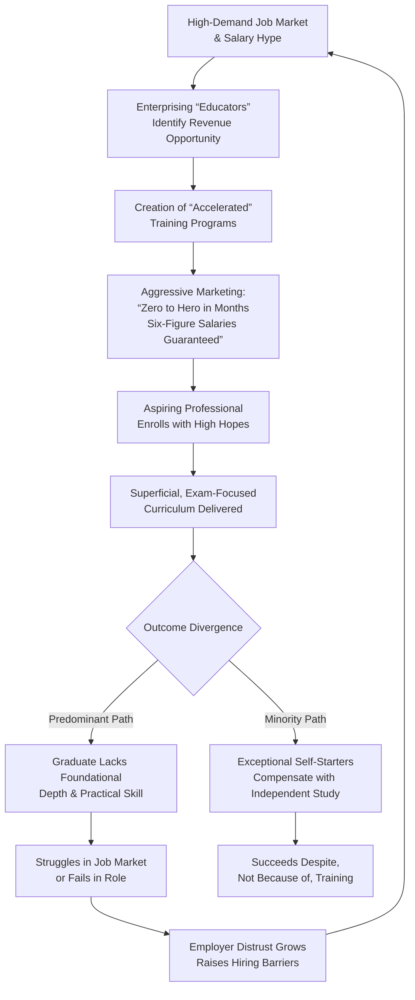

     
 
<h1 align="center">ESSENTIAL CYBERSECURITY GUIDE: A COMPREHENSIVE RESOURCE FOR INDIVIDUALS AND ORGANIZATIONS.</h1>

    

    

  

> **Disclaimer**
>
> *The information provided in this guide is for general informational and educational purposes only. It reflects common cybersecurity best practices as of the publication date. Cybersecurity is a rapidly evolving field, and threats and defenses are subject to change. Readers are encouraged to stay informed about the latest security developments and to consult with qualified IT professionals for advice tailored to their specific situation. The authors assume no responsibility for any loss or damage resulting from the use of, or reliance upon, the information contained herein.*

 

## Introduction: A Shared Responsibility in the Digital Age

In our increasingly interconnected world, the security of our digital information is not merely a matter for IT professionals; it is a fundamental responsibility shared by everyone. From students managing academic records and faculty conducting sensitive research to administrative staff handling institutional data and families protecting personal memories, every individual is a potential target for cyber threats. These threats, including data breaches, identity theft, and ransomware attacks, are growing in both sophistication and frequency.

While organizations invest in robust security infrastructure, individual actions form the first and most critical line of defense. This guide is designed to equip you with clear, actionable, and effective cybersecurity practices. By integrating these habits into your daily digital life, you significantly reduce your vulnerability to cyberattacks and contribute to a safer, more resilient digital ecosystem for our entire community.

The landscape of cyber threats has evolved dramatically with the advent of artificial intelligence. Attackers now use AI to automate hacking, craft flawless phishing emails, clone voices, and discover vulnerabilities at unprecedented speeds. This guide addresses both timeless security principles and the specific challenges posed by AI-powered threats, ensuring you are prepared for the current and emerging risk environment.

 

## Section 1: The First Line of Defense – Secure Authentication

The foundation of digital security rests on how you prove your identity online. Weak or reused passwords are akin to leaving your front door unlocked. Strengthening your authentication practices is the single most impactful step you can take to protect your digital life.

### Create Strong, Unique Passphrases

Gone are the days of simple, dictionary-word passwords. The modern standard is a passphrase, which is a string of at least four unrelated words combined with numbers and symbols. For example, `Correct-Horse-Battery-Staple#17` represents a credential that is both complex for attackers to crack and easier for you to remember. This method creates credentials that are resistant to brute-force attacks, where automated systems attempt millions of password combinations per second.

More importantly, you must use a unique passphrase for every single account. This practice prevents credential stuffing, a common attack where cybercriminals use credentials leaked from one service to try and break into your other, more valuable accounts like email or banking. When attackers obtain a password from a data breach at one website, they systematically test that same combination across hundreds of other popular services, knowing that many people reuse passwords.

### Embrace a Password Manager

Remembering dozens of unique, complex passphrases is humanly impossible. A password manager is the essential tool that solves this problem. These applications securely store all your credentials in an encrypted digital vault, accessible only through a single, strong master password. They can automatically generate and fill in complex passwords for you, eliminating the hassle of password fatigue and the security risk of password reuse.

By adopting a password manager, you only need to remember one supreme password, while the tool ensures every other account is protected by a unique and virtually uncrackable key. Popular options include Bitwarden, 1Password, and Dashlane, each offering robust encryption and cross-platform support. This single change in your digital habits eliminates the most common attack vector used by cybercriminals.

### Activate Multi-Factor Authentication Everywhere

A password, no matter how strong, is a single point of failure. Multi-factor authentication adds a vital second layer of security by requiring an additional verification step. This could be a temporary code from an authenticator app like Google Authenticator or Microsoft Authenticator, a biometric scan like your fingerprint or face, or a physical security key such as a YubiKey.

Even if a malicious actor manages to steal your password, MFA acts as an impassable barrier, preventing them from accessing your account without that second factor. Industry statistics demonstrate that MFA blocks 99.9% of automated account attacks, yet a significant percentage of users still do not enable it. For this reason, enabling MFA on your email, financial, and institutional accounts is one of the most powerful defenses available to you.

### Transition to Passkeys for Phishing-Resistant Authentication

Passkeys represent the next evolution in secure authentication. Unlike passwords, which can be stolen or guessed, passkeys use cryptographic keys that never leave your device. When you log in, your device uses biometrics or a PIN to authorize the transaction. Passkeys are completely immune to phishing because the key never travels over the internet, making them the gold standard for authentication in 2026 and beyond.

 

## Section 2: System Integrity – Maintaining a Healthy Digital Environment

Just as you would service a car to prevent breakdowns, your digital devices require regular maintenance to stay secure. Outdated software is a primary entry point for attackers, who actively scan for known, unpatched vulnerabilities. In the AI era, attackers use automated tools to reverse-engineer security patches within hours of release, creating exploits for unpatched systems with unprecedented speed.

### Enable Automatic Updates for All Software

Modern operating systems such as Windows, macOS, iOS, and Android, along with applications and web browsers, frequently release updates. These updates do more than just add new features; they often contain critical security patches that fix newly discovered vulnerabilities. By enabling automatic updates, you ensure these defenses are installed as soon as they are available.

Delaying or ignoring update notifications leaves your devices, and the networks they connect to, exposed to attacks that could have been easily prevented. This includes all software on your computers, smartphones, and tablets, as well as browser plugins and extensions. Automatic updates are no longer optional; they are the baseline for security in the modern threat landscape.

### Keep Your Hardware Current and Secure

Software and hardware are partners in security. As technology evolves, older devices may eventually be unable to run the latest, most secure operating systems. A device that no longer receives security updates from its manufacturer is a significant liability. Periodically evaluate whether your personal computers, smartphones, and even your home Wi-Fi router are still supported. An outdated router with unpatched firmware can be a gateway for attackers to access every device on your home network, including your computers, smart TVs, and security cameras.

### Deploy and Maintain Endpoint Protection

Endpoint protection is the modern term for comprehensive security software installed on your devices. This goes beyond traditional antivirus to include firewalls, anti-malware, and intrusion detection. Ensure you have a reputable security suite installed and active on all your computers, and be aware of the built-in security features on your smartphones and tablets.

A properly configured firewall acts as a gatekeeper, monitoring and controlling network traffic to block unauthorized connection attempts, both incoming and outgoing. When selecting security software, consider solutions that use AI-powered threat detection to identify novel attacks that signature-based antivirus might miss.

### Practice Input Sanitization for Connected AI Assistants

AI agents are increasingly being given access to calendars, emails, and files through tools like Microsoft Copilot and Google Duet. If an attacker poisons these files with hidden instructions, your AI assistant could inadvertently leak data. Regularly audit connected applications and grant AI assistants Read access only, never Write or Execute access, unless absolutely necessary. Delete old, sensitive files from your cloud drives that you no longer need, so the AI does not index them unnecessarily.

 

## Section 3: Data Protection – Safeguarding Your Digital Assets

Your personal information, academic work, financial records, and precious memories are all digital assets that need protection from loss, theft, or destruction. A proactive approach to data management is essential for maintaining privacy and ensuring business continuity.

### Adopt a Robust 3-2-1 Backup Strategy

Data loss can occur from ransomware, hardware failure, theft, or accidental deletion. The most reliable defense is a solid backup plan. The industry-standard 3-2-1 rule is simple to follow: maintain at least three total copies of your important data, stored on two different types of media, with one of those copies located off-site. For example, you might keep your primary copy on your computer's hard drive, a second copy on an external USB drive, and a third copy in a secure cloud storage service.

Automating this backup process ensures your irreplaceable work and memories are never lost to a single point of failure. Remember that a backup you have never restored from is not a backup; it is a hope. Test your backups regularly to ensure they can be recovered when needed.

### Protect Your Backups from Ransomware

Modern ransomware is increasingly sophisticated and may wait until your backup drive is connected before encrypting your files. If you back up your computer to an external hard drive, perform the backup and then physically unplug the USB cable from your computer. Keep it disconnected when you are not actively backing up. For cloud backups, consider immutable storage options that prevent data from being edited or deleted for a set period, ensuring your backups remain safe even if your primary systems are compromised.

### Encrypt Your Sensitive Information

Encryption scrambles your data, making it unreadable to anyone without the correct decryption key. You should use encryption in two primary scenarios. First, for data at rest, ensure your device's hard drive is encrypted using BitLocker on Windows or FileVault on macOS. Second, for data in transit, always look for the padlock icon in your browser's address bar, which indicates the website uses HTTPS encryption. Avoid entering personal or financial information on sites that do not use this secure connection.

When sharing sensitive files with others, use approved secure file-sharing services rather than unencrypted standard email. A purpose-built platform encrypts files end-to-end, allows you to control access by recipient, and creates an audit trail for compliance purposes.

### Minimize Your Digital Footprint

The less personal information you have online, the less there is for attackers to steal or exploit. Be judicious about what you share on social media and other public platforms. Personal Identifiable Information like your birthdate, address, or pet's name can be used to answer security questions or craft convincing phishing attacks. Regularly review and tighten the privacy settings on your accounts. Furthermore, make it a habit to securely delete old accounts and files you no longer need, reducing the overall amount of data you are responsible for protecting.

### Protect Your Voiceprint and Faceprint Footprint

AI can clone a loved one's voice with just three seconds of audio from social media and can replicate faces on video calls. Set your social media accounts to private and turn off data sharing for AI training in your privacy settings. Avoid posting long, unedited videos of yourself speaking directly to the camera, as scammers use these to train their voice-cloning models. Before using viral photo-editing apps, check the privacy policy for terms like perpetual, royalty-free license to use your content, which may allow the company to sell your facial biometrics.

### Use Secure File-Sharing Solutions

If your team regularly handles confidential documents like client files, financial records, and legal matters, regular email is not built for this purpose. Intercepted emails expose sensitive data and put you on the wrong side of compliance frameworks like HIPAA, PIPEDA, and the SEC Safeguards Rule. A purpose-built secure file sharing platform encrypts files end-to-end, lets you control access by recipient, and creates the audit trail compliance auditors require. Your files are only as secure as the tools you share them with.

 

## Section 4: Proactive Vigilance – The Human Firewall

Technology alone cannot stop all attacks. Many cyber threats, particularly phishing and social engineering, are designed to exploit human psychology. Cultivating a mindset of healthy skepticism and caution is your final, and often most effective, layer of defense.

### Master the Art of Phishing Detection

Phishing attacks arrive as deceptive emails, text messages, or even phone calls designed to trick you into revealing sensitive information or installing malware. In the AI era, phishing messages are increasingly perfect in grammar and personalization. Be highly suspicious of any unsolicited message that creates a sense of urgency, requests personal information, or asks you to click on a link or open an attachment.

Before engaging, scrutinize the sender's email address for subtle misspellings, such as `@universty.edu` instead of `@university.edu`. Hover your mouse over any link to see the true destination URL before clicking. If a message claims to be from a legitimate organization like your bank or institution, do not use the contact information in the message; instead, contact them directly through a verified phone number or website.

### Beware of Quishing

AI generates convincing fake QR codes and pastes them over real ones on parking meters, restaurant tables, and flyers. When you scan them, they take you to a fake login page that steals your credentials. Never scan a QR code that is stuck onto a surface like a sticker over a real meter. If you scan a menu QR code at a restaurant, look at the URL that pops up before you click Go. If it is a jumbled, nonsensical link, close it and ask for a physical menu.

### Implement a Safe Word Protocol for Deepfake Defense

AI can now clone a loved one's voice with just three seconds of audio from social media. Establish a family or office safe word that must be verbally exchanged during any unexpected financial, legal, or sensitive data transfer request, even during video calls. If the caller hesitates or cannot provide it, hang up and verify via a separate, out-of-band channel like a text to a different number. This simple practice defeats AI-powered voice and video impersonation attacks.

### Practice the Turn Your Head Test

If a caller looks slightly waxy, has unnatural blinking, or the lighting around their face does not match the background, ask them to turn their head to the side or wave a hand in front of their face. Real-time AI deepfakes struggle to render side profiles and moving hands accurately and will glitch or blur. This simple test can quickly identify synthetic video impersonations.

### Don't Trust Incoming Caller ID

AI voice-cloning combined with number spoofing means your phone screen will show Mom or Bank of America, but it is a scammer in another country. If you receive a call from your bank asking for verification codes, hang up immediately. Call the number printed on the back of your physical debit card. Do not call the number the incoming caller gives you. Always verify urgent requests through a separate, trusted channel.

### Cultivate Secure Browsing Habits

The websites you visit can pose a significant risk. Avoid untrustworthy sites, especially those offering pirated software, media, or other illegal content, as they are often riddled with malware. Pay attention to your browser's security warnings. If your browser blocks a site or displays a certificate error, heed the warning and leave the page. Consider using browser extensions that block intrusive ads and trackers, as these can also prevent malvertising, which can compromise your device even on legitimate websites.

### Follow the Three-Second Rule for Search Results

AI-generated search summaries sometimes hallucinate and recommend scam websites or even dangerous DIY remedies. Never click the first paid ad or the AI summary link. Scroll down to the organic search results and only click on well-known domains you recognize, such as `.gov`, `.edu`, or major news outlets. This practice helps you avoid malicious sites that have been optimized to appear in search results.

### Turn Off Auto-Connect for Wi-Fi and Bluetooth

AI bots set up fake Free Airport Wi-Fi or Coffee Shop hotspots that mimic real networks. Your phone auto-connects, and the AI scrapes everything you type, including banking passwords. Go to your phone's Wi-Fi settings and turn off auto-join public networks. Manually select trusted networks only. Turn Bluetooth off when you are in public to prevent AI-based tracking and unauthorized access attempts.

### Remove Adware from Your Machines

Adware collects information about you to serve more targeted ads and can compromise your privacy by gathering sensitive data for profiling. Use tools like AdwCleaner to clean adware and unwanted programs from your computer. This helps maintain your privacy and prevents advertisers from building detailed profiles of your online activities.

### Double-Check for HTTPS on Websites

When you are on a website that is not using HTTPS, there is no guarantee that the transfer of information between you and the site's server is secure. Double-check that a site is using HTTPS before you give away personal or private information. Look for the padlock icon in your browser's address bar as a visual confirmation of secure data transmission.

### Avoid Storing Important Information in Non-Secure Places

When storing information online, you want to keep it in a location that cannot be accessed by unauthorized users. Use encrypted cloud storage solutions or secure file-sharing platforms rather than unprotected folders or documents. Regular email is not secure for confidential documents, as intercepted emails expose sensitive data and may violate compliance requirements.

### Scan External Storage Devices for Viruses

External storage devices are just as prone to malware as internal storage devices. If you connect an infected external device to your computer, the malware can spread. Always scan external devices for malware before accessing them. This includes USB drives, external hard drives, and memory cards from cameras or other devices.

### Exercise Caution with Personality Quizzes

AI loves training on personality quizzes that ask for your birth month, pet name, or mother's maiden name. These are exactly the answers to your security questions. Never answer these quizzes truthfully. If you must participate, use completely fake answers that you write down in a physical notebook.

### Create a Burner Email for AI Tools and Shopping

Every time you sign up for a free AI tool or a grocery store loyalty app, your main email gets added to lists that are sold and scraped by AI bots for targeted spear-phishing. Create a completely separate, free email address that does not contain your real name. Use this junk email for all AI chatbot sign-ups, coupon sites, and newsletters. Keep your real email exclusively for banking, healthcare, and close family.

### Update Your Phone's Voice Assistant Lock Screen Settings

AI voice assistants can be tricked into calling numbers or reading out your calendar appointments while your phone is locked, especially if a scammer shouts commands near your pocket. Go to Settings and turn off Allow Siri When Locked or similar settings for Google Assistant. This prevents anyone from using voice commands to access your phone unless it is unlocked by your face or fingerprint.

 

## Section 5: Building a Culture of Security – For Families and Teams

If you are responsible for the digital safety of others, whether family members, a student team, or departmental colleagues, your role expands to include fostering a shared culture of security awareness.

### Champion Continuous Security Education

Security is not a one-time lesson but an ongoing practice. Engage your family or team in regular, informal discussions about common threats like phishing. Share examples of suspicious emails you have encountered and explain how you identified them. Encourage an environment where people feel comfortable reporting a potential security mistake without fear of blame. This open culture transforms everyone from a potential weak link into an active, vigilant participant in your collective defense.

Annual training does not work anymore. Best practice in 2026 is a mix of monthly micro-training sessions lasting five to ten minutes, quarterly phishing simulations, and role-specific training for high-risk roles like finance and executive assistants. Training should cover current threats including AI-generated phishing emails, deepfake voice and video calls, and social engineering through platforms like Slack and Teams. Organizations with continuous training programs experience up to 70% fewer successful phishing attacks than those with annual-only training.

### Embrace a Defense-in-Depth Philosophy

Move away from the idea that you are ever secure enough. Effective security is layered and constantly evolving. This means proactively investing in security upgrades for software and hardware. For anyone managing a website, enforcing HTTPS with a valid SSL or TLS certificate is non-negotiable; it protects your visitors' data and builds trust. Assume that your primary defenses will eventually be challenged, and have secondary controls, like MFA and robust backups, already in place.

### Consider Proactive Security Testing

For teams or organizations managing critical systems or sensitive data, consider going on the offensive with your defenses. Engaging qualified security professionals, often called white-hat hackers or penetration testers, to conduct ethical hacking exercises on your systems can be invaluable. They will attempt to find and exploit vulnerabilities just as a real attacker would, providing you with a clear, prioritized roadmap for fixing weaknesses before they can be discovered and used maliciously.

### Run Real-Time AI Phishing Drills

Use AI phishing simulation tools that generate personalized, context-aware phishing emails based on your employees' actual LinkedIn profiles and recent projects. Run these drills bi-weekly. If someone clicks, force them to take a five-minute micro-training immediately, not during next year's compliance review. This immediate feedback loop reinforces learning and reduces the likelihood of falling for real attacks.

### Implement a Zero Trust Approach

The old build a wall around the office network model is dead. Zero Trust assumes no user or device is trustworthy by default; every access request is verified, every time. Start with the basics: enforce least-privilege access so employees only get access to what they actually need, require MFA on every login, and log every access event so unusual activity gets flagged early.

### Evaluate Vendors and Third-Party Tools

Your security is only as strong as the weakest vendor with access to your data. Supply-chain breaches have quadrupled in recent years. Before you hand over data or system access, ask vendors about their security certifications such as SOC 2 or ISO 27001, encryption standards, breach history, and incident response process. Build security expectations into vendor contracts and review them annually.

### Have an Incident Response Plan Ready

Most breaches take an average of 241 days to detect and contain, and the longer it takes, the more it costs. A documented incident response plan cuts that timeline dramatically. At minimum, document who gets called first, how you isolate affected systems, your legal and regulatory notification obligations, and how you communicate with customers. Run a tabletop exercise once a year so the plan is not a PDF nobody has read.

 

## Section 6: The AI Era – Understanding Emerging Threats

The arrival of generative AI has fundamentally changed the cybersecurity landscape. Attackers now use AI to automate hacking, craft flawless phishing emails, clone voices, and discover zero-day vulnerabilities in milliseconds. Understanding these threats is essential for staying protected.

### AI-Generated Phishing

AI can create perfect phishing emails in any language, eliminating the classic spelling mistake and poor grammar red flags that used to identify scams. These messages can be personalized based on information scraped from social media, making them highly convincing. Old advice like watch for typos no longer applies. Train yourself and your team to verify any unusual request through a second, known channel.

### Deepfake Voice and Video

AI can clone voices from short audio clips and create realistic video impersonations. Attackers are using these tools in CEO-fraud scams, where they impersonate executives to authorize fraudulent wire transfers. The safe word protocol and turn your head test provide practical defenses against these sophisticated attacks.

### AI-Enhanced Ransomware

Modern ransomware can pause itself, wait for backups to sync, and then encrypt the backups along with the primary data. This is why immutable backups and offline storage are essential. Attackers increasingly demand payment within hours rather than days, making rapid recovery capabilities critical.

### The Rise of Phishing-as-a-Service

Scammers can now buy cheap AI bots that do 100% of the scamming for them. This means anyone can be a hacker, not just technically skilled individuals. The barrier to entry for cybercrime has dropped dramatically, resulting in a surge of attacks targeting individuals and small businesses.

 

## Quick Reference: Backup Strategy Comparison

Choosing the right backup strategy is critical. This table compares common approaches to help you make an informed decision.

| Strategy | Description | Best For | Key Consideration |
| :--- | :--- | :--- | :--- |
| **Local Backup** | Copying data to an external device like a USB hard drive or a Network Attached Storage system kept in your home or office. | Quick recovery of large volumes of data; full control over your media. | Vulnerable to local threats like theft, fire, or flood. To protect against ransomware, the backup drive must be disconnected from your computer when not actively backing up. |
| **Cloud Backup** | Automatically copying data to a secure, off-site server managed by a service provider such as Backblaze, iCloud, or OneDrive. | Off-site protection; data accessibility from anywhere; set-and-forget automation. | Requires an ongoing subscription. The initial backup of a large amount of data can be slow. It is vital to choose a reputable provider that uses strong encryption for your data both in transit and at rest. |
| **Hybrid with Immutable Storage** | A combined approach using both local and cloud backups, with cloud storage configured to prevent data from being edited or deleted for a set period. | Maximum protection for irreplaceable data and protection against sophisticated ransomware. | Requires managing two separate backup systems but offers the highest level of resilience against virtually any type of data loss scenario, including attacks on backup repositories. |

 

## Quick Reference: Authentication Methods Comparison

| Method | Security Level | Resistance to Phishing | Ease of Use | Recommendation |
| :--- | :--- | :--- | :--- | :--- |
| **Password Only** | Low | None | Moderate | Avoid entirely for any important account. |
| **Password + SMS Code** | Moderate | Low | Easy | Use only if no better option is available; SMS is vulnerable to SIM-swapping. |
| **Password + Authenticator App** | High | Moderate | Easy | Recommended as the baseline for all accounts that support it. |
| **Passkeys** | Very High | High | Very Easy | The gold standard; enable wherever available. |
| **Hardware Security Key** | Very High | Very High | Moderate | Best for high-value accounts and administrative access. |

 

## Quick Reference: AI Era Defense Checklist

| Threat | Defense | Action |
| :--- | :--- | :--- |
| AI Voice Cloning | Safe Word Protocol | Establish a family or office safe word for financial or sensitive requests. |
| AI Deepfake Video | Turn Your Head Test | Ask the caller to turn their head or wave a hand during video calls. |
| AI-Generated Phishing | Out-of-Band Verification | Verify all urgent requests through a separate, known communication channel. |
| AI-Enhanced Ransomware | Immutable Backups | Store backups in a location that cannot be edited or deleted for a set period. |
| AI Facial Scraping | Privacy Settings | Turn off data sharing for AI training on social media platforms. |
| Quishing (QR Phishing) | URL Inspection | Examine the URL before clicking after scanning a QR code. |
| Evil Twin Wi-Fi | Manual Network Selection | Turn off auto-join public networks and manually select trusted networks. |
| AI Chatbot Data Leakage | Input Sanitization | Never paste sensitive personal or business data into public AI tools. |

 

## Comprehensive Cybersecurity Checklist for All Users

**Authentication and Access Control**

- [ ] Enable Multi-Factor Authentication on all accounts that support it
- [ ] Transition to Passkeys where available
- [ ] Use a password manager with unique passwords for every account
- [ ] Create strong passphrases rather than simple passwords
- [ ] Disable voice assistant access when the device is locked

**Device and System Security**

- [ ] Enable automatic updates for operating systems, browsers, and applications
- [ ] Install and maintain reputable endpoint protection software
- [ ] Keep hardware up-to-date and replace devices that no longer receive security updates
- [ ] Remove adware and unwanted programs from all devices
- [ ] Scan external storage devices for viruses before accessing files
- [ ] Disable Bluetooth when not in use

**Data Protection and Backup**

- [ ] Implement the 3-2-1 backup strategy for important data
- [ ] Use encrypted storage for sensitive information
- [ ] Disconnect external backup drives when not actively backing up
- [ ] Test backups regularly by restoring from them
- [ ] Use secure file-sharing solutions rather than regular email for sensitive documents
- [ ] Enable HTTPS on any website you manage

**Network Security**

- [ ] Use a VPN when connecting to public Wi-Fi
- [ ] Turn off auto-connect for Wi-Fi and Bluetooth
- [ ] Secure your home Wi-Fi router with a strong password and updated firmware
- [ ] Avoid conducting sensitive activities on public networks

**Phishing and Social Engineering Defense**

- [ ] Verify the sender's email address carefully, looking for subtle misspellings
- [ ] Hover over links to see the true destination URL before clicking
- [ ] Verify urgent requests through a separate, trusted communication channel
- [ ] Establish a safe word for financial or sensitive requests
- [ ] Never click links or download attachments from suspicious messages
- [ ] Be cautious of QR codes, especially stickers placed over existing codes

**Privacy and Digital Footprint**

- [ ] Set social media accounts to private
- [ ] Turn off data sharing for AI training in privacy settings
- [ ] Limit sharing of personal identifiable information online
- [ ] Use a burner email for AI tools and shopping
- [ ] Regularly delete old accounts and files you no longer need
- [ ] Check HaveIBeenPwned.com to see if your email has been in a breach
- [ ] Remove location metadata before sharing photos publicly

**AI Tool Usage**

- [ ] Never paste sensitive personal or business information into public AI chatbots
- [ ] Use enterprise private instances for work-related AI usage when available
- [ ] Regularly audit connected apps and revoke unnecessary access
- [ ] Grant AI assistants Read access only, never Write or Execute access

**Organizational and Team Practices**

- [ ] Provide continuous security training with monthly micro-sessions
- [ ] Run regular phishing simulations
- [ ] Implement a Zero Trust security model
- [ ] Evaluate vendor security and include security expectations in contracts
- [ ] Maintain a documented incident response plan
- [ ] Conduct annual tabletop exercises to test the plan

 

## Frequently Asked Questions

### What are the most important cybersecurity best practices for individuals?

The five highest-impact practices are enabling Multi-Factor Authentication on every account, using a password manager with unique passwords, keeping software and hardware patched with automatic updates, backing up data using the 3-2-1 rule, and learning to identify and avoid phishing attempts. These cover the majority of attack vectors individuals face in their daily digital lives.

### What are the biggest cybersecurity threats in 2026?

The top threats are AI-generated phishing and deepfakes, ransomware, supply-chain attacks through third-party vendors, stolen credentials, and cloud misconfigurations. Attackers increasingly use AI to scale and personalize attacks, making them more difficult to detect with traditional methods.

### How much should a small business spend on cybersecurity?

Industry benchmarks recommend allocating 10 to 15 percent of your total IT budget to cybersecurity. Regulated sectors like legal, healthcare, and finance typically need to spend more to meet compliance requirements. The cost of a breach often far exceeds the investment in prevention.

### Is cybersecurity insurance worth it?

For most organizations, yes. The average cyberattack costs a small business between $120,000 and $254,000. Cyber insurance covers breach response, legal fees, and business interruption losses that can sink an unprotected company. However, insurance should complement, not replace, strong security practices.

### What is the 3-2-1 backup rule?

Keep three copies of your data, on two different types of storage media, with at least one copy stored offline or off-site. The offline copy is your insurance against ransomware. Modern best practices suggest adding immutability to your cloud backups to prevent attackers from encrypting them.

### How often should I update software for security?

Turn on automatic updates wherever possible. For systems where you cannot, apply high-severity patches within 30 days, and patch actively exploited zero-day vulnerabilities within 7 days. Unpatched software is consistently a top-three attack vector each year.

### How do I protect myself from AI-generated phishing?

Old advice like watch for typos no longer applies. Train yourself to verify any unusual request through a second, known channel, such as calling the requester back at a number from your contact list, not the one in the email. Combine that with strong email filtering, MFA, and out-of-band approval for any wire transfer or credential change.

### What is the difference between cybersecurity and information security?

Information security covers all forms of sensitive data, including paper documents, physical access, and verbal disclosures. Cybersecurity is the subset focused on protecting digital systems, networks, and data from electronic attacks. For most individuals and organizations, the two overlap heavily, and the practices in this guide cover both.

 

## Conclusion: Your Role in a Resilient Digital Community

Cybersecurity is not a distant concept managed by a central IT department; it is a daily practice woven into the fabric of our digital interactions. By internalizing and applying the principles outlined in this guide, securing your access, maintaining your systems, protecting your data, staying vigilant, and fostering a security-conscious environment, you become an integral part of the collective cyber defense.

The journey to a more secure digital life does not require perfection overnight. We encourage you to start by adopting one or two new habits this week. Perhaps enable MFA on your primary email account or set up a password manager. As these practices become routine, gradually incorporate the others. Share this knowledge and these habits with your peers, students, family members, and colleagues.

Together, through informed and proactive efforts, we can build a safer and more resilient digital community for teaching, learning, discovery, and everyday life. In the AI era, the most powerful defense is informed, vigilant human behavior combined with strong technical controls. Your actions matter, and every step you take toward better security practices makes the entire digital ecosystem more secure for everyone.

 

*Remember: Data you do not share is data AI cannot steal. Practice digital minimalism and ask yourself whether an app, website, or request truly needs each piece of your personal information. If the answer is no, do not provide it. This simple principle is one of the most powerful defenses in the modern threat landscape.*

     

<h1 align="center">CORE PRINCIPLES FOR THE GUARDIANS OF DIGITAL COMMONS.</h1>
<h3 align="center">A Comprehensive Framework for Ethical Cybersecurity Leadership and Operational Excellence.</h3>

  

# PREAMBLE

The digital commons—encompassing critical open-source software, public data infrastructures, shared knowledge platforms, and the interconnected systems upon which modern society depends—underpins global civilization. Its security and resilience demand far more than technical proficiency; they require a dedicated cadre of professionals operating under a unified ethical and operational framework.

This document defines the core principles, strategic pillars, and operational doctrines for Guardians committed to protecting this vital ecosystem. It synthesizes fundamental tenets of cybersecurity leadership, ethical imperatives, effective organizational practices, and the timeless wisdom of responsible stewardship. These principles serve as both a compass for decision-making and a foundation for building resilient, trustworthy digital environments.

The framework presented herein addresses the full spectrum of cybersecurity responsibility—from individual technical excellence to organizational leadership, from community engagement to global collaboration. It acknowledges that cybersecurity is fundamentally a human endeavor, one that requires technical mastery tempered by compassion, strategic thinking guided by integrity, and operational precision animated by purpose.

 

## SECTION I: FOUNDATIONAL ETHOS
### The Bedrock of Cyber Stewardship

### PRINCIPLE 1: Lead with Uncompromising Integrity and Ethical Accountability

Cybersecurity is fundamentally a trust-based profession. Leadership credibility serves as the cornerstone of organizational resilience. Guardians must uphold the highest standards of honesty, transparency, and moral clarity in every decision and action.

**Core Commitments:**

| Commitment Area | Operational Expression |
|----------------|----------------------|
| **Honesty** | Communicate risks, incidents, and vulnerabilities truthfully, without exaggeration or minimization |
| **Transparency** | Maintain open channels about security posture, limitations, and improvement areas |
| **Moral Clarity** | Make decisions based on ethical principles, not convenience or expediency |
| **Regulatory Compliance** | Meet or exceed all applicable legal and regulatory requirements |
| **Societal Responsibility** | Consider broader societal impacts of security decisions |

**Implementation Guidance:**

- Establish clear ethical guidelines for all security operations
- Create mechanisms for reporting ethical concerns without fear of reprisal
- Document and communicate decision-making processes
- Regularly audit practices against ethical standards
- Prioritize data privacy and individual rights in all initiatives

### PRINCIPLE 2: Embrace the Duty of Universal Protection

Cybersecurity knows no bias. Leadership demands a commitment to protecting all digital entities equally and actively extending expertise to uplift the vulnerable, under-resourced, and neglected. Guardians measure their success not by what they have secured for themselves, but by an ecosystem sustained, trusted, and accessible for all.

**Core Commitments:**

| Protection Domain | Application |
|------------------|-------------|
| **Non-Discrimination** | Equal protection regardless of victim wealth, status, or profile |
| **Vulnerable Populations** | Prioritize outreach to those lacking security resources |
| **Under-Resourced Entities** | Extend expertise to nonprofits, charities, and small businesses |
| **Global Perspective** | Recognize security as a universal human concern |

**Implementation Guidance:**

- Develop pro bono security services for qualifying organizations
- Create accessible security education for non-technical audiences
- Advocate for policies that protect the most vulnerable digital citizens
- Allocate resources to community defense initiatives
- Measure success by ecosystem health, not just organizational metrics

### PRINCIPLE 3: Champion Action-Oriented Stewardship

Leadership is defined by taking responsibility. Move beyond advocacy to operational execution. Actively educate, patch, prevent, and help fix flaws. Reject negligence and complacency. Courageously address security risks even when inconvenient.

**Core Commitments:**

| Action Domain | Expectation |
|--------------|-------------|
| **Education** | Actively teach security practices, not merely demand compliance |
| **Remediation** | Help fix vulnerabilities, not just identify them |
| **Prevention** | Build systems that resist attack by design |
| **Courage** | Address risks even when politically or organizationally difficult |

**Implementation Guidance:**

- Create actionable security guidance, not abstract principles
- Volunteer expertise to open-source projects and community initiatives
- Lead by example in implementing security measures
- Encourage reporting without blame or punishment
- Transform knowledge into reflexive defensive capability

---

## SECTION II: STRATEGIC AND OPERATIONAL PILLARS
### Mindset and Execution

### PRINCIPLE 4: Integrate Cybersecurity into Core Business Strategy

Translate technical risks into actionable business insights. Ensure security considerations are embedded into strategic decision-making from the outset, aligning initiatives with overarching organizational goals to enable sustainable growth and protect critical assets.

**Strategic Integration Framework:**

| Integration Level | Activity |
|-------------------|----------|
| **Strategic Planning** | Security considerations in all major business decisions |
| **Risk Communication** | Translate technical risks into business language |
| **Resource Allocation** | Security budget based on risk, not historical spending |
| **Performance Metrics** | Security KPIs aligned with business objectives |

**Implementation Guidance:**

- Establish security representation at executive leadership levels
- Develop business-aligned risk assessment frameworks
- Communicate security investments in terms of business value
- Integrate security into product and service development lifecycles
- Measure security effectiveness through business impact reduction

### PRINCIPLE 5: Cultivate Proactive Vigilance and Resilience

Treat vigilance as a continuous, adaptive discipline. Proactively identify and mitigate risks through robust frameworks (such as zero-trust architectures), advanced threat intelligence, and comprehensive incident response planning. Foster organizational adaptability to ensure systems and teams can recover and thrive after adverse events.

**Proactive Defense Components:**

| Component | Description |
|-----------|-------------|
| **Continuous Monitoring** | Real-time threat detection and analysis |
| **Threat Intelligence** | Proactive gathering and analysis of threat data |
| **Zero-Trust Architecture** | Verify every access request, trust nothing by default |
| **Incident Response Planning** | Prepared, practiced response to security events |
| **Resilience Engineering** | Design systems to withstand and recover from attacks |

**Implementation Guidance:**

- Implement continuous security monitoring and assessment
- Develop and practice incident response procedures
- Build redundancy and recovery capabilities
- Conduct regular security exercises and simulations
- Learn from incidents through structured post-mortems

### PRINCIPLE 6: Achieve Excellence through Precision and Simplicity

Maintain an unwavering commitment to precision in operations while simplifying complex processes. Leverage automation, artificial intelligence, and machine learning to enhance efficiency and reliability. Meticulous attention to detail in monitoring, assessment, and adjustment builds a reputation for high-quality, trustworthy outcomes.

**Excellence Framework:**

| Aspect | Approach |
|--------|----------|
| **Precision** | Rigorous attention to technical accuracy |
| **Simplicity** | Streamline processes for efficiency and clarity |
| **Automation** | Use technology to reduce human error and scale capabilities |
| **Quality Assurance** | Systematic verification of security controls |
| **Continuous Improvement** | Regular assessment and refinement of processes |

**Implementation Guidance:**

- Document and standardize security procedures
- Implement automated security testing and monitoring
- Regularly review and simplify complex processes
- Maintain detailed metrics for performance measurement
- Invest in training to ensure procedural compliance

### PRINCIPLE 7: Practice Informed, Data-Driven Decision-Making

Base decisions on data-driven insights, industry benchmarks, and diverse perspectives. Foster a culture of informed judgment where teams are empowered to analyze threats and trends, ensuring protective measures are effective, proportionate, and aligned with business objectives.

**Data-Driven Decision Framework:**

| Decision Element | Required Input |
|------------------|----------------|
| **Risk Assessment** | Quantitative and qualitative data on threats and vulnerabilities |
| **Resource Allocation** | Analysis of risk reduction per investment dollar |
| **Strategy Development** | Trend analysis and predictive modeling |
| **Performance Evaluation** | Metrics-based assessment of security effectiveness |

**Implementation Guidance:**

- Establish security metrics and measurement systems
- Regularly review threat intelligence and industry benchmarks
- Encourage diverse perspectives in decision-making
- Document decisions and their rationales
- Learn from both successes and failures

 

## SECTION III: PEOPLE AND CULTURE
### The Human Element of Cyber Defense

### PRINCIPLE 8: Foster a Culture of Coaching, Trust, and Psychological Safety

Emphasize continuous development through actionable feedback and tailored growth opportunities. Cultivate an environment of trust, open communication, and empathy where concerns are actively engaged. Prioritize mental, emotional, and physical well-being to sustain a motivated, engaged, and productive workforce.

**Culture Elements:**

| Cultural Component | Description |
|--------------------|-------------|
| **Psychological Safety** | Environment where speaking up is encouraged, not punished |
| **Trust** | Confidence that concerns will be treated seriously |
| **Empathy** | Understanding and considering others' perspectives |
| **Well-being** | Attention to mental, emotional, and physical health |
| **Development** | Continuous learning and growth opportunities |

**Implementation Guidance:**

- Create open feedback channels
- Address concerns promptly and respectfully
- Provide regular, constructive performance feedback
- Support work-life balance and mental health
- Celebrate learning and improvement, not just successes

### PRINCIPLE 9: Empower Teams with Autonomy and Clear Accountability

Establish clear visions and SMART goals. Equip teams with cutting-edge tools, training, and decision-making frameworks that foster independence and creativity. Grant autonomy while maintaining accountability through constructive feedback, empowering ownership of cybersecurity challenges.

**Empowerment-Accountability Balance:**

| Dimension | Autonomy | Accountability |
|-----------|----------|----------------|
| **Goals** | Teams participate in goal setting | Goals are specific and measurable |
| **Resources** | Teams choose how to use allocated resources | Results are evaluated against objectives |
| **Methods** | Teams decide implementation approaches | Outcomes are assessed for effectiveness |
| **Feedback** | Teams provide input on processes | Performance is regularly reviewed |

**Implementation Guidance:**

- Set clear, SMART (Specific, Measurable, Achievable, Relevant, Time-bound) goals
- Provide necessary tools, training, and authority
- Establish regular performance reviews
- Encourage creative problem-solving
- Maintain accountability through clear expectations

### PRINCIPLE 10: Invest Relentlessly in Talent and Continuous Learning

Identify and nurture unique strengths through personalized development plans, certifications, and knowledge-sharing. Champion a culture of lifelong learning for yourself and your teams, ensuring adaptation to the dynamic threat landscape. Replace passive consumption with active skill reconstruction for reflexive defensive capability.

**Talent Development Framework:**

| Development Area | Approach |
|------------------|----------|
| **Technical Skills** | Certifications, training, hands-on practice |
| **Strategic Acumen** | Leadership development, business understanding |
| **Knowledge Sharing** | Mentorship, workshops, community participation |
| **Personalized Growth** | Development plans tailored to individual strengths |
| **Continuous Learning** | Ongoing education in emerging threats and technologies |

**Implementation Guidance:**

- Create personalized career development plans
- Provide access to training and certification programs
- Facilitate knowledge sharing through mentorship and workshops
- Encourage attendance at industry conferences and events
- Lead by example in continuous learning

### PRINCIPLE 11: Promote Diversity, Equity, and Inclusion as a Security Imperative

Champion diverse perspectives to strengthen threat analysis and solution design. Create equitable opportunities through inclusive hiring, mentorship, and advocacy. A diverse team is more innovative and better equipped to defend a diverse world.

**Diversity, Equity, and Inclusion Framework:**

| Area | Action |
|------|--------|
| **Hiring** | Inclusive recruitment practices |
| **Development** | Equitable access to advancement opportunities |
| **Culture** | Environment where all voices are valued |
| **Perspective** | Diverse viewpoints in security decision-making |
| **Community** | Outreach to underrepresented groups |

**Implementation Guidance:**

- Implement inclusive hiring and promotion practices
- Create mentorship programs for underrepresented groups
- Foster an environment of respect and inclusion
- Seek diverse perspectives in security analysis and solutions
- Advocate for broader industry inclusion

 

## SECTION IV: COLLABORATION AND EXTERNAL ENGAGEMENT
### Building Collective Resilience

### PRINCIPLE 12: Cultivate Transparent Communication and Collaborative Defense

Prioritize open, honest dialogue to articulate risks and strategies, building trust across all levels. Reject siloed efforts. Actively champion collaboration, information sharing, and cross-border partnerships to build a collectively resilient digital ecosystem.

**Collaborative Defense Framework:**

| Collaboration Area | Application |
|--------------------|-------------|
| **Information Sharing** | Sharing threat intelligence within trusted communities |
| **Cross-Industry Cooperation** | Partnerships across sectors and geographies |
| **Open Standards** | Adoption and contribution to security standards |
| **Community Engagement** | Participation in security communities |
| **Collective Resilience** | Building ecosystem strength through cooperation |

**Implementation Guidance:**

- Participate in threat intelligence sharing communities
- Contribute to open-source security efforts
- Build relationships across organizational boundaries
- Share lessons learned from incidents
- Advocate for collaborative security approaches

### PRINCIPLE 13: Adopt a Client-Centric and Stakeholder-Focused Approach

Place client and stakeholder needs at the core of solution design. Deliver intuitive, scalable solutions by maintaining open feedback loops. This commitment to understanding and addressing specific challenges fosters long-term, trust-based partnerships.

**Client-Centric Framework:**

| Focus Area | Practice |
|------------|----------|
| **Understanding** | Deep knowledge of client needs and challenges |
| **Solution Design** | Solutions tailored to specific contexts |
| **Communication** | Clear, accessible explanation of security issues |
| **Feedback** | Regular collection and incorporation of feedback |
| **Partnership** | Long-term relationships based on trust |

**Implementation Guidance:**

- Conduct thorough needs assessments
- Design security solutions with usability in mind
- Communicate security concepts in plain language
- Maintain open feedback channels
- Foster long-term relationships through consistent value delivery

### PRINCIPLE 14: Lead with Innovation for Sustainable Impact

Encourage creative problem-solving aligned with purpose. Balance technological advancement with ethical and societal considerations. Drive innovation that not only addresses immediate threats but also contributes to a sustainable, secure, and equitable digital future.

**Innovation Framework:**

| Innovation Area | Focus |
|-----------------|-------|
| **Technical Innovation** | New solutions to emerging threats |
| **Process Innovation** | More efficient and effective security operations |
| **Social Innovation** | Addressing human dimensions of security |
| **Sustainable Innovation** | Solutions that benefit the broader ecosystem |

**Implementation Guidance:**

- Encourage creative problem-solving
- Balance innovation with ethical considerations
- Consider sustainability and equity in solution design
- Share innovations with the broader community
- Measure innovation by impact, not novelty

 

## SECTION V: OPERATIONAL DOCTRINES
### Practical Implementation of Principles

### Doctrine 1: Stewardship Rooted in Open Source and Shared Infrastructure Principles

**Principle:** Recognize open-source software and shared digital infrastructure not merely as technical tools but as essential, transparent public infrastructure requiring vigilant protection. Their openness enables scrutiny and collaboration but introduces unique supply chain and sustainability challenges that must be addressed.

**Operational Mandates:**

| Mandate | Description |
|---------|-------------|
| **Proactive Contribution** | Actively contribute security expertise to critical open-source projects through code audits, vulnerability patching, and documentation |
| **Transparency-Informed Defense** | Leverage the inherent transparency of open-source for continuous security assessment and advocate for Software Bill of Materials (SBOM) adoption |
| **Sustainable Support** | Champion and participate in sustainable funding models for critical open-source security maintenance, moving beyond uncompensated volunteerism |

**Implementation Guidance:**

- Identify critical open-source projects in your ecosystem
- Allocate time and resources to contribute security improvements upstream
- Implement SBOM generation and consumption in your development processes
- Support open-source security initiatives financially and technically
- Advocate for sustainable security funding models within industry and government

### Doctrine 2: Ethical Imperative of Universal Protection

**Principle:** Cybersecurity is a human endeavor. The duty to protect extends universally across the digital commons, irrespective of victim resources, perceived negligence, or attacker motive. Compassion and action supersede judgment.

**Operational Mandates:**

| Mandate | Description |
|---------|-------------|
| **Non-Discriminatory Response** | Provide security guidance, vulnerability disclosure, and incident response support based on need and impact on the commons, not on commercial viability or victim profile |
| **Responsible Remediation** | Move beyond identification to responsible remediation; collaborate on patches, provide clear mitigations, and support deployment where feasible |
| **Empowerment over Blame** | Address security shortcomings through education, accessible guidance, and tooling simplification rather than attributing fault |

**Implementation Guidance:**

- Develop criteria for pro bono security services to under-resourced entities
- Participate in vulnerability disclosure and remediation efforts
- Create accessible security education materials for non-technical audiences
- Foster a no-blame culture that encourages reporting and learning
- Measure success by reduction in ecosystem vulnerability, not just organizational metrics

### Doctrine 3: Collaborative Defense of Shared Infrastructure

**Principle:** The interconnected nature of the digital commons necessitates collective defense. Siloed security efforts are insufficient against systemic threats targeting shared infrastructure and components.

**Operational Mandates:**

| Mandate | Description |
|---------|-------------|
| **Intelligence Sharing** | Actively participate in trusted threat intelligence sharing communities and contribute anonymized indicators and tactics, techniques, and procedures related to shared infrastructure exploitation |
| **Coordinated Vulnerability Disclosure** | Adhere rigorously to established coordinated vulnerability disclosure protocols for infrastructure vulnerabilities |
| **Community Incident Response** | Develop plans and establish relationships for cross-organizational collaboration during widespread incidents affecting critical infrastructure |

**Implementation Guidance:**

- Join and actively participate in threat intelligence sharing communities
- Establish relationships with relevant Computer Emergency Response Teams (CERTs)
- Document and practice collaborative incident response procedures
- Contribute to shared threat intelligence repositories
- Build cross-organizational trust relationships before incidents occur

### Doctrine 4: Leadership for Resilience and Sustainability

**Principle:** Effective Guardianship requires leadership focused on long-term resilience, ethical integrity, and ecosystem health, balancing security needs with the values of the communities and systems being protected.

**Operational Mandates:**

| Mandate | Description |
|---------|-------------|
| **Ethical Commercialization** | Support sustainable business models that respect core principles while opposing practices that undermine the commons |
| **Inclusive Communities** | Champion diversity, equity, and inclusion within security teams and communities; implement codes of conduct |
| **Foundational Security Investment** | Allocate resources to secure the underpinnings: fund audits of critical libraries, support development of secure alternatives, contribute to security tools |
| **Technical Debt Management** | Proactively address security technical debt through systematic inventory, continuous monitoring, and prioritized remediation |

**Implementation Guidance:**

- Develop and enforce ethical guidelines for vendor and partner engagements
- Implement and enforce codes of conduct in security communities
- Allocate budget to foundational security initiatives
- Maintain accurate asset inventories and dependency maps
- Prioritize remediation of known vulnerabilities

### Doctrine 5: Vigilance Through Continuous Adaptation

**Principle:** Threat landscapes evolve rapidly. Guardians must prioritize continuous learning, adaptability, and the integration of emerging best practices into their operational frameworks.

**Operational Mandates:**

| Mandate | Description |
|---------|-------------|
| **Emerging Threat Focus** | Dedicate resources to researching and understanding threats specifically targeting supply chains and shared infrastructure |
| **Proven Framework Adoption** | Integrate established security frameworks and standards adapted to the specific context |
| **Metrics-Driven Improvement** | Define and track key security metrics relevant to stewardship; use data to guide resource allocation and process refinement |

**Implementation Guidance:**

- Establish dedicated threat research capabilities
- Implement relevant security frameworks (e.g., NIST Cybersecurity Framework)
- Develop and monitor security metrics
- Conduct regular security assessments and improvement planning
- Stay current with evolving threat landscape

 

## SECTION VI: THE CYBERSECURITY STEWARD
### Embodying the Good Samaritan Ethos in Digital Defense

### Introduction: Beyond Technical Mastery

As cybersecurity professionals, we occupy positions of profound societal trust, operating at the critical intersection of complex technology and fundamental human safety. This role demands far more than technical proficiency; it necessitates a deep-seated ethical commitment—a covenant to wield specialized expertise exclusively as a force for protection, empowerment, and systemic resilience.

True cybersecurity transcends procedural adherence; it requires elevating our function from skilled technicians to dedicated guardians and stewards of the global digital commons. We are entrusted with the integrity of the infrastructure upon which modern society increasingly depends, demanding a perspective rooted in service and compassion.

### The Core Ethical Imperative: Service to the Greater Good

The foundational principle of ethical cybersecurity mandates that our unique skills serve the unequivocal greater good. This requires the explicit rejection of actions driven by personal gain, unwarranted recognition, or objectives compromising broader societal welfare.

Moving beyond the essential tasks of vulnerability identification and threat neutralization, true ethical practice encompasses decisive, compassionate intervention aimed at mitigating harm and fostering enduring security. Our knowledge must function as an active shield, protecting individuals, organizations of all scales, and the fundamental integrity of interconnected systems.

Crucially, this commitment acknowledges that our professional obligations extend far beyond contractual duties or organizational silos. We serve as stewards of digital trust, accountable to the vast, diverse constituency reliant upon secure and resilient digital infrastructure—essentially, to society itself.

### The Scope of Protection: Universality, Empathy, and Constructive Empowerment

The protective mandate inherent in ethical cybersecurity is universal and non-discriminatory. Victims of cybercrime—whether individuals suffering identity theft, small businesses crippled by ransomware, or large enterprises targeted by espionage—are equally deserving of our expertise, diligence, and compassion.

Authentic ethical commitment necessitates the explicit rejection of prioritization based solely on financial resources, perceived status, or public visibility. Every legitimate security concern warrants our attention; no entity is too insignificant to merit protection. We must constantly recognize the human dimension: behind every breach statistic lies tangible impact—financial devastation, psychological trauma, reputational damage, or operational paralysis.

Furthermore, even when vulnerabilities demonstrably stem from user negligence or organizational oversight, our primary role is constructive remediation and empowerment, not judgment. Blaming victims is ethically indefensible and operationally counterproductive. Our duty is to secure the exploited entry points, fortify defenses against future compromise, and critically, educate stakeholders to prevent recurrence.

### Operationalizing Ethics: From Principle to Proactive Practice

Ethical commitment remains theoretical without concrete, sustained action. It demands tangible leadership by example, translating principles into daily operational reality:

**Proactive Implementation and Assistance:** Move beyond abstract advisement. Don't merely recommend Multi-Factor Authentication (MFA); actively guide users through its seamless configuration and adoption. Don't just advocate for network segmentation or the principle of least privilege; provide practical assistance in designing, implementing, and validating robust security architectures tailored to the specific context. Offer step-by-step support to bridge the gap between awareness and action.

**Responsible Remediation and Resolution:** Responsible vulnerability disclosure represents an essential baseline, but true ethics propel us further. Whenever feasible and appropriate, actively collaborate on developing patches, contribute effective mitigations, or directly assist in eradicating flaws—not merely documenting them. Pursue resolution with the same vigor applied to discovery. Focus on closing the vulnerability, not just cataloging it.

**Sustainable Empowerment and Capability Building:** Focus on building enduring security capability within user bases and organizations. Develop accessible, relevant training programs. Create clear, actionable security playbooks and response guidelines. Foster organizational cultures where security is understood as an integral, shared responsibility, not an opaque technical burden imposed externally. Invest in transforming reactive incident response into proactive, ingrained resilience.

### Embodying the Cybersecurity Steward: The Good Samaritan Principle Realized

The pinnacle of authentic ethical practice is embodied by the Cybersecurity Steward. This professional archetype exemplifies the modern Good Samaritan principle within the digital realm, acting selflessly to protect and uplift others, irrespective of personal inconvenience, technical challenge, or the absence of recognition or reward.

**Key Defining Attributes:**

| Attribute | Description |
|-----------|-------------|
| **Non-Discriminatory Aid** | Assistance is provided based solely on demonstrable need and potential impact, never on victim identity, perceived culpability, resource level, or potential for reciprocation |
| **Action-Oriented Imperative** | Decisive intervention occurs because capability exists and profound ethical responsibility demands it; inaction in the face of preventable harm constitutes a failure of stewardship |
| **Human-Centric Foundation** | Deep recognition that cybersecurity is fundamentally a human endeavor; we protect people—their data, privacy, dignity, and digital well-being |
| **Compassionate Application** | Expertise is applied with genuine empathy, acknowledging fear, disruption, and harm caused by cyber incidents; communication reflects understanding of the human experience |

### The Calling: Elevating Profession to Sacred Mission

Authentic ethical cybersecurity is not defined by the intellectual triumph of uncovering esoteric vulnerabilities or the prestige associated with high-profile engagements. Its essence resides in unwavering care, profound responsibility, and relentless, constructive action.

It necessitates stepping beyond purely technical comfort zones to actively engage with the complex human realities of digital insecurity—understanding the specific fears and challenges faced by victims and stakeholders, and dedicating our full spectrum of capability to their meaningful resolution.

This transforms cybersecurity from a profession into a vital vocation—a sacred mission rooted in service. It asks us to step into others' shoes, safeguard every corner of the digital community, and never stop learning or giving.

 

### Architecting a Secure, Equitable, and Trustworthy Digital Future

Cybersecurity, when authentically practiced as a rigorous ethical discipline guided by the Good Samaritan principle, transcends a mere career path. It becomes a vocation demanding the highest levels of technical excellence, unwavering integrity, and deep-seated compassion.

This vocation compels us to safeguard not only the specific systems under our direct purview but, more critically, the individuals, communities, and societal functions those systems enable and serve. Our collective mission is unequivocal: to leverage our unique skills and privileged position as stewards in creating a world—both physical and digital—where safety, security, privacy, and inclusivity are not precarious privileges reserved for the well-resourced, but fundamental rights accessible to all.

Through steadfast dedication to these ethical principles, manifested in compassionate and competent action, we become the indispensable architects of a resilient, trustworthy, and equitable digital future. This enduring commitment to stewardship, modeled on the timeless parable of the Good Samaritan, is the true measure of our professional value and our lasting legacy.

 

## APPENDIX A: CORE VALUES MATRIX
### The Principles That Guide Our Actions

| Core Value | Description | Operational Application |
|------------|-------------|------------------------|
| **Integrity** | Demonstrating honesty, transparency, and ethical behavior in all actions and decisions | Open communication about security posture; truthfulness in reporting; ethical decision-making |
| **Innovation** | Encouraging creativity and continuous improvement in addressing security challenges | Investment in research and development; adoption of emerging technologies; creative problem-solving |
| **Accountability** | Taking responsibility for actions and ensuring achievement of goals | Clear ownership of security outcomes; regular performance review; transparency about results |
| **Collaboration** | Promoting teamwork and cooperation across the organization and ecosystem | Information sharing; cross-functional security teams; community engagement |
| **Customer Focus** | Prioritizing client needs and exceeding expectations | Tailored security solutions; clear communication; responsive support |
| **Excellence** | Pursuing the highest quality in products, services, and performance | Rigorous standards; continuous improvement; attention to detail |
| **Respect** | Treating everyone with dignity, empathy, and fairness | Inclusive culture; valuing diverse perspectives; professional conduct |
| **Sustainability** | Embracing environmentally and socially responsible practices | Energy-efficient operations; long-term security planning; community support |
| **Diversity and Inclusion** | Valuing and promoting diverse perspectives | Inclusive hiring; equitable development opportunities; cultural awareness |
| **Agility** | Adapting to change and responding to evolving challenges | Flexible security strategies; rapid incident response; continuous learning |
| **Empowerment** | Encouraging initiative and autonomous decision-making | Clear authority for security teams; trust in professional judgment; resources for action |
| **Social Responsibility** | Contributing positively to communities and society | Pro bono security services; education and outreach; advocacy for security rights |
| **Passion** | Cultivating enthusiasm and dedication to the mission | Commitment to security excellence; engagement with the community; pride in work |
| **Trust** | Fostering reliable, consistent, and transparent relationships | Consistent security practices; open communication; follow-through on commitments |
| **Continuous Improvement** | Embracing perpetual progress and learning | Regular skill development; process refinement; lessons learned from incidents |
| **Transparency** | Ensuring open communication and clarity | Clear reporting; accessible explanations; honest about limitations |
| **Empathy** | Understanding and considering others' perspectives | User-centered security; victim support; compassionate communication |
| **Resilience** | Withstanding challenges and recovering from setbacks | Robust security architecture; incident recovery planning; learning from adversity |
| **Data-Driven Decision Making** | Utilizing evidence to inform strategies | Security metrics; threat intelligence; risk-based prioritization |
| **Ethical Leadership** | Leading with integrity and moral clarity | Values-based decision-making; ethical example; principled guidance |

 

## APPENDIX B: STRATEGIC FRAMEWORK IMPLEMENTATION
### Translating Principles into Practice

### Implementation Roadmap

**Phase 1: Foundation Building**
- Conduct security assessment and gap analysis
- Establish ethical guidelines and codes of conduct
- Implement foundational security controls
- Define key metrics and measurement frameworks

**Phase 2: Strategic Integration**
- Embed security into business processes and decision-making
- Develop incident response and business continuity plans
- Create training and awareness programs
- Build threat intelligence capabilities

**Phase 3: Culture and Community**
- Foster psychological safety and open communication
- Develop talent through training and mentorship
- Engage with security communities
- Establish collaborative partnerships

**Phase 4: Continuous Evolution**
- Regular assessment and improvement
- Adapt to emerging threats and technologies
- Share knowledge and lessons learned
- Scale effective practices organization-wide

### Measurement Framework

| Domain | Key Metrics |
|--------|-------------|
| **Technical Security** | Vulnerability remediation time; patch compliance; incident frequency and impact |
| **Organizational Effectiveness** | Security program maturity; risk reduction; compliance status |
| **Culture and People** | Employee security awareness; team engagement; diversity representation |
| **Community Impact** | Ecosystem contributions; pro bono services; information sharing |

 

## APPENDIX C: THE GUARDIAN'S PLEDGE

### Personal Commitment Statement

I am the Calm in the Breach.

I am the Logic in the Chaos.

I stand between the Vulnerable and the Abyss.

My tools are Knowledge, my shield is Integrity, my weapon is Relentless Action.

I reject complacency. I defy inertia. I dismantle malice.

I protect not because it is easy, but because it is right.

My legacy will not be a line on a resume.

It will be a world that is still functioning, still trusting, and still safe, long after I am dust.

**This is my watch. I will not falter.**

 

### Organizational Commitment Statement

We stand as Guardians of the Digital Commons.

We commit to:

- **Protecting** all digital entities equally, without discrimination
- **Acting** decisively to prevent and remediate harm
- **Educating** communities to build lasting resilience
- **Collaborating** across boundaries for collective security
- **Leading** with integrity, compassion, and courage
- **Innovating** for sustainable and equitable digital futures
- **Holding** ourselves accountable to the highest ethical standards

Our success is measured not in vulnerabilities patched alone, but in an ecosystem sustained, trusted, and accessible for all.

**This is our mission. We will not fail.**

 

# APPENDIX D: CLARIFICATION ON UNIVERSAL PROTECTION PRINCIPLE

## Addressing the "Defending Criminals" Fallacy

 

### Purpose of This Appendix

This appendix provides explicit clarification regarding the scope and limitations of our universal protection principle. It addresses a recurring misinterpretation of our ethical stance and establishes clear boundaries for our professional obligations. This documentation serves as both an internal reference and an external communication tool for stakeholders who may question the practical application of our principles.

 

### D.1 The Core Question

We have encountered a recurring objection to our principle of universal protection, often posed as follows:

> *"You said you will defend all systems. Does that mean you harden the criminals too? Will you protect the infrastructure of malicious actors?"*

This question, frequently raised by those who misunderstand or deliberately misrepresent our ethical stance, requires a clear, unequivocal response. The question itself reveals a fundamental confusion about the nature of cybersecurity, the scope of professional responsibility, and the difference between technical capability and moral endorsement.

 

### D.2 The Simple Answer

**No. Absolutely not.**

Universal protection does not mean indiscriminate protection. It means non-discriminatory protection of legitimate digital citizens and the infrastructure upon which society depends. It does not mean protecting malicious actors or their operations.

The distinction is not merely semantic; it is fundamental to ethical cybersecurity practice.

 

### D.3 Detailed Clarification

#### D.3.1 We Defend Systems, Not Malice

When we speak of protecting all entities equally, we refer to protecting legitimate systems and their users. The following table clarifies the scope of our protection:

| We Protect | We Do Not Protect |
|------------|-------------------|
| Individuals and families | Criminal enterprises |
| Legitimate businesses | Malicious infrastructure |
| Non-profits and charities | Attack command-and-control servers |
| Educational institutions | Ransomware operations |
| Healthcare facilities | Phishing campaigns |
| Government agencies | Scam networks |
| Critical infrastructure | Botnet controllers |
| Open-source projects | Malware distribution systems |

**Key Distinction:** The distinction is based on purpose and legality, not technical capability. We apply our expertise to protect systems used for legitimate, lawful, and beneficial purposes. We do not apply our expertise to systems designed for harm.

 

#### D.3.2 The Locksmith Analogy

Consider the locksmith who possesses the skills to open any lock. This professional:

- Uses those skills to help people who are locked out of their homes
- Works with law enforcement during emergencies
- Refuses to help criminals break into homes
- Reports suspicious requests to authorities

The locksmith's skill set is universal in capability but specific in application. The same principle applies to cybersecurity professionals. Our skills are universal in capability—we can harden any system—but specific in application: we harden legitimate systems, not malicious ones.

**Capability does not imply endorsement. Skill does not erase ethics.**

 

#### D.3.3 The Operational Reality

In practice, our work involves both positive actions and clear limitations:

**Positive Actions:**

- Securing hospital networks against ransomware
- Protecting small businesses from data breaches
- Helping non-profits implement basic security controls
- Educating vulnerable populations about scams
- Hardening open-source infrastructure
- Assisting victims of cybercrime

**Negative Actions (What We Do Not Do):**

- Provide security consultation to criminal organizations
- Offer penetration testing services to malicious actors
- Help malware developers protect their infrastructure
- Provide encryption guidance to ransomware operators
- Secure command-and-control servers
- Assist in evading law enforcement

**The distinction is clear: we use our skills for good, not for evil.**

 

#### D.3.4 The Broader Ecosystem Perspective

Our commitment to universal protection acknowledges a critical truth: the digital ecosystem is interconnected. When we protect:

- Small businesses, we protect their customers' data
- Non-profits, we protect their beneficiaries' privacy
- Open-source projects, we protect everyone who uses that software
- Critical infrastructure, we protect entire communities

This is not defending criminals. This is strengthening the collective resilience of the legitimate digital world. When criminals exploit vulnerabilities, they often do so through legitimate infrastructure that we help secure. By hardening the commons, we make it harder for criminals to operate.

**Protecting legitimate systems is not helping criminals. It is making criminals' work harder.**

 

### D.4 The Subtext of the Question

When C-suite executives or non-technical stakeholders pose this question, they are often not genuinely concerned about protecting criminal infrastructure. Instead, the question serves a different purpose:

| Hidden Agenda | Reality |
|---------------|---------|
| **Resource Deflection** | Avoiding investment in security by suggesting it might have negative consequences |
| **Ethical Dilution** | Weakening the moral clarity of universal protection principles |
| **Political Positioning** | Creating distance from controversial ethical stances |
| **Comfort with Inaction** | Justifying neglect of under-resourced entities by questioning the ethics of helping anyone |
| **Fear of Association** | Worrying that protecting the wrong systems might somehow tarnish the organization |

These motivations are not merely cynical; they are counterproductive to real security. The question is a distraction from the actual work of building resilience and protecting legitimate digital citizens.

 

### D.5 The Counter-Argument: Responding with Precision

When confronted with this question, we respond with clarity:

> *"We protect legitimate systems used for lawful purposes. We do not protect criminal enterprises or malicious infrastructure. Our commitment to universal protection applies to victims, not perpetrators. We secure hospitals, schools, non-profits, and businesses. We do not secure ransomware operations or scam networks. The question confuses protecting all people from harm with protecting those who cause harm—a distinction we maintain with absolute clarity."*

 

### D.6 Operational Safeguards

To ensure our principles are not misused or misunderstood, we implement the following safeguards:

| Safeguard | Description |
|-----------|-------------|
| **Due Diligence** | Verification of client legitimacy before providing services |
| **Legal Compliance** | Adherence to all applicable laws and regulations |
| **Ethical Review** | Regular assessment of activities against ethical guidelines |
| **Law Enforcement Collaboration** | Cooperation with authorities on criminal matters |
| **Transparent Policies** | Clear articulation of who we will and will not serve |
| **Regular Audits** | Independent review of our practices |

 

### D.7 The Philosophical Foundation

Our stance is rooted in the following ethical principles:

| Principle | Description |
|-----------|-------------|
| **Beneficence** | We actively do good by protecting the vulnerable |
| **Non-Maleficence** | We do no harm by refusing to assist malicious actors |
| **Justice** | We distribute protection fairly among legitimate entities |
| **Respect for Autonomy** | We respect the rights of legitimate users |
| **Integrity** | We maintain moral clarity in all our actions |

These principles guide our decisions, including who we choose to help and who we refuse to assist.

 

### D.8 The Bottom Line

**Universal protection means protecting legitimate systems and their users, not protecting criminals and their operations.**

The question itself misunderstands both our mission and our ethics. It suggests that a commitment to broad protection somehow lacks discrimination, when in fact our principles demand clear discrimination between those who deserve protection and those who do not.

**We protect:**

- Victims, not perpetrators
- Communities, not criminals
- Infrastructure, not attacks
- Legitimate systems, not malicious operations

 

### D.9 A Final Word to the Cynics

To those who pose this question in bad faith, attempting to undermine ethical cybersecurity principles through logical fallacy:

Your question reveals more about your own assumptions than about our principles. It suggests you cannot imagine ethical discrimination—that you see universal protection as inherently indiscriminate. This reflects a failure of moral imagination, not a flaw in our framework.

We protect legitimate digital citizens. We do not protect criminals.

The distinction is not difficult. It is not ambiguous. It is the foundation of ethical cybersecurity practice.

 

### D.10 Conclusion: The Integrity of Our Mission

Our commitment to universal protection is not weakened by cynical misinterpretation. We maintain clear ethical boundaries that guide our work and define our mission. The defending criminals fallacy is a straw man argument—a false representation of our principles designed to create controversy where none exists.

**We remain steadfast in our mission:**

- To protect legitimate digital citizens
- To strengthen the resilience of the digital commons
- To assist victims of cybercrime
- To educate communities about security
- To collaborate for collective defense
- To maintain the highest ethical standards in all our work

**We do not defend criminals. We defend the world against them.**

 

> **The Watch Never Ends. And we know exactly who we are watching for.**

 

### D.11 Reference Table: Quick Clarification Summary

| Question | Answer |
|----------|--------|
| Do you protect criminals? | No |
| Do you harden malicious infrastructure? | No |
| Do you assist criminal enterprises? | No |
| Do you provide security services to malicious actors? | No |
| Do you help ransomware operators? | No |
| Do you secure scam networks? | No |
| Do you protect legitimate victims? | Yes |
| Do you secure hospitals, schools, and non-profits? | Yes |
| Do you help small businesses and individuals? | Yes |
| Do you strengthen the digital commons? | Yes |

 

## CONCLUSION

These Core Principles for the Guardians of Digital Commons provide a comprehensive framework for cybersecurity professionals committed to excellence, integrity, and service. By embedding these principles into organizational culture, operational practices, and individual conduct, we build a resilient, trustworthy, and equitable digital future.

The principles outlined herein—from foundational ethics and strategic pillars to people-centered culture and collaborative defense—offer guidance for navigating the complex challenges of modern cybersecurity. They affirm that cybersecurity is not merely a technical discipline but a human endeavor requiring technical mastery tempered by compassion, strategic thinking guided by integrity, and operational precision animated by purpose.

As Guardians of the Digital Commons, we accept the profound responsibility of protecting the systems, data, and people that depend on our expertise. Through unwavering commitment to these principles, we fulfill our mission: to secure the digital world for all who inhabit it.

    

<h1 align="center">The Illusion of Readiness: A Critical Analysis of Misleading Cybersecurity Training.</h1>
 
 

> **Disclaimer:** This document is intended for informational and educational purposes. Career outcomes are influenced by a multitude of factors including individual effort, market conditions, and economic trends.

 

## Executive Summary

The cybersecurity industry faces a paradoxical crisis: a critical talent shortage coexists with a flood of inadequately prepared candidates. This phenomenon is largely fueled by an ecosystem of training programs that prioritize marketing allure over educational substance. This document deconstructs the mechanisms of misleading training, contrasts them with legitimate pathways, and provides a strategic framework for evaluating cybersecurity education. Our analysis synthesizes expert commentary, market data, and technical realities to expose the gaps between promise and practice.

## 1. The Deceptive Training Ecosystem: How Illusions Are Manufactured

The misleading training landscape operates on a model that exploits information asymmetry and career anxiety. The following flowchart visualizes this self-perpetuating cycle:

### 1.1 Core Mechanisms of Misrepresentation

*   **The "Quick Success" Mirage:** Programs routinely advertise career transformation in implausible timeframes (e.g., 12-16 weeks). This ignores the fundamental hierarchy of knowledge. Cybersecurity is an applied discipline that sits atop a pyramid of core IT competencies: hardware, operating systems, networking, system administration, and cloud architecture. Compressing this vertical stack into a single, short course results in fragile, superficial knowledge that collapses under real-world pressure. The promise of immediate six-figure salaries to career entrants is a statistical outlier misrepresented as the norm, preying on financial aspirations.

*   **Certification-Only Focus:** Many bootcamps and courses are designed as elaborate exam-prep engines, teaching students to recognize correct answers rather than understand underlying principles. This creates "paper-certified" professionals who can pass a CompTIA Security+ or CEH exam but cannot analyze a network diagram, interpret system logs, or articulate how a specific attack exploits a system's architecture. The credential becomes a hollow signal, devaluing its worth for employers and qualified holders alike.

*   **Omission of Foundational IT:** A central and damaging fallacy is treating cybersecurity as an entry-level discipline. Effective security requires deep comprehension of the system being secured. You cannot architect a zero-trust network without mastering VLANs, firewalls, and IAM. You cannot hunt for malware without understanding process management, memory allocation, and registry functions. Programs that jump straight to "ethical hacking" without ensuring fluency in TCP/IP, OSI layers, Windows/Linux internals, and basic scripting are building on a foundation of sand.

*   **Simulated Reality vs. Operational Reality:** Training environments are often sterile, with predefined vulnerabilities and guided pathways. This contrasts starkly with the chaotic, noisy, and constrained reality of enterprise networks—legacy systems, politically charged change controls, false positives, and business priorities that conflict with security ideals. Training that doesn't discuss budgetary constraints, policy development, incident reporting, and cross-departmental communication fails to prepare individuals for 80% of the job.

## 2. The Reality Matrix: Contrasting Marketing vs. Operational Truth

The table below crystallizes the disparity between common marketing claims and the on-the-ground reality experienced by security practitioners.

| Marketing Claim (The Illusion) | Operational Reality (The Truth) |
| :--- | :--- |
| **"Become a Penetration Tester in 12 Weeks!"** | Penetration testing is a mid-to-senior role. Competent testers require years of experience as network/systems admins to understand complex, heterogeneous environments. Entry-level security roles are defensive: SOC analysis, vulnerability management, and security coordination. |
| **"No IT Background Needed!"** | This is the most dangerous claim. Cybersecurity is **not** a standalone field. It is the risk management layer applied to **all** IT domains. Without the background, a professional cannot assess risk context, prioritize remediation, or communicate effectively with engineering teams. |
| **"High Salaries Guaranteed Upon Certification."** | Salaries are tied to demonstrable skill and experience, not certificates alone. The high salaries are for professionals who can defend complex environments, automate security controls, and guide business strategy—capabilities built over years, not weeks. |
| **"Learn the Latest Hacking Tools!"** | Over-emphasis on tools (Metasploit, Burp Suite) creates "script kiddies" who can run scans but cannot interpret results, modify payloads, or develop novel techniques. The value is in the underlying knowledge of protocols, systems, and code that the tools automate. |
| **"Thrilling, Action-Packed Daily Work!"** | Portrayals focus on "red team" glamour. The vast majority of roles are "blue team": monitoring alerts, reviewing logs, patching systems, writing reports, updating policies, and conducting user training. It is a profession of diligence, documentation, and occasional high-pressure incident response. |

## 3. The Path to Authentic Competence: A Sustainable Framework

Authentic cybersecurity expertise is not a product to be purchased but a mindset and skillset to be cultivated. The following framework outlines a sustainable, iterative approach.

### 3.1 Foundational Pillars: Non-Negotiable Prerequisites

*   **Master Core IT Systems:** Before any security-specific study, invest significant time in understanding how computers and networks actually work. This means being able to build a computer, install and configure Windows and Linux operating systems, set up a functional network with routers and switches (physical or virtual), and deploy basic services like DHCP, DNS, and Active Directory. Concepts must move from abstract to tangible. This foundational year (or more) is irreplaceable and is often best gained through roles like Help Desk Technician, Network Operations Center (NOC) Analyst, or Systems Administrator.
*   **Develop the Security Mindset:** Shift from a "user" perspective to a "builder and breaker" perspective. This involves constant curiosity: not just asking "how does it work?" but "how could it break?" and "how would I prove it's secure?" Begin reading incident reports from vendors like Mandiant or CrowdStrike, not for the drama, but to reverse-engineer the attacker's techniques and the defender's failures. This analytical posture is the core of the profession.
*   **Embrace Continuous, Self-Directed Learning:** The field's evolution is relentless. Formal training provides a launchpad, not a destination. Professionals must cultivate a disciplined habit of daily learning—following security researchers on social media, reading blogs from core infrastructure vendors, experimenting in personal labs, and taking incremental advanced certifications. The commitment is akin to a medical professional staying current with new treatments and research.

### 3.2 The Legitimate Learning Pathway: A Multiphase Journey

1.  **Phase 1: IT Foundation (6-24 months)**
    *   **Goal:** Achieve operational fluency in mainstream IT environments.
    *   **Actions:** Obtain CompTIA A+ and Network+ (or Cisco CCNA). Set up a home lab using virtualization (VirtualBox, VMware). Build a small domain network, configure Group Policy, manage users, and troubleshoot connectivity.
    *   **Outcome:** Ability to discuss technology in-depth with IT peers.

2.  **Phase 2: Security Fundamentals (6-12 months)**
    *   **Goal:** Apply the security mindset to foundational IT knowledge.
    *   **Actions:** Pursue CompTIA Security+. Study the NIST Cybersecurity Framework (CSF) and MITRE ATT&CK matrix. In your home lab, segment the network, implement a firewall, analyze logs for suspicious events, and practice basic hardening of Windows/Linux systems.
    *   **Outcome:** Ability to understand and articulate common threats and basic defensive controls.

3.  **Phase 3: Specialized Skill Development & Entry-Level Role (12-36 months)**
    *   **Goal:** Gain professional experience and deepen expertise in a chosen domain.
    *   **Actions:** Secure an entry-level role (SOC Analyst, Vulnerability Management Analyst). Pursue domain-specific certifications (e.g., CySA+ for defense, eJPT for introductory pentesting). Contribute to open-source security tools or write detailed blog posts about lab experiments.
    *   **Outcome:** Professional experience and a portfolio of demonstrable, practical skills.

## 4. Strategic Recommendations for Aspiring Professionals

*   **Conduct Diligent Vendor Vetting:** Scrutinize training providers. Legitimate programs will openly discuss the need for IT fundamentals, provide detailed bios of instructors with verifiable industry experience (not just teaching experience), and offer transparent job placement statistics, including role titles and starting salaries. They will emphasize concepts and principles over tool memorization.
*   **Seek Apprenticeship and Mentorship:** The master-apprentice model remains one of the most effective knowledge-transfer mechanisms. Seek out internships, apprenticeships, or even informal mentorships with experienced practitioners. On-the-job training surrounded by experts accelerates learning exponentially by providing context, nuance, and immediate feedback.
*   **Validate with Hands-On Practice:** Theory without application is useless. Use platforms like Hack The Box (HTB) or TryHackMe for guided, gamified learning. Build and attack your own isolated lab environments. Participate in Capture The Flag (CTF) competitions. This practical proving ground is where theoretical knowledge is stress-tested and solidified.
*   **Adopt a Long-Term Mindset:** Reframe your career entry as a marathon, not a sprint. Expect a journey of 3-5 years to reach a competent, mid-level degree of proficiency. Sustainable success is built on a wide and deep foundation. Patience and persistent effort will outperform rushed, superficial training every time.

## Conclusion

Misleading cybersecurity training is a systemic issue that damages individuals, employers, and the profession's integrity. It creates false expectations, floods the market with underqualified candidates, and forces employers to raise credentialing barriers. The antidote is a return to first principles: recognizing cybersecurity as an advanced, applied discipline built upon a robust IT core. By rejecting the allure of shortcuts, investing in foundational knowledge, and committing to continuous, experiential learning, aspiring professionals can build resilient, rewarding careers that genuinely enhance our digital ecosystem's security. The path is demanding but clear—it requires not just a different course, but a different mindset.

    
 
