<br><br><br><br>
 
<h1 align="center">THE COMPLETE GUIDE TO DIGITAL MARKETING.</h1>

<br><br><br><br>
<p align="center">
    <a href="https://github.com/advancedscientificcomputing" target="_blank" rel="noopener noreferrer">
        
    </a>
</p>

<br><br><br><br>

## Executive Summary

Digital marketing has transformed the way businesses connect with their audiences. This comprehensive guide provides a structured approach to understanding, implementing, and mastering digital marketing strategies. Drawing from over two decades of industry experience and current research, this documentation covers everything from foundational concepts to advanced techniques, ensuring readers at every level can benefit from the insights provided.

The digital landscape continues to evolve rapidly, with artificial intelligence, augmented reality, and data-driven strategies reshaping how marketers engage with consumers. This guide addresses these changes while maintaining focus on timeless principles of customer understanding, strategic planning, and ethical practice.

<br>

## Table of Contents

**Part One: Foundations of Digital Marketing**
1. What is Digital Marketing?
2. The Evolution and Importance of Digital Marketing
3. Benefits of Digital Marketing
4. Digital vs. Traditional Marketing

**Part Two: Core Concepts and Channels**
5. Types of Digital Marketing
6. Search Engine Optimization (SEO)
7. Paid Marketing with Google Ads
8. Social Media Marketing
9. Content Marketing
10. Email Marketing

**Part Three: Strategic Implementation**
11. Understanding Buyer Psychology
12. The Buyer's Journey
13. Strategies to Influence Buyer Decisions
14. Digital Marketing Strategy Development
15. Creating a Marketing Plan

**Part Four: Control, Measurement, and Optimization**
16. What You Can and Cannot Control in Digital Marketing
17. Analytics and Data-Driven Marketing
18. Key Performance Indicators (KPIs)

**Part Five: Specializations and Advanced Techniques**
19. Integrated Digital Marketing
20. Mobile Marketing
21. Augmented Reality (AR) and Virtual Reality (VR) Marketing
22. Artificial Intelligence in Digital Marketing
23. Business Intelligence in Marketing

**Part Six: Compliance, Ethics, and Governance**
24. Digital Marketing Rules and Regulations
25. Ethical Considerations in Digital Marketing

**Part Seven: Mastery and Career Development**
26. Digital Marketing Learning Roadmap
27. Creative Marketing Ideas
28. Social Branding
29. Interview Preparation and Career Growth

**Appendices**
- Recommended Resources
- Tools and Platforms
- Glossary of Terms

<br>

# Part One: Foundations of Digital Marketing


## 1. What is Digital Marketing?

### 1.1 Definition

Digital marketing is the strategic use of digital channels, electronic devices, and internet technologies to promote products, services, and brands. It encompasses all marketing efforts that occur on digital platforms, connecting businesses with current and potential customers through various online and offline digital touchpoints.

At its core, digital marketing leverages technology and data to create personalized, engaging customer experiences that drive brand awareness, lead generation, and customer loyalty. This approach focuses on connecting with customers in meaningful ways at every stage of their journey, ultimately maximizing business outcomes and building lasting relationships.

The essence of digital marketing lies in its ability to reach consumers where they spend their time—online. With billions of people using the internet daily, digital marketing provides businesses with unprecedented access to global audiences, enabling them to compete effectively regardless of their size or location.

### 1.2 Digital Marketing vs. Online Marketing

While often used interchangeably, these terms have distinct meanings that marketers should understand:

| Aspect | Digital Marketing | Online Marketing |
|--------|-------------------|------------------|
| **Definition** | All marketing strategies using digital services and technologies | Marketing strategies executed exclusively via the internet |
| **Examples** | Social media, television ads, digital billboards, SMS messaging, mobile apps | Email marketing, paid social media ads, SEO, websites, search engine marketing |
| **Scope** | Broader - includes both online and offline digital channels | Narrower - restricted to internet-based channels only |
| **Media Types** | Digital screens, mobile devices, digital signage, interactive kiosks | Websites, email platforms, social media networks, search engines |

**Key Point:** Online marketing is a subset of digital marketing. All online marketing qualifies as digital marketing, but not all digital marketing is online marketing. For instance, digital billboards and SMS marketing are digital marketing activities that exist outside the traditional online space.

### 1.3 How Digital Marketing Works

Digital marketing enables businesses to maintain an online presence so that when consumers search for information, products, or services, they can find them easily. The process involves several interconnected stages:

**Creating Visibility:**
Digital marketing begins with establishing an online presence through various tools and platforms. This includes developing a website, creating social media profiles, and ensuring the business appears in search engine results. Without visibility, even the best products and services remain undiscovered by potential customers.

**Sharing Valuable Content:**
Once visibility is established, businesses must provide information that educates, entertains, or solves problems for potential customers. This content serves as the foundation for building relationships and establishing authority in the industry. Quality content attracts visitors, keeps them engaged, and encourages them to return.

**Building Relationships:**
Digital marketing facilitates engagement with audiences across multiple touchpoints. Through social media interactions, email communications, and personalized experiences, businesses can develop meaningful connections with customers. These relationships form the basis for long-term loyalty and advocacy.

**Driving Action:**
The ultimate goal of digital marketing is converting interest into sales, sign-ups, or other desired outcomes. Effective digital marketing guides potential customers through their journey, removing barriers and creating opportunities for conversion at every stage.

<br>

## 2. The Evolution and Importance of Digital Marketing

### 2.1 Evolution of Marketing

Marketing has undergone a significant transformation over the past century, evolving from mass communication to highly personalized, data-driven approaches:

| Era | Medium | Characteristics |
|-----|--------|-----------------|
| **Traditional Marketing** | Print, radio, television, billboards | One-way communication, broad targeting, difficult to measure effectiveness |
| **Digital Beginnings** | Email, websites (1990s-2000s) | Two-way communication, emerging targeting capabilities, first measurable campaigns |
| **Social Media Age** | Facebook, Twitter, Instagram (2000s-2010s) | Real-time engagement, community building, user-generated content, viral marketing |
| **Data-Driven Era** | AI, automation, analytics (2010s-present) | Personalization, predictive analytics, omnichannel experiences, real-time optimization |

This evolution reflects broader changes in consumer behavior and technological capabilities. As consumers increasingly rely on digital platforms for information, entertainment, and commerce, marketing has necessarily followed, adapting to new channels and expectations.

### 2.2 Why Digital Marketing Matters

**Consumer Behavior Shift:**
Consumer behavior has fundamentally changed in the digital age. Over 92% of Americans use the internet regularly, spending multiple hours daily on digital devices. The impact on purchasing behavior is significant—research indicates that 88% of shopper interactions occur before engaging with a brand, and 94% of B2B buyers perform online research before engaging with an enterprise.

These statistics demonstrate that consumers now conduct extensive research independently before making purchasing decisions. They read reviews, compare prices, and evaluate options without direct interaction with sales representatives. Businesses that fail to establish a strong digital presence risk being invisible during this crucial research phase.

**Business Imperative:**
The business case for digital marketing continues to strengthen. Approximately 80% of marketers agree that customer experiences are the key differentiating factor between competitors. Digital channels offer cost-effective ways to reach targeted audiences, with marketing budgets increasingly shifting from traditional to digital as consumer attention migrates online.

Businesses that embrace digital marketing gain several competitive advantages. They can respond quickly to market changes, test and optimize campaigns in real-time, and build direct relationships with customers. These capabilities were unavailable or extremely limited with traditional marketing approaches.

### 2.3 Top Reasons to Learn Digital Marketing

**High Demand Careers:**
Digital marketing skills rank among the most sought-after in the contemporary job market. Organizations across all industries require professionals who understand online channels, data analysis, and customer engagement strategies. This demand creates numerous career opportunities with competitive compensation.

**Versatile Opportunities:**
The field offers diverse career paths, ranging from specialized roles such as SEO specialist and social media manager to strategic positions like marketing director and chief marketing officer. This diversity allows professionals to find roles that match their interests and strengths.

**Entrepreneurial Benefits:**
Small business owners and entrepreneurs can market their businesses effectively without large budgets. Digital marketing levels the playing field, enabling smaller competitors to reach target audiences through strategic content, targeted advertising, and organic search visibility.

**Continuous Learning:**
The digital marketing landscape evolves constantly, offering ongoing growth opportunities. Professionals who embrace this continuous learning can develop valuable, adaptable skills that remain relevant as technologies and platforms change.

**Measurable Impact:**
Unlike many traditional marketing approaches, digital marketing results can be tracked and optimized in real-time. This measurability allows professionals to demonstrate their value clearly and make data-driven decisions that improve performance.

<br>

## 3. Benefits of Digital Marketing

### 3.1 Key Advantages

| Benefit | Description | Impact |
|---------|-------------|--------|
| **Cost-Effective** | Even small budgets can drive leads and customers with a clear strategy | Enables businesses of all sizes to compete effectively |
| **Easy to Measure** | Track users across the buying cycle to understand what works | Provides clear ROI data for budget allocation |
| **Drives Engagement** | Interact with customers wherever they are in their journey | Builds relationships and customer loyalty |
| **Personalized** | Segment customers based on interests and engagement history | Improves customer experience and conversion rates |
| **Optimizable** | Test, adjust, and improve campaigns in real-time | Maximizes marketing effectiveness |
| **Targeted Reach** | Reach specific audiences with tailored messaging | Reduces waste and improves efficiency |
| **Global Reach** | Connect with customers worldwide | Expands market potential significantly |
| **Creates Awareness** | Build brand recognition before purchase decisions | Establishes presence in consumers' consideration sets |

**Cost-Effectiveness Explained:**
Traditional marketing often requires substantial upfront investments with uncertain returns. Digital marketing, however, allows businesses to start with modest budgets and scale based on results. A well-planned digital strategy can generate significant returns even with limited resources, making it accessible to businesses of all sizes.

**Measurability in Practice:**
Digital marketing provides detailed analytics on campaign performance. Marketers can track impressions, clicks, conversions, and revenue attribution with precision. This data enables informed decision-making and continuous improvement, unlike traditional marketing where measuring ROI often proves challenging.

**Engagement and Personalization:**
Digital channels facilitate two-way communication between businesses and customers. This interaction builds relationships and trust, while personalization ensures customers receive relevant content and offers. Together, these capabilities create more meaningful customer experiences that drive loyalty and advocacy.

### 3.2 Business Impact

**Create Awareness and Engagement:**
Digital marketing helps businesses become known and engage with people before they make purchasing decisions. By providing valuable content and building relationships, businesses can establish themselves as trusted resources in their industry.

**Convert Buyers into Fans:**
Digital marketing strategies can transform new customers into loyal advocates who continue to purchase and recommend the brand to others. Through consistent engagement, personalized communications, and exceptional experiences, businesses can build lasting customer relationships.

**Encourage Word-of-Mouth:**
Social sharing and online reviews amplify marketing efforts, bringing in more customers through trusted recommendations. Satisfied customers become brand ambassadors, sharing their positive experiences across social networks and review platforms.

**Shorten the Buyer's Journey:**
By showing the right offers at the right time, digital marketing accelerates the process of someone deciding to purchase. Strategic content and targeted communications guide customers through their journey efficiently, reducing decision-making time.

**Generate Revenue:**
Digital marketing drives sales through multiple channels, creating diverse revenue streams. From e-commerce websites to social commerce and email marketing, businesses can generate revenue through various digital touchpoints.

<br>

## 4. Digital vs. Traditional Marketing

### Comparison Overview

| Aspect | Digital Marketing | Traditional Marketing |
|--------|-------------------|----------------------|
| **Audience** | Global and highly targeted | Typically local or regional, broad targeting |
| **Medium** | Online channels, mobile devices, digital screens | Radio, television, print publications, billboards |
| **Cost** | Can be low-cost; flexible budgeting | Often expensive with fixed, upfront costs |
| **Measurement** | Real-time tracking and detailed analytics | Delayed measurement, difficult attribution |
| **Interaction** | Two-way communication with customers | One-way communication from business to customer |
| **Speed** | Immediate changes and optimization possible | Long lead times for changes and revisions |
| **Personalization** | Highly personalized messaging | Mass audience approach with limited personalization |
| **ROI** | Easy to calculate with clear attribution | Harder to measure directly and accurately |

**Understanding the Differences:**

Traditional marketing relies on one-way communication channels that broadcast messages to broad audiences. While this approach can build brand awareness at scale, it lacks the precision, measurability, and interactivity of digital marketing. Radio and television ads, for example, reach large audiences but provide limited information about who saw the message or how they responded.

Digital marketing transforms this dynamic by enabling two-way communication and precise targeting. Marketers can engage directly with consumers, respond to their questions, and personalize messages based on their interests and behaviors. This interactive approach builds stronger relationships and provides more valuable data for optimization.

**The Complementary Nature:**
While digital marketing offers many advantages over traditional approaches, the most effective marketing strategies often combine both. Traditional media can build broad awareness, while digital channels nurture relationships and drive conversions. The key is understanding how each channel contributes to overall marketing objectives.

<br>

# Part Two: Core Concepts and Channels


## 5. Types of Digital Marketing

### 5.1 Overview of Digital Marketing Channels

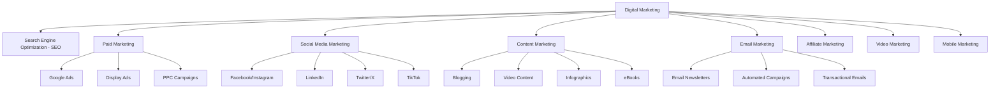

### 5.2 Channel Descriptions

| Channel | Description | Primary Benefits | Best For |
|---------|-------------|------------------|----------|
| **SEO** | Optimizing website content to rank higher in search results | Organic traffic, credibility, long-term visibility | Sustainable growth, authority building |
| **Paid Marketing** | Paying for ad placements on search engines and platforms | Immediate visibility, precise targeting, measurable ROI | Quick results, product launches |
| **Social Media** | Building presence and engagement on social platforms | Brand awareness, community building, direct engagement | Brand building, customer relationships |
| **Content Marketing** | Creating valuable content to attract and engage audiences | Authority building, lead generation, customer education | Establishing expertise, nurturing leads |
| **Email Marketing** | Sending targeted messages to email subscribers | Direct communication, personalization, high ROI | Direct sales, customer retention |
| **Affiliate Marketing** | Partnering with affiliates to promote products | Performance-based, extended reach, cost-effective | Scaling reach, performance marketing |
| **Video Marketing** | Using video content to engage audiences | High engagement, emotional connection, versatile format | Demonstrations, storytelling, tutorials |
| **Mobile Marketing** | Reaching customers on mobile devices | Location-based targeting, high personalization, immediate access | On-the-go consumers, local marketing |

**Understanding Channel Selection:**

Choosing the right digital marketing channels requires careful consideration of business objectives, target audience, and available resources. No single channel works for every business; successful strategies typically combine multiple channels that complement each other and reinforce overall marketing goals.

The most effective approach often involves starting with one or two channels where the target audience is most active, mastering those before expanding to others. This focused approach allows businesses to build expertise and achieve results before diversifying their efforts.

<br>

## 6. Search Engine Optimization (SEO)

### 6.1 What is SEO?

Search Engine Optimization (SEO) is the practice of optimizing websites and content to improve visibility in search engine results pages (SERPs). The goal is to attract organic (non-paid) traffic from users searching for relevant keywords and phrases related to a business's products, services, or content.

SEO represents one of the most cost-effective digital marketing strategies because it generates ongoing traffic without continuous advertising spend. When properly implemented, SEO can provide sustainable visibility that continues to deliver results long after the initial optimization work is completed.

### 6.2 Types of SEO

| Type | Description | Key Activities | Impact |
|------|-------------|----------------|--------|
| **On-Page SEO** | Optimization of elements on your website | Content optimization, title tags, meta descriptions, internal linking, header tags | Directly improves page relevance and user experience |
| **Off-Page SEO** | Optimization activities outside your website | Backlink building, social media engagement, guest posting, brand mentions | Builds authority and trust signals |
| **Technical SEO** | Technical optimization for search engine crawling | Site speed optimization, mobile responsiveness, XML sitemaps, structured data | Ensures search engines can access and understand your content |

**On-Page SEO in Detail:**
On-page SEO focuses on elements within your direct control. This includes optimizing content quality, ensuring proper use of heading tags, crafting compelling title tags and meta descriptions, and creating a logical internal linking structure. Each page should target specific keywords while providing genuine value to visitors.

**Off-Page SEO in Detail:**
Off-page SEO builds your website's authority through external signals. Backlinks from reputable websites serve as endorsements, indicating to search engines that your content is valuable and trustworthy. Social media engagement, brand mentions, and guest posting on authoritative sites all contribute to off-page SEO success.

**Technical SEO in Detail:**
Technical SEO ensures search engines can effectively crawl, index, and understand your website. This includes optimizing page load speed, ensuring mobile responsiveness, implementing structured data markup, creating XML sitemaps, and maintaining a secure HTTPS connection. Technical issues can undermine otherwise excellent content and on-page optimization.

### 6.3 How Search Engines Work

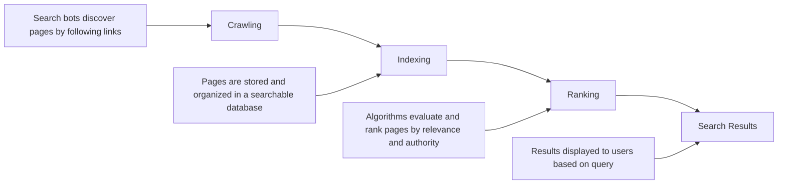

**Crawling:**
Search engines use automated programs called bots or spiders to discover publicly available web pages by following links from known pages. This continuous process ensures search engines maintain current information about the web's constantly changing landscape. Websites must be accessible to these bots to appear in search results.

**Indexing:**
Discovered pages are stored and organized in a searchable database called an index. This index contains information about each page's content, keywords, and structure. Only indexed pages can appear in search results, making indexability a fundamental requirement for SEO success.

**Ranking:**
When a user performs a search, algorithms evaluate and rank indexed pages based on relevance, authority, and quality. Ranking factors include keyword usage, content quality, user engagement signals, and backlink profiles. Algorithms continuously evolve to deliver increasingly relevant and valuable results to users.

### 6.4 Keyword Research and Optimization

**Keyword Research Process:**

Keyword research forms the foundation of effective SEO. This systematic process identifies the terms and phrases potential customers use when searching for products, services, or information related to your business.

1. **Identify Your Target Audience:** Understanding who your customers are and what they need helps guide keyword selection. Consider their demographics, challenges, and goals when identifying potential search terms.

2. **Use Keyword Research Tools:** Platforms like Google Keyword Planner, SEMrush, and Ahrefs provide data on search volume, competition, and related keywords. These tools help identify opportunities and prioritize keywords based on potential impact.

3. **Analyze Search Volume, Competition, and Intent:** Evaluate keyword metrics to identify terms with sufficient search volume and manageable competition. Understanding search intent—whether users are looking for information, making comparisons, or ready to purchase—ensures content matches user needs.

4. **Select Primary and Secondary Keywords:** Each page should target one primary keyword and several related secondary keywords. This focus helps search engines understand the page's topic while providing variety in content.

5. **Map Keywords to Appropriate Content:** Assign keywords to specific pages based on relevance and content purpose. Homepages often target broad brand terms, while blog posts may target more specific question-based keywords.

**Key Optimization Elements:**

| Element | Purpose | Best Practice |
|---------|---------|---------------|
| Title Tags | Primary ranking factor, click-through influence | Include primary keyword near beginning, keep under 60 characters |
| Meta Descriptions | Influence click-through rates | Include keywords, compelling copy under 160 characters |
| Heading Tags (H1, H2, H3) | Content structure and keyword emphasis | Use H1 for main title, H2/H3 for subsections with keywords |
| Content Quality | User satisfaction and engagement | Comprehensive, well-written content addressing user needs |
| URL Structure | User experience and keyword relevance | Clean, descriptive URLs with keywords where appropriate |
| Image Optimization | Accessibility and additional ranking opportunity | Descriptive file names, alt text, compressed file sizes |
| Internal Linking | Site structure and page authority distribution | Link related content, use descriptive anchor text |

### 6.5 Backlinks and Ranking Factors

**Understanding Backlinks:**

Backlinks are links from other websites to your content. They serve as "votes of confidence" that signal to search engines that your content is valuable, authoritative, and trustworthy. High-quality backlinks from reputable websites significantly improve search rankings and organic visibility.

**Quality Over Quantity:**
Not all backlinks provide equal value. Links from authoritative, relevant websites carry more weight than numerous links from low-quality or unrelated sites. Search engines evaluate the quality of linking domains, the relevance of the linking content, and the naturalness of the link profile.

**Key On-Page Ranking Factors:**

| Factor | Impact | Implementation |
|--------|--------|----------------|
| Content Quality and Relevance | High | Create comprehensive, well-researched content that addresses user needs |
| User Experience and Engagement | High | Ensure easy navigation, readable formatting, and engaging content |
| Page Speed and Mobile Responsiveness | High | Optimize images, use caching, implement responsive design |
| Secure Website (HTTPS) | Moderate | Implement SSL certificate, maintain secure connections |
| Keyword Optimization | Moderate | Use keywords naturally in strategic positions |

**Additional Ranking Factors:**
While the factors above represent the most important on-page elements, other factors also influence rankings. These include content freshness, user engagement metrics like bounce rate and time on page, and social signals indicating content popularity. Search engines continuously evolve, incorporating new signals to deliver better results.

### 6.6 SEO Tools

| Tool | Primary Use | Key Features |
|------|-------------|--------------|
| **Ahrefs** | Comprehensive SEO analysis | Backlink analysis, keyword research, competitor analysis, content explorer |
| **SEMrush** | All-in-one marketing toolkit | SEO, PPC, content marketing, social media, competitive intelligence |
| **Yoast SEO** | WordPress SEO plugin | Content optimization, readability analysis, meta tags, XML sitemaps |
| **Google Search Console** | Performance monitoring | Search traffic data, indexing status, technical issue alerts |
| **Google Analytics** | Website analytics | Traffic sources, user behavior, conversions, attribution |

**Tool Selection Considerations:**

Choosing the right SEO tools depends on your specific needs, budget, and technical expertise. For beginners, Google's free tools provide essential data and insights. As requirements become more sophisticated, paid tools offer advanced features for competitive analysis, backlink monitoring, and content optimization. Many professionals use a combination of tools to gain comprehensive insights.

<br>

## 7. Paid Marketing with Google Ads

### 7.1 Introduction to Google Ads

Google Ads is Google's pay-per-click (PPC) advertising platform that allows businesses to display ads on Google's search results pages, partner websites, and across the Google Display Network. Advertisers bid on keywords and pay only when users click their ads, making it a performance-based marketing channel with clear ROI measurement.

Google Ads offers immediate visibility for businesses, enabling them to appear prominently in search results even before organic SEO efforts gain traction. This immediacy makes it particularly valuable for product launches, time-sensitive promotions, and competitive keywords where organic ranking is challenging.

### 7.2 Types of Google Ads

| Ad Type | Description | Best For |
|---------|-------------|----------|
| **Search Ads** | Text ads shown in search results when users search for specific keywords | Direct intent marketing, lead generation |
| **Display Ads** | Visual banner ads on websites across the Google Display Network | Brand awareness, retargeting |
| **Shopping Ads** | Product listings with images, prices, and descriptions | E-commerce, retail products |
| **Video Ads** | Video ads on YouTube and partner platforms | Brand storytelling, engagement |
| **App Campaigns** | Ads designed to promote mobile app downloads | Mobile app promotion |

**Search Ads in Detail:**
Search ads appear at the top of search results pages, capturing users actively searching for products or services. These text-based ads include headlines, descriptions, and display URLs. Success depends on keyword relevance, ad copy quality, and landing page experience. Search ads typically achieve higher conversion rates than other ad types because they target users with demonstrated intent.

**Display Ads in Detail:**
Display ads appear on websites, apps, and video platforms across the Google Display Network. These visual ads can include images, text, and interactive elements. Display advertising is effective for building brand awareness and retargeting previous website visitors. The visual nature of display ads allows for creative expression that text-only ads cannot match.

**Shopping Ads in Detail:**
Shopping ads display product information directly in search results, including images, prices, and merchant names. These ads provide immediate product visibility and comparison shopping capability. Shopping ads work particularly well for e-commerce businesses with extensive product catalogs and competitive pricing.

### 7.3 Google Ads Account Structure

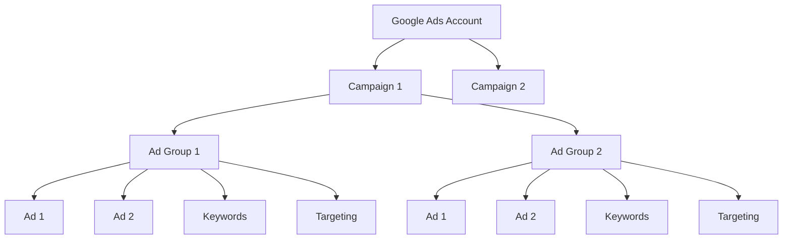

**Account Hierarchy:**
Proper account structure is essential for Google Ads success. The hierarchy from largest to smallest includes:

1. **Account Level:** Contains billing information, user access controls, and overall account settings. This level establishes the foundation for all campaigns.

2. **Campaign Level:** Each campaign defines budget, geographic targeting, and ad type. Campaigns typically align with marketing objectives, such as brand awareness or lead generation.

3. **Ad Group Level:** Within each campaign, ad groups organize related keywords, ads, and landing pages. Logical grouping improves relevance and quality scores.

4. **Ad Level:** Individual ads include creative elements like headlines, descriptions, and calls-to-action. Multiple ads allow for A/B testing and optimization.

**Structuring for Success:**

Effective account structure improves campaign performance by ensuring ad relevance and facilitating management. Search ads should be organized thematically, with each ad group targeting related keywords and directing to corresponding landing pages. This organization improves quality scores, reduces costs, and increases conversion rates.

### 7.4 Managing Google Ads

**Best Practices:**

| Practice | Description | Impact |
|----------|-------------|--------|
| **Thorough Keyword Research** | Identify relevant, high-intent keywords with appropriate search volume | Targets qualified traffic effectively |
| **Compelling Ad Copy** | Create clear, benefit-focused copy with strong calls-to-action | Improves click-through rates |
| **Negative Keywords** | Exclude irrelevant search terms to filter poor traffic | Reduces wasted spend |
| **Landing Page Optimization** | Ensure landing pages match ad promises and facilitate conversion | Improves conversion rates |
| **Bid Monitoring and Adjustment** | Regular review and adjustment based on performance | Optimizes costs and ROI |
| **Ad Extensions** | Add additional information like location, call buttons, and site links | Increases visibility and engagement |
| **A/B Testing** | Test different ad variations to identify winners | Continuous improvement |

**Ongoing Optimization:**

Successful Google Ads management requires continuous monitoring and optimization. Key activities include analyzing performance data, adjusting bids based on conversion value, testing new ad copy, refining keyword lists, and updating targeting based on audience insights. This ongoing process ensures campaigns remain efficient and effective.

<br>

## 8. Social Media Marketing

### 8.1 What is Social Media Marketing?

Social media marketing leverages platforms like Facebook, Instagram, LinkedIn, Twitter/X, TikTok, and others to build connections with potential customers and drive leads or sales. This approach focuses on creating and sharing content that resonates with target audiences, engaging in conversations, and building community around brands.

Social media marketing stands out for its ability to humanize brands and create direct, personal connections with customers. Unlike many other marketing channels, social media allows for authentic, two-way conversations that build trust and loyalty.

### 8.2 Two Types of Social Media Marketing

| Type | Description | Examples |
|------|-------------|----------|
| **Inbound** | Posting educational content, sharing resources on owned channels | Blog posts, educational videos, memes, lead generation ads |
| **Outbound** | Actively engaging outside your owned pages | Commenting on profiles, participating in hashtag conversations, engaging in groups |

**Inbound Social Media Marketing:**
Inbound social media focuses on attracting audiences to your owned channels by providing valuable content. This approach positions your brand as a helpful resource, building trust and authority over time. Inbound content educates, entertains, or solves problems for your target audience, naturally attracting followers and engagement.

**Outbound Social Media Marketing:**
Outbound social media involves engaging with audiences outside your owned channels. This proactive approach includes commenting on relevant posts, participating in industry discussions, and building relationships with influencers and other brands. Outbound efforts expand reach and demonstrate your brand's active participation in the community.

### 8.3 Pillars of Social Media Marketing

**1. Strategy:**
A clear strategy defines goals, target audience, and content approach. Strategy development includes identifying which platforms to use, establishing brand voice, and determining content mix. The strategy should align with broader business objectives while leveraging the unique capabilities of social media channels.

**2. Content:**
Creating engaging, relevant content forms the heart of social media marketing. Content should provide value to followers, whether through education, entertainment, or inspiration. The most effective content formats vary by platform, audience, and marketing objectives.

**3. Community Management:**
Active engagement with followers and responses to comments and messages build relationships and trust. Community management involves monitoring mentions, responding to questions, and addressing concerns promptly. This human touch distinguishes successful social media strategies from ineffective ones.

**4. Analytics:**
Measuring performance and optimizing strategy based on data ensures continuous improvement. Analytics inform content decisions, posting schedules, and resource allocation. Without measurement, social media efforts cannot be effectively optimized.

### 8.4 Platform-Specific Considerations

| Platform | Primary Audience | Best Content Types | Key Features |
|----------|------------------|-------------------|--------------|
| **Facebook** | Broad demographic (25-55+) | Mixed content, videos, articles, group engagement | Large user base, detailed targeting, groups |
| **Instagram** | Millennials, Gen Z (18-34) | High-quality images, Stories, Reels, carousel posts | Visual focus, shopping integration, creative tools |
| **LinkedIn** | Professionals, B2B | Thought leadership, industry insights, career content | Professional context, B2B targeting, long-form content |
| **Twitter/X** | News-oriented, professional | Short updates, news, customer service engagement | Real-time conversations, trending topics |
| **TikTok** | Gen Z, young millennials | Short-form video, trends, entertainment, behind-the-scenes | Viral potential, creative tools, music integration |
| **YouTube** | All ages | Long-form video, tutorials, reviews, storytelling | Search discovery, evergreen content, monetization |

**Platform Selection Considerations:**

Choosing the right platforms requires understanding where your target audience spends time and what content resonates on each platform. Most businesses benefit from focusing on 2-3 platforms initially, mastering those before expanding to others. Platform selection should align with marketing objectives, content capabilities, and resource availability.

### 8.5 Social Media Tools

| Tool | Primary Use | Key Features |
|------|-------------|--------------|
| **Hootsuite** | Social media management | Scheduling, monitoring, analytics across multiple platforms |
| **Buffer** | Content scheduling | Simple scheduling, analytics, queue management |
| **Canva** | Visual content creation | Templates, design tools, brand kits, easy-to-use interface |
| **Sprout Social** | Advanced social management | Analytics, engagement, publishing, social listening |

<br>

## 9. Content Marketing

### 9.1 What is Content Marketing?

Content marketing is the strategic creation and distribution of valuable, relevant, and consistent content to attract and retain a clearly defined audience, ultimately driving profitable customer action. Unlike advertising that directly promotes products, content marketing provides information that helps customers solve problems, learn new skills, or make informed decisions.

Content marketing builds trust and authority by demonstrating expertise and providing genuine value. When customers find your content helpful, they become more likely to choose your products or services when they're ready to purchase. This approach creates sustainable competitive advantages that advertising alone cannot achieve.

### 9.2 Types of Content

| Type | Description | Best Use |
|------|-------------|----------|
| **Blog Posts** | Written articles published on your website | SEO, education, thought leadership |
| **Videos** | Visual content in various formats | Engagement, demonstration, storytelling |
| **Infographics** | Visual data representation | Information sharing, shareability |
| **eBooks/Whitepapers** | Long-form, in-depth content | Lead generation, authority building |
| **Case Studies** | Success story content | Trust building, proof of value |
| **Webinars** | Live or recorded presentations | Education, lead generation |
| **Podcasts** | Audio content | Convenience, authority, relationship building |

**Content Selection Considerations:**

Choosing the right content types depends on your audience's preferences, your objectives, and your resources. Most successful content strategies incorporate multiple formats, repurposing content across different channels to maximize reach and impact. A blog post, for example, can become a video, infographic, podcast episode, and social media posts.

### 9.3 Content Marketing Strategy

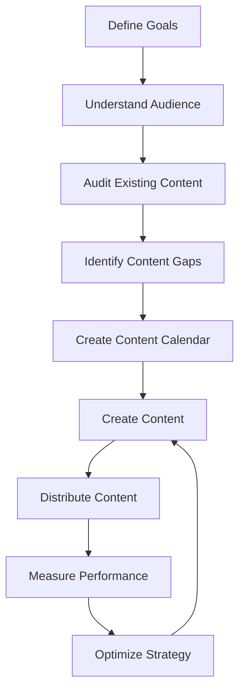

**Strategic Content Development:**

Effective content marketing begins with clear goals and audience understanding. Content should address audience pain points, answer questions, and provide value at each stage of the customer journey. The content calendar ensures consistent publishing while allowing for flexibility to respond to trends and opportunities.

**Distribution and Promotion:**

Creating excellent content is only half the battle; effective distribution ensures it reaches the intended audience. Promotion strategies include organic search optimization, email marketing, social media sharing, paid advertising, influencer partnerships, and content syndication. The most successful content marketing integrates multiple distribution channels.

<br>

## 10. Email Marketing

### 10.1 What is Email Marketing?

Email marketing is the use of email to send commercial messages to a group of people, typically subscribers who have provided permission to receive communications. It remains one of the most effective digital marketing strategies because nearly every consumer has an email address, and email provides a direct, owned communication channel.

Email marketing excels at building relationships, nurturing leads, and driving conversions. Unlike social media or search algorithms that control who sees your content, email marketing provides direct access to your audience without intermediary restrictions.

### 10.2 Benefits of Email Marketing

| Benefit | Description |
|---------|-------------|
| **Complete Control** | Direct connection to customers without platform changes or algorithm updates |
| **Audience Segmentation** | Send different content to different audiences based on behavior and preferences |
| **High ROI** | One of the most cost-effective marketing strategies with significant returns |
| **Personalization** | Tailor messages to individual preferences and behaviors |
| **Automation Friendly** | Drip campaigns and triggered emails work on autopilot |

**Understanding Email's Unique Value:**

Email marketing offers several advantages over other digital marketing channels. It provides direct ownership of the customer relationship, independent of platform changes. It enables sophisticated segmentation and personalization that increases relevance and effectiveness. And it integrates seamlessly with other marketing efforts, supporting the customer journey at every stage.

### 10.3 Email Marketing Types

| Type | Description | Use Case |
|------|-------------|----------|
| **Newsletters** | Regular updates to subscribers | Brand awareness, engagement, maintaining connections |
| **Promotional Emails** | Sales, offers, and product announcements | Direct marketing, conversions, revenue generation |
| **Transactional Emails** | Order confirmations, receipts, shipping updates | Customer service, post-purchase experience |
| **Drip Campaigns** | Automated sequences of emails | Lead nurturing, onboarding, education |
| **Re-engagement Campaigns** | Win-back inactive subscribers | Customer retention, list health |

**Segment-Based Email Strategies:**

Effective email marketing requires thoughtful segmentation and targeting. Subscriber behavior, preferences, and lifecycle stage should determine which emails they receive. This relevance increases engagement, reduces unsubscribe rates, and improves overall campaign performance.

### 10.4 Email Marketing Tools

| Tool | Best For | Key Features |
|------|----------|--------------|
| **Mailchimp** | Small to medium businesses | Templates, automation, analytics, ease of use |
| **Constant Contact** | Small businesses | User-friendly interface, email builder, event management |
| **HubSpot** | Integrated marketing | CRM integration, automation, lead management |
| **Klaviyo** | E-commerce | Advanced segmentation, analytics, integration with e-commerce platforms |

<br>

# Part Three: Strategic Implementation


## 11. Understanding Buyer Psychology

### 11.1 What is Buyer Psychology?

Buyer psychology is a blend of economics, psychology, and communications that helps businesses understand why people choose certain brands and products and how those choices lead to purchases. This field explores the cognitive, emotional, and social factors that influence consumer decision-making.

Understanding buyer psychology enables businesses to connect more effectively with their customers, addressing both conscious and subconscious motivations that drive purchasing behavior. While consumers often believe they make rational decisions, research consistently shows that emotions and unconscious factors play significant roles in choice.

### 11.2 Why Buyer Psychology Matters

Understanding buyer psychology helps businesses:

| Benefit | Description |
|---------|-------------|
| **Build a Good Reputation** | Align marketing with customer values and expectations |
| **Meet Customer Expectations** | Deliver experiences that satisfy customer needs |
| **Save Time and Money** | Focus marketing efforts on what matters to customers |
| **Build Loyalty** | Create emotional connections that drive repeat business |
| **Connect Emotionally** | Engage customers on deeper levels that transcend price and features |

**The Strategic Importance:**

Buyer psychology provides the foundation for effective marketing strategy. Without understanding what drives customer decisions, marketing efforts become guesswork. By understanding psychological principles, marketers can create more compelling messages, design better experiences, and build stronger customer relationships.

### 11.3 Key Psychological Principles

| Principle | Description | Application |
|-----------|-------------|-------------|
| **Emotions Matter** | Feelings are as important as facts in decision-making | Create positive emotional connections with your brand |
| **Novelty** | New things catch attention in an information-saturated world | Highlight what's new or innovative about your offering |
| **Loss Aversion** | People dislike losing things they value | Offer guarantees, flexible return policies, trial periods |
| **Community** | People like feeling part of a group | Share reviews, testimonials, use influencers |
| **Storytelling** | People connect with narratives and characters | Share authentic brand narratives, customer stories |
| **Short and Long-Term Focus** | Customers consider both present and future benefits | Show immediate and future benefits of purchase |
| **Pain Points** | Address customer frustrations effectively | Make processes easy, solve problems |

**Applying Psychological Principles:**

Effective marketing applies these principles thoughtfully and ethically. Emotional appeals should be genuine and relevant to the product or service. Novelty should reflect real innovation. Loss aversion strategies should focus on value and benefit, not manipulation. Community building should create genuine connections, not artificial engagement.

### 11.4 Basic Human Needs in Marketing

Your product should address at least one of these fundamental needs:

1. **Wealth**: Show efficiency, cost-effectiveness, ROI. Demonstrating how your product saves money, saves time, or creates value appeals to the desire for financial security and success.

2. **Health**: Highlight health benefits and wellness. Products that improve physical, mental, or emotional well-being address basic human desires for longevity, vitality, and quality of life.

3. **Relationships**: Demonstrate how your product brings people together. Products that facilitate connection, strengthen bonds, or create community address fundamental social needs.

<br>

## 12. The Buyer's Journey

### 12.1 Understanding the Journey

The buyer's journey represents the steps a customer takes from becoming aware of a problem to making a purchase decision. Understanding this journey enables marketers to provide appropriate content and experiences at each stage, guiding customers toward purchase efficiently.

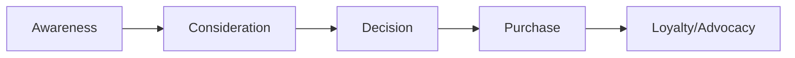

### 12.2 Journey Stages

| Stage | Customer Mindset | Marketing Focus | Content Examples |
|-------|-----------------|-----------------|------------------|
| **Awareness** | "I have a problem or need" | Educational content, problem identification | Blog posts, videos, infographics |
| **Consideration** | "What are my options?" | Comparative content, solution evaluation | Case studies, comparison guides, webinars |
| **Decision** | "Which should I choose?" | Product information, testimonials, offers | Product demos, reviews, free trials |
| **Purchase** | "I need to buy" | Seamless experience, checkout optimization | User-friendly checkout, payment options |
| **Loyalty** | "I want to stay" | Post-purchase engagement, loyalty programs | Onboarding, support, exclusive offers |

**Journey Stage Content Strategy:**

Content should evolve to match customer needs at each journey stage. Awareness content focuses on problems and possibilities. Consideration content compares alternatives and evaluates options. Decision content provides specific details and reassurance. Purchase content ensures smooth transactions. Loyalty content reinforces the value of the relationship and encourages repeat engagement.

### 12.3 Knowledge to Application to Experience

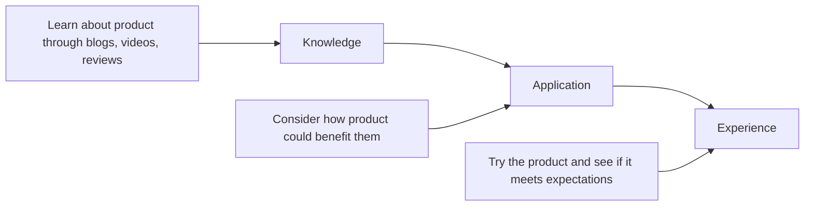

**Supporting the Journey:**

The buyer's journey moves from awareness to consideration to decision, ultimately leading to purchase and loyalty. Each stage requires different types of content and interaction. Marketing should support this progression naturally, providing appropriate information at each stage without rushing or overwhelming the customer.

<br>

## 13. Strategies to Influence Buyer Decisions

### 13.1 Effective Influence Strategies

| Strategy | Description | Example |
|----------|-------------|---------|
| **Easy-to-Understand Content** | Gradually introduce information | Start with simple concepts, build complexity over time |
| **Show Discounts** | Show original and discounted price together | Crossed-out original price next to sale price |
| **Highlight Savings** | Show annual vs. monthly pricing | "Save $50/year with annual plan" |
| **Keep Options Simple** | Limit choices to avoid overwhelm | Offer 3 plans instead of 10 |
| **One CTA Per Page** | Focus attention on single action | One primary button per landing page |
| **Use Testimonials** | Share customer reviews | Quotes and ratings on product pages |
| **Highlight Popular Clients** | Show major customers | Logo display of well-known clients |
| **Exceptional Customer Service** | Respond quickly and helpfully | Live chat, quick email responses |
| **Free Tools or Services** | Offer value without charge | Free trials, calculators, guides |

**Understanding Decision Psychology:**

These strategies work by addressing common decision-making biases and patterns. Discount presentation leverages anchoring and loss aversion. Simple options prevent choice overload. Testimonials provide social proof. Exceptional service builds trust and reduces perceived risk. Each strategy addresses specific psychological factors that influence purchasing decisions.

### 13.2 Creating a Positive Customer Experience

**Be Honest:**
Build trust through transparency. Honest communication about product capabilities, limitations, pricing, and policies establishes credibility and reduces the risk of customer disappointment. Honesty builds the foundation for long-term customer relationships.

**Be Kind:**
Show genuine care for customers through empathetic communication, helpful service, and authentic engagement. Kindness creates positive emotional connections that transcend transactional relationships.

**Make the Journey Enjoyable:**
Remove friction points throughout the customer experience. Simplify processes, provide clear information, and anticipate customer needs. An enjoyable journey reduces abandonment rates and increases satisfaction.

**Listen to Feedback:**
Act on customer input to improve products, services, and experiences. Demonstrate that customer opinions matter through responsive product development and service improvements.

**Provide Value:**
Always focus on customer benefit rather than simply promoting products. Value-focused marketing builds trust and positions the brand as a helpful partner rather than just a seller.

<br>

## 14. Digital Marketing Strategy Development

### 14.1 What is a Digital Marketing Strategy?

A digital marketing strategy is a plan for using digital channels to grow visibility online, attract customers, and achieve business objectives. It considers target audience, strengths and weaknesses, competitive positioning, and available resources to create a coherent approach to digital marketing.

A well-developed strategy provides direction and focus, preventing scattered efforts and wasted resources. It establishes priorities, guides resource allocation, and provides a framework for measuring success.

### 14.2 Strategy vs. Tactics

| Aspect | Strategy | Tactics |
|--------|----------|---------|
| **Definition** | The overall plan and direction | The specific actions to implement the plan |
| **Timeframe** | Long-term, strategic perspective | Short-term, execution-focused |
| **Focus** | What to achieve and why | How and when to implement |
| **Example** | "We will increase brand awareness through content marketing" | "Publish two blog posts weekly and share on LinkedIn" |

**Strategic Thinking:**

Strategy answers the "why" and "what" questions of marketing. It defines objectives, target audiences, and competitive positioning. Tactics answer the "how" questions, providing specific implementation details. Both are essential; strategy without tactics remains theoretical, while tactics without strategy lack direction and cohesion.

### 14.3 How to Create an Effective Digital Marketing Strategy

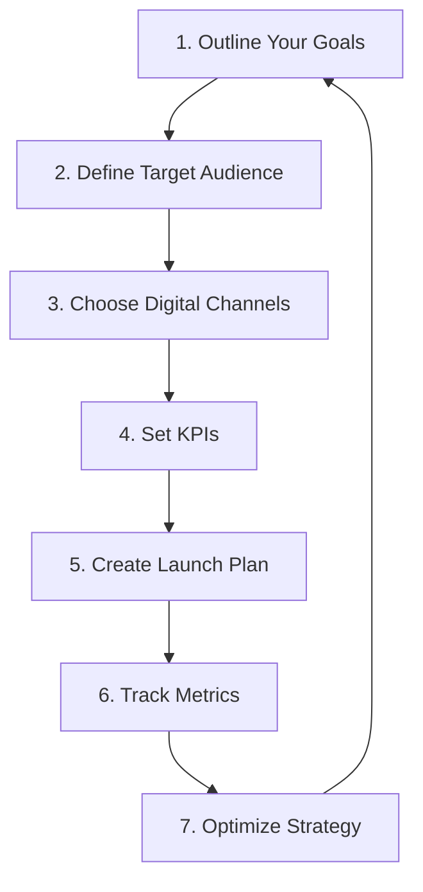

### 14.4 Seven-Step Strategy Guide

**1. Outline Your Goals**

Use the SMART framework to create specific, measurable, achievable, relevant, and time-bound goals. For example: "Increase website traffic by 25% in Q3" or "Generate 100 qualified leads per month by year-end." Clear goals provide direction and enable measurement of success.

**2. Define Your Target Audience**

Create detailed buyer personas that include demographics, interests, challenges, and behaviors. For B2B marketing, consider company size, industry, job role, and purchasing authority. Understanding who you're marketing to is essential for effective messaging and channel selection.

**3. Choose the Right Channels**

Select channels based on goals and audience preferences. A B2B company may find more success on LinkedIn than TikTok, while a consumer brand might prioritize Instagram and Facebook. Focus on channels where your audience is most active and where your content can make the greatest impact.

**4. Set Key Performance Indicators (KPIs)**

Define metrics that will measure progress toward your goals. Examples include click-through rates, conversion rates, traffic sources, engagement rates, and revenue generated. KPIs should directly relate to business objectives and provide actionable insights.

**5. Create a Launch Plan**

Determine resources needed, create a launch calendar, and assign responsibilities. A detailed launch plan ensures all elements are ready when needed and team members understand their roles. Consider content creation, technical setup, and promotional activities.

**6. Track Metrics**

Use analytics tools to monitor performance regularly. Review data to identify what's working and what needs improvement. Regular tracking enables timely adjustments and prevents problems from going unnoticed.

**7. Optimize Your Strategy**

Test new approaches and adjust based on performance data. Continuous optimization improves results over time. Use A/B testing, analyze competitor activity, and respond to changes in the market or consumer behavior.

### 14.5 Understanding Your Customer

**Key Questions to Answer:**

1. Who buys your product and why?
2. What are their pain points and challenges?
3. Where do they spend time online?
4. What language and terminology do they use?
5. What emotions drive their decisions?

**Steps to Customer Understanding:**

| Step | Description |
|------|-------------|
| **Define Channels** | Identify channels that fit key demographics and behaviors |
| **Speak Their Language** | Use terminology and communication styles that resonate |
| **Understand Pain Points** | Identify problems your product solves |
| **Create Buyer Personas** | Develop detailed profiles of ideal customers |
| **Be Culturally Aware** | Understand cultural factors that influence decisions |
| **Consider Influencer Partnerships** | Leverage trusted voices in the community |
| **Focus on Outcomes** | Emphasize results, not just product features |
| **Use Automation Tools** | Apply segmentation and targeting for personalized experiences |

### 14.6 Audit and Assess

**Conduct a Full Channel and Content Audit:**

1. **List all marketing channels and assets:** Document everything you're currently using, including websites, social media accounts, email lists, paid campaigns, and content assets.

2. **Map each to organizational goals:** Connect each channel and asset to specific business objectives. This helps identify alignment gaps and opportunities.

3. **Identify top performers:** Determine which channels and content types are delivering the best results. These represent areas to invest in and expand.

4. **Understand what drives revenue:** Connect marketing activities to revenue outcomes. This reveals what truly matters for business results.

5. **Double down on successes:** Increase investment in what's working well, whether that's specific channels, content types, or campaign approaches.

6. **Explore new opportunities:** Test new channels and content formats that could expand reach and impact.

### 14.7 Focus on the End Result

**Avoid Product-Centric Marketing:**

Traditional marketing often emphasizes product features and specifications. Digital marketing success requires a shift toward focusing on customer needs and outcomes:

- Focus on the need the product fulfills, not just the product itself
- Understand customer pain points and how your solution addresses them
- Demonstrate post-purchase moments and benefits
- Show why customers need it in the first place

**Outcome-Focused Messaging:**

Effective marketing answers the customer question, "What's in it for me?" It demonstrates how the product will improve their life, solve their problems, or help them achieve their goals. This outcome-focused approach resonates more strongly than feature-focused messaging.

### 14.8 Review and Refine

**Continuous Optimization:**

- Include KPIs aligned with business goals
- Step away from vanity metrics that don't indicate success
- Set up regular analysis intervals for performance review
- Isolate critical metrics when issues arise
- Document learnings and apply them to future campaigns

**The Optimization Cycle:**

Continuous improvement is fundamental to digital marketing success. Regularly analyze performance data, identify opportunities, implement changes, and measure impact. This cycle of planning, execution, measurement, and refinement drives ongoing improvement.

<br>

## 15. Creating a Marketing Plan

### 15.1 Structure of a Marketing Plan

| Component | Description |
|-----------|-------------|
| **Executive Summary** | Overview of the marketing plan and key objectives |
| **Situation Analysis** | Current market position, competitive landscape, SWOT analysis |
| **Goals and Objectives** | Specific, measurable targets to achieve |
| **Target Audience** | Detailed buyer personas and segmentation |
| **Marketing Strategy** | Overall approach and competitive positioning |
| **Tactical Plan** | Specific actions, channels, and campaigns |
| **Budget Allocation** | Resource distribution across activities |
| **Timeline** | Implementation schedule with milestones |
| **KPIs and Measurement** | How success will be measured and tracked |

### 15.2 How to Make an Effective Marketing Plan

**1. Research:**
Understand your market, competition, and audience thoroughly. This research provides the foundation for informed decision-making. Without adequate research, marketing plans become guesswork.

**2. Define:**
Set clear, measurable objectives that align with business goals. These objectives provide direction and enable measurement of success.

**3. Strategize:**
Determine your approach and positioning based on research findings. Strategy defines how you'll compete and win in your market.

**4. Implement:**
Execute tactics across chosen channels according to your plan. Implementation requires resources, coordination, and clear accountability.

**5. Measure:**
Track performance against KPIs to understand what's working. Measurement enables optimization and justifies resource allocation.

**6. Adjust:**
Optimize based on results, adapting to changing conditions and new insights. This adjustment cycle drives continuous improvement.

<br>

# Part Four: Control, Measurement, and Optimization


## 16. What You Can and Cannot Control in Digital Marketing

### 16.1 What You CAN Control

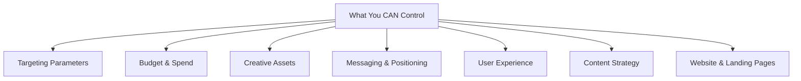

| Element | Description | Impact |
|---------|-------------|--------|
| **Targeting Parameters** | Exact audience demographics, locations, interests, devices | Determines who sees your marketing |
| **Budget & Spend** | Daily ad limits, bidding strategies, cost-per-click constraints | Controls cost and reach |
| **Creative Assets** | Design, copy, calls-to-action, formatting of ads and posts | Influences engagement and conversion |
| **Messaging & Positioning** | How you present your brand's value, tone, identity | Shapes brand perception |
| **User Experience** | Speed, mobile responsiveness, navigation of your website | Affects satisfaction and conversion |
| **Content** | What you create and share | Builds authority and engagement |
| **Customer Relationships** | How you respond to inquiries and engage | Builds loyalty and trust |

**Control as a Competitive Advantage:**

The elements within your control represent areas where you can develop competitive advantage. Excellent targeting, compelling creative, superior user experience, and strong customer relationships differentiate successful marketers. Focusing effort on controllable factors maximizes the impact of marketing investments.

### 16.2 What You CANNOT Control

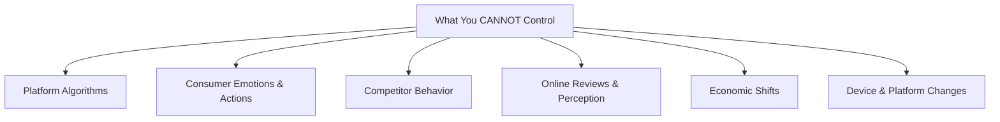

| Element | Description |
|---------|-------------|
| **Platform Algorithms** | Unannounced updates to Google or Meta algorithms |
| **Consumer Emotions & Actions** | Cannot force engagement or purchases |
| **Competitor Behavior** | Competitors' bids, budgets, and strategies |
| **Online Reviews & Perception** | Cannot control what users say about your brand |
| **Economic Shifts** | Sudden changes in consumer purchasing power |
| **Device Changes** | Technology and platform changes |
| **User Behavior** | Individual reactions to content |

**Managing Uncertainty:**

While many factors are outside your control, you can prepare for and respond to them. Stay informed about platform changes, monitor competitor activity, and maintain flexibility in your approach. Build relationships that can weather economic shifts. Focus on what you can control while adapting to what you cannot.

### 16.3 Success Strategy

Success lies in optimizing what you can control to influence what you cannot:

| Control Area | Influence Goal |
|--------------|----------------|
| High-quality content | Improved engagement and sharing |
| Excellent user experience | Better conversion rates |
| Relevant targeting | Higher click-through rates |
| Strong brand messaging | Positive brand perception |
| Customer service | Positive reviews and loyalty |
| Continuous testing | Optimized performance over time |

<br>

## 17. Analytics and Data-Driven Marketing

### 17.1 Introduction to Data Analytics in Marketing

Data analytics enables marketers to measure campaign success, understand customer behavior, and optimize strategies for better results. In today's digital environment, nearly every marketing interaction generates data that can be analyzed to improve performance.

Data-driven marketing moves beyond intuition and guesswork, providing evidence-based guidance for strategic decisions. This approach increases the efficiency and effectiveness of marketing investments, reducing waste and improving outcomes.

### 17.2 Key Analytics Tools

| Tool | Primary Use | Key Features |
|------|-------------|--------------|
| **Google Analytics** | Website analytics | Traffic sources, user behavior, conversions, audience insights |
| **Facebook Insights** | Social media analytics | Engagement, audience demographics, post performance |
| **Google Search Console** | SEO performance | Search visibility, technical issues, click-through rates |
| **Hotjar** | User behavior analysis | Heatmaps, session recordings, feedback polls |
| **SEMrush** | Competitive analysis | Traffic estimation, keyword tracking, competitor research |

**Tool Selection and Integration:**

Different analytics tools serve different purposes. Website analytics reveal how visitors interact with your site. Social analytics show engagement and audience characteristics. SEO tools track search visibility. Effective marketers integrate insights from multiple tools to gain a comprehensive view of performance.

### 17.3 How to Optimize Campaigns Based on Data

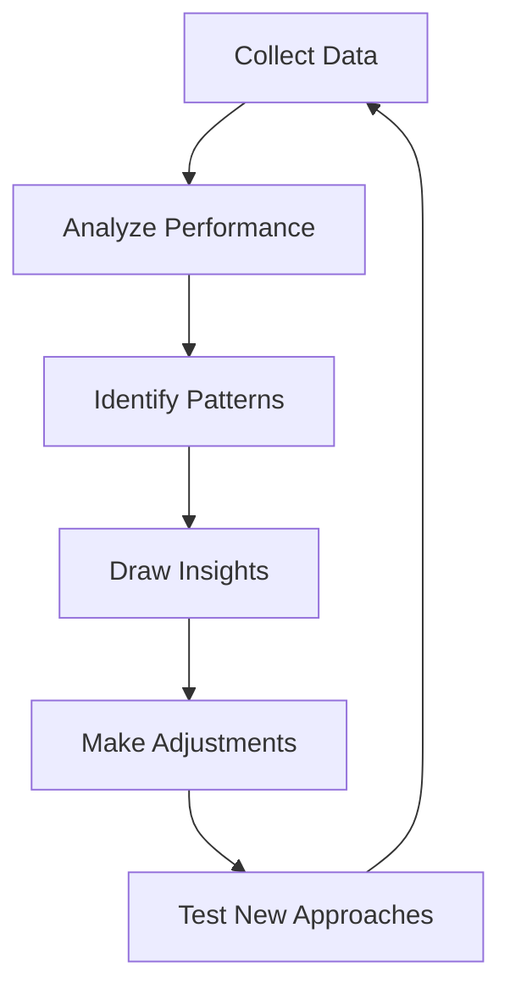

**Optimization Steps:**

1. **Define what to measure (KPIs):** Establish metrics that indicate success.
2. **Set up tracking and analytics:** Implement tools to capture relevant data.
3. **Collect and review data regularly:** Establish a regular review cadence.
4. **Identify underperforming areas:** Find where results fall short of goals.
5. **Develop hypotheses for improvement:** Formulate ideas for improvement.
6. **Test changes (A/B testing):** Experiment with specific changes.
7. **Measure impact:** Evaluate whether changes improved performance.
8. **Implement winning variations:** Apply successful changes broadly.
9. **Repeat continuously:** Continue the cycle for ongoing improvement.

<br>

## 18. Key Performance Indicators (KPIs)

### 18.1 What are KPIs?

Key Performance Indicators are measurable values that track an organization's performance and progress toward specific goals. KPIs translate abstract objectives into concrete metrics that can be tracked and optimized.

Effective KPIs are specific, measurable, and actionable. They provide clear targets and enable teams to understand whether they're making progress. Without KPIs, marketing becomes impossible to evaluate effectively.

### 18.2 Common Digital Marketing KPIs

| KPI | Definition | Why It Matters |
|-----|------------|----------------|
| **Click-Through Rate (CTR)** | Percentage of people who click on an ad or link | Measures ad and content effectiveness |
| **Conversion Rate** | Percentage of visitors who take desired action | Measures overall campaign effectiveness |
| **Cost Per Acquisition (CPA)** | Cost to acquire a new customer | Measures efficiency and profitability |
| **Return on Ad Spend (ROAS)** | Revenue generated per dollar of ad spend | Measures ROI and campaign effectiveness |
| **Customer Acquisition Cost (CAC)** | Total cost to acquire a new customer | Measures efficiency of acquisition efforts |
| **Customer Lifetime Value (CLV)** | Total revenue from a customer over time | Measures long-term customer value |
| **Engagement Rate** | Interactions as percentage of reach | Measures content and community effectiveness |
| **Bounce Rate** | Percentage of single-page visits | Measures user experience and content relevance |
| **Open Rate** | Percentage of emails opened | Measures email subject line effectiveness |
| **Organic Traffic** | Visitors from search results | Measures SEO success |

### 18.3 Aligning KPIs with Goals

| Goal | Relevant KPIs |
|------|---------------|
| **Brand Awareness** | Impressions, Reach, Social Followers, Brand Mentions |
| **Lead Generation** | Form Submissions, Click-Through Rate, Conversion Rate |
| **Sales/Revenue** | Conversion Rate, ROAS, Revenue, Average Order Value |
| **Customer Retention** | Retention Rate, Repeat Purchase Rate, Customer Lifetime Value |
| **Engagement** | Engagement Rate, Time on Page, Comments, Shares |

**Choosing the Right KPIs:**

Selecting appropriate KPIs begins with clear objectives. Brand awareness campaigns should measure reach and impressions, while lead generation campaigns should focus on form submissions and conversion rates. The right KPIs provide insight into whether you're achieving your objectives.

<br>

# Part Five: Specializations and Advanced Techniques


## 19. Integrated Digital Marketing

### 19.1 What is Integrated Digital Marketing?

Integrated digital marketing combines SEO, content marketing, social media, paid advertising, and email marketing into cohesive campaigns that work together synergistically. Rather than treating each channel independently, integrated marketing creates consistency across touchpoints, amplifying the impact of each channel.

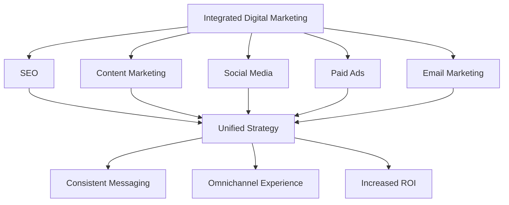

### 19.2 Benefits of Integration

| Benefit | Description |
|---------|-------------|
| **Consistent Messaging** | Same brand voice across all channels |
| **Enhanced Customer Experience** | Seamless journey across touchpoints |
| **Better Data Utilization** | Insights from one channel inform others |
| **Increased Efficiency** | Resources are used more effectively |
| **Improved ROI** | Combined efforts yield greater results |

### 19.3 Example: Integrated Marketing Approach

**Campaign: New Product Launch**

| Channel | Role | Activity |
|---------|------|----------|
| **Content** | Education | Blog posts explaining the problem and solution |
| **SEO** | Visibility | Optimize content for relevant keywords |
| **Social Media** | Awareness | Share content, build community |
| **Email** | Nurturing | Send educational series to subscribers |
| **Paid Ads** | Acceleration | Retarget website visitors |
| **Analytics** | Measurement | Track all touchpoints and attribution |

<br>

## 20. Mobile Marketing

### 20.1 What is Mobile Marketing?

Mobile marketing encompasses advertising, apps, messaging, mCommerce, and CRM on all mobile devices including smartphones and tablets. With mobile internet usage now exceeding desktop usage in many markets, mobile marketing has become essential for reaching consumers.

### 20.2 Mobile Marketing Benefits

| Benefit | Description |
|---------|-------------|
| **Location-Based Targeting** | Reach users based on real-time location |
| **Immediate Access** | Customers are always connected |
| **Personalization** | Tailor messages to individual preferences |
| **High Engagement** | Mobile users are highly engaged |
| **Integration** | Seamless across other marketing channels |

### 20.3 Mobile-Specific Features

- **Location-Based Advertising:** Reach users based on geographic location, enabling local targeting and contextual messaging
- **Mobile Apps:** Create branded app experiences that build loyalty and engagement
- **SMS Marketing:** Direct text message marketing with high open rates
- **QR Codes:** Bridge physical and digital worlds for seamless experiences
- **Mobile Wallets:** Digital payment and loyalty integration for frictionless transactions

<br>

## 21. Augmented Reality (AR) and Virtual Reality (VR) Marketing

### 21.1 Understanding the Concepts

| Technology | Description | Marketing Application |
|------------|-------------|----------------------|
| **Augmented Reality (AR)** | Digital information overlaid on the physical world | Virtual try-on, product visualization, interactive experiences |
| **Virtual Reality (VR)** | Complete immersion in a digital environment | Virtual showrooms, experiential marketing |
| **Mixed Reality (MR)** | Realistic integration of digital and real | Advanced product visualization, training |

### 21.2 AR/VR in Marketing

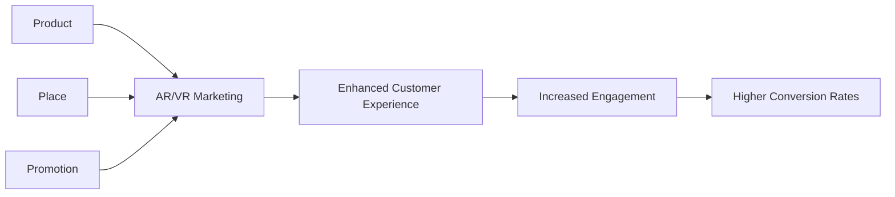

### 21.3 Applications of AR Marketing

| Application | Example | Benefit |
|-------------|---------|---------|
| **Virtual Try-On** | Makeup, clothing, glasses | Reduce return rates, increase purchase confidence |
| **Product Visualization** | Furniture placement in home | Increase purchase confidence |
| **Interactive Advertising** | Engaging brand experiences | Higher engagement, brand recall |
| **Enhanced Manuals** | AR instructions for products | Improved user experience, reduced support calls |

<br>

## 22. Artificial Intelligence in Digital Marketing

### 22.1 How AI is Transforming Digital Marketing

AI is revolutionizing digital marketing by enabling unprecedented levels of personalization, automation, and optimization. As AI technologies continue to advance, they're transforming how marketers understand customers, create content, and optimize campaigns.

**Key AI Capabilities:**

- **Personalization at Scale:** Tailored experiences for each user based on behavior, preferences, and context
- **Predictive Analytics:** Anticipating customer behavior and outcomes
- **Automation:** Handling repetitive tasks efficiently
- **Optimization:** Continuous improvement of campaigns
- **Content Generation:** Creating content at scale

### 22.2 AI Applications in Digital Marketing

| Application | Description | Example |
|-------------|-------------|---------|
| **Chatbots** | Automated customer interaction | 24/7 customer service, lead qualification |
| **Personalization** | Tailored content and recommendations | Product suggestions based on behavior |
| **Predictive Analytics** | Forecasting customer behavior | Churn prediction, lifetime value |
| **Ad Optimization** | Automated bidding and targeting | Dynamic ad adjustments |
| **Content Generation** | AI-created content | Product descriptions, emails |
| **Sentiment Analysis** | Understanding customer opinions | Social media monitoring |
| **Lead Scoring** | Prioritizing leads by potential | Sales prioritization |

### 22.3 Benefits of AI in Digital Marketing

| Benefit | Description |
|---------|-------------|
| **Increased Efficiency** | Automate routine tasks |
| **Better Insights** | Analyze data at scale |
| **Improved ROI** | More accurate targeting and spending |
| **Personalized Experiences** | Custom content for each user |
| **24/7 Availability** | Always-on customer engagement |

<br>

## 23. Business Intelligence in Marketing

### 23.1 What is Business Intelligence?

Business Intelligence (BI) encompasses processes, technologies, and tools that empower organizations to make informed, data-driven decisions. In marketing, BI enables deeper understanding of customers, better targeting, and improved performance measurement.

### 23.2 Core BI Components in Marketing

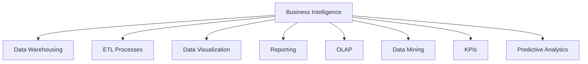

### 23.3 BI Components Explained

| Component | Description | Marketing Application |
|-----------|-------------|----------------------|
| **Data Warehousing** | Centralized data repository | Store all marketing data in one place |
| **ETL** | Extract, Transform, Load | Clean and standardize data |
| **Data Visualization** | Visual representation of data | Dashboards, reports |
| **Reporting** | Generating insights | Performance tracking, trend analysis |
| **OLAP** | Multidimensional analysis | Exploring data from different angles |
| **Data Mining** | Pattern discovery | Identifying customer segments |
| **KPIs** | Performance measurement | Tracking marketing effectiveness |
| **Predictive Analytics** | Forecasting future trends | Customer behavior prediction |

### 23.4 Benefits of BI for Marketers

1. **Data-Driven Decisions:** Base choices on evidence rather than intuition
2. **Better Targeting:** Identify ideal customer segments
3. **Improved ROI:** Allocate resources more effectively
4. **Competitive Advantage:** Stay ahead of market trends
5. **Efficiency:** Streamline operations
6. **Customer Understanding:** Deep insights into behavior

<br>

# Part Six: Compliance, Ethics, and Governance


## 24. Digital Marketing Rules and Regulations

### 24.1 Key Regulatory Frameworks

| Framework | Region | Focus |
|-----------|--------|-------|
| **GDPR** | European Union | Data protection and privacy |
| **CCPA** | California, USA | Consumer privacy rights |
| **CAN-SPAM** | USA | Commercial email compliance |
| **Telemarketing Laws** | Various | Telephone marketing restrictions |

### 24.2 CAN-SPAM Requirements

The CAN-SPAM Act establishes requirements for commercial messages:

1. **Honor opt-out requests promptly**
2. **Subscribers have the right to be forgotten**
3. **Monitor what others do on your behalf**
4. **Don't use false or misleading header information**
5. **Disclose clearly that your message is an ad**
6. **Subscribers can opt out of marketing emails**
7. **Tell subscribers how to opt out**
8. **Include your valid physical postal address**
9. **Subject lines must accurately reflect content**
10. **Subscribers have the right to know what data is collected and how it is used**

### 24.3 GDPR Requirements

The General Data Protection Regulation focuses on:

- **Data Protection:** Secure handling of personal data
- **Data Transparency:** Clear information about data collection
- **User Rights:** Right to access, rectify, erase data
- **Data Portability:** Users can move data between services
- **Consent:** Clear, explicit consent required

### 24.4 CCPA Requirements

The California Consumer Privacy Act provides:

- **Right to Know:** What personal information is collected
- **Right to Delete:** Request deletion of personal data
- **Right to Opt-Out:** Stop sale of personal information
- **Non-Discrimination:** Equal service regardless of privacy choices

### 24.5 Best Practices for Compliance

1. **Know the rules:** Understand all applicable regulations
2. **Document everything:** Maintain records of compliance
3. **Assemble a governance committee:** Oversee compliance
4. **Use appropriate technology:** Tools that support compliance
5. **Train your team:** Ensure everyone understands requirements
6. **Monitor compliance:** Regular audits and reviews

### 24.6 Creating a Digital Marketing Rulebook System

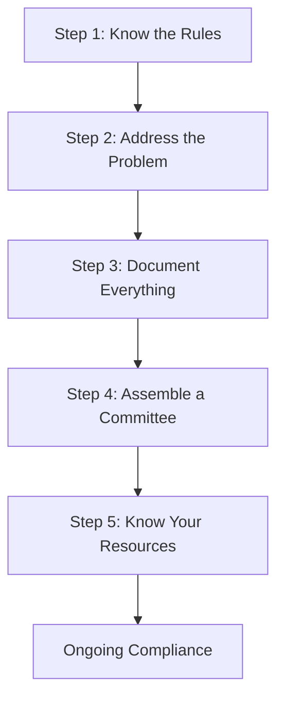

<br>

## 25. Ethical Considerations in Digital Marketing

### 25.1 Key Ethical Issues

| Issue | Description | Example |
|-------|-------------|---------|
| **Data Privacy** | Protecting personal information | Cambridge Analytica scandal |
| **Microtargeting** | Precise audience targeting | Targeted political ads |
| **Algorithmic Bias** | AI systems discriminating | Gender-biased hiring algorithms |
| **Fake Reviews** | Manipulated consumer feedback | Paid positive reviews |
| **Influencer Transparency** | Disclosure of paid relationships | Undisclosed sponsorships |
| **Data Security** | Protecting collected data | Data breaches |

### 25.2 The Public's Trust in eWOM

**Challenges:**
- Fake reviews are increasingly common
- Consumers are becoming skeptical of online reviews
- Trust in platform reviews is declining

**Impact:**
- Reduced credibility of online recommendations
- Consumer hesitation in relying on reviews
- Need for improved authenticity verification

### 25.3 Ethical AI in Marketing

**Responsible AI Principles:**

1. **Transparency:** Explain how AI makes decisions
2. **Fairness:** Avoid algorithmic bias
3. **Accountability:** Take responsibility for AI outcomes
4. **Privacy:** Protect user data
5. **Security:** Ensure AI systems are secure
6. **Human Control:** Maintain human oversight

### 25.4 Building Ethical Marketing Practices

| Practice | Description |
|----------|-------------|
| **Data Transparency** | Clearly communicate data collection practices |
| **Informed Consent** | Obtain explicit permission for data use |
| **Privacy Protection** | Implement strong data security measures |
| **Bias Prevention** | Regularly audit algorithms for fairness |
| **Honest Communication** | Avoid misleading claims |
| **Authentic Engagement** | Build genuine relationships with customers |

<br>

# Part Seven: Mastery and Career Development


## 26. Digital Marketing Learning Roadmap

### 26.1 Phase 1: Introduction (Beginner Level)

**Understanding the Basics:**
- What is digital marketing and why it matters
- Evolution of digital marketing
- Top reasons to learn digital marketing
- Importance of digital marketing

**Marketing Fundamentals:**
- Structure of a marketing plan
- How to make an effective marketing plan

**Beginner Practice:**
- Research a company's marketing plan
- Create a basic digital marketing strategy for a small business

### 26.2 Phase 2: Core Concepts

**Search Engine Optimization (SEO):**
- Types of SEO (on-page, off-page, technical)
- How search engines work (crawling, indexing, ranking)
- Keyword research and optimization
- Backlinks and on-page ranking factors
- SEO tools

**Paid Marketing with Google Ads:**
- Introduction to Google Ads
- Types of ads (search, display, shopping, video)
- Account structure
- Campaign management

**Social Media Marketing:**
- Pillars of social media marketing
- Social marketing tools

**Content Marketing:**
- Creating valuable, engaging content
- Blogging, video marketing, storytelling

**Intermediate Practice:**
- Create an SEO-optimized blog post
- Build a Google Ads campaign
- Design and schedule social media posts

### 26.3 Phase 3: Advanced Techniques

**Integrated Digital Marketing:**
- Combining SEO, content, social, and paid ads
- Example: Microsoft integrated marketing approach

**Email Marketing:**
- Basics and best practices
- Email marketing tools

**Advanced SEO and Content:**
- Schema markup, voice search optimization
- Link-building and competitive analysis

**Data-Driven Marketing:**
- Google Analytics and Facebook Insights
- Campaign optimization based on data

**Advanced Practice:**
- Execute a multi-channel campaign
- Create a data-driven analytics report

### 26.4 Phase 4: Specializations

**Digital Marketing Influencer:**
- Personal branding
- Content creation and consistency

**Advanced Paid Marketing:**
- Google AdSense
- Retargeting and remarketing

**Emerging Trends:**
- Voice and visual search
- AI and automation

### 26.5 Phase 5: Mastery

**Industry Best Practices:**
- Ethical practices, audience targeting, quality content

**Real-World Projects:**
- Build a complete marketing campaign
- Measure and optimize performance

**Interview Preparation:**
- Common digital marketing interview questions
- Best practices for answering

**Continuous Learning:**
- Follow industry blogs
- Engage in communities
- Attend webinars and meetups

<br>

## 27. Creative Marketing Ideas for Beginners

### 27.1 Creative Strategies

| Strategy | Description | Example |
|----------|-------------|---------|
| **Gamification** | Add gaming elements to engage audience | Points, rewards, challenges |
| **Interactive Content** | Encourage participation | Quizzes, calculators, polls |
| **Expert Roundups** | Share industry knowledge | Expert opinion articles |
| **Social Media Competitions** | Engage through contests | Photo contests, giveaways |
| **Creative Lead Magnets** | Grow email lists | Discounts, freebies, exclusive content |
| **Seasonal Marketing** | Align with events | Holiday specials |
| **Guest Content** | Expand reach | Guest blog posts |
| **Visual Content** | Use engaging visuals | Infographics, videos |
| **Trend Participation** | Capitalize on trends | TikTok challenges |
| **Short Videos** | Engage mobile users | TikTok, Instagram Reels |

### 27.2 Tips for Creative Marketing

1. **Understand your audience:** Create content they'll find valuable
2. **Be authentic:** Stay true to your brand voice
3. **Test and learn:** Try different approaches
4. **Think visually:** Visual content drives engagement
5. **Tell stories:** Connect emotionally with customers
6. **Be consistent:** Maintain regular presence
7. **Monitor results:** Track what works
8. **Adapt quickly:** Respond to feedback

<br>

## 28. Social Branding

### 28.1 What is Social Branding?

Social branding is shaping and strengthening your brand on social media platforms. Unlike traditional advertising, it lets your company connect with the audience on a personal level through engaging stories and modern technologies.

### 28.2 How Social Branding Helps Your Business

| Benefit | Description |
|---------|-------------|
| **Drives Traffic** | Brings relevant visitors to your business |
| **Builds Trust** | Creates credibility and relatability |
| **Enhances Sales** | Improves the sales process |
| **Increases Awareness** | Boosts brand exposure |
| **Creates Relationships** | Builds authentic customer connections |

### 28.3 Four Steps to Improve Social Branding

**1. Consistent Social Media Persona**
- Maintain consistent brand image across all channels
- Adapt visuals and tone to each platform
- Create recognizable brand elements

**2. Combine Automation with Humanization**
- Use scheduling software and AI tools
- Add a human touch to connect authentically
- Personalize responses and engagement

**3. Tailor Content to Each Platform**
- Keep brand persona consistent
- Adjust content types for each platform
- Videos on YouTube, written posts on Facebook, visuals on Instagram

**4. Create, Schedule, Post, Repeat**
- Stay consistent with regular posting
- Use automated scheduling software
- Maintain quality in every post

### 28.4 Successful Social Branding Examples

| Brand | Strategy | Impact |
|-------|----------|--------|
| **Dove** | Celebrating diversity, body positivity | Aligns with mission, builds trust |
| **Dollar Shave Club** | Witty, consistent tone | Clear value communication |
| **Shopify** | Social justice, environmental commitment | Stands out with values |
| **Wayfair** | Easy-to-understand visuals, tips | Encourages product exploration |

<br>

## 29. Interview Preparation and Career Growth

### 29.1 Common Digital Marketing Interview Questions

**General Questions:**
1. "What is digital marketing and why is it important?"
2. "How do you stay updated with industry trends?"
3. "Can you explain a successful campaign you've managed?"
4. "Which digital marketing channels do you prefer and why?"
5. "How do you measure campaign success?"

**SEO Questions:**
1. "What are the key ranking factors for Google?"
2. "How do you approach keyword research?"
3. "What's the difference between on-page and off-page SEO?"

**Paid Marketing Questions:**
1. "How do you optimize a Google Ads campaign?"
2. "What factors affect Quality Score?"
3. "How do you determine ad budget allocation?"

**Social Media Questions:**
1. "How do you develop a social media strategy?"
2. "Which metrics matter most for social media success?"
3. "How do you handle negative comments?"

**Analytics Questions:**
1. "What are the most important KPIs in digital marketing?"
2. "How do you use Google Analytics to optimize campaigns?"

### 29.2 Continuous Learning Resources

**Industry Blogs:**
- Moz
- HubSpot
- Neil Patel
- Search Engine Land
- Marketing Land

**Online Communities:**
- Reddit (r/DigitalMarketing)
- LinkedIn groups
- Facebook communities
- Meetup events

**Learning Platforms:**

| Platform | Cost | Focus |
|----------|------|-------|
| **Google Digital Garage** | Free | Fundamentals |
| **HubSpot Academy** | Free | Inbound marketing |
| **Moz Academy** | Paid | SEO |
| **SEMrush Academy** | Free | SEO and marketing |
| **Coursera** | Paid | University courses |
| **Udemy** | Paid | Various courses |
| **LinkedIn Learning** | Paid | Professional development |

<br>

# Appendices

---

## Appendix A: Recommended Resources

### Books

| Book | Author | Focus |
|------|--------|-------|
| *Digital Marketing for Dummies* | Various | Introduction |
| *SEO 2023* | Adam Clarke | Search optimization |
| *The Art of Digital Marketing* | Ian Dodson | Strategy |
| *Influence* | Robert Cialdini | Psychology |
| *Principles* | Ray Dalio | Business systems |
| *Good to Great* | Jim Collins | Business growth |

### Key Industry Resources

- **Google:** Google Digital Garage, Google Ads, Google Analytics
- **HubSpot:** Academy, blog, tools
- **SEMrush:** Tools, academy, blog
- **Moz:** SEO tools, blog, learning
- **Neil Patel:** Blog, tools, learning

<br>

## Appendix B: Tools and Platforms

### SEO Tools

| Tool | Primary Use |
|------|-------------|
| **Ahrefs** | Comprehensive SEO analysis |
| **SEMrush** | All-in-one marketing toolkit |
| **Yoast SEO** | WordPress SEO optimization |
| **Moz** | SEO tools and analysis |
| **Google Search Console** | Search performance tracking |

### Social Media Tools

| Tool | Primary Use |
|------|-------------|
| **Canva** | Visual content creation |
| **Hootsuite** | Social media management |
| **Buffer** | Content scheduling |
| **Sprout Social** | Social analytics and engagement |

### Email Marketing Tools

| Tool | Primary Use |
|------|-------------|
| **Mailchimp** | Small to medium business email |
| **HubSpot** | Integrated marketing |
| **Constant Contact** | Simple email marketing |
| **Klaviyo** | E-commerce email marketing |

### Analytics Tools

| Tool | Primary Use |
|------|-------------|
| **Google Analytics** | Website analytics |
| **Hotjar** | User behavior analysis |
| **Google Data Studio** | Dashboard creation |
| **Facebook Insights** | Social media analytics |

### AI and Automation Tools

| Tool | Primary Use |
|------|-------------|
| **ChatGPT** | Content generation |
| **Adnext** | Campaign optimization |
| **HubSpot** | Marketing automation |
| **Salesforce Marketing Cloud** | Marketing automation |

<br>

## Appendix C: Glossary of Key Terms

| Term | Definition |
|------|------------|
| **AI** | Artificial Intelligence: Machines simulating human intelligence |
| **AR** | Augmented Reality: Digital overlay on the physical world |
| **B2B** | Business to Business: Marketing to other businesses |
| **B2C** | Business to Consumer: Marketing directly to consumers |
| **BI** | Business Intelligence: Data-driven decision making |
| **CAC** | Customer Acquisition Cost: Cost to acquire a new customer |
| **CLV** | Customer Lifetime Value: Total revenue from a customer |
| **CRM** | Customer Relationship Management: Managing customer interactions |
| **CTR** | Click-Through Rate: Percentage of users clicking an ad |
| **DCM** | Digital Content Marketing: Content marketing strategy |
| **E-commerce** | Electronic Commerce: Online buying and selling |
| **ETL** | Extract, Transform, Load: Data processing |
| **eWOM** | Electronic Word of Mouth: Online recommendations |
| **GDPR** | General Data Protection Regulation: EU data privacy law |
| **IoT** | Internet of Things: Connected devices |
| **KPI** | Key Performance Indicator: Performance measure |
| **LBA** | Location-Based Advertising: Geographic targeting |
| **ML** | Machine Learning: AI that learns from data |
| **MR** | Mixed Reality: Combination of real and virtual |
| **OLAP** | Online Analytical Processing: Multidimensional analysis |
| **PPC** | Pay-Per-Click: Ad model where you pay for clicks |
| **ROI** | Return on Investment: Profitability measure |
| **SEM** | Search Engine Marketing: Paid search advertising |
| **SEO** | Search Engine Optimization: Organic search visibility |
| **SMM** | Social Media Marketing: Marketing on social platforms |
| **SMS** | Short Message Service: Text messaging |
| **UTM** | Urchin Tracking Module: Tracking parameter in URLs |
| **VR** | Virtual Reality: Immersive digital environment |
| **WOM** | Word of Mouth: Recommendations from customers |
| **XAI** | Explainable AI: Transparent AI systems |

<br>

## Final Thoughts

Digital marketing is a dynamic and evolving field that offers tremendous opportunities for businesses and professionals alike. Success requires:

1. **Understanding the fundamentals:** Master core concepts and channels thoroughly before attempting advanced techniques. Strong fundamentals provide the foundation for everything else.

2. **Strategic thinking:** Plan for the long-term while maintaining flexibility to adapt to change. Effective strategy balances consistency with agility.

3. **Data-driven decisions:** Measure, analyze, and optimize continuously. Data provides the evidence needed for confident decision-making.

4. **Customer focus:** Always prioritize customer needs and experience. Customers are the ultimate judges of marketing effectiveness.

5. **Ethical practice:** Build trust through transparency and responsibility. Ethical practice sustains long-term success.

6. **Continuous learning:** Stay updated with industry trends and technologies. Digital marketing never stands still, and neither should you.

Whether you're a beginner starting your journey or an experienced professional seeking to refine your skills, this guide provides the comprehensive foundation needed to succeed in digital marketing.

**Remember:** Digital marketing is about building relationships with your customers, creating value through meaningful experiences, and driving business growth through strategic, data-driven approaches. Keep the customer at the center of everything you do, and success will follow.

<br>

> *This documentation is intended for educational and professional development purposes. Practices should always be adapted to specific business needs and regulatory requirements.


<br><br><br><br>

<h1 align="center">THE CROSS-PLATFORM CONTENT CREATOR.</h1>
 
<br><br>

### Course Overview

This course teaches you how to build a sustainable content creation business across YouTube, Instagram, Medium, and X. It moves beyond the hobbyist mindset and shows you how to treat content creation as a professional business with clear systems, measurable outcomes, and consistent routines.

You will learn how social media algorithms actually work as distribution engines, including the sampling process and how fit scores determine which content gets promoted. The course covers how to create content that gets promoted by focusing on what you can control: your daily activities and consistent execution.

You will learn how to choose a profitable niche, craft compelling hooks that work within the first three seconds, and build retention into your content using proven storytelling techniques. The course includes a proven workflow for repurposing a single piece of content across multiple platforms, strategies for structuring your daily schedule for maximum productivity, and how to use AI tools safely while protecting your unique human perspective.

It emphasizes practical strategies for building multiple revenue streams including email list monetization, digital products, and affiliate marketing, and how to diagnose and fix performance problems to future-proof your channel.

<br>

### Learning Outcomes

By the end of this course, you will be able to:

- Treat your content creation as a business by defining your value proposition and understanding what your audience is paying for with their time and attention

- Understand how social media algorithms work as distribution engines, including the sampling process and how fit scores determine which content gets promoted

- Create content that the algorithm pushes by focusing on two key levers: helping the algorithm build an accurate fit score and making your sample group engage

- Implement a structured daily routine that prioritizes high-value activities like content creation, community engagement, and analytics review

- Apply productivity strategies including time blocking, the OHIO principle, and the Eisenhower Matrix to work smarter and avoid burnout

- Repurpose a single piece of content across multiple platforms using a proven workflow that saves time while maintaining consistency

- Craft hooks that actually work using text, audible, and visual elements within the first three seconds

- Build retention into your content using storytelling techniques like but/therefore structure, value refills every 60-90 seconds, and creating tension and stakes

- Use AI tools safely and in compliance with platform policies while protecting your unique human perspective and experience

- Select a profitable niche using the industry-audience-promise framework and apply modern SEO techniques focused on browse and suggested feeds

- Build multiple revenue streams including email list monetization, digital products, and affiliate marketing while diversifying beyond platform ad revenue

- Diagnose performance problems using troubleshooting frameworks for both YouTube and Instagram to quickly identify and fix what is not working

- Future-proof your channel by adapting to AI integration, shifting viewer habits, and stricter authenticity policies

- Shift your mindset from outcome-focused to activity-focused, adopting a decade perspective and building systems that separate you from the product

<br><br><br><br>

<h1 align="center">THE COMPLETE BLUEPRINT TO A SUCCESSFUL YOUTUBE JOURNEY IN THE AI ERA.</h1>

<br><br>

## Table of Contents

<br>

1. Executive Summary
2. The Core Logic: Algorithms as Matchmakers
3. How YouTube Tests and Promotes Videos
4. The Two-Part Strategy to Work With the Algorithm
5. The Four Attributes of High-Engagement Content
6. Advanced Tactics for Comments and Reach
7. The AI Era Rules: Authenticity, Disclosure, and Policy
8. Niche Selection: Finding a Profitable Lane
9. Modern YouTube SEO: What Still Works
10. Storytelling and Retention Engineering
11. Publishing Checklist: Dos and Don'ts
12. Building a Sustainable Business
13. Common Myths and Wasted Efforts
14. Protecting Your Channel: Policy Compliance
15. Future-Proofing Your Channel
16. Addendum A: 30-Day Launch Checklist
17. Addendum B: Troubleshooting Flowchart
18. Addendum C: Weekly Content Audit Template
19. Addendum D: Script Structure Template
20. Addendum E: Glossary of Key Terms
21. Conclusion

<br>

## Executive Summary

Most creators fail on YouTube because they misunderstand how the platform works. They chase shortcuts, worry about posting times, copy formats without adding value, and get caught by policies they never read. This blueprint explains the system behind YouTube distribution and gives creators a practical way to build a channel that lasts.

YouTube's recommendation system is not a mysterious black box. It is a logical system with one primary goal: keep viewers on the platform and satisfied with what they watch. Every recommendation decision serves that goal. When creators understand this, they stop trying to trick the system and start working with it.

This guide explains how YouTube evaluates, tests, and promotes videos. It shows what metrics matter, how to train the algorithm to understand your audience, how to structure content for retention, how to use AI responsibly, and how to build a channel that can survive policy changes.

The AI era does not spell doom for creators. It spells doom for lazy, mass-produced content. For creators with genuine ideas, real experience, and a clear audience, this is a strong opportunity.

<br>

## Section 1: The Core Logic: Algorithms as Matchmakers

Every social platform has one primary business goal: increase the time users spend on the platform. Longer sessions create more ad impressions and more revenue. To achieve this, platforms invest heavily in algorithms that predict what each viewer will enjoy.

The algorithm is best understood as a matchmaker. It tries to connect each viewer with videos that will keep them watching. It does not care about your subscriber count, your upload frequency, or your production budget in isolation. It cares about whether the people who see your content actually watch, enjoy, and stay on the platform afterward.

When your video performs well with a test audience, the algorithm learns that your content is valuable and expands its reach. When your video performs poorly, the algorithm limits promotion to protect the viewer experience.

This shifts your content philosophy. Instead of trying to trick the algorithm with hashtags, posting times, or secret hacks, you focus on creating content that a specific group of people will genuinely value. The algorithm is a distribution engine that rewards relevance and satisfaction. Your job is to make its job easy by being clear about who your content is for and delivering value that keeps people watching.

### The Invisible Growth Phase

Success on YouTube is rarely immediate. Growth is like planting a tree. You do not harvest fruit the next morning. Roots must grow first, establishing a foundation underground where nobody can see it. Many creators upload their first video, refresh analytics every hour, compare themselves to established channels, and quit before their twentieth video.

The algorithm needs time to gather data, test your content with different audiences, and learn who will enjoy what you make. This process is measured in weeks and months, not hours and days.

Your job during this invisible growth phase is not to force results. It is to keep building roots. Every video strengthens your foundation. Each viewer who watches is water nourishing your channel. Every comment is sunlight helping it grow. The hard part is not being able to see the fruit until later. It will come if you persist.

### What the Algorithm Cares About

| Factor | Does It Matter? | Why |
|---|---|---|
| Subscriber count | Less than most creators think | The algorithm tests content with non-followers to find new audiences |
| Upload frequency | Only if it affects quality | Topic consistency matters more than a strict schedule |
| Production budget | Not directly | Viewer satisfaction and retention matter more than expensive gear |
| Clear topic and audience | Yes | Helps the algorithm build an accurate fit score |
| Viewer retention | Yes | Direct signal of satisfaction |
| Comments and shares | Yes | Strong engagement signals active interest |

<br>

## Section 2: How YouTube Tests and Promotes Videos

When you upload a video, the algorithm does not immediately show it to millions of people. If it did, weak content would drive viewers away. Instead, the algorithm follows a structured testing process. Understanding this process is one of the most important factors in getting consistent views.

The flowchart below shows the general steps that occur after you publish a video.

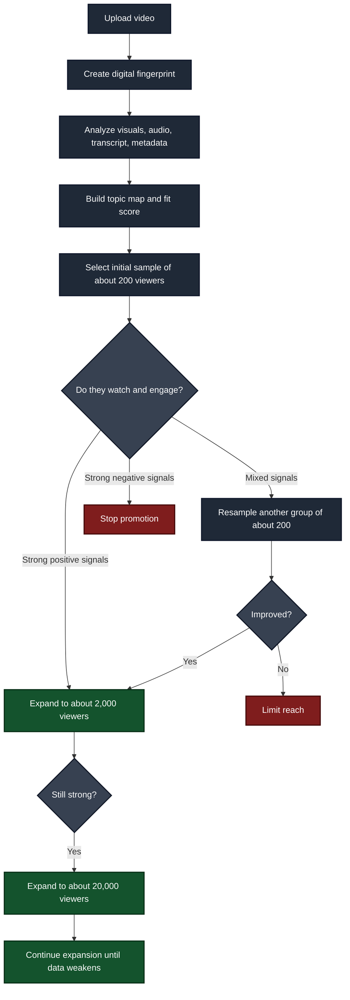

### Step 1: Digital Fingerprinting

The algorithm analyzes your video using computer vision to understand what is visually happening, audio analysis to capture what is said and the tone, and metadata such as captions, hashtags, and your creator history. It combines this into a topic map that summarizes what your video is about at multiple levels.

### Step 2: Fit Score Calculation

Based on the topic map, the algorithm predicts which types of viewers are most likely to enjoy the video. This is a mathematical score that ranks active users by predicted interest. The more consistent your channel topic has been, the more accurate this score becomes. A channel that jumps between unrelated topics creates a muddy average that confuses the algorithm.

### Step 3: Initial Sample of About 200 Viewers

The algorithm selects the top users from its fit score ranking. Most of these viewers are non-followers. The algorithm already knows your existing followers are likely to watch. The real test is whether strangers also engage. This is why follower count matters less than ever. A small channel with a clear topic can outperform a large channel with a confused identity.

### Step 4: Data Evaluation

The algorithm measures three core metrics from this sample:

| Metric | What It Measures | Why It Matters |
|---|---|---|
| Average watch time in seconds and percentage completion | How long viewers stay before clicking away | Direct measure of satisfaction. Longer watch time signals valuable content that holds attention. |
| Engagement rate: likes plus comments plus shares divided by views | How many viewers take action beyond passive watching | Indicates emotional impact and community building potential. |
| Watch time session share | Percentage of a viewer's total session spent on your content | Measures how influential your channel is in keeping people on the platform. |

If these metrics are strong, the algorithm expands to about 2,000 people, then 20,000, then 200,000, and so on. If the data is weak, the algorithm either resamples a different group or stops promoting entirely.

### Why Videos Eventually Slow Down

Even a viral video reaches a saturation point where most people who would enjoy it have already seen it. The algorithm continues to expand until engagement drops below a threshold, at which point it stops pushing. This is natural and not a sign of failure. It simply means your video has found its full audience.

<br>

## Section 3: The Two-Part Strategy to Work With the Algorithm

Knowing how the testing process works reveals what you need to do. There are two main levers you can pull to help the algorithm push your videos. Everything else is secondary.

### Lever 1: Help the Algorithm Build an Accurate Fit Score

The fit score is only as good as the data the algorithm has about your channel. If you post about different topics for different audiences every time, the algorithm cannot predict who will like your next video. Its fit score becomes a muddy average, and the sample group it selects will be a mix of unrelated viewer profiles. That sample will likely produce weak engagement data, and your video will underperform.

The solution is audience matching. Make videos about the same few topics for the same specific audience repeatedly. After three to five videos on a consistent theme, the algorithm learns who your content is for. It builds a history of successful sample groups and becomes more confident in its fit score. When you post your next video, the algorithm selects a more relevant sample group, those people engage strongly, and the boosting cycle begins.

**Practical example of audience matching.** A channel that makes three videos about productivity for freelance designers will train the algorithm more effectively than a channel that makes one video about tech, one about cooking, and one about fitness. The first channel gets more consistent growth because the algorithm always knows who to show the next video to. The second channel confuses the algorithm with every upload and stays stuck at low view counts regardless of video quality.

**The consistency trap.** Many creators hear consistency and think they need to upload every Monday, Wednesday, and Friday without fail. This is the wrong kind of consistency. The most important consistency is topic consistency, not upload schedule. The algorithm does not care if you upload every three days or every three weeks. It cares whether your content serves the same audience each time. A focused channel that uploads twice a month will often outperform a scattered channel that uploads daily.

### Lever 2: Make the Sample Group Engage

Even with a strong fit score, your video will not get pushed unless the sample group watches and interacts. The algorithm measures engagement through three primary metrics. Understanding these metrics at a deep level allows you to design content that triggers them naturally.

| Metric | What It Measures | Why It Matters |
|---|---|---|
| Average watch time and percentage completion | How long viewers stay before clicking away | Direct measure of satisfaction. Longer watch time signals valuable content. |
| Engagement rate | Likes plus comments plus shares divided by views | Shows emotional impact and community building potential. |
| Watch time session share | Percentage of a viewer's total session spent on your content | Measures how influential your channel is in keeping people on the platform. |

To improve these metrics, your content must deliver on four specific attributes covered in the next section. Each attribute directly targets one or more of these metrics, creating a complete system for algorithmic success.

<br>

## Section 4: The Four Attributes of High-Engagement Content

High-performing videos across many platforms share four non-negotiable attributes. If your video has these four qualities, the sample group will engage strongly, and the algorithm will push your content to larger audiences.

| Attribute | What It Means | Which Metric It Helps |
|---|---|---|
| Relevance to the ideal viewer's core problem or desire | The topic directly addresses something your target audience genuinely cares about | Watch time, engagement, session share |
| Non-obvious, tactically implementable information | Viewers learn something new and can apply it immediately | Engagement, saves, shares |
| High absorption | The content is explained in simple language with clear examples and visual aids | Watch time, completion rate |
| Short distance to implementation | The viewer can act quickly and see a result soon after watching | Completion rate, saves, shares |

### Attribute 1: Relevance to the Ideal Viewer's Core Problem or Desire

The topic of your video must directly address something your target audience genuinely cares about. This sounds obvious, but many creators make videos about what they want to talk about, not what their audience needs. Spend time researching the questions, frustrations, and aspirations of your specific viewer. Use social listening, read comments on competitor channels, and study forum discussions in your niche. When your topic aligns with a real pain point or desire, engagement becomes easier because viewers feel the video was made for them.

### Attribute 2: Non-Obvious, Tactically Implementable Information

Viewers have seen generic advice thousands of times. Phrases like "be consistent" or "work hard" do not drive engagement because they provide no new value. What drives engagement is new information presented in a way viewers can immediately apply. For example, instead of saying "improve your thumbnails," say "use this specific free tool to create a three-color contrast thumbnail that increased my click-through rate." The more specific and actionable your insights, the more viewers will watch, save, and share your content.

### Attribute 3: High Absorption

You can have valuable information, but if you deliver it in confusing, jargon-filled, or disorganized ways, viewers will click away. High absorption means using simple language, clear examples, analogies, and visual aids. Break complex ideas into small logical steps. Repeat key points. Use on-screen text to reinforce spoken words. When viewers feel they genuinely understand what you are teaching, satisfaction and engagement increase because cognitive load is reduced.

### Attribute 4: Short Distance to Implementation

Viewers are more likely to engage with content that promises a quick win. The distance between watching your video and seeing a result should be as short as possible. A video titled "Change these three settings on your phone to improve video quality in five minutes" has a short implementation distance because the viewer can act immediately. A video titled "The ten-year journey to becoming a master filmmaker" has a long distance that feels overwhelming. Short implementation distance leads to higher completion rates, more saves, and more shares.

<br>

## Section 5: Advanced Tactics for Comments and Reach

Comments are one of the strongest engagement signals because they require active effort. A like is passive and takes less than a second. A comment requires typing, thinking, and committing to a public statement. The algorithm therefore weights comments more heavily than likes. The following tactics can increase comment volume without using desperate engagement bait.

### Tactic 1: Take a Clear, Unambiguous Stance

People comment when they strongly agree or, more often, when they disagree. If you present both sides neutrally, you give viewers no reason to engage. Pick a clear position on your topic. State it confidently. For example, instead of saying "some people like X and some like Y, here are the pros and cons," say "X is better than Y for this specific use case, and here is why." This invites discussion and debate.

### Tactic 2: Choose the Contrarian Side When Appropriate

Most people hold majority opinions. When you take the opposite stance, you create tension. Many viewers will disagree, and disagreement drives comments because people like to debate. Be careful not to be inflammatory or offensive. Challenge popular beliefs in your niche with evidence and reasoning. Contrarian content often gets shared and remembered because it breaks the pattern of expected opinions.

### Tactic 3: Amplify Your Stance With Clear Framing

Once you have your stance, increase its intensity through word choice. Compare "This is a good way to edit videos" with "This editing method is more efficient than most tutorials on YouTube." The second statement is stronger and will provoke a clearer reaction. Viewers who agree will comment their support. Viewers who disagree will explain why. Both drive comments.

### Tactic 4: Build Topics Around Cult-Loved Brands, People, or Movements

People already have strong opinions about certain entities: Apple versus Android, Nike versus Adidas, Marvel versus DC, specific influencers, or cultural movements. When you create content that involves these pre-loaded emotional triggers, viewers are faster to comment because they already have a position. For example, a video titled "Why Apple's new privacy feature affects small creators" will generate more comments than a generic video about smartphone privacy because Apple fans and critics both have something to say.

### Tactic 5: Position Your Take to Drive Emotion

Emotion, whether anger, excitement, surprise, or sadness, fuels engagement. Review your script and ask: does this make the viewer feel something strongly? If not, rewrite. Use storytelling techniques such as tension, stakes, and personal vulnerability to create emotional investment. Viewers who feel something are more likely to comment because emotion creates a natural desire to express and share that feeling.

<br>

## Section 6: The AI Era Rules: Authenticity, Disclosure, and Policy

YouTube has changed significantly. The platform is no longer just a video repository. It is an answer engine powered by artificial intelligence, competing for viewer attention against TikTok, Netflix, and traditional television. Recent policy changes have tightened rules around mass-produced content, AI disclosure, and deceptive practices.

For creators, old strategies like keyword stuffing, uploading daily low-effort content, or relying only on search traffic no longer work as well. What matters now is authenticity, viewer satisfaction, and building genuine authority around a specific topic.

### Old Mindset Versus New Reality

| Old YouTube Mindset | New YouTube Reality |
|---|---|
| Optimize only for search and tags | Optimize for browse, suggested feeds, and viewer intent |
| Upload frequently to please the algorithm | Upload consistently to train the algorithm on your audience |
| Focus on click-through rate alone | Focus on viewer satisfaction and retention |
| Use AI to automate entire channels | Use AI as a tool to enhance human creativity |
| Rely on subscriber count for reach | Rely on topical authority and interest matching |
| Chase viral moments | Build an evergreen content library |

### The Inauthentic Content Policy

YouTube has tightened its rules against mass-produced and repetitive content. The policy targets content that is mass-produced or repetitive, videos made from templates with little variation, and content that is easily replicable at scale without meaningful human input.

Examples of content that can be flagged include videos composed solely of text-to-video AI clips, automated voiceovers over stock images with no original insight, batch uploading large quantities of low-effort AI material, near-duplicate content across multiple videos, slideshows or scrolling text with minimal narrative commentary, and content that simply reads text from websites without adding value.

Channels with large audiences have been terminated for creating AI-generated fake movie trailers or fake stories that caused public confusion. The message is clear: AI as a tool is allowed. AI as your entire creative process is not.

### C2PA and SynthID: Invisible Watermarks

YouTube has joined an alliance with Adobe, Microsoft, and OpenAI to implement C2PA, the Coalition for Content Provenance and Authenticity. C2PA stamps a permanent history log into video files, similar to a VIN number on a car, showing what edits were made and whether AI tools were used. SynthID embeds an invisible watermark into pixels and audio waveforms. This watermark is detectable by YouTube's systems and cannot be removed without violating terms of service.

If you use AI voiceovers from services that generate synthetic speech, AI-generated images, or AI-written scripts, check the "altered content" box in YouTube Studio when uploading. Failure to disclose can turn a demonetization issue into a termination for deceptive practices. Cloning your own voice is generally allowed and may not require disclosure. Using stock AI voices may require disclosure. AI as a tool for brainstorming, editing assistance, or research is fine. AI as a replacement for your creativity is not.

### Safe and Risky Uses of AI

| Safe AI Use | Risky AI Use |
|---|---|
| Brainstorming video ideas and titles | Fully automated script, voiceover, and stock footage with no human editing |
| Drafting scripts that you rewrite in your own voice | Mass-producing ten or more identical videos per day |
| Cleaning up audio and color grading | Faking real events or people without disclosure |
| Generating thumbnail concepts that you edit manually | Using AI to clone a celebrity's voice without permission |
| Translating and dubbing content into other languages | Uploading AI content that misleads viewers about real events |

<br>

## Section 7: Niche Selection: Finding a Profitable Lane

Many new creators fail because they choose the wrong niche. They either pick a saturated topic where they cannot compete, or they pick a niche that is being actively suppressed by YouTube's authenticity policies. The following table lists niches that currently carry higher risk and niches that remain viable for sustainable growth.

| Higher-Risk Niches | Why They Are Risky | Viable Niches | Why They Work |
|---|---|---|---|
| AI-generated motivation quote slideshows | Mass-produced, identical content, low human value | Personal finance and investing | High CPM, evergreen demand, authority builds trust |
| Generic AI tool tutorials | Over-saturated market, repeated information | Health and longevity for specific demographics | Specific audience, lower competition, high search intent |
| Reddit story voiceovers with gameplay | YouTube has flagged this format for reuse policy issues | AI automation for small business owners | Specific problem solving, high conversion potential |
| AI-generated fake movie trailers | Deceptive practices, copyright issues, legal risk | Fishing, hunting, outdoor skills, EV ownership | Untapped markets, high curiosity, lower competition |
| Faceless celebrity news with fake quotes | Misleading metadata, impersonation, legal risk | Psychological self-mastery | Broad appeal within a structured framework, high retention |
| Meditation with stock music | Not original enough for monetization approval | Travel guides with personal storytelling | Authentic experience, loyal community, evergreen value |

### The Concept of Niche Bending

Instead of inventing a completely new topic from scratch, one of the fastest growth strategies is niche bending. Niche bending means applying a proven viral format from one market to a different market. For example, the format "This video will change the way you see X forever" originated in sports commentary and was successfully adapted into gaming, spirituality, and even gardening content. The format works because structural curiosity is portable.

To find niche bending opportunities, search for small channels with unusually high views for their subscriber count. Then ask three questions. What format are they using? Which market is underserved by that format? How can I create my own version with my unique expertise? The goal is not to copy but to adapt a proven structural pattern to a new context where it has not been seen before.

Important update: copying videos from creators inside your own niche is increasingly risky. YouTube uses AI to compare new videos with existing content and can assign a similarity score. The more similar your video is to content already on the platform, the worse it may perform. Adapt formats from unrelated niches and add your own value.

### Actionable Steps for Niche Selection

1. Avoid broad topics like "fitness" or "make money online." Go hyper-specific: "fitness for software engineers working from home" or "make money online for teachers during summer break."
2. Use YouTube autocomplete and keyword tools to find long-tail keywords with low competition.
3. Check whether the top-ranking videos for your chosen keyword use the exact phrase in their titles. If not, that is an opportunity.
4. Ensure you have genuine experience or a unique perspective. YouTube's E-E-A-T framework, which stands for Experience, Expertise, Authority, and Trust, rewards creators who have actually done what they talk about.
5. Test a small series of three to five videos on the same topic before judging results.

<br>

## Section 8: Modern YouTube SEO: What Still Works

Search engine optimization on YouTube has changed. Tags are less important than they once were. Descriptions matter, but not as much as they used to. Titles and the actual spoken words in your video are now among the most important signals because YouTube's AI can transcribe and analyze your entire audio track.

### The KVS Framework: Keyword, Video, SEO

This framework consists of three steps that should be executed in order for maximum effectiveness.

#### Step 1: Keyword Research

Find a long-tail keyword with low competition, decent search volume, and no other video using that exact phrase in its title. Low competition means there are not big channels ranking everywhere for this keyword. Good search volume means people are actually searching for it. No matching keyword means there is a gap you can fill. Use a keyword tool or YouTube autocomplete to find these opportunities. Start with a broad term, then drill down to specific opportunities.

#### Step 2: Video Creation

Watch the top three to five ranking videos for that keyword all the way through. Identify what they missed or what they could have done better. Read the comments section for each video to find feedback from actual viewers about what they wished the video had included. Then create a video that is better, clearer, more detailed, or more entertaining than what is currently ranking. Ensure your video answers the searcher's question within the first sixty seconds so both human viewers and AI systems recognize its relevance.

#### Step 3: SEO Optimization

Place the exact keyword at the beginning of your title. Write a description of at least 300 to 500 words, with the keyword near the top and several related keywords woven naturally throughout. Use chapters, either automatic or manual, so AI can index individual sections. Add the keyword to your tags, but understand that tags have minimal impact compared to titles and spoken content. The effort you put into tags should be minimal.

### The New Role of AI Citation

AI assistants increasingly cite YouTube videos in answers. Some videos cited by AI assistants have relatively low view counts. This means YouTube is becoming a primary source for AI-generated answers, and smaller channels can be cited if they optimize correctly. To increase your chances of being cited by AI systems, create long-form videos between ten and twenty minutes in length. Add detailed chapter markers that clearly outline the structure of your content. Write descriptions exceeding 500 words with specific names, dates, and locations. Upload a corrected transcript because auto-captions are often wrong.

### What No Longer Works for SEO

| Tactic | Why It No Longer Works Well | What to Do Instead |
|---|---|---|
| Keyword stuffing in tags or descriptions | Against guidelines and can lead to penalties | Use natural language and clear descriptions |
| Naming your video file with the keyword | Minimal measurable impact | Do it if convenient, but do not rely on it |
| Using the same title structure every time | Can look repetitive or spammy | Vary titles while keeping clarity |
| Posting at a specific time to please the algorithm | Viewer habits matter more than a global clock | Upload when the video is ready |
| Hashtag stuffing | Minimal signal and possible spam penalty | Use three to five relevant hashtags |

<br>

## Section 9: Storytelling and Retention Engineering

Even with strong SEO and a good thumbnail, a video will fail if viewers click away within the first thirty seconds. Retention is now more important than click-through rate alone because retention directly measures satisfaction. Viewers who watch all the way through tell the algorithm that your content delivered on its promise.

### The Dance Between Context and Conflict

Good stories alternate between context, which is what is happening, and conflict, which is a problem or obstacle. Write your script using the words "but" and "therefore" instead of "and then." For example, instead of saying "we built a shelter and then a storm came and then we worked faster," say "we built a shelter, but a storm was coming, therefore we had to work faster." This creates causation and tension.

### The Storytelling River

Imagine your video as a river with stepping stones. The viewer is walking across those stones. Each stone is a piece of information, whether a visual, a line of dialogue, or a sound effect. If you miss a stone, if you skip a logical step the viewer needs to understand what comes next, the viewer falls into the river and stops watching. To prevent this, make every transition clear. Show, do not just tell. If you mention going to a new location, show the journey. If you teach a concept, provide an example. If you introduce a term, define it.

### Tension and Stakes

Viewers stay when they are uncertain about the outcome and when there are consequences for failure. A stake is the cost of not achieving something. Even in educational videos, you can create stakes. For example, say "if you do not understand this concept, you could lose money in your investments." That creates a stake that makes the viewer pay attention. The highest retention occurs when tension is introduced early and resolved near the end, with the core message delivered at the climax.

### Hook Optimization

In long-form videos, you have approximately thirty seconds to hook the viewer before they decide whether to stay or leave. In Shorts, you have approximately three seconds. Your hook must do two things at once. First, it must confirm the promise of the title and thumbnail. Second, it must be punchy and indicate the plot. Avoid vague openings like "wait till you see this." Use a visual hook whenever possible by showing an intriguing image on screen while you speak.

### Retention Checklist

| Element | Question to Ask | Action |
|---|---|---|
| Hook | Does the first 30 seconds confirm the title and thumbnail? | Rewrite until it does |
| Context | Does the viewer understand what is happening? | Add clear explanations |
| Conflict | Is there a problem or obstacle? | Introduce tension early |
| Pacing | Are there slow sections? | Cut or add value refills |
| Climax | Is the main takeaway delivered clearly? | Place it near the end |
| Ending | Does the video resolve the tension? | Close the loop |

<br>

## Section 10: Publishing Checklist: Dos and Don'ts

Use this checklist before publishing every video to ensure you are working with the algorithm, not against it. These guidelines are based on platform policy, creator experience, and common failure patterns.

### The Dos

| Area | Do This | Why |
|---|---|---|
| Topic | Narrow your topic and audience consistently across multiple videos | Trains the algorithm to identify who your content is for |
| Packaging | Lock in your title and thumbnail before you film | Packaging should drive the content, not the other way around |
| Clarity | Create a clear, curiosity-driven thumbnail and title | Viewers must understand what they will gain by watching |
| File name | Name your video file to match your target title or include primary keywords | Takes seconds and provides additional metadata |
| Description | Write a detailed description of 300 to 500 words | Helps search and viewer understanding |
| Chapters | Add manual chapters to your description | Helps indexing and navigation |
| Hook | Deliver on your title and thumbnail promise within the first thirty seconds | Viewers decide whether to stay quickly |
| Script | Use causal logic with "but" and "therefore" | Creates tension and open loops |
| End screen | Direct viewers to one specific related video | Reduces decision fatigue |
| Playlists | Add every video to a relevant playlist | Increases session time and discovery |
| Comment | Pin a comment on every video | Encourages discussion |
| Community | Respond to genuine comments, especially in the first 24 hours | Early engagement matters |
| Stance | Take a clear stance when appropriate | Drives comments and emotional engagement |
| Devices | Watch your video on mobile and TV before publishing | Ensures text and audio work across devices |

### The Don'ts

| Area | Do Not Do This | Why |
|---|---|---|
| Audience | Share your video with friends or family who are not your target audience | They may hurt retention by watching briefly and leaving |
| Self-viewing | Watch only a portion of your own video immediately after publishing | Low average view duration can send negative signals |
| Buying engagement | Buy views, subscribers, or likes | Confuses the algorithm and violates terms of service |
| Deletion | Delete underperforming videos too quickly | Videos can gain traction later |
| Thumbnails | Change thumbnails and titles repeatedly on a small channel | You cannot measure impact without significant data |
| Trends | Chase viral trends outside your core topic | Confuses your audience fit score |
| AI use | Use AI to generate entire scripts or voiceovers without disclosure and editing | Violates policy and often produces low-quality output |
| Analytics | Obsess over analytics in the first 24 to 48 hours | Data is not statistically meaningful yet |
| Comments | Delete negative comments manually one by one | Use blocked words and moderation settings instead |
| Upload | Upload directly to public visibility | Use unlisted or private first to allow processing and checks |

### Quick Reference Summary

| Do This | Avoid This |
|---|---|
| Narrow, consistent topic focus | Sharing videos with untargeted friends or family |
| Complete packaging before filming | Watching your own video partially |
| Manual chapters with keywords | Deleting underperforming videos |
| 300 to 500 word keyword-rich descriptions | Buying views or subscribers |
| One specific end screen video | Frequent thumbnail or title changes |
| Playlist links in descriptions | Chasing off-topic viral trends |
| Pinned comments on every video | Using AI to generate full scripts without editing |
| 24-hour unlisted processing | Obsessing over posting time |
| Mobile and TV device testing | Obsessing over early analytics |

<br>

## Section 11: Building a Sustainable Business

Short-term tricks do not create long-term success. The creators who consistently work well with the algorithm are those who build systems around the principles in this guide. The road ahead requires discipline, patience, and a shift from "going viral" to "serving an audience."

### The Reinvestment Flywheel

The most successful creators often reinvest early earnings into better equipment, better thumbnails, hiring editors, and improving production quality. This creates a cycle: better quality attracts more views and more revenue, which allows more reinvestment. Even small creators can reinvest a modest amount into a better microphone or a freelance thumbnail designer. The flywheel works at every scale.

### Monetization Diversification

Ad revenue varies widely by niche. Finance and investing can pay much more per thousand views than entertainment and comedy. Successful creators rarely rely solely on ads. They layer multiple revenue streams for stability and growth.

| Revenue Stream | How It Works | Best For |
|---|---|---|
| YouTube ad revenue | Revenue share for long-form and Shorts | Passive income once you have consistent views |
| Affiliate marketing | Promote products with unique links and earn a commission per sale | Any niche, especially tech, beauty, and fitness |
| Sponsorships | Brands pay for integrations | Channels with engaged audiences |
| Digital products such as courses and ebooks | Highest margin, sells your expertise | Educational niches like finance, health, productivity |
| Channel memberships | Viewers pay monthly for perks | Channels with loyal, community-focused audiences |
| Merchandise | Physical products with your branding | Channels with a strong personal brand identity |

Monetization thresholds can change. If your plan depends on watch hours or subscriber requirements, verify the current rules in YouTube Studio before making decisions. Platform updates have changed watch-hour requirements in the past, and program rules can vary by region and format.

### The Portfolio Mindset

Every video you post adds to your catalog of content. Think of your channel as a portfolio of assets, not a feed of random posts. If you focus on making evergreen videos that are timeless and can be enjoyed now or in several years, you are building a library that people can discover and binge at any time.

When a new viewer discovers one of your videos and likes it, they will click on your channel to see what else you have. If they find a back catalog of dozens or hundreds of videos on topics they care about, they will binge. This binge behavior is a strong signal of satisfaction and triggers the algorithm to recommend your channel more often. Unlike most social media where most views come in the first few days, YouTube will keep recommending your videos for years if they are good enough.

<br>

## Section 12: Common Myths and Wasted Efforts

Many creators waste time on tactics that have little or no impact on algorithmic distribution. The table below separates fact from fiction based on platform statements and analysis of thousands of channels.

| Myth or Wasted Effort | Why It Does Not Work Well | What to Do Instead |
|---|---|---|
| Optimizing posting time | The algorithm serves content based on individual viewer habits, not a global clock | Focus on content quality and topic relevance. Upload when the video is ready. |
| Hashtag stuffing | Hashtags provide minimal signal compared to the algorithm's topic mapping | Use three to five highly relevant hashtags. Spend time on thumbnails and hooks. |
| Keyword-stuffed descriptions | YouTube's AI now reads the spoken words in your video. Overstuffing violates guidelines | Write natural, helpful descriptions. Put your primary keyword near the top. |
| Changing thumbnails and titles repeatedly on small channels | Without significant impressions, you cannot measure impact | Be confident in your packaging before publishing. Improve the next video. |
| Buying views or subscribers | Botted accounts have random watch histories that confuse the fit score | Grow organically through consistent quality and clear topics. |
| Copying viral videos exactly | The algorithm already knows that format and has saturated that audience | Use viral videos as inspiration. Apply formats to different markets or add a unique perspective. |

<br>

## Section 13: Protecting Your Channel: Policy Compliance

YouTube has updated its policies to target low-quality, mass-produced, and deceptive content. Ignorance of these rules is one of the biggest reasons channels get terminated. Below is a summary of the most critical policy areas.

### Likeness Detection and Deepfakes

YouTube offers a likeness detection tool for creators in the Partner Program. You can upload a government ID and a short video of your face. YouTube can then scan uploaded videos across the platform to detect if your face or voice has been synthetically used without permission. You can request removal of deepfake content that uses your likeness.

Prohibited actions include creating AI-generated content that makes a real person appear to say or do something they never did, even for parody unless it is obviously fake. Using AI to clone a celebrity's voice without explicit permission is prohibited. Generating fake news or misinformation about sensitive topics such as elections, health crises, or natural disasters is prohibited and can lead to immediate termination.

### Critical Compliance Areas

| Policy Area | What to Watch For | Action |
|---|---|---|
| Altered content disclosure | Using AI voice, AI images, or synthetic media | Check the "altered content" box when applicable |
| Deepfakes and likeness | Using another person's face or voice without permission | Obtain permission or do not publish |
| Misinformation | Fake news about elections, health, or disasters | Do not publish misleading content |
| Inauthentic content | Mass-produced, repetitive, low-effort AI content | Add meaningful human input and original value |
| Copyright | Using music, clips, or images without rights | Use licensed or original assets |
| Monetization rules | Watch-hour and subscriber thresholds can change | Verify current requirements in YouTube Studio |

As of late 2026, transparency rules around AI content are active in several regions. If you use AI tools, disclose appropriately and keep records of how AI was used. When in doubt, check YouTube Studio and the official policy pages before publishing.

<br>

## Section 14: Future-Proofing Your Channel

The next twelve to twenty-four months will bring more AI integration, stricter enforcement of authenticity policies, and shifting viewer habits. Here is how to stay ahead and build a channel that survives changes.

### AI as a Tool, Not a Replacement

YouTube is not banning AI. It is banning channels where AI does everything with no human input. Your unique perspective, voice, face, and lived experience are your moat against automation. AI cannot replicate genuine human experience.

Safe AI uses include brainstorming video ideas and titles, drafting scripts that you then rewrite in your own voice, cleaning up audio and color grading, generating thumbnail concepts that you then edit manually, and translating and dubbing your content into other languages. Dangerous AI uses include fully automated script plus voiceover plus stock footage uploads with no human editing, mass-producing ten or more identical videos per day, and faking real events or people without disclosure.

### The Shift From Search to Discovery

As search traffic becomes a smaller share of total views for many channels, your focus must shift to browse and suggested feeds. This means creating titles and thumbnails that stop a scroller, not just match a search query. Study the homepage and suggested feeds of your target audience by using a separate viewer account trained on your niche.

### Long-Form Versus Shorts

Shorts are useful for discovery but usually generate less revenue than long-form. They can also take attention away from long-form if your audience becomes used to short content only. The best strategy is to use Shorts as trailers or highlights that link to your long-form video through the related video feature. Do not run Shorts and long-form on the same channel unless your content is highly consistent in theme and style. Consider a separate channel for Shorts if your long-form content requires deeper attention.

### The Main Opportunities Ahead

| Opportunity | What It Means | Practical Action |
|---|---|---|
| Multi-format creator ecosystems | YouTube on mobile and TV are becoming different viewing environments | Build one audience across short-form and long-form. Clip long-form into Shorts and link back. |
| YouTube as an e-commerce platform | Product integration and shopping features are expanding | Build trust with a specific audience. Recommend products you genuinely use. |
| Televisation of YouTube | Recurring shows, episodes, and formats matter more | Turn successful video styles into series and playlists. |
| Global-first creator | Automatic dubbing and captions reduce language barriers | Design ideas that work across cultures. Use dubbing and captions. |
| TV-optimized viewing | More long-form viewing happens on televisions | Make text readable on TV and ensure audio works without visual context. |
| AI-assisted production | AI speeds up research, editing, and translation | Use AI for support, not replacement. Disclose when required. |

### The Importance of Mental Resilience

Many creators quit before their twentieth video. The period between algorithm tests, sometimes called the valley of death, can last weeks or months. During this time, keep creating, keep improving, and avoid obsessing over analytics that do not yet have statistical significance. Success is exponential, not linear. One video can change everything, but you have to be there when it happens.

<br>

## Addendum A: 30-Day Launch Checklist for New Creators

Use this day-by-day checklist to launch a new channel or revive a struggling one.

| Day | Focus Area | Specific Actions | Success Metric |
|---|---|---|---|
| 1 to 2 | Channel foundation | Set up channel as a personality name, not a brand name. Write a 500+ word About section. Add links to off-platform profiles. Upload a channel trailer. Turn off third-party AI training if desired. Set upload defaults to unlisted. | All settings complete |
| 3 to 5 | Niche and keyword research | Use keyword tools or YouTube autocomplete to find 10 long-tail keywords with no exact title match. Select 3 as your first video topics. Verify search volume and competition. | List of 3 viable keywords |
| 6 to 10 | Video 1 production | Write script using "therefore" and "but" structure. Create a hook that delivers on the title promise within 30 seconds. Film with clear audio and varied visuals. Edit for pacing. Design a high-contrast thumbnail. | Video file rendered |
| 11 | Upload and optimize | Set video to unlisted. Add title with exact keyword near the front. Write a 300 to 500 word description. Add 3 to 5 hashtags. Add chapters. Check altered content if using AI voice or images. Add an end screen. | Video processed in HD |
| 12 | Publish and engage | Switch to public. Post to the Community Tab. Do not share with friends or family who are not your audience. Do not watch your own video partially. Respond to comments within the first 6 hours. | First 24-hour view count recorded |
| 13 to 16 | Analytics check | After 48 hours, check CTR and average view duration. Record what to improve but do not change this video yet. | Data recorded in a spreadsheet |
| 17 to 30 | Repeat for Videos 2 and 3 | Follow the same process. Implement one improvement from analytics each time. Aim to complete 3 videos in the first 30 days. | 3 published videos with improving metrics |

<br>

## Addendum B: Troubleshooting Flowchart: Why Your Video Is Not Getting Views

Use this decision tree to diagnose low-performing videos instead of guessing.

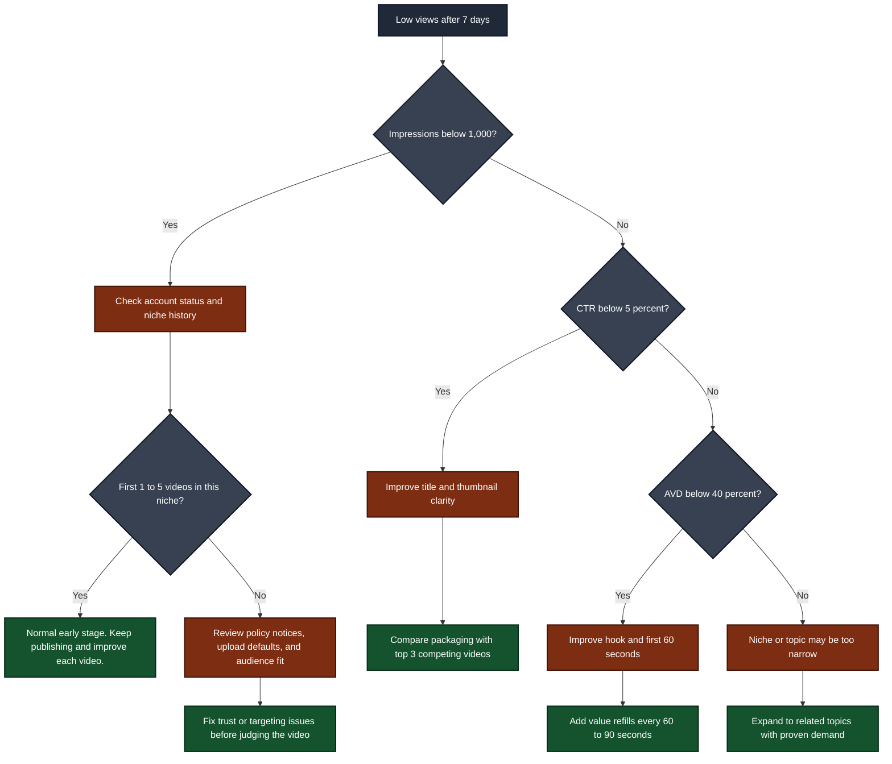

### How to Read This Flowchart

Start at the top with your video's performance after 7 days. Follow the arrows based on your actual data. Orange nodes identify the problem area. Green nodes provide the recommended action. Do not skip steps. The flowchart is designed to remove guesswork by forcing you to check specific metrics in sequence.

### Important Notes

- A true shadowban is rare. First check YouTube Studio for policy notices and community guidelines strikes. If none appear, focus on packaging, audience fit, and content quality.
- Value refills are moments of entertainment, insight, or surprise that reset the viewer's attention. Add them every 60 to 90 seconds.
- If your niche is too small, even a great video will have limited reach. Use YouTube autocomplete or keyword tools to find related topics with higher search volume, then create a video that bridges your niche to that broader topic.

<br>

## Addendum C: Weekly Content Audit Template

Use this template every Sunday to review each video you published during the previous week. Copy it into a spreadsheet or document and fill it out systematically.

**Video Title:** _________________________

**Publish Date:** _________________________

### Performance Metrics After 7 Days

| Metric | Value | Target |
|---|---|---|
| Impressions | ___________ | Track trend over time |
| Click-through rate | ___________ | Above 5 percent from browse features |
| Average view duration | ___________ | Above 50 percent of video length |
| Total views | ___________ | Compare to channel average |
| Likes | ___________ | Track ratio to views |
| Comments | ___________ | Quality over quantity |
| Shares | ___________ | High shares indicate strong emotion |
| Watch time from browse and suggested | ___________ percent | Higher is better. Target above 60 percent. |

### Diagnostic Questions

1. Did the title and thumbnail accurately reflect the content? Yes or no.
2. Did viewers drop off in the first 30 seconds? Check the retention graph.
3. What was the most rewatched section? Do more of that if valuable, or clarify if confusing.
4. What was the biggest drop-off point? Identify the timestamp and review what you were saying or showing.
5. Did any comment provide actionable feedback? Look for specific suggestions, questions, or requests.

### One Thing to Improve on Next Video

Be specific. Instead of "make better content," write something like "add a visual hook in the first 5 seconds" or "cut the intro from 45 seconds to 20 seconds."

<br>

## Addendum D: Script Structure Template for 8 to 12 Minute Videos

Use this template to write your next script. Fill in the bracketed placeholders with your specific content.

**Title:** [Exact keyword phrase] plus [curiosity hook]

### Hook: First 30 Seconds

- Confirm the promise: "In this video, I am going to show you [specific benefit from title]."
- Preview value: "By the end, you will know [3 specific takeaways]."
- Create a stake: "If you do not [action], you will [negative consequence]."

Example: "In this video, I am going to show you three settings on your phone that will improve your video quality. By the end, you will know how to adjust exposure, frame rate, and focus lock. If you do not learn these settings, your videos will keep looking amateur no matter how much you spend on equipment."

### Context and Conflict: Minutes 1 to 6

- Context 1: What viewers need to know first.
- But or therefore: A problem or obstacle that interrupts the context.
- Context 2: How you solved it or what you learned.
- But or therefore: The next problem or deeper insight.

Each "but" or "therefore" creates an open loop that keeps viewers watching. Aim for at least three to four cycles of context and conflict before the climax.

### Value Refills: Every 60 to 90 Seconds

- Insert a quick tip, a surprising fact, a joke, or a personal story.
- Change the visual or background music briefly to reset attention.
- Ask a rhetorical question to re-engage the viewer.

Examples: "Here is a trick most creators never learn." "I remember when I made this exact mistake." "This next part is where most people get it wrong."

### Climax and Resolution: Minutes 6 to 10

- Deliver the core answer or the most valuable takeaway.
- Resolve the tension introduced in the hook.
- Restate the stake and show how the viewer benefits from applying what they learned.
- Use a strong visual or memorable phrase so the climax sticks in the viewer's mind.

### Call to Action: Last 30 Seconds

- "Watch this next video to learn [related topic]."
- Use an end screen element that links directly to that video.
- Do not ask for likes or subscribes in the final moments. That request belongs earlier in the video or as a mid-roll mention.

Example: "Now that you know how to fix your settings, the next step is learning how to light your shots like a pro. Click the video on your screen to continue."

<br>

## Addendum E: Glossary of Key Terms

| Term | Definition |
|---|---|
| Algorithm | YouTube's system that decides which videos to recommend to which viewers. It is code that tests and learns from viewer behavior. |
| AVD: Average View Duration | The average amount of time viewers spend watching your video. Higher is better. |
| Browse features | The YouTube homepage and suggested video sidebar. Many views now come from these areas. |
| C2PA | A technology that stamps a history log into video files, showing whether AI tools were used in creation. |
| CTR: Click-Through Rate | The percentage of people who saw your thumbnail and clicked to watch. |
| Engagement rate | Calculated as likes plus comments plus shares divided by views. |
| Evergreen content | Videos that remain relevant and useful for months or years. |
| Fit score | A prediction of how likely a specific viewer is to enjoy your video. |
| Gemini | Google's artificial intelligence system that helps analyze YouTube videos and viewer context. |
| Good abandonment | When a viewer leaves your video because they got the answer they needed, not because they were bored. |
| Hook | The first 30 seconds of a long-form video or first 3 seconds of a Short. |
| Impressions | The number of times your video thumbnail was shown to a viewer. |
| Inauthentic content | YouTube's policy term for mass-produced, low-effort content that provides little human value. |
| KVS Framework | Keyword, Video, SEO. A three-step ranking strategy. |
| Niche bending | Applying a proven viral format from one topic area to a different, underserved topic area. |
| Retention | How long viewers watch your video, measured as a percentage of the video completed. |
| Sample group | The first group of viewers the algorithm shows your video to. |
| Satisfaction | YouTube's primary ranking factor. Measures whether viewers felt their time was well spent. |
| Seed audience | Same as sample group. The initial viewers used to test a video's performance. |
| Session time | The total minutes a viewer spends on YouTube after watching your video. |
| SynthID | Google's invisible watermark embedded into AI-generated pixels and audio. |
| Topical authority | When YouTube sees your channel as an expert on a specific topic because you consistently cover it. |

<br>

## Conclusion

YouTube algorithms are not mysterious systems designed to punish small creators. They are logical systems designed to increase viewer satisfaction. When you understand the testing process, the fit score, and the engagement metrics that matter, you stop guessing and start strategizing.

The formula for success is simple, though not easy. Pick a specific audience. Serve them consistent value on a narrow set of topics. Optimize every video for retention and emotional engagement. Avoid the myths and shortcuts that waste time. Focus on great content for a defined audience, not on tricks. The algorithm will do the rest.

Your audience is out there, waiting for what you create. They just have not found you yet. Keep showing up. Keep improving. Every video is a new opportunity, and with the right system, you improve your odds. The only way to lose is to quit before the algorithm has enough data to understand your value.

<br><br><br><br>

<h1 align="center">THE COMPLETE BLUEPRINT TO A SUCCESSFUL INSTAGRAM JOURNEY IN THE AI ERA.</h1>

<br><br>

 
## Table of Contents

<br>

1. [Understanding the New Instagram Landscape](#1-understanding-the-new-instagram-landscape)
2. [Phase One: Foundation Building (Weeks 1-4)](#2-phase-one-foundation-building-weeks-1-4)
3. [Phase Two: Content Creation and the Iteration Engine (Weeks 5-8)](#3-phase-two-content-creation-and-the-iteration-engine-weeks-5-8)
4. [Phase Three: Growth Acceleration (Weeks 9-12)](#4-phase-three-growth-acceleration-weeks-9-12)
5. [Phase Four: Monetization and Sustainable Scale](#5-phase-four-monetization-and-sustainable-scale)
6. [AI Integration: Working Smarter, Not Harder](#6-ai-integration-working-smarter-not-harder)
7. [The 90-Day Action Plan](#7-the-90-day-action-plan)
8. [Common Pitfalls and How to Avoid Them](#8-common-pitfalls-and-how-to-avoid-them)
9. [Conclusion: The Mindset Shift](#9-conclusion-the-mindset-shift)
10. [Appendix: Quick Reference Tables](#10-appendix-quick-reference-tables)
11. [Flowcharts](#11-flowcharts)

<br>

## 1. Understanding the New Instagram Landscape

### 1.1 The Algorithm Is Not Your Enemy

The most fundamental shift in perspective required for Instagram success is understanding what the algorithm actually is and what it does. Every social media platform has one primary business goal: maximize the time users spend on the platform. Longer sessions mean more ad impressions, which means more revenue. To achieve this, platforms invest billions in algorithms that predict what content each individual user will enjoy most.

The algorithm is essentially a matchmaker. It constantly tries to connect each viewer with the videos that will keep them watching. It does not have a personal vendetta against small creators. It does not care about your subscriber count, your upload frequency, or your production budget. It only cares about whether the people who see your content actually watch, enjoy, and stay on the platform afterward. When your content performs well with a test audience, the algorithm learns that your content is valuable and expands its reach. When your content performs poorly, the algorithm stops promoting it to protect the viewer experience.

Understanding this shifts your entire content philosophy. Instead of trying to trick the algorithm with hashtags, posting times, or secret hacks, you focus on one thing: creating content that a specific group of people will genuinely love. The algorithm is not your enemy. It is a distribution engine that rewards relevance and satisfaction. Your job is to make its job easy by being clear about who your content is for and delivering value that keeps people watching.

### 1.2 The Signal Era vs. The Volume Era

A critical historical understanding separates successful creators from those who remain stuck. For years, the prevailing advice was to post as much as possible because Instagram operated on a chronological feed. More posts literally meant more chances to be seen. This was the Volume Era.

Then the environment changed. TikTok rewired everything. Reach stopped being about who follows you and became about what the algorithm decides to push. Following turned into matching. Then AI flooded the feed with infinite cheap identical content, so the algorithm could suddenly afford to be ruthless. It stopped counting your posts and started grading them.

We left the Volume Era. We are in the Signal Era now.

Volume used to be the signal. Now volume is just noise. Every low-effort post you push out just to hit a number teaches the algorithm that this account makes average content. Quietly, it limits your next post. That is what we call the Quantity Debt, and paying it back in lost reach is expensive.

The fix is not posting more, and it is not even posting less. It is posting with intention and iteration.

### 1.3 The Invisible Growth Phase

Here is the truth that most creators never accept: success on Instagram is rarely immediate. Growth is like planting a tree. You do not harvest fruit the next morning. Roots must grow first, establishing a foundation underground where nobody can witness it. Yet most creators upload their first video, refresh analytics every hour, compare themselves to established channels, and quit before their twentieth post.

The statistics are sobering. Most creators quit before their twentieth post. They quit not because they lack talent, but because they misunderstand the platform's timeline. The algorithm needs time to gather data, test your content with different audiences, and figure out who will actually enjoy what you make. This process is measured in weeks and months, not hours and days.

Your job during this invisible growth phase is not to force results. It is to keep building roots. Every post you make strengthens your foundation. Each viewer who watches is water nourishing your channel. Every comment is sunlight helping it grow. The hard part is not being able to see the fruits until later. But they will come if you persist.

### 1.4 Key Algorithm Signals

Based on the most recent data and expert analysis, the Instagram algorithm prioritizes the following signals:

| Signal | Importance | What It Means For You |
|--------|------------|----------------------|
| Watch Time | Highest | The longer people watch, the more the algorithm pushes your content. Focus on retention. |
| Shares | Very High | Shares are the strongest indicator of value. Content that gets shared reaches new audiences. |
| Saves | High | Saves indicate that your content is valuable enough to revisit. |
| Comments | Medium-High | Meaningful comments signal engagement quality. |
| Likes | Medium | Likes matter but are less impactful than other signals. |

Key Insight: According to Adam Mosseri, Head of Instagram, watch time is actually the most valuable signal. Shares are also disproportionately powerful because they introduce your content to entirely new networks.

The algorithm does not just reward objectively good content anymore. It actually rewards content that satisfies strangers. If you are stuck and seeing 70-80% of your views coming from your followers, this is what happens behind the scenes: when you post a reel or carousel, Instagram tests it with a small group of people who do not follow you. If they skip, the algorithm concludes that people who do not know this creator just do not care, and your reach dies there.

The number one problem and the easiest fix: create content built for a stranger who could not care less about you. The question should never be, "Is my content good?" The question should be, "Does my content work for somebody who has never seen me before?"

<br>

## 2. Phase One: Foundation Building (Weeks 1-4)

### 2.1 Choosing Your Niche: The Who and The What

Your niche is comprised of two elements: the who (your target audience demographics, struggles, pain points) and the what (the specific topic or content you will create). The more specific you can get, the better. The riches are in the niches.

Why niching down is non-negotiable on Instagram: Instagram creates an account embedding on your profile, meaning they categorize your account under one topic. If you are posting about makeup, skincare, and lifestyle, Instagram will never be able to categorize your account properly and show your content to the right people. This is why people posting lifestyle content on Instagram have such a hard time growing.

How to choose your niche: Pick what you are most passionate about, what you have most experience in, or simply what is most fun to you, something you can see yourself sticking to for the next few years.

The Niche Definition Formula:

| Element | Question | Example |
|---------|----------|---------|
| Industry | What topic? | Skincare |
| Audience | For whom? | Women over 40 |
| Promise | What result? | Simplified routines that work |

Example: "Simplified skincare for women over 40" or "At-home fitness for busy moms."

### 2.2 Setting Up Your Profile for High Conversion

Your follower conversion rate is the percentage of people who decide to follow you after visiting your profile. If 100 people visit your profile, you want as many as possible to press that follow button. If zero people follow you, something about your profile is off and needs fixing.

The PBC Framework for Profile Optimization:

| Element | What It Means | Action Steps |
|---------|---------------|--------------|
| Positioning | What type of content? For whom? | Define your niche clearly |
| Branding | Visual communication | Profile photo, username, name plate |
| Clear Bio + CTA | Why follow? What next? | Value statement + call to action |

Positioning: You must know the answers to two questions. What type of content will you create? Who is your content for? If you cannot clearly answer these, Instagram's algorithm will struggle to connect your content to the right people. Instagram themselves have confirmed this. They build account embeddings to identify which accounts are topically similar. The algorithm first assigns a topic to your profile. If they cannot identify one topic for you, you will likely post for years with very slow traction.

Branding:

- Profile Photo: Clear representation of you with great lighting. Match it to your niche if possible (for example, running gear for a running account).
- Username: Simple, easy to remember, easy to spell. Does not have to be niche-specific.
- Name Plate: This is the bold section of your profile and is the most searchable part. Use keywords that people might type into the search bar to find you. Example: "Millie | Running for Beginners."

Clear Bio + Call to Action:

- Line 1 (Niche Statement): "I help [who] with [what]." Example: "Helping beginner runners start their journey with practical tips and daily motivation."
- Line 2 (Context/Value): Qualifications, experience, or what you help people achieve.
- Line 3 (Credibility/Mission): Background, mission statement, or what makes you unique.
- Line 4 (Call to Action): What you want them to do next. Follow, send a direct message with a keyword, or click the link.

The Unique Edge: Define your unique edge, the one-sentence follow-worthy promise that differentiates you from other creators. What result or transformation can you guarantee? Example: "Helping anyone turn content creation into a career in 12 months or less."

### 2.3 The Content Bank: Never Run Out of Ideas

Stop guessing what your next reel is going to be. There is no need to come up with content ideas yourself from scratch. Here is what to do instead:

1. Go to the Instagram search bar and enter your topic.
2. Scroll through the reels and search for anything with over 1 million views.
3. Hit save and create a save folder called "Content Pool."
4. Repeat until you have at least 20 proven viral reels in that folder.

This does two things. It gives you a variety of proven ideas to choose from, and it signals to Instagram your interest in this topic so you keep getting suggestions of similar viral reels on your explore feed.

For content research, look for three things:

1. The topic being discussed
2. The hook that was used
3. Any other patterns you notice

Pro Tip: When doing content research, look for the best view-to-follower ratio in addition to video recency. A video with 19 million views from a creator with 19 million followers is less impressive than a video with 1 million views from a creator with 10,000 followers. The latter indicates a breakout moment you can learn from.

### 2.4 The First 15 Posts: Building Your Storefront

Before you announce your account or worry about growth, you need to post 15 times. The goal of these 15 posts is not to grow your following just yet. The goal is simply to have something to look at so that when people find your page, there is actual content to consume.

Of those 15 posts, create three specific types:

| Post Type | Purpose | Example |
|-----------|---------|---------|
| About Me | Tell your audience who you are | Your story, mission, why you created this account |
| About Your Offer | What you are selling or what the account is about | Services, products, or content purpose |
| Quick Win | Something immediately valuable | A tip, hack, or piece of entertainment that exemplifies your content |

Pin these three posts to the top of your profile in that order.

Then, create 14 additional posts (not posted yet, but ready to go) before moving to launch. This ensures you have a buffer and do not get stuck on the hamster wheel of creating and posting every single day.

<br>

## 3. Phase Two: Content Creation and the Iteration Engine (Weeks 5-8)

### 3.1 The Iteration Engine: The Core Growth Mechanism

This is the single most important concept for sustainable Instagram growth. It works exactly like evolution. Evolution does not work by throwing out something random every generation and hoping it survives. The things that survive are the ones that take what already worked and build on it. Tiny improvements over and over on top of what was already winning.

Random change is death. Iteration is growth.

The Winners Loop:

1. A post wins (you will know what a win is: higher views, more engagement than your average).
2. What is the next idea this post unlocks for you?
3. Make that next one.
4. It feeds the loop.

A winner is not finished. It is a signal to go again. Your audience and the algorithm both want more of what just worked. When a post hits, extend it three ways:

1. Go deeper: Zoom into the one slide, line, or moment people reacted to most. Make the whole next post about just that.
2. Go adjacent: What is the next thing someone who loved this would want? Same world, next door.
3. Make it repeatable: Can it become a repeatable format, not a one-off? If yes, you have found a series.

One winner can win a month's content. In a month's time, you can do it again but change it slightly, adding more knowledge you have learned.

### 3.2 The Best of Nine Strategy

This is a practical framework for finding your winning format and identifying one specific content idea that works for you:

1. Select three reels from your content pool folder. Choose based on what you feel most comfortable recreating and what you are actually capable of recreating.
2. Recreate and post each of these three formats three times, giving you a total of nine reel posts.
3. Analyze which reels perform the best. Look for reels with the highest view count (for fast growth, focus on views rather than likes, shares, or saves for now).
4. Compare the top three reels. What do they have in common? Similarities could be based on audio, caption, format, hook, title on screen, or visuals.
5. Reuse that pattern and keep posting what works best.

### 3.3 The Hook: Your Single Most Important Element

The hook is beyond doubt the most important element. Spend 80% of your time, energy, and effort on just those first three seconds.

Here is where things have recently changed. Most people think a hook needs to sound like a hook: clever, catchy, attention-grabbing. But people have seen so many hooks that they have developed a shield against them. Being clever does not really work anymore. Being loud and obnoxious does not work either.

What actually works: A hook that does not sound like a hook at all. It sounds like someone just started talking to you like a friend, or like you overheard something very interesting. It slips right past the shield. The stranger who sees your video for the first time does not want to feel marketed to. They want to feel like they stumbled onto something real.

Hook Layering: Layer multiple types of hooks within the first three seconds of your video:

- Text Hook: Text that appears on screen at the beginning.
- Audible Hook: What someone hears at the beginning.
- Visual Hook: What the person actually sees.

If you can implement all three really well, you have mastered the art of short-form content.

The 5-5 Rule: Think about five different elements that appear on the screen within the first five seconds of your reels. These elements could include graphics, photos, text, different fonts, and so on. This forces you to ensure the first five seconds are as visually engaging and hooky as possible.

### 3.4 Posting Frequency: Quality and Consistency

Research consistently shows a positive correlation between posting frequency and growth. Higher volume generally produces more reach and follower growth. However, there is a practical ceiling: the frequency you can sustain without sacrificing quality or experiencing burnout. If you cannot sustain a frequency, if you burn out, if you miss days or weeks at a time, you will not grow. You have to have a sustained and consistent frequency in order to reap the benefits.

Posting 3 to 5 times per week is the optimal frequency for most creators. Accounts at this frequency grow followers twice as fast and see 12% more reach per post.

The Content Sprint Model:

- Creator Sprint (30 to 90 days): Post daily or near-daily to train the algorithm and build momentum.
- Maintenance Phase: Post 1 to 2 times per week to nurture your audience without burnout.

### 3.5 Content Formats: Choosing Your Weapons

| Format | Best For | Key Stat |
|--------|----------|----------|
| Reels | Reaching new audiences (growth) | 36% more reach than other formats |
| Carousels | Deepening engagement with existing audience | 12% more engagement than other formats |
| Single Image | Aesthetic branding | Lower reach and engagement |
| Stories | Nurturing followers, building relationships | Seen primarily by existing followers |

Recommendation: 75% reels, 25% carousels during early growth stages.

Trial Reels: If you have access to trial reels (available at 1,000+ followers), use them strategically. Trial reels are automatically pushed to new people. You can post up to 5 to 25 trial reels per day. Treat them as a testing tool. Post old content, test different hooks, and experiment without affecting your main grid.

<br>

## 4. Phase Three: Growth Acceleration (Weeks 9-12)

### 4.1 Analyzing Your Data: The Pattern Recognition Phase

Most people look at their analytics the wrong way. They check one reel and say, "This flopped, let's not do this again," and move on. What you should really do is zoom out and look at the big picture and the patterns.

Three things to analyze:

1. Which pieces of content got you the most views? Write them down and identify patterns.
2. Which pieces of content got you the most followers? These may be different from the ones that got the most views.
3. Which content completely flopped? This is actually the most valuable data because it tells you what not to do.

The Optimization Process:

1. Sort by follows to see what drove follower growth.
2. Sort by shares to see what reached new audiences.
3. Sort by lowest performance to see what to stop doing.
4. Identify your top two formats and double down on them.

Key Insight: The goal is to spot patterns. Maybe there is one type of reel you create where the comment depth is a lot higher, where you get really deep comments as opposed to just emoji responses. That is a signal.

### 4.2 The Repost and Repurpose System

Most people do not realize that over two-thirds of posts from top creators are upcycled. The average person sees 10,000 posts a day. They do not remember your post from two months ago, and they probably did not even see it in the first place.

The Repost System (Takes 1 minute per day):

1. Identify your top performing reels from the last 30 days.
2. Post them as-is to trial reels.
3. Repeat every month.

The Repurpose System (Takes 10 minutes per day):

1. Identify your top performing reels and carousels from the last 2 to 6 months.
2. Think about elements to make them better. The easiest is changing and upgrading the hook.
3. Create an updated version and post to your main feed.
4. A few weeks later, post to trial reels as well.

Repurposing a Reel to a Carousel: Some creators have gotten remarkable results just doing this. Literally take the same content and format it as a carousel.

### 4.3 The Credibility Layer: Production Quality

Many creators think short-form content needs to be raw and authentic, and it does. But people often confuse raw and authentic with bad lighting, cluttered backgrounds, terrible audio, and things that just feel off.

You do not need an expensive camera. Your phone is most likely good enough. You just need to spend an hour or two thinking of ways to make things look good and purposeful.

The Simple Lighting Trick:

1. Turn off your actual room light.
2. Put up a video light or use a big window.
3. Turn on some practical lights in the background.

The same camera, the same iPhone, but it looks 100 times better. Suddenly your hook is going to land so much harder because people will give you the benefit of the doubt. You look like somebody doing this with a purpose.

### 4.4 Collaboration and Cross-Promotion

Collab posts represent less than 3% of all posts on Instagram, yet they are consistently the best performing kind of post. Collabs take two audiences and combine them into one, essentially doubling your potential number of viewers.

Who to collaborate with:

- Creators in a similar niche (does not have to be exact).
- Similar amount of engagement (average views, not necessarily followers).
- Even competitors. All ships rise together.

How to find collaboration partners:

- Search niche hashtags for creators whose content aligns with yours.
- Use Instagram's suggested accounts feature.
- Check who your audience already engages with.
- Use influencer discovery tools.

Cross-promotion methods:

- Add your Instagram link to your website footer, email signature, and other social media bios.
- Include your Instagram handle in product packaging.
- Use your Instagram QR code at networking events and webinars.

<br>

## 5. Phase Four: Monetization and Sustainable Scale

### 5.1 Direct Message Automation: The Game Changer

The biggest difference maker for monetization on Instagram is direct message automation. Traditional promotion has been "click the link in my bio," which tells people to leave your post, go somewhere else, and go through a multi-step process. It is confusing and low-converting.

The DM Automation Alternative:

1. Include a call to action in your content: "Comment the word [keyword] and I will send you [resource]."
2. When someone comments, they get sent a DM automatically with the resource.
3. This increases engagement (comments), which leads to more views, creating a positive feedback loop.
4. You can see who clicked, who opened, and follow up manually.

The Follow-to-DM Feature: Automatically DM people who follow you. Use it to welcome new followers, introduce yourself, share a hyper-relevant freebie, or segment your audience by asking what they are interested in.

Key Tools: ManyChat is the most popular and trusted DM automation tool. It is an officially approved partner that meets weekly with Meta.

### 5.2 The Monetization Pathways

Pathway 1: External Monetization

- Selling digital products, courses, physical products.
- Having an online store.
- Building a business outside of social media that you can eventually sell.

Pathway 2: Client Work and Brand Deals

- Leverage your page to get paid partnerships.
- Some creators make $50,000 or more for a single post with major brands.
- Brand deals can be six-figure opportunities.

Pathway 3: Platform Bonuses

- Facebook pays the most for views.
- YouTube is the highest-paid platform overall.
- Reels bonuses, TikTok bonuses, and similar programs provide passive income from doing what you are already doing.

### 5.3 The Email List: Your Safety Net

Views and followers are not going to help you build something sustainable if you cannot convert them. The real game changer is getting people on your email list, because you own that audience, not Instagram.

The System:

1. Create a freebie (guide, template, checklist) that your audience wants.
2. Attach it to your videos once or twice a week.
3. Use DM automation to deliver it when people comment a keyword.
4. People get added to your email list.
5. Send valuable emails and occasional offers.

The Beauty of This System: If you create a reel with a freebie that truly hits what people want, the reel will not stop growing. Some reels are still generating comments and still collecting leads six to eight months after they were posted.

Prioritize Your Own Offers: Your own products and services will always be more valuable and profitable than anything a sponsor could ever pay you. Once you have your own offers, you can stop chasing brand deals.

<br>

## 6. AI Integration: Working Smarter, Not Harder

### 6.1 The AI Opportunity

AI is not here to replace your creativity. It is here to replace the blank page feeling and the "What am I supposed to post about?" spiral. AI helps you work smarter and faster, generating ideas and saving you hours of time.

Best Uses for AI in Your Instagram Workflow:

| Task | AI Tool | Benefit |
|------|---------|---------|
| Idea Generation | ChatGPT, Trend Assist AI | Never run out of content ideas |
| Script Writing | Stanley for Instagram, ChatGPT | Scripts in your brand voice with hooks and CTAs |
| Carousel Creation | Trend Assist AI | Generate entire carousels from simple prompts |
| Caption Writing | ChatGPT, Brockbot | Captions with hooks, body, and CTAs |
| Hashtag Research | Buffer Hashtag Generator | Relevant hashtags in seconds |
| Analytics Analysis | Stanley for Instagram | Understand what is working and what is not |

### 6.2 AI Prompts for Every Stage

For Defining Your Brand:

"I am a [profession/niche]. I help [specific audience] with [specific problem]. You should listen to me because [unique qualification or perspective]."

For Content Ideas:

"Based on my outperformers in my industry, can you generate 10 new reel ideas for me that will help reach new followers and grow my audience?"

For Scripting:

"Can you script this out so I could film it today? Include a hook, the beats the video will hit, visual cues, and a call to action."

For Analytics Analysis:

"Based on my analytics over the past 30 days, can you figure out what is working and what is not so that I know what to lean into over the next 30 days that will drive more followers?"

### 6.3 AI-Powered Tools for Creators

Stanley for Instagram: A personal AI coach that analyzes your actual Instagram profile and content to understand your strategy needs. It shows you high-performing videos in your niche, scripts versions for you in your voice, and generates fresh ideas based on your outperformers.

Trend Assist AI: Generates trending ideas and helps you create carousels with proven hooks and storytelling frameworks. It has specialized AI assistants for each social media platform.

The Brockbot: A generative chatbot trained on real Instagram strategies from an expert, not generic internet data. Less than half the price of ChatGPT.

<br>

## 7. The 90-Day Action Plan

### Month 1: Ideation (Weeks 1-4)

| Week | Focus | Key Actions |
|------|-------|-------------|
| Week 1 | Define Your Brand | Choose niche, identify audience, craft mission statement |
| Week 2 | Set Up Profile | Optimize bio, name plate with keywords, profile photo, pinned posts |
| Week 3 | Build Content Bank | Search and save 20+ proven viral reels, create content calendar |
| Week 4 | Create First Posts | Post 15 times (including About Me, About Offer, Quick Win), create 14 additional drafts |

Month 1 Mindset: Give yourself permission to be messy. The point is to start. Get in the habit of filming, editing, and posting. Start figuring out what posting consistency is realistic for you.

### Month 2: Creation (Weeks 5-8)

| Week | Focus | Key Actions |
|------|-------|-------------|
| Week 5 | Content Research | Analyze outperformers, identify hook styles and formats |
| Week 6 | Batch Creation | Script, film, and edit in batches. Create 10 to 20 videos. |
| Week 7 | The Best of Nine | Post 9 reels (3 formats x 3 times each), analyze performance |
| Week 8 | Iteration | Double down on what is working, cut what is not |

Month 2 Mindset: Get 1% better at each part of the creative process: ideation, content research, filming, editing, posting. Leverage analytics to understand what to lean into.

### Month 3: Optimization (Weeks 9-12)

| Week | Focus | Key Actions |
|------|-------|-------------|
| Week 9 | Deep Analytics | Sort by follows, shares, views. Identify patterns. |
| Week 10 | Winners Loop | Extend winning posts three ways (deeper, adjacent, repeatable) |
| Week 11 | Repost and Repurpose | Post top performers to trial reels, repurpose reels to carousels |
| Week 12 | Signature Series | Launch a repeatable series based on your best-performing content |

Month 3 Mindset: Cut what is not working. Double down on your top two formats. Create a signature series that people will come back for.

<br>

## 8. Common Pitfalls and How to Avoid Them

### 8.1 The Comparison Trap

The Mistake: Comparing yourself to creators who have come before you, especially their outcomes: how fast they grew, how many followers they have, how much engagement they are getting.

The Fix: Use other creators for inspiration, not comparison. Look for gaps in the market you can fill. Understand that success takes months or years, not days. The average growth rate for a small brand on Instagram is about 8% per month.

### 8.2 Quitting Too Early

The Mistake: Posting for a few weeks, not seeing results, and giving up. Most creators quit before their twentieth post.

The Fix: Commit for at least six months to a year of consistent effort. The algorithm needs time to gather data, test your content with different audiences, and figure out who will enjoy what you make.

### 8.3 Buying Followers or Using Shortcuts

The Mistake: Buying followers, using follow-unfollow tactics, or joining engagement pods to artificially boost numbers.

The Fix: Fake followers do not engage, which lowers your engagement rate and can trigger Instagram penalties. Focus on organic growth that compounds over time. A small but engaged audience is far more powerful than a large and unaware audience.

### 8.4 Making Your Account About Too Many Things

The Mistake: Posting about fashion, travel, and fitness all on one account. This confuses the viewer, makes it impossible for the algorithm to categorize you, and complicates your content creation.

The Fix: Pick one core topic and go all in. You can always broaden out later once you have established your presence.

### 8.5 Over-Editing and Overthinking

The Mistake: Spending hours editing every single post, trying to make it perfect, and overanalyzing every detail.

The Fix: Stop trying to make every post perfect. Most people end up in a middle ground where they have horribly performing content but have spent time editing it. Embrace the raw, the imperfect, the authentic. Just press post.

<br>

## 9. Conclusion: The Mindset Shift

### 9.1 The Real Goal

The goal was never really about posting less or posting more. The iteration engine, looping your winners, protecting the gap: that is just what taking control actually looks like. The moment you stop racking up quantity debt, throwing content at the wall every day, you get the space to actually understand your own audience.

You learn what your people respond to. You build on it. Slowly, you stop needing the gurus. You stop chasing the trends. You stop needing anyone's permission because you have become the expert on your own content. That is the real goal here. Not three posts a week, not 100 posts a day. Independence.

### 9.2 The Activity Over Outcome Mindset

Every winner and every loser have the same goals. Your goals do not make you unique. It is the activities that you do that make you unique. The goal of the winner is to commit to the activities. The goal of the loser is to commit to the goal.

Count uploads, not views. Count uploads, not followers.

If you can divorce the activities from the outcome, then you can focus on the doing. Whether your income goes up or down over that period of time, your self-esteem remains the same because you are committed to what you can control.

### 9.3 The Decade Mindset

Most people think in days. They want results in 90 days. But the reality is that it takes years to build something meaningful. When you think in decades, the time will pass no matter what. But if you make the action the goal, "Did I make the post? Did I do the reach outs every day?", then you are a success regardless of the outcome.

The Question to Ask Yourself: If someone could promise you that you would grow an insane amount if you actually committed for 100 days, would you do it?

### 9.4 Your Call to Action

Instagram growth is 0% luck and 100% strategy. The platform is giving everyone an equal chance to go viral. If you use these strategies, you can absolutely be seen by millions of people, even starting from zero followers.

Start today. Pick your niche. Set up your profile. Create your content bank. Post your first 15 posts. And then keep going.

The more you post, the more you grow. But more importantly, the more you learn. Every post is data. Every view is feedback. Every comment is a connection. Build the system, trust the process, and the results will follow.

The journey of a thousand followers begins with a single post. Press post.

<br>

## 10. Appendix: Quick Reference Tables

### A.1 The Complete Instagram Growth Checklist

| Phase | Task | Status |
|-------|------|--------|
| Foundation | Choose one niche (who + what) | ☐ |
| Foundation | Optimize bio with PBC framework | ☐ |
| Foundation | Add keywords to name plate | ☐ |
| Foundation | Create 20+ content bank folder | ☐ |
| Foundation | Post 15 times (with 3 pinned posts) | ☐ |
| Foundation | Create 14 additional drafts | ☐ |
| Creation | Post 9 reels (Best of Nine strategy) | ☐ |
| Creation | Analyze top 3 performing reels | ☐ |
| Creation | Identify winning pattern | ☐ |
| Creation | Implement hook layering | ☐ |
| Creation | Set sustainable posting schedule | ☐ |
| Optimization | Analyze analytics (follows, shares, views) | ☐ |
| Optimization | Double down on top 2 formats | ☐ |
| Optimization | Repost to trial reels | ☐ |
| Optimization | Create signature series | ☐ |
| Scale | Set up DM automation | ☐ |
| Scale | Create freebie/lead magnet | ☐ |
| Scale | Build email list | ☐ |
| Scale | Launch monetization pathway | ☐ |

### A.2 Content Format Comparison

| Format | Reach | Engagement | Effort | Best For |
|--------|-------|------------|--------|----------|
| Reels | Highest (36% more) | Moderate | Medium | New audience growth |
| Carousels | Moderate | Highest (12% more) | Medium | Existing audience engagement |
| Single Image | Lowest | Lowest | Low | Aesthetic branding |
| Stories | Low (followers only) | High | Low | Nurturing relationships |
| Trial Reels | High (non-followers) | Varies | Low | Testing content |

### A.3 Posting Frequency Guidelines

| Frequency | Growth Impact | Sustainability | Best For |
|-----------|---------------|----------------|----------|
| 1-2x/week | Slow | High | Maintenance phase |
| 3-5x/week | 2x faster growth | Medium | Most creators |
| 6-9x/week | Faster growth | Low-Medium | Growth sprints |
| Daily | Fastest | Low | Creator sprints (30-90 days) |

<br>

## 11. Flowcharts

### 11.1 The Complete Instagram Growth System

```mermaid
%%{init: {'theme': 'dark', 'themeVariables': {'primaryColor': '#1e293b', 'primaryTextColor': '#e2e8f0', 'primaryBorderColor': '#475569', 'lineColor': '#94a3b8', 'secondaryColor': '#0f172a', 'tertiaryColor': '#1e293b', 'background': '#0f172a', 'mainBkg': '#1e293b', 'nodeBorder': '#475569', 'clusterBkg': '#1e293b', 'clusterBorder': '#475569', 'titleColor': '#e2e8f0', 'edgeLabelBackground': '#1e293b'}}}%%
flowchart TD
    A[Start: Zero Followers] --> B[Phase 1: Foundation]
    B --> C[Choose Niche: Who + What]
    C --> D[Optimize Profile: PBC Framework]
    D --> E[Build Content Bank: 20+ Viral Reels]
    E --> F[Post 15 Times + Create 14 Drafts]
    F --> G[Phase 2: Creation]
    G --> H[Best of Nine Strategy]
    H --> I[Analyze Top 3 Performers]
    I --> J[Identify Winning Pattern]
    J --> K[The Iteration Engine]
    K --> L[Winners Loop: Extend 3 Ways]
    L --> M[Repost and Repurpose System]
    M --> N[Phase 3: Optimization]
    N --> O[Deep Analytics: Follows, Shares, Views]
    O --> P[Double Down on Top 2 Formats]
    P --> Q[Create Signature Series]
    Q --> R[Phase 4: Scale and Monetize]
    R --> S[Set Up DM Automation]
    S --> T[Create Lead Magnet or Freebie]
    T --> U[Build Email List]
    U --> V[Launch Monetization Pathway]
    V --> W[Continuous Iteration and Growth]
    
    W --> X[The Algorithm Rewards You]
    X --> Y[More Reach, More Followers]
    Y --> Z[More Engagement, More Revenue]
    Z --> W
```

### 11.2 The Iteration Engine

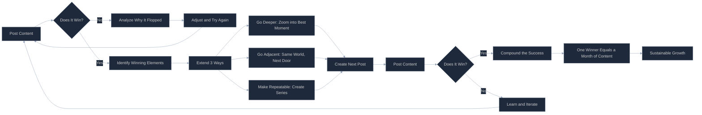

### 11.3 The 90-Day Action Plan

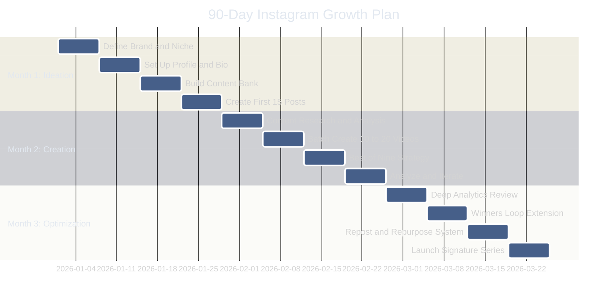
 
<br><br><br><br>


<h1 align="center">THE COMPLETE BLUEPRINT TO A SUCCESSFUL MEDIUM JOURNEY IN THE AI ERA.</h1>


<br><br>

 
## Introduction

Medium has established itself as a unique space in digital publishing. It offers writers something increasingly rare: a built-in audience actively seeking quality content. Unlike traditional blogging, where success often depends on mastering search engine optimization and building traffic from scratch, Medium provides an ecosystem where good writing can find readers without requiring technical expertise.

Yet success on the platform does not happen automatically. By studying writers who have grown from zero followers to thousands, clear patterns emerge. These patterns can be learned and applied by anyone willing to put in consistent effort.

This guide brings together practical insights for building a sustainable Medium presence. It covers everything from setting up your profile to developing multiple income streams. Whether you are publishing your first story or looking to accelerate existing growth, this blueprint provides actionable strategies grounded in how the platform actually works.

The rise of AI writing tools has changed the content landscape. More content exists than ever before. This makes genuine human perspective, lived experience, and authentic voice more valuable, not less. The strategies in this guide reflect this reality.

<br>

## Chapter 1: Understanding Medium as a Platform

### What Medium Is and How It Works

Medium is a social publishing platform where writers create articles and readers discover content matching their interests. The platform was built to prioritize quality writing and meaningful engagement over algorithmic tricks.

The business model centers on subscriptions. Readers pay approximately five dollars monthly for unlimited access to premium content. This subscription revenue is distributed to writers based on how much engagement their articles generate from paying members. This structure creates a different incentive system than advertising-supported platforms. The focus shifts to creating content that genuinely resonates with readers, because reader satisfaction directly affects writer income.

Medium benefits from strong search engine visibility. Articles published on the platform often rank well in Google search results. This built-in advantage saves writers the months or years typically required to build similar visibility through their own websites.

### The Medium Partner Program

The Medium Partner Program is the primary way writers earn money directly from the platform. To participate, writers must meet several requirements:

| Requirement | Details |
|-------------|---------|
| Medium membership | Active paid subscription |
| Publishing history | At least one story in the last six months |
| Banking information | Valid account in an eligible country |
| Age | At least eighteen years old |
| Follower threshold | One hundred followers |

The one hundred follower requirement serves as a useful filter. It ensures that writers joining the program have demonstrated commitment to building an audience. Reaching this milestone takes effort, but it is achievable within a reasonable timeframe using the strategies in this guide.

Payment comes from engagement metrics. Read time, claps, highlights, and comments from paying members all contribute to earnings. Views from non-members do not generate income. This makes building an internal audience on the platform essential for financial success.

<br>

## Chapter 2: Building Your Foundation

### Setting Up Your Profile

Your profile is your digital storefront. It is what potential followers see when they discover your writing. It needs to convey professionalism and authenticity immediately.

The essential profile elements are straightforward:

| Element | Best Practice |
|---------|---------------|
| Name | Use your real name or a human-sounding alias |
| Biography | State clearly who you are and what you write about |
| Profile photo | Use a clear, professional image of yourself |

Using a real name or realistic alias builds trust. In an era of increasing automation, readers want to connect with actual people. Your biography does not need to be elaborate. A simple statement like "I write about personal finance and building wealth" works perfectly when starting out.

Your profile photo matters significantly. Readers engage more with writers who have clear, professional photos compared to those using default avatars or no image. This simple step signals that you are a real person committed to your craft.

### Publishing Your First Story

Your first story serves one primary purpose: establishing your presence on the platform. It does not need to be perfect. Do not spend excessive time polishing it.

Write a brief introduction explaining who you are, your background, and what topics you plan to explore. This initial story accomplishes several objectives. It shows the platform you are an active user. It gives potential followers a sense of what to expect. Most importantly, it breaks through the psychological barrier of hitting publish for the first time.

### Using Topic Tags Strategically

When publishing stories, Medium allows you to add topic tags that help readers discover your content. These tags function similarly to hashtags on other platforms. Your stories appear on topic pages that new readers browse when they join.

A strategic approach involves using the same two topic tags consistently across your stories. This consistency helps establish your authority in those areas and ensures your content regularly appears on relevant topic pages. You can check how many followers each topic has by looking at the topic follower count in the story composer or searching for topics on the Medium homepage.

Choosing topics with substantial followings increases your potential reach. However, balance this against competition. Highly popular topics have more writers competing for attention. Mid-sized topics often offer better opportunities for new writers to stand out.

<br>

## Chapter 3: Growth Strategies That Work

### The Power of Publications

Publications are among the most effective tools for expanding reach on Medium. Think of them as digital magazines organized around specific themes. When you publish through a publication, your article reaches both your personal followers and the entire follower base of that publication.

Consider the math. A writer with fifteen thousand followers publishing in a publication with six hundred thousand followers immediately multiplies their potential audience. The key is finding publications that align with your niche and writing style.

Many publications welcome new writers and provide submission guidelines on their homepage. The process typically involves submitting your article as a draft to the publication's editors. They review it for quality and alignment with their standards. Once accepted, you become a writer for that publication and can submit future work directly.

For newcomers, publications designed to support new writers offer excellent starting points. These publications exist specifically to help build momentum for writers who have not yet established their own following.

### Mutual Engagement Strategy

Engagement metrics heavily influence how Medium's algorithm distributes your content. The platform uses a tiered distribution system:

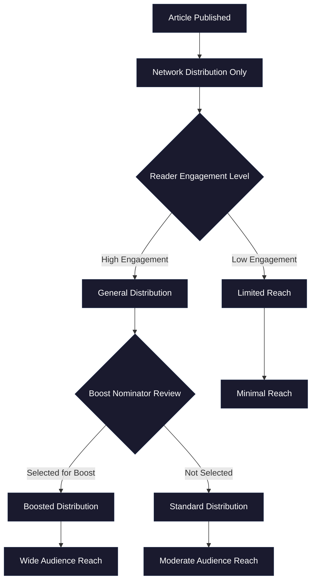

The most effective strategy for jumpstarting this engagement cycle is mutual engagement. Identify a small group of five to ten writers in your niche. Commit to reading, clapping, highlighting, and commenting on each other's stories. This mutual support signals to Medium's algorithm that your content is engaging and worthy of broader distribution.

The hierarchy of engagement value places comments highest, followed by claps and highlights. Prioritize responding to those who comment on your stories. If you are starting from zero, look for recent stories in your topic area and engage with writers who have recently commented. Spread your engagement strategically rather than concentrating on a few accounts.

### Consistency and Frequency

The debate between quality and quantity continues to evolve on Medium. Recent algorithm changes emphasize quality over frequency. However, consistency remains crucial for building momentum and maintaining visibility.

For beginners, publishing one quality article per week strikes an optimal balance. This schedule allows sufficient time for research and thoughtful writing while maintaining a steady presence that keeps you in readers' minds. As you gain experience, you may increase frequency, but starting with a manageable schedule prevents burnout and maintains quality.

Some writers find success publishing multiple articles daily, particularly those treating Medium as their primary income source. The data suggests that sustainable growth comes from consistently creating valuable content rather than flooding the platform with lower-quality pieces.

### Developing Your Voice and Niche

Readers are drawn to authenticity and expertise. While writing about broad topics might seem like a way to reach more people, the most successful Medium writers typically specialize in specific niches where they can establish authority.

Your niche should reflect genuine expertise or passionate interest. Writing from personal experience and knowledge creates content that resonates with readers who share those interests. When readers find value in your perspective, they follow you and engage with future work.

Experiment with different topics in your first fifty to one hundred articles to discover where your voice resonates most strongly. This experimentation phase is essential for identifying your sweet spot, where your expertise and reader interest intersect.

### Headline Writing

Headlines represent your first and often only opportunity to capture attention. In a crowded feed, your headline determines whether someone clicks or scrolls past.

Successful headlines typically fall into two categories:

| Headline Type | Example | Why It Works |
|---------------|---------|--------------|
| Personal experience | "I Tried This Productivity Method for 30 Days" | Creates curiosity, promises a story |
| Actionable advice | "Five Lessons I Learned About Saving Money" | Promises practical value |

You can research successful headlines by visiting major publications and appending "/archive" to their URL. This reveals their top-performing stories. This free tool provides real-time data on what headlines are working in your niche.

<br>

## Chapter 4: After Publishing

### Building Relationships Through Comments

The work does not end when you hit publish. Actions taken after publishing often determine whether an article achieves meaningful reach or languishes unnoticed.

Responding thoughtfully to comments builds two-way relationships with readers. When readers feel heard and valued, they become loyal followers who return to read future work. This engagement also signals to the algorithm that your content sparks meaningful conversation.

Beyond your own articles, actively commenting on other writers' work builds community connections. The writing community on Medium is supportive and collaborative. Those who participate actively often find that support returned when they publish their own work.

### Promoting Your Articles

While Medium provides a built-in audience, strategic promotion on other platforms can accelerate growth. Sharing links to your Medium articles on Twitter, LinkedIn, and other social media drives new readers to your content.

Twitter, in particular, serves as a gathering place for the writing community. Building a presence there connects you with other writers, potential collaborators, and industry professionals who may discover and amplify your work.

### Adapting to Platform Changes

The digital publishing landscape changes constantly, and Medium is no exception. Platform policy changes have historically led to significant fluctuations in earnings and reach. Recent examples include the expansion of the Partner Program to new countries, which coincided with reduced earnings for some established writers.

Rather than viewing these changes as insurmountable obstacles, successful writers treat them as opportunities to adapt and refine strategies. Flexibility and resilience are essential qualities for anyone building a long-term presence on any online platform.

<br>

## Chapter 5: Monetization and Financial Realities

### Income Potential and Realistic Expectations

The financial potential of Medium writing ranges from supplemental income to substantial earnings for top performers. Many successful writers report earnings of one hundred to two hundred dollars monthly, with occasional viral articles generating thousands of dollars.

Geographic location significantly influences how these earnings are perceived. In countries with lower costs of living, Medium income can provide meaningful supplementary revenue. For writers in Western countries, these amounts are often more modest compared to other income opportunities.

Data from successful writers shows that a single viral article can generate significant income for several months, even after initial views decrease. This tail effect means that quality content continues producing returns long after publication.

### Diversification Strategy

No writer should rely solely on Medium as their primary income source. Platform policies can change unpredictably, and algorithm shifts can dramatically impact earnings. Smart writers treat Medium as one component of a broader content strategy that may include their own websites, email newsletters, and other social media platforms.

Building an email subscriber list through your Medium presence creates a direct channel to your audience that is not subject to platform changes. Many successful writers include subscription links in their articles to capture reader contact information.

### Revenue Streams Beyond the Partner Program

While the Partner Program provides direct payment for reading engagement, additional revenue opportunities exist:

| Revenue Source | Potential Scale | Time to Results | Sustainability |
|----------------|-----------------|-----------------|----------------|
| Partner Program | Variable | Short-term | Moderate |
| Affiliate Marketing | Medium | Medium-term | Stable |
| Brand Partnerships | High | Long-term | Reliable |
| Ghostwriting | High | Long-term | Reliable |
| Freelance Writing | Medium | Medium-term | Stable |
| Digital Products | High | Long-term | Sustainable |
| Speaking Engagements | High | Long-term | Occasional |

Affiliate marketing partnerships allow you to recommend products and services relevant to your niche, earning commissions on sales. Brands may reach out directly for sponsored content opportunities. Ghostwriting offers sometimes emerge from your Medium visibility. Freelance writing opportunities often arise from readers who appreciate your style. Speaking engagements and consulting opportunities also develop for writers who establish significant authority.

<br>

## Chapter 6: Common Pitfalls and How to Avoid Them

### The Comparison Trap

One of the most destructive patterns for new writers is comparing their journey to others. A writer who reaches four thousand followers with fourteen articles may not represent a typical trajectory. Comparing your growth to such outliers leads only to discouragement.

Every writer's journey is unique. Some writers see explosive growth from their first article. Others build slowly over months or years. Focus on your own improvement and the value you provide to readers rather than measuring yourself against others.

### Quality Versus Quantity Confusion

The ongoing debate about whether to prioritize quality or quantity often confuses new writers. Both matter, but in different ways at different stages.

For beginners, producing quantity helps develop writing skills and discover what resonates with readers. The more you write, the better you become. As you gain experience, shifting focus to quality becomes increasingly important. A single well-researched, thoughtfully crafted article often outperforms ten rushed pieces.

### Burnout Prevention

Writing consistently without burning out requires sustainable practices. Set a publishing schedule that feels manageable rather than overwhelming. Give yourself permission to take breaks when needed. Write about topics that genuinely interest you rather than chasing trends that drain your energy.

The most successful writers treat their writing as a practice rather than a grind. They find joy in the process, which sustains them through inevitable periods of slower growth.

### Writing for Readers, Not Yourself

A common mistake among new writers is writing for themselves rather than their readers. While it is important to write about topics you care about, the most successful articles address readers' needs, questions, and interests.

This does not mean abandoning your authentic voice. It means finding the intersection between your genuine interests and what readers want to learn about. When your expertise meets reader curiosity, powerful content emerges.

<br>

## Chapter 7: Advanced Strategies for Sustained Growth

### Visual Elements in Storytelling

The visual presentation of your articles significantly impacts reader engagement. Beyond the hero image at the top of your article, incorporating images throughout the text breaks up dense sections, adds visual interest, and improves the reading experience.

When selecting images, avoid the first results that appear on stock photo sites. Scroll deeper to find unique images that readers have not seen repeatedly. This attention to detail makes your articles more memorable and professional-looking.

### Building a Recognizable Brand

Developing a recognizable writing style helps readers identify your work even before seeing your name. This uniqueness might come through your vocabulary, sentence structure, the types of stories you tell, or the perspectives you bring to common topics.

When readers can recognize your voice across articles, they become more loyal followers who actively seek out your content. This brand recognition is particularly valuable in crowded topic areas with many competing voices.

### Leveraging Viral Success

When an article performs exceptionally well, analyze why and double down on those elements. If a particular topic, headline format, or approach resonates, create similar content that builds on that success.

Many writers have found that creating sequels to successful articles, with doubled stakes or fresh perspectives, often achieves comparable success. This iteration approach builds on proven formulas while offering readers new value.

<br>

## Chapter 8: Practical Implementation Guide

### Getting Started Checklist

To begin your Medium journey with confidence, follow this implementation sequence:

```mermaid
flowchart TD
    A[Create Medium Account] --> B[Complete Profile]
    B --> C[Publish Introductory Story]
    C --> D[Join Publication for New Writers]
    D --> E[Build First 100 Followers]
    E --> F[Join Partner Program]
    F --> G[Establish Publishing Schedule]
    G --> H[Create Mutual Engagement Group]
    H --> I[Publish Quality Articles Weekly]
    I --> J[Research Successful Headlines]
    J --> K[Apply Headline Patterns]
    K --> L[Include Images Throughout]
    L --> M[Engage With Commenters]
    M --> N[Analyze Performance]
    N --> O{Article Performing Well?}
    O -->|Yes| P[Double Down on Format]
    O -->|No| Q[Adjust Approach]
    P --> R[Continue Publishing]
    Q --> R
    R --> S[Build Audience Growth]
    S --> T[Monetize Multiple Streams]
    T --> U[Sustained Medium Success]
    
    style A fill:#1a1a2e,stroke:#16213e,color:#ffffff
    style B fill:#1a1a2e,stroke:#16213e,color:#ffffff
    style C fill:#1a1a2e,stroke:#16213e,color:#ffffff
    style D fill:#1a1a2e,stroke:#16213e,color:#ffffff
    style E fill:#1a1a2e,stroke:#16213e,color:#ffffff
    style F fill:#1a1a2e,stroke:#16213e,color:#ffffff
    style G fill:#1a1a2e,stroke:#16213e,color:#ffffff
    style H fill:#1a1a2e,stroke:#16213e,color:#ffffff
    style I fill:#1a1a2e,stroke:#16213e,color:#ffffff
    style J fill:#1a1a2e,stroke:#16213e,color:#ffffff
    style K fill:#1a1a2e,stroke:#16213e,color:#ffffff
    style L fill:#1a1a2e,stroke:#16213e,color:#ffffff
    style M fill:#1a1a2e,stroke:#16213e,color:#ffffff
    style N fill:#1a1a2e,stroke:#16213e,color:#ffffff
    style O fill:#1a1a2e,stroke:#16213e,color:#ffffff
    style P fill:#1a1a2e,stroke:#16213e,color:#ffffff
    style Q fill:#1a1a2e,stroke:#16213e,color:#ffffff
    style R fill:#1a1a2e,stroke:#16213e,color:#ffffff
    style S fill:#1a1a2e,stroke:#16213e,color:#ffffff
    style T fill:#1a1a2e,stroke:#16213e,color:#ffffff
    style U fill:#1a1a2e,stroke:#16213e,color:#ffffff
```

1. Create your Medium account and complete your profile with a professional photo, clear biography, and your real name or a human-sounding alias.

2. Publish your introductory story explaining who you are and what you plan to write about.

3. Apply to join a publication designed for new writers, which provides access to a supportive community and initial readership.

4. Begin building your first one hundred followers through strategic engagement and mutual support.

5. Join the Medium Partner Program once you qualify to begin earning from your writing.

6. Establish a consistent publishing schedule, starting with one quality article per week.

7. Develop a mutual engagement group of five to ten writers who support each other's content.

8. Research successful headlines in your niche and apply those patterns to your articles.

9. Incorporate images throughout your articles for visual appeal.

10. Engage meaningfully with every comment and actively comment on others' work.

### Tools and Resources

Several resources support your Medium writing practice:

| Resource Type | Purpose |
|---------------|---------|
| Medium analytics | Track article performance |
| Stock photo websites | Source free images |
| Publication directories | Find appropriate outlets |
| Archive pages | Research successful headlines |
| Twitter writing community | Networking and collaboration |

### Data Analysis for Continuous Improvement

Regularly reviewing article statistics provides insights into what works and what does not. Pay attention to read ratio, which indicates how many people who click actually read the article. Engagement metrics including claps, highlights, and comments show how readers interact with content. Follower growth patterns reveal whether current strategies are building audience momentum. Revenue data shows which articles generate meaningful income.

```mermaid
flowchart LR
    A[Publish Article] --> B[Track Metrics]
    B --> C[Analyze Read Ratio]
    B --> D[Review Engagement]
    B --> E[Monitor Follower Growth]
    B --> F[Check Revenue]
    C --> G[Identify Patterns]
    D --> G
    E --> G
    F --> G
    G --> H[Refine Strategy]
    H --> A
    
    style A fill:#1a1a2e,stroke:#16213e,color:#ffffff
    style B fill:#1a1a2e,stroke:#16213e,color:#ffffff
    style C fill:#1a1a2e,stroke:#16213e,color:#ffffff
    style D fill:#1a1a2e,stroke:#16213e,color:#ffffff
    style E fill:#1a1a2e,stroke:#16213e,color:#ffffff
    style F fill:#1a1a2e,stroke:#16213e,color:#ffffff
    style G fill:#1a1a2e,stroke:#16213e,color:#ffffff
    style H fill:#1a1a2e,stroke:#16213e,color:#ffffff
```

Use these insights to refine your approach continually. If articles on certain topics perform better, write more about those topics. If particular headlines generate higher click-through rates, apply those patterns to future articles.

<br>

## Chapter 9: Writing in the AI Era

### The Value of Human Perspective

AI writing tools have made content creation easier and faster. This abundance of content makes genuine human perspective more valuable. Readers increasingly seek writing that reflects real experience, original thinking, and authentic voice.

Your personal stories, specific observations, and unique viewpoints cannot be replicated by AI. These elements form the core of what makes your writing worth reading. Lean into them.

### Using AI as a Tool, Not a Crutch

AI can assist with research, editing, and brainstorming. It can help you organize thoughts and catch errors. However, relying on AI to generate entire articles undermines the authenticity readers seek.

Use AI to enhance your writing process while maintaining your voice and perspective. Let it help you work more efficiently without replacing the human insight that makes your work valuable.

### Building Trust in an Automated World

As more content becomes automated, trust becomes a differentiator. Readers want to know there is a real person behind the words. Your profile photo, personal stories, and authentic engagement all build this trust.

Respond to comments personally. Share your real experiences. Engage genuinely with the community. These actions distinguish you from automated content and build lasting relationships with readers.

<br>

## Growth Metrics Reference

| Growth Strategy | Time Investment | Difficulty Level | Expected Results |
|-----------------|-----------------|------------------|------------------|
| Mutual Engagement | Moderate | Easy | Consistent follower growth |
| Publication Submissions | Low | Moderate | Rapid audience expansion |
| Quality Article Focus | High | Challenging | Long-term authority building |
| Viral Content Creation | Variable | Challenging | Exponential growth potential |
| Consistent Publishing | Moderate | Easy | Steady momentum building |
| Headline Optimization | Low | Moderate | Higher click-through rates |
| Community Engagement | Moderate | Easy | Loyal follower base |

<br>

## Conclusion: The Long Game

Success on Medium is not achieved through quick fixes or shortcuts. It results from consistent effort, genuine engagement with your audience, and a commitment to creating value through your writing.

The platform offers unique advantages for writers willing to invest in their craft: a built-in audience of engaged readers, monetization opportunities that reward quality content, and a community of fellow writers who support and encourage each other.

Whether you are writing to build a personal brand, establish expertise in your field, earn supplemental income, or simply share your perspective with the world, Medium provides the tools and audience to support your goals.

Remember that every successful writer started with zero followers and published their first article not knowing whether anyone would read it. The difference between those who succeed and those who give up is simply the willingness to continue writing, learning, and connecting with readers one article at a time.

Your Medium journey is uniquely yours. Focus on your own growth, the value you provide to your readers, and the gradual building of your audience. With patience, consistency, and genuine engagement, you can achieve meaningful success on the platform.


<br><br><br><br>


<h1 align="center">THE COMPLETE BLUEPRINT TO A SUCCESSFUL X/TWITTER JOURNEY IN THE AI ERA. </h1>


<br><br>


## Introduction

Building an audience on X (formerly Twitter) remains one of the most effective ways to establish a personal brand, generate business leads, and create meaningful professional opportunities. The platform has undergone substantial changes in recent years, particularly following Elon Musk's acquisition, rendering many traditional growth strategies obsolete.

This documentation provides a systematic approach to audience development on X, drawing from real-world results and the experiences of creators who have built substantial followings. The focus remains on organic growth, sustainable practices, and creating genuine value for your audience.

Whether you are starting from zero or looking to accelerate existing growth, this guide offers a clear framework for understanding the platform's current dynamics and developing an effective strategy.

<br>

## Chapter 1: Understanding the Modern X Algorithm

### How the Platform Has Changed

The X algorithm underwent a significant transformation in 2024. Understanding these changes is fundamental to developing an effective growth strategy.

#### The Shift from Engagement-Based to AI-Powered Recommendations

Historically, the X algorithm relied heavily on early engagement signals. Posts receiving significant engagement shortly after publication were pushed to more users, while those failing to generate immediate traction were buried.

Under the current system, artificial intelligence reads and evaluates the content of each post. The algorithm assesses substance, quality, and relevance of the content itself rather than relying primarily on engagement metrics. This represents a fundamental shift in how content is distributed.

#### Key Implications for Creators

**Post Timing Matters Less**

Previously, posting when your followers were most active was crucial because early engagement determined whether content would reach a wider audience. With the AI-driven system, content can continue to be distributed for up to 24 hours. This extended window reduces the importance of posting at specific times.

For most creators, optimizing for the perfect posting time is no longer necessary. The exception remains news-based niches where timeliness is inherently valuable.

**Mass-Replying Is Less Effective**

While engaging with other accounts remains valuable, the old approach of mass-replying to boost visibility is less effective. Under the previous system, accumulating replies from established accounts could artificially boost engagement signals. Now, the algorithm evaluates the content itself, making these tactics less impactful.

**Content Quality Has Become Paramount**

The most significant takeaway is that content quality has become the primary driver of reach. The AI system rewards substantive, well-crafted posts that provide genuine value. This shift makes it harder to game the system but creates a more level playing field for creators who focus on producing excellent content.

### Content Trends That Perform Well

#### Media-Rich Content

Posts incorporating images, videos, or screenshots consistently outperform text-only content. Media can increase impressions significantly, even when engagement numbers remain similar. This effect is likely due to increased dwell time, which signals to the algorithm that users find the content valuable.

The key consideration is relevance. Adding media solely for the sake of including it can detract from the post's quality. The most effective approach is making media central to the content's value.

#### Journey and Progress Content

Audiences respond positively to creators who share their journey transparently. Posts documenting progress, whether upgrading equipment, achieving milestones, or learning new skills, generate strong engagement. This content humanizes creators and builds authentic connections with followers.

#### Storytelling

Narrative-driven content consistently outperforms purely informational posts. Stories create emotional engagement and are more likely to be shared. This applies regardless of niche.

#### Spontaneous Creation

Creators who write spontaneously often produce better-performing content than those who overanalyze their posts. When content feels forced, audiences recognize it. The most effective posts often emerge naturally from genuine reactions, real-world insights, or authentic wins.

<br>

## Chapter 2: The Foundational Framework

### The Three-Stage Growth Model

Building an audience on X follows a cyclical process consisting of three primary stages: Traffic, Conversion, and Retention. Understanding each stage and how they interconnect is essential for sustainable growth.

```mermaid
graph TD
    A[Traffic Generation] --> B[Profile Visit]
    B --> C[Conversion]
    C --> D[Follower Acquisition]
    D --> E[Engagement]
    E --> F[Algorithm Boost]
    F --> G[Increased Visibility]
    G --> H[More Traffic]
    H --> A
    
    style A fill:#1a2333,stroke:#4a7fff,color:#ffffff
    style B fill:#1a2333,stroke:#4a7fff,color:#ffffff
    style C fill:#1a2333,stroke:#4a7fff,color:#ffffff
    style D fill:#1a2333,stroke:#4a7fff,color:#ffffff
    style E fill:#1a2333,stroke:#4a7fff,color:#ffffff
    style F fill:#1a2333,stroke:#4a7fff,color:#ffffff
    style G fill:#1a2333,stroke:#4a7fff,color:#ffffff
    style H fill:#1a2333,stroke:#4a7fff,color:#ffffff
```

### Stage One: Traffic Generation

Traffic generation involves getting your content in front of potential followers. For new accounts, this requires strategic effort since organic reach is limited.

#### The Initial Challenge

Starting from zero presents a fundamental problem: you may create excellent content, but nobody will see it without an audience. This creates a situation where you need exposure to build an audience but need an audience to get exposure.

#### Two Primary Traffic Sources

**1. Comments and Replies**

For new accounts, commenting on established creators' content is the most effective traffic generation method. When you contribute valuable comments, you become visible to audiences that already exist in your niche.

The key is quality over quantity. Forced or generic comments are counterproductive. Instead, engage authentically with content that genuinely interests you. When you resonate with a post, share meaningful thoughts that add value to the conversation.

**2. Original Posts**

As your account builds momentum, creating original content becomes increasingly important. Unlike comments, which provide linear returns, posts offer exponential growth potential. Well-crafted posts can be shared, discovered through search, and recommended by the algorithm to users who do not follow you.

#### Strategic Engagement Approaches

**The List Method**

Creating curated lists of accounts in your niche is one of the most efficient ways to manage engagement. Structure lists by account size:

| Account Tier | Follower Range | Quantity |
|--------------|----------------|----------|
| Large | Above 100,000 | 20 accounts |
| Medium | 10,000 to 50,000 | 20 accounts |
| Small | Below 10,000 | 20 accounts |

This approach provides a balanced mix of audiences. Engaging with smaller accounts creates reciprocity opportunities, while larger accounts offer exposure to established communities.

**Focus on Fresh Content**

For maximum effectiveness, engage with recently published posts. This increases the likelihood that your comment will appear prominently and be seen by a larger audience.

**Quality Comments That Generate Followers**

The most effective comments share certain characteristics:

- Personal insights related to the topic
- Short lessons or takeaways
- Genuine opinions
- Relevant ideas or perspectives
- Personal experiences connected to the post
- Thought-provoking additions to the discussion

Comments should always add value and be directly relevant to the original post.

### Stage Two: Conversion Optimization

Conversion transforms passive viewers into active followers. This stage is crucial because the traffic you generate is wasted if visitors do not follow.

#### Niche Definition

Clearly defining your niche is fundamental to conversion optimization. A well-defined niche consists of two components:

1. **The Problem You Solve**: What specific challenge do you address?
2. **The Person You Solve It For**: Who experiences this problem?

The magnet analogy illustrates this principle effectively. Just as magnets attract one pole and repel the other, your profile should clearly attract some people while repelling others. Attempting to appeal to everyone results in appealing to no one.

#### Profile Optimization

When someone discovers your content and visits your profile, they make a split-second decision about whether to follow. Your profile must confirm the expectations created by your content.

**Profile Photo**

Your profile photo should be clear, recognizable, and consistent with how you present yourself across platforms. Professional-quality photography makes a significant difference, as it signals credibility and investment in your personal brand.

**Banner Image**

The banner should immediately convey the benefit of following you. Think of it as a billboard that communicates your value proposition to visitors.

**Bio**

Your bio must concisely explain what followers can expect. The most effective bios:

- Clearly state your topic focus
- Establish credibility or authority
- Help visitors self-identify as your target audience

**Pinned Post**

The pinned post is one of the most powerful conversion tools. For new accounts, personal story hooks work exceptionally well. Two effective approaches include:

- The Personal Journey: "10 years ago I was [X]. Today I am [Y]."
- The Who Is This: Personal traits that communicate authenticity and value

#### Profile Efficiency Ratio

The profile efficiency ratio measures how effectively your profile converts visitors into followers. Calculate this by dividing followers by total profile visits. The average X account converts at approximately 2%, while optimized profiles can achieve 15% or higher.

This metric is arguably more important than impressions or engagement rates because it directly measures your conversion effectiveness.

### Stage Three: Retention

Retention keeps followers engaged and interacting with your content over the long term. This stage is often overlooked but is essential for sustained growth.

#### Consistency in Content

Followers follow you because they expect certain content. When you deviate from what attracted them, you create disappointment and disengagement. When followers stop engaging with your content, the algorithm stops showing it to them. This creates a downward spiral where disengagement leads to reduced visibility, which further reduces engagement.

#### Demonstrating Results

The most powerful retention mechanism is helping followers achieve positive outcomes. When followers see tangible results from implementing your advice, they become loyal advocates. Conversely, when followers fail to get results, they are likely to unfollow.

#### Authentic Personality

Your unique personality can be a competitive advantage in retention. In any niche, multiple creators may offer similar value. Personality differentiates you and attracts followers who resonate with your specific style, sense of humor, and perspective.

#### Community Building

Beyond content, creating genuine community through interactions builds retention. Recognizing and valuing followers creates reciprocal loyalty. As you support others, they are more likely to support you in return.

<br>

## Chapter 3: The 2020 Method for Early Growth

### A Systematic Approach to Gaining Initial Traction

The 2020 method provides a structured framework for early growth, particularly for accounts with under 1,000 followers. The name reflects the structure: two lists, each containing twenty accounts across different size tiers.

### List Creation

Create two separate lists:

**First List: 60 Accounts**

Categorize these accounts by size:

| Account Tier | Follower Range | Quantity |
|--------------|----------------|----------|
| Large | Above 100,000 | 20 accounts |
| Medium | 10,000 to 50,000 | 20 accounts |
| Small | Below 10,000 | 20 accounts |

This distribution ensures exposure to different audience segments and engagement levels.

**Second List: Engagement Targets**

Create a separate list of accounts you want to engage with regularly. This list should include established accounts in your niche that have strong engagement rates.

### Daily Engagement Routine

Follow a consistent daily engagement routine:

1. Enable notifications for accounts on your list
2. Spend 30 to 60 minutes daily providing valuable comments
3. Focus on fresh posts to maximize visibility
4. Add new accounts to your lists as you discover them

### Progress Tracking

Monitor your growth metrics weekly:

- Follower count changes
- Impressions trends
- Engagement rates
- Profile visit conversion rates

<br>

## Chapter 4: Content Strategy and Development

### Creating Content That Drives Growth

#### The GAP Framework

Organize content into three categories using the GAP framework:

**Growth Content**

Growth content relates to trending topics and well-known figures that can be connected back to your brand. This content captures attention because audiences are already interested in these topics. For example, if you create writing content, you might write about ChatGPT's impact on writing or analyze Stephen King's writing lessons.

**Authority Content**

Authority content demonstrates competence and expertise. This is where you provide genuine value by solving audience problems or sharing actionable insights. The focus should be on specific, implementable advice rather than vague inspiration.

**Personal Content**

Personal content separates you from other creators. Since your unique experiences and perspectives cannot be copied, this content creates authentic connections. Share your story, failures, transformations, and genuine opinions.

#### The What Why How Framework

Structure individual posts using a clear framework:

1. **State your idea**: Present your main point clearly
2. **Explain why it matters**: Help readers understand the significance
3. **Show how to apply it**: Provide actionable implementation steps

#### Ten Effective Post Types

Analysis of thousands of successful posts reveals patterns that consistently generate engagement:

| Post Type | Description |
|-----------|-------------|
| Contrast Posts | Present opposing concepts, such as "You do not need this. You do need this." |
| Milestone Posts | Celebrate achievements while sharing key learnings |
| Symmetric Comparisons | Compare two situations with clear takeaway |
| List Posts | Organize information in accessible list formats |
| Split Sentences | Break single ideas into multiple lines for readability |
| Intentional Ambiguity | Use ambiguity to create intrigue |
| Double Definitions | Define related concepts in contrast |
| Triad Structure | Present three related ideas with connecting insights |
| Extremes | Use superlatives to capture attention |
| The Callout | Identify and reframe common faults or misconceptions |

#### Long-Form Content

Creating one to three long-form posts weekly accelerates growth. These posts build authority more effectively than single posts by providing deeper value.

Structure long-form content around:

- Steps to achieve desired outcomes
- Solutions to specific problems
- Comprehensive lessons from experience

#### Content Waterfall System

Maximize your content's reach by repurposing successful posts across platforms. The content waterfall approach involves:

1. Identifying your best-performing X content
2. Adapting it for other platforms
3. Creating multiple formats from a single idea

For example, a successful thread can generate:

- Individual posts
- Short-form videos
- Newsletter content
- Long-form video scripts

One strong post on X can potentially generate numerous pieces of content across platforms, multiplying its impact.

```mermaid
graph TD
    A[Idea Generation] --> B[Review Swipe File]
    B --> C[Content Creation]
    C --> D[Schedule Post]
    D --> E[Publish]
    E --> F[Monitor Engagement]
    F --> G[Analyze Performance]
    G --> H[Identify Top Performers]
    H --> I[Repurpose Content]
    I --> J[Content Waterfall Distribution]
    J --> K[Review Results]
    K --> A
    
    style A fill:#1a2333,stroke:#4a7fff,color:#ffffff
    style B fill:#1a2333,stroke:#4a7fff,color:#ffffff
    style C fill:#1a2333,stroke:#4a7fff,color:#ffffff
    style D fill:#1a2333,stroke:#4a7fff,color:#ffffff
    style E fill:#1a2333,stroke:#4a7fff,color:#ffffff
    style F fill:#1a2333,stroke:#4a7fff,color:#ffffff
    style G fill:#1a2333,stroke:#4a7fff,color:#ffffff
    style H fill:#1a2333,stroke:#4a7fff,color:#ffffff
    style I fill:#1a2333,stroke:#4a7fff,color:#ffffff
    style J fill:#1a2333,stroke:#4a7fff,color:#ffffff
    style K fill:#1a2333,stroke:#4a7fff,color:#ffffff
```

<br>

## Chapter 5: Profile Optimization

### Converting Visitors into Followers

#### Essential Profile Elements

**Profile Photo**

- Use a clear, professional-quality image
- Ensure consistency across platforms
- Make it recognizable in the timeline
- Consider using a high-quality camera for the photo

**Banner Image**

- Convey the benefit of following you
- Match your overall brand aesthetic
- Keep it professional and aligned with your niche

**Bio**

- First line: What your account focuses on
- Second line: Why you are qualified or your journey
- Keep it clear and benefit-focused

**Username**

- Make it easy to spell and remember
- Avoid numbers and underscores
- Keep it consistent with your brand name

**Pinned Post**

- Use a personal story hook for follower optimization
- Use case studies for sales optimization
- Show transformation or demonstrated competence

#### The Two-Day Rule

A common mistake is failing to optimize profiles before posting. Even viral content will not convert if your profile is not properly optimized. One approach is to spend several days optimizing before beginning regular posting.

### The Follower Journey

```mermaid
graph LR
    A[Stranger] --> B[Sees Content]
    B --> C{Clicks Profile?}
    C -->|No| D[No Action]
    C -->|Yes| E[Views Profile]
    E --> F{Profile Optimized?}
    F -->|No| G[Bounces]
    F -->|Yes| H{Content Relevant?}
    H -->|No| G
    H -->|Yes| I[Follows]
    I --> J[Engages]
    J --> K[Becomes Advocate]
    K --> L[Shares Content]
    L --> A
    
    style A fill:#1a2333,stroke:#4a7fff,color:#ffffff
    style B fill:#1a2333,stroke:#4a7fff,color:#ffffff
    style C fill:#1a2333,stroke:#4a7fff,color:#ffffff
    style D fill:#1a2333,stroke:#4a7fff,color:#ffffff
    style E fill:#1a2333,stroke:#4a7fff,color:#ffffff
    style F fill:#1a2333,stroke:#4a7fff,color:#ffffff
    style G fill:#1a2333,stroke:#4a7fff,color:#ffffff
    style H fill:#1a2333,stroke:#4a7fff,color:#ffffff
    style I fill:#1a2333,stroke:#4a7fff,color:#ffffff
    style J fill:#1a2333,stroke:#4a7fff,color:#ffffff
    style K fill:#1a2333,stroke:#4a7fff,color:#ffffff
    style L fill:#1a2333,stroke:#4a7fff,color:#ffffff
```

<br>

## Chapter 6: Community Building and Networking

### The Power of Connections

#### Strategic Following

Follow 50 people in your industry. Aim to engage with the most prominent thought leaders who interest you. This builds visibility and establishes your presence in relevant communities.

#### Direct Messaging

Sending five to ten direct messages daily can accelerate growth significantly. The key is authentic, value-focused communication rather than spammy requests.

Effective direct message structure:

- Acknowledge a specific post you appreciated
- Share genuine appreciation
- Keep the tone natural and conversational

#### Engagement Groups

Creating groups of five to ten creators who exchange engagement can accelerate growth. As each member grows, they contribute exposure to increasingly larger audiences. This approach compounds over time.

#### Connection Benefits

Building relationships on X has generated extraordinary opportunities for many creators, including:

- Connections with Fortune 500 CEOs
- Relationships with bestselling authors
- Partnerships with major companies
- Speaking opportunities
- Business deals

<br>

## Chapter 7: Tooling and Automation

### Leveraging Technology for Efficiency

#### Scheduling Tools

Content scheduling platforms enable batch creation and consistent posting. The most effective approach involves dedicating time to creating content in bulk and then scheduling it for publication over subsequent days.

#### Analytics and Research Tools

**Tweet Hunter or Twx**

This free Chrome extension displays the top-performing posts of any account. Using this tool, you can identify what content resonates in your niche and adapt similar concepts for your audience.

**Important Note**: Never copy content directly. Instead, adapt successful concepts to serve your specific audience while adding original value.

#### Lists Features

X's list feature enables organized engagement. By creating private lists of accounts you want to engage with, you can avoid the distraction of the main timeline and focus your efforts strategically.

#### Platforms for Engagement Management

Several platforms offer engagement management features:

- Content scheduling
- Engagement tracking
- List management
- Content queue organization

<br>

## Chapter 8: Advanced Growth Tactics

### Specialized Strategies for Accelerated Growth

#### The Reply Method

While less powerful than before, strategic commenting remains valuable. The key is systematic implementation:

1. Turn on notifications for key accounts
2. Be among the first to comment on new posts
3. Provide genuine value in comments
4. Follow up on engagement opportunities

#### X Spaces

X Spaces represents an underutilized growth opportunity. Hosting or participating in spaces allows you to:

- Connect directly with audiences
- Build community in real-time
- Develop relationships with established creators
- Demonstrate personality and expertise

**Getting Started with Spaces:**

1. Join existing spaces to observe
2. Engage and react to content
3. Request the microphone when comfortable
4. Host your own spaces on relevant topics
5. Ensure all participants have speaking opportunities

#### Community Posts

X's community feature provides another growth avenue. When you post in communities, your content appears in both the community and on your profile. Some creators have experienced significant impression increases using this feature.

#### Search Optimization

Search traffic can be valuable, particularly for niche-specific content. To optimize for search:

1. Use complete names (first and last)
2. Include relevant keywords naturally
3. Consider competition levels for topics
4. X Premium subscription provides search priority

<br>

## Chapter 9: Sustainability and Long-Term Growth

### Building a System That Endures

#### Consistent Posting

Posting one to five times daily is recommended for consistent growth. The most important factor is consistency over perfection. Posting regularly builds momentum, increases familiarity, and signals activity to the algorithm.

#### The 30-Day Commitment

Commit to 30 days of consistent posting without obsessing over initial results. This builds the discipline necessary for long-term success. The focus should be on learning and refining rather than immediate metrics.

#### System Creation

Develop a personal system that works with your schedule and preferences. An effective system might include:

- Morning engagement before posting
- Scheduled posting times
- Response windows for comments
- Regular analytics review

#### The Long Game Perspective

Understanding that growth takes time is essential. People often overestimate what they can achieve in one year and underestimate what they can achieve in ten years. Consistent effort over extended periods produces compound results.

#### Newsletter Integration

Building an email list alongside your X presence protects against platform dependency. When you own direct communication channels:

- You can reach 100% of subscribers
- You reduce reliance on algorithms
- You create assets independent of platforms

<br>

## Chapter 10: Common Mistakes to Avoid

### Pitfalls That Limit Growth

#### Overemphasis on Replies

While replies are valuable for initial growth, relying on them too long limits progress. The trap is building an account based primarily on engagement efforts rather than content quality. This creates a ceiling on growth potential.

#### Neglecting Profile Optimization

Failing to optimize your profile before publishing content wastes the traffic you generate. Even viral posts will not convert without an effective profile.

#### Forcing Content

When content feels forced, audiences sense it. Spending more than five minutes forcing an idea often results in underperforming content. The best ideas usually emerge naturally.

#### Ignoring Analytics

Publishing without analyzing what works misses opportunities for improvement. Regular review of your top and bottom performing content reveals patterns that can inform strategy refinement.

#### Copying Content

Directly copying other creators' content is unethical, ineffective, and ultimately counterproductive. While learning from successful content is valuable, copying damages credibility and prevents you from developing your unique voice.

#### Hashtag Overuse

Using multiple hashtags can actually reduce reach. While theoretically useful for search, in practice hashtags appear spammy and outdated. If you must use hashtags, limit yourself to one.

#### Reposting Without Value

Reposting or quote posting without adding substantial value provides limited benefit. These posts clutter your timeline without building authority or engagement.

<br>

## Chapter 11: Implementation Roadmap

### Your Action Plan for Growth

#### Phase One: Foundation (Weeks 1-4)

1. **Optimize Your Profile**
   - Professional photo
   - Compelling banner
   - Clear bio
   - Strategic pinned post

2. **Define Your Niche**
   - Identify the problem you solve
   - Define the person you solve it for
   - Validate your market focus

3. **Create Content Pillars**
   - Growth content
   - Authority content
   - Personal content

4. **Build Engagement Lists**
   - Create your 60-account list
   - Organize by account size
   - Ensure niche relevance

#### Phase Two: Early Growth (Weeks 5-12)

1. **Establish Engagement Routine**
   - 30-60 minutes daily commenting
   - Focus on recent content
   - Provide genuine value

2. **Begin Regular Posting**
   - 1-5 posts daily
   - Schedule content in batches
   - Review performance weekly

3. **Analyze and Refine**
   - Identify best-performing content
   - Understand what resonates
   - Adjust approach based on data

4. **Build Connections**
   - Follow industry accounts
   - Engage authentically
   - Begin limited direct messages

#### Phase Three: Acceleration (Months 4-12)

1. **Shift Focus to Original Content**
   - Increase posting frequency
   - Develop distinctive voice
   - Create long-form content

2. **Implement Content Waterfall**
   - Repurpose successful content
   - Expand to other platforms
   - Maximize content return on investment

3. **Deepen Community**
   - Participate in Spaces
   - Create group engagement
   - Build meaningful relationships

4. **Monetize Strategically**
   - Develop product pathways
   - Build newsletter
   - Create revenue streams

<br>

## Chapter 12: Conclusion

### The Path Forward

Building a significant following on X requires strategic effort, consistent execution, and patience. The platform has evolved significantly, rewarding quality content and authentic engagement over superficial tactics.

The most effective approach combines:

- Strategic engagement for initial traffic
- Optimized profiles for conversion
- Consistent quality content for retention
- Relationship building for community
- Systematic analysis for refinement

Success on X is achievable for anyone willing to invest the time and effort. The key is understanding that this is a long game rather than a quick win. Those who approach growth as a sustainable process rather than a short-term sprint build the most valuable audiences.

The opportunities created through X growth extend far beyond follower counts. Meaningful business connections, revenue opportunities, and personal development are accessible to those who build their presence strategically.

Start where you are. Apply these principles consistently. Trust the process, and over time, the results will follow.

<br>

## Appendix: Key Metrics to Track

| Metric | Why It Matters | Target |
|--------|----------------|--------|
| Follower Growth | Measures overall progress | Consistent weekly increase |
| Profile Conversion Rate | Indicates profile effectiveness | Above 10% |
| Impressions | Shows content reach | Growing month over month |
| Engagement Rate | Measures content quality | Above 5% |
| Saves and Bookmarks | Indicates value provided | Increasing trend |
| Profile Visits | Shows traffic generation | Growing month over month |

<br>

## Appendix: Sample Content Schedule

| Time | Activity |
|------|----------|
| Morning | 15-20 comments on list accounts |
| 9:00 AM | First scheduled post |
| Afternoon | 15-20 comments, second post |
| Evening | Third post if applicable |
| Ongoing | Reply to comments on your posts |

<br>

## Appendix: The X Growth Flywheel

```mermaid
graph TD
    A[Traffic Generation] --> B[Profile Visit]
    B --> C[Conversion]
    C --> D[Follower Acquisition]
    D --> E[Engagement]
    E --> F[Algorithm Boost]
    F --> G[Increased Visibility]
    G --> H[More Traffic]
    H --> A
    
    style A fill:#1a2333,stroke:#4a7fff,color:#ffffff
    style B fill:#1a2333,stroke:#4a7fff,color:#ffffff
    style C fill:#1a2333,stroke:#4a7fff,color:#ffffff
    style D fill:#1a2333,stroke:#4a7fff,color:#ffffff
    style E fill:#1a2333,stroke:#4a7fff,color:#ffffff
    style F fill:#1a2333,stroke:#4a7fff,color:#ffffff
    style G fill:#1a2333,stroke:#4a7fff,color:#ffffff
    style H fill:#1a2333,stroke:#4a7fff,color:#ffffff
```


<br><br><br><br>

<br><br><br><br>
 
