    
 
<h1 align="center">THE COMPLETE GUIDE TO DIGITAL MARKETING.</h1>

    

    

    

## Executive Summary

Digital marketing has transformed the way businesses connect with their audiences. This comprehensive guide provides a structured approach to understanding, implementing, and mastering digital marketing strategies. Drawing from over two decades of industry experience and current research, this documentation covers everything from foundational concepts to advanced techniques, ensuring readers at every level can benefit from the insights provided.

The digital landscape continues to evolve rapidly, with artificial intelligence, augmented reality, and data-driven strategies reshaping how marketers engage with consumers. This guide addresses these changes while maintaining focus on timeless principles of customer understanding, strategic planning, and ethical practice.

 

## Table of Contents

**Part One: Foundations of Digital Marketing**
1. What is Digital Marketing?
2. The Evolution and Importance of Digital Marketing
3. Benefits of Digital Marketing
4. Digital vs. Traditional Marketing

**Part Two: Core Concepts and Channels**
5. Types of Digital Marketing
6. Search Engine Optimization (SEO)
7. Paid Marketing with Google Ads
8. Social Media Marketing
9. Content Marketing
10. Email Marketing

**Part Three: Strategic Implementation**
11. Understanding Buyer Psychology
12. The Buyer's Journey
13. Strategies to Influence Buyer Decisions
14. Digital Marketing Strategy Development
15. Creating a Marketing Plan

**Part Four: Control, Measurement, and Optimization**
16. What You Can and Cannot Control in Digital Marketing
17. Analytics and Data-Driven Marketing
18. Key Performance Indicators (KPIs)

**Part Five: Specializations and Advanced Techniques**
19. Integrated Digital Marketing
20. Mobile Marketing
21. Augmented Reality (AR) and Virtual Reality (VR) Marketing
22. Artificial Intelligence in Digital Marketing
23. Business Intelligence in Marketing

**Part Six: Compliance, Ethics, and Governance**
24. Digital Marketing Rules and Regulations
25. Ethical Considerations in Digital Marketing

**Part Seven: Mastery and Career Development**
26. Digital Marketing Learning Roadmap
27. Creative Marketing Ideas
28. Social Branding
29. Interview Preparation and Career Growth

**Appendices**
- Recommended Resources
- Tools and Platforms
- Glossary of Terms

 

# Part One: Foundations of Digital Marketing

## 1. What is Digital Marketing?

### 1.1 Definition

Digital marketing is the strategic use of digital channels, electronic devices, and internet technologies to promote products, services, and brands. It encompasses all marketing efforts that occur on digital platforms, connecting businesses with current and potential customers through various online and offline digital touchpoints.

At its core, digital marketing leverages technology and data to create personalized, engaging customer experiences that drive brand awareness, lead generation, and customer loyalty. This approach focuses on connecting with customers in meaningful ways at every stage of their journey, ultimately maximizing business outcomes and building lasting relationships.

The essence of digital marketing lies in its ability to reach consumers where they spend their time—online. With billions of people using the internet daily, digital marketing provides businesses with unprecedented access to global audiences, enabling them to compete effectively regardless of their size or location.

### 1.2 Digital Marketing vs. Online Marketing

While often used interchangeably, these terms have distinct meanings that marketers should understand:

| Aspect | Digital Marketing | Online Marketing |
|--------|-------------------|------------------|
| **Definition** | All marketing strategies using digital services and technologies | Marketing strategies executed exclusively via the internet |
| **Examples** | Social media, television ads, digital billboards, SMS messaging, mobile apps | Email marketing, paid social media ads, SEO, websites, search engine marketing |
| **Scope** | Broader - includes both online and offline digital channels | Narrower - restricted to internet-based channels only |
| **Media Types** | Digital screens, mobile devices, digital signage, interactive kiosks | Websites, email platforms, social media networks, search engines |

**Key Point:** Online marketing is a subset of digital marketing. All online marketing qualifies as digital marketing, but not all digital marketing is online marketing. For instance, digital billboards and SMS marketing are digital marketing activities that exist outside the traditional online space.

### 1.3 How Digital Marketing Works

Digital marketing enables businesses to maintain an online presence so that when consumers search for information, products, or services, they can find them easily. The process involves several interconnected stages:

**Creating Visibility:**
Digital marketing begins with establishing an online presence through various tools and platforms. This includes developing a website, creating social media profiles, and ensuring the business appears in search engine results. Without visibility, even the best products and services remain undiscovered by potential customers.

**Sharing Valuable Content:**
Once visibility is established, businesses must provide information that educates, entertains, or solves problems for potential customers. This content serves as the foundation for building relationships and establishing authority in the industry. Quality content attracts visitors, keeps them engaged, and encourages them to return.

**Building Relationships:**
Digital marketing facilitates engagement with audiences across multiple touchpoints. Through social media interactions, email communications, and personalized experiences, businesses can develop meaningful connections with customers. These relationships form the basis for long-term loyalty and advocacy.

**Driving Action:**
The ultimate goal of digital marketing is converting interest into sales, sign-ups, or other desired outcomes. Effective digital marketing guides potential customers through their journey, removing barriers and creating opportunities for conversion at every stage.

 

## 2. The Evolution and Importance of Digital Marketing

### 2.1 Evolution of Marketing

Marketing has undergone a significant transformation over the past century, evolving from mass communication to highly personalized, data-driven approaches:

| Era | Medium | Characteristics |
|-----|--------|-----------------|
| **Traditional Marketing** | Print, radio, television, billboards | One-way communication, broad targeting, difficult to measure effectiveness |
| **Digital Beginnings** | Email, websites (1990s-2000s) | Two-way communication, emerging targeting capabilities, first measurable campaigns |
| **Social Media Age** | Facebook, Twitter, Instagram (2000s-2010s) | Real-time engagement, community building, user-generated content, viral marketing |
| **Data-Driven Era** | AI, automation, analytics (2010s-present) | Personalization, predictive analytics, omnichannel experiences, real-time optimization |

This evolution reflects broader changes in consumer behavior and technological capabilities. As consumers increasingly rely on digital platforms for information, entertainment, and commerce, marketing has necessarily followed, adapting to new channels and expectations.

### 2.2 Why Digital Marketing Matters

**Consumer Behavior Shift:**
Consumer behavior has fundamentally changed in the digital age. Over 92% of Americans use the internet regularly, spending multiple hours daily on digital devices. The impact on purchasing behavior is significant—research indicates that 88% of shopper interactions occur before engaging with a brand, and 94% of B2B buyers perform online research before engaging with an enterprise.

These statistics demonstrate that consumers now conduct extensive research independently before making purchasing decisions. They read reviews, compare prices, and evaluate options without direct interaction with sales representatives. Businesses that fail to establish a strong digital presence risk being invisible during this crucial research phase.

**Business Imperative:**
The business case for digital marketing continues to strengthen. Approximately 80% of marketers agree that customer experiences are the key differentiating factor between competitors. Digital channels offer cost-effective ways to reach targeted audiences, with marketing budgets increasingly shifting from traditional to digital as consumer attention migrates online.

Businesses that embrace digital marketing gain several competitive advantages. They can respond quickly to market changes, test and optimize campaigns in real-time, and build direct relationships with customers. These capabilities were unavailable or extremely limited with traditional marketing approaches.

### 2.3 Top Reasons to Learn Digital Marketing

**High Demand Careers:**
Digital marketing skills rank among the most sought-after in the contemporary job market. Organizations across all industries require professionals who understand online channels, data analysis, and customer engagement strategies. This demand creates numerous career opportunities with competitive compensation.

**Versatile Opportunities:**
The field offers diverse career paths, ranging from specialized roles such as SEO specialist and social media manager to strategic positions like marketing director and chief marketing officer. This diversity allows professionals to find roles that match their interests and strengths.

**Entrepreneurial Benefits:**
Small business owners and entrepreneurs can market their businesses effectively without large budgets. Digital marketing levels the playing field, enabling smaller competitors to reach target audiences through strategic content, targeted advertising, and organic search visibility.

**Continuous Learning:**
The digital marketing landscape evolves constantly, offering ongoing growth opportunities. Professionals who embrace this continuous learning can develop valuable, adaptable skills that remain relevant as technologies and platforms change.

**Measurable Impact:**
Unlike many traditional marketing approaches, digital marketing results can be tracked and optimized in real-time. This measurability allows professionals to demonstrate their value clearly and make data-driven decisions that improve performance.

 

## 3. Benefits of Digital Marketing

### 3.1 Key Advantages

| Benefit | Description | Impact |
|---------|-------------|--------|
| **Cost-Effective** | Even small budgets can drive leads and customers with a clear strategy | Enables businesses of all sizes to compete effectively |
| **Easy to Measure** | Track users across the buying cycle to understand what works | Provides clear ROI data for budget allocation |
| **Drives Engagement** | Interact with customers wherever they are in their journey | Builds relationships and customer loyalty |
| **Personalized** | Segment customers based on interests and engagement history | Improves customer experience and conversion rates |
| **Optimizable** | Test, adjust, and improve campaigns in real-time | Maximizes marketing effectiveness |
| **Targeted Reach** | Reach specific audiences with tailored messaging | Reduces waste and improves efficiency |
| **Global Reach** | Connect with customers worldwide | Expands market potential significantly |
| **Creates Awareness** | Build brand recognition before purchase decisions | Establishes presence in consumers' consideration sets |

**Cost-Effectiveness Explained:**
Traditional marketing often requires substantial upfront investments with uncertain returns. Digital marketing, however, allows businesses to start with modest budgets and scale based on results. A well-planned digital strategy can generate significant returns even with limited resources, making it accessible to businesses of all sizes.

**Measurability in Practice:**
Digital marketing provides detailed analytics on campaign performance. Marketers can track impressions, clicks, conversions, and revenue attribution with precision. This data enables informed decision-making and continuous improvement, unlike traditional marketing where measuring ROI often proves challenging.

**Engagement and Personalization:**
Digital channels facilitate two-way communication between businesses and customers. This interaction builds relationships and trust, while personalization ensures customers receive relevant content and offers. Together, these capabilities create more meaningful customer experiences that drive loyalty and advocacy.

### 3.2 Business Impact

**Create Awareness and Engagement:**
Digital marketing helps businesses become known and engage with people before they make purchasing decisions. By providing valuable content and building relationships, businesses can establish themselves as trusted resources in their industry.

**Convert Buyers into Fans:**
Digital marketing strategies can transform new customers into loyal advocates who continue to purchase and recommend the brand to others. Through consistent engagement, personalized communications, and exceptional experiences, businesses can build lasting customer relationships.

**Encourage Word-of-Mouth:**
Social sharing and online reviews amplify marketing efforts, bringing in more customers through trusted recommendations. Satisfied customers become brand ambassadors, sharing their positive experiences across social networks and review platforms.

**Shorten the Buyer's Journey:**
By showing the right offers at the right time, digital marketing accelerates the process of someone deciding to purchase. Strategic content and targeted communications guide customers through their journey efficiently, reducing decision-making time.

**Generate Revenue:**
Digital marketing drives sales through multiple channels, creating diverse revenue streams. From e-commerce websites to social commerce and email marketing, businesses can generate revenue through various digital touchpoints.

 

## 4. Digital vs. Traditional Marketing

### Comparison Overview

| Aspect | Digital Marketing | Traditional Marketing |
|--------|-------------------|----------------------|
| **Audience** | Global and highly targeted | Typically local or regional, broad targeting |
| **Medium** | Online channels, mobile devices, digital screens | Radio, television, print publications, billboards |
| **Cost** | Can be low-cost; flexible budgeting | Often expensive with fixed, upfront costs |
| **Measurement** | Real-time tracking and detailed analytics | Delayed measurement, difficult attribution |
| **Interaction** | Two-way communication with customers | One-way communication from business to customer |
| **Speed** | Immediate changes and optimization possible | Long lead times for changes and revisions |
| **Personalization** | Highly personalized messaging | Mass audience approach with limited personalization |
| **ROI** | Easy to calculate with clear attribution | Harder to measure directly and accurately |

**Understanding the Differences:**

Traditional marketing relies on one-way communication channels that broadcast messages to broad audiences. While this approach can build brand awareness at scale, it lacks the precision, measurability, and interactivity of digital marketing. Radio and television ads, for example, reach large audiences but provide limited information about who saw the message or how they responded.

Digital marketing transforms this dynamic by enabling two-way communication and precise targeting. Marketers can engage directly with consumers, respond to their questions, and personalize messages based on their interests and behaviors. This interactive approach builds stronger relationships and provides more valuable data for optimization.

**The Complementary Nature:**
While digital marketing offers many advantages over traditional approaches, the most effective marketing strategies often combine both. Traditional media can build broad awareness, while digital channels nurture relationships and drive conversions. The key is understanding how each channel contributes to overall marketing objectives.

 

# Part Two: Core Concepts and Channels

## 5. Types of Digital Marketing

### 5.1 Overview of Digital Marketing Channels

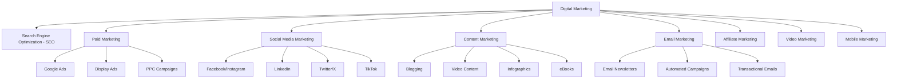

### 5.2 Channel Descriptions

| Channel | Description | Primary Benefits | Best For |
|---------|-------------|------------------|----------|
| **SEO** | Optimizing website content to rank higher in search results | Organic traffic, credibility, long-term visibility | Sustainable growth, authority building |
| **Paid Marketing** | Paying for ad placements on search engines and platforms | Immediate visibility, precise targeting, measurable ROI | Quick results, product launches |
| **Social Media** | Building presence and engagement on social platforms | Brand awareness, community building, direct engagement | Brand building, customer relationships |
| **Content Marketing** | Creating valuable content to attract and engage audiences | Authority building, lead generation, customer education | Establishing expertise, nurturing leads |
| **Email Marketing** | Sending targeted messages to email subscribers | Direct communication, personalization, high ROI | Direct sales, customer retention |
| **Affiliate Marketing** | Partnering with affiliates to promote products | Performance-based, extended reach, cost-effective | Scaling reach, performance marketing |
| **Video Marketing** | Using video content to engage audiences | High engagement, emotional connection, versatile format | Demonstrations, storytelling, tutorials |
| **Mobile Marketing** | Reaching customers on mobile devices | Location-based targeting, high personalization, immediate access | On-the-go consumers, local marketing |

**Understanding Channel Selection:**

Choosing the right digital marketing channels requires careful consideration of business objectives, target audience, and available resources. No single channel works for every business; successful strategies typically combine multiple channels that complement each other and reinforce overall marketing goals.

The most effective approach often involves starting with one or two channels where the target audience is most active, mastering those before expanding to others. This focused approach allows businesses to build expertise and achieve results before diversifying their efforts.

 

## 6. Search Engine Optimization (SEO)

### 6.1 What is SEO?

Search Engine Optimization (SEO) is the practice of optimizing websites and content to improve visibility in search engine results pages (SERPs). The goal is to attract organic (non-paid) traffic from users searching for relevant keywords and phrases related to a business's products, services, or content.

SEO represents one of the most cost-effective digital marketing strategies because it generates ongoing traffic without continuous advertising spend. When properly implemented, SEO can provide sustainable visibility that continues to deliver results long after the initial optimization work is completed.

### 6.2 Types of SEO

| Type | Description | Key Activities | Impact |
|------|-------------|----------------|--------|
| **On-Page SEO** | Optimization of elements on your website | Content optimization, title tags, meta descriptions, internal linking, header tags | Directly improves page relevance and user experience |
| **Off-Page SEO** | Optimization activities outside your website | Backlink building, social media engagement, guest posting, brand mentions | Builds authority and trust signals |
| **Technical SEO** | Technical optimization for search engine crawling | Site speed optimization, mobile responsiveness, XML sitemaps, structured data | Ensures search engines can access and understand your content |

**On-Page SEO in Detail:**
On-page SEO focuses on elements within your direct control. This includes optimizing content quality, ensuring proper use of heading tags, crafting compelling title tags and meta descriptions, and creating a logical internal linking structure. Each page should target specific keywords while providing genuine value to visitors.

**Off-Page SEO in Detail:**
Off-page SEO builds your website's authority through external signals. Backlinks from reputable websites serve as endorsements, indicating to search engines that your content is valuable and trustworthy. Social media engagement, brand mentions, and guest posting on authoritative sites all contribute to off-page SEO success.

**Technical SEO in Detail:**
Technical SEO ensures search engines can effectively crawl, index, and understand your website. This includes optimizing page load speed, ensuring mobile responsiveness, implementing structured data markup, creating XML sitemaps, and maintaining a secure HTTPS connection. Technical issues can undermine otherwise excellent content and on-page optimization.

### 6.3 How Search Engines Work

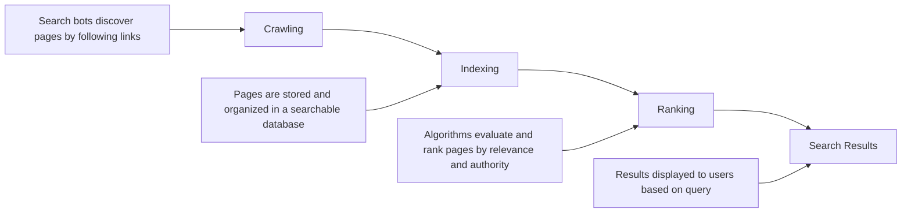

**Crawling:**
Search engines use automated programs called bots or spiders to discover publicly available web pages by following links from known pages. This continuous process ensures search engines maintain current information about the web's constantly changing landscape. Websites must be accessible to these bots to appear in search results.

**Indexing:**
Discovered pages are stored and organized in a searchable database called an index. This index contains information about each page's content, keywords, and structure. Only indexed pages can appear in search results, making indexability a fundamental requirement for SEO success.

**Ranking:**
When a user performs a search, algorithms evaluate and rank indexed pages based on relevance, authority, and quality. Ranking factors include keyword usage, content quality, user engagement signals, and backlink profiles. Algorithms continuously evolve to deliver increasingly relevant and valuable results to users.

### 6.4 Keyword Research and Optimization

**Keyword Research Process:**

Keyword research forms the foundation of effective SEO. This systematic process identifies the terms and phrases potential customers use when searching for products, services, or information related to your business.

1. **Identify Your Target Audience:** Understanding who your customers are and what they need helps guide keyword selection. Consider their demographics, challenges, and goals when identifying potential search terms.

2. **Use Keyword Research Tools:** Platforms like Google Keyword Planner, SEMrush, and Ahrefs provide data on search volume, competition, and related keywords. These tools help identify opportunities and prioritize keywords based on potential impact.

3. **Analyze Search Volume, Competition, and Intent:** Evaluate keyword metrics to identify terms with sufficient search volume and manageable competition. Understanding search intent—whether users are looking for information, making comparisons, or ready to purchase—ensures content matches user needs.

4. **Select Primary and Secondary Keywords:** Each page should target one primary keyword and several related secondary keywords. This focus helps search engines understand the page's topic while providing variety in content.

5. **Map Keywords to Appropriate Content:** Assign keywords to specific pages based on relevance and content purpose. Homepages often target broad brand terms, while blog posts may target more specific question-based keywords.

**Key Optimization Elements:**

| Element | Purpose | Best Practice |
|---------|---------|---------------|
| Title Tags | Primary ranking factor, click-through influence | Include primary keyword near beginning, keep under 60 characters |
| Meta Descriptions | Influence click-through rates | Include keywords, compelling copy under 160 characters |
| Heading Tags (H1, H2, H3) | Content structure and keyword emphasis | Use H1 for main title, H2/H3 for subsections with keywords |
| Content Quality | User satisfaction and engagement | Comprehensive, well-written content addressing user needs |
| URL Structure | User experience and keyword relevance | Clean, descriptive URLs with keywords where appropriate |
| Image Optimization | Accessibility and additional ranking opportunity | Descriptive file names, alt text, compressed file sizes |
| Internal Linking | Site structure and page authority distribution | Link related content, use descriptive anchor text |

### 6.5 Backlinks and Ranking Factors

**Understanding Backlinks:**

Backlinks are links from other websites to your content. They serve as "votes of confidence" that signal to search engines that your content is valuable, authoritative, and trustworthy. High-quality backlinks from reputable websites significantly improve search rankings and organic visibility.

**Quality Over Quantity:**
Not all backlinks provide equal value. Links from authoritative, relevant websites carry more weight than numerous links from low-quality or unrelated sites. Search engines evaluate the quality of linking domains, the relevance of the linking content, and the naturalness of the link profile.

**Key On-Page Ranking Factors:**

| Factor | Impact | Implementation |
|--------|--------|----------------|
| Content Quality and Relevance | High | Create comprehensive, well-researched content that addresses user needs |
| User Experience and Engagement | High | Ensure easy navigation, readable formatting, and engaging content |
| Page Speed and Mobile Responsiveness | High | Optimize images, use caching, implement responsive design |
| Secure Website (HTTPS) | Moderate | Implement SSL certificate, maintain secure connections |
| Keyword Optimization | Moderate | Use keywords naturally in strategic positions |

**Additional Ranking Factors:**
While the factors above represent the most important on-page elements, other factors also influence rankings. These include content freshness, user engagement metrics like bounce rate and time on page, and social signals indicating content popularity. Search engines continuously evolve, incorporating new signals to deliver better results.

### 6.6 SEO Tools

| Tool | Primary Use | Key Features |
|------|-------------|--------------|
| **Ahrefs** | Comprehensive SEO analysis | Backlink analysis, keyword research, competitor analysis, content explorer |
| **SEMrush** | All-in-one marketing toolkit | SEO, PPC, content marketing, social media, competitive intelligence |
| **Yoast SEO** | WordPress SEO plugin | Content optimization, readability analysis, meta tags, XML sitemaps |
| **Google Search Console** | Performance monitoring | Search traffic data, indexing status, technical issue alerts |
| **Google Analytics** | Website analytics | Traffic sources, user behavior, conversions, attribution |

**Tool Selection Considerations:**

Choosing the right SEO tools depends on your specific needs, budget, and technical expertise. For beginners, Google's free tools provide essential data and insights. As requirements become more sophisticated, paid tools offer advanced features for competitive analysis, backlink monitoring, and content optimization. Many professionals use a combination of tools to gain comprehensive insights.

 

## 7. Paid Marketing with Google Ads

### 7.1 Introduction to Google Ads

Google Ads is Google's pay-per-click (PPC) advertising platform that allows businesses to display ads on Google's search results pages, partner websites, and across the Google Display Network. Advertisers bid on keywords and pay only when users click their ads, making it a performance-based marketing channel with clear ROI measurement.

Google Ads offers immediate visibility for businesses, enabling them to appear prominently in search results even before organic SEO efforts gain traction. This immediacy makes it particularly valuable for product launches, time-sensitive promotions, and competitive keywords where organic ranking is challenging.

### 7.2 Types of Google Ads

| Ad Type | Description | Best For |
|---------|-------------|----------|
| **Search Ads** | Text ads shown in search results when users search for specific keywords | Direct intent marketing, lead generation |
| **Display Ads** | Visual banner ads on websites across the Google Display Network | Brand awareness, retargeting |
| **Shopping Ads** | Product listings with images, prices, and descriptions | E-commerce, retail products |
| **Video Ads** | Video ads on YouTube and partner platforms | Brand storytelling, engagement |
| **App Campaigns** | Ads designed to promote mobile app downloads | Mobile app promotion |

**Search Ads in Detail:**
Search ads appear at the top of search results pages, capturing users actively searching for products or services. These text-based ads include headlines, descriptions, and display URLs. Success depends on keyword relevance, ad copy quality, and landing page experience. Search ads typically achieve higher conversion rates than other ad types because they target users with demonstrated intent.

**Display Ads in Detail:**
Display ads appear on websites, apps, and video platforms across the Google Display Network. These visual ads can include images, text, and interactive elements. Display advertising is effective for building brand awareness and retargeting previous website visitors. The visual nature of display ads allows for creative expression that text-only ads cannot match.

**Shopping Ads in Detail:**
Shopping ads display product information directly in search results, including images, prices, and merchant names. These ads provide immediate product visibility and comparison shopping capability. Shopping ads work particularly well for e-commerce businesses with extensive product catalogs and competitive pricing.

### 7.3 Google Ads Account Structure

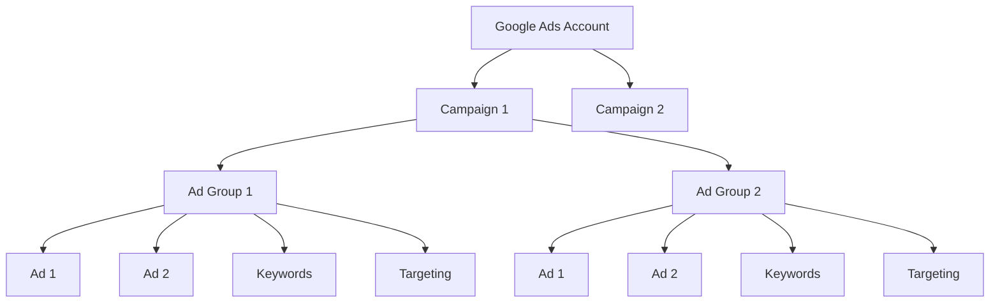

**Account Hierarchy:**
Proper account structure is essential for Google Ads success. The hierarchy from largest to smallest includes:

1. **Account Level:** Contains billing information, user access controls, and overall account settings. This level establishes the foundation for all campaigns.

2. **Campaign Level:** Each campaign defines budget, geographic targeting, and ad type. Campaigns typically align with marketing objectives, such as brand awareness or lead generation.

3. **Ad Group Level:** Within each campaign, ad groups organize related keywords, ads, and landing pages. Logical grouping improves relevance and quality scores.

4. **Ad Level:** Individual ads include creative elements like headlines, descriptions, and calls-to-action. Multiple ads allow for A/B testing and optimization.

**Structuring for Success:**

Effective account structure improves campaign performance by ensuring ad relevance and facilitating management. Search ads should be organized thematically, with each ad group targeting related keywords and directing to corresponding landing pages. This organization improves quality scores, reduces costs, and increases conversion rates.

### 7.4 Managing Google Ads

**Best Practices:**

| Practice | Description | Impact |
|----------|-------------|--------|
| **Thorough Keyword Research** | Identify relevant, high-intent keywords with appropriate search volume | Targets qualified traffic effectively |
| **Compelling Ad Copy** | Create clear, benefit-focused copy with strong calls-to-action | Improves click-through rates |
| **Negative Keywords** | Exclude irrelevant search terms to filter poor traffic | Reduces wasted spend |
| **Landing Page Optimization** | Ensure landing pages match ad promises and facilitate conversion | Improves conversion rates |
| **Bid Monitoring and Adjustment** | Regular review and adjustment based on performance | Optimizes costs and ROI |
| **Ad Extensions** | Add additional information like location, call buttons, and site links | Increases visibility and engagement |
| **A/B Testing** | Test different ad variations to identify winners | Continuous improvement |

**Ongoing Optimization:**

Successful Google Ads management requires continuous monitoring and optimization. Key activities include analyzing performance data, adjusting bids based on conversion value, testing new ad copy, refining keyword lists, and updating targeting based on audience insights. This ongoing process ensures campaigns remain efficient and effective.

 

## 8. Social Media Marketing

### 8.1 What is Social Media Marketing?

Social media marketing leverages platforms like Facebook, Instagram, LinkedIn, Twitter/X, TikTok, and others to build connections with potential customers and drive leads or sales. This approach focuses on creating and sharing content that resonates with target audiences, engaging in conversations, and building community around brands.

Social media marketing stands out for its ability to humanize brands and create direct, personal connections with customers. Unlike many other marketing channels, social media allows for authentic, two-way conversations that build trust and loyalty.

### 8.2 Two Types of Social Media Marketing

| Type | Description | Examples |
|------|-------------|----------|
| **Inbound** | Posting educational content, sharing resources on owned channels | Blog posts, educational videos, memes, lead generation ads |
| **Outbound** | Actively engaging outside your owned pages | Commenting on profiles, participating in hashtag conversations, engaging in groups |

**Inbound Social Media Marketing:**
Inbound social media focuses on attracting audiences to your owned channels by providing valuable content. This approach positions your brand as a helpful resource, building trust and authority over time. Inbound content educates, entertains, or solves problems for your target audience, naturally attracting followers and engagement.

**Outbound Social Media Marketing:**
Outbound social media involves engaging with audiences outside your owned channels. This proactive approach includes commenting on relevant posts, participating in industry discussions, and building relationships with influencers and other brands. Outbound efforts expand reach and demonstrate your brand's active participation in the community.

### 8.3 Pillars of Social Media Marketing

**1. Strategy:**
A clear strategy defines goals, target audience, and content approach. Strategy development includes identifying which platforms to use, establishing brand voice, and determining content mix. The strategy should align with broader business objectives while leveraging the unique capabilities of social media channels.

**2. Content:**
Creating engaging, relevant content forms the heart of social media marketing. Content should provide value to followers, whether through education, entertainment, or inspiration. The most effective content formats vary by platform, audience, and marketing objectives.

**3. Community Management:**
Active engagement with followers and responses to comments and messages build relationships and trust. Community management involves monitoring mentions, responding to questions, and addressing concerns promptly. This human touch distinguishes successful social media strategies from ineffective ones.

**4. Analytics:**
Measuring performance and optimizing strategy based on data ensures continuous improvement. Analytics inform content decisions, posting schedules, and resource allocation. Without measurement, social media efforts cannot be effectively optimized.

### 8.4 Platform-Specific Considerations

| Platform | Primary Audience | Best Content Types | Key Features |
|----------|------------------|-------------------|--------------|
| **Facebook** | Broad demographic (25-55+) | Mixed content, videos, articles, group engagement | Large user base, detailed targeting, groups |
| **Instagram** | Millennials, Gen Z (18-34) | High-quality images, Stories, Reels, carousel posts | Visual focus, shopping integration, creative tools |
| **LinkedIn** | Professionals, B2B | Thought leadership, industry insights, career content | Professional context, B2B targeting, long-form content |
| **Twitter/X** | News-oriented, professional | Short updates, news, customer service engagement | Real-time conversations, trending topics |
| **TikTok** | Gen Z, young millennials | Short-form video, trends, entertainment, behind-the-scenes | Viral potential, creative tools, music integration |
| **YouTube** | All ages | Long-form video, tutorials, reviews, storytelling | Search discovery, evergreen content, monetization |

**Platform Selection Considerations:**

Choosing the right platforms requires understanding where your target audience spends time and what content resonates on each platform. Most businesses benefit from focusing on 2-3 platforms initially, mastering those before expanding to others. Platform selection should align with marketing objectives, content capabilities, and resource availability.

### 8.5 Social Media Tools

| Tool | Primary Use | Key Features |
|------|-------------|--------------|
| **Hootsuite** | Social media management | Scheduling, monitoring, analytics across multiple platforms |
| **Buffer** | Content scheduling | Simple scheduling, analytics, queue management |
| **Canva** | Visual content creation | Templates, design tools, brand kits, easy-to-use interface |
| **Sprout Social** | Advanced social management | Analytics, engagement, publishing, social listening |

 

## 9. Content Marketing

### 9.1 What is Content Marketing?

Content marketing is the strategic creation and distribution of valuable, relevant, and consistent content to attract and retain a clearly defined audience, ultimately driving profitable customer action. Unlike advertising that directly promotes products, content marketing provides information that helps customers solve problems, learn new skills, or make informed decisions.

Content marketing builds trust and authority by demonstrating expertise and providing genuine value. When customers find your content helpful, they become more likely to choose your products or services when they're ready to purchase. This approach creates sustainable competitive advantages that advertising alone cannot achieve.

### 9.2 Types of Content

| Type | Description | Best Use |
|------|-------------|----------|
| **Blog Posts** | Written articles published on your website | SEO, education, thought leadership |
| **Videos** | Visual content in various formats | Engagement, demonstration, storytelling |
| **Infographics** | Visual data representation | Information sharing, shareability |
| **eBooks/Whitepapers** | Long-form, in-depth content | Lead generation, authority building |
| **Case Studies** | Success story content | Trust building, proof of value |
| **Webinars** | Live or recorded presentations | Education, lead generation |
| **Podcasts** | Audio content | Convenience, authority, relationship building |

**Content Selection Considerations:**

Choosing the right content types depends on your audience's preferences, your objectives, and your resources. Most successful content strategies incorporate multiple formats, repurposing content across different channels to maximize reach and impact. A blog post, for example, can become a video, infographic, podcast episode, and social media posts.

### 9.3 Content Marketing Strategy

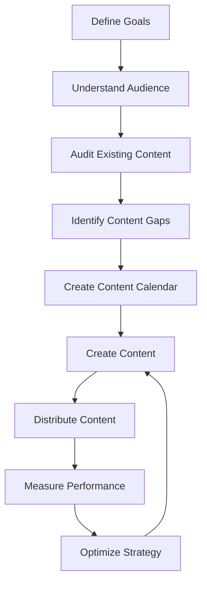

**Strategic Content Development:**

Effective content marketing begins with clear goals and audience understanding. Content should address audience pain points, answer questions, and provide value at each stage of the customer journey. The content calendar ensures consistent publishing while allowing for flexibility to respond to trends and opportunities.

**Distribution and Promotion:**

Creating excellent content is only half the battle; effective distribution ensures it reaches the intended audience. Promotion strategies include organic search optimization, email marketing, social media sharing, paid advertising, influencer partnerships, and content syndication. The most successful content marketing integrates multiple distribution channels.

 

## 10. Email Marketing

### 10.1 What is Email Marketing?

Email marketing is the use of email to send commercial messages to a group of people, typically subscribers who have provided permission to receive communications. It remains one of the most effective digital marketing strategies because nearly every consumer has an email address, and email provides a direct, owned communication channel.

Email marketing excels at building relationships, nurturing leads, and driving conversions. Unlike social media or search algorithms that control who sees your content, email marketing provides direct access to your audience without intermediary restrictions.

### 10.2 Benefits of Email Marketing

| Benefit | Description |
|---------|-------------|
| **Complete Control** | Direct connection to customers without platform changes or algorithm updates |
| **Audience Segmentation** | Send different content to different audiences based on behavior and preferences |
| **High ROI** | One of the most cost-effective marketing strategies with significant returns |
| **Personalization** | Tailor messages to individual preferences and behaviors |
| **Automation Friendly** | Drip campaigns and triggered emails work on autopilot |

**Understanding Email's Unique Value:**

Email marketing offers several advantages over other digital marketing channels. It provides direct ownership of the customer relationship, independent of platform changes. It enables sophisticated segmentation and personalization that increases relevance and effectiveness. And it integrates seamlessly with other marketing efforts, supporting the customer journey at every stage.

### 10.3 Email Marketing Types

| Type | Description | Use Case |
|------|-------------|----------|
| **Newsletters** | Regular updates to subscribers | Brand awareness, engagement, maintaining connections |
| **Promotional Emails** | Sales, offers, and product announcements | Direct marketing, conversions, revenue generation |
| **Transactional Emails** | Order confirmations, receipts, shipping updates | Customer service, post-purchase experience |
| **Drip Campaigns** | Automated sequences of emails | Lead nurturing, onboarding, education |
| **Re-engagement Campaigns** | Win-back inactive subscribers | Customer retention, list health |

**Segment-Based Email Strategies:**

Effective email marketing requires thoughtful segmentation and targeting. Subscriber behavior, preferences, and lifecycle stage should determine which emails they receive. This relevance increases engagement, reduces unsubscribe rates, and improves overall campaign performance.

### 10.4 Email Marketing Tools

| Tool | Best For | Key Features |
|------|----------|--------------|
| **Mailchimp** | Small to medium businesses | Templates, automation, analytics, ease of use |
| **Constant Contact** | Small businesses | User-friendly interface, email builder, event management |
| **HubSpot** | Integrated marketing | CRM integration, automation, lead management |
| **Klaviyo** | E-commerce | Advanced segmentation, analytics, integration with e-commerce platforms |

 

# Part Three: Strategic Implementation

## 11. Understanding Buyer Psychology

### 11.1 What is Buyer Psychology?

Buyer psychology is a blend of economics, psychology, and communications that helps businesses understand why people choose certain brands and products and how those choices lead to purchases. This field explores the cognitive, emotional, and social factors that influence consumer decision-making.

Understanding buyer psychology enables businesses to connect more effectively with their customers, addressing both conscious and subconscious motivations that drive purchasing behavior. While consumers often believe they make rational decisions, research consistently shows that emotions and unconscious factors play significant roles in choice.

### 11.2 Why Buyer Psychology Matters

Understanding buyer psychology helps businesses:

| Benefit | Description |
|---------|-------------|
| **Build a Good Reputation** | Align marketing with customer values and expectations |
| **Meet Customer Expectations** | Deliver experiences that satisfy customer needs |
| **Save Time and Money** | Focus marketing efforts on what matters to customers |
| **Build Loyalty** | Create emotional connections that drive repeat business |
| **Connect Emotionally** | Engage customers on deeper levels that transcend price and features |

**The Strategic Importance:**

Buyer psychology provides the foundation for effective marketing strategy. Without understanding what drives customer decisions, marketing efforts become guesswork. By understanding psychological principles, marketers can create more compelling messages, design better experiences, and build stronger customer relationships.

### 11.3 Key Psychological Principles

| Principle | Description | Application |
|-----------|-------------|-------------|
| **Emotions Matter** | Feelings are as important as facts in decision-making | Create positive emotional connections with your brand |
| **Novelty** | New things catch attention in an information-saturated world | Highlight what's new or innovative about your offering |
| **Loss Aversion** | People dislike losing things they value | Offer guarantees, flexible return policies, trial periods |
| **Community** | People like feeling part of a group | Share reviews, testimonials, use influencers |
| **Storytelling** | People connect with narratives and characters | Share authentic brand narratives, customer stories |
| **Short and Long-Term Focus** | Customers consider both present and future benefits | Show immediate and future benefits of purchase |
| **Pain Points** | Address customer frustrations effectively | Make processes easy, solve problems |

**Applying Psychological Principles:**

Effective marketing applies these principles thoughtfully and ethically. Emotional appeals should be genuine and relevant to the product or service. Novelty should reflect real innovation. Loss aversion strategies should focus on value and benefit, not manipulation. Community building should create genuine connections, not artificial engagement.

### 11.4 Basic Human Needs in Marketing

Your product should address at least one of these fundamental needs:

1. **Wealth**: Show efficiency, cost-effectiveness, ROI. Demonstrating how your product saves money, saves time, or creates value appeals to the desire for financial security and success.

2. **Health**: Highlight health benefits and wellness. Products that improve physical, mental, or emotional well-being address basic human desires for longevity, vitality, and quality of life.

3. **Relationships**: Demonstrate how your product brings people together. Products that facilitate connection, strengthen bonds, or create community address fundamental social needs.

 

## 12. The Buyer's Journey

### 12.1 Understanding the Journey

The buyer's journey represents the steps a customer takes from becoming aware of a problem to making a purchase decision. Understanding this journey enables marketers to provide appropriate content and experiences at each stage, guiding customers toward purchase efficiently.

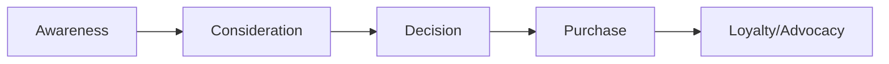

### 12.2 Journey Stages

| Stage | Customer Mindset | Marketing Focus | Content Examples |
|-------|-----------------|-----------------|------------------|
| **Awareness** | "I have a problem or need" | Educational content, problem identification | Blog posts, videos, infographics |
| **Consideration** | "What are my options?" | Comparative content, solution evaluation | Case studies, comparison guides, webinars |
| **Decision** | "Which should I choose?" | Product information, testimonials, offers | Product demos, reviews, free trials |
| **Purchase** | "I need to buy" | Seamless experience, checkout optimization | User-friendly checkout, payment options |
| **Loyalty** | "I want to stay" | Post-purchase engagement, loyalty programs | Onboarding, support, exclusive offers |

**Journey Stage Content Strategy:**

Content should evolve to match customer needs at each journey stage. Awareness content focuses on problems and possibilities. Consideration content compares alternatives and evaluates options. Decision content provides specific details and reassurance. Purchase content ensures smooth transactions. Loyalty content reinforces the value of the relationship and encourages repeat engagement.

### 12.3 Knowledge to Application to Experience

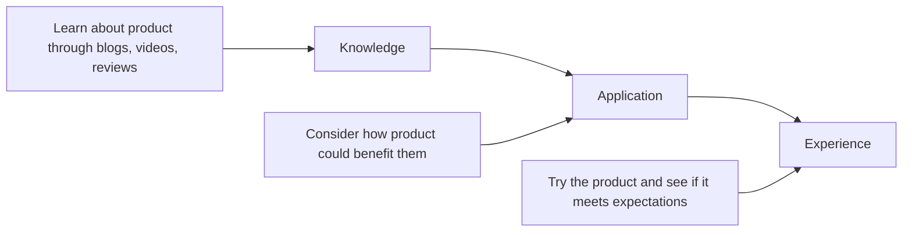

**Supporting the Journey:**

The buyer's journey moves from awareness to consideration to decision, ultimately leading to purchase and loyalty. Each stage requires different types of content and interaction. Marketing should support this progression naturally, providing appropriate information at each stage without rushing or overwhelming the customer.

 

## 13. Strategies to Influence Buyer Decisions

### 13.1 Effective Influence Strategies

| Strategy | Description | Example |
|----------|-------------|---------|
| **Easy-to-Understand Content** | Gradually introduce information | Start with simple concepts, build complexity over time |
| **Show Discounts** | Show original and discounted price together | Crossed-out original price next to sale price |
| **Highlight Savings** | Show annual vs. monthly pricing | "Save $50/year with annual plan" |
| **Keep Options Simple** | Limit choices to avoid overwhelm | Offer 3 plans instead of 10 |
| **One CTA Per Page** | Focus attention on single action | One primary button per landing page |
| **Use Testimonials** | Share customer reviews | Quotes and ratings on product pages |
| **Highlight Popular Clients** | Show major customers | Logo display of well-known clients |
| **Exceptional Customer Service** | Respond quickly and helpfully | Live chat, quick email responses |
| **Free Tools or Services** | Offer value without charge | Free trials, calculators, guides |

**Understanding Decision Psychology:**

These strategies work by addressing common decision-making biases and patterns. Discount presentation leverages anchoring and loss aversion. Simple options prevent choice overload. Testimonials provide social proof. Exceptional service builds trust and reduces perceived risk. Each strategy addresses specific psychological factors that influence purchasing decisions.

### 13.2 Creating a Positive Customer Experience

**Be Honest:**
Build trust through transparency. Honest communication about product capabilities, limitations, pricing, and policies establishes credibility and reduces the risk of customer disappointment. Honesty builds the foundation for long-term customer relationships.

**Be Kind:**
Show genuine care for customers through empathetic communication, helpful service, and authentic engagement. Kindness creates positive emotional connections that transcend transactional relationships.

**Make the Journey Enjoyable:**
Remove friction points throughout the customer experience. Simplify processes, provide clear information, and anticipate customer needs. An enjoyable journey reduces abandonment rates and increases satisfaction.

**Listen to Feedback:**
Act on customer input to improve products, services, and experiences. Demonstrate that customer opinions matter through responsive product development and service improvements.

**Provide Value:**
Always focus on customer benefit rather than simply promoting products. Value-focused marketing builds trust and positions the brand as a helpful partner rather than just a seller.

 

## 14. Digital Marketing Strategy Development

### 14.1 What is a Digital Marketing Strategy?

A digital marketing strategy is a plan for using digital channels to grow visibility online, attract customers, and achieve business objectives. It considers target audience, strengths and weaknesses, competitive positioning, and available resources to create a coherent approach to digital marketing.

A well-developed strategy provides direction and focus, preventing scattered efforts and wasted resources. It establishes priorities, guides resource allocation, and provides a framework for measuring success.

### 14.2 Strategy vs. Tactics

| Aspect | Strategy | Tactics |
|--------|----------|---------|
| **Definition** | The overall plan and direction | The specific actions to implement the plan |
| **Timeframe** | Long-term, strategic perspective | Short-term, execution-focused |
| **Focus** | What to achieve and why | How and when to implement |
| **Example** | "We will increase brand awareness through content marketing" | "Publish two blog posts weekly and share on LinkedIn" |

**Strategic Thinking:**

Strategy answers the "why" and "what" questions of marketing. It defines objectives, target audiences, and competitive positioning. Tactics answer the "how" questions, providing specific implementation details. Both are essential; strategy without tactics remains theoretical, while tactics without strategy lack direction and cohesion.

### 14.3 How to Create an Effective Digital Marketing Strategy

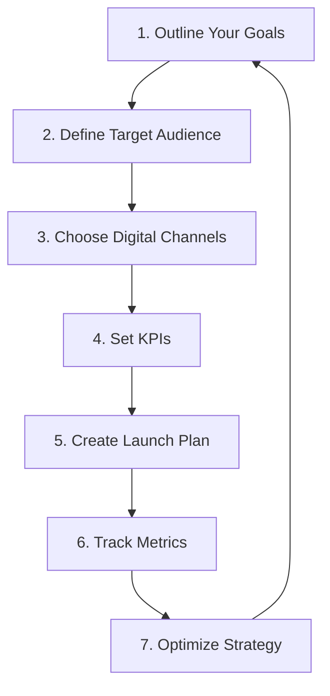

### 14.4 Seven-Step Strategy Guide

**1. Outline Your Goals**

Use the SMART framework to create specific, measurable, achievable, relevant, and time-bound goals. For example: "Increase website traffic by 25% in Q3" or "Generate 100 qualified leads per month by year-end." Clear goals provide direction and enable measurement of success.

**2. Define Your Target Audience**

Create detailed buyer personas that include demographics, interests, challenges, and behaviors. For B2B marketing, consider company size, industry, job role, and purchasing authority. Understanding who you're marketing to is essential for effective messaging and channel selection.

**3. Choose the Right Channels**

Select channels based on goals and audience preferences. A B2B company may find more success on LinkedIn than TikTok, while a consumer brand might prioritize Instagram and Facebook. Focus on channels where your audience is most active and where your content can make the greatest impact.

**4. Set Key Performance Indicators (KPIs)**

Define metrics that will measure progress toward your goals. Examples include click-through rates, conversion rates, traffic sources, engagement rates, and revenue generated. KPIs should directly relate to business objectives and provide actionable insights.

**5. Create a Launch Plan**

Determine resources needed, create a launch calendar, and assign responsibilities. A detailed launch plan ensures all elements are ready when needed and team members understand their roles. Consider content creation, technical setup, and promotional activities.

**6. Track Metrics**

Use analytics tools to monitor performance regularly. Review data to identify what's working and what needs improvement. Regular tracking enables timely adjustments and prevents problems from going unnoticed.

**7. Optimize Your Strategy**

Test new approaches and adjust based on performance data. Continuous optimization improves results over time. Use A/B testing, analyze competitor activity, and respond to changes in the market or consumer behavior.

### 14.5 Understanding Your Customer

**Key Questions to Answer:**

1. Who buys your product and why?
2. What are their pain points and challenges?
3. Where do they spend time online?
4. What language and terminology do they use?
5. What emotions drive their decisions?

**Steps to Customer Understanding:**

| Step | Description |
|------|-------------|
| **Define Channels** | Identify channels that fit key demographics and behaviors |
| **Speak Their Language** | Use terminology and communication styles that resonate |
| **Understand Pain Points** | Identify problems your product solves |
| **Create Buyer Personas** | Develop detailed profiles of ideal customers |
| **Be Culturally Aware** | Understand cultural factors that influence decisions |
| **Consider Influencer Partnerships** | Leverage trusted voices in the community |
| **Focus on Outcomes** | Emphasize results, not just product features |
| **Use Automation Tools** | Apply segmentation and targeting for personalized experiences |

### 14.6 Audit and Assess

**Conduct a Full Channel and Content Audit:**

1. **List all marketing channels and assets:** Document everything you're currently using, including websites, social media accounts, email lists, paid campaigns, and content assets.

2. **Map each to organizational goals:** Connect each channel and asset to specific business objectives. This helps identify alignment gaps and opportunities.

3. **Identify top performers:** Determine which channels and content types are delivering the best results. These represent areas to invest in and expand.

4. **Understand what drives revenue:** Connect marketing activities to revenue outcomes. This reveals what truly matters for business results.

5. **Double down on successes:** Increase investment in what's working well, whether that's specific channels, content types, or campaign approaches.

6. **Explore new opportunities:** Test new channels and content formats that could expand reach and impact.

### 14.7 Focus on the End Result

**Avoid Product-Centric Marketing:**

Traditional marketing often emphasizes product features and specifications. Digital marketing success requires a shift toward focusing on customer needs and outcomes:

- Focus on the need the product fulfills, not just the product itself
- Understand customer pain points and how your solution addresses them
- Demonstrate post-purchase moments and benefits
- Show why customers need it in the first place

**Outcome-Focused Messaging:**

Effective marketing answers the customer question, "What's in it for me?" It demonstrates how the product will improve their life, solve their problems, or help them achieve their goals. This outcome-focused approach resonates more strongly than feature-focused messaging.

### 14.8 Review and Refine

**Continuous Optimization:**

- Include KPIs aligned with business goals
- Step away from vanity metrics that don't indicate success
- Set up regular analysis intervals for performance review
- Isolate critical metrics when issues arise
- Document learnings and apply them to future campaigns

**The Optimization Cycle:**

Continuous improvement is fundamental to digital marketing success. Regularly analyze performance data, identify opportunities, implement changes, and measure impact. This cycle of planning, execution, measurement, and refinement drives ongoing improvement.

 

## 15. Creating a Marketing Plan

### 15.1 Structure of a Marketing Plan

| Component | Description |
|-----------|-------------|
| **Executive Summary** | Overview of the marketing plan and key objectives |
| **Situation Analysis** | Current market position, competitive landscape, SWOT analysis |
| **Goals and Objectives** | Specific, measurable targets to achieve |
| **Target Audience** | Detailed buyer personas and segmentation |
| **Marketing Strategy** | Overall approach and competitive positioning |
| **Tactical Plan** | Specific actions, channels, and campaigns |
| **Budget Allocation** | Resource distribution across activities |
| **Timeline** | Implementation schedule with milestones |
| **KPIs and Measurement** | How success will be measured and tracked |

### 15.2 How to Make an Effective Marketing Plan

**1. Research:**
Understand your market, competition, and audience thoroughly. This research provides the foundation for informed decision-making. Without adequate research, marketing plans become guesswork.

**2. Define:**
Set clear, measurable objectives that align with business goals. These objectives provide direction and enable measurement of success.

**3. Strategize:**
Determine your approach and positioning based on research findings. Strategy defines how you'll compete and win in your market.

**4. Implement:**
Execute tactics across chosen channels according to your plan. Implementation requires resources, coordination, and clear accountability.

**5. Measure:**
Track performance against KPIs to understand what's working. Measurement enables optimization and justifies resource allocation.

**6. Adjust:**
Optimize based on results, adapting to changing conditions and new insights. This adjustment cycle drives continuous improvement.

 

# Part Four: Control, Measurement, and Optimization

## 16. What You Can and Cannot Control in Digital Marketing

### 16.1 What You CAN Control

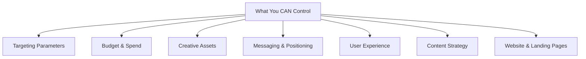

| Element | Description | Impact |
|---------|-------------|--------|
| **Targeting Parameters** | Exact audience demographics, locations, interests, devices | Determines who sees your marketing |
| **Budget & Spend** | Daily ad limits, bidding strategies, cost-per-click constraints | Controls cost and reach |
| **Creative Assets** | Design, copy, calls-to-action, formatting of ads and posts | Influences engagement and conversion |
| **Messaging & Positioning** | How you present your brand's value, tone, identity | Shapes brand perception |
| **User Experience** | Speed, mobile responsiveness, navigation of your website | Affects satisfaction and conversion |
| **Content** | What you create and share | Builds authority and engagement |
| **Customer Relationships** | How you respond to inquiries and engage | Builds loyalty and trust |

**Control as a Competitive Advantage:**

The elements within your control represent areas where you can develop competitive advantage. Excellent targeting, compelling creative, superior user experience, and strong customer relationships differentiate successful marketers. Focusing effort on controllable factors maximizes the impact of marketing investments.

### 16.2 What You CANNOT Control

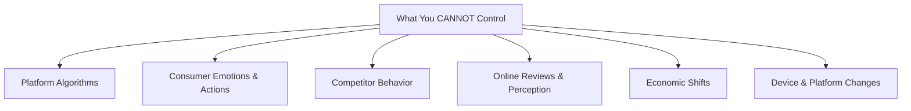

| Element | Description |
|---------|-------------|
| **Platform Algorithms** | Unannounced updates to Google or Meta algorithms |
| **Consumer Emotions & Actions** | Cannot force engagement or purchases |
| **Competitor Behavior** | Competitors' bids, budgets, and strategies |
| **Online Reviews & Perception** | Cannot control what users say about your brand |
| **Economic Shifts** | Sudden changes in consumer purchasing power |
| **Device Changes** | Technology and platform changes |
| **User Behavior** | Individual reactions to content |

**Managing Uncertainty:**

While many factors are outside your control, you can prepare for and respond to them. Stay informed about platform changes, monitor competitor activity, and maintain flexibility in your approach. Build relationships that can weather economic shifts. Focus on what you can control while adapting to what you cannot.

### 16.3 Success Strategy

Success lies in optimizing what you can control to influence what you cannot:

| Control Area | Influence Goal |
|--------------|----------------|
| High-quality content | Improved engagement and sharing |
| Excellent user experience | Better conversion rates |
| Relevant targeting | Higher click-through rates |
| Strong brand messaging | Positive brand perception |
| Customer service | Positive reviews and loyalty |
| Continuous testing | Optimized performance over time |

 

## 17. Analytics and Data-Driven Marketing

### 17.1 Introduction to Data Analytics in Marketing

Data analytics enables marketers to measure campaign success, understand customer behavior, and optimize strategies for better results. In today's digital environment, nearly every marketing interaction generates data that can be analyzed to improve performance.

Data-driven marketing moves beyond intuition and guesswork, providing evidence-based guidance for strategic decisions. This approach increases the efficiency and effectiveness of marketing investments, reducing waste and improving outcomes.

### 17.2 Key Analytics Tools

| Tool | Primary Use | Key Features |
|------|-------------|--------------|
| **Google Analytics** | Website analytics | Traffic sources, user behavior, conversions, audience insights |
| **Facebook Insights** | Social media analytics | Engagement, audience demographics, post performance |
| **Google Search Console** | SEO performance | Search visibility, technical issues, click-through rates |
| **Hotjar** | User behavior analysis | Heatmaps, session recordings, feedback polls |
| **SEMrush** | Competitive analysis | Traffic estimation, keyword tracking, competitor research |

**Tool Selection and Integration:**

Different analytics tools serve different purposes. Website analytics reveal how visitors interact with your site. Social analytics show engagement and audience characteristics. SEO tools track search visibility. Effective marketers integrate insights from multiple tools to gain a comprehensive view of performance.

### 17.3 How to Optimize Campaigns Based on Data

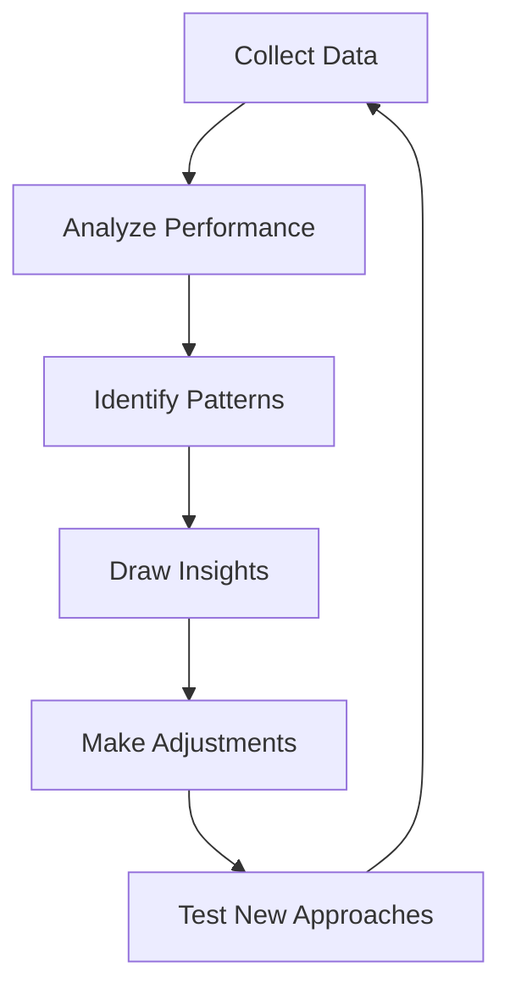

**Optimization Steps:**

1. **Define what to measure (KPIs):** Establish metrics that indicate success.
2. **Set up tracking and analytics:** Implement tools to capture relevant data.
3. **Collect and review data regularly:** Establish a regular review cadence.
4. **Identify underperforming areas:** Find where results fall short of goals.
5. **Develop hypotheses for improvement:** Formulate ideas for improvement.
6. **Test changes (A/B testing):** Experiment with specific changes.
7. **Measure impact:** Evaluate whether changes improved performance.
8. **Implement winning variations:** Apply successful changes broadly.
9. **Repeat continuously:** Continue the cycle for ongoing improvement.

 

## 18. Key Performance Indicators (KPIs)

### 18.1 What are KPIs?

Key Performance Indicators are measurable values that track an organization's performance and progress toward specific goals. KPIs translate abstract objectives into concrete metrics that can be tracked and optimized.

Effective KPIs are specific, measurable, and actionable. They provide clear targets and enable teams to understand whether they're making progress. Without KPIs, marketing becomes impossible to evaluate effectively.

### 18.2 Common Digital Marketing KPIs

| KPI | Definition | Why It Matters |
|-----|------------|----------------|
| **Click-Through Rate (CTR)** | Percentage of people who click on an ad or link | Measures ad and content effectiveness |
| **Conversion Rate** | Percentage of visitors who take desired action | Measures overall campaign effectiveness |
| **Cost Per Acquisition (CPA)** | Cost to acquire a new customer | Measures efficiency and profitability |
| **Return on Ad Spend (ROAS)** | Revenue generated per dollar of ad spend | Measures ROI and campaign effectiveness |
| **Customer Acquisition Cost (CAC)** | Total cost to acquire a new customer | Measures efficiency of acquisition efforts |
| **Customer Lifetime Value (CLV)** | Total revenue from a customer over time | Measures long-term customer value |
| **Engagement Rate** | Interactions as percentage of reach | Measures content and community effectiveness |
| **Bounce Rate** | Percentage of single-page visits | Measures user experience and content relevance |
| **Open Rate** | Percentage of emails opened | Measures email subject line effectiveness |
| **Organic Traffic** | Visitors from search results | Measures SEO success |

### 18.3 Aligning KPIs with Goals

| Goal | Relevant KPIs |
|------|---------------|
| **Brand Awareness** | Impressions, Reach, Social Followers, Brand Mentions |
| **Lead Generation** | Form Submissions, Click-Through Rate, Conversion Rate |
| **Sales/Revenue** | Conversion Rate, ROAS, Revenue, Average Order Value |
| **Customer Retention** | Retention Rate, Repeat Purchase Rate, Customer Lifetime Value |
| **Engagement** | Engagement Rate, Time on Page, Comments, Shares |

**Choosing the Right KPIs:**

Selecting appropriate KPIs begins with clear objectives. Brand awareness campaigns should measure reach and impressions, while lead generation campaigns should focus on form submissions and conversion rates. The right KPIs provide insight into whether you're achieving your objectives.

 

# Part Five: Specializations and Advanced Techniques

## 19. Integrated Digital Marketing

### 19.1 What is Integrated Digital Marketing?

Integrated digital marketing combines SEO, content marketing, social media, paid advertising, and email marketing into cohesive campaigns that work together synergistically. Rather than treating each channel independently, integrated marketing creates consistency across touchpoints, amplifying the impact of each channel.

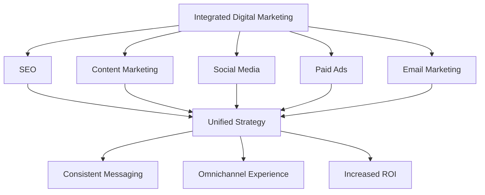

### 19.2 Benefits of Integration

| Benefit | Description |
|---------|-------------|
| **Consistent Messaging** | Same brand voice across all channels |
| **Enhanced Customer Experience** | Seamless journey across touchpoints |
| **Better Data Utilization** | Insights from one channel inform others |
| **Increased Efficiency** | Resources are used more effectively |
| **Improved ROI** | Combined efforts yield greater results |

### 19.3 Example: Integrated Marketing Approach

**Campaign: New Product Launch**

| Channel | Role | Activity |
|---------|------|----------|
| **Content** | Education | Blog posts explaining the problem and solution |
| **SEO** | Visibility | Optimize content for relevant keywords |
| **Social Media** | Awareness | Share content, build community |
| **Email** | Nurturing | Send educational series to subscribers |
| **Paid Ads** | Acceleration | Retarget website visitors |
| **Analytics** | Measurement | Track all touchpoints and attribution |

 

## 20. Mobile Marketing

### 20.1 What is Mobile Marketing?

Mobile marketing encompasses advertising, apps, messaging, mCommerce, and CRM on all mobile devices including smartphones and tablets. With mobile internet usage now exceeding desktop usage in many markets, mobile marketing has become essential for reaching consumers.

### 20.2 Mobile Marketing Benefits

| Benefit | Description |
|---------|-------------|
| **Location-Based Targeting** | Reach users based on real-time location |
| **Immediate Access** | Customers are always connected |
| **Personalization** | Tailor messages to individual preferences |
| **High Engagement** | Mobile users are highly engaged |
| **Integration** | Seamless across other marketing channels |

### 20.3 Mobile-Specific Features

- **Location-Based Advertising:** Reach users based on geographic location, enabling local targeting and contextual messaging
- **Mobile Apps:** Create branded app experiences that build loyalty and engagement
- **SMS Marketing:** Direct text message marketing with high open rates
- **QR Codes:** Bridge physical and digital worlds for seamless experiences
- **Mobile Wallets:** Digital payment and loyalty integration for frictionless transactions

 

## 21. Augmented Reality (AR) and Virtual Reality (VR) Marketing

### 21.1 Understanding the Concepts

| Technology | Description | Marketing Application |
|------------|-------------|----------------------|
| **Augmented Reality (AR)** | Digital information overlaid on the physical world | Virtual try-on, product visualization, interactive experiences |
| **Virtual Reality (VR)** | Complete immersion in a digital environment | Virtual showrooms, experiential marketing |
| **Mixed Reality (MR)** | Realistic integration of digital and real | Advanced product visualization, training |

### 21.2 AR/VR in Marketing

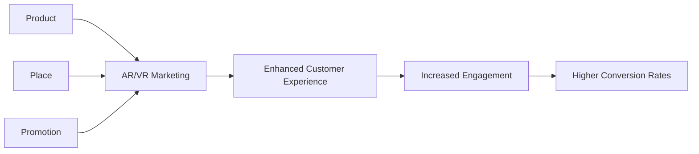

### 21.3 Applications of AR Marketing

| Application | Example | Benefit |
|-------------|---------|---------|
| **Virtual Try-On** | Makeup, clothing, glasses | Reduce return rates, increase purchase confidence |
| **Product Visualization** | Furniture placement in home | Increase purchase confidence |
| **Interactive Advertising** | Engaging brand experiences | Higher engagement, brand recall |
| **Enhanced Manuals** | AR instructions for products | Improved user experience, reduced support calls |

 

## 22. Artificial Intelligence in Digital Marketing

### 22.1 How AI is Transforming Digital Marketing

AI is revolutionizing digital marketing by enabling unprecedented levels of personalization, automation, and optimization. As AI technologies continue to advance, they're transforming how marketers understand customers, create content, and optimize campaigns.

**Key AI Capabilities:**

- **Personalization at Scale:** Tailored experiences for each user based on behavior, preferences, and context
- **Predictive Analytics:** Anticipating customer behavior and outcomes
- **Automation:** Handling repetitive tasks efficiently
- **Optimization:** Continuous improvement of campaigns
- **Content Generation:** Creating content at scale

### 22.2 AI Applications in Digital Marketing

| Application | Description | Example |
|-------------|-------------|---------|
| **Chatbots** | Automated customer interaction | 24/7 customer service, lead qualification |
| **Personalization** | Tailored content and recommendations | Product suggestions based on behavior |
| **Predictive Analytics** | Forecasting customer behavior | Churn prediction, lifetime value |
| **Ad Optimization** | Automated bidding and targeting | Dynamic ad adjustments |
| **Content Generation** | AI-created content | Product descriptions, emails |
| **Sentiment Analysis** | Understanding customer opinions | Social media monitoring |
| **Lead Scoring** | Prioritizing leads by potential | Sales prioritization |

### 22.3 Benefits of AI in Digital Marketing

| Benefit | Description |
|---------|-------------|
| **Increased Efficiency** | Automate routine tasks |
| **Better Insights** | Analyze data at scale |
| **Improved ROI** | More accurate targeting and spending |
| **Personalized Experiences** | Custom content for each user |
| **24/7 Availability** | Always-on customer engagement |

 

## 23. Business Intelligence in Marketing

### 23.1 What is Business Intelligence?

Business Intelligence (BI) encompasses processes, technologies, and tools that empower organizations to make informed, data-driven decisions. In marketing, BI enables deeper understanding of customers, better targeting, and improved performance measurement.

### 23.2 Core BI Components in Marketing

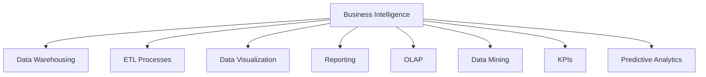

### 23.3 BI Components Explained

| Component | Description | Marketing Application |
|-----------|-------------|----------------------|
| **Data Warehousing** | Centralized data repository | Store all marketing data in one place |
| **ETL** | Extract, Transform, Load | Clean and standardize data |
| **Data Visualization** | Visual representation of data | Dashboards, reports |
| **Reporting** | Generating insights | Performance tracking, trend analysis |
| **OLAP** | Multidimensional analysis | Exploring data from different angles |
| **Data Mining** | Pattern discovery | Identifying customer segments |
| **KPIs** | Performance measurement | Tracking marketing effectiveness |
| **Predictive Analytics** | Forecasting future trends | Customer behavior prediction |

### 23.4 Benefits of BI for Marketers

1. **Data-Driven Decisions:** Base choices on evidence rather than intuition
2. **Better Targeting:** Identify ideal customer segments
3. **Improved ROI:** Allocate resources more effectively
4. **Competitive Advantage:** Stay ahead of market trends
5. **Efficiency:** Streamline operations
6. **Customer Understanding:** Deep insights into behavior

 

# Part Six: Compliance, Ethics, and Governance

## 24. Digital Marketing Rules and Regulations

### 24.1 Key Regulatory Frameworks

| Framework | Region | Focus |
|-----------|--------|-------|
| **GDPR** | European Union | Data protection and privacy |
| **CCPA** | California, USA | Consumer privacy rights |
| **CAN-SPAM** | USA | Commercial email compliance |
| **Telemarketing Laws** | Various | Telephone marketing restrictions |

### 24.2 CAN-SPAM Requirements

The CAN-SPAM Act establishes requirements for commercial messages:

1. **Honor opt-out requests promptly**
2. **Subscribers have the right to be forgotten**
3. **Monitor what others do on your behalf**
4. **Don't use false or misleading header information**
5. **Disclose clearly that your message is an ad**
6. **Subscribers can opt out of marketing emails**
7. **Tell subscribers how to opt out**
8. **Include your valid physical postal address**
9. **Subject lines must accurately reflect content**
10. **Subscribers have the right to know what data is collected and how it is used**

### 24.3 GDPR Requirements

The General Data Protection Regulation focuses on:

- **Data Protection:** Secure handling of personal data
- **Data Transparency:** Clear information about data collection
- **User Rights:** Right to access, rectify, erase data
- **Data Portability:** Users can move data between services
- **Consent:** Clear, explicit consent required

### 24.4 CCPA Requirements

The California Consumer Privacy Act provides:

- **Right to Know:** What personal information is collected
- **Right to Delete:** Request deletion of personal data
- **Right to Opt-Out:** Stop sale of personal information
- **Non-Discrimination:** Equal service regardless of privacy choices

### 24.5 Best Practices for Compliance

1. **Know the rules:** Understand all applicable regulations
2. **Document everything:** Maintain records of compliance
3. **Assemble a governance committee:** Oversee compliance
4. **Use appropriate technology:** Tools that support compliance
5. **Train your team:** Ensure everyone understands requirements
6. **Monitor compliance:** Regular audits and reviews

### 24.6 Creating a Digital Marketing Rulebook System

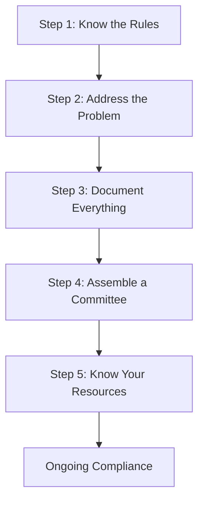

 

## 25. Ethical Considerations in Digital Marketing

### 25.1 Key Ethical Issues

| Issue | Description | Example |
|-------|-------------|---------|
| **Data Privacy** | Protecting personal information | Cambridge Analytica scandal |
| **Microtargeting** | Precise audience targeting | Targeted political ads |
| **Algorithmic Bias** | AI systems discriminating | Gender-biased hiring algorithms |
| **Fake Reviews** | Manipulated consumer feedback | Paid positive reviews |
| **Influencer Transparency** | Disclosure of paid relationships | Undisclosed sponsorships |
| **Data Security** | Protecting collected data | Data breaches |

### 25.2 The Public's Trust in eWOM

**Challenges:**
- Fake reviews are increasingly common
- Consumers are becoming skeptical of online reviews
- Trust in platform reviews is declining

**Impact:**
- Reduced credibility of online recommendations
- Consumer hesitation in relying on reviews
- Need for improved authenticity verification

### 25.3 Ethical AI in Marketing

**Responsible AI Principles:**

1. **Transparency:** Explain how AI makes decisions
2. **Fairness:** Avoid algorithmic bias
3. **Accountability:** Take responsibility for AI outcomes
4. **Privacy:** Protect user data
5. **Security:** Ensure AI systems are secure
6. **Human Control:** Maintain human oversight

### 25.4 Building Ethical Marketing Practices

| Practice | Description |
|----------|-------------|
| **Data Transparency** | Clearly communicate data collection practices |
| **Informed Consent** | Obtain explicit permission for data use |
| **Privacy Protection** | Implement strong data security measures |
| **Bias Prevention** | Regularly audit algorithms for fairness |
| **Honest Communication** | Avoid misleading claims |
| **Authentic Engagement** | Build genuine relationships with customers |

 

# Part Seven: Mastery and Career Development

## 26. Digital Marketing Learning Roadmap

### 26.1 Phase 1: Introduction (Beginner Level)

**Understanding the Basics:**
- What is digital marketing and why it matters
- Evolution of digital marketing
- Top reasons to learn digital marketing
- Importance of digital marketing

**Marketing Fundamentals:**
- Structure of a marketing plan
- How to make an effective marketing plan

**Beginner Practice:**
- Research a company's marketing plan
- Create a basic digital marketing strategy for a small business

### 26.2 Phase 2: Core Concepts

**Search Engine Optimization (SEO):**
- Types of SEO (on-page, off-page, technical)
- How search engines work (crawling, indexing, ranking)
- Keyword research and optimization
- Backlinks and on-page ranking factors
- SEO tools

**Paid Marketing with Google Ads:**
- Introduction to Google Ads
- Types of ads (search, display, shopping, video)
- Account structure
- Campaign management

**Social Media Marketing:**
- Pillars of social media marketing
- Social marketing tools

**Content Marketing:**
- Creating valuable, engaging content
- Blogging, video marketing, storytelling

**Intermediate Practice:**
- Create an SEO-optimized blog post
- Build a Google Ads campaign
- Design and schedule social media posts

### 26.3 Phase 3: Advanced Techniques

**Integrated Digital Marketing:**
- Combining SEO, content, social, and paid ads
- Example: Microsoft integrated marketing approach

**Email Marketing:**
- Basics and best practices
- Email marketing tools

**Advanced SEO and Content:**
- Schema markup, voice search optimization
- Link-building and competitive analysis

**Data-Driven Marketing:**
- Google Analytics and Facebook Insights
- Campaign optimization based on data

**Advanced Practice:**
- Execute a multi-channel campaign
- Create a data-driven analytics report

### 26.4 Phase 4: Specializations

**Digital Marketing Influencer:**
- Personal branding
- Content creation and consistency

**Advanced Paid Marketing:**
- Google AdSense
- Retargeting and remarketing

**Emerging Trends:**
- Voice and visual search
- AI and automation

### 26.5 Phase 5: Mastery

**Industry Best Practices:**
- Ethical practices, audience targeting, quality content

**Real-World Projects:**
- Build a complete marketing campaign
- Measure and optimize performance

**Interview Preparation:**
- Common digital marketing interview questions
- Best practices for answering

**Continuous Learning:**
- Follow industry blogs
- Engage in communities
- Attend webinars and meetups

 

## 27. Creative Marketing Ideas for Beginners

### 27.1 Creative Strategies

| Strategy | Description | Example |
|----------|-------------|---------|
| **Gamification** | Add gaming elements to engage audience | Points, rewards, challenges |
| **Interactive Content** | Encourage participation | Quizzes, calculators, polls |
| **Expert Roundups** | Share industry knowledge | Expert opinion articles |
| **Social Media Competitions** | Engage through contests | Photo contests, giveaways |
| **Creative Lead Magnets** | Grow email lists | Discounts, freebies, exclusive content |
| **Seasonal Marketing** | Align with events | Holiday specials |
| **Guest Content** | Expand reach | Guest blog posts |
| **Visual Content** | Use engaging visuals | Infographics, videos |
| **Trend Participation** | Capitalize on trends | TikTok challenges |
| **Short Videos** | Engage mobile users | TikTok, Instagram Reels |

### 27.2 Tips for Creative Marketing

1. **Understand your audience:** Create content they'll find valuable
2. **Be authentic:** Stay true to your brand voice
3. **Test and learn:** Try different approaches
4. **Think visually:** Visual content drives engagement
5. **Tell stories:** Connect emotionally with customers
6. **Be consistent:** Maintain regular presence
7. **Monitor results:** Track what works
8. **Adapt quickly:** Respond to feedback

 

## 28. Social Branding

### 28.1 What is Social Branding?

Social branding is shaping and strengthening your brand on social media platforms. Unlike traditional advertising, it lets your company connect with the audience on a personal level through engaging stories and modern technologies.

### 28.2 How Social Branding Helps Your Business

| Benefit | Description |
|---------|-------------|
| **Drives Traffic** | Brings relevant visitors to your business |
| **Builds Trust** | Creates credibility and relatability |
| **Enhances Sales** | Improves the sales process |
| **Increases Awareness** | Boosts brand exposure |
| **Creates Relationships** | Builds authentic customer connections |

### 28.3 Four Steps to Improve Social Branding

**1. Consistent Social Media Persona**
- Maintain consistent brand image across all channels
- Adapt visuals and tone to each platform
- Create recognizable brand elements

**2. Combine Automation with Humanization**
- Use scheduling software and AI tools
- Add a human touch to connect authentically
- Personalize responses and engagement

**3. Tailor Content to Each Platform**
- Keep brand persona consistent
- Adjust content types for each platform
- Videos on YouTube, written posts on Facebook, visuals on Instagram

**4. Create, Schedule, Post, Repeat**
- Stay consistent with regular posting
- Use automated scheduling software
- Maintain quality in every post

### 28.4 Successful Social Branding Examples

| Brand | Strategy | Impact |
|-------|----------|--------|
| **Dove** | Celebrating diversity, body positivity | Aligns with mission, builds trust |
| **Dollar Shave Club** | Witty, consistent tone | Clear value communication |
| **Shopify** | Social justice, environmental commitment | Stands out with values |
| **Wayfair** | Easy-to-understand visuals, tips | Encourages product exploration |

 

## 29. Interview Preparation and Career Growth

### 29.1 Common Digital Marketing Interview Questions

**General Questions:**
1. "What is digital marketing and why is it important?"
2. "How do you stay updated with industry trends?"
3. "Can you explain a successful campaign you've managed?"
4. "Which digital marketing channels do you prefer and why?"
5. "How do you measure campaign success?"

**SEO Questions:**
1. "What are the key ranking factors for Google?"
2. "How do you approach keyword research?"
3. "What's the difference between on-page and off-page SEO?"

**Paid Marketing Questions:**
1. "How do you optimize a Google Ads campaign?"
2. "What factors affect Quality Score?"
3. "How do you determine ad budget allocation?"

**Social Media Questions:**
1. "How do you develop a social media strategy?"
2. "Which metrics matter most for social media success?"
3. "How do you handle negative comments?"

**Analytics Questions:**
1. "What are the most important KPIs in digital marketing?"
2. "How do you use Google Analytics to optimize campaigns?"

### 29.2 Continuous Learning Resources

**Industry Blogs:**
- Moz
- HubSpot
- Neil Patel
- Search Engine Land
- Marketing Land

**Online Communities:**
- Reddit (r/DigitalMarketing)
- LinkedIn groups
- Facebook communities
- Meetup events

**Learning Platforms:**

| Platform | Cost | Focus |
|----------|------|-------|
| **Google Digital Garage** | Free | Fundamentals |
| **HubSpot Academy** | Free | Inbound marketing |
| **Moz Academy** | Paid | SEO |
| **SEMrush Academy** | Free | SEO and marketing |
| **Coursera** | Paid | University courses |
| **Udemy** | Paid | Various courses |
| **LinkedIn Learning** | Paid | Professional development |

 

# Appendices

---

## Appendix A: Recommended Resources

### Books

| Book | Author | Focus |
|------|--------|-------|
| *Digital Marketing for Dummies* | Various | Introduction |
| *SEO 2023* | Adam Clarke | Search optimization |
| *The Art of Digital Marketing* | Ian Dodson | Strategy |
| *Influence* | Robert Cialdini | Psychology |
| *Principles* | Ray Dalio | Business systems |
| *Good to Great* | Jim Collins | Business growth |

### Key Industry Resources

- **Google:** Google Digital Garage, Google Ads, Google Analytics
- **HubSpot:** Academy, blog, tools
- **SEMrush:** Tools, academy, blog
- **Moz:** SEO tools, blog, learning
- **Neil Patel:** Blog, tools, learning

 

## Appendix B: Tools and Platforms

### SEO Tools

| Tool | Primary Use |
|------|-------------|
| **Ahrefs** | Comprehensive SEO analysis |
| **SEMrush** | All-in-one marketing toolkit |
| **Yoast SEO** | WordPress SEO optimization |
| **Moz** | SEO tools and analysis |
| **Google Search Console** | Search performance tracking |

### Social Media Tools

| Tool | Primary Use |
|------|-------------|
| **Canva** | Visual content creation |
| **Hootsuite** | Social media management |
| **Buffer** | Content scheduling |
| **Sprout Social** | Social analytics and engagement |

### Email Marketing Tools

| Tool | Primary Use |
|------|-------------|
| **Mailchimp** | Small to medium business email |
| **HubSpot** | Integrated marketing |
| **Constant Contact** | Simple email marketing |
| **Klaviyo** | E-commerce email marketing |

### Analytics Tools

| Tool | Primary Use |
|------|-------------|
| **Google Analytics** | Website analytics |
| **Hotjar** | User behavior analysis |
| **Google Data Studio** | Dashboard creation |
| **Facebook Insights** | Social media analytics |

### AI and Automation Tools

| Tool | Primary Use |
|------|-------------|
| **ChatGPT** | Content generation |
| **Adnext** | Campaign optimization |
| **HubSpot** | Marketing automation |
| **Salesforce Marketing Cloud** | Marketing automation |

 

## Appendix C: Glossary of Key Terms

| Term | Definition |
|------|------------|
| **AI** | Artificial Intelligence: Machines simulating human intelligence |
| **AR** | Augmented Reality: Digital overlay on the physical world |
| **B2B** | Business to Business: Marketing to other businesses |
| **B2C** | Business to Consumer: Marketing directly to consumers |
| **BI** | Business Intelligence: Data-driven decision making |
| **CAC** | Customer Acquisition Cost: Cost to acquire a new customer |
| **CLV** | Customer Lifetime Value: Total revenue from a customer |
| **CRM** | Customer Relationship Management: Managing customer interactions |
| **CTR** | Click-Through Rate: Percentage of users clicking an ad |
| **DCM** | Digital Content Marketing: Content marketing strategy |
| **E-commerce** | Electronic Commerce: Online buying and selling |
| **ETL** | Extract, Transform, Load: Data processing |
| **eWOM** | Electronic Word of Mouth: Online recommendations |
| **GDPR** | General Data Protection Regulation: EU data privacy law |
| **IoT** | Internet of Things: Connected devices |
| **KPI** | Key Performance Indicator: Performance measure |
| **LBA** | Location-Based Advertising: Geographic targeting |
| **ML** | Machine Learning: AI that learns from data |
| **MR** | Mixed Reality: Combination of real and virtual |
| **OLAP** | Online Analytical Processing: Multidimensional analysis |
| **PPC** | Pay-Per-Click: Ad model where you pay for clicks |
| **ROI** | Return on Investment: Profitability measure |
| **SEM** | Search Engine Marketing: Paid search advertising |
| **SEO** | Search Engine Optimization: Organic search visibility |
| **SMM** | Social Media Marketing: Marketing on social platforms |
| **SMS** | Short Message Service: Text messaging |
| **UTM** | Urchin Tracking Module: Tracking parameter in URLs |
| **VR** | Virtual Reality: Immersive digital environment |
| **WOM** | Word of Mouth: Recommendations from customers |
| **XAI** | Explainable AI: Transparent AI systems |

 

## Final Thoughts

Digital marketing is a dynamic and evolving field that offers tremendous opportunities for businesses and professionals alike. Success requires:

1. **Understanding the fundamentals:** Master core concepts and channels thoroughly before attempting advanced techniques. Strong fundamentals provide the foundation for everything else.

2. **Strategic thinking:** Plan for the long-term while maintaining flexibility to adapt to change. Effective strategy balances consistency with agility.

3. **Data-driven decisions:** Measure, analyze, and optimize continuously. Data provides the evidence needed for confident decision-making.

4. **Customer focus:** Always prioritize customer needs and experience. Customers are the ultimate judges of marketing effectiveness.

5. **Ethical practice:** Build trust through transparency and responsibility. Ethical practice sustains long-term success.

6. **Continuous learning:** Stay updated with industry trends and technologies. Digital marketing never stands still, and neither should you.

Whether you're a beginner starting your journey or an experienced professional seeking to refine your skills, this guide provides the comprehensive foundation needed to succeed in digital marketing.

**Remember:** Digital marketing is about building relationships with your customers, creating value through meaningful experiences, and driving business growth through strategic, data-driven approaches. Keep the customer at the center of everything you do, and success will follow.

 

> *This documentation is intended for educational and professional development purposes. Practices should always be adapted to specific business needs and regulatory requirements.

    
 
