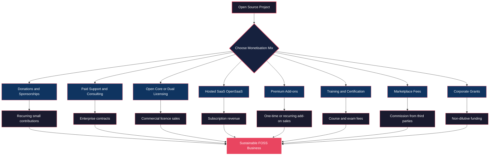
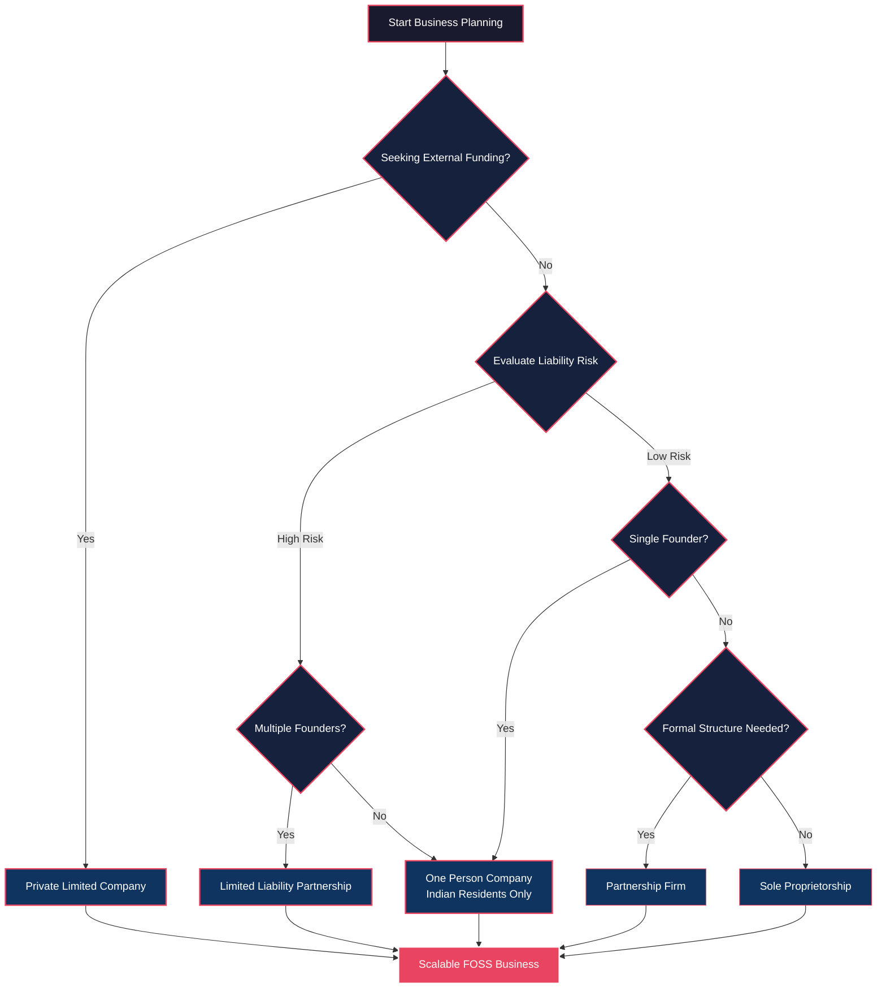
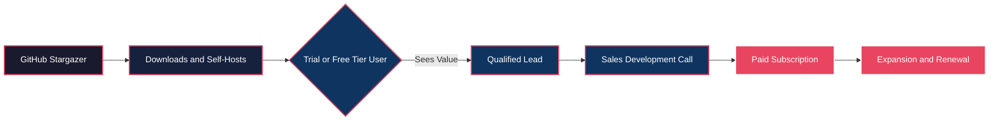
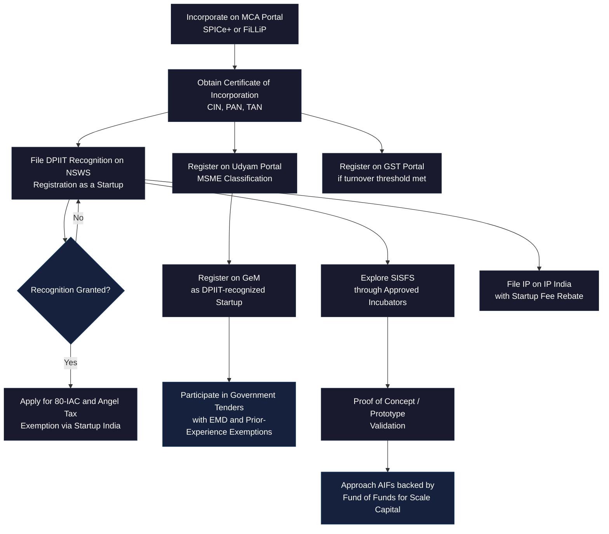

    

<h1 align="center">THE OPEN-SOURCE ENTREPRENEUR'S GUIDE</h1>
<h3 align="center">HOW TO GENERATE REVENUE AND SCALE YOUR FOSS BUSINESS IN INDIA.</h3>

    

    

    
 
> *Disclaimer: This guide provides general information based on prevailing regulations and market practices. Business regulations evolve continuously and specific circumstances may require tailored advice. Entrepreneurs should consult qualified professionals such as chartered accountants, company secretaries, or legal advisors before making entity selection, licensing, or registration decisions. The authors and publishers assume no liability for decisions made based on this documentation.*

  

## Introduction

Free and Open Source Software (FOSS) powers a significant portion of modern digital infrastructure. From cloud computing platforms to mobile operating systems, open-source code forms the foundation upon which businesses build their products and services. A persistent misconception, however, is that open source cannot be commercially viable. The reality contradicts this assumption entirely. Red Hat, GitLab, MongoDB, and WordPress have demonstrated that organisations can generate hundreds of millions, and in some cases billions, of dollars in annual revenue while keeping their core code open.

The fundamental principle underlying successful FOSS businesses is straightforward. Open-source companies do not sell software licences. Instead, they sell value around the software: reliability, convenience, expertise, compliance, and enterprise-grade features. This guide provides a practical framework for monetising open-source projects and scaling them into sustainable commercial ventures within the Indian context. It covers proven revenue models, the legal and regulatory landscape specific to India, strategic foundations, growth levers, and actionable steps for founders.

India presents a unique opportunity for FOSS entrepreneurs. The country has one of the world's fastest-growing major economies, a large pool of skilled software developers, and supportive government initiatives such as Startup India and Make in India. At the same time, Indian entrepreneurs face specific challenges related to business registration, taxation, compliance, and access to capital that require careful navigation. This guide addresses both the opportunities and the practical hurdles.

 

## Part One: Revenue Models for Open-Source Projects

### 1.1 Overview of Revenue Models

The table below summarises the most effective ways to generate income from open-source software. Most successful companies combine several of these models rather than relying on a single stream.

| Model | Description | Best Suited For | Real-World Example |
|-------|-------------|----------------|--------------------|
| Donations and Sponsorships | Individuals or companies contribute voluntarily through platforms like GitHub Sponsors or Open Collective | Early-stage projects with strong community support | Vue.js, Homebrew |
| Paid Support and Consulting | Customers pay for technical support, service level agreements, troubleshooting, and custom integration | Mature projects used by enterprises requiring guaranteed uptime | Red Hat |
| Open Core (Dual Licensing) | Core features remain open source while advanced proprietary features are sold under a commercial licence | Projects where enterprises need extra security, scalability, or compliance | GitLab, MongoDB |
| Hosted or SaaS (OpenSaaS) | The software is offered as a managed cloud-hosted service where users pay for convenience and maintenance | Projects that are complex to self-host or require continuous updates | WordPress.com, Supabase |
| Premium Features and Add-ons | Base product is free while specific extensions, themes, plugins, or modules are sold separately | Projects with a large ecosystem of third-party developers | Tailwind UI, WooCommerce |
| Training and Certification | Paid courses, workshops, and official certifications that validate expertise | Projects with steep learning curves or compliance requirements | Red Hat Certifications, Linux Foundation |
| Marketplace and Ecosystem Fees | A platform where third-party developers sell integrations, templates, or plugins with the project owner taking a commission | Highly popular projects with many external contributors | Shopify (marketplace model) |
| Bug Bounties and Feature Funding | Companies or individuals pay for specific issues to be fixed or features to be built | Niche projects with specific enterprise needs | Gitcoin |
| Corporate Grants and Foundations | Non-profit foundations or corporate programmes provide funding for development, security audits, or infrastructure | Projects critical to digital infrastructure | Apache Foundation, Mozilla Open Source Support |

### 1.2 Detailed Explanations of Each Model

**Donations and Sponsorships**

This is the simplest model to start. Add a Sponsor button to your GitHub repository or create a page on Open Collective. Individuals and companies that benefit from your project can contribute monthly or one-time amounts. While this model rarely generates enough income to support a full team, it can cover server costs, domain registration, and small bounties. To succeed, actively promote your sponsorship page, acknowledge donors publicly, and offer recognition tiers. Relying solely on donations is risky because income is unpredictable. Use donations as a supplementary stream rather than a primary revenue source. Even popular projects often collect only modest amounts through this channel, highlighting its limitations.

**Paid Support and Consulting**

Many enterprises are willing to pay for guaranteed response times, bug fixes, and expert advice. Offer different support tiers: basic email support, round-the-clock coverage, or on-site consulting. This model works best when your software is critical to business operations, such as databases, operating systems, or continuous integration tools. Red Hat built a multi-billion dollar business almost entirely on support subscriptions. The downside is that support is labour-intensive and does not scale linearly with revenue. Mitigate this by creating a knowledge base, self-service tools, and training a support team. Consulting, on the other hand, can be highly profitable per hour but requires skilled engineers who enjoy client interaction. This model is particularly effective for infrastructure software where downtime is costly for the customer.

**Open Core and Dual Licensing**

Under the open-core model, release a base version of your software under a permissive or copyleft licence such as MIT or GPL. Then sell a commercial version that adds proprietary features such as advanced analytics, role-based access control, or compliance tooling. Dual licensing goes further by offering the same codebase under both an open-source licence for non-commercial use and a commercial licence for proprietary integration. MySQL famously used this approach. The main challenge is deciding which features remain open. If too many valuable features go into the paid version, the community may fork your project. If too few, no one will pay. Transparency is critical: clearly document what is open and what is not. This model is best when your largest customers will pay for performance, scalability, and integration features that individual developers do not need.

**Hosted Services (OpenSaaS)**

This model takes your open-source application and offers it as a fully managed cloud service. Customers pay a monthly or usage-based fee to avoid the hassle of self-hosting, updating, and securing the software. WordPress.com is a classic example: the core WordPress software is free, but millions of users pay for hosting, automatic backups, and custom domains. GitLab offers both a self-hosted Community Edition and a paid SaaS version. The biggest advantage is recurring revenue with relatively high margins. The risk is that large cloud providers might offer the same service at a lower price. To compete, focus on best-in-class user experience, specialised features, and direct support from the original developers. Offering a hosted version often converts users who do not want to deal with self-hosting.

**Premium Features and Add-ons**

Instead of splitting the core product, keep everything open but sell optional extras. For a content management system, that could be premium themes or SEO plugins. For a CSS framework, it could be pre-built component libraries. This model works exceptionally well when you have a large user base and an ecosystem of third-party developers. You can either build the add-ons yourself or create a marketplace and take a revenue share. The key is to ensure that the free version remains fully functional and attractive; otherwise, users will feel forced to pay and may abandon the project.

**Training and Certification**

If your open-source project is complex or industry-standard, offering paid training courses and formal certifications can be a lucrative revenue stream. Companies often require certified engineers to meet compliance or insurance requirements. Red Hat's certification programme is renowned and generates significant income. You can create on-demand video courses, live workshops, or partner with existing e-learning platforms. Production costs are relatively low once materials are developed, and each certification exam can be priced at several hundred dollars. The main challenge is maintaining credibility: your certification must be rigorous and respected. This model is particularly effective when your software is a job skill, such as Kubernetes, Linux, or PostgreSQL.

**Marketplace and Ecosystem Fees**

When your project becomes a platform, such as a headless content management system, e-commerce engine, or analytics tool, you can allow third-party developers to sell plugins, templates, or integrations on your marketplace. You then take a percentage of each sale. This model turns your open-source project into a revenue-sharing ecosystem. To succeed, you need a large number of active users, clear API documentation, and a fair revenue split that incentivises developers without discouraging participation. A typical commission ranges from 10 to 30 percent. This model is powerful because it creates network effects: more users attract more developers, which in turn attracts more users.

**Bug Bounties and Feature Funding**

Platforms like Gitcoin allow organisations to post bounties for specific issues or feature requests. Developers who solve them get paid. While this is not a steady income stream, it can be a useful way to earn money on the side or to fund specific work on your own project. You can also set up a feature fund where multiple users pool money to prioritise a feature they need. This model aligns incentives between maintainers and users but requires active community management. For project leaders, feature funding can help allocate development effort to the most desired features without taking a salary from a single company.

**Corporate Grants and Foundations**

Many open-source projects receive grants from technology foundations such as the Linux Foundation, Apache Foundation, or Mozilla Foundation, or from corporate programmes such as GitHub Accelerator or Stripe Open-Source Retreat. Grants are typically awarded for security improvements, sustainability efforts, or adding critical features. They usually do not require giving up equity or control, but the application process can be competitive. Having a clear roadmap and measurable outcomes significantly increases your chances. In India, organisations such as the Software Freedom Law Center and various government-backed innovation funds also provide support for open-source development.

### 1.3 Visual Overview: Monetisation Models Flow

 

## Part Two: Legal and Business Foundations in India

Before scaling, you must establish the right legal, technical, and community foundations. These elements determine whether your monetisation efforts will be accepted by the open-source community or rejected as unethical. In India, the choice of business entity carries additional significance because it affects your ability to raise capital, comply with tax regulations, and protect personal assets.

### 2.1 Choosing the Right Business Entity in India

India offers several business structures, each with distinct implications for liability, taxation, fundraising, and compliance. The table below compares the primary options available to FOSS entrepreneurs.

| Entity Type | Liability Protection | Funding Potential | Compliance Complexity | Best For |
|-------------|---------------------|-------------------|----------------------|----------|
| Sole Proprietorship | None | Very Low | Very Low | Freelancers and early-stage testing |
| Partnership Firm | Unlimited | Low | Low | Small teams with complementary skills |
| Limited Liability Partnership (LLP) | Limited | Moderate | Medium | Professional services and consulting |
| One Person Company (OPC) | Limited | Low | Medium | Solo founders seeking liability protection |
| Private Limited Company | Limited | High | High | Growth-oriented startups planning to raise capital |
| Public Limited Company | Limited | Very High | Very High | Large enterprises planning to list on stock exchanges |
| Section 8 Company | Limited | Grants and donations | High | Non-profit and social impact ventures |

**Sole Proprietorship**

This is the simplest structure where no legal distinction exists between the owner and the business. It offers complete managerial control and minimal compliance requirements. However, the owner bears unlimited personal liability, meaning personal assets such as a home or savings are exposed to business debts and legal claims. Raising external investment is extremely difficult because the structure cannot issue equity shares. This option suits freelancers, local retail businesses, and entrepreneurs testing concepts with minimal risk exposure.

**Partnership Firm**

A partnership involves two or more individuals operating together under the Indian Partnership Act, 1932. Partners share profits and losses according to predetermined ratios outlined in a partnership deed. While it allows for resource pooling and shared responsibility, all partners bear unlimited personal liability for the firm's debts. Decision-making can become complicated without clear governance mechanisms. This structure is ideal for professional services firms and family businesses where partners bring complementary skills.

**Limited Liability Partnership (LLP)**

An LLP combines the flexibility of a partnership with the benefits of limited liability. Established under the Limited Liability Partnership Act, 2008, it provides a separate legal identity distinct from its partners. Partners' liability is limited to their agreed contribution, protecting personal assets from business obligations. LLPs require fewer compliance formalities than private limited companies and are taxed as partnership firms, avoiding dividend distribution tax. However, they are less attractive to venture capital investors who prefer equity structures. LLPs suit professional services firms, consulting businesses, and ventures with multiple founders seeking liability protection without corporate complexity.

**One Person Company (OPC)**

An OPC allows a single entrepreneur to operate with limited liability. Introduced through the Companies Act, 2013, it requires the nomination of a successor director and is available only to Indian residents. The structure provides complete decision-making authority with corporate benefits, including limited liability protection. However, it must convert to a private limited company if turnover exceeds two crore rupees or paid-up capital exceeds fifty lakh rupees. OPCs cannot issue equity to multiple investors, limiting their fundraising potential. This structure suits solo entrepreneurs and individual consultants seeking liability protection without partner complexity.

**Private Limited Company**

A private limited company is a corporate structure with a separate legal identity governed by the Companies Act, 2013. It requires a minimum of two shareholders and two directors, with a maximum of 200 shareholders. Shareholder liability is limited to unpaid share capital. This structure is the preferred choice for venture capital and institutional investment because it allows for the issuance of equity shares, employee stock option plans, and clear governance protocols. The trade-off is greater compliance burden, including mandatory annual filings, statutory audits, and board meetings. Private limited companies suit growth-oriented startups and technology ventures planning external funding rounds.

**Public Limited Company**

A public limited company can offer shares to the general public through stock exchanges. It requires a minimum of seven shareholders and three directors. While it provides the greatest access to capital and maximum liability protection, it also imposes stringent compliance requirements, including extensive disclosure obligations and oversight from the Securities and Exchange Board of India when listed. This structure suits large-scale businesses and enterprises planning initial public offerings.

**Section 8 Company**

A Section 8 company is established for charitable objectives rather than profit distribution. It is formed for purposes such as education, art, science, sports, religion, social welfare, or environmental protection. Profits are reinvested into promoting the stated objectives rather than distributed to members. Section 8 companies are eligible for tax benefits under the Income Tax Act and are ideal for social enterprises, non-governmental organisations, and impact-focused ventures. However, they cannot distribute dividends and face restrictions on their activities.

### 2.2 Entity Selection Decision Flow

### 2.3 Licensing and Intellectual Property Strategy

Choosing the right open-source licence is one of the most important decisions. Licences fall into two broad categories.

**Permissive licences** such as MIT, Apache 2.0, and BSD allow anyone to use, modify, and redistribute the code in proprietary products. This maximises adoption but gives you little control over commercial use by others.

**Copyleft licences** such as GPL, AGPL, and LGPL require that any derivative work or software that links to your code must also be released under the same licence. This protects the code from becoming closed-source but can discourage some commercial adoption.

For a business, a common approach is to use a strong copyleft licence such as GPL for the core open-source product, then offer additional proprietary components under a commercial licence. This is the dual-licensing model mentioned earlier. You must also protect your trademarks and project name. Even if someone forks your code, they cannot legally use your brand name without permission. Registering trademarks in India is a relatively inexpensive way to prevent confusion and maintain your commercial offering's uniqueness.

It is equally important to have clear contributor agreements. When external developers contribute code, you need a Contributor Licence Agreement or a Developer Certificate of Origin that grants you the right to relicense their contributions for commercial purposes. Without this, you may not be able to offer a paid version that includes community-written code. Many companies have learned this lesson the hard way. Consult an open-source lawyer to draft appropriate agreements. Projects that changed licensing terms without sufficient community dialogue have faced significant backlash and forks.

### 2.4 Community Governance and Health

Your community is your greatest asset and your potential competitor. If you alienate contributors, they can fork the project and create a competing free version. Therefore, governance must be transparent and fair. For small projects, a benevolent dictator model with one lead maintainer works. For larger projects, consider a foundation or a steering committee with representatives from key corporate users.

Measuring community health is critical for business planning. Track metrics such as the number of active committers, issue resolution time, pull request response rate, contributor retention, and the number of stars, forks, and downloads. While stars and forks are vanity metrics, they indicate popularity. A healthy community creates a virtuous cycle: more contributions lead to better software, leading to more users, some of whom convert to paying customers. Invest time in writing good documentation, responding kindly to issues, and recognising contributors publicly. A strong open-source community can help a venture out-innovate larger competitors and build features faster.

### 2.5 Product Differentiation: What Will People Pay For?

Even with a perfect licence and community, you need a compelling reason for customers to pay. Enterprises typically pay for the following:

- **Lifecycle guarantees**: Long-term support for older versions, backported security fixes, and certified compatibility with hardware or cloud platforms.
- **Security and compliance**: Regular vulnerability scanning, CVE disclosure handling, software bill of materials, and certifications such as FIPS or SOC2.
- **Management tools**: A graphical dashboard for monitoring, auto-updates, role-based access control, and audit logs.
- **Scalability features**: Clustering, horizontal scaling, high availability configurations, and performance tuning.
- **Integration ecosystem**: Pre-built connectors for popular CRMs, ERPs, cloud storage, or identity providers.

Do not try to build all these at once. Start with the features that your largest or most demanding users request. Often, a single enterprise customer will fund the development of a feature that can then be sold to others.

 

## Part Three: Scaling Your FOSS Business in India

Once you have a monetisation model and a solid foundation, the next phase is growth. Scaling an open-source business is different from a traditional software company because your top-of-funnel lead generation is essentially free: it comes from developers who discover your project organically. However, converting those developers into paying customers requires a structured sales and marketing approach tailored to the Indian market.

### 3.1 Go-to-Market and Sales Channels

A typical open-source company uses a bottoms-up sales motion: developers use the free version at work, appreciate its capabilities, and then recommend it to their manager or procurement department. Eventually, the company buys a subscription for support or advanced features. To facilitate this, you need:

- **Self-serve online subscriptions**: A clear pricing page where anyone can buy a subscription using a credit card or unified payments interface. No sales call required for small teams.
- **Inside sales team**: For mid-market customers with 50 to 500 employees, a sales development representative can follow up on inbound leads, offer demos, and negotiate pricing.
- **Field sales for enterprise**: For large corporations, you need dedicated account executives who can handle complex procurement, legal reviews, and multi-year contracts.

Many open-source companies also leverage cloud marketplaces such as AWS Marketplace, Azure Marketplace, and Google Cloud Marketplace. Selling through these channels gives you access to existing cloud budgets and simplifies billing for customers. However, marketplaces take a revenue share typically ranging from 15 to 20 percent. Weigh this against the reduced customer acquisition cost.

In India, additional channels include government procurement portals for public sector contracts, participation in industry events such as the National Software Product Conclave, and partnerships with system integrators who serve large enterprises.

The diagram below illustrates the typical conversion funnel from community user to paying customer.

### 3.2 Financial Metrics and Key Performance Indicators

To scale successfully, you must measure the right numbers. The following key performance indicators are widely used in the open-source industry.

| Metric | Definition | Typical Benchmark for Healthy Business |
|--------|------------|----------------------------------------|
| Annual Recurring Revenue | Total yearly revenue from subscriptions | Growth above 50 percent year-over-year for early stage |
| Gross Margin | Revenue minus cost of goods sold divided by revenue | Above 80 percent for SaaS; above 60 percent for support-heavy models |
| Net Revenue Retention | Starting annual recurring revenue plus upgrades minus downgrades and churn divided by starting revenue | Above 110 percent is excellent; above 120 percent is world-class |
| Customer Acquisition Cost | Total sales and marketing spend divided by number of new customers | Payback period should be under 12 months |
| Logo Churn | Percentage of customers who cancel each month | Below 5 percent annual churn for enterprise; below 2 percent monthly for self-serve |
| Developer Adoption Rate | Number of active installations or downloads per month | Thousands to millions depending on project maturity |

Avoid focusing only on top-line growth. Many open-source companies have failed because they grew user numbers but never converted them to revenue. Establish a disciplined process to track how many users become qualified leads, how many leads become trials, and how many trials convert to paying customers. Healthy unit economics, where lifetime value exceeds three times customer acquisition cost, is the single most important predictor of sustainable growth.

### 3.3 Organisational Structure and Talent

As you scale, divide your engineering team into two groups.

The **upstream or core team** works on the open-source project, engages with the community, and reviews external contributions. These engineers must be excellent communicators and passionate about open-source values. They represent the project to the outside world and must balance community expectations with commercial priorities.

The **product or platform team** builds proprietary features, the hosted SaaS offering, and enterprise management tools. They focus on customer requirements and can work with closed-source code. This separation prevents conflicts of interest and allows each team to specialise.

The chief executive of an open-source company is often the original project leader. That person must balance community expectations with shareholder returns, which can be challenging. Decisions to move a feature from open to closed must be communicated well in advance with clear reasoning to avoid backlash.

Other key roles include a developer relations team that speaks at conferences, creates content, and nurtures the community; a compliance officer who handles licence audits and export controls; and a security engineer responsible for vulnerability disclosure and patch management. In India, where salary expectations for senior engineers have risen significantly, consider offering equity through employee stock option plans to attract and retain top talent.

### 3.4 Defending Against Forks and Cloud Provider Competition

Large cloud providers often offer managed versions of popular open-source software. Some companies have seen their open-source code repackaged as a cloud service with minimal revenue sharing. To defend against this, consider the following options.

Use the Server Side Public License or other cloud licences that explicitly require anyone offering the software as a service to also open-source their management code. Build a better SaaS experience that includes features the cloud providers cannot easily replicate, such as deep integration with your proprietary tools, one-click migration from self-hosted installations, and direct access to your support engineers. Form strategic partnerships with the cloud providers. Many hyperscalers have open-source partner programmes that offer co-marketing, co-selling, and even revenue sharing if you list your product on their marketplace.

Do not spend excessive energy worrying about cloud providers. As a project leader, you have the advantage of deep expertise. Customers often prefer to buy from the original creators because they trust the roadmap and can get faster feature development.

### 3.5 Security, Compliance, and Risk Management

Enterprises, especially in finance, healthcare, and government, will not use your software unless you meet stringent security and compliance standards. The following elements are non-negotiable for scaling into these markets.

- **Software Bill of Materials**: A complete inventory of all open-source components, versions, and licences used in your product. This can be generated automatically with tools like SPDX or CycloneDX.
- **CVE Response Process**: A documented procedure for receiving, triaging, patching, and disclosing security vulnerabilities. You need a dedicated security contact and a policy for coordinated disclosure.
- **Compliance Certifications**: Depending on your customer base, you may need SOC 2 Type II, ISO 27001, or other certifications. Achieving these certifications costs time and money but they become competitive moats.
- **Data Protection Compliance**: If you collect user data, you must comply with the Digital Personal Data Protection Act, 2023 in India and relevant international regulations such as the General Data Protection Regulation in Europe. This means having a clear privacy policy, implementing data minimisation practices, and having processes to handle user data requests.

Do not wait until an enterprise customer demands these. Build security practices into your daily development workflow: use automated dependency scanning, require signed commits, run fuzz testing, and maintain a public bug bounty programme.

 

## Part Four: Practical Steps to Start and Scale

The following step-by-step roadmap synthesises best practices from successful open-source founders, adapted for the Indian context.

### Step 1: Validate the Problem and Build the Core

Before thinking about monetisation, create a minimal but functional open-source project that solves a real pain point. Ensure the code is well-documented, has a clear licence starting with MIT or GPL, and is easy to install. Publish it on GitHub or GitLab. Focus on solving a specific problem for a well-defined user base. Generic tools compete with thousands of other projects; specialised tools build loyal communities.

### Step 2: Grow the Community and Achieve Product-Market Fit

Promote your project on forums, social media, and relevant conferences. Engage with every user who files an issue or submits a pull request. Track downloads and usage analytics with user consent. Product-market fit is achieved when users adopt your software without any sales effort: they find it themselves and recommend it to others. This stage can take six months to two years. Rapid public validation through a single tweet or blog post that reaches a wide audience can help accelerate this phase.

### Step 3: Add a Monetisation Stream

Start with the simplest method that fits your audience. For infrastructure tools, that is usually open core or hosted SaaS. For developer tools, it might be premium add-ons or training. Announce your monetisation plan to the community well in advance. Offer existing contributors a discount or free tier to show goodwill. Launch with a simple payment system such as Stripe or Paddle, or use Indian payment gateways like Razorpay or Cashfree for domestic customers.

### Step 4: Formalise the Business Entity

Register a legal entity appropriate to your scale and funding plans. For most growth-oriented FOSS startups in India, a private limited company is the right choice because it is the only structure that venture capital investors will fund. For solo founders testing a concept, a one person company or limited liability partnership may suffice. Open a business bank account. Sign contributor agreements with your core committers. Secure trademark protection for your project name and logo. This step is crucial for moving beyond donations and into enterprise sales, as procurement departments require a legal entity to contract with.

### Step 5: Build a Sales Funnel and Measure KPIs

Create a website with clear pricing and a demo or free trial. Install analytics to track the user journey from landing page to subscription. Set up a customer relationship management system such as HubSpot or Salesforce for lead tracking. Hire your first salesperson or lead founder-led sales. Define your target customer segments (small business, mid-market, enterprise) and tailor your messaging for each. Open source provides free top-of-funnel leads, but you must have a system to capture and nurture them.

### Step 6: Scale the Organisation and Defend Against Competition

As revenue grows, hire a dedicated community manager, a support engineer, and a product manager. Invest in security certifications if targeting regulated industries. Monitor competitors, especially free forks, by regularly checking GitHub for projects that copy your code. Differentiate through branding, certification, and superior service. Consider applying for grants or strategic investment to accelerate growth. In India, government schemes such as Startup India Seed Fund Scheme and state-level innovation programmes can provide non-dilutive funding.

### 4.1 Common Pitfalls and How to Avoid Them

| Pitfall | Description | Mitigation Strategy |
|---------|-------------|----------------------|
| Alienating the community | Putting too many features behind a paywall causing a fork | Keep core functionality open; add proprietary value that complements rather than replaces |
| Underpricing | Charging too little for support or SaaS making scaling impossible | Research competitor pricing; calculate true costs; price for value not cost |
| Ignoring security | No vulnerability disclosure process leading to a major breach | Adopt a security policy from day one; use automated scanning; create a private security mailing list |
| Single-point failure | Relying entirely on one paying customer or one cloud platform | Diversify revenue across multiple segments and channels; avoid exclusive hosting agreements |
| Founder burnout | Trying to handle community, code, sales, and support alone | Recruit co-founders or early employees with complementary skills; automate repetitive tasks; set clear work-life boundaries |
| Regulatory non-compliance | Failing to register for GST, professional tax, or other mandatory filings | Maintain a compliance calendar; engage a chartered accountant early; budget for ongoing compliance costs |

### 4.2 Cost Considerations for Indian FOSS Entrepreneurs

Understanding the cost structure of setting up and running a FOSS business in India helps with financial planning. The table below provides indicative figures for common expenses.

| Expense Category | Sole Proprietorship | LLP | Private Limited Company |
|------------------|---------------------|-----|-------------------------|
| Incorporation and registration | 3,000 to 8,000 | 10,000 to 25,000 | 18,000 to 45,000 |
| Annual compliance | 2,000 to 5,000 | 8,000 to 25,000 | 15,000 to 50,000 |
| Professional tax (Karnataka example) | Applicable per employee | Applicable per employee | Applicable per employee |
| Virtual office (monthly) | 1,500 to 4,000 | 1,500 to 4,000 | 1,500 to 4,000 |
| Coworking desk (monthly) | 5,000 to 8,000 | 5,000 to 8,000 | 5,000 to 8,000 |

Note that these figures are indicative and vary by state, authorised capital, and service provider. Government fees for company incorporation depend on authorised capital. Professional fees depend on complexity. Always obtain current quotes from chartered accountants and company secretaries before making decisions.

 

## Conclusion: The Open-Source Flywheel

Making money from open-source projects is not only possible but has been proven by dozens of multi-million dollar companies. The secret is to understand that open-source software acts as a powerful demand-generation engine. The more people use your free code, the more potential customers learn about your expertise. You then offer paid services, hosted versions, or premium features to those who need reliability, security, and convenience.

Scaling a FOSS business in India requires balancing the values of openness with commercial reality and navigating the country's specific legal and regulatory landscape. When done right, this balance creates a virtuous cycle: community contributions improve the software, which attracts more users, which generates more revenue, which allows you to pay more engineers to work on the software. That is the open-source flywheel.

Start small, stay transparent, listen to your users, and gradually introduce monetisation. Choose a business entity that matches your funding strategy and risk profile. Maintain compliance with Indian tax and corporate regulations from the beginning. With patience and persistence, your open-source passion can become a sustainable, scalable business.

 

## Appendix: Curated FOSS Licences Reference Table

The following table lists common open-source licences and their key characteristics. Use this guide when choosing a licence for your project.

| Licence Name | Type | Key Terms | Official URL |
|--------------|------|-----------|---------------|
| MIT License | Permissive | Allows any use including proprietary; only requires preservation of copyright and licence notice | opensource.org/licenses/MIT |
| Apache 2.0 | Permissive | Provides patent protection; requires explicit notice of modified files | apache.org/licenses/LICENSE-2.0 |
| BSD 3-Clause | Permissive | Similar to MIT but prohibits using the name of the project for endorsement | opensource.org/licenses/BSD-3-Clause |
| GPL 3.0 | Copyleft | Any derivative work must also be GPL; includes anti-tivoisation clauses | gnu.org/licenses/gpl-3.0.html |
| AGPL 3.0 | Copyleft | Extends GPL to software accessed over a network such as a service | gnu.org/licenses/agpl-3.0.html |
| LGPL 3.0 | Weak Copyleft | Allows linking from proprietary code; modifications to the library itself must remain LGPL | gnu.org/licenses/lgpl-3.0.html |
| Mozilla Public License 2.0 | Weak Copyleft | Copyleft applies only to individual files; entire combined work can be proprietary | mozilla.org/en-US/MPL/2.0/ |
| EUPL 1.2 | Copyleft | European Union licence; compatible with GPL; requires sharing modifications | joinup.ec.europa.eu/collection/eupl/eupl-text-eupl-12 |
| Unlicense | Public Domain Equivalent | Dedication to public domain; no conditions | unlicense.org/ |
| Server Side Public License | Strong Copyleft | Requires that anyone offering the software as a service must release all service management code | mongodb.com/licensing/server-side-public-license |

Note: This table is for reference only. Always consult a qualified attorney before adopting a licence for your project, especially if you plan to commercialise.

    

<h1 align="center">Government Websites for Startups in India</h1>

  

India’s startup ecosystem is supported by a layered architecture of government portals. These platforms are not marketing pages. They are working interfaces for recognition, registration, funding, procurement, and compliance. For a founder, knowing which portal does what, and in what sequence, is more useful than a long list of scheme names. This guide maps the core central portals, the state-level single windows, and the practical steps that connect them.

The central principle is straightforward: a startup in India typically interacts with the government in four capacities: as a **company or LLP** (MCA), as a **recognized startup** (DPIIT through NSWS), as an **MSME** (Udyam), and as a **taxable entity** (GST). Funding, incubation, and public procurement sit on top of these four foundations. Understanding this stack prevents wasted effort and repeated filings.

 

## The Core Central Government Portals

The following portals form the minimum viable digital footprint for most startups. Each has a distinct legal or administrative purpose, and none is a substitute for another.

| Portal | Primary Purpose | Who It Serves | Key Output |
|---|---|---|---|
| **MCA Portal** (mca.gov.in) | Company or LLP incorporation | All founders | Certificate of Incorporation, CIN, PAN, TAN |
| **NSWS** (nsws.gov.in) | DPIIT startup recognition and multi-ministry approvals | Startups seeking recognition and regulatory clearances | DPIIT Recognition Certificate |
| **Startup India** (startupindia.gov.in) | Information, scheme discovery, and tax exemption applications | DPIIT-recognized startups | Access to 80-IAC, Angel Tax exemption, SIPP |
| **Udyam** (udyamregistration.gov.in) | MSME registration | Micro, small, and medium enterprises | Udyam Registration Certificate with QR code |
| **GeM** (gem.gov.in) | Government procurement marketplace | Startups and MSMEs selling to government | Seller account and tender participation |
| **GST Portal** (gst.gov.in) | Goods and Services Tax registration | Any entity crossing the GST threshold | GSTIN |
| **IP India** (ipindia.gov.in) | Patent, trademark, and design filing | Innovators seeking IP protection | Patent or trademark application |
| **myScheme** (myscheme.gov.in) | Scheme eligibility discovery | All citizens and businesses | Curated list of applicable schemes |

### MCA Portal: Incorporation Through SPICe+

The Ministry of Corporate Affairs portal is the first stop for any founder incorporating a private limited company or LLP. The relevant instrument is the **SPICe+ form**, an integrated web form that combines name reservation, incorporation, DIN allotment, PAN, TAN, GSTIN, EPFO, ESIC, and professional tax registration into a single filing window. The form is filed on the MCA V3 portal. An LLP uses the FiLLiP form instead.

The practical significance of SPICe+ is that it reduces what used to be a multi-week, multi-agency process into a single structured application. The output is the Certificate of Incorporation, which is the legal birth certificate of the entity. Every subsequent registration, including DPIIT recognition and Udyam, depends on this certificate.

### NSWS: The Gateway to DPIIT Recognition

The National Single Window System is the operational front end for DPIIT startup recognition. It hosts approval applications from **32 central departments and 33 state governments** on a single digital platform. For startups, the critical action is adding the “Registration as a Startup” form to the dashboard and filing it with the required documents.

DPIIT recognition is not automatic. The eligibility criteria are specific:

| Criterion | Requirement |
|---|---|
| **Entity type** | Private Limited Company, Registered Partnership Firm, LLP, or Cooperative Society |
| **Turnover** | Less than INR 200 crore in any previous financial year (INR 300 crore for DeepTech) |
| **Age** | Up to 10 years from incorporation (20 years for DeepTech) |
| **Nature of work** | Innovation, improvement of products or processes, potential for employment or wealth creation |
| **Exclusions** | Entities formed by splitting up or reconstruction of an existing business |

The recognition is free of charge. DPIIT has explicitly stated that no agency or representative is authorized to issue the certificate, and the application must be filed by the startup using its own credentials.

The recognition unlocks two tax benefits. Under **Section 80-IAC**, an eligible startup can claim a tax holiday for three consecutive financial years out of its first ten years. Under **Section 56**, Angel Tax exemption is available. Both applications are routed through the Startup India portal after the DPIIT certificate is issued. The 80-IAC benefit is restricted to private limited companies and LLPs incorporated after 1 April 2016.

### Udyam: MSME Registration as a Separate Identity

Udyam registration is distinct from DPIIT recognition. It classifies an enterprise as micro, small, or medium based on investment in plant and machinery and turnover. The thresholds are:

| Category | Investment in Plant and Machinery | Annual Turnover |
|---|---|---|
| **Micro** | Up to INR 2.5 crore | Up to INR 10 crore |
| **Small** | Up to INR 25 crore | Up to INR 100 crore |
| **Medium** | Up to INR 125 crore | Up to INR 500 crore |

The process is fully online, paperless, and free. Only an Aadhaar number is required for the proprietor or authorized signatory. PAN and GST details are pulled automatically from government databases. The certificate carries a dynamic QR code and requires no renewal. The Ministry of MSME has issued an explicit warning that only the Udyam portal and government single window systems are authorized for registration; private websites claiming to offer the service are not official.

For startups, Udyam matters because MSME status is a prerequisite for several collateral-free credit schemes and for benefits under the Public Procurement Policy. It also signals to incubators and grant evaluators that the entity is an operating enterprise, not merely an incorporated shell.

### Startup India Portal: The Information and Scheme Layer

Startup India is often confused with the recognition process. In practice, recognition happens on NSWS, while the Startup India portal serves as the knowledge and scheme application layer. It hosts the Startup India Hub, learning modules, and the application links for 80-IAC and Angel Tax exemption.

The portal also provides access to the **Startups Intellectual Property Protection (SIPP)** framework. DPIIT-recognized startups are eligible for an **80% rebate on patent filing fees** and a **50% rebate on trademark fees**. SIPP facilitation cells, staffed by empanelled patent and trademark agents, provide pro bono assistance for the drafting and filing process. The scheme’s original iteration concluded in March 2026, but the statutory fee concessions on the IP India portal remain available to eligible startups, subject to current rules.

### GeM: Selling to the Government

Government e Marketplace is the central procurement platform for ministries, departments, and public sector undertakings. DPIIT-recognized startups receive specific advantages on GeM: exemption from prior turnover and prior experience requirements, and exemption from Earnest Money Deposit (EMD). Registration is free and requires only Aadhaar or PAN, a mobile number, and an email ID.

For a B2B startup selling industrial software, monitoring devices, or maintenance services, GeM is often the first credible revenue channel. The platform does not guarantee orders, but it removes the gatekeeping that traditionally excluded young companies from government tenders.

### GST Portal: The Compliance Backbone

GST registration is mandatory once turnover crosses the prescribed threshold, and voluntary registration is common for B2B startups seeking to claim input tax credit. The application is filed on **gst.gov.in** through Services > Registration > New Registration. The process is free, Aadhaar-authenticated, and increasingly automated. A GSTIN is a practical requirement for GeM selling, for most B2B contracts, and for bank account operations at scale.

 

## Funding and Incubation: Where the Money Sits

Government funding for startups is not a single pool. It is a set of instruments with different eligibility rules, ticket sizes, and disbursement routes. The two most relevant central instruments for early-stage startups are the Startup India Seed Fund Scheme and the Fund of Funds for Startups.

### Startup India Seed Fund Scheme (SISFS)

SISFS is designed for the pre-revenue and early-revenue stage. It provides financial support for **proof of concept, prototype development, product trials, market entry, and commercialization**. The scheme is routed through selected incubators, not directly to startups from a central ministry. A startup applies to an approved incubator, and the incubator evaluates and disburses the seed support.

The instrument is a grant, not equity. This matters for founders who want to validate a product without diluting equity at a low valuation. The trade-off is that the application is competitive and the incubator’s approval is the binding decision point.

### Fund of Funds for Startups (FFS)

The Fund of Funds does not invest directly in startups. It is managed by **SIDBI** and invests in SEBI-registered Alternative Investment Funds (AIFs). Those AIFs, in turn, must invest at least twice the FFS contribution into DPIIT-recognized startups. For a founder, the practical implication is that FFS is relevant only after the startup has reached a stage where a VC fund is a realistic investor. It is a supply-side intervention that deepens the venture capital market, not a direct grant window.

### Technology Incubators

The government’s incubator network is catalogued on the **India Science, Technology & Innovation** platform, which lists **246 technology incubators** across states and focus areas. These incubators span sectors including ICT, renewable energy, dairy technology, medical devices, and composites. Examples include CIIE in Ahmedabad, CIBA in Goa, and the Society for Innovation and Entrepreneurship in Dairying in Karnal.

The incubator route is often more useful for a sector-focused startup than a generic grant scheme. An incubator with domain expertise in dairy technology or medical devices can provide lab access, industry mentors, and credibility that a general-purpose seed fund cannot.

 

## State-Level Portals: Where the Real Friction Lives

Central recognition is necessary but not sufficient. State governments administer their own startup policies, incentives, and single-window clearance systems. The quality and completeness of these portals vary, but ignoring them leaves money and expedited approvals on the table.

| State | Portal | What It Offers |
|---|---|---|
| **Rajasthan** | iStart Rajasthan (istart.rajasthan.gov.in) | Registration, incentives, incubator access, single-window approvals for AVGC-XR and other sectors |
| **Karnataka** | Karnataka Startup Portal (startup.karnataka.gov.in) | State startup policy access, ELEVATE and ELEVATE NxT programmes, incubator and mentor network |
| **Telangana** | Startup Telangana (startup.telangana.gov.in) | Registration, grievance redressal, mentorship, incubator listings, and T-Hub linkage |
| **Kerala** | Kerala Startup Mission (startupmission.kerala.gov.in) | KSUM registration, KSWIFT single-window clearance, IEDC network, structured financial support |
| **Tamil Nadu** | StartupTN (startuptn.in) | Unified startup portal, DeepTech policy access, grant applications, state registration |
| **Gujarat** | Startup Gujarat (startup.gujarat.gov.in) | Startup registration, nodal institution and mentor registration, policy notifications, i-Hub linkage |
| **Maharashtra** | MAITRI 2.0 (maitri.maharashtra.gov.in) | Single-window investor facilitation, startup grants and incentives, IP support, dedicated innovation fund |

The state portals are not harmonized. A founder operating in multiple states will encounter different registration forms, different incentive definitions, and different approval workflows. The practical approach is to register in the state of incorporation or primary operations first, and expand to other states only when there is a concrete operational need.

 

## The Practical Sequence: From Incorporation to First Government Customer

The following flow chart shows the recommended sequence for a founder who intends to use government platforms systematically. The sequence is not mandatory, but it reflects the dependency relationships between the portals. Each step produces an output that is a prerequisite for the next.

The flow is intentionally linear on the left side because incorporation, recognition, and Udyam are foundational. The branches on the right side, funding and procurement, are optional but high-leverage. A startup can operate without DPIIT recognition, but it will pay full patent fees, face EMD requirements on GeM, and miss the 80-IAC tax holiday. For most growth-oriented ventures, the recognition is worth the filing effort.

 

## Avoiding Common Pitfalls

**Do not pay intermediaries for free registrations.** Udyam registration is free and does not require any agent. DPIIT recognition is free and DPIIT has not appointed any franchise or representative. Any website charging a fee for these services is either a convenience layer or a misuse of the government’s name.

**Do not confuse Udyam with DPIIT recognition.** They serve different purposes and are administered by different ministries. A company can have Udyam registration without DPIIT recognition, and vice versa. Udyam is about enterprise size; DPIIT recognition is about innovation and age. The benefits are not interchangeable.

**Do not assume state incentives are automatic.** Most state startup policies require separate registration on the state portal and, in some cases, physical presence or incubation in the state. The central DPIIT certificate does not trigger state benefits. The state portal is a separate application with its own eligibility criteria and disbursement process.

**Do not treat myScheme as an application portal.** myScheme is a discovery tool. It helps identify schemes for which a business may be eligible, but the actual application typically happens on the ministry or state portal that administers the scheme. Use myScheme to build a shortlist, then go to the source portal to file.

 

## What This Stack Means for a Founder

The government portal architecture in India is dense, but it is not opaque. The core logic is a separation of concerns: MCA creates the legal entity, NSWS recognizes it as a startup, Udyam classifies it as an enterprise, GST makes it taxable, GeM makes it sellable to the government, and the funding and incubation layers provide risk capital and validation. Each portal has a defined role, and the sequence matters.

A founder who treats these portals as a checklist to be completed in order will spend less time correcting filings and more time building the business. The portals are not perfect. State systems are uneven, some approval workflows still involve physical touchpoints, and the language across portals is not fully harmonized. But the direction is clear: the government has built a digital-first layer for startup formation and support, and the founders who learn to use it gain a structural advantage over those who treat it as an afterthought.

     

<h1 align="center">DIRECTORY OF GLOBAL TECHNOLOGY COMPANIES AND STARTUPS</h1>

    

  

### Overview

This document presents a compiled directory of 1,078 technology companies, software firms, and startups from across the global business landscape. The listing represents a cross-section of the technology sector, ranging from established multinational corporations to emerging ventures in various stages of growth. The directory is intended to serve as a reference point for stakeholders seeking to understand the breadth of the technology ecosystem.

### Scope and Composition

The directory encompasses organizations across multiple categories, reflecting the diversity of the modern technology industry. These categories are not mutually exclusive, as many companies operate across several domains.

| Category | Description | Examples |
| :--- | :--- | :--- |
| **Technology Giants** | Established global corporations with significant market presence | Apple, Microsoft, Google, Amazon, IBM |
| **Financial Services & FinTech** | Banking institutions, investment firms, and financial technology innovators | Goldman Sachs, PayPal, Stripe, Razorpay |
| **Software & SaaS** | Companies specializing in software development and cloud-based services | Salesforce, Adobe, Atlassian, Shopify |
| **E-commerce & Consumer Platforms** | Digital marketplaces and direct-to-consumer platforms | Amazon, Flipkart, Zomato, Airbnb |
| **Aerospace & Defense** | Organizations involved in space technology, defense, and aviation | Airbus, ISRO, DRDO |
| **Enterprise Solutions** | Providers of B2B services and enterprise software | Cognizant, Infosys, Accenture, EPAM |
| **Emerging Startups** | Venture-backed companies and early-stage innovative firms | Various entries across fintech, healthtech, and edtech |
| **Digital Media & Content** | Media platforms, streaming services, and content creation tools | Spotify, Discord, Medium, Bandcamp |

### Geographic Diversity

The companies represented span multiple continents, with significant representation from the following regions:

- **North America**: United States, Canada
- **Europe**: United Kingdom, Germany, France, Poland, Sweden, and others
- **Asia**: India, China, Japan, Singapore, Indonesia
- **South America**: Brazil, Argentina
- **Australia and Oceania**

### Industry Sectors Represented

The directory covers a broad spectrum of technology-enabled industries, illustrating the pervasive influence of technology across the global economy. Key sectors include:

- Artificial Intelligence and Machine Learning
- Cloud Computing and Infrastructure
- Financial Technology (FinTech)
- Health Technology (HealthTech)
- Educational Technology (EdTech)
- E-commerce and Retail Technology
- Cybersecurity
- Enterprise Software and SaaS
- Mobile Applications
- Gaming and Entertainment
- Aerospace and Defense Technology
- Digital Marketing and Advertising Technology (AdTech)
- Human Resources and Recruitment Technology
- Logistics and Supply Chain Technology

### Methodology

The compilation was derived from multiple source documents and consolidated to eliminate duplicate entries while preserving the integrity of the original data. Each organization has been assigned a unique serial index to facilitate easy reference and navigation within the accompanying table.

### Data Considerations and Limitations

Users of this directory should be aware that the corporate landscape is inherently dynamic. The information presented represents a snapshot in time, and organizations may have undergone significant changes since the data was compiled. Such changes may include, but are not limited to:

- Acquisitions or mergers resulting in new parent entities
- Rebranding initiatives leading to name changes
- Operational cessation or bankruptcy
- Strategic pivots, restructuring, or spin-offs
- Geographic expansion or consolidation

Furthermore, the directory includes some company names that are generic or for which limited public information is available. The absence of a company from this list does not imply any judgment on its significance or viability.

### Intended Use

This directory is intended to serve as a foundational reference for a range of stakeholders, including:

- **Job seekers** exploring career opportunities within the technology sector
- **Investors** conducting preliminary research on potential portfolio companies
- **Business development professionals** identifying potential partners, clients, or competitors
- **Market researchers** analyzing industry composition and trends
- **Students and academics** studying the technology ecosystem

The directory is a starting point for research and should not be used as the sole basis for critical business decisions.

### Recommendations for Utilization

For optimal and responsible use of this directory, the following steps are strongly recommended:

1.  **Verify Current Status**: Confirm the operational status and legal name of any company of interest through its official website or relevant business registries.
2.  **Consult Recent News**: Review recent news and industry publications to identify any major corporate developments, such as acquisitions, leadership changes, or financial results.
3.  **Utilize Multiple Sources**: Supplement the information in this directory with data from other sources, including financial databases, industry reports, and professional networks.
4.  **Review Accompanying Disclaimer**: Carefully read the associated disclaimer for a full understanding of the limitations of this data.

### Key Statistics

| Metric | Value |
| :--- | :--- |
| Total Companies Listed | 1,078 |
| Geographic Regions | 30+ countries represented |
| Industry Sectors | 15+ primary categories |
| Company Types | Public, private, venture-backed, government |

 

# Disclaimer

**Please Read Carefully**

The information provided in the accompanying table and this executive summary has been compiled from various sources and is presented for general informational purposes only. While efforts have been made to ensure the accuracy of the company names and their serial numbering, no guarantee is made regarding the completeness, accuracy, reliability, or current status of the information presented.

**Important Considerations:**

- **Dynamic Corporate Status**: The corporate landscape is subject to constant change. Companies listed may have undergone significant changes since the time of compilation, including but not limited to mergers, acquisitions, rebranding, bankruptcy, cessation of operations, restructuring, or spin-offs.

- **Temporal Relevance**: The status of companies in this list is time-sensitive. An organization that was operational when this data was compiled may have since been acquired, shut down, or rebranded.

- **Verification Required**: Users are strongly advised to exercise due diligence and independently verify all information. Recommended verification steps include:
    - Consulting official company websites.
    - Checking current corporate registrations in relevant jurisdictions.
    - Confirming company status through recent news or official announcements.
    - Validating any commercial or professional relationships independently.

- **No Warranties**: This compilation is provided on an "as is" basis without any warranties, express or implied. The compilers and distributors disclaim all liability for any errors, omissions, or inaccuracies.

- **Not Professional Advice**: The information contained herein does not constitute professional, financial, investment, or legal advice. It should not be used as the sole basis for making business decisions, investments, or establishing professional relationships without independent verification by a qualified professional.

By using this information, you acknowledge and agree that the compilers and distributors of this data shall not be held liable for any losses, damages, or consequences arising from its use. It is your sole responsibility to ensure you have the most current and accurate information for your specific needs.

    
 
| Index | Company Name |
| :--- | :--- |
| 1 | [24]7.ai |
| 2 | 10up |
| 3 | 15Five |
| 4 | 17hats |
| 5 | 18F |
| 6 | 1mg |
| 7 | 1Password |
| 8 | 314e Corporation |
| 9 | 3i Infotech |
| 10 | 42 Technologies |
| 11 | abiturma |
| 12 | Ably |
| 13 | Abstract API |
| 14 | acct |
| 15 | Accolite software |
| 16 | Accord software |
| 17 | Acko |
| 18 | Acivilate |
| 19 | Acquia |
| 20 | ActiveCampaign |
| 21 | Ad Hoc |
| 22 | Adaface |
| 23 | AddStructure |
| 24 | Adeva |
| 25 | Adobe |
| 26 | Adzuna |
| 27 | AE Studio |
| 28 | Aerolab |
| 29 | Aerostrat |
| 30 | AgFlow |
| 31 | Agile Solutions |
| 32 | Agnikul Cosmos |
| 33 | Aha! |
| 34 | Aim India |
| 35 | Airbase |
| 36 | Airbank |
| 37 | Airbnb |
| 38 | Airbyte |
| 39 | AirGarage |
| 40 | Airbus |
| 41 | Airline |
| 42 | Airtel x labs |
| 43 | AirTreks |
| 44 | Aivitex |
| 45 | Ajio |
| 46 | Akamai |
| 47 | Alami |
| 48 | Alan |
| 49 | Algorand |
| 50 | Algorithmia |
| 51 | ALICE |
| 52 | Alight Solutions |
| 53 | Alley |
| 54 | allyDVM |
| 55 | AlphaSights |
| 56 | Alstom |
| 57 | Amadeus labs |
| 58 | Amazon |
| 59 | Ambaum |
| 60 | Amdocs |
| 61 | American express |
| 62 | Amway |
| 63 | Andela |
| 64 | Animalz |
| 65 | Annertech |
| 66 | Anomali |
| 67 | apartment therapy |
| 68 | Apna |
| 69 | App Dynamics |
| 70 | Appen |
| 71 | Appinio |
| 72 | Apple |
| 73 | AppInventiv |
| 74 | Applaudo |
| 75 | Appstractor Corporation |
| 76 | Appwrite |
| 77 | Aptiv |
| 78 | Arcesium |
| 79 | argyle |
| 80 | ARK |
| 81 | Arkency |
| 82 | Art & Logic |
| 83 | Artefactual Systems |
| 84 | Articulate |
| 85 | Aryaka networks |
| 86 | Asteria Aerospace Ltd |
| 87 | Athena Health |
| 88 | Atlan |
| 89 | Atlassian |
| 90 | Audiense |
| 91 | Aula Education |
| 92 | Auth0 |
| 93 | Automattic |
| 94 | Avaya |
| 95 | Axelerant |
| 96 | Axios |
| 97 | Bain & Co |
| 98 | Bairesdev |
| 99 | Balena |
| 100 | Balsamiq |
| 101 | Bandcamp |
| 102 | BandLab |
| 103 | Bandzoogle |
| 104 | BARC India |
| 105 | Barclays |
| 106 | Baremetrics |
| 107 | Basecamp |
| 108 | Bazaarvoice |
| 109 | Bear Group |
| 110 | BeBanjo |
| 111 | BeenVerified |
| 112 | Bellatrix Aerospace |
| 113 | Benchmark |
| 114 | Best Practical Solutions |
| 115 | Betable |
| 116 | BetaPeak |
| 117 | Better |
| 118 | BetterUp |
| 119 | Beyond Company |
| 120 | BeyondPricing |
| 121 | BharatPe |
| 122 | BigBasket |
| 123 | Big Cartel |
| 124 | Bill |
| 125 | Bit Zesty |
| 126 | Bitnami |
| 127 | Bitovi |
| 128 | Bizink |
| 129 | BlackBuck |
| 130 | Blackrock |
| 131 | Blameless |
| 132 | Bloc |
| 133 | Bloomberg LP |
| 134 | BlueCat Networks |
| 135 | BlueJeans |
| 136 | Bluespark |
| 137 | Bluestacks |
| 138 | BMC software |
| 139 | BNY Mellon |
| 140 | Boeing |
| 141 | Boldare |
| 142 | Bonsai |
| 143 | Booking.com |
| 144 | Bosch |
| 145 | Bottemline Technologies |
| 146 | Bounce |
| 147 | Bounteous |
| 148 | Box |
| 149 | Brahmastra Aerospace |
| 150 | Brainstorm Force |
| 151 | Brave Investments |
| 152 | Bright Funds |
| 153 | Brikl |
| 154 | BriteCore |
| 155 | Broadwing |
| 156 | Browser stack |
| 157 | Buffer |
| 158 | Bugfender |
| 159 | BukuWarung |
| 160 | BuySellAds |
| 161 | Byju's |
| 162 | ByteDance |
| 163 | Cabify |
| 164 | Cadence |
| 165 | Calamari |
| 166 | Calibre |
| 167 | CANCOM |
| 168 | Canonical |
| 169 | Capchase |
| 170 | Capillary |
| 171 | Capital One |
| 172 | CarDekho |
| 173 | Cards Against Humanity |
| 174 | CareCru |
| 175 | CareMessage |
| 176 | CarWale |
| 177 | CartoDB |
| 178 | CartStack |
| 179 | Cashfree |
| 180 | Casumo |
| 181 | Celigo |
| 182 | Celsius |
| 183 | Cerner |
| 184 | ChainLink Labs |
| 185 | Chargebee |
| 186 | Chargify |
| 187 | charity: water |
| 188 | ChatGen |
| 189 | Checkly |
| 190 | Chef |
| 191 | ChefsClub |
| 192 | Chess |
| 193 | Chroma |
| 194 | Chronus |
| 195 | Cimpress |
| 196 | CircleCI |
| 197 | Circonus |
| 198 | Cisco |
| 199 | Citadel |
| 200 | Citadel Securities |
| 201 | Citrix |
| 202 | CivicActions |
| 203 | Civo |
| 204 | Classplus |
| 205 | ClearGlass |
| 206 | Cleartrip |
| 207 | Clevertech |
| 208 | ClickUp |
| 209 | Clootrack |
| 210 | Close |
| 211 | CloudApp |
| 212 | Cloudera |
| 213 | Coalition Technologies |
| 214 | Code Like a Girl |
| 215 | Codea IT |
| 216 | Codenation innovation labs |
| 217 | CodingNinjas |
| 218 | CodePen |
| 219 | CodeSandbox |
| 220 | Codeship |
| 221 | Codestunts |
| 222 | Cofense |
| 223 | Cognizant |
| 224 | CoinBase |
| 225 | CoinDCX |
| 226 | Coingape |
| 227 | Coinswitch kuber |
| 228 | Collabora |
| 229 | Comet |
| 230 | Commvault |
| 231 | Compose |
| 232 | Compucorp |
| 233 | Connexa |
| 234 | ConsenSys |
| 235 | Consumer Financial Protection Bureau |
| 236 | Continental |
| 237 | Continu |
| 238 | Contra |
| 239 | Conversio |
| 240 | Convert |
| 241 | Coodesh |
| 242 | Core-Apps |
| 243 | CoreOS |
| 244 | Corgibytes |
| 245 | Coupang |
| 246 | Coursera |
| 247 | Cradlepoint |
| 248 | Cred |
| 249 | Credit Suisse |
| 250 | Crestron |
| 251 | Crowdstrike |
| 252 | CrowdTangle |
| 253 | CSS Corp |
| 254 | Cueup |
| 255 | cure.fit |
| 256 | Customer.io |
| 257 | Cuvette |
| 258 | Cvent |
| 259 | CVS Health |
| 260 | CWT |
| 261 | Cyber Whale |
| 262 | DailyHunt |
| 263 | Dalenys |
| 264 | DappRadar |
| 265 | DareCode |
| 266 | DashboardHub |
| 267 | Dashlane |
| 268 | Data Science Brigade |
| 269 | Data Science Dojo |
| 270 | Databricks |
| 271 | DataCamp |
| 272 | Datadog |
| 273 | Dataminr |
| 274 | DataStax |
| 275 | Datica |
| 276 | DBS |
| 277 | D. E. Shaw & Co. |
| 278 | DealDash |
| 279 | DealShare |
| 280 | Delhivery |
| 281 | Delighted |
| 282 | Dell |
| 283 | Designcode |
| 284 | Deskpass |
| 285 | Deutsche Bank |
| 286 | Dev Spotlight |
| 287 | Devsquad |
| 288 | Dgraph |
| 289 | Dhruva Space |
| 290 | Dialpad |
| 291 | DigitalOcean |
| 292 | digit |
| 293 | Digitise |
| 294 | Directi |
| 295 | Discovery inc |
| 296 | Discord |
| 297 | Discourse |
| 298 | Disney |
| 299 | DNSimple |
| 300 | Docker |
| 301 | Doist |
| 302 | Donut App |
| 303 | DoorDash |
| 304 | DP World |
| 305 | DRDO |
| 306 | Dream11 |
| 307 | DroneDeploy |
| 308 | droom |
| 309 | Dropbox |
| 310 | Druva |
| 311 | Drupal Jedi |
| 312 | DuckDuckGo |
| 313 | Dukaan |
| 314 | Dunzo |
| 315 | DuPont |
| 316 | DynaPictures |
| 317 | EA Games |
| 318 | EarthOfDrones |
| 319 | EatStreet |
| 320 | EBSCO Information Services |
| 321 | Eco-Mind |
| 322 | Edgar |
| 323 | Edgio |
| 324 | Edify |
| 325 | eFishery |
| 326 | Elastic |
| 327 | Emsisoft |
| 328 | EngineYard (Support Team) |
| 329 | Enjoei |
| 330 | Enok |
| 331 | Enfussion |
| 332 | Entrision |
| 333 | Envato |
| 334 | Envestnet Yoodlee |
| 335 | Envoy |
| 336 | Epam |
| 337 | Epic Games |
| 338 | Epilocal |
| 339 | Episource |
| 340 | Equal Experts Portugal |
| 341 | Ergeon |
| 342 | Ericsson |
| 343 | Estately |
| 344 | Etch |
| 345 | Etsy |
| 346 | Eurofins |
| 347 | EVELO |
| 348 | Evil Martians |
| 349 | Evrone |
| 350 | EXL Healthcare |
| 351 | Expedia |
| 352 | ExportData |
| 353 | EY |
| 354 | Eyeo (Adblock Plus) |
| 355 | EyeROV |
| 356 | F5 |
| 357 | FactorialHR |
| 358 | factset |
| 359 | Fairwinds |
| 360 | Faithlife |
| 361 | FamPay |
| 362 | Fastly |
| 363 | FATMAP |
| 364 | Fauna |
| 365 | Featurist |
| 366 | Fetlife |
| 367 | FFW Agency |
| 368 | Fidelity investments |
| 369 | Filament Group |
| 370 | Findify |
| 371 | FingerprintJS |
| 372 | Fire Engine Red |
| 373 | Fireball Labs |
| 374 | FireEye inc |
| 375 | Fischer Jordan |
| 376 | fiserv |
| 377 | Fiverr |
| 378 | FivexL |
| 379 | Flexera |
| 380 | Flexport |
| 381 | FlightAware |
| 382 | Flip |
| 383 | Flipkart |
| 384 | Flowing |
| 385 | FlyFin |
| 386 | Fly.io |
| 387 | FMX |
| 388 | Focusnetworks |
| 389 | fohandboh |
| 390 | Formidable |
| 391 | Formstack |
| 392 | Four Kitchens |
| 393 | Fractal |
| 394 | Frappe Technologies |
| 395 | Fraudio |
| 396 | Freeagent |
| 397 | FreeCharge |
| 398 | Freeletics |
| 399 | Freshworks |
| 400 | Fuel Made |
| 401 | FullFabric |
| 402 | Functionize |
| 403 | Furlenco |
| 404 | fyle |
| 405 | Gaggle |
| 406 | Gartner |
| 407 | Garuda Aerospace private Ltd |
| 408 | Geckoboard |
| 409 | GeeksForGeeks |
| 410 | GE |
| 411 | GE Healthcare |
| 412 | General Assembly |
| 413 | GEO Jobe |
| 414 | Gerencianet |
| 415 | GFT |
| 416 | Ghost |
| 417 | Ghost Foundation |
| 418 | Ghost Inspector |
| 419 | Giant |
| 420 | Giant Swarm |
| 421 | GigSalad |
| 422 | Gitbook |
| 423 | Github |
| 424 | GitLab |
| 425 | GitPrime |
| 426 | Glenn Website Design |
| 427 | Glitch |
| 428 | Global Logic |
| 429 | Gluware |
| 430 | GoDaddy |
| 431 | Godrej Aerospace |
| 432 | GoDigit |
| 433 | GoHiring |
| 434 | Gojek |
| 435 | Gojob |
| 436 | Goldman Sachs |
| 437 | Google |
| 438 | Gorman Health Group |
| 439 | GotSoccer |
| 440 | Grab |
| 441 | Grafana Labs |
| 442 | Granicus |
| 443 | Gravitont Rading |
| 444 | Graylog |
| 445 | Gremlin |
| 446 | Gridium |
| 447 | Grofers |
| 448 | Groove |
| 449 | Grou.ps |
| 450 | Groupon |
| 451 | Groww |
| 452 | Grubhub |
| 453 | Gruntwork |
| 454 | GuideSmiths |
| 455 | Hackerearth |
| 456 | HackerRank |
| 457 | Hack Reactor Remote |
| 458 | Hanno |
| 459 | Hanzo |
| 460 | Happy Cog |
| 461 | Harvest |
| 462 | Hashedin |
| 463 | Hashex |
| 464 | HashiCorp |
| 465 | HBO |
| 466 | Headway |
| 467 | HealthAsyst |
| 468 | Healthfinch |
| 469 | Healthify me |
| 470 | Heap |
| 471 | Heetch |
| 472 | HE:labs |
| 473 | Help Scout |
| 474 | HERE |
| 475 | Heroku |
| 476 | Hireology |
| 477 | HomeFlicWeGrow |
| 478 | HomeValet |
| 479 | Honeybadger |
| 480 | Honeycomb |
| 481 | Honeywell |
| 482 | Hopper |
| 483 | Hotjar |
| 484 | Hotstar |
| 485 | HP |
| 486 | Hudl |
| 487 | Hugo |
| 488 | Human Made |
| 489 | HUSL Digital |
| 490 | Hypergiant |
| 491 | Hyperion |
| 492 | Hypothesis |
| 493 | IBM |
| 494 | iClinic |
| 495 | IdeaForge |
| 496 | IDoneThis |
| 497 | iFit |
| 498 | Igalia |
| 499 | IHS Markit |
| 500 | Imagine Learning |
| 501 | Impala |
| 502 | Impact Analytics |
| 503 | Impira |
| 504 | Implisense |
| 505 | Incsub |
| 506 | Indeed |
| 507 | India Mart |
| 508 | Infinite Red |
| 509 | InfluxData |
| 510 | Infor |
| 511 | Informatica |
| 512 | Inmobi |
| 513 | Innovaccer |
| 514 | Inpsyde |
| 515 | InQuicker |
| 516 | Inshorts |
| 517 | Instamobile |
| 518 | Instructure |
| 519 | Intel |
| 520 | Intellika |
| 521 | Intellum |
| 522 | Interactive Intelligence |
| 523 | Intercom |
| 524 | Interpersonal Frequency (I.F.) |
| 525 | Intevity |
| 526 | Intuit Inc. |
| 527 | Intuition Machines, Inc |
| 528 | InVision |
| 529 | IOHK |
| 530 | IOpipe |
| 531 | iOS App Templates |
| 532 | IPInfusion |
| 533 | IPInfo |
| 534 | IPS Group, Inc. |
| 535 | IQVIA |
| 536 | iQuanti |
| 537 | iRonin |
| 538 | ISRO |
| 539 | Iterative |
| 540 | iwantmyname |
| 541 | Jackson River |
| 542 | Jaguar |
| 543 | Jaya Tech |
| 544 | JBS Custom Software Solutions |
| 545 | Jio |
| 546 | Jitbit |
| 547 | Jitera |
| 548 | Jobsity |
| 549 | Jolly Good Code |
| 550 | journy.io |
| 551 | Joyent |
| 552 | JP Morgan |
| 553 | Jumbotail |
| 554 | Juniper networks |
| 555 | Jupiter money |
| 556 | JupiterOne |
| 557 | Juspay |
| 558 | Kaggle |
| 559 | Kantar |
| 560 | kea |
| 561 | Keen IO |
| 562 | Kentik |
| 563 | Kesari bharat |
| 564 | Keyvalue |
| 565 | Khatabook |
| 566 | Khan Academy |
| 567 | khoros |
| 568 | KickBack Rewards Systems |
| 569 | Kinsta |
| 570 | Kiprosh |
| 571 | Kissmetrics |
| 572 | KLA Tencor |
| 573 | Klaviyo |
| 574 | Knack |
| 575 | Koch |
| 576 | Kodify |
| 577 | Koding |
| 578 | Komoot |
| 579 | Kona |
| 580 | Konkurenta |
| 581 | Kraken |
| 582 | Kuali |
| 583 | Labelbox |
| 584 | Lambda School |
| 585 | Lambert Labs |
| 586 | Land rover |
| 587 | LaterPay |
| 588 | Leadership Success |
| 589 | Leadfeeder |
| 590 | LeadIQ |
| 591 | Leap Finance |
| 592 | Lenskart |
| 593 | Let's Encrypt |
| 594 | Licious |
| 595 | Lifen |
| 596 | Lifetime Value Company |
| 597 | Lightbend |
| 598 | Lightspeed |
| 599 | Linaro |
| 600 | Lincoln Loop |
| 601 | LINE Plus Corporation |
| 602 | Link11 |
| 603 | LinkedIn |
| 604 | Linux Foundation |
| 605 | LionSher |
| 606 | Litmus |
| 607 | LivePerson |
| 608 | Loadsys Web Strategies |
| 609 | Localistico |
| 610 | LogicFruit |
| 611 | Logicmonitor |
| 612 | LogDNA |
| 613 | Lowe's companies, inc |
| 614 | Lullabot |
| 615 | Luxoft |
| 616 | Lyseon Tech |
| 617 | Lytx |
| 618 | madewithlove |
| 619 | Madisoft |
| 620 | Magicpin |
| 621 | MailerLite |
| 622 | MakeMyTrip |
| 623 | Manifold |
| 624 | Mapbox |
| 625 | Marco Polo |
| 626 | Marketade |
| 627 | MarsBased |
| 628 | Massive Pixel Creation |
| 629 | Mastercard |
| 630 | Mastery |
| 631 | Mathworks |
| 632 | Maxicus |
| 633 | Mayvue |
| 634 | McKinsey |
| 635 | Mediacurrent |
| 636 | Media.net |
| 637 | Mediavine |
| 638 | Medium |
| 639 | Meesho |
| 640 | Memberful |
| 641 | Memory |
| 642 | Mercari |
| 643 | Merico |
| 644 | MeridianLink |
| 645 | Meta |
| 646 | MetaLab |
| 647 | MetaMask |
| 648 | MeteorOps |
| 649 | Microsoft |
| 650 | Micron |
| 651 | Mindful |
| 652 | MindTickle |
| 653 | Mixcloud |
| 654 | Mixmax |
| 655 | MixRank |
| 656 | Mobile Jazz |
| 657 | MobiKwik |
| 658 | Modern Health |
| 659 | Modern Tribe |
| 660 | Modsquad |
| 661 | Molteo |
| 662 | MongoDB |
| 663 | Monthly |
| 664 | Morgan Stanley |
| 665 | Mount talent |
| 666 | Mozilla |
| 667 | MPL |
| 668 | mtc. |
| 669 | MTX |
| 670 | Muck Rack |
| 671 | Mux |
| 672 | Mycelium |
| 673 | Myntra |
| 674 | MySQL |
| 675 | Nagarro |
| 676 | NASDAQ |
| 677 | National instruments Corporation |
| 678 | Nationwide |
| 679 | NatWest Group |
| 680 | navi |
| 681 | NCR Corporation |
| 682 | NetApp |
| 683 | Netcracker |
| 684 | Netguru |
| 685 | Netmeds |
| 686 | Netris |
| 687 | Netsparker |
| 688 | Nettl Edinburgh |
| 689 | New Context |
| 690 | NEXT |
| 691 | Nike |
| 692 | Ninjacart |
| 693 | No Code No Problem |
| 694 | NodeSource |
| 695 | Nokia |
| 696 | NoRedInk |
| 697 | Novoda |
| 698 | npm |
| 699 | Nuage |
| 700 | Nuna |
| 701 | nurture.farm |
| 702 | Nutanix |
| 703 | Nvidia |
| 704 | Nykaa |
| 705 | O'Reilly Media |
| 706 | O'Reilly Online Learning |
| 707 | Observe.ai |
| 708 | Obvious |
| 709 | Ocient |
| 710 | Ocrolus |
| 711 | Octopus Deploy |
| 712 | Oddball |
| 713 | Okta |
| 714 | Ola |
| 715 | Olark |
| 716 | Olist |
| 717 | Ollie |
| 718 | Ollie Order |
| 719 | Olo |
| 720 | Olx |
| 721 | OmbuLabs |
| 722 | OmniTI |
| 723 | Onna |
| 724 | OnTheGoSystems |
| 725 | Opencity Labs |
| 726 | OpenCraft |
| 727 | OpenText |
| 728 | OpenZeppelin |
| 729 | Optoro |
| 730 | Optum |
| 731 | Optym |
| 732 | Oracle |
| 733 | Ordermentum |
| 734 | Our-Hometown Inc. |
| 735 | OutsourcingDev |
| 736 | Over |
| 737 | OYO |
| 738 | Packlink |
| 739 | Pagepro |
| 740 | PagerDuty |
| 741 | Paktor |
| 742 | Palantir.net |
| 743 | Palo Alto Networks |
| 744 | Panther Labs |
| 745 | Parabol |
| 746 | Park Assist |
| 747 | Park+ |
| 748 | Parsely |
| 749 | Particular Software |
| 750 | Pathable |
| 751 | Payfully |
| 752 | Paylocity |
| 753 | Paypal |
| 754 | PayScale |
| 755 | Paytm |
| 756 | Paytm Labs |
| 757 | PayU |
| 758 | Peachworks |
| 759 | PeopleStrong |
| 760 | PeopleDoc |
| 761 | Percona |
| 762 | persistent systems |
| 763 | Pex |
| 764 | PharmEasy |
| 765 | Phillips |
| 766 | Phonepe |
| 767 | Plai |
| 768 | Platform Builders |
| 769 | Platform.sh |
| 770 | Playment |
| 771 | Pleo |
| 772 | Plex |
| 773 | PNC Financial Services |
| 774 | Polygon |
| 775 | Postman |
| 776 | PowerSchool |
| 777 | Practo |
| 778 | Pragma |
| 779 | Precision Nutrition |
| 780 | Predict Mobile |
| 781 | Prelude |
| 782 | Prezi |
| 783 | Prezly |
| 784 | PreviousNext |
| 785 | PricewaterhouseCoopers (PwC) |
| 786 | priceline |
| 787 | Primer |
| 788 | Principal |
| 789 | Prisma |
| 790 | PrivacyCloud |
| 791 | Privado.ai |
| 792 | Procenge Tecnologia |
| 793 | Procurify |
| 794 | Prodapt |
| 795 | Progress Engine |
| 796 | Prominent Edge |
| 797 | Protegrity |
| 798 | Providence Healthcare |
| 799 | Proximity Labs |
| 800 | Publicis Sapient |
| 801 | PubMatic |
| 802 | Puppet |
| 803 | Quaderno |
| 804 | Qualcomm |
| 805 | Quantify |
| 806 | QuestDB |
| 807 | Quora |
| 808 | Rackspace |
| 809 | Raft |
| 810 | Rainforest QA |
| 811 | Rakuten Travel Xchange |
| 812 | Ramp |
| 813 | Razorpay |
| 814 | Reaction Commerce |
| 815 | ReactiveOps, Inc. |
| 816 | real.digital |
| 817 | RealtimeCRM |
| 818 | RebelMouse |
| 819 | Reboot Studio |
| 820 | ReCharge |
| 821 | Recurly |
| 822 | Red Hat |
| 823 | Reddit |
| 824 | RedMonk |
| 825 | Redox |
| 826 | Reducer |
| 827 | reinteractive |
| 828 | Reelo |
| 829 | Remote Garage |
| 830 | RemoteBase |
| 831 | RenoFi |
| 832 | Replit |
| 833 | Reprise |
| 834 | Research Square |
| 835 | Revolut |
| 836 | Rivigo |
| 837 | Roadtrippers |
| 838 | Rocket.Chat |
| 839 | Rocket Companies |
| 840 | Rockstar Games |
| 841 | rtCamp |
| 842 | Rubrik |
| 843 | Saavan |
| 844 | Sabre corporation |
| 845 | Safeguard Global |
| 846 | Salesforce |
| 847 | Samsung |
| 848 | Sandhills Development |
| 849 | SAP |
| 850 | Scalac |
| 851 | Scandit |
| 852 | Scopic Software |
| 853 | ScrapingBee |
| 854 | Scrapinghub |
| 855 | ScyllaDB |
| 856 | Seaplane |
| 857 | SecurityScorecard |
| 858 | Seeq |
| 859 | Semaphore |
| 860 | SendinBlue |
| 861 | Sendwave |
| 862 | SerpApi |
| 863 | Server Density |
| 864 | ServMask |
| 865 | ServiceNow |
| 866 | Session |
| 867 | Shaadi.com |
| 868 | ShareChat |
| 869 | Shareup |
| 870 | Shell |
| 871 | Shippabo |
| 872 | Shipsy |
| 873 | Shogun |
| 874 | Shopee |
| 875 | Shopify |
| 876 | Siemens |
| 877 | Siemens Healthineers |
| 878 | Sigma Defense |
| 879 | Sigmoid |
| 880 | SignEasy |
| 881 | Silverfin |
| 882 | simplabs |
| 883 | SimpleTexting |
| 884 | Six to Start |
| 885 | Skillcrush |
| 886 | Skillshare |
| 887 | SkillVertex |
| 888 | Skyrocket Ventures |
| 889 | Skyroot Aerospace |
| 890 | Sling Media |
| 891 | SmartCash |
| 892 | Smile.io |
| 893 | Smith Detection |
| 894 | Smmile Digital |
| 895 | SmugMug |
| 896 | Socket Supply Co. |
| 897 | SoftwareMill |
| 898 | Sommo |
| 899 | Soostone |
| 900 | Soshace |
| 901 | Spinny |
| 902 | Spoqa |
| 903 | Spotify |
| 904 | Spreaker |
| 905 | Spreedly |
| 906 | Sprinklr |
| 907 | Spruce |
| 908 | Squadstack |
| 909 | Stack Exchange |
| 910 | Stairlin |
| 911 | Status |
| 912 | Stencil |
| 913 | Sticker Mule |
| 914 | Stitch Fix |
| 915 | StoneCo |
| 916 | StormX |
| 917 | Strapi |
| 918 | StreamNative |
| 919 | Stripe |
| 920 | StudySoup |
| 921 | Superplayer & Co |
| 922 | Surevine |
| 923 | SUSE |
| 924 | Sutherland CloudSource |
| 925 | SweetRush |
| 926 | Swiggy |
| 927 | Swimlane |
| 928 | Sysdig️ |
| 929 | Synopsys |
| 930 | Tag1 Consulting |
| 931 | Taledo |
| 932 | Taplytics |
| 933 | Target |
| 934 | Taskade |
| 935 | TATA Advanced Sysytems Ltd |
| 936 | TatvaSoft |
| 937 | TaxJar |
| 938 | TE Connectivity |
| 939 | Teamflow |
| 940 | TeamSnap |
| 941 | TeamUltra |
| 942 | TED |
| 943 | TEK Systems |
| 944 | Tekion corp |
| 945 | Teleport |
| 946 | Telerik |
| 947 | Telestax |
| 948 | Tenable |
| 949 | Teradata |
| 950 | Teravision Technologies |
| 951 | Tesla |
| 952 | Test Double |
| 953 | TestGorilla |
| 954 | texas instruments |
| 955 | The Crafters Lab |
| 956 | The Grid |
| 957 | The Publisher Desk |
| 958 | The Scale Factory |
| 959 | The Wirecutter |
| 960 | TheoremOne |
| 961 | Thinkful |
| 962 | Third Iron |
| 963 | Thorn |
| 964 | ThoughtSpot |
| 965 | thoughtWorks |
| 966 | TimeSpot |
| 967 | Tipe |
| 968 | Toast |
| 969 | toggl |
| 970 | Topcoder |
| 971 | Toptal |
| 972 | Tower |
| 973 | tower research capital |
| 974 | Tractionboard |
| 975 | Transition Technologies - Advanced Solutions |
| 976 | Transloadit |
| 977 | Travis |
| 978 | Travis CI |
| 979 | Treebo Hotels |
| 980 | Treehouse |
| 981 | Trello |
| 982 | Truelogic |
| 983 | TrussWorks |
| 984 | Tuft & Needle |
| 985 | Turing |
| 986 | turvo |
| 987 | Twilio |
| 988 | Two |
| 989 | Twitter |
| 990 | Uber |
| 991 | Ubisoft |
| 992 | Udaan |
| 993 | Udacity |
| 994 | Uhuru |
| 995 | unacadamy |
| 996 | Uncapped |
| 997 | Unicommerce |
| 998 | Unisys |
| 999 | Upgrad |
| 1000 | Upstox |
| 1001 | Upwork Pro |
| 1002 | Upworthy |
| 1003 | Urban company |
| 1004 | USAA |
| 1005 | Ushahidi |
| 1006 | uShip |
| 1007 | Valimail |
| 1008 | Valuefy |
| 1009 | Varnish Software |
| 1010 | vast limits |
| 1011 | Vercel |
| 1012 | Veryfi |
| 1013 | Viasat |
| 1014 | Vicara |
| 1015 | Viperdev |
| 1016 | Virta Health |
| 1017 | Visa |
| 1018 | VMware |
| 1019 | Vogo |
| 1020 | voiio |
| 1021 | Vox Media (Product Team) |
| 1022 | Voxy |
| 1023 | VSHN |
| 1024 | WalletHub |
| 1025 | Walmart |
| 1026 | Warner Bros. |
| 1027 | WebDevStudios |
| 1028 | WebFX |
| 1029 | Webikon |
| 1030 | Webrunners |
| 1031 | Wells Fargo |
| 1032 | wemake.services |
| 1033 | WeMakeMVP |
| 1034 | Western Digital |
| 1035 | Whatfix |
| 1036 | Whitecap SEO |
| 1037 | Whitespectre |
| 1038 | WikiHow |
| 1039 | Wikimedia Foundation |
| 1040 | Wildbit |
| 1041 | Wizeline |
| 1042 | Wolfram |
| 1043 | Wolverine Trading |
| 1044 | Wombat Security Technologies |
| 1045 | Wooqer |
| 1046 | worldQuant |
| 1047 | WP-Media |
| 1048 | Xiaomi |
| 1049 | Xicom Technologies |
| 1050 | X-Team |
| 1051 | Xapo |
| 1052 | XP Inc |
| 1053 | Yahoo |
| 1054 | Yandex |
| 1055 | YAZIO |
| 1056 | yellow.ai |
| 1057 | Yodo1 |
| 1058 | Yonder |
| 1059 | You are launched |
| 1060 | You Need A Budget |
| 1061 | YouCanBook.me Ltd |
| 1062 | yugabyte |
| 1063 | Yulu Bikes |
| 1064 | ZAMP |
| 1065 | Zapier |
| 1066 | Zeit.io |
| 1067 | ZenRows |
| 1068 | zerodha |
| 1069 | Zeta |
| 1070 | Zignaly.com |
| 1071 | Zip.co |
| 1072 | ZivaMe |
| 1073 | zoho |
| 1074 | Zolar |
| 1075 | Zomato |
| 1076 | ZoomCar |
| 1077 | ZS |
| 1078 | Zup |

     
    
