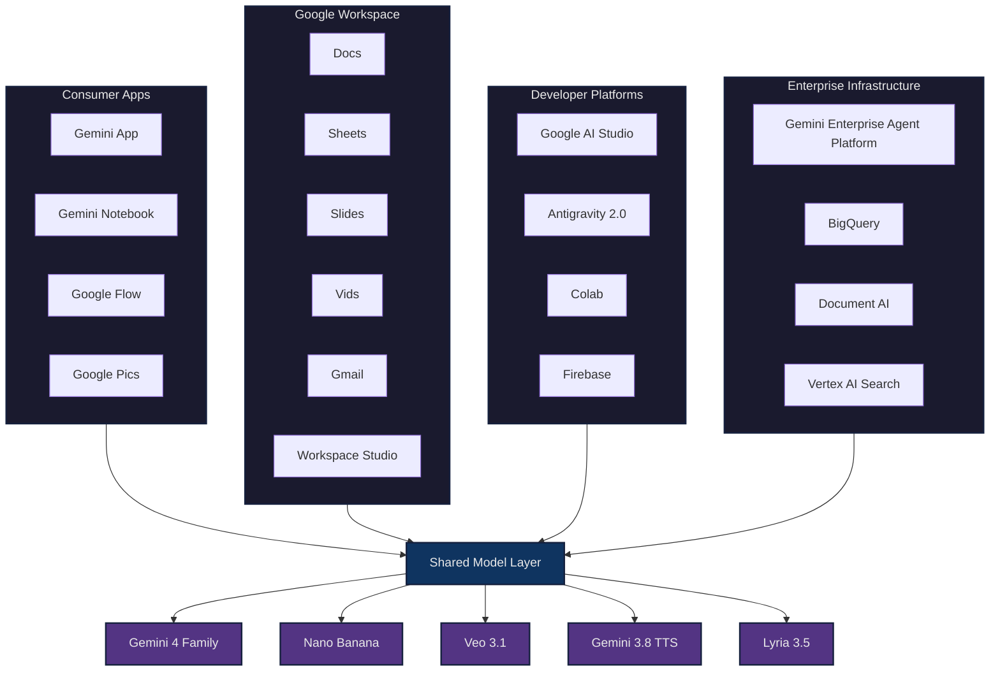
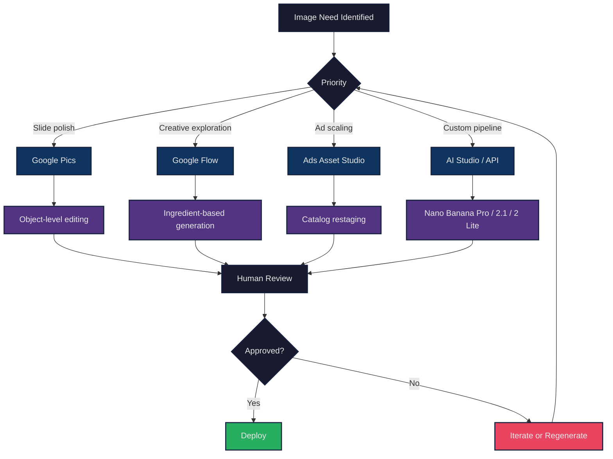
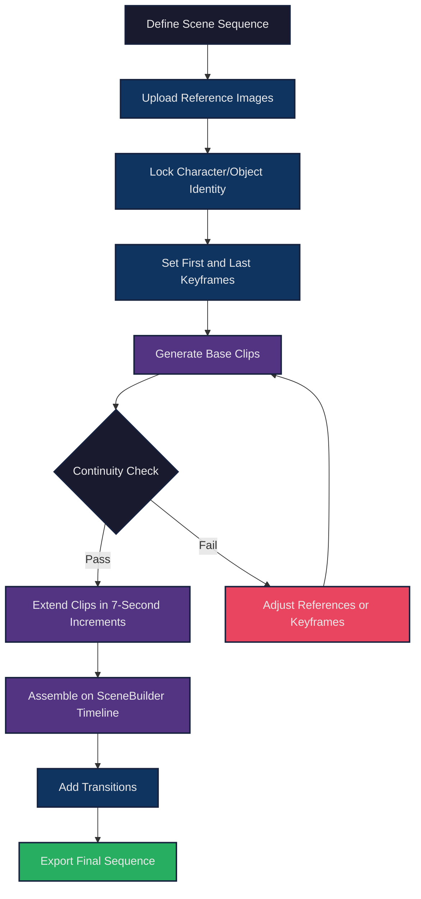
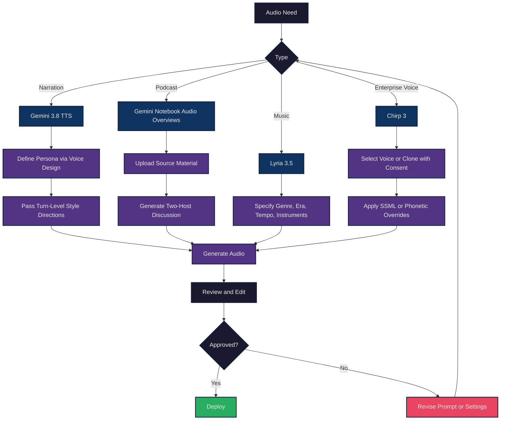
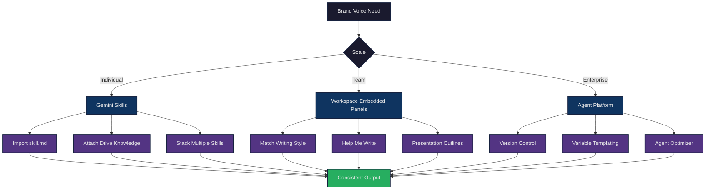
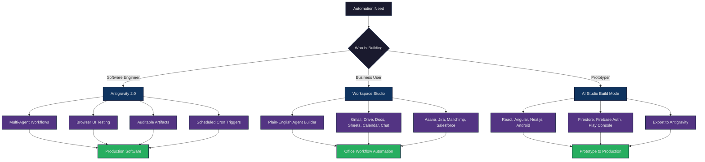
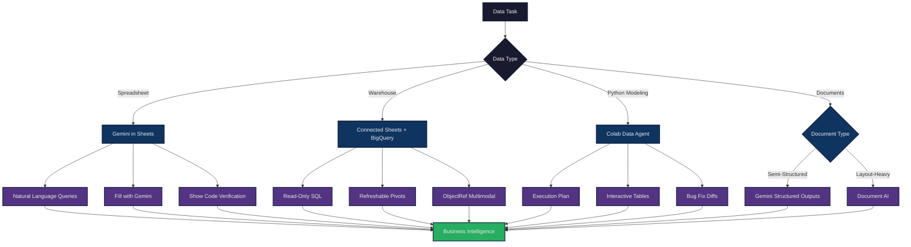
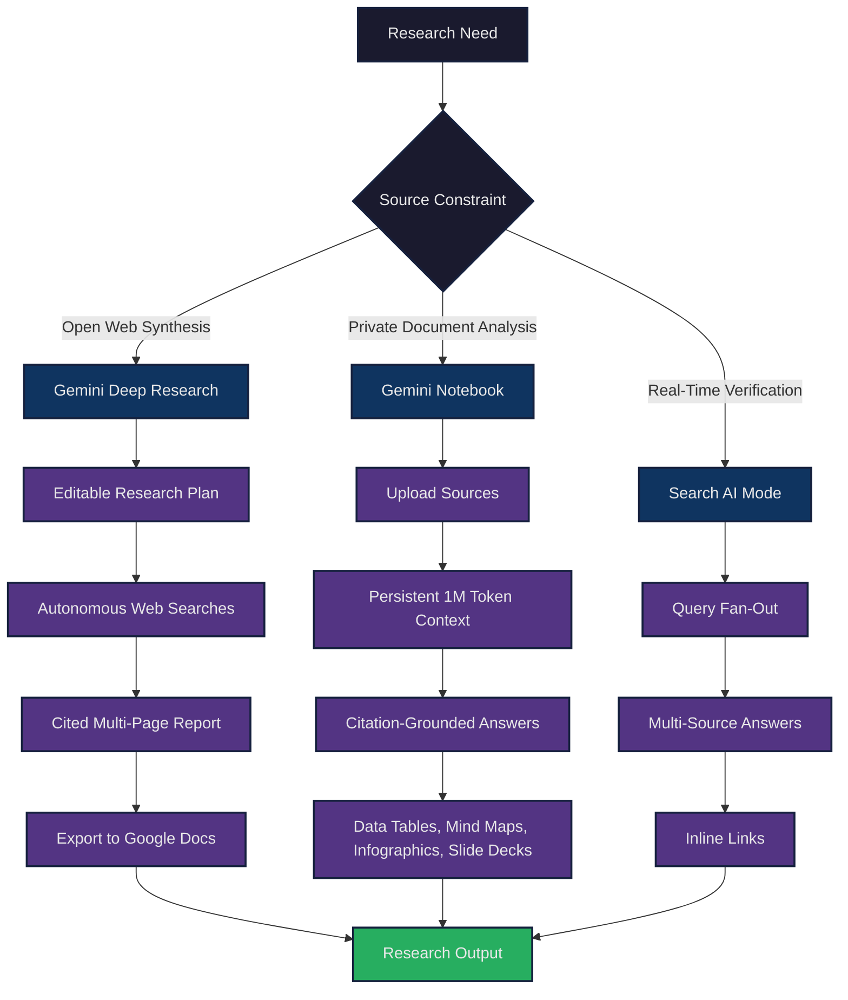

    

<h1 align="center">WHAT YOU CAN BUILD AND AUTOMATE WITH GOOGLE'S AI ECOSYSTEM?</h1>

    

    

  
 
## Table of Contents

1. [Introduction](#1-introduction)
2. [The Google AI Model Lineup](#2-the-google-ai-model-lineup)
3. [Platform Map: Where Each Capability Lives](#3-platform-map-where-each-capability-lives)
4. [Image Generation for Campaigns and Presentations](#4-image-generation-for-campaigns-and-presentations)
5. [Video Generation and Visual Summaries](#5-video-generation-and-visual-summaries)
6. [Studio-Quality Audio, Podcasts, and Music](#6-studio-quality-audio-podcasts-and-music)
7. [Brand Voice Consistency and Reusable Text Workflows](#7-brand-voice-consistency-and-reusable-text-workflows)
8. [Coding Tasks and End-to-End Automation](#8-coding-tasks-and-end-to-end-automation)
9. [Data Analysis, Extraction, and Classification](#9-data-analysis-extraction-and-classification)
10. [Research and Information Synthesis](#10-research-and-information-synthesis)
11. [Industry-Specific Applications](#11-industry-specific-applications)
12. [Access Tiers and Pricing Guide](#12-access-tiers-and-pricing-guide)
13. [Operational Constraints and Practical Warnings](#13-operational-constraints-and-practical-warnings)
14. [Conclusion: Choosing the Right Tool for the Job](#14-conclusion-choosing-the-right-tool-for-the-job)

 

## 1. Introduction

Google's AI ecosystem in late 2026 is not a single product. It is a collection of consumer apps, workspace tools, developer platforms, and enterprise infrastructure, all connected by a shared family of models. The practical challenge for any team is not access to AI. It is routing each goal to the right surface.

Using a single chat window for every task introduces friction. Long documents get silently truncated. Audio tracks cannot be edited after generation. Spreadsheet analysis hits row limits. The alternative is to pair each workflow with the native tool designed for it: Workspace apps for business documents, creative studios for media, and APIs for production pipelines.

This document maps what you can build and automate across that ecosystem. It covers the models, the platforms, the realistic constraints, and the pricing tiers. It is written for practitioners who need to make deployment decisions, not for readers looking for a product tour.

**A note on dates:** The information here reflects Google's published documentation and independent reporting as of November 2026. Product names, model versions, and pricing change frequently. Verify current details before committing to a production architecture.

 

## 2. The Google AI Model Lineup

Google's models are organized by modality and by tier. The Gemini 4 family provides the general reasoning backbone. Specialized models handle images, video, audio, and scientific domains.

### 2.1 Core Model Families

| Model Family | Variants | Primary Use | Access Surface |
|---|---|---|---|
| **Gemini 4** | Carbon, Neon, Hydrogen | General reasoning, text generation, analysis, coding | Gemini app, Workspace, AI Studio, Agent Platform, API |
| **Gemini 3.5** | Flash, Flash-Lite | High-throughput tasks, low-latency applications, agentic workflows | AI Studio, Antigravity, API |
| **Nano Banana** | Pro (gemini-3-pro-image), 2.1, 2 Lite | Image generation, editing, typography, layout | Google Pics, Flow, AI Studio, API, Ads Asset Studio |
| **Veo 3.1** | Standard, Fast, Lite | Video generation with synchronized audio | Vids, Flow, API, Ads Asset Studio |
| **Gemini Omni 1.2** | Flash | Video generation and editing | Flow, API |
| **Gemini 3.8 TTS** | Flash TTS, Flash-Lite TTS | Expressive speech synthesis, multi-speaker audio | AI Studio Audio Playground, API, Vids, Notebook |
| **Chirp 3** | Standard | Enterprise TTS with phonetic control, voice cloning | Google Cloud TTS API |
| **Lyria 3.5** | Standard | Music composition from prompts or mood images | Gemini app, Vids, API |
| **Gemini 3.8 Live** | Standard | Real-time bidirectional voice agents | API, AI Studio |
| **Gemini 3.5 Transcribe** | Standard | Speaker-diarized transcription with timestamps | API |
| **Gemini 3.5 Live Translate** | Standard | Real-time speech-to-speech translation (70+ languages) | API |
| **Gemma 4** | Open weights | On-device and local inference | Firebase AI Logic, local deployments |
| **MedGemma** | 4B, 1.5 4B, 27B | Medical image analysis, clinical text extraction | Open weights, Vertex AI |
| **TxGemma** | Standard | Drug discovery and therapeutic prediction | Vertex AI |
| **Genie 4** | Standard | Interactive world generation | Flow (Ultra 20x), API (experimental) |

### 2.2 Model Selection Guidance

The choice between Gemini 4 tiers depends on the workload.

| Need | Recommended Tier | Reason |
|---|---|---|
| High-volume, low-complexity tasks | Gemini 3.5 Flash-Lite | Lowest cost per token, adequate for classification, extraction, simple generation |
| General business and creative work | Gemini 4 Hydrogen | Balanced cost and capability, suitable for most Workspace and API tasks |
| Complex analysis, coding, multi-step reasoning | Gemini 4 Neon | Stronger reasoning, better at long-context tasks and agentic workflows |
| Maximum capability, video production, multi-agent systems | Gemini 4 Carbon | Highest capability tier, reserved for demanding workloads |

 

## 3. Platform Map: Where Each Capability Lives

Google's ecosystem spans four layers. Understanding which layer owns which capability prevents wasted effort.

### 3.1 Capability Routing Table

| Goal | Consumer Surface | Workspace Surface | Developer Surface | Enterprise Surface |
|---|---|---|---|---|
| Image generation and editing | Google Pics, Google Flow | Slides, Docs (via Pics) | AI Studio, Gemini API | Ads Asset Studio, Agent Platform |
| Video generation | Google Vids, Flow, Gemini Notebook | Vids | AI Studio, Gemini API | Ads Asset Studio |
| Audio and podcast production | Gemini Notebook, Gemini app | Vids | AI Studio Audio Playground, Cloud TTS API | Agent Platform |
| Brand voice and reusable text | Gemini Skills (formerly Gems) | Gmail, Docs, Slides | Agent Platform Prompt Management | Agent Platform |
| Coding and workflow automation | None | Workspace Studio, Apps Script | Antigravity 2.0, AI Studio Build | Agent Platform |
| Data analysis and classification | Gemini in Sheets (limited) | Connected Sheets | Colab Data Agent | BigQuery, Document AI |
| Research and synthesis | Gemini Deep Research, Notebook | None | Deep Research API | Agent Search, Multimodal Embeddings |
| Industry applications | Classroom, Shopping AI Mode | None | MedGemma, TxGemma | AML AI, Financial Services package |

 

## 4. Image Generation for Campaigns and Presentations

Google retired Imagen from its cloud model catalog on June 30, 2026, and merged Whisk and ImageFX into Google Flow on April 30, 2026. The current image stack is built on the Nano Banana models and is oriented toward iterative, object-level editing rather than one-shot generation.

### 4.1 Tools by Workflow

| Tool | Best For | Key Features | Access |
|---|---|---|---|
| **Google Pics** (pics.new) | Business graphics, marketing collateral, presentation decks | Object segmentation, text editing within images, crop to web/print ratios, 2K/4K upscaling, persistent version history | Google AI Pro/Ultra, eligible Workspace Business and Enterprise plans |
| **Google Flow** (flow.google.com) | Conceptual art direction, creative exploration | Subject/Scene/Style reference images ("Ingredients"), Insert/Remove/Lasso editing tools | Google AI Pro/Ultra, free tier with limited credits |
| **Google Ads Asset Studio** | Ad scaling, catalog-based creative variation | Merchant Center integration, restage up to 100 product photos into seasonal scenes, out-painting to widescreen formats | Active Google Ads advertisers |
| **AI Studio / Gemini API** | Custom pipelines, high-volume variation | Nano Banana Pro (4K layout and typography), Nano Banana 2.1 (multi-turn editing, character consistency), Nano Banana 2 Lite (low-latency interactive) | Pay-as-you-go API |

### 4.2 Practical Constraints

Human review remains essential for image generation. Independent testing of Google Pics found that localized edits can alter adjacent areas, and 4K upscaling does not always produce a true photograph. Third-party PPC specialists caution against generating promotional text overlays inside Asset Studio. The compliant approach is to add copy after generation, even though Nano Banana Pro supports legible text rendering in eight languages.

 

## 5. Video Generation and Visual Summaries

Video generation in Google's stack serves three distinct needs: templated workplace explainers, directed multi-scene clips, and automated document-to-video briefings.

### 5.1 Video Tools by Complexity Level

| Level | Tool | What It Does | Constraints |
|---|---|---|---|
| **Templated workplace video** | Google Vids (vids.new) | Converts plain-language concepts or Drive documents into script, storyboard, and multi-scene video | Free accounts: 10 Veo 3.1 clips/month (720p, up to 8 seconds each). AI Pro: 50/month. AI Ultra: up to 1,000/month |
| **Directed multi-scene clips** | Google Flow | Cinematic prompt sequences with continuity controls, SceneBuilder timeline, First/Last Frame interpolation | Free tier exports carry visible watermark and less reliable audio on Veo 3.1 Lite |
| **Automated document briefing** | Gemini Notebook (notebook.google.com) | Generates narrated slideshows, short video overviews (60 seconds, 80+ languages), and cinematic video overviews | Cinematic overviews are English-only, 18+, and cannot be edited after rendering |
| **Ad creative** | Google Ads Asset Studio | Turns up to 3 static images into one 10-second Veo clip per image for Performance Max and Demand Gen | Limited to ad campaign contexts |
| **Interactive worlds** | Genie 4 | Real-time, steerable 24 fps interactive worlds with 48 kHz stereo audio | Experimental access via Flow (Ultra 20x) and API |

### 5.2 Continuity Workflow for Multi-Scene Video

Maintaining visual consistency across shots requires a structured approach.

### 5.3 Key Technical Details

Veo 3.1 synthesizes synchronized dialogue (cued in quotes), sound effects, and ambient noise in the same pass as visuals. It supports 720p, 1080p, and 4K output across 16:9 or 9:16 aspect ratios. Clips can be extended in 7-second increments up to 20 times, accepting input videos up to 141 seconds.

Gemini Notebook video overviews have a hard constraint: cinematic overviews cannot be edited after rendering. Any correction requires full prompt revision and regeneration. Plan for this before generating final assets.

 

## 6. Studio-Quality Audio, Podcasts, and Music

Google's audio stack covers expressive speech synthesis, multi-speaker podcast generation, original music composition, and real-time voice agents.

### 6.1 Audio Tools by Use Case

| Use Case | Tool | Capabilities | Constraints |
|---|---|---|---|
| **Scripted narration, audiobooks, e-learning** | Gemini 3.8 Flash TTS / Flash-Lite TTS | Studio-grade fidelity, multi-turn character acting, 130+ languages (Flash) or 100+ languages (Flash-Lite) | Voice Replication requires verified consent and is blocked in India, EEA, UK, Switzerland, Illinois, and Texas |
| **Enterprise IVR, accessibility** | Google Cloud TTS (Chirp 3) | 380+ voices, 75+ languages, IPA/SSML support, speaking-rate control (0.25x to 2.0x), Instant Custom Voice from 10-second recording | Requires Cloud account and consent statement for cloning |
| **Podcast generation** | Gemini Notebook Audio Overviews | 10-25 minute two-host discussions from Docs, PDFs, Slides, URLs, YouTube links; Interactive Mode for live questions | Closed pipeline without pre-synthesis transcript editing or explicit commercial-use licensing |
| **Music composition** | Lyria 3.5 | Up to 3-minute instrumental or vocal tracks from mood photos or structured prompts (genre, era, tempo, instruments, vocal timbre, lyrics) | 18+ only in Gemini app |
| **Real-time voice agents** | Gemini 3.8 Live | Sub-second bidirectional voice interaction | API access |
| **Transcription** | Gemini 3.5 Transcribe | Speaker-diarized transcription with word timestamps | API access |
| **Live translation** | Gemini 3.5 Live Translate | Real-time speech-to-speech translation across 70+ languages | API access |

### 6.2 Audio Production Workflow

### 6.3 Practical Audio Notes

Gemini 3.8 TTS reads SSML tags and stage notes verbatim if they appear inside the spoken script. The correct approach is to define a reusable persona upfront using Voice Design (describing age, accent, timbre, and pace in plain language) and pass turn-level emotional directions in `speech_metadata.style` alongside point-in-time vocal tags.

Notebook Audio Overviews run in a closed pipeline. There is no pre-synthesis transcript editing and no explicit commercial-use licensing. For commercial podcast production, plan to record or synthesize audio through a controllable pipeline.

 

## 7. Brand Voice Consistency and Reusable Text Workflows

Maintaining a consistent house style across emails, proposals, and documentation requires saved instructions and reference examples. Google is transitioning its personalization layer from Gems to Gemini Skills.

### 7.1 The Gems-to-Skills Transition

| Account Type | Migration Start | Notes |
|---|---|---|
| Personal accounts | November 2026 | Gems retired and automatically migrated |
| Workspace business, enterprise, nonprofit | March 2027 | Admin controls apply |
| Workspace education | June 2027 | Admin controls apply |

Gemini Skills allow inline invocation of custom workflows inside any chat. You can import portable `skill.md` instruction files, attach Drive knowledge sources, and stack multiple skills in one prompt. The premade `@match-my-writing-style` skill builds a custom voice card from your actual Workspace writing. Combining it with `@prep-for-meetings` is a supported pattern.

### 7.2 Brand Voice Setup by Platform

| Platform | Mechanism | Best For | Constraint |
|---|---|---|---|
| **Gemini Skills** | Inline `@` invocation, `skill.md` files, Drive knowledge attachment | Personal and team workflows, writing style matching | Migration timeline varies by account type |
| **Gemini Gems (legacy)** | Four-part instruction pattern (Persona, Task, Context, Format), uploaded brand guides, instruction rewriter | Workspace teams still on Gems | Retiring; plan migration |
| **Workspace embedded panels** | "Help me write," "Match writing style and format," presentation outline drafting | Gmail, Docs, Slides | Business Starter limits Workspace integration to Gmail and standalone app; Business Standard+ required for Docs, Sheets, Slides, Meet |
| **Agent Platform** | `create_version`, `restore_version`, variable templating, CMEK, Agent Optimizer | Engineering teams managing customer-facing copy at scale | Enterprise pricing and setup |

### 7.3 Operational Caveats

Two practical warnings apply to brand voice customization.

First, practitioner testing reports roughly 60 to 80 percent adherence to global custom instructions without concrete few-shot examples and explicit refusal rules. If you need the model to print `[CONFIRM]` rather than guess missing figures, state that rule explicitly.

Second, Google's Gem sharing rules allow anyone with Viewer access to inspect your underlying instructions and uploaded knowledge files. Do not store sensitive logic or confidential reference material in shared Gems.

 

## 8. Coding Tasks and End-to-End Automation

Google's developer and automation tooling split into two tracks in 2026: Antigravity 2.0 and AI Studio Build Mode for software engineers, and Workspace Studio plus Gemini in Apps Script for business automation.

### 8.1 Developer Tools

| Tool | What It Is | Key Capabilities | When to Use |
|---|---|---|---|
| **Antigravity 2.0** | Agentic coding ecosystem (desktop app, IDE, CLI, editor extensions, API/SDK) | Multi-agent swarm workflows, browser UI testing, auditable artifacts (implementation plans, task lists, code diffs, screenshots), directory-scoped `AGENTS.md` rules, scheduled cron triggers in persistent Linux sandboxes | Complex software projects requiring multi-step agent orchestration |
| **Antigravity IDE / CLI** | Traditional code editor and Go-based CLI (`agy`) | Local terminal and file tree, full editor experience | Engineers who want a classic development environment |
| **AI Studio Build Mode** | Rapid full-stack prototyping | Vibe-code React, Angular, Next.js, native Android apps; wired to Firestore, Firebase Auth, Play Console test tracks; exports repository and agent conversation history to Antigravity | Prototyping and early-stage development |
| **Android Studio** | Mobile development | Translates UI mockups to Jetpack Compose, configures Firebase backends | Android app development |
| **Firebase AI Logic** | On-device and hybrid inference | Server-side template-only prompt locking, Auth verification, Gemma 4 on-device inference across Android, iOS, Chrome | Mobile and web apps requiring local inference |

### 8.2 Business Automation Tools

| Tool | What It Does | Trigger Model | Constraint |
|---|---|---|---|
| **Workspace Studio** (studio.workspace.google.com) | Builds multi-step agents from plain-English descriptions across Gmail, Drive, Docs, Sheets, Calendar, Chat, Asana, Jira, Mailchimp, Salesforce | Optimized for triggers starting inside Google apps | External webhooks (e.g., Stripe) are not natively supported |
| **Gemini in Apps Script** | Writes, edits, and debugs JavaScript automations inside Sheets, Docs, Slides | Generally available November 17, 2026 for Business Standard+, Enterprise, AI Pro/Ultra | Requires Workspace tier eligibility |

### 8.3 Tools to Avoid for New Projects

| Tool | Status | Action |
|---|---|---|
| **Firebase Studio** | Stopped accepting new workspaces June 22, 2026; shuts down March 22, 2027 | Migrate to Antigravity or AI Studio Build |
| **Gemini Code Assist (Standard/Enterprise)** | Halted new sales October 9, 2026 | Use Antigravity 2.0 instead |
| **Jules** | Shuts down at year-end 2026 | Migrate to Antigravity 2.0 |
| **Gemini CLI** | Actively maintained with weekly releases | Safe to use for open-source workflows |

### 8.4 Antigravity Benchmark Context

In Google's I/O 2026 benchmarks, Gemini 3.5 Flash scored 76.2 percent on Terminal-Bench 2.1 and 83.6 percent on MCP Atlas while running inside Antigravity. Developer forum feedback notes that Antigravity 2.0 separated the streamlined desktop agent app from the classic code-editor experience. Engineers wanting a local terminal and file tree should install the dedicated Antigravity IDE or CLI.

 

## 9. Data Analysis, Extraction, and Classification

Turning raw tables, cloud warehouses, and multi-page PDFs into reliable business intelligence requires separating conversational exploration from schema-enforced extraction.

### 9.1 Analysis Tools by Data Location

| Data Location | Tool | What It Does | Key Detail |
|---|---|---|---|
| **Google Sheets (local)** | Gemini in Sheets | Natural-language questions, Fill with Gemini pattern categorization, "Show code" formula verification | 95-participant controlled study reported speed and accuracy gains for Fill with Gemini |
| **BigQuery (warehouse)** | Connected Sheets + Gemini in BigQuery | Read-only SQL across billions of rows, refreshable pivot tables, charts, database formulas, Data Insights, Conversational Analytics, Data Canvas, SQL/Python generation, ObjectRef multimodal queries | Every pivot table or chart triggers billed BigQuery queries |
| **Google Colab** | Colab Data Agent | Proposes execution plan, runs code, renders interactive tables, presents bug fixes as diffs | Free tier resources unguaranteed; Pro/Ultra provide 200 to 2,000 monthly compute units |
| **Documents (PDFs, forms, invoices)** | Document AI or Gemini Structured Outputs | Layout-heavy extraction, custom classifiers, fine-tuning with as few as 10 sample documents | See classification decision table below |

### 9.2 Classification and Extraction Decision Table

| Input Type | Recommended Tool | Why | Pricing |
|---|---|---|---|
| Varied, semi-structured inputs (emails, resumes, heterogeneous receipts) | Gemini Structured Outputs (Interactions API) | Enforces strict JSON Schema or Pydantic enum types | API token pricing |
| High-volume, layout-heavy, standardized forms (invoices, tax forms, mortgages) | Google Cloud Document AI | Enterprise OCR, Layout Parser, Custom Extractors/Classifiers, export to BigQuery | Enterprise OCR $1.50 per 1,000 pages; Layout Parser $10 per 1,000 pages; Custom Extractors $30 per 1,000 pages |

### 9.3 Critical Warning: Silent Omissions

Never rely on unstructured chat prompts for exhaustive multi-page extraction. In an independent October 2026 benchmark of bills of lading, chat-mode Gemini 3.6 Flash scored 74 of 77 overall because it silently returned null for all 47 container numbers across 16 rider pages on a 20-page document without warning the user. Use schema-enforced extraction for any task where missing data has consequences.

### 9.4 Connected Sheets Operational Constraints

Technical documentation for Connected Sheets warns of three constraints:

1. Every pivot table or chart triggers billed BigQuery queries, subject to project `QueryUsagePerDay` defaults of 200 TiB and a 500,000-row extract limit.
2. Chat history resets on browser reload unless inserted into the sheet.
3. Sheets requires explicit VPC Service Controls ingress and egress rules to reach protected datasets.

 

## 10. Research and Information Synthesis

Google divides AI research into three workflows: autonomous web synthesis, source-locked private analysis, and real-time live assistance.

### 10.1 Research Tools Compared

| Tool | What It Does | Best For | Cost / Limit |
|---|---|---|---|
| **Gemini Deep Research** | Asynchronous investigator that drafts an editable research plan, runs dozens to roughly 160 web searches, incorporates connected Gmail, Drive, PDFs, images, and NotebookLM notebooks, compiles cited multi-page report exportable to Google Docs | Complex research questions requiring synthesis across multiple sources | API: ~$1 to $3 per standard task (~80 searches); ~$3 to $7 per Max task (~160 searches) |
| **Gemini Notebook** (notebook.google.com) | Closed, citation-grounded RAG workspace with persistent 1-million-token context window | Accuracy-critical work where outside web claims must be excluded | Free: 50 sources per notebook; Plus: 100; Pro: 300; Ultra: 600. Up to 500,000 words or 200 MB per file |
| **Google Search AI Mode** | Query fan-out and Deep Search for multi-source answers with inline links; Temporary Threads detach searches from account personalization | Fast web verification and live troubleshooting | Free with Google account; Temporary Threads added November 17, 2026 |
| **Chrome Auto Browse** | Multi-tab comparison tasks (flight research, hotel research) | Personal assistance | US and India; Plus, Pro, Ultra tiers |
| **Gemini Live** | Conversational diagnosis with camera and screen sharing | Hardware troubleshooting, handwritten notes, live code errors | Gemini app |

### 10.2 Research Workflow Selection

### 10.3 Privacy Note for Regulated Research

Search AI Mode Temporary Threads detach searches from account personalization and history, but analysts note that server-log retention remains unspecified. Regulated research should stay inside Workspace or Agent Platform, where data handling terms are explicit.

 

## 11. Industry-Specific Applications

At the enterprise layer, Gemini Enterprise Agent Platform provides governance controls required by regulated industries: Agent Identity cryptographic audit trails, Agent Registry, Agent Gateway with Model Armor prompt-injection protection, Memory Bank, Agent Evaluation (generally available July 31, 2026), and VPC Service Controls (preview).

### 11.1 Financial Services

| Capability | Detail |
|---|---|
| **Package launch** | Gemini Enterprise for Financial Services launched August 25, 2026 |
| **Components** | Google-managed Financial Research agent, 50+ financial-role skills, 13 connectors to market feeds including FactSet, LSEG, MSCI, S&P Global, SEC Edgar |
| **Design partners** | Co-designed with Deutsche Bank; used by CME Group; BNP Paribas and CaixaBank signed major Gemini agreements in autumn 2026 |
| **Compliance** | Anti Money Laundering AI (AML AI) trains exclusively on a bank's core banking and SAR data to produce regulator-explainable monthly risk scores. Google Cloud reports that over 95 percent of first-phase alerts in legacy rule-based systems are false positives. Adopted by HSBC. |
| **Data residency** | Sovereign cloud deployments (German/Swiss data boundaries, air-gapped Google Distributed Cloud) support strict banking residency mandates |

### 11.2 Healthcare and Life Sciences

| Capability | Detail |
|---|---|
| **Open-weight models** | MedGemma (4B, 1.5 4B, 27B) and 400M-parameter MedSigLIP vision encoder |
| **Target tasks** | CT, MRI, whole-slide histopathology, longitudinal chest X-rays, structured FHIR/EHR lab extraction |
| **Published results** | Nature Medicine study reported gains of 2.6 to 10 percent on medical visual Q&A and 15.5 to 18.1 percent on chest X-ray classification over base Gemma 3; claimed 500-fold compute cost gap between MedGemma 4B and the largest comparator model |
| **Deployment pattern** | Run offline on-device or locally to de-identify sensitive data before calling cloud Gemini models |
| **Real-world deployments** | Crane AI (Uganda), DawaMom (Zambia, 3,500+ women screened), Visilant (India, 50,000+ patients screened), AIIMS Delhi's IndusDerma and Aarogyam pilots (hospital networks handling up to 15,000 daily visits) |
| **Additional models** | TxGemma for drug discovery, AlphaFold/AlphaGenome, PH-LLM/Large Sensor Model for wearables, Vertex AI Search for Healthcare |
| **Critical caveat** | Google states MedGemma is not yet clinical-grade out of the box and requires domain validation and fine-tuning before clinical deployment |

### 11.3 Retail and E-Commerce

| Capability | Detail |
|---|---|
| **Shopping Graph** | 50 billion listings, updated over 2 billion times per hour |
| **Consumer features** | Conversational discovery in AI Mode, price tracking, U.S. agentic Google Pay checkout ("buy for me") |
| **Virtual Try-On** | google.com/shopping/tryon lets US and UK shoppers preview shoes, tops, bottoms, and dresses on diverse models or a selfie transformed into a full-body view via Nano Banana. Merchants must supply clean 1024px+ front-facing imagery in Merchant Center. Google notes visualizations are not an exact fit guarantee. |
| **AI Mode link behavior** | Independent Findrix study reported that 57 percent of AI Mode women's fashion product links stay within Google Shopping versus 1.1 percent for software |
| **Storefront tools** | Vertex AI Search for Commerce (retail search and Recommendations AI), Ads Asset Studio for catalog-grounded creatives |
| **Advertising results** | 2026 Google study cited by Market IA reported 68 percent lower production time and 41 percent average ROAS lift. Multi-channel marketers (64 percent spanning 3+ ad platforms per Statista) still pair it with cross-platform tools. |

### 11.4 Education

| Capability | Detail |
|---|---|
| **Pedagogical integration** | LearnLM tuning folded directly into Gemini 2.5+ models |
| **Guided Learning** | Launched inside Google Classroom on November 3, 2026, alongside a U.S. Search pilot and Chromebook Class Tools lock-down. Students receive step-by-step Socratic coaching rather than direct answers. |
| **Learning gains** | Google's May and October 2026 technical reports found student tutoring gains matched human tutors and corresponded to roughly 1.8 to 2.5 years of extra learning progress by standard conversion |
| **Notebook quizzes** | Gemini Notebook added retrieval-focused short-answer, multiple-select, and fill-in-the-blank quizzes in October 2026 |
| **Governance** | Schools govern access via Admin Console OU policies and Vault auditing |
| **Student offer** | Eligible U.S. college students (18+) can claim one year of Google AI Pro at no cost |

 

## 12. Access Tiers and Pricing Guide

Google bundles consumer model quotas, cloud storage, Workspace apps, and developer credits together while metering API tokens separately. Matching your plan to your primary workflow prevents paying for duplicate access.

### 12.1 Individual and Consumer Plans

| Plan | Indicative Pricing (Nov 2026) | Model and Feature Access | Storage and Developer Perks | Best-Fit User |
|---|---|---|---|---|
| **Gemini Free** | $0 / ₹0 | Gemini 4 Hydrogen and Flash-Lite; 10 Veo 3.1 clips per month in Vids; Notebook (50 sources, 3 Audio Overviews per day) | 15 GB; free AI Studio API tier (free API prompts may be used for training) | Casual use, Colab exploration, light Notebook study |
| **Google AI Plus** | $4.99/mo (400 GB) or $9.99/mo (2 TB) / ₹399/mo | 2x Free usage; Gemini 4 Hydrogen, Deep Research, Gmail proofreading, Chrome Auto Browse (US/India), 200 Flow credits per month | 400 GB or 2 TB plus family sharing (up to 5 members) | Solo users hitting free caps or wanting low-cost Flow/Research access |
| **Google AI Pro** | $19.99/mo ($199.99/yr) / ₹1,950/mo (1 year free for eligible U.S. students 18+) | 4x Free usage; Gemini 4 Neon, Docs/Sheets/Vids/Pics AI, 1,000 Flow credits per month, 50 Vids Veo clips per month, Short Video Overviews | 5 TB; 200 Colab compute units per month; $10/mo GCP credits; expanded Antigravity and Android Studio limits | Daily knowledge workers, creators, students, solo builders |
| **Google AI Ultra (5x / 20x)** | $99.99 or $199.99/mo / ₹6,500 or ₹19,500/mo | 5x or 20x Pro usage; Gemini 4 Carbon, Neon, Hydrogen; 10,000 or 25,000 Flow credits per month; up to 1,000 Vids Veo clips per month; Project Genie (20x); Gemini Spark (US) | Starting at 20 TB (up to 30 TB on 20x); 1,000 to 2,000 Colab units per month; $40 to $100/mo GCP credits; YouTube Premium Family | Heavy video producers, power coders, multi-agent workflows |

### 12.2 Business and API Plans

| Plan | Indicative Pricing (Nov 2026) | Model and Feature Access | Storage and Perks | Best-Fit User |
|---|---|---|---|---|
| **Workspace Business Starter / Standard / Plus** | $7 / $14 / $22 per user/mo annual (India: ₹270 Starter, ₹1,080 Standard) | Starter: Gmail, Workspace Studio, 3 Audio Overviews per day. Standard+: Docs, Sheets, Slides, Meet, Pics, Connected Sheets, 20 Audio Overviews per day (up to 300 users) | 30 GB / 2 TB / 5 TB per user; Workspace data not used to train models; optional AI Expanded Access add-on | Business teams needing shared Brand Skills, Pics, Vids, and zero-training privacy |
| **Gemini API and Agent Platform** | Pay-as-you-go (e.g., 3.5 Flash-Lite $0.30/$2.50 per 1M tokens; 4 Hydrogen $1.50/$7.50; 4 Neon $3/$15; 4 Argon $2/$10 rising to $4/$20 Dec 1) | Full programmatic access to Gemini 4, TTS, Veo 3.1, Deep Research ($1 to $7 per task), Document AI ($1.50 to $30 per 1K pages), BigQuery AI, ADK | $300 free GCP trial credits; Batch and Flex PayGo 50 percent off; CMEK, VPC-SC, zero model training on paid tier | Production software, automated pipelines, regulated enterprises |

### 12.3 Practical Guidance

For most learners applying AI immediately, the Free tier across Gemini, Gemini Notebook, AI Studio, Colab, and Google Vids is sufficient to master every modality without spending anything.

Once daily creative, research, or spreadsheet workloads hit usage ceilings, Google AI Pro ($19.99 / ₹1,950 per month) for individuals or Workspace Business Standard ($14 / ₹1,080 per user per month) for teams unlocks the core productivity stack: Gemini 4 Neon, Google Pics, Connected Sheets for BigQuery, and Workspace Studio.

Production engineering and compliance-heavy automation belong directly on Antigravity 2.0 and the Gemini Enterprise Agent Platform.

Subscription pages show minor regional and storefront variations. For example, AI Plus appears at $4.99/month with 400 GB on Gemini's page versus $9.99/month with 2 TB on Google One's page. Confirm exact bundle details at checkout.

 

## 13. Operational Constraints and Practical Warnings

The following table consolidates the constraints that most often affect deployment decisions.

| Area | Constraint | Mitigation |
|---|---|---|
| **Video** | Free-tier Flow exports carry a visible watermark and less reliable audio on Veo 3.1 Lite | Budget for paid tier if watermark-free output is required |
| **Video** | Notebook Cinematic Video Overviews cannot be edited after rendering | Plan for full prompt revision and regeneration |
| **Audio** | Gemini 3.8 TTS Voice Replication requires verified consent and is blocked in India, EEA, UK, Switzerland, Illinois, Texas | Use text-prompted Voice Design, which has no geographic restrictions |
| **Audio** | Notebook Audio Overviews run in a closed pipeline without pre-synthesis transcript editing or explicit commercial-use licensing | Use a controllable TTS pipeline for commercial production |
| **Text** | Global custom instructions achieve roughly 60 to 80 percent adherence without few-shot examples and explicit refusal rules | Provide concrete examples and state refusal behavior explicitly |
| **Text** | Gem sharing rules allow anyone with Viewer access to inspect underlying instructions and uploaded knowledge files | Do not store sensitive logic in shared Gems |
| **Coding** | Firebase Studio stops accepting new workspaces June 22, 2026; shuts down March 22, 2027 | Migrate to Antigravity or AI Studio Build |
| **Coding** | Gemini Code Assist halted new Standard/Enterprise sales October 9, 2026; Jules shuts down at year-end 2026 | Use Antigravity 2.0; Gemini CLI remains maintained |
| **Coding** | Antigravity 2.0 separated the desktop agent app from the classic code editor | Install Antigravity IDE or CLI for local terminal and file tree |
| **Data** | Chat-mode extraction silently returned null for 47 container numbers on a 20-page document in independent testing | Use schema-enforced extraction (Structured Outputs or Document AI) for exhaustive tasks |
| **Data** | Connected Sheets triggers billed BigQuery queries for every pivot table or chart; 500,000-row extract limit; chat history resets on browser reload | Monitor query costs; insert chat results into the sheet |
| **Research** | Search AI Mode Temporary Threads have unspecified server-log retention | Keep regulated research inside Workspace or Agent Platform |
| **Healthcare** | MedGemma is not clinical-grade out of the box | Require domain validation and fine-tuning before clinical deployment |
| **Retail** | Virtual Try-On visualizations are not an exact fit guarantee | Set customer expectations; use as a preview tool, not a sizing guarantee |
| **Image** | Localized edits in Google Pics can alter adjacent areas; 4K upscaling does not always produce a true photograph | Human review before deployment |
| **Image** | Third-party PPC specialists caution against generating promotional text overlays inside Asset Studio | Add compliant copy after generation |

 

## 14. Conclusion: Choosing the Right Tool for the Job

Google's AI ecosystem rewards routing discipline. The models are capable across modalities, but the surrounding tools determine whether a workflow is repeatable, verifiable, and cost-controlled.

### 14.1 Decision Summary

| If Your Goal Is... | Start With... | Then Scale To... |
|---|---|---|
| Write, edit, and maintain brand voice | Gemini Skills or Workspace embedded panels | Agent Platform for versioned, encrypted prompt management |
| Generate images for slides or campaigns | Google Pics (object-level editing) or Ads Asset Studio (catalog scaling) | AI Studio or Gemini API for custom pipelines |
| Produce video summaries or ads | Google Vids (templated) or Flow (directed multi-scene) | Veo 3.1 API for automated pipelines |
| Create podcasts or narration | Gemini Notebook Audio Overviews or Gemini 3.8 TTS | Chirp 3 for enterprise voice control |
| Automate office workflows | Workspace Studio | Gemini in Apps Script for custom logic |
| Build software with AI agents | Antigravity 2.0 or AI Studio Build Mode | Agent Platform for production governance |
| Analyze spreadsheets or warehouses | Gemini in Sheets or Connected Sheets | BigQuery and Colab Data Agent |
| Extract structured data from documents | Gemini Structured Outputs (semi-structured) or Document AI (layout-heavy) | Document AI Custom Extractors with BigQuery export |
| Conduct research with citations | Gemini Deep Research (open web) or Gemini Notebook (private sources) | Deep Research API for automated pipelines |
| Deploy in regulated industries | Gemini Enterprise Agent Platform | Industry-specific packages (Financial Services, Healthcare, Retail, Education) |

### 14.2 Final Recommendation

For most teams, the sequence is straightforward. Start on the Free tier to validate the workflow. Move to Google AI Pro or Workspace Business Standard when daily usage hits ceilings. Move to Antigravity 2.0 and the Agent Platform when the workflow becomes production infrastructure that requires audit trails, encryption, and access controls.

The ecosystem is broad, but the routing logic is simple: match the tool to the task, verify the output, and plan for the constraints documented in Section 13. That approach produces repeatable results without paying for capabilities you do not use.
 
    
