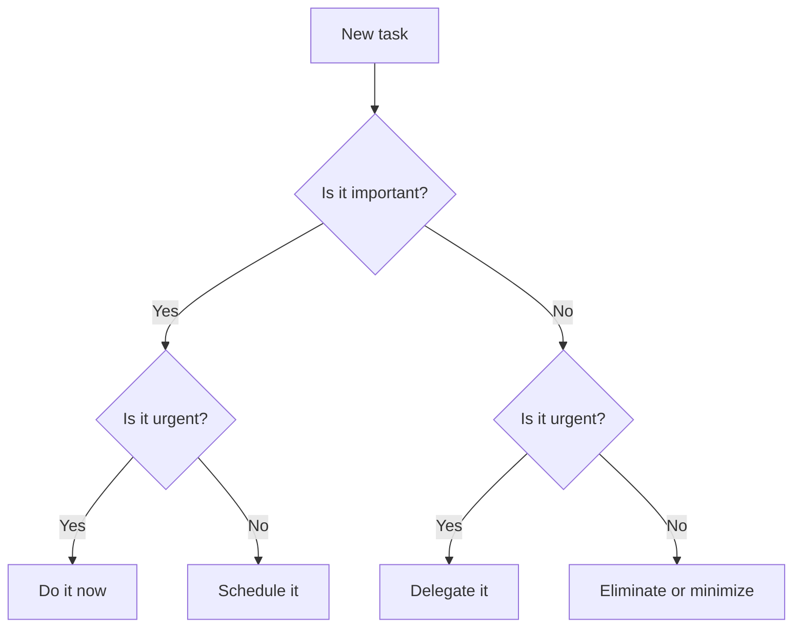
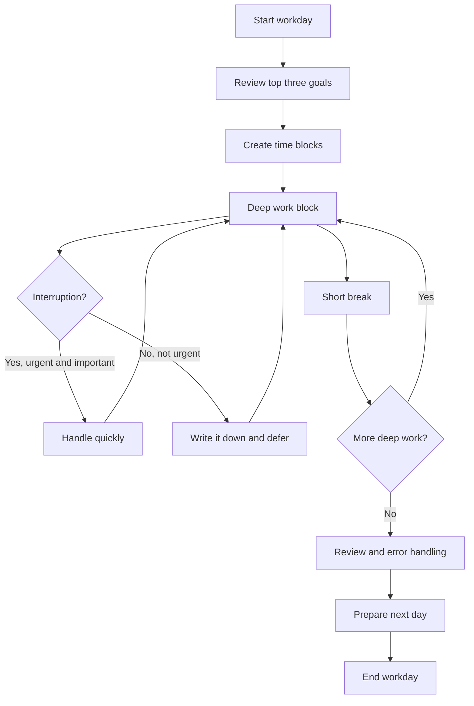
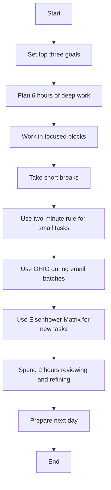

    

<h1 align="center">HOW TO GET MORE DONE IN LESS TIME</h1>

    

    

  

## Document Purpose

This guide explains how to get more done in less time without burning out. It combines nine practical productivity strategies with a structured 8-hour workday model. The goal is not to fill every minute with tasks. The goal is to focus on important work, reduce time-wasters, and finish the day with meaningful progress.

## Who This Guide Is For

This guide is for:

- Employees who feel busy but not productive.
- Managers who want to help their teams focus.
- Freelancers and business owners who manage their own time.
- Students and professionals who want to complete important work with less stress.

## Key Idea

Productivity is not about doing more tasks. It is about doing the right tasks with focus, accuracy, and enough recovery. A productive day is built on clear priorities, deep work, short breaks, and a planned review period.

 

## Section 1: Nine Strategies for Getting More Done in Less Time

### 1. Prioritize Your Top Goals First

Many people spend most of their working time on emails, meetings, and small tasks. These tasks feel urgent, but they often do not move important goals forward.

Start each day by identifying your top three goals. Then use your most productive hours for those goals. When you make progress on important work early, you reduce the end-of-day feeling that you worked hard but achieved little.

### 2. Apply the OHIO Principle: Only Handle It Once

OHIO means “Only Handle It Once.” When you open an item, make a decision about it. You can reply, archive, delete, delegate, or schedule it. Then move on.

Important clarification: OHIO does not mean you must respond to every email the moment it arrives. That would break your focus. Instead, process email in planned batches. When you open an email during a batch, handle it once. Do not open the same message again and again.

### 3. Time Block Your Day

Time blocking means giving a specific period of time to a specific task or group of tasks. For example, you may plan a 90-minute block for writing a report. During that block, you focus only on that report. You do not multitask.

You can also use the Pomodoro Technique: 25 minutes of work followed by a 5-minute break. Choose the method that fits the task and your attention span. Add short breaks between blocks to recharge.

### 4. Limit Perfectionism

Perfectionism can slow you down. Some tasks need high accuracy, such as financial reports or important presentations. Other tasks only need to be clear and complete. For lower-priority tasks, aim for “good enough” instead of perfect.

Perfectionism often leads to procrastination. You delay work because you fear it will not be flawless. Learn to separate high-stakes tasks from low-stakes tasks. Give your best effort where it matters most.

### 5. Use the Eisenhower Matrix to Prioritize Tasks

The Eisenhower Matrix organizes tasks by urgency and importance.

| Quadrant | Task Type | Action |
|---|---|---|
| Urgent and Important | Crises, hard deadlines, critical problems | Do immediately |
| Important but Not Urgent | Planning, skill building, relationship building | Schedule for later |
| Urgent but Not Important | Some emails, some meetings, interruptions | Delegate or batch |
| Not Urgent and Not Important | Mindless scrolling, busywork, distractions | Eliminate or minimize |

### 6. Break Larger Goals into Smaller Steps

Large goals can feel overwhelming. Break them into smaller, actionable steps. Each small step should be clear enough to start. Completing each step gives you a sense of progress and helps you maintain momentum.

### 7. Apply the Two-Minute Rule

If a task will take two minutes or less, do it immediately. This prevents small tasks from piling up. Examples include sending a short reply, filing a document, or making a quick call.

Important clarification: If you are in a deep work block, do not break focus for every small task. Write it down and handle it during your next break or review period.

### 8. Make Your Routine More Efficient

Small decisions can take a lot of mental energy. Simplify your routine where possible. For example, you can plan your meals, prepare your clothes the night before, or choose a simple breakfast. Some highly successful people, such as President Barack Obama and Steve Jobs, used simple routines to save mental energy for bigger decisions.

### 9. Limit Interruptions

Constant interruptions damage focus. To protect your attention:

- Turn off non-essential notifications.
- Use noise-canceling headphones.
- Close your office door when possible.
- Set expectations with colleagues about your focus time.
- Use status indicators in messaging apps to show when you are unavailable.

The goal is to create an environment where you can focus on important work without being pulled away by other people’s priorities.

### Summary of the Nine Strategies

| Strategy | Main Action | Best Used For | Watch Out For |
|---|---|---|---|
| Prioritize top goals | Start with top three goals | Important work | Letting small tasks take over |
| OHIO principle | Handle items once per batch | Email, admin, decisions | Reacting to every message instantly |
| Time blocking | Give tasks fixed time periods | Deep work, projects | Overloading blocks |
| Limit perfectionism | Match effort to task value | Low-stakes tasks | Delaying work unnecessarily |
| Eisenhower Matrix | Sort by urgency and importance | Task selection | Confusing urgent with important |
| Break large goals | Divide into small steps | Big projects | Staying too general |
| Two-minute rule | Do quick tasks immediately | Small admin tasks | Breaking deep focus |
| Efficient routine | Simplify repeated decisions | Daily habits | Making routines too rigid |
| Limit interruptions | Protect focus time | Deep work | Being unavailable for real emergencies |

 

## Section 2: The 6 + 2 Workday Model

### Why 6 + 2 Equals 8

The standard 8-hour workday can be difficult to manage. Many people try to fit too much into the day. A better approach is to divide the day into two parts:

| Workday Part | Time | Purpose |
|---|---|---|
| Deep work | 6 hours | Focus on critical tasks and high-value work |
| Review and refinement | 2 hours | Handle errors, review work, finish tasks, and plan the next day |

This model does not mean you must work six continuous hours. It means you aim for six hours of focused work across the day. The remaining two hours are used for review, error handling, communication, and planning.

### Step 1: Set Clear, Achievable Goals for Your Day

At the start of each day, define what you want to accomplish. Use the SMART goal framework.

| SMART Element | Meaning | Example |
|---|---|---|
| Specific | Be clear about what you need to do | “Write the first draft of the client report” |
| Measurable | Track progress | “Complete 3 of 5 sections” |
| Achievable | Choose realistic work | “Finish within 90 minutes” |
| Relevant | Support larger objectives | “This report is due Friday” |
| Time-bound | Set a deadline | “Complete by 11:00 AM” |

After setting goals, schedule them into your day. Place your most important tasks during your peak productivity hours.

### Step 2: Focus on Six Hours of Deep Work

Deep work means focusing without distraction on a cognitively demanding task. Reserve your best hours for your most critical work.

Use time blocking to schedule these six hours. Each block can last 90 minutes to two hours. You can also use the Pomodoro Technique for shorter focus periods.

| Method | Work Period | Break Period | Best For |
|---|---|---|---|
| Time blocking | 90–120 minutes | 10–20 minutes | Complex projects, writing, planning |
| Pomodoro Technique | 25 minutes | 5 minutes | Tasks that feel difficult to start |
| Deep work sprint | 50 minutes | 10 minutes | Balanced focus and recovery |

### Step 3: Minimize Distractions and Build a Focused Environment

To protect your deep work time:

- Turn off notifications on your phone and computer.
- Keep your workspace clean and organized.
- Use website blockers or focus apps if needed.
- Tell colleagues when you are in a focus block.
- Keep a notebook nearby for stray thoughts so you can return to work quickly.

### Step 4: Use Two Hours for Error Handling and Refinement

After six hours of focused work, switch to review mode. Use the remaining two hours to:

- Review and polish your work.
- Check reports for typos, number errors, or formatting issues.
- Fix mistakes immediately using the OHIO principle.
- Complete loose ends from your main tasks.
- Prepare your task list for the next day.

This buffer period prevents you from rushing at the end of the day. It also improves the quality of your work.

### Step 5: Implement Time Management Techniques

Use proven methods to stay on track:

- Eisenhower Matrix: Prioritize urgent and important tasks.
- Time Blocking: Protect time for important work.
- Two-Minute Rule: Clear small tasks quickly when appropriate.
- OHIO Principle: Handle items once during planned processing times.

### Step 6: Take Regular Breaks and Re-energize

Breaks are not wasted time. They help you maintain focus and energy. During deep work periods, take short breaks between blocks. Stand up, walk, stretch, or drink water. Active breaks can improve both mental clarity and physical health.

### Step 7: Gradually Build Productive Habits

Do not try to change everything at once. Start with one or two habits. For example, begin with a daily top-three goal list. After one week, add time blocking. After another week, add a two-hour review period.

Over time, these habits become automatic. You will get more done in less time while feeling less stressed.

 

## Section 3: Putting It All Together

### A Sample Productive Workday

| Time | Activity |
|---|---|
| 8:00–8:20 | Review top three goals and calendar |
| 8:20–10:00 | Deep work block 1 |
| 10:00–10:15 | Break |
| 10:15–11:45 | Deep work block 2 |
| 11:45–12:00 | Process quick tasks using two-minute rule |
| 12:00–1:00 | Lunch and rest |
| 1:00–2:30 | Deep work block 3 |
| 2:30–2:45 | Break |
| 2:45–4:00 | Deep work block 4 |
| 4:00–5:30 | Review, error handling, email batch, planning |
| 5:30–6:00 | Prepare next day and close out tasks |

This is only a sample. Adjust it to your job, energy levels, and responsibilities.

### Combined Workflow

 

## Section 4: Common Pitfalls and Corrections

| Pitfall | Why It Hurts | Correction |
|---|---|---|
| Trying to do too much | Leads to overload and shallow work | Choose top three goals |
| Confusing urgency with importance | You stay busy but not effective | Use the Eisenhower Matrix |
| Checking email constantly | Breaks focus and slows deep work | Process email in batches |
| Multitasking | Increases errors and reduces speed | Single-task during time blocks |
| Perfectionism on small tasks | Delays completion | Aim for “good enough” when appropriate |
| Skipping breaks | Reduces energy and focus | Schedule short recovery breaks |
| No review time | Mistakes and loose ends remain | Reserve a two-hour buffer |
| Changing too many habits at once | Causes frustration and failure | Build one habit at a time |

 

## Section 5: Implementation Plan

| Timeframe | Focus | Action |
|---|---|---|
| Week 1 | Awareness | Track how you spend your time and list top three goals daily |
| Week 2 | Focus | Add one or two time blocks for important work |
| Week 3 | Task control | Use the Eisenhower Matrix and two-minute rule |
| Week 4 | Communication | Batch email and use OHIO during those batches |
| Week 5 | Structure | Try the 6 + 2 workday model |
| Week 6 and beyond | Refinement | Review progress weekly and adjust habits |

 

## Conclusion

Getting more done in less time is not about rushing. It is about focus, priority, and structure. Use the nine strategies to protect your attention and direct your energy toward meaningful work. Use the 6 + 2 workday model to combine deep work with a review period. Build these habits gradually, and you will improve both productivity and peace of mind.

 

## Key Takeaways

| Principle | Action |
|---|---|
| Focus on what matters | Start each day with your top three goals |
| Protect deep work | Use time blocks and limit interruptions |
| Handle tasks once | Use OHIO during planned processing times |
| Match effort to value | Limit perfectionism on low-stakes tasks |
| Sort tasks clearly | Use the Eisenhower Matrix |
| Make progress manageable | Break large goals into small steps |
| Clear small tasks | Use the two-minute rule when it does not break focus |
| Review and improve | Reserve two hours for error handling and planning |
| Build slowly | Introduce one or two habits at a time |

     
