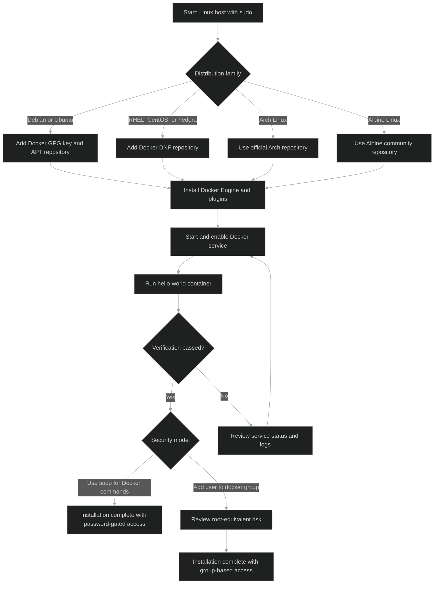

<br><br><br><br>

<h1 align="center">INSTALLING DOCKER ENGINE ON LINUX</h1>

<br><br><br><br>

<p align="center">
    <a href="https://github.com/advancedscientificcomputing" target="_blank" rel="noopener noreferrer">
        
    </a>
</p>

<br><br>
 

This document explains how to install Docker Engine on common Linux distributions using the official Docker repositories. It covers system preparation, installation commands for each distribution family, post-installation configuration, security considerations, and verification steps. The instructions assume a fresh or clean system and are intended for system administrators and developers who need a reliable, repeatable installation process.

<br>

## 1. Prerequisites

Before installing Docker Engine, confirm the following:

- A 64-bit Linux system with `sudo` or root access.
- An active internet connection to download packages and images.
- Basic familiarity with the command line.
- A supported operating system version. Docker maintains specific version support for Ubuntu, Debian, Fedora, RHEL, and their derivatives. Using an unsupported or end-of-life release may lead to package conflicts or missing security updates.

> **Note on firewall compatibility:** Docker publishes container ports directly, which can bypass rules managed by `ufw` or `firewalld`. If the host uses a firewall, review Docker's packet filtering documentation before exposing services.

<br>

## 2. Preparing the System

Update the package index and install the utilities required to add Docker's repository and verify its packages. Microcode updates are also recommended for CPU stability, particularly on production hosts.

### 2.1 Debian, Ubuntu, and derivatives

```bash
sudo apt update
sudo apt install -y ca-certificates curl gnupg
```

For CPU microcode, install the package matching the processor:

```bash
# Intel CPUs
sudo apt install -y intel-microcode

# AMD CPUs
sudo apt install -y amd64-microcode
```

### 2.2 RHEL, CentOS, Fedora, and related distributions

```bash
sudo dnf install -y dnf-plugins-core curl ca-certificates gnupg
```

Microcode is provided by `microcode_ctl` on RHEL-based systems:

```bash
sudo dnf install -y microcode_ctl
```

### 2.3 Arch Linux and derivatives

```bash
sudo pacman -Syu --noconfirm
sudo pacman -S --noconfirm curl ca-certificates gnupg
```

Install the microcode package for the CPU vendor:

```bash
# Intel
sudo pacman -S --noconfirm intel-ucode

# AMD
sudo pacman -S --noconfirm amd-ucode
```

### 2.4 Alpine Linux

```bash
sudo apk update
sudo apk add ca-certificates curl
```

Microcode handling on Alpine varies by hardware and is often managed through the bootloader. Consult the Alpine Wiki for platform-specific guidance.

Reboot the system if a kernel or microcode update was applied.

<br>

## 3. Installing Docker Engine

Docker provides official repositories for the major distribution families. Installing from these repositories is preferred over distribution-provided packages because the official packages receive Docker's latest security patches and are tested against Docker's release cycle.

If any unofficial Docker packages are already present, remove them before proceeding to avoid conflicts. On Debian and Ubuntu, the conflicting packages include `docker.io`, `docker-compose`, `docker-doc`, `docker-buildx`, and `podman-docker`. On RHEL-based systems, remove packages such as `docker`, `docker-client`, `docker-common`, and `docker-engine` before installing the official release.

### 3.1 Debian and Ubuntu based systems

Docker's official repository uses a signed APT source. The following commands configure the repository for Ubuntu. For Debian, replace `ubuntu` with `debian` in the repository URL and use the Debian GPG key URL.

```bash
# Add Docker's official GPG key
sudo install -m 0755 -d /etc/apt/keyrings
sudo curl -fsSL https://download.docker.com/linux/ubuntu/gpg \
  -o /etc/apt/keyrings/docker.asc
sudo chmod a+r /etc/apt/keyrings/docker.asc

# Add the repository to Apt sources
echo \
  "deb [arch=$(dpkg --print-architecture) signed-by=/etc/apt/keyrings/docker.asc] \
  https://download.docker.com/linux/ubuntu \
  $(. /etc/os-release && echo "$VERSION_CODENAME") stable" | \
  sudo tee /etc/apt/sources.list.d/docker.list > /dev/null

# Update the package index
sudo apt update
```

Install Docker Engine, the command-line interface, the container runtime, and the Buildx and Compose plugins:

```bash
sudo apt install -y docker-ce docker-ce-cli containerd.io \
  docker-buildx-plugin docker-compose-plugin
```

### 3.2 RHEL, CentOS, Fedora, and related distributions

On Fedora, add the official Docker repository using `dnf config-manager`:

```bash
sudo dnf config-manager addrepo \
  --from-repofile https://download.docker.com/linux/fedora/docker-ce.repo
```

For RHEL and CentOS Stream, use the corresponding repository URL for the target major version. For example, CentOS Stream 9 uses:

```bash
sudo dnf config-manager --add-repo \
  https://download.docker.com/linux/centos/docker-ce.repo
```

Install the packages:

```bash
sudo dnf install -y docker-ce docker-ce-cli containerd.io \
  docker-buildx-plugin docker-compose-plugin
```

When prompted to accept the GPG key, verify that the fingerprint matches `060A 61C5 1B55 8A7F 742B 77AA C52F EB6B 621E 9F35` before accepting.

### 3.3 Arch Linux

Docker is available in the official Arch repositories. Install the base package:

```bash
sudo pacman -S docker
```

The Compose plugin is provided by the `docker-compose` package:

```bash
sudo pacman -S docker-compose
```

### 3.4 Alpine Linux

Docker and the Compose plugin are available from the Alpine community repository:

```bash
sudo apk add docker docker-cli-compose
```

### 3.5 Summary of installation commands

| Distribution family | Repository setup | Install command |
|---|---|---|
| Debian / Ubuntu | Add Docker GPG key and APT source | `apt install docker-ce docker-ce-cli containerd.io docker-buildx-plugin docker-compose-plugin` |
| RHEL / CentOS / Fedora | `dnf config-manager addrepo` with Docker repo file | `dnf install docker-ce docker-ce-cli containerd.io docker-buildx-plugin docker-compose-plugin` |
| Arch Linux | Official Arch repository | `pacman -S docker docker-compose` |
| Alpine Linux | Alpine community repository | `apk add docker docker-cli-compose` |

<br>

## 4. Post-Installation Steps

After the packages are installed, the Docker daemon must be started and, optionally, enabled to start at boot.

### 4.1 Start and enable the service

On systemd-based distributions such as Ubuntu, Debian, Fedora, RHEL, and Arch:

```bash
sudo systemctl start docker
sudo systemctl enable docker
sudo systemctl status docker
```

On Alpine Linux, which uses OpenRC:

```bash
sudo rc-update add docker default
sudo service docker start
```

### 4.2 Verify the installation

Confirm that the Docker client is available and that the daemon can run a container:

```bash
docker --version
sudo docker run hello-world
```

The `hello-world` command downloads a small test image, starts a container, prints a confirmation message, and exits. If the message appears, the engine is working correctly.

### 4.3 Running Docker without sudo

By default, the Docker daemon binds to a Unix socket owned by `root`. Non-root users must prefix Docker commands with `sudo`. Adding a user to the `docker` group allows Docker commands without `sudo`, but this action carries a significant security implication that must be understood before it is used.

If the decision is made to add the current user to the `docker` group:

```bash
sudo usermod -aG docker $USER
newgrp docker
docker run hello-world
```

Log out and log back in, or reboot, for group membership changes to take effect across all sessions.

<br>

## 5. Security Considerations

The `docker` group is not a restricted group. Membership in this group grants effective root-level privileges on the host. A user who can run Docker commands can mount host directories into containers, modify files owned by root, and, in many configurations, escalate to full root access. Docker's own documentation states that the `docker` group grants root-level privileges and that adding a user to this group is not a security boundary against malicious code running as that user.

For environments where security boundaries matter, consider one of the following approaches instead of adding users to the `docker` group:

- **Use `sudo` for Docker commands.** This keeps Docker access behind a password prompt and provides an audit trail through `sudo` logs.
- **Use rootless mode.** Docker supports running the daemon and containers entirely within a user namespace, without root privileges. This is the recommended approach for developer workstations and multi-user systems where root access should not be granted casually.

A group password on the `docker` group reduces ambient access but does not remove the root-level privileges granted once access is authorized.

<br>

## 6. Uninstalling Docker Engine

If Docker needs to be removed, uninstall the packages and optionally remove the data directory. Note that images, containers, volumes, and networks stored in `/var/lib/docker/` are not removed automatically when the packages are uninstalled.

### Debian / Ubuntu

```bash
sudo apt purge docker-ce docker-ce-cli containerd.io \
  docker-buildx-plugin docker-compose-plugin docker-ce-rootless-extras
sudo rm -rf /var/lib/docker
sudo rm -rf /var/lib/containerd
```

### RHEL / CentOS / Fedora

```bash
sudo dnf remove docker-ce docker-ce-cli containerd.io \
  docker-buildx-plugin docker-compose-plugin docker-ce-rootless-extras
sudo rm -rf /var/lib/docker
sudo rm -rf /var/lib/containerd
```

<br>

## 7. Troubleshooting

| Symptom | Likely cause | Resolution |
|---|---|---|
| `Cannot connect to the Docker daemon` | The daemon is not running. | Start the service with `sudo systemctl start docker` or `sudo service docker start` on Alpine. |
| `Permission denied` when running `docker` without `sudo` | The user is not in the `docker` group. | Either use `sudo`, or add the user to the `docker` group after reviewing the security implications in Section 5. |
| GPG error during repository update | The GPG key is missing, expired, or the repository entry is malformed. | Re-download the Docker GPG key and verify the repository line in `/etc/apt/sources.list.d/docker.list` or the corresponding DNF repository file. |
| Ports exposed by containers are not reachable through the host firewall | Docker bypasses `ufw` and `firewalld` rules for published ports. | Review Docker's packet filtering documentation and add rules to the `DOCKER-USER` chain. |

<br>

## 8. Installation Flowchart

The following flowchart summarizes the decision and installation path for a Linux host.



<br>

> This guide provides a path for installing Docker Engine on the most common Linux distributions. The key decisions are the choice of repository, the service management commands for the host's init system, and the security model for non-root access. Keeping Docker packages current and avoiding casual membership in the `docker` group will reduce both operational and security risk.


<br><br><br><br>
