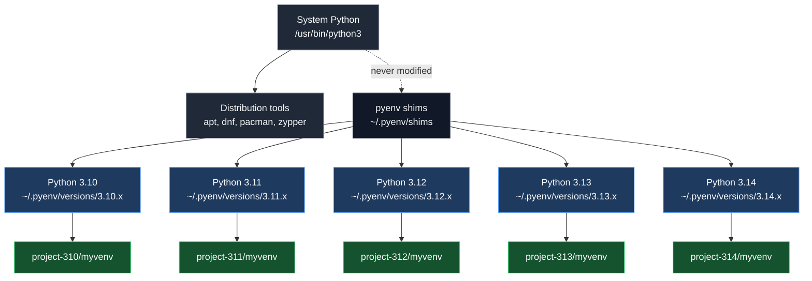

<br><br><br><br>

<h1 align="center">SETTING UP MULTIPLE PYTHON VERSIONS ON LINUX USING PYENV</h1>

<br><br><br><br>

<p align="center">
    <a href="https://github.com/advancedscientificcomputing" target="_blank" rel="noopener noreferrer">
        
    </a>
</p>

<br><br>

## 1. Introduction

Modern Python projects often require different interpreter versions and incompatible library sets. Replacing the distribution's system Python is not safe because package managers, desktop utilities, and init scripts depend on the interpreter that shipped with the operating system.

`pyenv` solves this problem by compiling and installing Python versions entirely under your home directory. It switches between interpreters per project, does not require elevated privileges for daily work, and leaves the system Python untouched.

This guide covers the major Linux distribution families:

| Family | Distributions |
|---|---|
| Debian-based | Debian, Ubuntu, Linux Mint, Pop!_OS, elementary OS, Kali Linux |
| Red Hat-based | Red Hat Enterprise Linux, CentOS Stream, Fedora, Oracle Linux |
| Arch-based | Arch Linux, Manjaro, EndeavourOS |
| SUSE-based | openSUSE, SUSE Linux Enterprise Server |
| Source-based | Gentoo, Funtoo |
| Slackware-based | Slackware, Salix OS, Zenwalk |

The workflow is identical on all of them. Only the package manager commands for build dependencies differ.

<br>

## 2. How pyenv Works

The diagram below shows the relationship between the system Python, pyenv, the installed interpreter versions, and project virtual environments.



The key principle is isolation. pyenv prepends a shim directory to your `PATH`. When you run `python`, the shim resolves to the version selected by `pyenv global`, `pyenv local`, or an activated virtual environment. The system interpreter at `/usr/bin/python3` remains available for distribution tools and is never replaced.

Two kinds of virtual environments appear in the diagram:

| Type | Created with | Activation |
|---|---|---|
| Standard venv | `python -m venv myvenv` | Manual: `source myvenv/bin/activate` |
| pyenv virtualenv | `pyenv virtualenv 3.12.13 myenv` | Optional auto-activation when the environment name is in `.python-version` |

The distinction matters. A standard venv is tied to the interpreter that created it but is not managed by pyenv. A pyenv virtualenv is registered with pyenv and can be activated automatically when you enter a directory whose `.python-version` file contains the environment name.

<br>

## 3. Prerequisites: Build Dependencies

`pyenv install` compiles CPython from source. The build requires development headers for OpenSSL, zlib, bzip2, readline, SQLite, ncurses, xz, Tk, libffi, and lzma. These packages are installed once per system.

### 3.1 Dependency map

| Dependency | Debian/Ubuntu | RHEL/Fedora | Arch | openSUSE | Gentoo | Slackware/Salix |
|---|---|---|---|---|---|---|
| C/C++ toolchain | `build-essential` | `gcc gcc-c++ make` | `base-devel` | `gcc gcc-c++ make` | `sys-devel/gcc sys-devel/make` | `gcc g++ make` |
| Download tools | `curl wget git` | `curl wget git` | `curl wget git` | `curl wget git` | `net-misc/curl net-misc/wget dev-vcs/git` | `curl wget git` |
| OpenSSL headers | `libssl-dev` | `openssl-devel` | `openssl` | `libopenssl-devel` | `dev-libs/openssl` | `openssl` |
| zlib headers | `zlib1g-dev` | `zlib-devel` | `zlib` | `zlib-devel` | `sys-libs/zlib` | `zlib` |
| bzip2 headers | `libbz2-dev` | `bzip2-devel` | `bzip2` | `libbz2-devel` | `sys-libs/bzip2` | `bzip2` |
| readline headers | `libreadline-dev` | `readline-devel` | `readline` | `readline-devel` | `sys-libs/readline` | `readline` |
| SQLite headers | `libsqlite3-dev` | `sqlite-devel` | `sqlite` | `sqlite3-devel` | `dev-db/sqlite` | `sqlite` |
| ncurses headers | `libncurses-dev` | `ncurses-devel` | `ncurses` | `ncurses-devel` | `sys-libs/ncurses` | `ncurses` |
| xz and lzma headers | `xz-utils liblzma-dev` | `xz-devel` | `xz` | `xz-devel` | `app-arch/xz-utils` | `xz` |
| Tk headers | `tk-dev` | `tk-devel` | `tk` | `tk-devel` | `dev-lang/tk` | `tk` |
| libffi headers | `libffi-dev` | `libffi-devel` | `libffi` | `libffi-devel` | `dev-libs/libffi` | `libffi` |
| libxml2 headers (optional) | `libxml2-dev` | `libxml2-devel` | `libxml2` | `libxml2-devel` | `dev-libs/libxml2` | `libxml2` |
| LLVM (optional) | `llvm` | `llvm` | `llvm` | `llvm` | `sys-devel/llvm` | `llvm` |
| pip and venv | `python3-pip python3-venv` | `python3-pip` | `python-pip` | `python3-pip` | included with `dev-lang/python` | `python3 pip` |

The libxml2 and LLVM packages are optional. They are used by a small number of extension modules and by some build configurations. Including them prevents build failures for projects that need those modules.

### 3.2 Install commands per distribution family

**Debian, Ubuntu, Linux Mint, Pop!_OS, elementary OS, Kali Linux**

```bash
sudo apt update && sudo apt install -y \
    build-essential curl wget git make gcc g++ \
    libssl-dev zlib1g-dev libbz2-dev libreadline-dev \
    libsqlite3-dev libncurses-dev xz-utils liblzma-dev \
    tk-dev libxml2-dev libxmlsec1-dev libffi-dev \
    llvm python3-venv python3-pip
```

On Debian 12 and later the ncurses development package is named `libncurses-dev`. Older releases used `libncursesw5-dev`. Both provide the same headers.

**Red Hat, CentOS Stream, Fedora, Oracle Linux**

```bash
sudo dnf groupinstall -y "Development Tools"
sudo dnf install -y \
    curl wget git make gcc gcc-c++ \
    openssl-devel zlib-devel bzip2-devel readline-devel \
    sqlite-devel ncurses-devel xz-devel \
    tk-devel libxml2-devel libffi-devel \
    llvm python3-pip
```

**Arch Linux, Manjaro, EndeavourOS**

```bash
sudo pacman -Syu --noconfirm
sudo pacman -S --noconfirm --needed \
    base-devel curl wget git openssl zlib bzip2 \
    readline sqlite ncurses xz tk libxml2 \
    libffi llvm python-pip
```

**openSUSE, SUSE Linux Enterprise Server**

```bash
sudo zypper refresh
sudo zypper install -y \
    gcc gcc-c++ make curl wget git \
    libopenssl-devel zlib-devel libbz2-devel readline-devel \
    sqlite3-devel ncurses-devel xz-devel \
    tk-devel libxml2-devel libffi-devel \
    llvm python3-pip
```

**Gentoo, Funtoo**

```bash
sudo emerge --sync
sudo emerge -av \
    sys-devel/gcc sys-devel/make dev-vcs/git \
    net-misc/curl net-misc/wget \
    dev-libs/openssl sys-libs/zlib sys-libs/bzip2 \
    sys-libs/readline dev-db/sqlite sys-libs/ncurses \
    app-arch/xz-utils dev-lang/tk dev-libs/libxml2 \
    dev-libs/libffi sys-devel/llvm
```

Ensure the `ssl`, `sqlite`, `readline`, and `ncurses` USE flags are enabled for the relevant packages. The default Gentoo profile enables them.

**Slackware, Salix OS, Zenwalk**

Slackware uses `slackpkg`. Salix and Zenwalk provide `slapt-get`.

```bash
# Slackware
sudo slackpkg update
sudo slackpkg install gcc make git curl wget openssl zlib bzip2 \
    readline sqlite ncurses xz tk libxml2 libffi llvm python3

# Salix and Zenwalk
sudo slapt-get --update
sudo slapt-get --install gcc make git curl wget openssl zlib bzip2 \
    readline sqlite ncurses xz tk libxml2 libffi llvm python3
```

Some Slackware releases split development headers into separate `-dev` packages. Install them if a build fails with a missing header error.

<br>

## 4. Installing pyenv

The official installer clones pyenv and its companion plugins into `~/.pyenv`. It does not require `sudo` and does not write to system directories.

```bash
curl -fsSL https://pyenv.run | bash
```

After the command completes, `~/.pyenv` contains the pyenv binary, the `python-build` plugin used for compilation, and the `pyenv-virtualenv` plugin used for environment management.

Using the official installer keeps pyenv current and independent of the distribution package manager. A distribution-provided pyenv package, where one exists, is often several releases behind and is not recommended for production use.

<br>

## 5. Shell Integration

### 5.1 Add pyenv to the shell configuration

Append the following lines to `~/.bashrc`. For Zsh, add the equivalent lines to `~/.zshrc`.

```bash
echo 'export PYENV_ROOT="$HOME/.pyenv"' >> ~/.bashrc
echo '[[ -d $PYENV_ROOT/bin ]] && export PATH="$PYENV_ROOT/bin:$PATH"' >> ~/.bashrc
echo 'eval "$(pyenv init -)"' >> ~/.bashrc
echo 'eval "$(pyenv virtualenv-init -)"' >> ~/.bashrc
```

The `pyenv init -` line places the shim directory at the front of `PATH`. The `pyenv virtualenv-init -` line enables automatic activation and deactivation of pyenv-managed virtual environments. The second line is optional if you do not use `pyenv virtualenv`, but it is harmless and keeps the setup consistent.

### 5.2 Reload the shell and verify

```bash
source ~/.bashrc
pyenv --version
```

A version string such as `pyenv 2.5.x` confirms that the installation succeeded. If the shell reports `command not found`, see Section 10 before continuing.

<br>

## 6. Installing Python Versions

### 6.1 List available versions

Confirm the patch releases that pyenv can build on the current system.

```bash
pyenv install --list | grep -E '^\s*3\.(10|11|12|13|14)\.'
```

### 6.2 Install each minor version

Install the latest patch release for each minor version. Using an explicit patch number makes the build reproducible and documents exactly which interpreter is in use.

```bash
pyenv install 3.10.16
pyenv install 3.11.14
pyenv install 3.12.13
pyenv install 3.13.7
pyenv install 3.14.0
```

Adjust the patch numbers to the latest releases shown by `pyenv install --list`. Each installation downloads the CPython source, configures it with the appropriate flags, compiles it, and installs it under `~/.pyenv/versions/<version>`. Compilation typically takes several minutes per version depending on CPU and disk speed.

### 6.3 Verify the installed versions

```bash
pyenv versions
```

The output lists every installed version and marks the active one with an asterisk. At this stage the active version is usually `system`, because no global or local version has been set yet.

<br>

## 7. Project Directories and Virtual Environments

Each project receives its own directory, its own local Python version pin, and its own virtual environment. The local pin is written to a `.python-version` file in the project directory. The virtual environment, named `myvenv`, contains an independent copy of `pip`, `setuptools`, and `wheel` and isolates third-party packages from every other project.

### 7.1 Create the project and environment

The pattern below applies to all five versions. Replace `310` with `311`, `312`, `313`, or `314` and adjust the version number accordingly.

```bash
mkdir ~/project-310 && cd ~/project-310
pyenv local 3.10.16
python -m venv myvenv
source myvenv/bin/activate
python -m pip install --upgrade pip setuptools wheel
deactivate
```

The `pyenv local` command writes `3.10.16` to `.python-version`. From that point forward, the `python` command in that directory resolves through the pyenv shim to Python 3.10.16. When you create the virtual environment with `python -m venv myvenv`, the interpreter inside `myvenv` is permanently tied to Python 3.10.16.

A standard venv is not auto-activated by pyenv. You activate it with `source myvenv/bin/activate` each time. If you want auto-activation, create the environment with `pyenv virtualenv` instead, as shown in Section 9.

### 7.2 Repeat for the remaining versions

| Version | Project directory | Local version command | Virtual environment |
|---|---|---|---|
| 3.10 | `~/project-310` | `pyenv local 3.10.16` | `myvenv` |
| 3.11 | `~/project-311` | `pyenv local 3.11.14` | `myvenv` |
| 3.12 | `~/project-312` | `pyenv local 3.12.13` | `myvenv` |
| 3.13 | `~/project-313` | `pyenv local 3.13.7` | `myvenv` |
| 3.14 | `~/project-314` | `pyenv local 3.14.0` | `myvenv` |

A virtual environment is bound to the Python version that created it. Changing `.python-version` after the environment exists does not change the interpreter inside `myvenv`. If a different interpreter is required for the same project, create a new virtual environment and remove the old one.

<br>

## 8. Shared Package Set

Most projects need a consistent set of development tools regardless of the Python version. Installing them once per environment keeps each project self-contained and avoids version conflicts between projects.

### 8.1 Recommended package set

| Package | Purpose |
|---|---|
| `ipython` | Enhanced interactive interpreter |
| `pytest` | Test runner and assertion framework |
| `black` | Deterministic code formatter |
| `ruff` | Fast linter and import sorter |
| `requests` | HTTP client |
| `python-dotenv` | Load environment variables from `.env` files |
| `click` | Command-line interface construction |
| `pydantic` | Data validation and settings management |
| `rich` | Terminal output and formatting |

### 8.2 Create a shared requirements file

Create the file once in your home directory.

```bash
cat > ~/standard_requirements.txt <<'EOF'
ipython
pytest
black
ruff
requests
python-dotenv
click
pydantic
rich
EOF
```

Inside any activated virtual environment, install the shared set.

```bash
pip install -r ~/standard_requirements.txt
```

This approach keeps the package list in one place while still installing packages into each environment independently. Project-specific dependencies belong in the project's own `requirements.txt` or `pyproject.toml`, not in the shared file.

<br>

## 9. Daily Workflow

### 9.1 Common commands

| Task | Command |
|---|---|
| Activate a virtual environment | `source myvenv/bin/activate` |
| Deactivate the current environment | `deactivate` |
| Check the active Python version | `python --version` |
| Show the resolved interpreter path | `which python` |
| List installed pyenv versions | `pyenv versions` |
| Show the active pyenv version | `pyenv version` |
| Pin a version to the current directory | `pyenv local 3.12.13` |
| Set a global fallback version | `pyenv global 3.12.13` |
| Create a pyenv virtualenv | `pyenv virtualenv 3.12.13 myenv` |
| Remove a pyenv virtualenv | `pyenv virtualenv-delete myenv` |

### 9.2 Switching between projects

When switching between projects in the same terminal, deactivate the current environment, change directory, and activate the other environment.

```bash
deactivate
cd ~/project-312
source myvenv/bin/activate
```

If the environment was created with `pyenv virtualenv` and its name is stored in `.python-version`, entering the directory activates it automatically, provided `pyenv virtualenv-init` is enabled.

### 9.3 Avoid sudo inside pyenv environments

Do not use `sudo` with `pyenv`, `pip`, or `python` inside a pyenv-managed environment. pyenv installs everything under your home directory and does not require elevated permissions. Running `sudo python` or `sudo pip` bypasses the pyenv shims and writes to system locations, which defeats the purpose of the isolated setup.

<br>

## 10. Troubleshooting

### 10.1 `pyenv: command not found`

This error means the shell cannot find the pyenv executable. Work through the checks below in order.

```bash
ls -la ~/.pyenv/bin/pyenv
```

If the file exists, the problem is the `PATH` configuration. Confirm that `~/.bashrc` contains the lines from Section 5.1 and that they are not commented out.

```bash
grep -n 'pyenv' ~/.bashrc
source ~/.bashrc
pyenv --version
```

If `~/.pyenv/bin/pyenv` does not exist, the installer did not complete. Re-run the installation command from Section 4.

As a temporary diagnostic for the current shell session only:

```bash
export PYENV_ROOT="$HOME/.pyenv"
export PATH="$PYENV_ROOT/bin:$PATH"
eval "$(pyenv init -)"
pyenv --version
```

If this works but a new terminal still fails, the shell configuration file was not saved or the terminal is not reading the file you edited. Confirm that you are editing the correct file (`~/.bashrc` for Bash, `~/.zshrc` for Zsh) and that your terminal starts an interactive shell that sources that file.

### 10.2 Build fails during `pyenv install`

A build failure almost always points to a missing development package. The build log path is printed after the `BUILD FAILED` message. Open the log and search for the first line containing `error`. The earliest error typically identifies the missing dependency.

Common causes:

| Missing package | Symptom in build log |
|---|---|
| OpenSSL headers | `openssl/ssl.h` not found, or `_ssl` module fails to build |
| zlib headers | `zlib.h` not found |
| bzip2 headers | `bzlib.h` not found |
| SQLite headers | `sqlite3.h` not found, or `_sqlite3` module fails |
| readline headers | `readline/readline.h` not found |
| libffi headers | `ffi.h` not found |
| lzma headers | `lzma.h` not found |
| ncurses headers | `curses.h` or `ncurses.h` not found |

Re-run the dependency installation command for your distribution family from Section 3.2, then retry the failed version. If the failure persists, remove the partial build directory and install again.

```bash
rm -rf ~/.pyenv/versions/3.12.13
pyenv install 3.12.13
```

If the build log reports `bad interpreter: Permission denied` and the machine is a VPS, the `/tmp` directory may be mounted with `noexec`. Set `TMPDIR` to a writable and executable directory in your home folder.

```bash
export TMPDIR="$HOME/tmp"
mkdir -p "$TMPDIR"
pyenv install 3.12.13
```

Add the `TMPDIR` export to `~/.bashrc` if the issue recurs.

### 10.3 `pyenv versions` does not show an installed version

Check the filesystem directly.

```bash
ls ~/.pyenv/versions/
```

If the directory exists but pyenv does not list it, the version may have been partially installed or pyenv's internal records are out of sync. Remove the directory under `~/.pyenv/versions/` and reinstall. If the directory does not exist, the installation did not complete. Return to Section 6 and inspect the build output.

### 10.4 The wrong Python version is active inside a project

Confirm the local pin and the active interpreter.

```bash
cat .python-version
pyenv version
which python
```

If `.python-version` contains the correct version but `python` resolves to a different interpreter, a virtual environment created with another version may be active. Deactivate the environment with `deactivate` and check again. If the virtual environment is still needed, recreate it with the correct interpreter. An existing `myvenv` cannot be retargeted to a different Python version after creation.

<br>

## 11. Uninstalling pyenv Components

Removal is handled at two levels: individual Python versions and the pyenv tool itself. Neither operation touches the system Python.

### 11.1 Remove a single Python version

```bash
pyenv uninstall 3.12.13
```

To remove several versions in one command:

```bash
pyenv uninstall 3.10.16 3.11.14
```

Before removing a version, make sure that no project still uses it. Check the `.python-version` files in your project directories and remove or update any references to the version being deleted.

If `pyenv uninstall` is unavailable, remove the version directory manually. pyenv scans the `versions` directory, so deleting the folder is equivalent to uninstalling the version.

```bash
rm -rf ~/.pyenv/versions/3.12.13
```

### 11.2 Remove a virtual environment

A virtual environment created with `python -m venv myvenv` is a directory inside the project folder.

```bash
rm -rf ~/project-310/myvenv
```

A virtual environment created with `pyenv virtualenv` is managed by pyenv.

```bash
pyenv virtualenv-delete myenv
```

### 11.3 Remove pyenv completely

Complete removal consists of three steps: remove the pyenv root directory, remove the pyenv lines from the shell configuration, and start a new shell.

**Step 1. Remove the pyenv root directory.**

```bash
rm -rf ~/.pyenv
```

This deletes every Python version installed through pyenv, every pyenv-managed virtual environment, and the pyenv executables. Project directories outside `~/.pyenv` are not affected.

**Step 2. Remove the pyenv configuration lines from the shell profile.**

Open `~/.bashrc` or `~/.zshrc` and delete the lines that reference `PYENV_ROOT`, `pyenv init`, and `pyenv virtualenv-init`.

**Step 3. Reload the shell.**

```bash
exec "$SHELL"
```

After removal, `which python` resolves to the system interpreter at `/usr/bin/python3` or `/usr/bin/python`, and `python3 --version` reports the distribution-provided version. The system Python was never modified, so distribution tools and packages continue to work normally.

<br>

## 12. Operational Notes

- pyenv and all Python versions installed through pyenv live under `~/.pyenv`. Backing up that directory preserves your installed interpreters, though reinstalling from a documented version list is usually faster than restoring a large directory.
- Pin versions explicitly in `.python-version` files and commit those files to version control. This ensures that every developer and every CI runner uses the same interpreter for the project.
- Keep the shared requirements file under version control alongside your project templates so that new environments start with a consistent toolset.
- Distribution upgrades do not affect pyenv-managed versions because pyenv does not install files into system paths. If an upgrade changes the system OpenSSL or zlib shared libraries, previously compiled Python versions usually still run. Rebuilding a version with `pyenv install` after the upgrade ensures that it links against the current system libraries.
- The `pyenv update` command updates the pyenv tool and its plugins without touching installed Python versions.
- Standard venvs and pyenv virtualenvs behave differently with respect to auto-activation. Choose one convention for a project and document it in the repository so that contributors do not mix the two.

<br>

## 13. Quick Reference

| Operation | Command |
|---|---|
| Install a Python version | `pyenv install 3.12.13` |
| List available versions | `pyenv install --list` |
| List installed versions | `pyenv versions` |
| Set global default | `pyenv global 3.12.13` |
| Set project-specific version | `pyenv local 3.12.13` |
| Create a venv in a project | `python -m venv myvenv` |
| Activate a venv | `source myvenv/bin/activate` |
| Deactivate a venv | `deactivate` |
| Remove a Python version | `pyenv uninstall 3.12.13` |
| Remove a pyenv virtualenv | `pyenv virtualenv-delete myenv` |
| Remove pyenv entirely | `rm -rf ~/.pyenv` and clean the shell profile |
| Update pyenv | `pyenv update` |

This setup keeps the system Python intact, isolates project dependencies, and allows multiple Python versions to coexist on the same machine without conflicts. The workflow is user-local, reversible, and suitable for development workstations, CI runners, and production hosts that need multiple interpreter versions for different applications.

<br><br><br><br>
