<br><br><br><br>

<h1 align="center">LINUX, PYTHON, DOCKER, AND VIM/NEOVIM FOR RETAIL TRADING.</h1>
<h3 align="center">A BEGINNER'S GUIDE TO BUILDING A RELIABLE AND EFFICIENT TRADING SETUP!</h3>

<br><br><br><br>

<p align="center">
    <a href="https://github.com/advancedscientificcomputing" target="_blank" rel="noopener noreferrer">
        
    </a>
</p>

<br><br><br><br>
  
## Introduction

Retail trading has changed dramatically over the past decade. What once required a seat on an exchange or a dedicated broker now happens from a laptop in a home office. With this change comes a new set of challenges. A retail trader must now think like a small technology operator. The trading logic needs to run reliably. The data must be stored safely. The whole system must be easy to rebuild if something breaks.

Four tools solve these problems for retail traders. Linux provides a stable operating system that runs for months without rebooting. Python provides a simple programming language with powerful libraries for data analysis and trading. Docker provides a way to package the trading software so that it runs the same way on every computer. Vim and Neovim provide lightweight, keyboard-driven text editing that works on any server, including remote machines accessed over SSH.

This guide explains why these four technologies form a strong foundation for retail trading. It is written for beginners. No prior experience with Linux, Python, Docker, or Vim is assumed. Each section explains the core idea, the practical benefit, and the trade-offs to consider.

<br>

## Section 1: Why Linux for Retail Trading

### 1.1 Stability and Uptime

Trading systems must run continuously. A strategy that stops working at 2:00 AM because the operating system decided to reboot will miss trades and lose money. Linux is known for running for months or even years without requiring a restart. This reliability is the single most important reason to choose Linux for trading.

Linux achieves this stability through a clean separation between the kernel, which manages hardware, and user space, where applications run. A misbehaving application rarely brings down the entire system. Updates can be applied to most services without rebooting, so a trading bot does not need to go offline during a security patch.

### 1.2 Performance and Low Latency

Retail traders do not need the microsecond latency of a high-frequency trading firm, but they do need predictable response times. Linux offers fine-grained control over how the processor, memory, and network are used.

- **CPU pinning:** A trading process can be assigned to a dedicated processor core using tools like `taskset`. This prevents other background tasks from interrupting the trading logic.
- **Real-time scheduling:** The Linux kernel can be configured with real-time preemption (PREEMPT_RT). This reduces the time it takes for the system to respond to an event, which matters when every millisecond counts.
- **Network tuning:** Parameters such as socket buffer sizes and interrupt handling can be adjusted to reduce network latency. Features like Receive-Side Scaling spread network traffic across multiple cores.

These settings are optional. A beginner can start with a default Linux installation and add tuning later as the strategy demands it.

### 1.3 Security

A trading system holds sensitive data: broker API keys, account credentials, and potentially large sums of money. Linux provides strong security tools out of the box.

- **User separation:** Every process runs under a user account with limited permissions. The trading bot does not need to run as the administrator account.
- **Mandatory access control:** Tools such as SELinux and AppArmor confine programs to specific files and operations. Even if the trading bot is compromised, the attacker's access is limited.
- **Firewalls:** The Linux kernel includes a built-in firewall (iptables or nftables). Only the ports required for trading need to be open to the internet.
- **Open source:** The source code is publicly auditable. Security researchers around the world can inspect it and report flaws. Patches are usually released quickly.

### 1.4 Cost and Hardware Support

Linux is free. There are no license fees, no per-seat costs, and no restrictions on how many machines run it. This matters for retail traders who operate on a budget. An old desktop or a low-cost cloud server can run a full trading stack without paying for an operating system license.

Linux also supports a wide range of hardware, including older machines that would struggle with modern commercial operating systems. This extends the useful life of hardware and reduces capital expenditure.

### 1.5 Trade-Offs to Consider

| Benefit | Trade-Off |
|---|---|
| High stability and uptime | Requires basic system administration knowledge |
| Fine-grained performance tuning | Default settings may not be optimal for trading |
| Strong security model | Security tools need to be configured correctly |
| Free and open source | Some commercial trading software is Windows-only |
| Runs on older hardware | Hardware drivers for very new devices may lag |

The learning curve is real, but it is manageable. A beginner can start with a user-friendly distribution such as Ubuntu or Linux Mint and learn the command line gradually.

<br>

## Section 2: Why Python for Retail Trading

### 2.1 Readable and Beginner-Friendly

Python was designed to be easy to read and write. Its syntax is close to plain English, which makes it an excellent first language for retail traders who are not professional programmers. A simple trading rule can be expressed in a few lines of Python:

```python
from decimal import Decimal


def evaluate_signal(price: Decimal, moving_average: Decimal) -> str:
    """Return BUY when price falls below the moving average."""
    if price < moving_average:
        return "BUY"
    return "HOLD"
```

This readability matters for two reasons. First, it reduces the chance of errors. Second, it makes the code easier to review and improve over time.

### 2.2 A Rich Ecosystem for Data Analysis

Python has the most complete set of free libraries for working with financial data. These libraries handle the heavy mathematical work so the trader can focus on strategy.

| Library | Purpose |
|---|---|
| **Pandas** | Organizes price data into tables and calculates rolling statistics |
| **NumPy** | Performs fast numerical operations on large arrays of prices |
| **Matplotlib** | Creates charts for visual analysis of price movements |
| **SciPy** | Provides statistical tests and optimization routines |
| **scikit-learn** | Offers machine learning models for pattern recognition |

A retail trader can load years of daily price data, calculate indicators, and plot the results in a few dozen lines of code. This speed of experimentation is a major advantage.

### 2.3 Trading and Backtesting Libraries

Python has dedicated libraries for connecting to brokers and testing strategies.

- **CCXT:** A unified library for connecting to dozens of cryptocurrency exchanges. It handles authentication, order placement, and market data retrieval.
- **Backtrader:** A mature backtesting framework. It allows a trader to test a strategy on historical data and then run the same strategy in live mode.
- **TA-Lib:** A library of over 150 technical indicators, including moving averages, RSI, and MACD.
- **Alpaca-py and IBAPI:** Broker-specific libraries for stock trading with Alpaca and Interactive Brokers.

These libraries reduce the amount of code a trader must write. Instead of building a connection to an exchange from scratch, the trader can use a well-tested library and focus on the strategy itself.

### 2.4 Updated Python Logic Examples

The following examples show modern Python patterns for common retail trading tasks. They use type hints, context managers, and clear error handling.

**Fetching historical data with yfinance:**

```python
import pandas as pd
import yfinance as yf


def fetch_price_history(ticker: str, period: str = "1y") -> pd.DataFrame:
    """Download daily OHLCV data and return a clean DataFrame."""
    data = yf.download(ticker, period=period, progress=False, auto_adjust=False)
    if data.empty:
        raise ValueError(f"No data returned for ticker: {ticker}")
    data = data.reset_index()
    data.columns = [str(col).lower() for col in data.columns]
    return data
```

**Computing a moving average with Pandas:**

```python
import pandas as pd


def add_moving_average(
    prices: pd.DataFrame, window: int = 20, column: str = "close"
) -> pd.DataFrame:
    """Add a simple moving average column to the price DataFrame."""
    prices = prices.copy()
    prices[f"sma_{window}"] = prices[column].rolling(window=window).mean()
    return prices
```

**A minimal Backtrader strategy:**

```python
import backtrader as bt


class MovingAverageCross(bt.Strategy):
    """Buy when the fast SMA crosses above the slow SMA."""

    params = (("fast_period", 10), ("slow_period", 30))

    def __init__(self) -> None:
        fast = bt.indicators.SMA(self.data.close, period=self.p.fast_period)
        slow = bt.indicators.SMA(self.data.close, period=self.p.slow_period)
        self.crossover = bt.indicators.CrossOver(fast, slow)

    def next(self) -> None:
        if not self.position and self.crossover > 0:
            self.buy()
        elif self.position and self.crossover < 0:
            self.close()
```

**Connecting to an exchange with CCXT:**

```python
import ccxt


def fetch_ticker(exchange_id: str, symbol: str) -> dict:
    """Fetch the latest ticker for a symbol from a CCXT exchange."""
    exchange_class = getattr(ccxt, exchange_id, None)
    if exchange_class is None:
        raise ValueError(f"Unsupported exchange: {exchange_id}")

    exchange = exchange_class({"enableRateLimit": True})
    try:
        return exchange.fetch_ticker(symbol)
    finally:
        exchange.close()
```

These examples show clean, maintainable patterns. They avoid global state, handle errors explicitly, and use the standard library where possible.

### 2.5 Backtesting and Live Trading with the Same Code

One of Python's greatest strengths for trading is that the same strategy code can be used for both backtesting and live trading. This reduces the risk of a bug that appears only in production. The trader writes the strategy once, tests it on historical data, and then deploys it with a live data feed.

Docker, discussed in the next section, makes this even stronger by ensuring that the backtest and the live deployment use exactly the same software environment.

### 2.6 Trade-Offs to Consider

| Benefit | Trade-Off |
|---|---|
| Easy to learn and read | Slower than compiled languages like C++ |
| Rich data analysis libraries | The Global Interpreter Lock limits true multithreading |
| Large trading community | Some libraries are not maintained actively |
| Fast prototyping | Performance-critical code may need to be rewritten in C or Rust |
| Cross-platform | Requires careful dependency management |

For retail trading, the benefits far outweigh the trade-offs. The speed of development matters more than raw execution speed for most strategies. When performance becomes critical, specific functions can be optimized or rewritten in a faster language.

<br>

## Section 3: Why Docker for Retail Trading

### 3.1 The Problem Docker Solves

A Python trading script depends on many other pieces of software: the Python interpreter itself, the Pandas library, the CCXT library, and so on. Each of these has a specific version. If the trader upgrades Pandas on the development laptop but not on the trading server, the script may behave differently or crash.

This problem is often called "it works on my machine." Docker solves it by packaging the trading application together with all its dependencies into a single unit called a container. The container runs the same way on any computer that has Docker installed.

### 3.2 Reproducibility

A Docker container is built from a text file called a Dockerfile. This file lists every step needed to create the environment: the base operating system, the Python version, and the exact versions of every library.

```dockerfile
FROM python:3.11-slim
WORKDIR /app
COPY requirements.txt .
RUN pip install --no-cache-dir -r requirements.txt
COPY . .
RUN useradd --create-home trader
USER trader
CMD ["python", "trade_bot.py"]
```

Because the Dockerfile is a text file, it can be stored in version control alongside the trading code. If the trader needs to rebuild the environment six months later, the same Dockerfile produces the same container. This is called reproducibility, and it is essential for trusting backtest results.

### 3.3 Isolation

A Docker container is isolated from the rest of the system. It has its own filesystem, its own network stack, and its own process space. This isolation provides two benefits.

First, it prevents conflicts. If one strategy needs Pandas version 1.5 and another needs version 2.0, they can run in separate containers without interfering with each other.

Second, it improves security. If a container is compromised, the attacker's access is limited to that container. The rest of the system remains protected.

### 3.4 Easy Deployment and Scaling

Deploying a trading bot with Docker is simple. The trader builds the container image once, pushes it to a registry, and then pulls and runs it on any server. The same image runs on a laptop, a home server, or a cloud virtual machine.

Scaling is also straightforward. If a strategy needs more computing power, the trader can run multiple copies of the container behind a load balancer. Docker Compose and Kubernetes provide tools for managing multiple containers as a single application.

### 3.5 Trade-Offs to Consider

| Benefit | Trade-Off |
|---|---|
| Reproducible environments | Requires learning Docker commands and concepts |
| Strong isolation | Containers share the host kernel, so kernel bugs affect all containers |
| Easy deployment | Container images can become large if not managed carefully |
| Simple scaling | Orchestration tools like Kubernetes add complexity |
| Version control for environments | Persistent data must be stored in volumes, not inside containers |

For a retail trader, the learning curve is modest. A beginner can start with basic `docker run` commands and learn Docker Compose later when multiple services are needed.

<br>

## Section 4: Why Vim and Neovim for Retail Trading

### 4.1 Lightweight Editing on Any Server

Vim and Neovim are terminal-based text editors. They run without a graphical interface, which means they work on any Linux server, including minimal cloud instances and remote machines accessed over SSH. A retail trader who needs to fix a strategy parameter at midnight can open a terminal, connect to the trading server, and edit the file immediately.

Unlike graphical editors, Vim and Neovim consume very little memory and CPU. This matters on a trading server where resources should be reserved for the trading logic, not for the editor.

### 4.2 Modal Editing for Speed

Vim and Neovim use modal editing. Instead of typing directly into the document at all times, the user navigates and manipulates text in Normal mode, enters Insert mode only when typing is needed, and uses Visual and Command-line modes for selection and commands.

| Mode | Purpose | How to enter | How to leave |
|---|---|---|---|
| **Normal mode** | Navigate, delete, copy, paste, and run editing commands | Default mode when the editor starts | Press `Esc` from other modes |
| **Insert mode** | Type and edit text like a conventional editor | `i`, `a`, `o`, `O`, `I`, `A` | `Esc` or `Ctrl + [` |
| **Visual mode** | Select text by character, line, or block | `v`, `V`, `Ctrl + v` | `Esc` |
| **Command-line mode** | Run Ex commands such as save, quit, and substitute | `:` | `Enter` to run, `Esc` to cancel |

This separation of concerns reduces cognitive load. Navigation, selection, and text insertion are distinct tasks, so the editor does not force one behavior onto every keystroke. Composable commands enable concise operations. For example, `d` can be combined with `w` to delete a word, or with `$` to delete to the end of a line.

```mermaid
flowchart TD
    N[Normal mode] -->|i, a, o, O, I, A| I[Insert mode]
    I -->|Esc or Ctrl + [| N
    N -->|v, V, Ctrl + v| V[Visual mode]
    V -->|Esc| N
    N -->|:| C[Command-line mode]
    C -->|Enter| N
    C -->|Esc| N
    V -->|y, d, c, >, <, etc.| N
```

### 4.3 Editing Over SSH

Retail traders often run their trading bots on remote servers. Vim and Neovim are the standard editors for this workflow. They work perfectly over SSH, even on slow connections, because they send only text updates rather than graphical screen refreshes.

A typical workflow looks like this:

```bash
ssh trader@trading-server
vim /opt/trading/strategies/momentum.py
```

The trader can inspect logs, adjust parameters, and restart the service without leaving the terminal.

### 4.4 Plugin Ecosystem for Development

Both editors support plugins that turn them into full development environments. For Python development, useful plugins include:

| Plugin | Purpose |
|---|---|
| **vim-plug** or **lazy.nvim** | Plugin managers for Vim and Neovim |
| **coc.nvim** or **nvim-lspconfig** | Language Server Protocol support for autocompletion and diagnostics |
| **nvim-treesitter** | Enhanced syntax highlighting and code analysis |
| **vim-fugitive** or **gitsigns.nvim** | Git integration for version control |
| **NERDTree** or **nvim-tree.lua** | File explorer for navigating project directories |
| **ale** | Asynchronous linting for Python and other languages |

These plugins allow a trader to write, test, and review trading code directly on the server. Neovim includes a built-in LSP client, which makes it a strong choice for modern Python development.

### 4.5 Trade-Offs to Consider

| Benefit | Trade-Off |
|---|---|
| Runs on any server without a GUI | Requires learning modal editing commands |
| Very low resource usage | Initial learning curve can be steep |
| Works well over SSH | Some users prefer graphical editors for large projects |
| Powerful plugin ecosystem | Plugins need configuration and maintenance |
| Fast editing for experienced users | Not ideal for mouse-heavy workflows |

For retail trading, the benefits are clear. A trader who masters even a few basic Vim commands can edit files on any server quickly and reliably. The initial learning curve is manageable with practice, and the editor is available on virtually every Linux system by default.

### 4.6 Essential Vim Commands for Traders

The following commands cover the most common editing tasks a retail trader needs.

| Category | Command | Action |
|---|---|---|
| Movement | `h` `j` `k` `l` | Move left, down, up, right |
| Movement | `w` / `b` | Jump forward or backward by word |
| Movement | `gg` / `G` | Go to the first or last line |
| Insert | `i` / `a` | Insert before or after the cursor |
| Insert | `o` / `O` | Open a new line below or above |
| Delete | `dd` | Delete the current line |
| Copy | `yy` | Yank (copy) the current line |
| Paste | `p` / `P` | Paste after or before the cursor |
| Undo | `u` | Undo the last change |
| Redo | `Ctrl + r` | Redo a previously undone change |
| Search | `/pattern` | Search forward |
| Save | `:w` | Write the current file |
| Quit | `:q` | Quit |
| Save and quit | `:wq` or `ZZ` | Save and exit |
| Quit without saving | `:q!` | Discard changes and exit |

A beginner can learn these commands in a single afternoon and become comfortable within a week of daily use.

<br>

## Section 5: How These Tools Work Together

### 5.1 The Combined Stack

The four technologies complement each other. Linux provides the stable foundation. Python provides the trading logic. Docker provides the packaging and isolation. Vim or Neovim provides the editing interface.

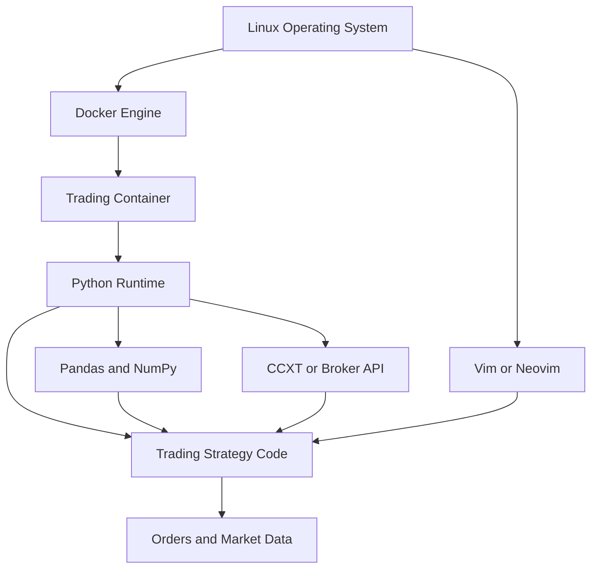

The Linux kernel manages the hardware. Docker runs on top of Linux and uses kernel features such as namespaces and cgroups to create isolated containers. Inside each container, Python runs the trading strategy. The strategy uses libraries to analyze data and connect to exchanges. Vim or Neovim is used on the Linux host to edit strategy files, configuration, and logs.

### 5.2 The Development to Production Flow

A typical workflow for a retail trader using this stack looks like this:


The trader writes the strategy on a laptop or directly on the server using Vim or Neovim. The strategy is tested with historical data. A Docker image is built. The image is deployed to a Linux server. The same image that was tested is the one that runs live. This eliminates a whole class of deployment errors.

<br>

## Section 6: Deployment Architectures for Retail Traders

### 6.1 Single Server Setup

The simplest architecture runs everything on one Linux machine.

| Component | Role |
|---|---|
| Linux server | Hosts the Docker engine |
| Trading container | Runs the Python strategy |
| Database container | Stores trade history and market data |
| Docker volumes | Persist data across container restarts |
| Vim or Neovim | Edits strategy files and configuration on the server |

This setup is cheap and easy to manage. It is suitable for a single strategy or a small number of strategies. The main drawback is that a hardware failure takes down the entire system.

### 6.2 Multi-Container Setup with Docker Compose

As the trader adds more strategies or services, Docker Compose helps organize them.

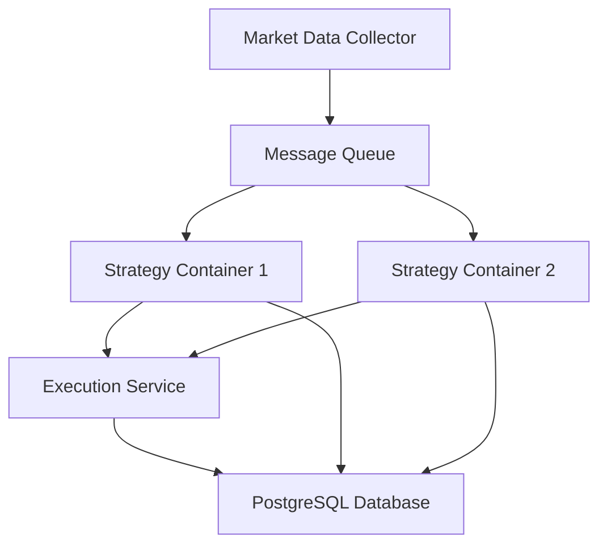

Each service runs in its own container. The data collector fetches prices and publishes them to a message queue. The strategy containers read from the queue and generate signals. The execution service sends orders to the broker. The database stores everything for later analysis.

This architecture is more complex but also more resilient. If one strategy container crashes, the others continue running.

### 6.3 Cloud Deployment

For traders who want high availability, the stack can run on a cloud provider.

| Architecture | Availability | Complexity | Cost |
|---|---|---|---|
| Single server | Low | Low | Low |
| Multi-container | Medium | Medium | Medium |
| Cloud with Kubernetes | High | High | High |

Cloud deployment adds automatic failover, geographic redundancy, and managed databases. It also adds cost and operational complexity. Most retail traders should start with a single server and move to the cloud only when the strategy demands it.

<br>

## Section 7: Security Best Practices

### 7.1 Protect API Keys

Broker and exchange API keys are the most sensitive data in a trading system. They should never be stored in the source code or in the Docker image.

- Use environment variables or Docker secrets to inject keys at runtime.
- Restrict API keys to the minimum permissions required. For example, disable withdrawal permissions if the strategy only needs to trade.
- Rotate keys regularly.

### 7.2 Run as a Non-Root User

By default, Docker containers run as the root user. This is unnecessary and dangerous. A trading container should run as an unprivileged user.

```dockerfile
RUN useradd --create-home trader
USER trader
```

This simple step limits the damage if the container is compromised.

### 7.3 Keep Software Updated

Linux, Python, and Docker all receive security updates regularly. A retail trader should:

- Enable automatic security updates on the Linux host.
- Rebuild Docker images regularly to pick up updated base images and libraries.
- Scan images for known vulnerabilities using tools like Trivy or Docker Scout.

### 7.4 Use a Firewall

Only the ports required for trading should be open to the internet. SSH access should be restricted to known IP addresses and should use key-based authentication instead of passwords.

### 7.5 Secure Vim and Neovim Access

When editing files on a remote server, always use SSH with key-based authentication. Avoid storing sensitive credentials in plain text files that are edited with Vim. Use a password manager or environment variables instead.

<br>

## Section 8: A Beginner's Roadmap

### 8.1 Week 1: Learn the Linux Basics

- Install Ubuntu or Linux Mint on a spare computer or virtual machine.
- Learn basic commands: `ls`, `cd`, `cp`, `mv`, `rm`, `mkdir`, `nano`.
- Learn how to install software with `apt`.
- Learn how to check system status with `top`, `df`, and `free`.
- Open a file in Vim and practice the basic commands: `i`, `Esc`, `:w`, `:q`.

### 8.2 Week 2: Learn Python Basics

- Install Python and a code editor such as VS Code or Neovim.
- Learn variables, lists, dictionaries, loops, and functions.
- Write a simple script that downloads price data with `yfinance` and calculates a moving average.
- Plot the result with Matplotlib.
- Practice editing the script with Vim or Neovim.

### 8.3 Week 3: Learn Docker Basics

- Install Docker on the Linux machine.
- Learn the difference between an image and a container.
- Write a Dockerfile for the Python script from Week 2.
- Build the image and run the container.

### 8.4 Week 4: Build a Complete Trading Stack

- Write a simple trading strategy in Python.
- Backtest it with Backtrader or a custom Pandas script.
- Package it in a Docker container.
- Run the container on the Linux server.
- Set up logging and basic monitoring.
- Use Vim or Neovim to edit the strategy directly on the server.

### 8.5 Ongoing Learning

- Learn about Docker Compose for multi-container setups.
- Learn about database options such as PostgreSQL and TimescaleDB.
- Learn about monitoring tools such as Prometheus and Grafana.
- Learn about CI/CD pipelines for automated testing and deployment.
- Explore advanced Vim or Neovim plugins for Python development, such as LSP support and Treesitter.

<br>

## Conclusion

Linux, Python, Docker, and Vim or Neovim form a practical, cost-effective foundation for retail trading. Linux provides a stable and secure operating system that runs continuously. Python provides a readable language with powerful libraries for data analysis and trading. Docker provides reproducible, isolated environments that ensure the trading software behaves the same way everywhere. Vim and Neovim provide lightweight, keyboard-driven editing that works on any server, including remote machines accessed over SSH.

The combination is greater than the sum of its parts. A trader can develop a strategy on a laptop, test it on historical data, package it in a container, and deploy it to a Linux server with confidence. The same container image that was tested is the one that runs live. The same software environment that produced the backtest results produces the live trading signals. The same editor that was used to write the strategy can be used to fix it on the server at any time.

For a beginner, the path is clear. Start with a user-friendly Linux distribution. Learn enough Python to write a simple strategy. Learn enough Docker to package it. Learn enough Vim or Neovim to edit files on the server. Add complexity only when the strategy demands it. The tools are free, the documentation is extensive, and the community is welcoming.

This stack does not guarantee profits. Trading always carries risk. But it does guarantee that the technology will not be the reason a strategy fails. That is the foundation every retail trader needs.

<br><br><br><br>

<h1 align="center">CYBERSECURITY IMPACT OF LINUX, PYTHON, DOCKER, AND VIM/NEOVIM IN STOCK TRADING.</h1>

<br><br>

### Executive Summary

In stock trading, cybersecurity protects three things: money, market actions, and trust. Money is protected through account and API-key security. Market actions are protected through order integrity and system availability. Trust is protected through confidentiality, auditability, and compliance. Linux, Python, Docker, and Vim or Neovim each affect these areas in a different way. Linux secures the host foundation. Python secures or weakens the trading application layer. Docker controls isolation, reproducibility, and blast radius. Vim or Neovim secures or weakens remote administration. None of these tools makes a trading system secure automatically. Their cybersecurity impact depends on how they are configured and used. When they are hardened together, they create defense in depth. When they are misconfigured, they create new attack paths.

<br>

### Linux: The Security Foundation of the Trading Host

Linux has the strongest direct impact on the cybersecurity of a stock trading system because it is the host operating system beneath everything else. It controls user accounts, file permissions, network exposure, process isolation, and system updates. In a trading environment, Linux helps protect broker API keys, strategy code, market data, logs, and the Docker engine itself.

The most important Linux security impact is least privilege. The trading service should not run as the root user. A dedicated non-root account limits what a compromised process can do. File permissions should allow only the required user to read configuration files that contain secrets. SSH access should use key-based authentication, should be restricted to known addresses where possible, and should not allow direct root login. A firewall should allow only the ports required for trading and administration. Tools such as SELinux or AppArmor add another layer by confining programs to specific files and operations. Audit logs help trace who changed what and when, which matters for order integrity and compliance.

Linux also affects availability, which is a cybersecurity concern in trading. A stable host with automatic security updates, a supported kernel, and minimal unnecessary services is less likely to be disrupted by an attack or a crash. However, Linux security is not automatic. Exposed SSH, weak passwords, outdated packages, unnecessary open ports, and running containers or scripts as root can turn a stable system into an easy target. The cybersecurity impact of Linux is therefore foundational but conditional: it is strong when hardened and weak when left at unsafe defaults.

<br>

### Python: Security at the Trading Application Layer

Python has a direct impact on the security of trading logic, credentials, and data handling. Because Python is readable, it can reduce accidental security mistakes. Clear code is easier to review, test, and audit. Type hints, small functions, explicit error handling, and tests reduce the chance of logic bugs that could place wrong orders, duplicate orders, or ignore risk limits. In stock trading, a logic bug can be as damaging as an external attack.

Python also affects credential security. Broker and exchange API keys should never be hardcoded in source files or committed to version control. They should be injected at runtime through environment variables or a secret manager. API keys should have the minimum permissions required, such as trading without withdrawal rights, and they should be rotated regularly. Logging should redact secrets so that API keys and account details do not appear in plain text. Dependencies should be pinned and scanned for known vulnerabilities because third-party libraries are part of the trading system’s attack surface.

Python can also weaken security when used carelessly. Unsafe functions such as `eval` or insecure deserialization with `pickle` can allow code execution if untrusted data is processed. Unmaintained libraries may contain known flaws. A script that runs with excessive permissions or uses a broker API key with withdrawal rights increases the impact of any compromise. Python’s cybersecurity impact is therefore application-level and highly dependent on discipline: secure code, secure dependencies, secure secrets, and least-privilege API access.

<br>

### Docker: Isolation, Reproducibility, and Blast Radius Control

Docker has a strong impact on cybersecurity in stock trading because it controls how the trading application is packaged and isolated. A well-built container packages the trading code with exact dependency versions, which improves reproducibility and reduces the risk of unexpected behavior between backtesting and live trading. Reproducible environments also make security reviews easier because the trader knows exactly what software is running.

Docker’s main security benefit is isolation. Each container has its own filesystem, network stack, and process space. If one strategy container is compromised, the attacker’s access is limited compared with a process running directly on the host. This reduces the blast radius. Docker also supports practical hardening controls: running the container as a non-root user, using read-only filesystems where possible, limiting CPU and memory, separating networks, and injecting secrets at runtime instead of baking them into images. Image scanning tools can detect known vulnerabilities before deployment, and rebuilding images regularly picks up security updates from base images.

Docker does not remove risk. Containers share the host Linux kernel, so a kernel vulnerability can affect all containers. Running containers as root, mounting the Docker socket into a container, using privileged mode, storing secrets in image layers, or exposing unnecessary ports can weaken security significantly. Persistent data must be stored in volumes with correct permissions, not inside replaceable containers. Docker’s cybersecurity impact is therefore architectural: it can strongly improve isolation and consistency, but only when the host is hardened and containers follow secure defaults.

<br>

### Vim and Neovim: Secure Remote Administration and Its Risks

Vim and Neovim affect cybersecurity mainly through administration and remote access. Retail traders often run trading bots on remote Linux servers. Vim and Neovim allow the trader to edit strategy files, configuration, and logs directly over SSH without a graphical interface. This reduces the need to copy sensitive files to local machines and reduces dependence on graphical remote desktop tools, which can add attack surface. Used over SSH with key-based authentication, they support a secure and lightweight administration workflow.

Vim and Neovim also support security-friendly development practices. Plugins for Git integration, linting, and Language Server Protocol support help the trader review changes, detect errors, and maintain version control. This supports auditability and reduces the chance of unplanned production changes. Because the editors are lightweight, they leave more server resources for the trading system, which supports availability.

Their risks are mostly related to configuration and plugin supply chain. Plugins downloaded from untrusted sources can execute code. Swap files, backup files, and configuration files can accidentally expose sensitive information if permissions are weak. Modelines and embedded commands can be dangerous if untrusted files are opened. Editing production files directly on a live server without version control or backups can damage order integrity. The cybersecurity impact of Vim and Neovim is therefore administrative: they are secure and efficient when used over SSH with trusted plugins, correct file permissions, and change control, but they can weaken security when treated as uncontrolled production editors.

<br>

### Combined Cybersecurity Impact in Stock Trading

Together, these tools create a layered security model. Linux secures the host, users, network, and updates. Python secures the application logic, secrets handling, and dependencies. Docker secures packaging, isolation, and deployment consistency. Vim and Neovim secure remote administration and code review. Cybersecurity is the discipline that connects them through least privilege, encryption, monitoring, patching, and auditability.

| Technology | Main Cybersecurity Contribution in Trading | Main Risk if Misused | Beginner Control |
|---|---|---|---|
| Linux | Host hardening, user separation, firewall, updates, audit logs | Root usage, exposed SSH, outdated packages | Non-root trading user, key-based SSH, firewall, automatic updates |
| Python | Readable logic, secure secrets handling, dependency control | Hardcoded API keys, unsafe libraries, excessive API permissions | Environment variables, pinned dependencies, least-privilege API keys |
| Docker | Isolation, reproducibility, limited blast radius | Root containers, privileged mode, secrets in images | Non-root container, image scanning, runtime secrets, network limits |
| Vim/Neovim | Lightweight secure remote editing over SSH | Untrusted plugins, weak file permissions, uncontrolled production edits | Trusted plugins, SSH keys, version control, restricted file access |

The practical conclusion is that these tools improve cybersecurity in stock trading only when they are configured as part of a security-first workflow. Linux must be hardened. Python must handle secrets and dependencies carefully. Docker must run with least privilege and be scanned regularly. Vim and Neovim must be used over secure SSH with trusted plugins and change control. When these practices are followed, the stack protects trading accounts, order integrity, market data, and system availability more effectively than any single tool could on its own.

<br><br><br><br>

<h1 align="center">LINUX!</h1>

<br><br>
 

<h1 align="center">The History and Evolution of Linux.</h1>

<br><br>

<div align="center">

[](https://www.debian.org/)
[](https://ubuntu.com/)
[](https://fedoraproject.org/)
[](https://archlinux.org/)
[](https://www.opensuse.org/)
[](https://www.gentoo.org/)
[](https://nixos.org/)
[](https://voidlinux.org/)
[](https://alpinelinux.org/)
[](https://www.slackware.com/)

</div>


<br><br><br><br>

## 1. Introduction: The Linux Phenomenon

Linux, at its core, is an open-source, Unix-like operating system kernel created by Linus Torvalds in 1991. What began as a personal hobby project has grown into the most pervasive software platform in modern computing, underpinning everything from tiny embedded sensors to the entire global cloud infrastructure. The development model—characterised by radical transparency, decentralised collaboration, and the copyleft protections of the GNU General Public License—has produced not only a remarkably stable and secure kernel but also catalysed a broader cultural shift toward open-source innovation. Today, when we speak of “Linux” we usually refer to complete operating system distributions that combine the kernel with a rich user‑space environment, primarily sourced from the GNU Project. This document traces the historical arc of Linux, examining the philosophical, technical, and community forces that transformed a student’s side project into the de facto operating system of the internet, supercomputing, and mobile devices.

*   **The Linux kernel is the central coordinator of any Linux-based operating system, managing all communication between hardware and software.** Unlike proprietary kernels such as the Windows NT kernel or the XNU kernel used in macOS, Linux’s entire source code is freely available for anyone to inspect, modify, and redistribute under the terms of the GNU General Public License. This radical openness has attracted a global community of contributors—ranging from independent enthusiasts to engineers at the world’s largest technology corporations—who collectively review, test, and improve the code. The result is a kernel that has achieved exceptional portability, running on more than two dozen hardware architectures including x86, ARM, RISC‑V, and IBM Z mainframes. Its modular design allows it to scale from tiny IoT devices with a few megabytes of memory to supercomputers with millions of cores, while its rigorous code review processes and mandatory use of static analysis tools have made it one of the most secure and resilient pieces of software ever written. Furthermore, because the kernel’s development is completely transparent, security vulnerabilities are typically discovered and patched faster than in closed-source equivalents, making Linux the preferred choice for security-critical applications in finance, defence, and healthcare.

*   **The colloquial term “Linux” actually refers to full operating systems built around the kernel, more accurately termed “distributions” or “GNU/Linux systems.”** A typical Linux distribution bundles the kernel with a comprehensive user‑space environment—shells, compilers, system libraries, desktop environments, and thousands of applications—much of which originates from the GNU Project. The synergy between the kernel and these GNU tools creates a complete, Unix‑compatible operating system that can be freely copied, studied, and customised. Distributions such as Debian, Fedora, and Arch Linux differ in their package management, release cadence, and design philosophies, yet they all share the same foundational kernel and a core set of utilities. This packaging model decouples the low‑level kernel development from the user experience, enabling an ecosystem where hundreds of specialised distributions coexist, each optimised for a particular use case—from lightweight desktop environments for older hardware to fully audited, security‑hardened builds for military applications. Importantly, this diversity does not lead to fragmentation because all distributions ultimately benefit from, and contribute back to, the single upstream kernel maintained by Linus Torvalds and the Linux Foundation.

*   **Linux’s dominance remains largely invisible to end‑users but is absolute in the infrastructure that powers the digital world.** Over 90% of public cloud workloads run on Linux, and it is the exclusive operating system on all of the world’s top 500 supercomputers. The Android mobile operating system, which uses the Linux kernel at its core, is installed on billions of smartphones and tablets globally. Embedded Linux variants operate inside smart televisions, automotive infotainment systems, home routers, and countless industrial controllers. Even Microsoft, historically the most prominent rival of open‑source software, now integrates a full Linux kernel into Windows via the Windows Subsystem for Linux (WSL) and uses Linux extensively within its Azure cloud platform. This quiet ubiquity demonstrates that an open, transparent development model can produce software of the highest quality, capable of meeting the most demanding requirements of scalability, security, and reliability. The Linux phenomenon is not merely a technical success; it is a proof‑of‑concept that the collaborative power of a global community, operating without centralised corporate control, can build and sustain the digital backbone of modern civilisation.

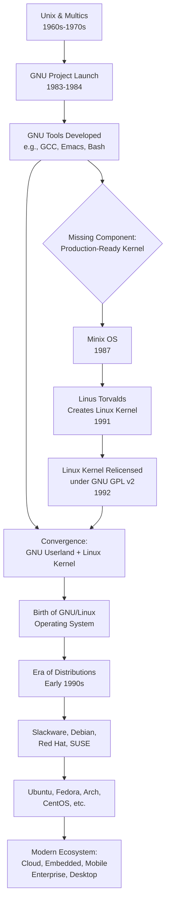

<br>

## 2. The Foundations: Unix and the Free Software Movement

The roots of Linux extend deep into the technical and philosophical soil of two antecedent movements: the architectural genius of the Unix operating system and the ethical crusade of the free software movement. Unix, conceived at Bell Labs in the late 1960s and refined throughout the 1970s, introduced a design philosophy that prized simplicity, modularity, and composability. Its portable C‑language implementation and the “everything is a file” abstraction made it the gold standard in academic and research computing. However, the commercial enclosure of Unix in the 1980s—when AT&T began asserting proprietary control over the source code—severely restricted the freedoms that earlier generations of programmers had taken for granted. This enclosure ignited a philosophical counter‑movement that would, within a decade, provide the legal and cultural scaffolding on which Linux could be built and thrive.

*   **The free software movement, spearheaded by Richard Stallman, arose in the early 1980s as a direct ethical response to the increasing prevalence of proprietary software.** Stallman, then a programmer at the MIT Artificial Intelligence Laboratory, encountered a paradigm‑shifting moment when he could not legally modify the software controlling a newly installed Xerox printer to add a feature he had previously implemented on an older model. For Stallman, this restriction represented a violation of the communal sharing norms that had long characterised academic computing, and he resolved to build an operating system that would guarantee every user the four essential freedoms: the freedom to run the program for any purpose, to study and change its source code, to redistribute copies, and to distribute modified versions. To institutionalise these freedoms, he founded the Free Software Foundation in 1985, creating an organisational vehicle to advance the legal, technical, and educational dimensions of the movement. The FSF’s work would prove indispensable: it produced the GNU General Public License, a legal innovation that used copyright law itself to subvert proprietary restrictions, and it coordinated the development of a complete ecosystem of free software tools that would later combine with the Linux kernel.

*   **The GNU Project, launched by Stallman in 1983, was the ambitious practical embodiment of free software philosophy, aiming to create a completely free, Unix‑compatible operating system.** Its recursive name, “GNU’s Not Unix,” cleverly signalled both its technical lineage and its moral divergence: it would replicate the functionality of Unix without incorporating any of its proprietary code. The scale of this undertaking was immense; it required rebuilding from scratch every component of an operating system—compilers, linkers, debuggers, text editors, shell interpreters, core utilities, and a kernel. By the early 1990s, the GNU Project had achieved remarkable success, producing world‑class tools such as the GNU Compiler Collection (GCC), the GNU Debugger (GDB), the Emacs editor, and the Bourne‑Again Shell (Bash). These programs were not merely functional; they often surpassed their proprietary Unix counterparts in quality, portability, and performance. Yet, despite this prodigious output, the project’s own kernel—GNU Hurd—remained stubbornly incomplete, mired in architectural complexity and slow to reach production readiness.

*   **The educational operating system MINIX, created by Andrew S. Tanenbaum in 1987, filled the pedagogical void left by the commercialisation of Unix but was never intended for broader use.** Tanenbaum released MINIX with a textbook to teach operating system design, and its source code was available for study under a licence that permitted academic use but explicitly forbade redistribution and modification for production. MINIX ran on the popular Intel 8088 and 80286 processors and provided a stable, if limited, Unix‑like environment that allowed students and hobbyists to experiment with operating system concepts. Linus Torvalds would later cite MINIX as a formative influence, both as a practical reference implementation and as a source of frustration: its design was deliberately minimal, it did not fully exploit the capabilities of the newer Intel 80386 processor, and its restrictive licence meant that the community could not extend it into a truly free, full‑featured system. By 1991, the stage was set: a rich body of free software tools existed, a generation of programmers had been educated on Unix principles, but no production‑ready free kernel was available to unite them into a complete operating system.

<br>

## 3. The GNU Project: Building a Free Operating System

The GNU Project stands as one of the most consequential collaborative engineering efforts in computing history. Its goal was not merely to clone Unix but to reconstruct its entire environment under a legal and ethical framework that would permanently protect user freedoms. This required the systematic creation of compilers, libraries, text processors, shell utilities, and eventually a kernel—all written from scratch to avoid any proprietary encumbrance. The project’s success in delivering high‑quality components demonstrated that a geographically distributed, volunteer‑driven community could produce software that rivalled the output of well‑funded commercial laboratories. Central to this achievement was the GNU General Public License, a legal instrument that encoded the principles of copyleft, ensuring that the software—and all derived works—would forever remain free for anyone to use, study, modify, and share.

*   **The GNU General Public License, first published in 1989 and revised as version 2 in 1991, implemented a legal mechanism known as copyleft to protect user freedoms.** Unlike traditional copyright, which reserves all rights to the author, copyleft uses copyright law to mandate that anyone who distributes a covered work—whether verbatim or modified—must also make the corresponding source code available under the same licence terms. This viral property creates a legally protected commons: it prevents proprietary vendors from incorporating GPL‑licensed code into closed products and ensures that all improvements and modifications flow back to the community. The GPL v2 became the standard licence for the Linux kernel, and its terms have been upheld in courts around the world, providing a robust legal foundation for the entire open‑source ecosystem. The FSF’s later GPL v3 addressed newer concerns such as software patents and “Tivoisation,” but Linux remains licensed under GPL v2, a deliberate choice that reflects the kernel community’s preference for stability and broad compatibility.

*   **By 1991, the GNU ecosystem was tantalisingly complete but still lacked a production‑ready kernel to form a functional operating system.** The GNU Compiler Collection had become the de facto standard C, C++, and Fortran compiler on Unix platforms, celebrated for its optimisation capabilities and cross‑architecture support. The Bash shell provided a powerful, scriptable command‑line interface that enhanced the user experience far beyond the original Bourne shell. Essential utilities such as coreutils, binutils, and the GNU C Library (glibc) replicated and extended the standard Unix toolset, ensuring compatibility while adding new features. Despite this richness, the GNU Hurd kernel remained in development limbo, hindered by its ambitious microkernel architecture and the difficulty of achieving consensus among a loosely coordinated team of volunteers. The community therefore found itself in the paradoxical situation of having a virtually complete free operating system that could not boot without a kernel, leaving a gap that was eagerly filled by the emerging Linux kernel.

*   **The philosophical and legal scaffolding erected by the GNU Project was indispensable to Linux’s subsequent trajectory.** When Linus Torvalds began distributing his kernel, he initially used a restrictive licence that prohibited commercial distribution. Recognising the need for a more permissive framework that could attract broad contribution, he adopted the GPL v2 in early 1992, a move he later described as “the best thing I ever did.” This decision instantly aligned the kernel with the existing corpus of GNU software, creating a legally compatible and philosophically coherent whole. The Free Software Foundation and many community advocates therefore insist on the term “GNU/Linux” to accurately reflect the contributions of both projects, acknowledging that the kernel alone does not constitute an operating system. While the naming debate continues, the technical and legal symbiosis is undeniable: without the GNU tools and the GPL, the Linux kernel would have lacked the user‑space environment and the community trust needed to achieve its eventual ubiquity.

<br>

## 4. The Birth of the Linux Kernel

In the spring of 1991, a 21‑year‑old computer science student at the University of Helsinki named Linus Torvalds purchased an Intel 80386‑based personal computer and began exploring its protected‑mode capabilities. Unsatisfied with the educational MINIX system, which he felt could not fully exploit the 386’s hardware features and did not permit free modification, he started writing his own terminal emulator to better understand the CPU’s task switching. That terminal emulator gradually evolved into a rudimentary kernel, and on August 25, 1991, Torvalds posted a famous message to the comp.os.minix newsgroup: “I’m doing a (free) operating system (just a hobby, won’t be big and professional like gnu)…” This modest announcement marked the beginning of the Linux kernel, a project that would eventually become one of the largest and most consequential collaborative software developments in history.

*   **Torvalds’ initial motivation was pragmatic and educational rather than overtly ideological; he wanted a kernel that could fully utilise his 80386 PC’s features.** MINIX, while an excellent teaching tool, was deliberately limited: its microkernel design and restricted licence prevented users from modifying and redistributing the system freely. Torvalds set out to write a monolithic kernel that would use the 386’s memory management unit for demand paging and protected‑mode multitasking, capabilities that were absent in MINIX at the time. He released the very first version, 0.01, in September 1991 to a small group of interested hackers, making the complete source code available via FTP. This early and frequent release pattern, combined with direct solicitation of feedback and patches, became a hallmark of the Linux development model. Within weeks, developers from around the world began submitting bug fixes, device drivers, and feature enhancements, transforming a one‑person hobby into a global collaboration.

*   **A pivotal moment in the kernel’s evolution was its relicensing under the GNU General Public License version 2 with the release of version 0.12 in early 1992.** The original licence for Linux had prohibited any commercial distribution, which severely limited the project’s ability to attract contributors who might want to use it in business contexts. By switching to the GPL v2, Torvalds aligned the kernel with the existing body of GNU software and created a legal framework that encouraged both voluntary and corporate participation. The GPL’s copyleft provision ensured that any modifications to the kernel would also be released under the same terms, preventing fragmentation and guaranteeing that all improvements would benefit the common codebase. This decision lowered barriers for companies like Red Hat and SUSE to build entire businesses around packaging, supporting, and certifying Linux, knowing that their investments would not be locked into a proprietary fork.

*   **The development philosophy that emerged around Linux was later described by Eric S. Raymond as the “bazaar” model, in contrast to the “cathedral” model of proprietary software development.** In the bazaar, a large, loosely connected group of developers works in parallel on many aspects of the project, with a trusted integrator—originally Torvalds alone—merging contributions based on technical merit. This model proved extraordinarily scalable: by delegating responsibility for subsystems to trusted maintainers, Torvalds built a hierarchy that could absorb contributions from thousands of developers while maintaining code quality. The governance structure, often characterised as a “benevolent dictatorship,” relies on Torvalds’ final authority for critical decisions, but he rarely overrules subsystem maintainers unless a fundamental technical principle is at stake. This meritocratic system, combined with the transparency of mailing‑list discussions and the use of distributed version control (first BitKeeper, then Git), has enabled Linux to manage an estimated codebase of over 30 million lines of code with a release cadence of a new kernel every nine to ten weeks.

<br>

## 5. GNU/Linux: The Complete Operating System

The convergence of the Linux kernel with the GNU user‑space utilities in 1992 yielded the first completely free, production‑ready Unix‑like operating system. This union was both technically natural and philosophically synergistic: the kernel managed hardware resources, provided process scheduling, and mediated device access, while the GNU tools furnished a mature, feature‑rich environment for compilation, shell scripting, and file manipulation. The resulting system, while most commonly called “Linux,” is more precisely referred to as GNU/Linux to honour the indispensable contributions of the GNU Project. This complete operating system immediately appealed to hobbyists, academics, and early adopters who valued the ability to freely inspect, modify, and share every line of code running on their machines, and it laid the groundwork for the distribution ecosystem that would soon transform the computing landscape.

*   **The availability of a complete GNU/Linux system spurred the creation of “distributions,” which package the kernel and software into an easily installable and maintainable form.** Early integrators such as MCC Interim Linux, Slackware, and Debian took on the challenging task of building bootable floppy disks or CD‑ROMs that included the kernel, the GNU utilities, device drivers, and a basic filesystem layout. These pioneers wrote installation scripts, selected default configurations, and curated collections of additional software, dramatically reducing the complexity of assembling a working system from raw source code. This packaging effort was essential for extending Linux’s reach beyond expert developers; without distributions, every user would have needed to manually compile the kernel, configure bootloaders, and resolve library dependencies—a prohibitively technical process for most potential adopters.

*   **Distributions quickly diversified along philosophical, technical, and commercial lines, creating an ecosystem that remains a defining feature of the Linux world.** Slackware, first released in 1993, aimed to keep the system as close to traditional Unix as possible, with a simple package format and BSD‑style init scripts. Debian, also launched in 1993 under Ian Murdock, established a community‑governed project with a social contract and a rigorous policy for packaging free software, ultimately producing the largest repository of pre‑compiled software in the open‑source world. Red Hat Linux, founded by Marc Ewing and Bob Young in 1994, introduced a commercial model based on selling support subscriptions and certifications, demonstrating that a company could build a profitable business around free software without compromising its openness. These foundational distributions, each with its own package management system, release philosophy, and target audience, created a rich, competitive marketplace that pushed all participants to improve usability, stability, and security.

*   **The GNU/Linux system directly challenged the entrenched positions of proprietary Unix vendors and, later, Microsoft Windows, by offering a zero‑cost, modifiable alternative that could run on commodity hardware.** In the mid‑1990s, commercial Unix workstations from Sun, HP, and IBM were expensive and tied to specific processor architectures, while Windows NT was gaining traction in the server market. Linux, by contrast, could be installed on inexpensive Intel‑based PCs and scaled from a small file server to a departmental database host without per‑seat licensing fees. Early internet service providers and web hosting companies quickly adopted Linux because it allowed them to deploy hundreds of servers without incurring crippling software costs, accelerating the growth of the commercial internet. The LAMP stack—Linux, Apache, MySQL, and PHP/Perl/Python—became the standard platform for dynamic websites, powering the early growth of companies such as Google, Yahoo, and Amazon, and cementing Linux’s reputation as the operating system of choice for internet infrastructure.

<br>

## 6. The Proliferation of Linux Distributions

The distribution model is the engine of Linux’s remarkable diversity and adaptability. By decoupling the kernel’s development from the integration and user‑experience layers, distributions enable specialists to craft operating systems optimised for every conceivable niche. From lightweight environments that revive decade‑old hardware to security‑audited builds used in nuclear submarines, the distribution ecosystem demonstrates how a common kernel can be shaped into radically different products. The table below summarises the most influential distribution families and their notable descendants, while the subsequent flowchart illustrates the genealogical relationships that define the modern landscape.

| Distribution Family (Origin) | Founding Philosophy / Focus | Notable Derivatives & Downstreams | Primary Package Manager |
| :--------------------------- | :-------------------------- | :-------------------------------- | :---------------------- |
| **Debian** (1993) | Stability, strict free software commitment, vast community repository. | **Ubuntu** (user-friendliness), **Linux Mint** (desktop ease), **Kali Linux** (security testing), **elementary OS** (design focus). | `APT` (`dpkg`) |
| **Red Hat** (1994) | Enterprise-grade stability, long-term support, commercial ecosystem. | **Fedora** (cutting-edge features), **CentOS** / **Rocky Linux** / **AlmaLinux** (community RHEL rebuilds), **Oracle Linux**. | `RPM` (`dnf`/`yum`) |
| **Arch Linux** (2002) | Simplicity, minimalism, user centrality, rolling-release model. | **Manjaro** (user-friendly Arch), **EndeavourOS** (terminal-centric installer). | `Pacman` |
| **openSUSE** (1994) | Stability and flexibility, powerful configuration tool (YaST). | **SUSE Linux Enterprise Server (SLES)** (commercial edition), **openSUSE Leap** (stable), **openSUSE Tumbleweed** (rolling). | `RPM` (`zypper`) |
| **Slackware** (1993) | One of the oldest; extreme simplicity, stability, Unix-like purity. | **Salix OS** (user-friendly, dependency-aware), **Zenwalk**. | `pkgtools` / `slapt-get` |
| **Gentoo** (2002) | Ultimate configurability, source-based compilation for optimisation. | **Funtoo** (variant with experimental features). | `Portage` |

```mermaid
flowchart TD
    Debian --> Ubuntu
    Debian --> Kali
    Debian --> Devuan
    Debian --> MX[antiX & MX Linux]
    Ubuntu --> Mint[Linux Mint]
    Ubuntu --> Pop[Pop!_OS]
    Ubuntu --> Elem[elementary OS]
    Ubuntu --> Zorin
    Ubuntu --> Neon[KDE neon]
    Arch --> Manjaro
    Arch --> Endeavour
    Arch --> Artix
    Manjaro --> Garuda
    Fedora --> RHEL[Red Hat Enterprise Linux]
    RHEL --> Rocky
    RHEL --> Alma[AlmaLinux]
    RHEL --> CentOS_Stream
    RHEL --> Oracle[Oracle Linux]
    Fedora --> Nobara
    Fedora --> Bazzite
    openSUSE --> Tumbleweed
    openSUSE --> Leap
    openSUSE --> TUXEDO
    Gentoo --> Calculate
    Slackware --> Salix
    NixOS
    Void
    Alpine --> PorteuX
    Solus
    BSD --> FreeBSD
    FreeBSD --> GhostBSD
    FreeBSD --> TrueNAS
    BSD --> OpenBSD
```

*   **Each distribution family embodies a distinct philosophy that governs its approach to stability, software currency, ease of use, and community governance.** Debian’s commitment to free software principles means that its official repositories strictly segregate free and non‑free software, and its stable releases undergo years of testing before publication, making it a favourite for servers and mission‑critical infrastructure. Arch Linux, by contrast, follows a rolling‑release model that provides users with the latest upstream software versions almost immediately, at the cost of requiring more manual intervention and deeper system knowledge. Red Hat’s family has successfully commercialised open source by creating a certified, fully supported enterprise distribution (RHEL) and reinvesting a portion of the resulting revenue into upstream development, a model that has been replicated by SUSE and, to a lesser extent, by Canonical. Gentoo’s source‑based approach allows users to compile every package with custom optimisation flags and feature selections, yielding systems that can be precisely tuned for specific hardware at the expense of compilation time and complexity. These philosophical divergences are not weaknesses; they allow the ecosystem to serve everyone from novice desktop users who want a Windows‑like experience to kernel developers who need a bare‑bones environment for low‑level debugging.

*   **The package manager is the most visible technical differentiator among distributions, fundamentally shaping the user experience of installing, updating, and removing software.** The Advanced Package Tool (APT), used by Debian and its derivatives, manages `.deb` packages and automatically resolves complex dependency chains, allowing users to install a web server stack with a single command. RPM‑based distributions such as Fedora and openSUSE use variants of the DNF or Zypper tools, which provide similar dependency resolution and transaction history features. Arch’s Pacman combines a simple, fast binary format with the Arch User Repository (AUR), a community‑driven collection of build scripts that dramatically expands the available software catalogue. Source‑based distributions like Gentoo use Portage, a system inspired by FreeBSD’s ports, which downloads source code and compiles it on the local machine according to user‑defined USE flags. The historical divergence of package formats created some ecosystem fragmentation, but modern cross‑distribution solutions such as Flatpak, Snap, and AppImage are increasingly providing a unified application‑delivery mechanism that works across all major Linux families, isolating applications from the underlying system libraries and reducing dependency conflicts.

*   **Ubuntu’s launch in 2004 represented a transformative moment that dramatically lowered the barrier to entry for desktop Linux.** Sponsored by Canonical Ltd. and based on Debian’s unstable branch, Ubuntu introduced a predictable, six‑month release cycle with a strong emphasis on usability, multilingual support, and hardware compatibility. Its “Warty Warthog” release shipped a polished GNOME 2 desktop, a straightforward graphical installer, and access to thousands of pre‑compiled packages, making it possible for non‑technical users to adopt Linux without encountering the steep learning curve of earlier distributions. Ubuntu’s success catalysed a wave of derivative distributions that further specialised the experience: Linux Mint polished the desktop with its Cinnamon environment and multimedia codecs preinstalled; elementary OS focused on minimalist, macOS‑like design; and Pop!_OS optimised for System76 hardware and gaming. Despite periodic controversies—such as the inclusion of Amazon search results in the Unity desktop or the introduction of the Snap package format—Ubuntu remains the most widely used Linux distribution on servers, in clouds, and among desktop newcomers, serving as the gateway through which millions of users first encounter free software.

<br>

## 7. Key Milestones in Linux Development

The evolution of Linux is punctuated by a series of pivotal events—technical breakthroughs, community expansions, legal battles, and market validations—that collectively propelled it from a hobbyist kernel to a foundational technology of the global economy. The following table captures the most significant milestones, while the subsequent commentary expands on their broader implications for the ecosystem.

| Year | Milestone | Significance |
| :--- | :-------- | :----------- |
| **1991** | Linus Torvalds announces and releases the first Linux kernel (0.01). | The project begins; source code is immediately opened for collaboration. |
| **1992** | Linux kernel relicensed under GNU GPL v2. | Adopts the copyleft framework, ensuring perpetual openness and alignment with the GNU Project. |
| **1994** | Linux kernel 1.0.0 released. | Signals the kernel’s maturity and stability for production use. |
| **1996** | Tux the penguin mascot is adopted. | Creates a recognisable and enduring brand symbol for Linux worldwide. |
| **1998** | Major corporations (IBM, Oracle) announce support for Linux. | Legitimises Linux in the enterprise, triggering massive corporate investment and talent influx. |
| **1999** | Red Hat IPO; stock soars, validating open-source business models. | Demonstrates the commercial viability of open-source software and support services. |
| **2003** | SCO Group files lawsuits against IBM and Linux users. | A major legal challenge that ultimately strengthens the community’s legal standing and unity. |
| **2004** | Ubuntu 4.10 “Warty Warthog” released. | Democratises desktop Linux access with a focus on usability and regular, predictable releases. |
| **2005** | Git version control system created by Linus Torvalds. | Revolutionises distributed software development; becomes the global standard for version control. |
| **2007** | Linux Foundation formed. | Provides a neutral, professional home for kernel development funding and industry collaboration. |
| **2011** | Linux powers 91% of the world’s top 500 supercomputers. | Establishes absolute dominance in high‑performance computing (HPC). |
| **2015** | Microsoft launches Windows Subsystem for Linux (WSL). | Symbolic embrace of Linux by its historic rival, integrating the kernel directly into Windows. |

*   **The early 2000s dot‑com boom and the subsequent expansion of web infrastructure were profoundly accelerated by the capabilities of Linux.** As internet startups scrambled to scale their services at minimal cost, Linux provided a reliable, high‑performance, and licence‑free platform that could be deployed on commodity x86 servers without vendor lock‑in. The LAMP stack—Linux, Apache HTTP Server, MySQL database, and PHP/Perl/Python scripting languages—became the standard architecture for dynamic websites, from small forums to the nascent search engines and e‑commerce platforms that would grow into the world’s largest internet companies. Google famously built its initial search infrastructure on clusters of thousands of inexpensive Linux machines, pioneering techniques in distributed file systems and parallel processing that remain central to cloud computing today. The open‑source nature of the stack meant that any organisation, from a university research group to a national government, could replicate and adapt the technology without negotiating costly licensing agreements, democratising access to scalable web infrastructure and fuelling the explosive growth of the early internet.

*   **The creation of Git in 2005 was a direct response to the scaling challenges inherent in managing a project as vast and distributed as the Linux kernel.** Prior to Git, the kernel community had relied on the proprietary BitKeeper version control system, which became unavailable to the project after licensing disputes. In just a few weeks, Torvalds designed and implemented Git as a distributed, high‑performance, and content‑addressable system that could handle the massive volume of patches, merges, and branches generated by thousands of contributors working concurrently. Git’s distributed architecture means that every developer has a complete local copy of the repository, enabling offline work, fast branching, and robust integrity verification via cryptographic hashes. The tool’s adoption rapidly spread beyond the Linux kernel to become the de facto standard for all software development, powering platforms such as GitHub, GitLab, and Bitbucket, and enabling the collaborative workflows that characterise modern open‑source and enterprise development alike. Git’s existence exemplifies how solving a concrete engineering problem within the Linux community produced a tool that has transformed the global practice of software engineering.

*   **The formation of the Linux Foundation in 2007 consolidated the governance and funding needed to sustain the kernel’s development as a neutral, professionally managed project.** Prior to the Foundation, Linus Torvalds and a small number of core maintainers were employed by various companies, creating potential conflicts of interest and uncertainties about long‑term stewardship. The Linux Foundation, a non‑profit consortium, now employs Torvalds and other key kernel developers, manages the kernel’s trademark, provides legal infrastructure, and hosts a wide array of collaborative open‑source projects including the Cloud Native Computing Foundation (CNCF) and the Automotive Grade Linux initiative. By pooling financial contributions from hundreds of corporate members—including Intel, Google, Red Hat, Microsoft, and Huawei—the Foundation ensures that the kernel’s development roadmap is not dictated by any single entity and that critical security auditing, fuzzing, and compliance work receive sustained funding. This professional stewardship has been instrumental in maintaining the kernel’s reliability as it has expanded to over 30 million lines of code and more than 4,000 developers contributing per release.

<br>

## 8. Linux in the Modern Computing Landscape

Today, Linux functions as the silent, ubiquitous substrate upon which the digital world is built. Its architectural principles—modularity, network transparency, and runtime configurability—have proven ideally suited to the demands of twenty‑first‑century computing, from resource‑constrained IoT microcontrollers to planet‑scale cloud data centres. While its desktop market share remains modest, Linux has achieved near‑total dominance in servers, supercomputers, and embedded devices, and it forms the foundational layer for the container and orchestration technologies that are reshaping how software is developed, deployed, and scaled.

*   **Cloud computing and containerisation are fundamentally Linux technologies, built upon kernel features that enable lightweight isolation and efficient resource management.** Every major public cloud provider—Amazon Web Services, Google Cloud, and Microsoft Azure—runs its infrastructure on customised Linux variants, and the virtual machines offered to customers overwhelmingly run Linux distributions. The container revolution, ignited by Docker in 2013 and orchestrated at scale by Kubernetes, is deeply rooted in Linux kernel primitives: control groups (cgroups) limit and account for resource usage, namespaces provide isolated views of system resources for each container, and union filesystems enable efficient layered image management. These features allow thousands of containers to run on a single host with near‑native performance, enabling the microservices architectures that power modern streaming platforms, financial transaction systems, and artificial intelligence workloads. Kubernetes itself, originally designed by Google based on its internal Borg system and now managed by the Cloud Native Computing Foundation, has become the universal control plane for Linux‑based container fleets, cementing Linux’s position as the operating system of the cloud‑native era.

*   **Embedded systems and the Internet of Things represent another vast domain where Linux’s small footprint and customisability make it the dominant operating system.** Projects such as the Yocto Project and Buildroot provide tools and metadata layers that allow developers to assemble bespoke Linux distributions for any hardware target, selecting only the kernel components and user‑space libraries needed for a specific application. This enables Linux to run on devices ranging from high‑end automotive infotainment systems and industrial robot controllers to low‑power smart thermostats and connected medical sensors. The kernel’s ability to support real‑time processing through the PREEMPT_RT patch set is expanding its applicability in safety‑critical and time‑sensitive domains such as autonomous vehicle control and telecommunications infrastructure. In the IoT space, Linux‑based platforms balance the need for rich networking stacks, security updates, and cloud connectivity with the stringent power and cost constraints of battery‑powered edge devices, creating a continuum from the smallest sensor node to the cloud back‑end.

*   **Despite its low single‑digit share of the traditional desktop PC market, the Linux desktop ecosystem is vibrant, mature, and increasingly attractive for developers, creatives, and privacy‑conscious users.** Distributions such as Linux Mint, Ubuntu, and Fedora Workstation now provide polished, installation‑ready desktop environments that rival or surpass the ease of use of proprietary alternatives, with application stores, automatic driver installation, and seamless integration with cloud services. The rise of Flatpak and Snap has largely solved the software‑distribution problem that once plagued desktop Linux, allowing independent software vendors to ship applications that run consistently across any Linux distribution. For software developers, Linux offers the most native and friction‑free environment for working with containers, cloud infrastructure, and open‑source toolchains, making it the platform of choice for the majority of professional programmers according to multiple industry surveys. Moreover, as concerns about digital privacy and vendor lock‑in grow, Linux distributions offer a transparent, auditable, and user‑controlled computing experience that cannot be matched by closed‑source operating systems, driving steady growth in adoption among government agencies, non‑profits, and individual users seeking digital sovereignty.

<br>

## 9. The Future of Linux

The trajectory of Linux points toward deeper specialisation, expanded real‑time capabilities, and an even more central role in the infrastructure of artificial intelligence, edge computing, and autonomous systems. Its open development model and architectural adaptability position it to absorb and enable the next wave of hardware innovation, from RISC‑V processors and composable disaggregated servers to neuromorphic accelerators and quantum computing interfaces. As the software ecosystem continues to evolve, Linux will remain the common platform that allows heterogeneous technologies to interoperate reliably and securely.

*   **Linux will continue to evolve as the primary operating system for virtualised and containerised workloads, with ongoing kernel improvements focused on performance isolation, security, and live‑patching.** The introduction of technologies such as eBPF (extended Berkeley Packet Filter) allows safe, dynamic instrumentation of kernel behaviour, enabling observability, networking, and security tools that run at native speed without kernel module loading. Virtualisation enhancements like KVM and the increasing use of hardware‑assisted isolation will allow Linux to host confidential computing environments where even the hypervisor cannot inspect guest memory, meeting the demands of multi‑tenant clouds and regulated industries. The rise of edge computing will see lightweight, immutable Linux distributions deployed on millions of devices processing data close to its source, from 5G radio access networks to autonomous vehicle sensor arrays, requiring new approaches to over‑the‑air updates, disconnected operation, and hardware‑enforced trust. The kernel’s real‑time capabilities, once a niche interest, are becoming mainstream as industrial control systems, robotics, and financial trading platforms demand microsecond‑level determinism.

*   **Security and digital sovereignty are becoming paramount concerns where Linux’s open‑source nature provides a strategic, verifiable advantage.** In an era of supply‑chain attacks and state‑sponsored cyber threats, the ability to independently audit every line of the operating system—from the bootloader to the cryptographic libraries—is not a luxury but a necessity for national security and critical infrastructure. Governments and enterprises are increasingly mandating that the software they depend on must be buildable from auditable source code, a requirement that Linux distributions can satisfy natively. Technologies such as Secure Boot, TPM‑backed disk encryption, and immutable root filesystems (as pioneered by Fedora Silverblue and openSUSE MicroOS) allow Linux to provide a chain of trust from firmware to application, resistant to persistent malware and tampering. The growing adoption of memory‑safe languages like Rust in the kernel itself—enabled by the recent inclusion of Rust support—promises to eliminate entire classes of memory‑corruption vulnerabilities that have plagued C‑based systems for decades, further hardening the platform for the most sensitive deployments in defence, finance, and healthcare.

*   **The developer experience on Linux will continue to improve, consolidating its position as the premier platform for software engineering across all domains.** Microsoft’s Windows Subsystem for Linux has already made the Linux toolchain seamlessly accessible to millions of Windows‑based developers, while native Linux desktops offer unmatched integration with container runtimes, Kubernetes clusters, and continuous‑integration pipelines. The ecosystem of programming languages, frameworks, and development tools is most complete and performant on Linux, from Rust’s borrow checker to Python’s data‑science stack to the LLVM compiler infrastructure. As artificial intelligence and machine learning development increasingly centres on Linux‑based GPU clusters and specialised hardware, the kernel’s driver model and user‑space libraries will continue to receive the lion’s share of optimisation effort from hardware vendors. The combination of a free, open platform with world‑class development tooling ensures that Linux will not only host the infrastructure of the future but also serve as the environment in which that future is conceived and built.

<br>

## 10. Conclusion

The history of Linux is a testament to the extraordinary outcomes that can arise from a simple idea pursued with unwavering consistency: that transparent, collaborative development can produce software of unparalleled quality, adaptability, and reach. From a student’s terminal emulator project in a Helsinki apartment to the invisible engine that powers the global internet, Linux’s journey has been propelled not by corporate mandate but by the collective intelligence and effort of a worldwide community. Along the way, it has overcome technical complexity, legal assault, and market scepticism, transforming the software industry’s assumptions about how complex systems should be built and who should own them.

*   **Linux’s success has fundamentally rewritten the economics and ethics of the technology industry, proving that open‑source software is not merely viable but often superior for building the most demanding computing systems.** It has forced a re‑evaluation of traditional proprietary business models, giving rise to billion‑dollar companies built on services, support, and subscription revenues rather than software licence sales. The principles it embodies—radical transparency, meritocratic governance, and the legal protection of user freedoms—have inspired the creation of countless other open‑source projects and have influenced policymaking on digital sovereignty and competition law around the world. Linux has democratised access to world‑class operating system technology, enabling a student in Nairobi, a startup in Bangalore, and a research lab in Geneva to build on the same foundation used by Google and NASA, purely on the strength of their ideas.

*   **The story of Linux is far from over; it remains a living, evolving project that is continuously being rewritten to meet the demands of new hardware and new computing paradigms.** The development process, now professionally stewarded by the Linux Foundation and executed by thousands of contributors from competing companies, ensures that the kernel will adapt to whatever challenges the next decades bring. As computing becomes ever more embedded in the fabric of society—managing power grids, controlling autonomous vehicles, analysing personal health data—the need for a secure, stable, and transparent foundation becomes acute. Linux, curated and refined by a global community that has already navigated thirty years of exponential change, is uniquely positioned to provide that foundation, not by resting on its legacy but by relentlessly continuing to improve, one patch at a time.

<br>

## Appendix: Comprehensive Distribution Family Tree

The following hierarchical tree documents the technical lineage of major Linux distributions and includes the BSD family for contextual completeness. This map is based on direct source‑code descent and package‑management inheritance, reflecting the genealogical relationships that define the modern open‑source operating system landscape.

```
├── Debian (Stable) [1993]
│   ├── Ubuntu (Canonical Ltd) [2004]
│   │   ├── Official Flavors (Canonical)
│   │   │   ├── Kubuntu (KDE Plasma)
│   │   │   ├── Lubuntu (LXQt)
│   │   │   ├── Ubuntu Budgie
│   │   │   ├── Ubuntu MATE
│   │   │   ├── Ubuntu Studio
│   │   │   └── Xubuntu (XFCE)
│   │   └── Unofficial Derivatives
│   │       ├── Pop!_OS (System76)
│   │       ├── elementary OS (Pantheon Desktop)
│   │       ├── Linux Mint
│   │       ├── Zorin OS
│   │       ├── KDE neon
│   │       ├── Linux Lite
│   │       ├── Bodhi Linux (Moksha Desktop)
│   │       ├── Peppermint OS
│   │       ├── BackBox (Penetration Testing)
│   │       └── Trisquel GNU/Linux (FSF-endorsed)
│   ├── Direct Derivatives
│   │   ├── MX Linux (antiX + MEPIS)
│   │   │   └── Swift Linux (MX Linux-based)
│   │   ├── antiX (SysVinit/Runit, Lightweight)
│   │   ├── Kali Linux (Penetration Testing)
│   │   ├── Tails (Privacy & Anonymity)
│   │   ├── PureOS (Privacy-focused, FSDG)
│   │   ├── Devuan (No systemd)
│   │   └── SparkyLinux
│   └── Testing/Unstable Branches
│       ├── Siduction
│       └── (Other Experimental Forks)
├── Arch Linux (Rolling Release) [2002]
│   ├── EndeavourOS (Terminal-Centric)
│   ├── Manjaro (Curated, Delayed Packages)
│   │   └── Garuda Linux (Gaming Focus)
│   ├── Artix Linux (No systemd)
│   ├── Archcraft (Minimalist, Aesthetic)
│   ├── ArcoLinux (Learning-focused)
│   ├── CachyOS (Performance Patched)
│   └── Bluestar Linux (Desktop Focus)
├── Fedora (RHEL Upstream) [2003]
│   ├── Red Hat Enterprise Linux (RHEL)
│   │   ├── CentOS Stream (RHEL Development Feed)
│   │   ├── AlmaLinux (RHEL-compatible)
│   │   ├── Rocky Linux (RHEL-compatible)
│   │   └── Oracle Linux
│   ├── Nobara Project (Gaming & Multimedia)
│   ├── Ultramarine Linux (Fedora + Budgie/Pantheon)
│   └── Bazzite (Immutable Gaming)
├── openSUSE (SUSE Upstream) [2005]
│   ├── openSUSE Tumbleweed (Rolling Release)
│   ├── openSUSE Leap (Stable, SLE-based)
│   └── TUXEDO OS (Hardware Vendor)
├── Independent & Ancestral Distributions
│   ├── Gentoo Linux (Source-based) [2002]
│   │   └── Calculate Linux (Binary/Portage)
│   ├── Slackware (One of the Oldest) [1993]
│   ├── NixOS (Declarative, Immutable) [2003]
│   ├── Void Linux (Independent, XBPS, Runit) [2008]
│   ├── Alpine Linux (musl libc, BusyBox) [2005]
│   │   └── PorteuX (Portable)
│   ├── Solus (Independent, Budgie Origin) [2012]
│   ├── PCLinuxOS (Independent, RPM) [2003]
│   └── Mageia (Mandriva fork) [2010]
└── BSD Family (UNIX Derivatives, Not Linux)
    ├── FreeBSD
    │   ├── GhostBSD (MATE Desktop)
    │   └── TrueNAS (Storage Appliance)
    └── OpenBSD (Security-focused)
```

<br>

**Lineage Notes**

*   **Ubuntu’s Unique Position:** Ubuntu serves as the primary gateway between the Debian base and the modern desktop ecosystem. Its official flavours are maintained within the Canonical project infrastructure, while derivatives such as Pop!_OS and Linux Mint are independent projects with their own repositories, packaging policies, and release schedules.
*   **Complex Derivative Chains:** Some distributions represent multi‑generational descent. For instance, Swift Linux is derived from MX Linux, which in turn is a collaboration of the antiX and MEPIS communities, both rooted in Debian. This demonstrates how derivative distributions can themselves become new upstream sources for further specialisation.
*   **Package Management Families:** The tree structure generally aligns with the primary package management system: APT (`.deb`) for the Debian branch, Pacman for Arch, DNF/RPM for Fedora and openSUSE, and unique systems such as Portage for Gentoo and XBPS for Void. Understanding these families helps system administrators predict dependency resolution behaviour and tooling compatibility.
*   **BSD Context:** The BSD family is included for historical and architectural completeness. FreeBSD, OpenBSD, and their derivatives are direct descendants of the original Berkeley Software Distribution, sharing a common ancestry with Unix but developed under a permissive licence. They are not Linux and do not use the Linux kernel, but they contribute significantly to the broader open‑source operating system ecosystem, especially in networking, storage, and security appliances.

 
<br><br><br><br>

<h1 align="center">The Linux File System Hierarchy.</h1>

<br><br>

<div align="center">

[](https://www.debian.org/)
[](https://ubuntu.com/)
[](https://fedoraproject.org/)
[](https://archlinux.org/)
[](https://www.opensuse.org/)
[](https://www.gentoo.org/)
[](https://nixos.org/)
[](https://voidlinux.org/)
[](https://alpinelinux.org/)
[](https://www.slackware.com/)

</div>

<br><br><br><br>

## 1. Introduction

The Linux File System Hierarchy is the structural backbone of every Linux and Unix-like operating system. Governed by the Filesystem Hierarchy Standard (FHS), it defines a logical, predictable layout for all files—binaries, libraries, configuration data, user documents, and transient state information. A deep understanding of this hierarchy is indispensable for system architects, administrators, and developers who aim to build secure, maintainable, and high‑performance Linux deployments. This document provides a comprehensive, refined analysis that incorporates modern practices, resolves historical ambiguities, and serves as a deployment‑ready reference.

<br>

## 2. The Filesystem Hierarchy Standard: Goals and Principles

The FHS is maintained by the Linux Foundation and serves as a normative specification for directory layout. Its primary objectives are:

- **Predictability:** Software can rely on fixed paths to locate binaries, libraries, and configuration files across any compliant distribution.
- **Interoperability:** Different Linux distributions, and even non‑Linux Unix systems, share a common structural model, easing cross‑platform development and administration.
- **Separation of Concerns:** The standard distinguishes between shareable and unshareable data, static and variable content, and system‑critical versus user‑space components.

The FHS categorizes files along two axes:

- **Shareable vs. Unshareable:** Shareable files can be mounted read‑only over a network and used by multiple hosts (e.g., `/usr`, `/opt`). Unshareable files are host‑specific and must remain local (e.g., `/etc`, `/var`).
- **Static vs. Variable:** Static files do not change during normal operation except during deliberate upgrades (e.g., `/bin`, `/lib`). Variable files are modified by running processes (e.g., `/var/log`, `/tmp`).

These principles inform the placement, permission model, and mounting strategy for every directory.

<br>

## 3. Directory Classification Framework

The following table summarizes the canonical top‑level directories according to their primary role and classification under FHS 3.0, with notes on how they are treated in modern systemd‑based distributions.

| **Directory** | **Content** | **Shareable** | **Static/Variable** | **Required for Boot** | **Typical Mount** |
|---------------|-------------|---------------|---------------------|------------------------|-------------------|
| `/`           | Root filesystem, essential top‑level directories | No | Mixed | Yes | Local disk, often single partition or combined with `/usr` |
| `/bin`        | Essential user command binaries | No | Static | Yes | Historically on root; now often a symlink to `/usr/bin` |
| `/sbin`       | Essential system administration binaries | No | Static | Yes | Historically on root; now often a symlink to `/usr/sbin` |
| `/boot`       | Boot loader, kernel images, initramfs | Yes | Static | Required by bootloader | Separate small partition (ext4/FAT32) for compatibility |
| `/dev`        | Device special files (udev‑managed) | No | Dynamic (virtual) | Yes | `devtmpfs` (in‑memory) |
| `/etc`        | Host‑specific configuration files | No | Primarily static | Yes | Part of root filesystem |
| `/lib*`       | Essential shared libraries and kernel modules | No | Static | Yes | Historically on root; may be symlinked to `/usr/lib` |
| `/media`      | Automatic mount points for removable media | No | Variable | No | Managed by desktop automounters |
| `/mnt`        | Manual, temporary mount points | No | Variable | No | Empty directory, used ad‑hoc |
| `/opt`        | Self‑contained third‑party application packages | Yes | Static | No | Separate partition or under `/` |
| `/proc`       | Virtual filesystem for process and kernel info | No | Virtual (in‑memory) | Yes | `proc` (never backed by disk) |
| `/root`       | Home directory of the root user | No | Static (mostly) | No | Part of root filesystem |
| `/run`        | Volatile runtime data (tmpfs) | No | Variable (in‑memory) | Yes (systemd) | `tmpfs` |
| `/srv`        | Data served by the system (web, ftp, etc.) | Yes | Static | No | Separate partition optional |
| `/sys`        | Virtual filesystem for kernel objects | No | Virtual (in‑memory) | Yes | `sysfs` |
| `/tmp`        | Temporary files, often cleared at boot | No | Variable | No | `tmpfs` or disk partition |
| `/usr`        | Read‑only, shareable user applications and libraries | Yes | Static | No (historically); with UsrMerge, required early in boot | Separate partition or under `/` |
| `/var`        | Variable data: logs, caches, spools, state | No | Variable | No | Separate partition strongly recommended |
| `/home`       | User home directories | No | Variable | No | Separate partition strongly recommended |

<br>

## 4. Visual Overview of the Hierarchy

The following Mermaid diagram depicts the primary top‑level directories and their most important subdirectories, illustrating the logical flow from the root downward.

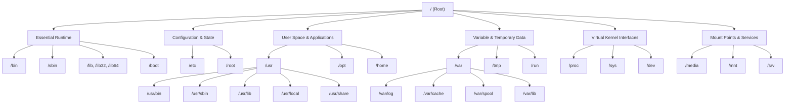

<br>

## 5. In‑Depth Directory Analysis

Each top‑level directory is examined below, with verbose bullet points that describe its purpose, typical contents, security and mount considerations, and any recent evolution.

### 5.1 The Root Directory (`/`)

- The root directory is the absolute origin of the entire filesystem tree. Every other file, device node, and mount point descends from `/`. Write access to the root directory itself must be limited to the root user to prevent accidental or malicious restructuring.
- A minimal root filesystem must contain all directories necessary for single‑user mode and early boot: `/bin`, `/sbin`, `/lib`, `/etc`, `/dev`, and `/proc` (and `/sys`/`/run` on systemd systems). Historically these were physically present on the root partition; modern systems may implement the UsrMerge where `/bin`, `/sbin`, and `/lib` are symbolic links into `/usr`, shifting the requirement that `/usr` be available during boot.
- In a multi‑partition layout, branches like `/home`, `/var`, and `/usr` are often separate filesystems mounted later in the boot process via entries in `/etc/fstab`. This separation protects the root filesystem from being filled by user data or runaway logs.
- The root directory should never contain ordinary files; only the standard subdirectories belong there. Ad‑hoc top‑level directories (e.g., `/data`, `/backup`) violate the FHS and should be avoided in favor of `/mnt` or appropriate locations.

### 5.2 Essential Command Binaries (`/bin` and `/sbin`)

- `/bin` holds executable programs that are fundamental for system operation and must be available to all users even in single‑user recovery mode. Commands such as `ls`, `cp`, `mv`, `cat`, `bash`, and `mount` reside here. Because these binaries are required before any additional filesystems are mounted, `/bin` was historically never a separate partition.
- `/sbin` is reserved for system administration tools typically run by the root user during boot, repair, or maintenance. Examples include `fdisk`, `fsck`, `mkfs`, `ifconfig` (or `ip`), and `shutdown`. Keeping these separate from `/bin` enforces the principle of least privilege and prevents accidental use by unprivileged users.
- On many contemporary distributions (Debian, Ubuntu, Arch, Fedora), the distinction is largely removed through the UsrMerge: `/bin` is a symbolic link to `/usr/bin` and `/sbin` to `/usr/sbin`. This consolidation reduces complexity and guarantees that all system binaries live under a single `/usr` hierarchy, which can be mounted read‑only after boot.
- Even with the merge, the directories remain conceptually distinct in the FHS, and scripts and documentation may still reference both paths. A properly configured system ensures that any legacy references resolve correctly through the symlinks.

### 5.3 Boot Loader Files (`/boot`)

- `/boot` contains static files required by the bootloader before the kernel takes control: the kernel image (`vmlinuz-<version>`), the initial RAM disk (`initrd.img-<version>` or `initramfs-<version>.img`), and bootloader configuration (GRUB’s `grub.cfg`, or systemd‑boot entries).
- On UEFI systems, the EFI System Partition (ESP) is often mounted at `/boot/efi` (or `/efi`) and formatted as FAT32. The bootloader’s EFI executables reside there, while the kernel and initramfs may still be in `/boot` or on the ESP depending on the distribution.
- Because the bootloader must read these files using firmware drivers, the filesystem of `/boot` must be a type that the firmware or bootloader understands natively (typically ext4 for BIOS/GRUB, or FAT32 for UEFI). Advanced filesystems like XFS, Btrfs, or ZFS are rarely used for `/boot` without careful configuration.
- For disk encryption setups, `/boot` often remains unencrypted (or uses a separate LUKS partition with a passphrase) to allow the bootloader to load the kernel and initramfs that will then unlock the root volume. Its small size (500 MB–1 GB) and static nature make it a candidate for a dedicated primary partition.

### 5.4 Device Files (`/dev`)

- `/dev` is a virtual filesystem (`devtmpfs`) populated by the kernel and managed by `udev` (or `eudev`). It contains special device nodes that represent hardware and virtual devices, providing a uniform interface for user‑space programs to interact with kernel drivers.
- Block devices such as `/dev/sda` (entire disk), `/dev/sda1` (first partition), and `/dev/nvme0n1` (NVMe disk) allow random access storage operations. Character devices like `/dev/tty1` (virtual terminal), `/dev/null` (data sink), `/dev/random` (entropy source), and `/dev/zero` (null byte source) handle sequential data streams.
- Persistent device naming is maintained through symbolic links in `/dev/disk/by-id/`, `/dev/disk/by-uuid/`, and `/dev/disk/by-path/`. These links are created by `udev` rules and remain consistent across reboots, allowing system configuration files (e.g., `/etc/fstab`) to reference disks by UUID or label rather than by transient names like `sda`.
- Loop devices (`/dev/loop*`) and device mapper nodes (`/dev/dm-*`, `/dev/mapper/`) support advanced storage features such as loop‑mounted disk images, LVM logical volumes, and LUKS encryption containers.
- Security considerations: The `/dev` directory itself is root‑owned and not world‑writable. Device node permissions are dynamically assigned by `udev` rules; for example, disk devices are typically accessible only to root and the `disk` group.

### 5.5 System Configuration (`/etc`)

- `/etc` is the central repository for host‑specific, text‑based configuration files. It must not contain binary executables; such files belong in `/bin`, `/sbin`, or `/usr`. The entire directory tree is essential for defining how the system and its services behave.
- Critical system identity files include `/etc/hostname`, `/etc/hosts` (static hostname resolution), `/etc/resolv.conf` (DNS configuration), and `/etc/nsswitch.conf` (name service switch order). User and group databases are maintained in `/etc/passwd`, `/etc/shadow` (hashed passwords), `/etc/group`, and `/etc/gshadow`.
- Service‑specific configuration is organized into subdirectories: `/etc/ssh/` for OpenSSH, `/etc/nginx/` for Nginx, `/etc/systemd/system/` for locally defined systemd units, and `/etc/apt/` for APT package sources. This layout prevents clutter and makes administration modular.
- Many services support a `.d/` drop‑in directory pattern (e.g., `/etc/sudoers.d/`, `/etc/cron.d/`), allowing packages and administrators to add snippets without editing monolithic configuration files.
- For security, most files in `/etc` are readable by all users but writable only by root. Sensitive files like `/etc/shadow` and `/etc/sudoers` have even stricter permissions (e.g., 640 or 440) and must be edited using dedicated tools (`vipw`, `visudo`) to prevent corruption.

### 5.6 Essential Shared Libraries (`/lib`, `/lib32`, `/lib64`)

- These directories contain shared object files (`.so`) required to run the essential binaries from `/bin` and `/sbin`, as well as the dynamic linker/loader (`ld-linux.so.*`). They also house loadable kernel modules in `/lib/modules/<kernel-version>/`.
- On multi‑architecture systems, separate directories maintain isolation: `/lib` typically points to the native architecture’s libraries, `/lib32` provides 32‑bit compatibility libraries, and `/lib64` contains 64‑bit libraries. This separation prevents linkage conflicts and ensures correct binary execution.
- The C standard library (`libc.so.6`) is the most critical component; virtually every program depends on it. Other essential libraries include `libpthread`, `libdl`, and security modules like `libpam`.
- As with `/bin` and `/sbin`, the UsrMerge has led many distributions to symlink `/lib` to `/usr/lib`, `/lib32` to `/usr/lib32`, and `/lib64` to `/usr/lib64`. In such environments, the entire library set is part of the `/usr` hierarchy, and an initramfs must ensure `/usr` is available early in boot.
- The `/lib*` directories must reside on the root filesystem (or be reachable via the initramfs) because the linker and essential libraries are required before any other filesystem is mounted.

### 5.7 Removable Media Mount Points (`/media` and `/mnt`)

- `/media` serves as the parent for automatically created mount points when a removable device (USB drive, SD card, optical disc) is inserted. Desktop environments and `udisks2` create subdirectories under `/media/<username>/<label>` and mount the device there.
- This automated management keeps user‑accessible mounts organized and under a predictable tree, avoiding cluttering `/mnt` or the root with transient directories. It also allows fine‑grained permission control per user.
- `/mnt` is the conventional location for manual, temporary mounts performed by a system administrator. Common examples include mounting a network share (NFS, CIFS), an ISO image, or a secondary disk for recovery tasks. The directory is typically empty and should contain only administrator‑created mount points.
- Both directories are conventions, not enforced by the kernel; however, adhering to them promotes consistency, simplifies backup scripts (by excluding these paths), and helps enforce security policies such as `noexec` or `nosuid` on mounted volumes.

### 5.8 Optional Third‑Party Software (`/opt`)

- `/opt` is designed for the installation of self‑contained, optional application packages from independent software vendors (ISVs). Each application is placed in its own subdirectory, named after the provider and package, such as `/opt/google/chrome/` or `/opt/jetbrains/idea/`.
- This layout isolates the application’s binaries, libraries, and static data from the standard Unix directory structure, preventing conflicts with distribution‑managed files and simplifying manual removal (delete the single directory). It is especially useful for commercial, proprietary software that does not follow the FHS.
- To make executables available from the command line, symbolic links may be manually created in `/usr/local/bin` or `/usr/bin`, or the user’s `PATH` can be extended. System‑wide integration is the responsibility of the packager or administrator, not the distribution’s package manager.
- `/opt` is typically shareable and can be mounted read‑only across multiple systems if the application supports it. It should never contain variable data; such data belongs under `/var/opt/<package>/` according to FHS recommendations.

### 5.9 Virtual Kernel Filesystems (`/proc` and `/sys`)

- `/proc` is a virtual filesystem (`proc`) that exposes kernel data structures and process information as a tree of pseudo‑files. Each running process has a directory `/proc/<PID>/` containing its memory maps, file descriptors, environment, and command line.
- Key system‑wide information files include `/proc/cpuinfo` (CPU details), `/proc/meminfo` (memory usage), `/proc/mounts` (currently mounted filesystems), and `/proc/partitions` (disk partition table). Many entries are read‑only, but some, especially under `/proc/sys/`, allow runtime tuning of kernel parameters (e.g., `/proc/sys/net/ipv4/ip_forward`).
- `/sys` (`sysfs`) provides a structured view of kernel objects, primarily devices and drivers. It exports a unified device tree under `/sys/devices/` and class‑based views under `/sys/class/` (e.g., `/sys/class/net/` for network interfaces, `/sys/class/block/` for block devices). This is heavily used by `udev` for device management.
- `/sys` also exposes control groups (`/sys/fs/cgroup/`) for resource management, and firmware/ACPI tables under `/sys/firmware/`. Unlike `/proc`, `/sys` is designed to be a single hierarchy with clean, one‑value‑per‑file semantics.
- Both filesystems exist entirely in memory and have no on‑disk representation. They are automatically mounted by the kernel during boot and are essential for modern system management, monitoring, and hardware detection.

### 5.10 Root User Home (`/root`)

- `/root` is the home directory for the superuser account. It is analogous to a regular user’s directory under `/home` but is deliberately placed outside of `/home` to ensure availability when `/home` is a separate filesystem that might not be mounted, is full, or is corrupted.
- The directory stores root’s shell configuration (`~/.bashrc`, `~/.profile`), SSH keys (`~/.ssh/`), and any administrative scripts or temporary work files. Because of the sensitive nature, its default permissions are `0700` (accessible only by root).
- Keeping `/root` small and on the root filesystem guarantees that the administrator can log in and repair the system even if user data partitions have failed. Regular users have no access to its contents, which protects sensitive history and configuration data.

### 5.11 Runtime Variable Data (`/run`)

- `/run` is a `tmpfs` filesystem that stores ephemeral runtime data for processes started since the last boot. It replaces the older `/var/run` and `/var/lock` directories, which are now typically symlinks to `/run` and `/run/lock` respectively.
- Typical contents include PID files (`/run/*.pid`), socket files for daemons, systemd‑managed session state (`/run/user/<UID>/`), and `udev` runtime data (`/run/udev/`). All data are lost on reboot, which is the expected behavior for information that is valid only for the current session.
- The directory is created early in the boot process, before systemd starts services, and is mounted with `nosuid`, `noexec`, and `nodev` to enhance security. Its size is limited (often 10–20% of physical RAM) to prevent memory exhaustion.
- Per‑user `/run/user/<UID>/` directories are a cornerstone of the `systemd --user` session model, holding the user’s runtime service sockets, bus endpoints, and temporary files accessible only by that user.

### 5.12 Temporary Files (`/tmp` and `/var/tmp`)

- `/tmp` provides a world‑writable space for temporary files created by users and applications. The sticky bit (`t`) is set (permissions `1777`), preventing users from deleting or renaming files owned by others, a crucial safeguard in a shared directory.
- On many modern systems, `/tmp` is mounted as `tmpfs` to improve performance and reduce disk I/O. Files stored here are not guaranteed to survive a reboot. Systemd‑based distributions typically run `systemd-tmpfiles-clean.service` periodically to remove files that have not been accessed for a configurable period (e.g., 10 days).
- `/var/tmp` is intended for temporary files that should persist across reboots but are still considered disposable in the long term. Its cleanup policy is longer (often 30 days) and it is located on persistent storage, making it suitable for longer‑running processes that need temporary data between restarts.
- For security, both `/tmp` and `/var/tmp` should be mounted with `noexec`, `nosuid`, and `nodev` to prevent execution of malicious binaries, escalation via SUID programs, or creation of device nodes in these writable areas.

### 5.13 User Programs and Data (`/usr`)

- `/usr` is a major read‑only hierarchy that contains the bulk of user‑space applications, libraries, documentation, and architecture‑independent data. It is designed to be shareable across machines of the same architecture and can be mounted read‑only after the system is booted.
- `/usr/bin` holds the majority of non‑essential user commands (e.g., `python3`, `gcc`, `vim`, `git`), while `/usr/sbin` contains non‑essential system administration tools (e.g., `tcpdump`, `sshd`, `httpd`). These are added to the default `PATH` for all users.
- `/usr/lib` (and `/usr/lib32`, `/usr/lib64`) contain shared libraries and internal binaries for programs in `/usr/bin` and `/usr/sbin`. `/usr/include` provides C/C++ header files for development, and `/usr/share` stores architecture‑independent data such as man pages, locales, documentation, icons, and desktop entries.
- `/usr/local` is the administrator’s sandbox for software compiled or installed manually, outside the distribution’s package manager. Its internal structure mirrors that of `/usr` (with `bin/`, `lib/`, `share/`, etc.) and takes precedence over the vendor‑supplied `/usr` in the system `PATH`. This separation ensures that system updates do not overwrite locally installed software.
- `/usr/src` traditionally contains source code for the Linux kernel and optionally other packages, but in practice most source trees are kept elsewhere. The FHS allows this directory to be empty or absent.

### 5.14 Variable Data (`/var`)

- `/var` stores files that are expected to grow and change during normal system operation: system logs, caches, spool directories, and persistent application state. Because of its dynamic and potentially unbounded growth, `/var` is strongly recommended to reside on its own partition.
- `/var/log` is the primary log directory, holding files like `syslog`, `auth.log`, `kern.log`, and subdirectories for application‑specific logs (`/var/log/apache2/`, `/var/log/mysql/`). Log rotation and retention policies are configured via `logrotate` to prevent disk exhaustion.
- `/var/cache` contains cached data that can be regenerated if lost, such as the APT package cache (`/var/cache/apt/`), man page indexes, and font caches. These directories are candidates for aggressive cleanup scripts or separate filesystems.
- `/var/spool` holds data queued for later processing: print jobs (`/var/spool/cups/`), outgoing mail (`/var/spool/mail/`), and at/cron job definitions (`/var/spool/cron/`). These are transaction‑critical and must persist across reboots.
- `/var/lib` maintains persistent application state, e.g., MySQL databases (`/var/lib/mysql/`), Docker images and containers (`/var/lib/docker/`), and package manager state (`/var/lib/dpkg/`). This directory is often the most critical for backup purposes, as it holds application data that cannot be trivially reproduced.

### 5.15 User Home Directories (`/home`)

- `/home` contains a personal subdirectory for each regular user, named after their login (e.g., `/home/alice`). It is the default location for user documents, personal configuration files (dotfiles), and application‑specific data.
- User‑specific shell and GUI configuration are stored in hidden files like `.bashrc`, `.profile`, `.config/`, and `.local/`. Permissions are typically `0700` or `0750`, ensuring that only the owner (and optionally a private group) can access the contents.
- Placing `/home` on a dedicated partition separates user data from the operating system, allowing the system to be reinstalled or upgraded without affecting personal files, and simplifying backup and quota management.
- The directory is the top‑level target for network‑mounted home directories (via NFS or CIFS) in enterprise environments, making user environments portable across different workstations.

### 5.16 Service Data (`/srv`)

- `/srv` is designated for site‑specific, read‑only data served by the system. For example, a web server’s document root might be placed at `/srv/www/`, an FTP repository at `/srv/ftp/`, or a Git server’s repositories at `/srv/git/`.
- Using `/srv` separates service data from application binaries (in `/usr`) and variable state (in `/var/lib`). This clarifies administrative responsibility and simplifies backup procedures that focus only on content that changes due to external contributions.
- While the FHS recommends `/srv`, its use is not enforced; many distributions and administrators continue to place web data under `/var/www` due to historical convention. The choice should be documented and consistent across a given environment.

### 5.17 Snap Packages (`/snap`)

- `/snap` is the default mount point and installation root for Snap packages, a self‑contained software distribution system used primarily on Ubuntu and its derivatives. Each Snap is mounted as a read‑only `squashfs` image under `/snap/<name>/<revision>/`.
- The `snapd` daemon manages these packages, creating symbolic links from `/snap/bin/` to the current revision’s executables and integrating them into the system `PATH`. This mechanism provides strong application isolation, automatic updates, and rollback capabilities.
- `/snap` functions conceptually similarly to `/opt` but with enforced confinement and transactional updates. Its presence is distribution‑specific; other packaging systems (Flatpak, AppImage) use different paths (e.g., `/var/lib/flatpak/`, user‑selected locations).

<br>

## 6. Specialized and Legacy Directories

- **`/cdrom` and `/floppy`**: Historical mount points for CD‑ROM and floppy disk drives. In modern distributions, these are replaced by `/media` for automatic mounting and are almost never present.
- **`/lost+found`**: A directory created at the root of every `ext2`/`ext3`/`ext4` filesystem by `fsck`. When a filesystem check recovers orphaned data blocks (e.g., after an unclean shutdown), the recovered fragments are placed here as files with inode‑based names for manual inspection.
- **`/selinux`**: On systems with SELinux enabled, this virtual filesystem (`selinuxfs`) provides the enforcement interface and policy controls. It typically contains the `enforce` file (to toggle enforcing mode) and `policy/` directory.
- **`/sys/fs/cgroup` (Control Groups)**: The unified cgroup hierarchy, managed by systemd, is mounted here. Sub‑directories like `cpu/`, `memory/`, and `systemd/` allow resource limiting and accounting for processes and services.

<br>

## 7. Partitioning and Filesystem Selection

Choosing the right filesystem and mount options for each directory is critical for performance, resilience, and security. The table below offers recommendations for a typical server deployment.

| **Directory** | **Recommended Filesystem** | **Mount Options** | **Rationale** |
|---------------|----------------------------|-------------------|---------------|
| `/` (if separate) | ext4 | `defaults,noatime,errors=remount-ro` | Excellent stability, wide support, reliable journal recovery. |
| `/boot` | ext4 (or FAT32 for UEFI) | `defaults` | Must be readable by the bootloader; keep simple. |
| `/home` | XFS or Btrfs | `defaults,noatime,nodev,nosuid` | XFS scales well for large files; Btrfs enables snapshots and compression. |
| `/var` | XFS | `defaults,noatime` | Handles many small files efficiently; avoids journal pressure from log writes. |
| `/var/log` | XFS (or separate ext4) | `defaults,noatime,noexec,nosuid,nodev` | Append‑heavy workload benefits from XFS allocation groups. |
| `/tmp` | tmpfs | `defaults,noexec,nosuid,nodev,size=2G` | Memory‑backed for speed and automatic cleanup; size limits protect RAM. |
| `/usr` (if separate) | ext4 | `defaults,ro,noatime` (after boot) | Read‑only mounting enhances security; atime disabled for performance. |
| `/opt` | ext4 | `defaults,noatime` | Broad compatibility with proprietary software installers. |
| `/srv` | XFS or ext4 | `defaults,noatime,nodev,nosuid` | Performance depends on service workload; restrict execution for safety. |

A recommended partition scheme for a 500 GB disk with a modern systemd‑based server:

| **Mount Point** | **Size** | **Filesystem** | **Purpose** |
|-----------------|----------|----------------|-------------|
| `/boot`         | 1 GB     | ext4           | Kernel and bootloader |
| `/`             | 30 GB    | ext4           | Root filesystem, covering `/usr` (merged) |
| `/var`          | 50 GB    | XFS            | Logs, caches, databases |
| `/home`         | remaining| XFS            | User data |

<br>

## 8. Security Hardening Recommendations

- **Mount Options:** Apply `noexec`, `nosuid`, and `nodev` to world‑writable areas (`/tmp`, `/var/tmp`, `/dev/shm`) and user data partitions (`/home`). This prevents execution of malicious binaries, exploitation of SUID/GUID programs, and device file abuse.
- **Read‑only Mounts:** Mount `/usr` and `/opt` read‑only (`ro`) after boot to protect system binaries from tampering. Ensure that package management temporarily remounts them as needed.
- **Filesystem Quotas:** Enable user and group quotas on `/home` and mail spools to prevent a single user from filling the disk and causing a denial of service.
- **Permissions:** Restrict sensitive directories: `/root` (mode 700), `/etc/shadow` (mode 640 or 600), `/etc/sudoers` (mode 440). Regularly audit world‑writable directories with tools like `find / -perm -0002 -type d`.
- **Mandatory Access Control:** Deploy SELinux or AppArmor with appropriate policies that confine services to their allowed paths. For instance, a web server should be restricted from writing to `/etc` or reading `/home` without explicit labeling.

<br>

## 9. Backup and Recovery Strategy

Effective backup planning requires mapping directory content to recovery priority and data churn.

| **Tier** | **Directories** | **Backup Frequency** | **Rationale** |
|----------|-----------------|----------------------|---------------|
| **Tier 1 – Critical** | `/etc`, `/home`, `/root`, `/var/lib` (app data), `/srv` | Daily, with versioning | Contains unique configuration and irreplaceable user/application data. |
| **Tier 2 – Important** | `/var/log`, `/var/spool`, `/usr/local`, `/opt` (config only) | Weekly | Useful for auditing and operational continuity; partially recreatable. |
| **Tier 3 – Recreatable** | `/usr`, `/bin`, `/sbin`, `/lib*`, `/boot` (after updates) | After system changes or monthly | Can be restored from installation media and package repositories. |
| **Excluded** | `/proc`, `/sys`, `/dev`, `/tmp`, `/run`, `/var/tmp` | Never | Transient, in‑memory, or automatically regenerated data. |

Automated backups should use snapshot‑capable filesystems (Btrfs, ZFS, LVM snapshots) where possible to ensure consistency, especially for databases. Off‑site or secondary storage must be synchronized regularly, and restore procedures should be tested.

<br>

## 10. Distribution‑Specific Variations

While the FHS provides a common baseline, distributions have adapted the layout to suit their design goals. The table below highlights notable deviations.

| **Distribution** | **Key Deviations** | **Rationale** |
|------------------|-------------------|--------------|
| **Debian/Ubuntu** | Full UsrMerge (`/bin` → `/usr/bin`); `/snap` for Snap packages; `/var/log/journal` for persistent systemd journal | Simplifies layout and supports modern packaging formats. |
| **RHEL/CentOS (up to 8)** | Traditional separation retained; `/opt` used for some commercial ISV software; `/var/log` is the main log directory | Enterprise stability and backward compatibility with certified applications. |
| **Fedora (latest)** | UsrMerge enforced; `/usr/lib/sysimage` for system state in some versions; strong reliance on systemd‑based paths | Embraces upstream innovations and aligns with RHEL future direction. |
| **Arch Linux** | Simplified, merged hierarchy; no separate `/bin` or `/sbin`; documentation encourages following the latest FHS interpretation | Minimalism and rolling release philosophy. |
| **openSUSE** | Hybrid with option for UsrMerge; `/var/adm` for administrative logs; extensive use of `/usr/share` for YaST data | Flexibility for enterprise and community environments. |

Administrators should consult their distribution’s specific documentation for precise paths, especially when writing portable scripts or configuring automation.

<br>

## 11. Conclusion

The Linux File System Hierarchy is a deliberately engineered structure that balances standardization with flexibility. It encapsulates decades of Unix experience, translating core design principles—separation of static and variable data, shareable versus unshareable components, and clear demarcation of privilege domains—into a practical, enforceable layout. For system administrators, mastery of this hierarchy is the foundation for designing robust partitioning schemes, implementing effective security policies, conducting precise troubleshooting, and automating maintenance. For developers, it guarantees that software behaves predictably across environments. By adhering to the FHS and understanding the rationale behind each directory, engineers can build Linux systems that are secure, maintainable, and ready for production.


<br><br><br><br>


<h1 align="center">The Linux Resource Analyst’s Handbook.</h1>

<br><br>

<div align="center">

[](https://www.debian.org/)
[](https://ubuntu.com/)
[](https://fedoraproject.org/)
[](https://archlinux.org/)
[](https://www.opensuse.org/)
[](https://www.gentoo.org/)
[](https://nixos.org/)
[](https://voidlinux.org/)
[](https://alpinelinux.org/)
[](https://www.slackware.com/)

</div>

<br><br><br><br>

 
## Executive Summary

This guide equips system administrators, developers, and power users with a rigorous, repeatable framework for analyzing resource consumption across major Linux distributions and desktop environments. In an era where computational efficiency governs both productivity and operational expenditure, a nuanced understanding of how CPU, memory, storage, and GPU resources are allocated is essential for informed infrastructure decisions. The document synthesizes empirical measurement data with practical optimization methodologies, enabling readers to tailor Linux deployments—from single-user workstations to enterprise fleets—for optimal performance, stability, and cost-effectiveness.

<br>

## 1. The Linux Foundation and Its Architectural Advantages

### 1.1 The Linux Operating System: A Community-Driven Powerhouse

Linux originated from Linus Torvalds’ 1991 kernel and has evolved into a complete ecosystem that powers embedded devices, desktops, servers, and supercomputers. Its open-source development model delivers transparency, auditability, and customisation unmatched by proprietary systems. The entire codebase is available for inspection, modification, and redistribution, fostering global collaboration among independent developers, corporations, and academic institutions. This collective effort has produced a vast array of specialised distributions that maintain binary compatibility and adhere to shared standards such as the Filesystem Hierarchy Standard (FHS) and freedesktop.org specifications.

- **Security Through Transparency**: Linux enforces a multi-layered security architecture that includes discretionary access controls (DAC), mandatory access controls (MAC) via SELinux or AppArmor, and capability-based privilege separation. The public availability of the source code enables continuous worldwide auditing, which accelerates vulnerability discovery and patch deployment compared to closed-source alternatives. By applying the principle of least privilege to service design, the system inherently resists widespread malware propagation. Combined with features like kernel lockdown, secure boot integration, and namespaces for process isolation, this architecture provides a robust foundation for security-critical workloads in finance, healthcare, and government sectors where data integrity and confidentiality are paramount.

- **Economic and Operational Efficiency**: The absence of per-seat licensing fees is only the most visible cost advantage of Linux. Deeper savings arise from efficient resource utilisation, which allows the same hardware to support higher workloads or to remain in service longer without performance degradation. Lightweight distributions and desktop environments extend hardware lifecycles well beyond the typical vendor support window, reducing capital expenditure and electronic waste. Predictable update cycles, long-term support (LTS) releases, and the elimination of vendor lock-in further stabilise operational planning, shielding organisations from the sudden licensing escalations and forced upgrade paths that accompany proprietary enterprise software agreements.

- **Architectural Flexibility and Customisation**: Linux’s modular design permits radical customisation—from container-optimised builds smaller than 10 MB to full multimedia workstations. Administrators can select among multiple init systems (systemd, OpenRC, runit), file systems (ext4, Btrfs, XFS, ZFS), display protocols (X11, Wayland), and desktop environments while preserving application compatibility through shared libraries and standardised interfaces. This flexibility makes it possible to craft precisely tailored environments for specialised workloads: low-latency real-time audio processing, GPU-accelerated scientific computing, minimal kiosk deployments, or highly secure network appliances. The modularity also simplifies troubleshooting, as components can be swapped or omitted without destabilising the entire system.

### 1.2 Linux in Contemporary Computing Infrastructure

Linux now powers more than 90% of public cloud workloads, all of the TOP500 supercomputers, and the majority of embedded systems from consumer routers to automotive infotainment. Its dominance is founded on proven reliability under sustained load, deterministic performance characteristics, and the economic scalability of open-source licensing. Major technology providers—Google, Amazon, IBM, Microsoft, and others—invest heavily in kernel development, file system improvements, containerisation technologies (such as cgroups v2 and namespaces), and hardware enablement. This investment ensures that Linux remains at the forefront of innovation while retaining the core stability and security principles that make it the operating system of choice for mission-critical infrastructure.

<br>

## 2. Comparative Analysis of Major Linux Distributions

### 2.1 Distribution Philosophy and Release Models

A Linux distribution bundles the kernel with system utilities, package management tools, and default configurations to create a complete, installable operating system. The four distributions analysed here—Debian, Fedora, Arch Linux, and openSUSE—embody distinct philosophical approaches to software delivery, update cadence, and system management.

```mermaid
flowchart TD
    A[Start: Distribution Selection] --> B{Primary Use Case?};
    B -->|Server / Stability| C[Debian Stable];
    B -->|Desktop / Innovation| D{Familiarity with Linux?};
    D -->|Beginner / Intermediate| E[Fedora Workstation];
    D -->|Advanced / Expert| F[Arch Linux];
    B -->|Enterprise / Mixed Workloads| G{Update Preference?};
    G -->|Stable Releases| H[openSUSE Leap];
    G -->|Rolling Updates| I[openSUSE Tumbleweed];
    
    C --> J[Secondary Check: Hardware Age];
    E --> J;
    F --> J;
    H --> J;
    I --> J;
    
    J -->|Modern Hardware (2018+)| K[Proceed with Selection];
    J -->|Legacy Hardware (pre-2018)| L{Performance Priority?};
    L -->|Maximum Compatibility| M[Consider Debian Stable];
    L -->|Modern Features| N[Consider Lightweight Variants];
    
    K --> O[Final Selection Ready];
    M --> O;
    N --> O;
```

### 2.2 Detailed Distribution Profiles

#### Debian Stable
- **Release Philosophy**: Debian’s conservative, time-based release cycle—approximately two years between stable versions—prioritises rock-solid reliability over software freshness. Three parallel branches coexist: Stable (production-ready), Testing (candidate for the next stable release), and Unstable (rapid updates, higher risk). This multi-tiered approach ensures that production systems receive only packages that have undergone extensive integration testing, while enthusiasts can access newer software through backports or by migrating to Testing/Unstable repositories.

- **Package Management Ecosystem**: The Advanced Package Tool (APT) with dpkg delivers robust dependency resolution, cryptographic signature verification, and flexible repository management. The official repositories contain over 59,000 binary packages covering the vast majority of free software needs. When applications fall outside the main archive, universal packaging formats such as Flatpak, AppImage, and (optionally) Snap can fill the gap without compromising the stability of the core system.

- **System Characteristics and Optimisation**: The default installation is intentionally minimal, allowing administrators to build upward according to precise requirements. Debian supports an exceptionally broad range of architectures—x86_64, ARM, PowerPC, MIPS, RISC-V, and others—making it suitable for everything from embedded devices to mainframes. Configuration follows established conventions (FHS, traditional init scripts or systemd), which eases administration and guarantees predictable behaviour across upgrades.

#### Fedora Workstation
- **Release Philosophy**: Fedora adopts a predictable six-month release cadence with approximately thirteen months of support per version, balancing currency with stability. As the upstream source for Red Hat Enterprise Linux (RHEL), Fedora functions as an innovation platform where new kernel features, compilers, and system libraries are battle-tested before being integrated into enterprise products. The distribution is committed to shipping only free and open-source software by default, with mechanisms such as RPM Fusion providing optional access to non-free components.

- **Package Management Ecosystem**: DNF (with libdnf) replaces the older YUM stack, delivering faster performance, modular repository streams, and sophisticated transaction handling. Fedora has embraced Flatpak as its primary universal packaging format, while COPR offers community-driven build services for packages not yet in the official repositories. The combination of strict free software policies and curated supplementary sources gives administrators fine-grained control over the software supply chain.

- **System Characteristics and Optimisation**: Fedora Workstation ships a near-vanilla GNOME desktop on Wayland, serving as a reference implementation for modern Linux desktop technologies. It integrates tuned profiles for automatic performance adjustment, enables Btrfs with transparent compression by default, and includes Cockpit for web-based system administration. Security defaults are strong: SELinux enforcing mode, LUKS2 disk encryption, and firmware updates via fwupd are all configured out of the box.

#### Arch Linux
- **Release Philosophy**: Arch Linux employs a pure rolling-release model in which individual packages are continuously updated to their latest upstream versions. The distribution adheres to the “Keep It Simple” principle by applying minimal patches to upstream software, exposing the user directly to the underlying components rather than hiding them behind abstraction layers. This approach demands active user involvement but offers unrivalled control over every aspect of the system.

- **Package Management Ecosystem**: Pacman delivers fast, simple package operations with a straightforward archive format and efficient delta updates. The Arch User Repository (AUR) is a community-driven collection of PKGBUILD scripts that automate building packages from source, dramatically expanding the available software catalogue. While official repositories provide binary packages for core components, the AUR and the Arch Build System (ABS) facilitate source-based customisation and third-party software integration.

- **System Characteristics and Optimisation**: Installation begins with a bare command-line environment; the user must manually configure networking, audio, graphical display, and all desired services. This results in a system that contains only the components the administrator explicitly selected, with minimal background overhead. Comprehensive, community-maintained documentation—particularly the Arch Wiki—provides detailed guidance for every configuration task. The kernel’s standard page cache mechanism still uses free memory for file caching, but because the base system includes no userspace prefetching daemons or aggressive indexing services, physical memory remains predominantly available for application workloads.

#### openSUSE
- **Release Philosophy**: openSUSE offers two distinct tracks: Leap, which shares a codebase with SUSE Linux Enterprise for long-term stability, and Tumbleweed, a rolling release subjected to rigorous automated testing via openQA before any snapshot is published. This dual model serves both conservative enterprise deployments and users who need the latest software without sacrificing quality assurance.

- **Package Management Ecosystem**: Zypper, paired with the libsolv solver, provides exceptionally robust handling of complex dependency graphs and multi-repository configurations. The Open Build Service (OBS) allows users to build packages for multiple distributions and architectures, while pattern-based installation groups streamline the deployment of common software stacks. Third-party repositories such as Packman supplement the official sources with multimedia codecs and other non-free components.

- **System Characteristics and Optimisation**: YaST (Yet another Setup Tool) offers a unified graphical and text-based interface for system configuration, covering tasks that often require manual command-line editing on other distributions. Btrfs is the default root file system, with Snapper managing automated snapshots before and after system updates; default cleanup policies prevent snapshot accumulation from exhausting disk space. Enterprise integration features include Active Directory support, comprehensive network configuration tools, and seamless compatibility with SUSE Linux Enterprise environments.

### 2.3 Comparative Distribution Analysis

#### Table 1: Distribution Overview and Characteristics

| Feature | Debian Stable | Fedora Workstation | Arch Linux | openSUSE Leap | openSUSE Tumbleweed |
|---------|---------------|-------------------|------------|---------------|---------------------|
| **Base System** | Independent | Independent (RHEL upstream) | Independent | Independent (SLE basis) | Independent |
| **Release Model** | Fixed (2‑3 year cycle) | Fixed (6 month cycle) | Rolling | Fixed (aligned with SLE) | Rolling (tested) |
| **Default Desktop** | GNOME (minimal) | GNOME (vanilla) | None (user choice) | KDE Plasma / GNOME | KDE Plasma / GNOME |
| **Installation Complexity** | Intermediate | Beginner-Friendly | Advanced | Beginner‑Intermediate | Intermediate |
| **Primary Target** | Stability-focused users, servers | Developers, early adopters | Experienced enthusiasts | Enterprises, professionals | Developers, enthusiasts |
| **Documentation Quality** | Very Good | Excellent | Exceptional (Arch Wiki) | Very Good | Very Good |
| **Security Defaults** | Moderate (AppArmor optional) | Strong (SELinux default) | Minimal (user configured) | Strong (AppArmor default) | Strong (AppArmor default) |
| **Update Frequency** | Security only (Stable) | Every 6 months | Continuous | Security / selected updates | Weekly tested updates |

#### Table 2: Package Management Systems Comparison

| Feature | Debian/APT | Fedora/DNF | Arch/pacman | openSUSE/zypper |
|---------|------------|------------|-------------|-----------------|
| **Package Format** | .deb | .rpm | .pkg.tar.zst | .rpm |
| **Dependency Resolution** | Advanced | Very Advanced | Advanced | Exceptional (libsolv) |
| **Transaction Speed** | Good | Very Good | Excellent | Good |
| **Repository Management** | `/etc/apt/sources.list` | `/etc/yum.repos.d/` | `/etc/pacman.conf` | `/etc/zypp/repos.d/` |
| **Third-Party Sources** | Large (PPAs, backports) | COPR, RPM Fusion | Extensive (AUR) | OBS, Packman |
| **Universal Package Support** | Flatpak, Snap, AppImage | Flatpak (preferred), AppImage | All formats (manual) | Flatpak, AppImage |
| **System Upgrade Method** | `apt dist-upgrade` | `dnf system-upgrade` | `pacman -Syu` | `zypper dup` |

#### Table 3: Hardware Compatibility and Support

| Feature | Debian Stable | Fedora Workstation | Arch Linux | openSUSE Leap/Tumbleweed |
|---------|---------------|-------------------|------------|--------------------------|
| **Kernel Version** | LTS (5.10+) | Recent (6.0+) | Latest stable (6.5+) | Leap: LTS, Tumbleweed: Recent |
| **Legacy Hardware** | Excellent (i486+) | Moderate (x86_64 only) | Good (with manual config) | Good (x86_64, ARM) |
| **Modern Hardware** | Good (with backports) | Excellent (early adoption) | Excellent (latest drivers) | Very Good |
| **Graphics Support** | Mature (stable drivers) | Current (new features) | Latest (bleeding edge) | Current (tested drivers) |
| **Proprietary Drivers** | Optional (non-free repo) | Optional (RPM Fusion) | Available (AUR / manual) | Available (Packman repo) |
| **Firmware Support** | Limited (non-free repo) | Extensive (linux-firmware) | Extensive (latest) | Extensive (with updates) |

<br>

## 3. In-Depth Resource Utilization Analysis

### 3.1 Methodology and Measurement Framework

Resource characterisation was performed on identical hardware—an Intel i5‑11400 with 16 GB DDR4 memory and an NVMe SSD—using fresh installations at their default settings. Measurements capture three representative usage states: idle (immediately after boot with no interactive applications), light load (web browsing, document editing, terminal use), and heavy load (code compilation, virtual machine execution). All values are approximations; exact figures will vary with specific configurations, background services, and workload composition.

### 3.2 Distribution-Specific Resource Profiles

#### Debian Stable Resource Characteristics
- **CPU Utilisation Patterns**: Idle CPU consumption typically falls between 1–5% on modern hardware, rising to 10–25% during light desktop activity and 40–90% under sustained heavy load. Conservative scheduling defaults and the absence of aggressive background indexing services produce highly predictable, low-jitter performance characteristics. The lack of telemetry, automatic package refresh timers, and media indexing means that the processor spends the vast majority of its time servicing user-initiated work rather than background housekeeping.

- **Memory Management Profile**: The base memory footprint starts at 350–550 MB depending on the chosen desktop environment; a GNOME installation idles at approximately 700–900 MB. The kernel’s default page cache behaviour uses free memory to accelerate file I/O, and memory reclamation under pressure is responsive thanks to standardised swappiness (60 by default). Swap utilisation remains negligible until physical memory exceeds roughly 80% utilisation, after which the kernel begins migrating cold anonymous pages to disk at a rate that can be tuned via the `vm.swappiness` parameter.

- **Storage Requirements and I/O Patterns**: A minimal installation requires 2–5 GB, expanding to 8–15 GB for a full desktop with office suites and development tools. The default ext4 file system provides reliable, low-overhead performance with moderate journaling overhead. Apt’s local package cache minimises repeated network transfers during updates, and I/O intensity during package operations is moderate—well suited to rotational and solid-state storage alike.

#### Fedora Workstation Resource Characteristics
- **CPU Utilisation Patterns**: Idle consumption ranges from 2–7% due to background services such as PackageKit metadata refreshes, Tracker file indexing, and GNOME Shell extensions. Under load, modern CPU features—frequency scaling, turbo boost, and core parking—are used aggressively to balance responsiveness with power efficiency. The default tuned profile favours interactive performance, which may increase power draw relative to more conservative configurations but ensures a snappy desktop experience.

- **Memory Management Profile**: A fresh GNOME installation idles between 800 MB and 1.3 GB, with additional memory allocated for file system cache and application preloading. `zswap` is enabled by default, compressing swap-bound pages to reduce I/O at the cost of modest CPU overhead during memory pressure. The distribution’s tendency to preload frequently used libraries and applications improves perceived responsiveness but consumes additional RAM that may be missed on memory-constrained hardware.

- **Storage Requirements and I/O Patterns**: The base installation occupies 10–15 GB, and Flatpak applications plus container tooling can push the footprint significantly higher. Btrfs with transparent compression (typically zstd) reduces effective storage consumption for compressible data while adding a small CPU cost to I/O operations. Automated snapshot management via `snapper` provides robust rollback capabilities at the expense of increased disk space usage when many snapshots accumulate.

#### Arch Linux Resource Characteristics
- **CPU Utilisation Patterns**: A minimal base system idles at 1–3% CPU, reflecting the deliberate absence of automated background services, indexing daemons, and telemetry. Under load, the system gives near-direct access to hardware capabilities with negligible middleware overhead; the user must, however, explicitly configure power management and thermal regulation. The rolling release model occasionally introduces transient performance regressions that typically resolve within days as upstream optimisations propagate.

- **Memory Management Profile**: Memory consumption is entirely determined by the components the administrator installs: a tiling window manager may use under 200 MB, while a full KDE Plasma or GNOME session matches the figures seen on other distributions. Because the default installation omits preloading services and userspace cache daemons, more physical memory remains free for application workloads. Administrators can manually configure `zswap`, swappiness, and the OOM killer behaviour to tailor memory reclamation to their specific workload patterns.

- **Storage Requirements and I/O Patterns**: A base command-line system can fit in under 800 MB; a typical desktop installation with a graphical environment and productivity tools consumes 5–10 GB. Pacman’s efficient delta compression (when enabled) and parallel download support make package operations exceptionally fast. The choice of file system—XFS for large sequential I/O, Btrfs for snapshot and compression features—has a pronounced effect on both performance and disk utilisation, and the distribution imposes no default, leaving the decision to the user.

#### openSUSE Resource Characteristics
- **CPU Utilisation Patterns**: Idle consumption of 2–6% is driven by moderate background activity from YaST management daemons, PackageKit, and Snapper snapshot management. Periodic Btrfs maintenance tasks—balance, scrub, and defragmentation—run as scheduled systemd timers and can temporarily increase CPU utilisation, though they are designed to yield to interactive workloads when possible. Tuned profiles provide a straightforward mechanism for switching between power-saving, balanced, and performance-oriented CPU governor settings.

- **Memory Management Profile**: A KDE Plasma desktop idles at 600 MB–1 GB; GNOME installations are slightly higher at 700 MB–1.2 GB. Kernel same-page merging (KSM) can be enabled for virtualised environments, and earlyoom is integrated to provide predictable behaviour under memory exhaustion. Btrfs metadata caching uses a portion of system memory to accelerate file system operations, which improves responsiveness for directory-heavy workloads at the cost of a modest permanent memory allocation.

- **Storage Requirements and I/O Patterns**: Leap installations occupy 10–20 GB depending on selected software patterns; Tumbleweed builds are slightly larger due to more comprehensive default package sets. Btrfs with Snapper snapshot management can consume significant additional space if many snapshots accumulate, although default cleanup policies cap the number of retained snapshots to prevent uncontrolled growth. The copy-on-write nature of Btrfs can increase write amplification for certain workloads but simultaneously provides strong data integrity guarantees and near-instantaneous snapshot creation.

### 3.3 Comparative Resource Usage Table

#### Table 4: Comprehensive Resource Utilization Comparison

| Metric | Debian Stable | Fedora Workstation | Arch Linux (minimal) | openSUSE Leap | openSUSE Tumbleweed |
|--------|---------------|-------------------|----------------------|---------------|---------------------|
| **Idle CPU Usage** | 1–5% | 2–7% | 1–3% | 2–5% | 2–6% |
| **Light Load CPU** | 10–25% | 15–30% | 8–20% | 10–25% | 12–28% |
| **Heavy Load CPU** | 40–90% | 50–100% | 40–85% | 40–90% | 45–95% |
| **Minimum RAM** | 512 MB | 2 GB | 256 MB | 2 GB | 2 GB |
| **Idle RAM Usage** | 350–900 MB | 800 MB–1.3 GB | 200–600 MB | 600 MB–1.2 GB | 650 MB–1.3 GB |
| **Active RAM Usage** | 1–2.5 GB | 2–4 GB | 0.8–2 GB | 1.5–3 GB | 1.6–3.2 GB |
| **Minimum Storage** | 10 GB | 20 GB | 5 GB | 20 GB | 25 GB |
| **Fresh Install Size** | 4–8 GB | 10–15 GB | 2–5 GB | 10–20 GB | 12–22 GB |
| **Update Bandwidth** | Low (security only) | Moderate (6‑month) | High (continuous) | Low (security) | High (weekly) |
| **I/O Intensity** | Low–Moderate | Moderate–High | Low (configurable) | Moderate–High | Moderate–High |

<br>

## 4. Desktop Environment Resource Analysis and Selection

### 4.1 Desktop Environment Architecture and Performance Implications

A desktop environment (DE) integrates a window manager, compositor, panel system, file manager, and a suite of core utilities into a coherent graphical shell. Its architectural choices directly influence memory consumption, rendering performance, and CPU overhead. DEs can be broadly categorised by their resource profile and feature set.

- **Full-Featured Environments**: GNOME and KDE Plasma deliver comprehensive, tightly integrated experiences with advanced compositing, animations, and semantic search. These environments typically utilise GPU acceleration for rendering, and their rich feature sets increase baseline memory and CPU usage. They are best suited to modern hardware with sufficient RAM and a capable graphics processor.

- **Balanced Environments**: Cinnamon, MATE, and Budgie strike a middle ground by offering modern features—composited desktops, system tray integration, and polished application menus—without the heavy background service load of the full-featured tier. They perform well on mid-range hardware and are often preferred by users transitioning from other operating systems who expect a traditional desktop paradigm.

- **Lightweight Environments**: XFCE, LXQt, and LXDE prioritise efficiency over visual flair. Their compositing is optional or minimal, and they avoid dependency-heavy frameworks where possible. These environments can deliver a responsive user experience even on decade-old hardware, making them ideal for revitalising older machines or building minimalist kiosk and server‑GUI deployments.

### 4.2 Detailed Desktop Environment Analysis

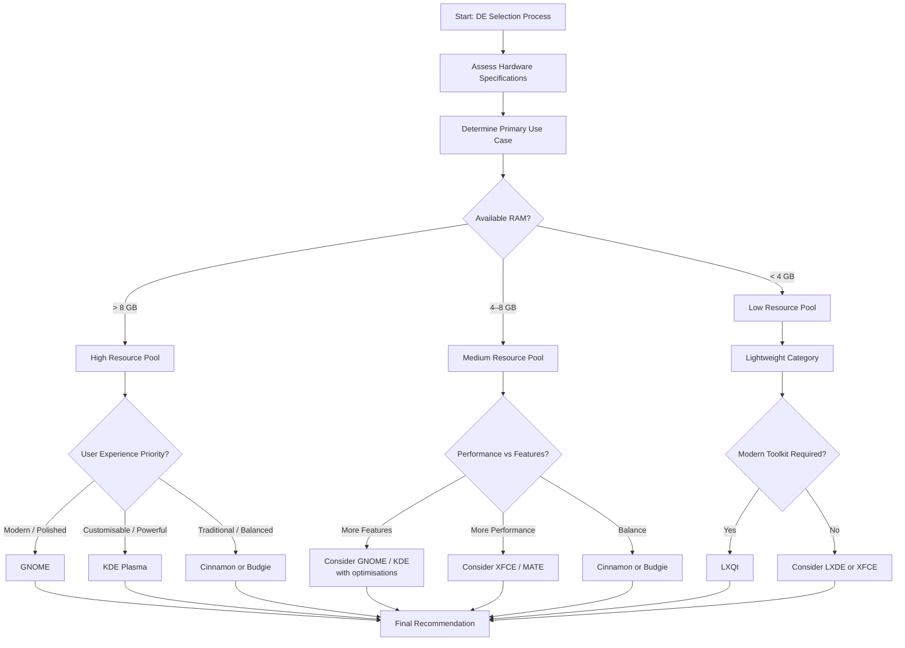

#### GNOME Desktop Environment
- **Architectural Overview**: GNOME is built around the Mutter compositor and GNOME Shell, which implements a hybrid client/server rendering model with JavaScript extensions and native C components. The design philosophy emphasises minimal interface chrome, an activities overview for window and workspace management, and integrated search driven by the Tracker indexer. This unified approach provides a cohesive user experience but at the cost of a comparatively high memory baseline.

- **Resource Consumption Profile**: Idle memory usage ranges from 800 MB to 1.3 GB, with additional RAM consumed by Shell extensions and Tracker indexing. The compositor offloads rendering to the GPU when possible and falls back to software rasterisation on systems without capable graphics hardware. On integrated GPUs with limited video memory, animation performance may degrade unless compositing settings are dialled back.

- **Optimisation Strategies**: Disabling unnecessary Shell extensions—particularly those that poll external sources such as weather or system monitors—reduces both memory overhead and periodic CPU wake-ups. Reducing animation durations or disabling them entirely via `gsettings` improves perceived responsiveness on low-end graphics hardware. For memory-constrained systems, purging the Tracker index, limiting thumbnail cache sizes, and selecting a simpler GTK theme can reclaim tens to hundreds of megabytes without impacting core functionality.

#### KDE Plasma Desktop Environment
- **Architectural Overview**: Plasma leverages the KWin compositor and a Qt-based widget framework, offering extreme customisability through system settings, plasmoids, and activities. Baloo provides semantic file search, and KRunner delivers universal desktop search and command execution. The environment can be tuned from a visually rich, effects-heavy desktop to a lean, classic panel-and-menu arrangement.

- **Resource Consumption Profile**: Idle memory usage typically falls between 500 MB and 900 MB, with additional overhead from desktop widgets and Baloo indexing. KWin supports multiple rendering backends—OpenGL, OpenGL ES, and software (XRender)—allowing administrators to select the most appropriate driver for their GPU. Per‑effect toggles enable fine-grained control over compositing load.

- **Optimisation Strategies**: Disabling desktop effects such as blur, transparency, and window animations dramatically reduces GPU and CPU demand. Restricting Baloo to index only essential directories (e.g., Documents, source code trees) curtails background I/O. Replacing heavier default applications with their lighter counterparts—Kate with KWrite, Dolphin with PCManFM‑Qt—while remaining within the Qt ecosystem trims memory usage without breaking desktop integration.

#### XFCE Desktop Environment
- **Architectural Overview**: XFCE pairs the Xfwm window manager with GTK-based components in a modular, file-backed configuration system. It adheres to a traditional desktop metaphor with a panel, application menu, and desktop icons, while keeping runtime dependencies and background services to a minimum. Its design philosophy favours stability and resource frugality over visual innovation.

- **Resource Consumption Profile**: Idle memory usage ranges from 300 MB to 600 MB, influenced primarily by the number of panel applets and the Thunar file manager’s extensions. The window manager supports optional compositing for transparency and drop shadows with negligible GPU requirements. Even on hardware a decade old with integrated graphics, XFCE remains responsive for everyday productivity tasks.

- **Optimisation Strategies**: Further reductions can be achieved by stripping the panel to essential applets, disabling compositing entirely, and selecting lightweight alternatives to default applications (e.g., Mousepad instead of gedit). Disabling desktop icons and wallpaper rendering eliminates a layer of compositing overhead, and setting the window manager to minimal decoration reduces repaint costs on low-end GPUs.

#### Comparative Desktop Environment Resource Table

| Desktop Environment | Idle CPU | Idle RAM | Storage Footprint | Compositing | Recommended Hardware | Optimal Use Case |
|---------------------|----------|----------|-------------------|-------------|---------------------|------------------|
| **GNOME** | 2–6% | 800 MB–1.3 GB | 5–8 GB | Full (Mutter) | 4+ cores, 8 GB+ RAM, GPU | Modern workflows, touch interfaces |
| **KDE Plasma** | 1–4% | 500–900 MB | 4–7 GB | Full (KWin) | 2+ cores, 4 GB+ RAM, GPU | Customisation, traditional desktop |
| **Cinnamon** | 2–5% | 500–800 MB | 3–6 GB | Basic (Muffin) | 2+ cores, 4 GB+ RAM, GPU | Windows transitions, balanced systems |
| **XFCE** | 1–3% | 300–600 MB | 2–4 GB | Optional (Xfwm) | 1+ cores, 2 GB+ RAM | Legacy hardware, server with GUI |
| **MATE** | 1–4% | 400–800 MB | 3–5 GB | Optional (Marco) | 1+ cores, 2 GB+ RAM | GNOME 2 familiarity, low resources |
| **LXQt** | 1–3% | 250–500 MB | 2–4 GB | Optional | 1+ cores, 1 GB+ RAM | Modern lightweight, Qt preference |
| **LXDE** | 1–3% | 200–400 MB | 1.5–3 GB | None | 1 core, 512 MB+ RAM | Ultra-lightweight, embedded |

<br>

## 5. Resource Monitoring Methodologies and Tools

### 5.1 Real-Time System Monitoring Tools

Effective optimisation starts with precise measurement. A range of command-line and graphical tools provide real-time visibility into CPU, memory, I/O, and network utilisation.

- **htop**: `htop` extends the classic `top` with colour-coded resource bars, a tree view of parent-child process relationships, and mouse interaction for sorting and signalling processes. It displays per‑core CPU utilisation, breaks memory into resident, shared, and virtual segments, and can be customised to show I/O wait percentage, processor affinity, or memory compression statistics. These details make it possible to identify not only which process is consuming resources, but how it is interacting with the scheduler and memory subsystems under varying load.

- **Glances**: `Glances` aggregates data from `/proc`, sensors, and network interfaces into a unified, cross-platform dashboard. Its plugin architecture enables monitoring of Docker containers, GPU utilisation, and RAID arrays, while a built-in web interface supports remote observation of multiple hosts. By using efficient polling intervals and data aggregation, Glances maintains a low local resource footprint even when monitoring dozens of systems from a central console.

- **BTOP**: `BTOP` is a modern terminal resource monitor with GPU‑accelerated rendering, configurable widgets, and extensive theming support. It exposes pressure stall information (PSI) that reveals resource contention before traditional utilisation metrics reach saturation. Interactive process filtering, signal injection, and disk activity heatmaps allow rapid triage of performance incidents, making it particularly valuable during live troubleshooting sessions.

### 5.2 Benchmarking and Performance Analysis Tools

- **Phoronix Test Suite**: This suite automates the download, installation, and execution of hundreds of standardised benchmarks covering CPU, memory, storage, graphics, and whole-system performance. Results are validated, statistically analysed, and can be compared against reference systems via the OpenBenchmarking.org database. Tests range from microbenchmarks that stress individual subsystems to application-level measurements using real software like GIMP, Blender, and database servers, providing both synthetic metrics and practical performance indicators.

- **Sysbench**: `Sysbench` offers a modular, Lua‑scriptable framework for CPU, memory, file I/O, thread, and database benchmarks. Its strength lies in the ability to define custom workload profiles—adjusting thread counts, I/O patterns, and access distributions—while reporting detailed latency percentiles. Memory tests can measure bandwidth and access latency under different striding patterns, and file I/O tests evaluate performance across varying working set sizes, enabling precise replication of application behaviour.

- **stress-ng**: With over 280 different stressor modules, `stress-ng` can target specific CPU instruction sets, memory access patterns, I/O subsystems, and inter-process communication mechanisms. Fine-grained control over test duration, concurrency, and resource limits allows administrators to stress suspected bottleneck components in isolation. The tool reports operations per second, failure rates, and hardware utilisation statistics, making it an essential component of any stability and capacity testing regimen.

### 5.3 Command-Line Resource Analysis Utilities

- **Memory Analysis**: `free -h` provides an immediate snapshot of physical RAM, swap, buffers, and cache. `vmstat 1 10` reveals dynamic memory pressure through scanning and swapping rates. For per‑process analysis, `ps aux --sort=-%mem | head -20` identifies the top consumers, while `slabtop` displays kernel slab cache utilisation, which can highlight memory fragmentation or inefficient driver allocations.

- **CPU Performance Monitoring**: `mpstat -P ALL 1` shows per‑CPU utilisation with breakdowns of user, system, idle, and I/O wait states, exposing core imbalances or hyper‑threading inefficiencies. `turbostat` reports actual operating frequencies, C‑state residency, and thermal throttling events, while `perf stat` reads hardware performance counters to measure cache hit rates, branch prediction accuracy, and instruction retirement efficiency.

- **Storage I/O Analysis**: `iostat -dx 1` reports per‑device I/O statistics including request sizes, queue depths, service times, and utilisation percentages. `fatrace` monitors file access patterns in real time, revealing unnecessary background I/O, and `iotop` provides a per‑process I/O view analogous to `top`, enabling rapid identification of applications generating excessive read/write operations.

<br>

## 6. Optimisation Strategies for Resource-Constrained Environments

### 6.1 System-Level Optimisation Techniques

- **Kernel Parameter Tuning for Specific Workloads**: The Linux kernel exposes tunable parameters via `/proc/sys` and `sysctl` that control memory reclamation, file system behaviour, and process scheduling. For memory-constrained desktops, setting `vm.swappiness` to a low value (10–30) discourages premature swapping, while lowering `vm.vfs_cache_pressure` (to around 50) retains directory and inode caches longer, improving file‑system responsiveness. Storage performance benefits from selecting the appropriate I/O scheduler—`none` (or `mq-deadline`) for NVMe, `bfq` for rotational disks—and from mount options such as `noatime,nodiratime` that eliminate unnecessary metadata writes. For Btrfs systems, enabling `compress=zstd` reduces write amplification and effective storage consumption, while periodic balance operations maintain free space efficiency.

- **Service Management and Systemd Optimisation**: Modern distributions rely on systemd for service supervision, which provides direct levers for reducing resource footprint. The command `systemd-analyze blame` identifies services that delay boot, allowing them to be deferred or parallelised. Masking unnecessary services with `systemctl mask` prevents them from starting even as dependencies, and systemd’s resource control directives—`MemoryMax`, `CPUQuota`, `IOWeight`—can cap resource consumption for problematic services without disabling them entirely. User‑scoped systemd instances can similarly limit desktop components by launching them via `systemd-run --user` with appropriate limits.

- **File System Selection and Configuration**: Ext4 remains the most forgiving general‑purpose file system, requiring minimal tuning and moderate memory for metadata. XFS excels at large sequential reads and writes, making it a strong choice for video editing or database storage. Btrfs and ZFS deliver data integrity through checksumming, snapshots, and compression, but they consume additional RAM for their metadata caches—typically 1–2 GB under heavy write loads. For solid‑state storage, enabling periodic TRIM via `fstrim.timer`, adjusting read‑ahead values, and avoiding the `discard` mount option (in favour of scheduled trim) balances performance with drive longevity.

### 6.2 Desktop Environment-Specific Optimisations

- **GNOME Optimisation Strategies**: Begin by auditing GNOME Shell extensions; each active extension consumes memory and may run JavaScript that wakes the CPU periodically. Extensions that fetch weather data, display system monitors, or integrate with online services are common offenders. Next, reduce or disable animations using `gnome-tweaks` or `gsettings`, which can dramatically improve the perceived responsiveness on integrated graphics. Finally, stop and mask the Tracker indexer if full‑text search is not required, cap thumbnail cache sizes, and switch to a simplified GTK theme to reclaim memory and reduce rendering complexity without breaking core workflow features like workspaces and notifications.

- **KDE Plasma Configuration Adjustments**: Disable compositing effects that rely on blur, transparency, or complex window transitions via System Settings; on older GPUs, switching the rendering backend to XRender eliminates OpenGL overhead entirely. Restrict Baloo indexing to a small set of project directories and exclude large media folders and network mounts. Replace the default Dolphin file manager with a lighter Qt‑based alternative such as PCManFM‑Qt for daily use, and remove auto‑starting plasmoids that poll system statistics or external data sources. These steps can reduce KDE’s idle memory footprint by 200–400 MB while preserving Plasma’s powerful customisation and krunner search capabilities.

- **Lightweight Environment Tuning**: For XFCE and LXQt, start by reducing the number of panel applets and disabling the compositor if transparency and shadows are not essential. Replace the default image viewer, text editor, and terminal emulator with their most lightweight equivalents. In XFCE, disable desktop icons and wallpaper if they are not critical to the workflow; this eliminates a layer of compositing and reduces repaint overhead. For maximum resource savings, consider transitioning to a standalone window manager (Openbox, i3, sway) that provides only window drawing and keyboard shortcuts, adding back only those desktop components strictly required for the user’s tasks.

### 6.3 Application-Level Resource Management

- **Web Browser Optimisation Techniques**: Modern browsers are among the heaviest consumers of RAM and CPU on a desktop system. Limiting content process counts (Firefox’s `dom.ipc.processCount`, Chrome’s `--renderer-process-limit`) prevents excessive memory fragmentation. Disabling unused features such as WebRTC, WebGL, and speculative pre‑loading reduces both memory and background network activity. Configuring aggressive disk cache size limits and enabling automatic tab discard for inactive tabs reclaims memory without requiring manual tab management. On memory-constrained hardware, using a lightweight browser such as Falkon or Midori can reduce baseline consumption by hundreds of megabytes compared to mainstream alternatives.

- **Development Environment Configuration**: Integrated development environments and language servers constantly index source trees, compile in the background, and poll the file system for changes. Project‑specific `.gitignore`-aware indexing scopes, increased file watcher polling intervals, and disabling unused language support can cut background CPU usage by 20–40%. For containerised workflows, applying resource limits to Docker or Podman via `--memory` and `--cpus` prevents individual containers from monopolising host resources. Using multi‑stage builds and persistent build caches further reduces cumulative I/O and CPU demand during iterative development.

- **Background Service Management**: Over time, autostart entries accumulate in `~/.config/autostart`, `/etc/xdg/autostart`, and systemd user units. A quarterly audit that removes entries for obsolete or redundant services can measurably reduce idle resource consumption. For services that must run, `systemd-run --user -p MemoryMax=... -p CPUQuota=...` imposes hard limits that prevent runaway processes from destabilising the entire desktop session. Long‑running user services can also benefit from scheduled restart policies that mitigate the impact of slow memory leaks.

<br>

## 7. Practical Implementation Guide

### 7.1 Systematic Resource Assessment Methodology

- **Baseline Establishment and Measurement**: Before making any changes, capture a comprehensive set of performance baselines under representative workloads. Use tools like `sysbench` and the Phoronix Test Suite for synthetic benchmarks, and supplement them with real‑world measurements: application launch times, file‑copy throughput, and memory usage after an hour of typical browsing and document editing. Record kernel versions, driver revisions, and firmware levels, as these variables can materially affect reproducibility. This baseline serves as the control against which all subsequent optimisations are evaluated.

- **Incremental Optimisation and Validation**: Apply changes one at a time and measure their impact before proceeding. Document each modification, the rationale behind it, the expected outcome, and the actual measured difference. For critical systems, use Btrfs/ZFS snapshots or configuration management versioning so that any change that degrades performance or stability can be reverted in seconds. Incremental optimisation isolates the effect of each parameter and prevents the confusion that arises when multiple conflicting changes are applied simultaneously.

- **Continuous Monitoring and Adjustment**: Resource optimisation is not a one‑time event. As software updates bring new features—and occasionally new resource demands—regularly review key performance indicators using lightweight monitoring that does not itself become a significant consumer of CPU cycles. Set threshold‑based alerts for swap utilisation, disk I/O latency, and memory pressure so that emerging bottlenecks are flagged before users experience slowdowns. Schedule comprehensive reassessments after major distribution upgrades or hardware changes to keep the system aligned with current workload characteristics.

### 7.2 Distribution-Specific Optimisation Checklists

Each checklist item below is a concrete action that measurably improves resource efficiency or operational robustness on the target distribution.

**Debian Stable Optimisation Checklist**
- Enable the backports repository to obtain a more recent kernel and updated drivers, which can unlock better hardware support and power management on modern systems while retaining the stability of the base system.
- Install and configure `needrestart` to automatically restart services that are still using outdated shared libraries after a package upgrade, preventing subtle performance degradation or security exposure.
- Use `apt-listbugs` to screen updates for known critical bugs before they are applied, reducing the risk of introducing regressions into a production environment.
- Tune `vm.dirty_ratio` and `vm.dirty_background_ratio` based on workload I/O patterns; for desktop use, lowering these values can improve responsiveness by forcing more frequent, smaller write‑back bursts.
- Set up `anacron` to run periodic maintenance tasks (log rotation, temporary file cleanup, fstrim) during idle periods rather than at boot or shutdown.
- Enable `apticron` to receive email notifications when security updates are available, allowing timely patching without requiring manual checking.
- Configure `debsecan` to cross‑reference installed packages with known vulnerabilities, providing an additional security audit layer.
- Deploy `unattended-upgrades` with a carefully curated package blacklist to automatically apply security fixes for non‑critical packages, keeping the attack surface minimal with zero administrative overhead.

**Fedora Workstation Optimisation Checklist**
- Edit `/etc/dnf/dnf.conf` to enable fastest mirror selection, parallel downloads, and delta RPMs, which together can cut update download times by half or more.
- Activate `zswap` with the `lz4` compressor (for speed) or `zstd` (for higher compression ratios) and verify the allocation via `dmesg`, ensuring that swap‑bound pages are compressed in memory before being written to disk.
- Install and enable `earlyoom`, then set its memory thresholds to terminate the most memory‑hungry process before the system enters an unrecoverable thrashing state.
- Protect the desktop session by adjusting `systemd‑oomd` user slice configurations, ensuring that a runaway browser tab does not bring down the entire graphical environment.
- Launch GNOME Shell under a `systemd-run --user` scope with `MemoryMax` and `CPUQuota` limits to contain extension‑related resource spikes.
- Enable `fstrim.timer` for periodic SSD TRIM operations, preserving write performance and extending the life of NAND flash.
- Configure `power-profiles-daemon` to automatically switch between performance and power‑saving modes depending on whether the system is plugged in or running on battery.
- Add the RPM Fusion repositories to gain access to multimedia codecs and proprietary GPU drivers that can offload video decoding and improve graphics performance.

**Arch Linux Optimisation Checklist**
- Configure `pacman.conf` to enable parallel downloads, colour output, and the `ILoveCandy` progress bar; these cosmetic and throughput improvements make system maintenance faster and more pleasant.
- Schedule `reflector` via a systemd timer to periodically rank mirrors by speed and recency, ensuring that package downloads always come from the fastest available source.
- Set up `zram-generator` to create a compressed swap device in RAM, with a size of 50–100% of physical memory depending on expected workloads, reducing pressure on physical swap storage.
- Customise `/etc/makepkg.conf` to set `MAKEFLAGS` for parallel compilation and select processor‑specific compiler optimisations, shortening build times for AUR packages.
- Create a pacman hook that runs `paccache` after every transaction to keep the local package cache from growing indefinitely.
- Add the `intel-ucode` or `amd-ucode` package and regenerate the initramfs to apply the latest processor microcode updates, mitigating hardware bugs and improving stability.
- Tune sysctl parameters—particularly `vm.swappiness`, `vm.vfs_cache_pressure`, and `net.core.default_qdisc`—to shift the kernel’s behaviour from server throughput to desktop responsiveness.
- Install an AUR helper such as `yay` or `paru`, and configure it to build in a dedicated `tmpfs` if RAM permits, dramatically accelerating compilation and reducing disk wear.

**openSUSE Optimisation Checklist**
- Configure `zypper` to use the fastest mirrors and enable automatic snapshot creation before and after each transaction, ensuring a rollback point exists for every package change.
- Adjust Snapper configurations to retain a practical number of snapshots—for instance, keep the last five hourly and three daily snapshots—and set a quota to prevent snapshot accumulation from consuming the entire disk.
- Enable Btrfs quota groups to track subvolume usage and schedule regular scrubs and balances to maintain file system performance over time.
- Use YaST’s system health check modules to automatically verify that critical services are running and that file system integrity is intact after every boot.
- Apply a tuned profile tailored to the hardware: `desktop` for workstations, `laptop-battery-powersave` for mobile use, or `throughput-performance` for compile servers.
- For systems that require static network configurations or high throughput, replace NetworkManager with `wicked`, which offers lower overhead and a declarative configuration model.
- Tune AppArmor profiles to the specific threat model of the machine, relaxing only those constraints that demonstrably interfere with required workflows.
- Install `opi` to streamline the addition of community repositories (e.g., Packman) and the installation of third‑party software, reducing the manual steps needed to acquire essential non‑free components.

### 7.3 Desktop Environment Selection Decision Framework

- **Hardware Capability Assessment**: Start with a quantitative hardware inventory using `inxi -F`, `lshw`, and `hwloc-ls`. Identify the total system memory, GPU model and VRAM, storage type, and CPU core count. Compare these specifications against the minimum and recommended requirements of candidate desktop environments, paying special attention to GPU acceleration requirements and baseline memory footprints. For hardware that sits near the boundary, prioritise environments with configurable rendering backends and optional compositing, so that the session degrades gracefully rather than failing when resources are tight.

- **Workflow Compatibility Evaluation**: Map the user’s daily tasks against the capabilities of each DE. Developers who rely on multiple terminals and browser windows may benefit from a tiling window manager or a DE with robust workspace management, while graphic designers require consistent colour management and tablet input support. Evaluate features like global search (KRunner, GNOME Shell), applet ecosystems (Plasma widgets, XFCE panel plugins), and extension APIs to ensure the environment enhances rather than obstructs the primary workflow.

- **Long-Term Maintenance Considerations**: Assess the development activity and release cadence of each candidate environment. DEs backed by large organisations (GNOME by the GNOME Foundation and Red Hat, KDE by KDE e.V. and Blue Systems) tend to offer predictable six‑month or annual releases with long‑term backward compatibility. Community‑driven projects may evolve more quickly but can also introduce breaking interface changes between releases. Consider the quality of available documentation, the size of the support community, and the ease of migrating user configurations to future versions when selecting an environment for production systems where continuity is paramount.

<br>

## Conclusion and Strategic Recommendations

Linux distributions and desktop environments present a broad spectrum of resource utilisation profiles, enabling precise alignment between hardware capabilities, workload demands, and user expectations. The principles and methodologies detailed in this handbook provide a repeatable framework for measuring, understanding, and optimising these profiles across any deployment scenario.

- **For Legacy Hardware and Resource‑Constrained Environments**: Debian Stable combined with XFCE or LXQt delivers the widest compatibility with older machines while maintaining active security support. Aggressive memory management through `zswap` compression, service de‑bloating, and the use of lightweight application alternatives can extend the useful life of hardware that would otherwise be considered obsolete. Pre‑configured Debian live images that include non‑free firmware simplify deployment on systems with proprietary Wi‑Fi or graphics components.

- **For Modern Desktop Workstations and Development Systems**: Fedora Workstation or openSUSE Tumbleweed with GNOME or KDE Plasma provide current software stacks, early hardware enablement, and enterprise‑grade management tools. Enable automatic security updates, configure Btrfs snapshots for instant rollback after a problematic update, and deploy performance monitoring to catch resource bottlenecks before they affect development productivity. Containerisation via Podman or Docker isolates project dependencies without polluting the host system with conflicting libraries, preserving the stability of the base OS.

- **For Advanced Users and Specialised Workloads**: Arch Linux, paired with a hand‑selected window manager or lightweight DE, grants total control over every package and service running on the system. This control comes with the responsibility of thorough documentation, regular system maintenance, and proactive monitoring. Automate routine tasks—mirror ranking, package cache cleanup, snapshot creation—so that the rolling release remains stable despite continuous updates. Consider immutable root variants such as Fedora Silverblue or openSUSE MicroOS for container‑centric workflows that require a bullet‑proof base system.

- **For Enterprise Deployments and Managed Environments**: openSUSE Leap or RHEL derivatives with GNOME or KDE Plasma provide multi‑year support lifecycles, centralised management via YaST or Ansible, and optional commercial support contracts. Deploy resource monitoring with threshold‑based alerts to catch storage exhaustion or memory pressure before users are impacted, and standardise on validated hardware profiles with certified driver stacks. Enterprise repository mirrors and staged update rollouts enable controlled software distribution at scale, turning the Linux resource analyst’s handbook into a foundation for operational excellence.

The Linux ecosystem continues to expand, offering ever more refined choices for resource‑efficient computing—from ultra‑lightweight embedded builds to full‑featured creative workstations. By applying the structured assessment and optimisation techniques described here, organisations and individuals can make data‑driven decisions that maximise productivity, extend hardware lifecycles, and control operational costs across every layer of the computing stack.


<br><br><br><br>
 
<h1 align="center">The Linux Distribution Lineage: A Comprehensive Family Tree.</h1>
 
<br><br>

## Introduction: Understanding Distribution Ancestry in Linux

The Linux ecosystem is not a monolith but a rich, interconnected genealogy of operating systems, each inheriting characteristics from its predecessors while forging its own identity. This lineage is crucial for understanding package management, system behavior, available software, and where to seek support. A distribution's ancestry dictates its fundamental philosophy—be it unwavering stability, cutting-edge innovation, or uncompromising user control. This document maps the primary family trees, corrects common misconceptions, and explains the practical implications of these relationships for users and administrators navigating the vast landscape of open-source operating systems.

*   At the core of every Linux distribution lies the **Linux kernel**, initially released by Linus Torvalds in 1991. A distribution, or "distro," packages this kernel with system libraries, user utilities, a desktop environment, and a package management system to create a complete operating system.
*   An **upstream** distribution serves as a foundational source. A **downstream** distribution builds upon this base, adding its own modifications, custom tools, and philosophies. For example, Debian is upstream to Ubuntu, which is in turn upstream to Linux Mint.
*   Understanding this hierarchy is practical. It dictates which troubleshooting guides are relevant, determines software compatibility, and reveals the underlying philosophy of a system before installation. Knowledge of lineage allows you to predict system behavior and make informed choices.

## 1. The Debian Family: The Bedrock of Stability

Debian, established in 1993, is one of the oldest, most stable, and influential distributions. Governed by its strict Social Contract and dedication to free software, it forms the reliable bedrock for the largest family of Linux distributions. Its extensive software repositories and rigorous testing cycles make it a preferred base for countless derivatives.

### 1.1 Debian: The Universal Operating System
*   Debian is renowned for its **exceptional stability** and massive software repository, containing tens of thousands of pre-compiled packages. Its development cycle is methodical, with major "Stable" releases emerging every 2-3 years after extensive testing, making it ideal for servers and mission-critical workstations.
*   The project is entirely **community-driven**, without direct corporate ownership, adhering to a strong philosophical commitment to free and open-source software as defined by the Debian Free Software Guidelines (DFSG). This governance model influences its development priorities and long-term maintainability.
*   Debian offers various **installation images** for different use-cases: the standard `netinst` ISO, live images with different desktop environments (GNOME, KDE Plasma, XFCE, LXQt, etc.), and specialized builds for servers or cloud deployment. It supports a vast array of hardware architectures beyond the common x86_64.

### 1.2 Ubuntu and Its Ecosystem: User-Friendly Innovation
*   Founded by Canonical Ltd. in 2004, **Ubuntu**'s primary mission was to make Debian's power accessible to a wider audience. It simplified installation, provided regular release cycles (every six months), and introduced Long-Term Support (LTS) versions with five years of security updates, striking a balance between stability and modernity.
*   Ubuntu maintains several **official flavors**, which are remixes with different default desktop environments. These include Kubuntu (KDE Plasma), Lubuntu (LXQt, lightweight), Xubuntu (XFCE), Ubuntu MATE (classic desktop metaphor), Ubuntu Budgie (modern Budgie desktop), and Ubuntu Studio (multimedia production).
*   A vast ecosystem of **third-party derivatives** has sprung from Ubuntu, each targeting specific user needs. Notable examples include Linux Mint (famously user-friendly with a familiar desktop layout), Pop!_OS (optimized for developers, creators, and System76 hardware), elementary OS (focusing on refined design and a cohesive user experience), and Zorin OS (designed to ease the transition from Windows or macOS).

### 1.3 Direct Debian Derivatives: Bypassing Ubuntu
*   Several significant distributions build directly on Debian's "Stable" or "Testing" branches, inheriting its core systems while implementing unique visions. **MX Linux** combines Debian's stability with antiX's efficiency tools and a custom desktop environment, often topping popularity charts.
*   **Kali Linux** is a premier, specialized distribution for **penetration testing and digital forensics**, pre-loaded with hundreds of security tools like Nmap, Wireshark, Metasploit, and Burp Suite. It is designed for security professionals and requires ethical use and appropriate expertise.
*   **Tails (The Amnesic Incognito Live System)** is a privacy-focused distribution that **routes all internet traffic through the Tor network** and leaves no trace on the host machine. It runs from a USB stick or DVD and is used by journalists, activists, and privacy-conscious individuals.
*   Other important direct derivatives include **Devuan** (a systemd-free variant of Debian), **antiX** (a lightweight system for old hardware using SysVinit or runit), **SparkyLinux** (a lightweight and customizable rolling release option), and **Parrot OS** (a security-oriented distro with a focus on privacy, development, and penetration testing).

## 2. The Arch Linux Family: The Cutting-Edge DIY Paradigm

Arch Linux, founded in 2002, champions the principles of simplicity, minimalism, and user-centricity. It follows a rolling release model, providing continuous updates to the latest software versions. Arch provides a bare framework, expecting users to build and configure their system deliberately, which offers unparalleled control and a deep learning experience.

### 2.1 Arch Linux: Keep It Simple
*   Arch employs a **rolling release model**, meaning there are no versioned releases; a single installation is continuously updated. This grants access to the latest software and kernel features but requires a more attentive maintenance approach from the user to avoid potential breakage.
*   Its installation process is **minimalist and manual**, typically performed via a command-line installer (`archinstall` script or manual partitioning/chroot). This "do-it-yourself" approach ensures users understand their system's components from the ground up, from the bootloader to the desktop environment.
*   Arch is supported by the powerful **Pacman package manager** and the vast **Arch User Repository (AUR)**, a community-driven repository of build scripts for software not in the official repos. This combination provides access to an enormous collection of software, from common applications to obscure utilities.

### 2.2 Prominent Arch-Based Distributions
*   **Manjaro** is one of the most popular Arch-based distros, offering a more accessible experience. It features a graphical installer, pre-configured desktop environments, and its own repositories that **delay packages from Arch for additional testing**, aiming to provide greater stability while maintaining the benefits of a rolling release.
*   **EndeavourOS** serves as a "terminal-centric" bridge to Arch. It provides a user-friendly, offline-capable graphical installer but delivers a system that is **very close to vanilla Arch** post-installation, making it an excellent choice for those who want an easier setup without sacrificing the core Arch experience.
*   Other notable derivatives include **Garuda Linux** (heavily optimized for gaming and performance with a distinctive look), **Artix Linux** (a systemd-free variant offering multiple init system choices like OpenRC, runit, or s6), and **CachyOS** (focused on performance optimizations via compiler flags and a custom kernel).

## 3. The Fedora & Red Hat Enterprise Linux Ecosystem: The Enterprise Backbone

This family represents the interplay between cutting-edge community development and rock-solid commercial enterprise support. Fedora serves as the innovative upstream for Red Hat Enterprise Linux (RHEL), which in turn spawns several community-maintained, binary-compatible clones.

### 3.1 Fedora: The Innovative Upstream
*   Sponsored by Red Hat, **Fedora** is a community-driven distribution that focuses on **rapid innovation and the integration of new technologies**. It serves as the primary testing ground for features that may eventually land in RHEL. Fedora Workstation features the polished GNOME desktop and emphasizes a secure, developer-friendly out-of-the-box experience.
*   It has a **predictable, short release cycle** with new versions approximately every six months and support for each version lasting roughly 13 months. This model ensures users and developers have consistent access to modern software stacks and toolchains.
*   Fedora is known for its **strong stance on open-source software**, often excluding proprietary firmware or drivers from its main repos. It also features **SELinux (Security-Enhanced Linux)** enabled by default, providing robust mandatory access controls.

### 3.2 Red Hat Enterprise Linux and Its Binary-Compatible Family
*   **Red Hat Enterprise Linux (RHEL)** is the commercial, subscription-based enterprise distribution. It is renowned for its **exceptional stability, long support lifecycles (10 years per major release)**, and comprehensive support ecosystem, making it the standard in corporate data centers, government, and financial institutions.
*   **CentOS Stream** is the **continuous-delivery, rolling development branch** of RHEL. It sits between Fedora and RHEL, serving as a public preview of the next minor RHEL release. It is intended for developers and ecosystem partners who want to contribute to and test against the next version of RHEL.
*   Following a change in the CentOS project's direction, two prominent **community-driven, RHEL-compatible** distributions emerged: **Rocky Linux** (founded by the original creator of CentOS) and **AlmaLinux** (backed by a non-profit foundation). Both aim to provide a free, 1:1 binary-compatible alternative to RHEL with long-term support cycles, filling the role previously held by CentOS Linux.

## 4. The openSUSE Family: Stability with Powerful Administration

The openSUSE distribution, sponsored by SUSE, is distinguished by its robust system administration tool, YaST, and offers a clear choice between a rock-solid fixed release and a well-tested rolling release model.

### 4.1 openSUSE Leap and Tumbleweed
*   **openSUSE Leap** shares a core with **SUSE Linux Enterprise (SLE)**, providing a **highly stable and predictable** base perfect for servers, workstations, and users who prioritize reliability. It benefits from the enterprise-grade engineering and long-term maintenance of SLE.
*   **openSUSE Tumbleweed** is a **rolling release distribution** that undergoes automated, comprehensive testing via the OpenQA framework. This allows it to deliver the latest stable software packages with a high degree of confidence in system integrity, appealing to users who want current software without the potential instability of other rolling releases.
*   Both editions feature the powerful **YaST (Yet another Setup Tool)** control center, which provides a comprehensive, graphical interface for nearly all system administration tasks, from partitioning disks to configuring network services and managing software.

## 5. Independent & Ancestral Distributions

These distributions are built from scratch, not derived from the major families above. They often pioneer unique technical approaches, adhere to specific philosophical tenets, or maintain historic development models.

### 5.1 Source-Based and Unique Systems
*   **Gentoo** is an ultimate **source-based meta-distribution**. Users compile all software from source code, allowing for deep customization via USE flags that tailor software features and dependencies to the specific hardware and user needs. It offers maximum control and optimization at the cost of longer installation and update times.
*   **NixOS** introduces a **purely declarative and reproducible system configuration**. The entire OS—packages, services, and settings—is defined in a single configuration file. This enables atomic upgrades, easy rollbacks, and perfectly consistent system deployments, making it immensely powerful for development and server environments.
*   **Slackware**, one of the oldest surviving distributions (1993), adheres to a **KISS (Keep It Simple, Stupid) philosophy** and a close-to-UNIX design. It provides a stable, transparent base without automated dependency resolution, offering experienced users a high degree of control and a simple, text-file-based configuration system.

### 5.2 Lightweight and Specialized Independents
*   **Void Linux** is an **independent rolling release** distribution developed from scratch. It uses the XBPS package manager and the runit init system, avoiding systemd. It is known for its simplicity, clean design, and excellent support for multiple architectures, including musl libc builds.
*   **Alpine Linux** is a security-oriented, **musl libc and BusyBox-based** distribution designed for extreme minimalism. Its tiny image size (around 5MB for the base) makes it the **de facto standard base image for Docker containers** and is ideal for embedded systems and edge computing.
*   **Puppy Linux** is an ultra-lightweight distribution designed to run **entirely in RAM**. This makes it incredibly fast and portable, capable of breathing new life into very old or low-spec hardware, often booting from USB drives or live CDs.

## 6. Key Technical Differentiators Across Lineages

### 6.1 Package Management Systems
The package manager is a distribution's core tool for installing, updating, and removing software. Each family typically maintains its own system.
*   **Debian/Ubuntu Family:** Uses **APT (Advanced Package Tool)** with `.deb` packages. Commands like `apt update`, `apt upgrade`, and `apt install [package]` are fundamental. Ubuntu also introduced the Snap universal package system.
*   **Arch Linux Family:** Uses **Pacman** with its simple syntax: `pacman -S [package]` to install, `pacman -Syu` to update the system. The **Arch User Repository (AUR)** vastly extends available software via community-maintained build scripts.
*   **Fedora/RHEL Family:** Uses **DNF (Dandified YUM)** as the modern successor to YUM, working with `.rpm` packages. Key commands include `dnf install [package]` and `dnf update`. RHEL 7 and older systems use YUM.
*   **openSUSE:** Uses **Zypper** as its command-line package manager for `.rpm` packages, known for its speed and powerful dependency resolution features.

### 6.2 Release Models: Fixed vs. Rolling
*   **Fixed/Point Release (e.g., Debian Stable, Ubuntu LTS, RHEL, openSUSE Leap):** The distribution releases major versions at specific intervals. These versions receive security and maintenance updates but do not jump to major new software versions until the next distribution release. This model prioritizes stability and predictability.
*   **Pure Rolling Release (e.g., Arch, openSUSE Tumbleweed, Void):** The distribution is in a constant state of update. There is only one "version"—the current state of the repositories. Users receive the latest software updates as soon as they are released by upstream projects, prioritizing freshness and continuous integration.
*   **Hybrid/Semi-Rolling (e.g., Manjaro, Fedora Rawhide to some extent):** These distributions use a curated or delayed rolling model. Updates are batched and tested before being pushed to users, aiming to combine the freshness of a rolling release with a higher degree of stability than a pure rolling model.

## Conclusion: Navigating the Linux Landscape

Understanding Linux distribution lineage is more than an academic exercise; it is a practical tool for effective system administration, informed software choices, and efficient problem-solving. By recognizing that Linux Mint inherits its stability from Ubuntu and ultimately Debian, or that Rocky Linux is built from RHEL's source code, you can accurately predict system behavior, locate relevant documentation, and leverage compatible skills. This interconnected family tree, with its shared roots and diverse branches, is the source of Linux's greatest strength: a collaborative ecosystem that fosters both robust stability for enterprises and radical innovation for enthusiasts, all built upon a common foundation of open-source philosophy.


<br><br>

 
 
```
# the linux distribution family tree
├── 📁 Independent & Ancestral Foundations
│   ├── Slackware [1993] [PM: Slackpkg/pkgtools]
│   ├── Gentoo Linux [2002] [PM: Portage (emerge)]
│   │   └── Calculate Linux
│   ├── Arch Linux [2002] [PM: Pacman] (Rolling Release)
│   │   ├── Manjaro [PM: Pacman]
│   │   │   └── Garuda Linux
│   │   ├── EndeavourOS
│   │   └── Artix Linux (No systemd)
│   ├── Void Linux [2008] [PM: XBPS]
│   ├── Alpine Linux [2005] [PM: apk] (musl libc, BusyBox)
│   └── NixOS [2003] [PM: Nix] (Declarative)
│
├── 📁 The Debian Family [PM: APT (dpkg)]
│   └── Debian [1993]
│       ├── 📁 Direct Derivatives
│       │   ├── Ubuntu [2004] (Canonical Ltd.)
│       │   │   ├── 📁 Official Flavors
│       │   │   │   ├── Kubuntu (KDE Plasma)
│       │   │   │   ├── Lubuntu (LXQt/LXDE)
│       │   │   │   ├── Xubuntu (XFCE)
│       │   │   │   ├── Ubuntu MATE
│       │   │   │   ├── Ubuntu Budgie
│       │   │   │   └── Ubuntu Studio
│       │   │   └── 📁 Popular Third-Party Derivatives
│       │   │       ├── Linux Mint
│       │   │       ├── Pop!_OS (System76)
│       │   │       ├── elementary OS
│       │   │       ├── Zorin OS
│       │   │       └── KDE neon
│       │   ├── MX Linux (antiX + MEPIS heritage)
│       │   ├── Kali Linux (Security/Penetration Testing)
│       │   ├── Parrot OS (Security)
│       │   ├── Tails (Privacy/Anonymity)
│       │   ├── Devuan (No systemd)
│       │   ├── SparkyLinux
│       │   ├── antiX (Lightweight)
│       │   └── Raspberry Pi OS (Official OS for Raspberry Pi)
│       └── ... (Many other derivatives)
│
├── 📁 The Red Hat Enterprise Linux (RHEL) Ecosystem [PM: DNF/YUM (RPM)]
│   ├── Fedora [2003] (Community Upstream for RHEL)
│   │   ├── Red Hat Enterprise Linux (RHEL) [2000] (Commercial)
│   │   │   ├── CentOS Stream (RHEL's rolling development branch)
│   │   │   ├── AlmaLinux (1:1 RHEL-compatible, community)
│   │   │   ├── Rocky Linux (1:1 RHEL-compatible, community)
│   │   │   └── Oracle Linux
│   │   └── 📁 Fedora-Based Specialized Distros
│   │       ├── Nobara Project (Gaming & Multimedia)
│   │       └── Ultramarine Linux
│   └── ... (Other historical branches like Scientific Linux, now discontinued)
│
└── 📁 The openSUSE Family [PM: Zypper (RPM)]
    └── openSUSE [2005]
        ├── openSUSE Leap (Stable, SUSE Linux Enterprise-based)
        ├── openSUSE Tumbleweed (Rolling Release)
        └── SUSE Linux Enterprise (SLE) (Commercial)
```

###  Key Technical Characteristics by Family

The lineage determines fundamental system behaviors. Here is a quick-reference comparison of the major families:

| Family / Characteristic | Primary Package Manager & Format | Typical Release Model | Philosophy / Common Use |
| :--- | :--- | :--- | :--- |
| **Debian & Derivatives** | APT (`.deb`) | **Fixed Release** (Stable, LTS) | Stability, vast repositories, universal use. |
| **Arch & Derivatives** | Pacman (`.pkg.tar.zst`) | **Pure Rolling Release** | Simplicity, minimalism, user control, cutting-edge. |
| **RHEL Ecosystem** | DNF/YUM (`.rpm`) | **Fixed/Long-Term** (Enterprise) | Stability, predictability, commercial support. |
| **openSUSE** | Zypper (`.rpm`) | **Dual (Leap: Fixed, Tumbleweed: Rolling)** | Stability, powerful admin tools (YaST). |
| **Independent (e.g., Gentoo, Slackware)** | Varies (Portage, pkgtools) | Varies (Rolling/Fixed) | Control, customization, simplicity, learning. |

###  How to Use This Lineage Guide

*   **Predicting Compatibility**: Software packaged for a parent distro (e.g., a `.deb` for Debian) will often work on its derivatives (e.g., Ubuntu, Mint).
*   **Finding Support**: Troubleshooting guides and community forums for a parent distribution are frequently applicable to its children.
*   **Choosing a Distro**: Understanding the lineage helps you select a system with the right balance of stability, software freshness, and philosophy for your needs.

This ecosystem is dynamic, with new distributions emerging and existing ones occasionally changing their base. For the most current details on any specific distribution, always refer to its official documentation.
 

 
<br><br><br><br>

<h1 align="center">Master the Linux Terminal: Essential Keyboard Shortcuts & Power Combinations.</h1>
<h3 align="center">Boost Your Productivity with Command Line Efficiency.</h3>

<br><br>
 
### Introduction: The Power of Keyboard Mastery

In the world of Linux, the terminal is your gateway to unparalleled control and efficiency. While clicking through graphical interfaces might feel familiar, true power users know that keyboard shortcuts transform the terminal from a simple text interface into a productivity powerhouse. This guide will help you navigate, edit, and control your Linux environment with speed and precision.

 

## Section 1: Foundational Navigation Shortcuts

### Moving the Cursor Efficiently

Stop reaching for the arrow keys! These shortcuts let you navigate command lines at lightning speed:

```bash
Ctrl + A          # Jump to Beginning (A for "start")
Ctrl + E          # Jump to End (E for "end")
Ctrl + ← / →      # Move word by word
Alt + B / Alt + F # Alternative word navigation
```

**Real-World Example:**
Instead of pressing → 20 times to fix a typo at the beginning of a long command, simply press `Ctrl + A` to jump there instantly.

### Smart Text Editing

Fix mistakes without retyping entire commands:

```bash
Ctrl + U          # Cut from cursor to beginning
Ctrl + K          # Cut from cursor to end
Ctrl + W          # Cut previous word
Ctrl + Y          # Paste last cut text (Y for "yank")
Alt + Backspace   # Delete previous word
```

**Practice Exercise:** Type `echo "Hello World"`, then use `Ctrl + A`, `Ctrl + K`, and `Ctrl + Y` to experiment with cutting and pasting.

 

## Section 2: Command History Magic

### Searching Through Your Past

Your command history is a goldmine. Access it efficiently:

```bash
↑ / ↓             # Scroll through recent commands
Ctrl + R          # Search history (type to filter)
Ctrl + G          # Exit search mode
!!                # Repeat last command
!text             # Run last command starting with "text"
```

**Practical Use:** Forgot how you installed a package last week? Press `Ctrl + R`, type "install", and browse through your installation history.

### Working with Command Arguments

```bash
Alt + .           # Insert last argument from previous command
!$                # Reference last argument
!:2               # Reference second word from previous command
```

**Example:**
```bash
$ ls /etc/nginx/nginx.conf
$ cat !$          # Expands to: cat /etc/nginx/nginx.conf
```

 

## Section 3: Process Control Essentials

### Managing Running Commands

Never lose control of runaway processes:

```bash
Ctrl + C          # Gracefully stop current command
Ctrl + Z          # Pause process (send to background)
Ctrl + D          # End input or exit shell
fg                # Resume paused process in foreground
bg                # Resume in background
```

**Important Distinction:**
- `Ctrl + C` sends "please stop" (process can clean up)
- `Ctrl + Z` says "pause for now" (you can resume later)

### Job Management

```bash
jobs              # List background jobs
fg %1             # Bring job #1 to foreground
kill %2           # Terminate job #2
```

 

## Section 4: Terminal Window Management

### Screen Control

```bash
Ctrl + L          # Clear screen (keeps scrollback)
Ctrl + S          # Pause terminal output (freeze)
Ctrl + Q          # Resume terminal output (unfreeze)
```

**Pro Tip:** Use `Ctrl + S` when reading fast-scrolling output, then `Ctrl + Q` to continue.

### Tab and Window Shortcuts

Most modern terminals support:

```bash
Ctrl + Shift + T  # New tab
Ctrl + Shift + W  # Close current tab
Ctrl + Page Up    # Previous tab
Ctrl + Page Down  # Next tab
Ctrl + Shift + N  # New terminal window
```

 

## Section 5: Top 10 Productivity Combinations

### 1. The "Oops, I Forgot sudo" Save
```bash
$ apt update
Permission denied
$ sudo !!        # Runs: sudo apt update
```

### 2. Directory Quick Switch
```bash
$ cd /var/log
$ cd /etc
$ cd -           # Returns to /var/log
```

### 3. Smart File Operations
```bash
$ find /home -name "*.tmp"
$ rm !$          # Removes what you just found
# WARNING: Be absolutely sure before using this!
```

### 4. Process Discovery and Management
```bash
$ ps aux | grep nginx
$ kill -9 !$     # Kills the last-found process
```

### 5. Download and Extract in One Go
```bash
$ wget https://example.com/archive.tar.gz
$ tar xzf !$     # Extracts the downloaded archive
```

### 6. Chain Commands with Error Checking
```bash
$ make && ./program     # Only runs ./program if make succeeds
$ make || echo "Build failed"  # Shows message if make fails
```

### 7. Quick System Health Check
```bash
$ echo "=== Disk ===" && df -h && echo "=== Memory ===" && free -h
```

### 8. Edit the File You Just Found
```bash
$ locate nginx.conf
$ sudo nano !$   # Opens the found file for editing
```

### 9. History Search and Execute
```bash
# Press Ctrl + R, type "ssh", find your last SSH command
# Press Ctrl + O to run it, then Ctrl + R again to find next
```

### 10. Create and Enter Directory
```bash
$ mkdir new_project && cd !$
# The !$ expands to "new_project"
```

 

## Section 6: Development Workflow Shortcuts

### Git Power Usage
```bash
$ git status
$ git add . && git commit -m "Update"
# If commit fails:
$ !!            # Repeats the entire git add/commit command
```

### Build and Test Cycles
```bash
$ make test
$ ./test_runner
# Quick iteration:
$ make && ./test_runner  # Only runs tests if build succeeds
$ !make          # Re-run just the make command
```

### Python Development
```bash
$ python3 script.py
$ python3 !$     # Run same script again
$ python3 -m pytest tests/
$ !! -v          # Run same tests with verbose flag
```

 

## Section 7: System Administration Power Combos

### Service Management
```bash
$ systemctl status nginx
$ sudo systemctl restart !:4
# !:4 extracts the 4th word (nginx) from previous command
```

### Log Monitoring
```bash
$ tail -f /var/log/syslog
# Press Ctrl+C to stop, then:
$ grep "ERROR" !$ | head -20  # Search the same log for errors
```

### User and Permission Fixes
```bash
$ ls -la /home/user/files/
$ sudo chown -R user:user !$  # Recursively fix ownership
```

 

## Section 8: Customization for Maximum Efficiency

### Create Your Own Shortcuts (Aliases)

Add to `~/.bashrc` or `~/.zshrc`:
```bash
# Navigation
alias ..='cd ..'
alias ...='cd ../..'

# Safety first
alias rm='rm -i'          # Confirm before deleting
alias cp='cp -i'
alias mv='mv -i'

# Quick system info
alias disks='df -h'
alias memory='free -h'
alias ports='netstat -tuln'

# Git shortcuts
alias gs='git status'
alias gp='git pull'
alias gcm='git commit -m'
```

### Remembering Shortcuts: The Mnemonic Method

- **Ctrl + A**: A is the first letter → beginning of line
- **Ctrl + E**: E for "end"
- **Ctrl + U**: "Up" to beginning
- **Ctrl + K**: "Kill" to end
- **Ctrl + Y**: "Yank" (paste) what you cut
- **Ctrl + R**: "Reverse" search

### Practice Routine
1. **Week 1**: Master `Ctrl + C`, `Ctrl + R`, `↑/↓`
2. **Week 2**: Add `Ctrl + A/E`, `Ctrl + U/K`
3. **Week 3**: Learn `!!`, `!$`, `Alt + .`
4. **Week 4**: Practice tab completion and history search

 

## Section 9: Troubleshooting Common Issues

### When Shortcuts Don't Work

**Problem**: `Ctrl + S` freezes terminal and `Ctrl + Q` doesn't unfreeze
**Solution**: This is usually a terminal configuration issue. Try `stty ixany` or check terminal settings.

**Problem**: Clipboard shortcuts (`Ctrl+Shift+C/V`) don't work
**Solution**: Some terminals use `Ctrl+Insert` (copy) and `Shift+Insert` (paste)

**Problem**: `Ctrl + R` search behaves strangely
**Solution**: You might be in a different shell. Check with `echo $SHELL`

### Emergency Recovery Shortcuts

```bash
Ctrl + C          # Break out of almost anything
reset             # Fix garbled terminal output
stty sane         # Restore terminal settings
exit              # Gracefully close shell
```

 

## Section 10: Quick Reference Cheat Sheet

### Essential Daily Shortcuts
```
Navigation:
  Ctrl+A/E      Start/End of line
  Ctrl+←/→      Move by words
  Tab           Auto-complete

Editing:
  Ctrl+U/K      Cut to start/end
  Ctrl+W/Y      Cut word/Paste
  Alt+Backspace Delete word

Control:
  Ctrl+C        Stop command
  Ctrl+Z        Pause command
  Ctrl+R        Search history
  Ctrl+L        Clear screen
```

### Power User Combinations
```
!!              Repeat last command
!$              Last argument
sudo !!         Redo with admin rights
cd -            Previous directory
Alt+.           Insert last argument
command &&      Chain if success
command ||      Chain if failure
```

### Safety First Reminders
1. **Always** double-check before using `rm` with `!$`
2. Use `-i` flag with destructive commands: `rm -i`, `cp -i`
3. Test dangerous combinations in a safe directory first
4. Keep backups before running bulk operations

 

## Conclusion: Building Muscle Memory

Keyboard shortcuts are like learning to touch-type: awkward at first, but transformative once mastered. Start by incorporating **just three shortcuts** into your daily workflow:

1. **`Ctrl + R`** for command history search
2. **`Ctrl + A/E`** for line navigation  
3. **`!!`** for repeating commands

Practice these for a week until they feel natural, then add two more. Within a month, you'll navigate the terminal with fluid efficiency that mouse users can only dream of.

Remember: Every expert was once a beginner who kept practicing. The terminal is your ally—master its shortcuts, and you master the system.

 
*Pro Tip: Print the cheat sheet and keep it visible. Regular reference builds familiarity faster than occasional use.*

<br><br>

```
# Linux Terminal Keyboard Shortcuts.
├── [Volume I] TERMINAL CORE CONTROLS (/proc/input)
│   ├── {Part 1} Line Navigation & Editing
│   │   ├── Chapter 01: Cursor Movement
│   │   │   ├── Ctrl + A        # Move to beginning of line
│   │   │   ├── Ctrl + E        # Move to end of line
│   │   │   ├── Ctrl + ←/→      # Move by word (left/right)
│   │   │   ├── Alt + B/F       # Move by word (backward/forward)
│   │   │   ├── Ctrl + XX       # Toggle cursor/start of line
│   │   │   ├── Home            # Beginning of line (alternative)
│   │   │   └── End             # End of line (alternative)
│   │   │
│   │   ├── Chapter 02: Text Cutting & Pasting
│   │   │   ├── Ctrl + U        # Cut from cursor to beginning
│   │   │   ├── Ctrl + K        # Cut from cursor to end
│   │   │   ├── Ctrl + W        # Cut word before cursor
│   │   │   ├── Ctrl + Y        # Paste last cut text
│   │   │   ├── Ctrl + T        # Swap last two characters
│   │   │   ├── Alt + T         # Swap last two words
│   │   │   ├── Alt + Backspace # Delete word before cursor
│   │   │   └── Alt + D         # Delete word after cursor
│   │   │
│   │   └── Chapter 03: Text Transformation
│   │       ├── Alt + U         # Uppercase word after cursor
│   │       ├── Alt + L         # Lowercase word after cursor
│   │       └── Ctrl + Backspace # Delete previous word
│   │
│   ├── {Part 2} Process & Signal Management (/proc/[pid])
│   │   ├── Chapter 04: Process Control
│   │   │   ├── Ctrl + C        # Terminate process (SIGINT)
│   │   │   ├── Ctrl + Z        # Suspend process (SIGTSTP)
│   │   │   ├── Ctrl + \        # Force quit (SIGQUIT)
│   │   │   └── Ctrl + D        # EOF/Exit terminal
│   │   │
│   │   └── Chapter 05: Job Control
│   │       ├── jobs            # List background jobs
│   │       ├── fg              # Bring job to foreground
│   │       ├── bg              # Resume job in background
│   │       ├── fg %n           # Bring specific job to foreground
│   │       └── bg %n           # Resume specific job in background
│   │
│   └── {Part 3} Terminal Device Control (/dev/tty)
│       ├── Chapter 06: Screen Management
│       │   ├── Ctrl + L        # Clear screen
│       │   ├── clear           # Clear screen (command)
│       │   ├── Ctrl + S        # Freeze terminal output
│       │   └── Ctrl + Q        # Unfreeze terminal output
│       │
│       └── Chapter 07: Terminal Recovery
│           ├── reset           # Reset terminal
│           ├── stty sane       # Restore terminal settings
│           └── Ctrl + Q        # Unfreeze (if frozen by Ctrl+S)
│
├── [Volume II] SHELL ENVIRONMENT (/bin & /home)
│   ├── {Part 4} Command History (/home/.bash_history)
│   │   ├── Chapter 08: History Navigation
│   │   │   ├── ↑/↓            # Navigate through history
│   │   │   ├── Ctrl + R       # Reverse search history
│   │   │   ├── Ctrl + G       # Exit history search
│   │   │   ├── Ctrl + O       # Execute found command
│   │   │   └── Alt + <        # Go to first command
│   │   │
│   │   └── Chapter 09: History Expansion
│   │       ├── !!             # Repeat last command
│   │       ├── !n             # Execute nth command
│   │       ├── !string        # Execute last command starting with string
│   │       ├── !$             # Last argument of previous command
│   │       ├── !*             # All arguments of previous command
│   │       ├── !:n            # nth word of previous command
│   │       ├── Alt + .        # Insert last argument
│   │       └── Esc + .        # Insert last argument (alternative)
│   │
│   ├── {Part 5} Auto-completion (/usr/share/bash-completion)
│   │   ├── Chapter 10: Path Completion
│   │   │   ├── Tab            # Auto-complete command/filename
│   │   │   └── Tab Tab        # Show all completion options
│   │   │
│   │   └── Chapter 11: Argument Completion
│   │       └── Alt + ?        # List completions (some shells)
│   │
│   └── {Part 6} Clipboard & Selection (/dev/clipboard)
│       ├── Chapter 12: Mouse-less Selection
│       │   ├── Ctrl + Shift + C  # Copy selected text
│       │   ├── Ctrl + Shift + V  # Paste text
│       │   └── Shift + Insert    # Alternative paste
│       │
│       └── Chapter 13: X11 Clipboard
│           ├── Ctrl + Insert     # Copy (X11)
│           └── Shift + Insert    # Paste (X11)
│
├── [Volume III] WINDOW MANAGEMENT (/usr/share/applications)
│   ├── {Part 7} Terminal Window Control
│   │   ├── Chapter 14: Tab Management
│   │   │   ├── Ctrl + Shift + T    # Open new tab
│   │   │   ├── Ctrl + Shift + W    # Close current tab
│   │   │   ├── Ctrl + PageUp       # Previous tab
│   │   │   ├── Ctrl + PageDown     # Next tab
│   │   │   └── Ctrl + Tab          # Next tab (some terminals)
│   │   │
│   │   ├── Chapter 15: Window Management
│   │   │   ├── Ctrl + Shift + N    # Open new window
│   │   │   ├── Ctrl + Shift + Q    # Close terminal window
│   │   │   └── Ctrl + Shift + D    # Detach tab into window
│   │   │
│   │   └── Chapter 16: Terminal Launch
│   │       └── Ctrl + Alt + T      # Open terminal (universal)
│   │
│   ├── {Part 8} Desktop Environment Integration
│   │   ├── Chapter 17: Global Navigation
│   │   │   ├── Super + A       # Open applications menu
│   │   │   ├── Super           # Open activities overview
│   │   │   ├── Alt + Tab       # Switch applications
│   │   │   ├── Super + Tab     # Switch applications (alt)
│   │   │   ├── Alt + F2        # Run command dialog
│   │   │   ├── Super + D       # Show desktop
│   │   │   └── Super + Space   # Switch keyboard layout
│   │   │
│   │   └── Chapter 18: File Management
│   │       ├── F2              # Rename file/folder
│   │       ├── Ctrl + N        # New window (file manager)
│   │       └── Ctrl + T        # New tab (file manager)
│   │
│   └── {Part 9} Application Switching
│       └── Chapter 19: Workspace Control
│           ├── Ctrl + Alt + ←/→    # Switch workspaces
│           └── Super + [1-9]       # Switch to workspace N
│
├── [Volume IV] PRODUCTIVITY WORKFLOWS (/etc/profile.d)
│   ├── {Part 10} System Administration Patterns
│   │   ├── Chapter 20: Service Management
│   │   │   ├── sudo !!          # Re-run last command with sudo
│   │   │   ├── systemctl status [service]
│   │   │   └── sudo systemctl restart !:4
│   │   │
│   │   ├── Chapter 21: Process Management
│   │   │   ├── ps aux | grep [process]
│   │   │   ├── kill -9 !$       # Kill last found PID
│   │   │   └── pkill -9 [name]
│   │   │
│   │   └── Chapter 22: File Operations
│   │       ├── find /etc -name "*.conf" -type f
│   │       └── sudo nano !$     # Edit found file
│   │
│   ├── {Part 11} Development Workflows
│   │   ├── Chapter 23: Build Systems
│   │   │   ├── make && ./output
│   │   │   └── !make           # Re-run make
│   │   │
│   │   ├── Chapter 24: Version Control
│   │   │   ├── git status
│   │   │   ├── git add . && git commit -m "message"
│   │   │   └── !!              # Repeat last command
│   │   │
│   │   └── Chapter 25: Package Management
│   │       ├── apt search [package]
│   │       └── sudo apt install !:2
│   │
│   └── {Part 12} Multi-command Workflows
│       ├── Chapter 26: Directory Operations
│       │   ├── mkdir [dir] && cd !$
│       │   └── cd -            # Previous directory
│       │
│       ├── Chapter 27: Download & Extract
│       │   └── wget [url] && tar xzf !$ && cd $(tar tzf !$ | head -1)
│       │
│       └── Chapter 28: Search & Process
│           └── find . -name "*.log" -exec grep -l "ERROR" {} \; && vim $(!!)
│
└── [APPENDICES] CUSTOMIZATION & CONFIGURATION
    ├── Appendix A: Shell Configuration (~/.bashrc)
    │   ├── alias ll='ls -la'
    │   ├── alias ..='cd ..'
    │   ├── alias ...='cd ../..'
    │   ├── alias gs='git status'
    │   ├── alias gp='git pull'
    │   └── alias sysinfo='df -h && free -h && uptime'
    │
    ├── Appendix B: Terminal Emulator Settings
    │   ├── ~/.config/terminator/config
    │   ├── ~/.config/gnome-terminal/
    │   └── ~/.config/konsole/
    │
    ├── Appendix C: Readline Configuration (~/.inputrc)
    │   ├── set editing-mode vi   # Vi mode
    │   ├── set show-mode-in-prompt on
    │   └── "\C-p": history-search-backward
    │
    ├── Appendix D: Key Binding Inspection
    │   ├── bind -P              # Show current bindings
    │   ├── bind -l              # List function names
    │   └── stty -a              # Terminal settings
    │
    ├── Appendix E: System-wide Shortcuts (/etc/inputrc)
    │   └── # System-wide Readline configuration
    │
    └── Appendix F: Desktop Environment Settings
        ├── GNOME: gsettings
        ├── KDE: System Settings → Shortcuts
        └── XFCE: Settings → Keyboard
```

## **Quick Reference Layers:**

### **Layer 1: Daily Essentials (Core 10)**
```
/bin/essentials/
├── Ctrl + C      # Stop command
├── Ctrl + R      # Search history
├── Tab           # Auto-complete
├── Ctrl + A/E    # Line navigation
├── Ctrl + U/K    # Line editing
├── Ctrl + Z      # Suspend process
├── Ctrl + L      # Clear screen
├── !!           # Repeat command
├── cd -         # Previous directory
└── Alt + .      # Last argument
```

### **Layer 2: Developer Workflow**
```
/usr/local/dev/
├── Ctrl + Shift + T    # New tab
├── Ctrl + PageUp/Down  # Switch tabs
├── Ctrl + Shift + C/V  # Copy/paste
├── history | grep      # Find commands
└── !$ / !*            # Previous arguments
```

### **Layer 3: Sysadmin Operations**
```
/sbin/admin/
├── ps aux | grep      # Find processes
├── sudo !!            # Re-run with privileges
├── df -h && free -h   # System check
└── tail -f            # Follow logs
```

### **Layer 4: Power User Toolkit**
```
/opt/power/
├── Ctrl + XX          # Cursor toggle
├── Alt + U/L          # Text case
├── Ctrl + Shift + D   # Detach tab
└── !:n               # Nth word expansion
```

## **Memory Aids by Location:**

1. **Line Navigation (A-Z)**
   - `A` = Alpha (beginning)
   - `E` = End
   - `U` = Up (to beginning)
   - `K` = Kill (to end)
   - `W` = Word (cut)

2. **Process Control (Signal-based)**
   - `C` = Cancel
   - `Z` = Zap (suspend)
   - `\` = Emergency exit
   - `D` = Done/Exit

3. **History Navigation (Temporal)**
   - `R` = Reverse search
   - `G` = Get out
   - `O` = Okay/Execute
   - `<` = First/oldest


<br><br><br><br>
 
<h1 align="center">The Practical Linux Command Line Guide.</h1>
<h3 align="center">A Beginner-Friendly Reference for Everyday Tasks.</h3>

<br><br>

### Introduction: Why Learn Linux Commands?

Linux powers the modern world—from web servers and smartphones to supercomputers and cloud infrastructure. While many users interact with Linux through graphical interfaces, the command line offers precision, efficiency, and control that graphical tools cannot match. This guide provides a structured introduction to essential Linux commands, designed specifically for newcomers and those seeking a reliable reference.


## 1. Getting Started: Basic Navigation

### Understanding Your Environment
When you open a terminal, you're interacting with the **shell**—a program that interprets your commands. The prompt typically shows your username, hostname, and current directory.

### Essential Navigation Commands
```bash
pwd                 # "Print Working Directory" - shows where you are
ls                  # Lists files and folders in current directory
cd [directory]      # Change directory
cd ~                # Go to your home folder
cd ..               # Move up one level
mkdir [name]        # Create a new directory
```

**Example:** 
```
$ pwd
/home/alex
$ mkdir projects
$ cd projects
$ pwd
/home/alex/projects
```

### Viewing Files and Directories
```bash
ls -l              # Detailed list with permissions, size, and dates
ls -a              # Show hidden files (starting with .)
ls -la             # Detailed list including hidden files
tree               # Visual directory structure (may need installation)
```

 

## 2. Working with Files

### Creating, Copying, and Moving
```bash
touch file.txt            # Create empty file or update timestamp
cp original.txt copy.txt  # Copy a file
mv oldname.txt newname.txt # Rename or move a file
rm file.txt              # Remove a file (use carefully!)
```

### Viewing File Contents
```bash
cat file.txt        # Display entire file
less file.txt       # View file page by page (press 'q' to quit)
head -n 5 file.txt  # Show first 5 lines
tail -n 5 file.txt  # Show last 5 lines
tail -f log.txt     # Watch a log file in real-time
```

### Text Editors
```bash
nano file.txt       # Simple editor (Ctrl+X to exit)
vim file.txt        # Powerful editor (press 'i' to insert, ':q!' to quit)
```

 

## 3. Understanding Permissions and Ownership

Linux uses a permission system to control file access. View permissions with `ls -l`:

```
-rwxr-xr-- 1 alex developers 2048 Jan 12 10:30 script.sh
```

The first section shows:
- First character: `-` (file), `d` (directory), or `l` (link)
- Next three: Owner permissions (r=read, w=write, x=execute)
- Next three: Group permissions
- Last three: Others' permissions

### Changing Permissions and Ownership
```bash
chmod +x script.sh        # Make file executable
chmod 755 script.sh       # Set specific permissions (rwxr-xr-x)
chown alex:developers file.txt  # Change owner and group
```

**Safety Note:** Be cautious with `chmod 777` (gives everyone all permissions)—this can create security risks.

 

## 4. Finding Files and Searching Text

### Locating Files
```bash
find /home -name "*.txt"          # Find .txt files in /home
find . -type f -size +10M         # Files larger than 10MB in current directory
locate filename                   # Fast search using database (updated daily)
```

### Searching Within Files
```bash
grep "error" log.txt             # Find lines containing "error"
grep -r "TODO" ~/projects/       # Search recursively through directories
grep -i "warning" file.txt       # Case-insensitive search
```

### Command Helpers
```bash
which python          # Shows full path to python executable
whereis git           # Locates binary, source, and manual pages
history | grep ssh    # Search your command history
```

 

## 5. System Information and Monitoring

### Checking System Status
```bash
uname -a              # Display all system information
df -h                 # Disk space in human-readable format
free -h               # Memory usage
uptime                # How long system has been running
top                   # Live view of running processes (press 'q' to exit)
htop                  # Enhanced version of top (may need installation)
```

### Process Management
```bash
ps aux                # List all running processes
kill 1234             # Gracefully stop process with ID 1234
kill -9 1234          # Forcefully stop process (use as last resort)
pkill firefox         # Stop all processes named "firefox"
```

 

## 6. Working with Networks

### Basic Network Commands
```bash
ping google.com        # Test connection to Google
ifconfig               # Display network interfaces (older systems)
ip addr show           # Display network interfaces (modern systems)
curl https://example.com  # Fetch webpage content
wget https://example.com/file.zip  # Download file
```

### Remote Connections
```bash
ssh user@server.com    # Connect to remote server
scp file.txt user@server.com:/path/  # Securely copy files
```

 

## 7. Installing Software

Package managers vary by Linux distribution:

**Ubuntu/Debian:**
```bash
sudo apt update        # Refresh package list
sudo apt install package_name
sudo apt remove package_name
```

**Red Hat/CentOS/Fedora:**
```bash
sudo dnf install package_name    # or yum on older systems
```

**Arch Linux:**
```bash
sudo pacman -S package_name
```

**Note:** `sudo` gives temporary administrative privileges. You'll need your password.

 

## 8. Archives and Compression

### Creating Archives
```bash
tar -czf archive.tar.gz folder/   # Create compressed archive
zip archive.zip file1 file2       # Create zip archive
```

### Extracting Archives
```bash
tar -xzf archive.tar.gz          # Extract tar.gz archive
unzip archive.zip                # Extract zip archive
```

 

## 9. Useful Tips and Shortcuts

### Terminal Shortcuts
- **Ctrl+C**: Cancel current command
- **Ctrl+Z**: Pause current command (use `fg` to resume)
- **Ctrl+D**: Logout or signal end of input
- **Ctrl+R**: Search through command history
- **Tab**: Auto-complete filenames and commands
- **Up/Down arrows**: Scroll through previous commands

### Command Combinations
```bash
command1 | command2          # Pipe output of command1 to command2
ls -la > filelist.txt        # Save directory listing to file
ls -la >> existing.txt       # Append to existing file
```

### Help Resources
```bash
man command_name      # Full manual page
command --help        # Brief help summary
whatis command        # One-line description
```

 

## 10. Safety First: Commands to Use Carefully

Some commands can cause data loss if used improperly:

```bash
rm -rf /              # NEVER RUN THIS - deletes everything!
rm -rf ~              # Deletes your home directory
dd if=/dev/zero of=/dev/sda  # Overwrites entire disk
```

**Always:**
1. Double-check paths before using `rm`, especially with `-r` or `-f`
2. Use `ls` before `rm` to verify what you're deleting
3. Consider using `mv` to trash instead of immediate deletion
4. Be cautious with wildcards: `rm *.txt` removes ALL .txt files

 

## 11. Building Your Skills

### Practice Exercises
1. Create a directory structure: `projects/python/scripts/`
2. Create a text file and practice moving, copying, and renaming it
3. Find all PDF files in your home directory
4. Monitor system processes while opening applications
5. Create a backup of an important folder using tar

### Next Steps
- Learn shell scripting to automate repetitive tasks
- Explore advanced text processing with `awk` and `sed`
- Study system logs in `/var/log/`
- Practice with online Linux labs or virtual machines

 

## Conclusion

The Linux command line is a powerful tool that becomes more intuitive with practice. Start with basic file operations, gradually incorporate new commands, and always remember that `--help` and `man` pages are your built-in guides. Whether you're managing servers, developing software, or simply curious about how your system works, these commands provide the foundation for effective Linux use.

**Remember:** Every expert was once a beginner. Take time to experiment in a safe environment, and don't hesitate to consult the extensive Linux community when you need help.

<br><br>


```
# Linux Commands: Hierarchy Organization.
├── [Volume I] SYSTEM CORE COMMANDS (Essential Runtime)
│   ├── {Part 1} Core Command Interface (/bin)
│   │   ├── Chapter 01: File System Navigation
│   │   │   ├── pwd           # Print working directory
│   │   │   ├── cd            # Change directory
│   │   │   ├── ls            # List directory contents
│   │   │   │   ├── ls -l     # Long listing format
│   │   │   │   ├── ls -la    # Long listing with hidden files
│   │   │   │   └── ls -lt    # Sort by modification time
│   │   │   └── tree          # Display directory tree
│   │   │
│   │   ├── Chapter 02: Basic File Operations
│   │   │   ├── touch         # Create or update file timestamp
│   │   │   ├── mkdir         # Create directory
│   │   │   │   └── mkdir -p  # Create with parent directories
│   │   │   ├── rmdir         # Remove empty directory
│   │   │   ├── cp            # Copy files/directories
│   │   │   │   └── cp -r     # Copy recursively
│   │   │   ├── mv            # Move/rename files
│   │   │   ├── rm            # Remove file
│   │   │   │   ├── rm -r     # Remove recursively
│   │   │   │   ├── rm -f     # Force remove
│   │   │   │   └── rm -rf    # Force recursive remove
│   │   │   ├── ln            # Create hard link
│   │   │   │   └── ln -s     # Create symbolic link
│   │   │   └── file          # Determine file type
│   │   │
│   │   ├── Chapter 03: File Content Viewing
│   │   │   ├── cat           # Concatenate/display file content
│   │   │   ├── tac           # Display file in reverse
│   │   │   ├── more          # Page through file
│   │   │   ├── less          # Advanced file viewer
│   │   │   ├── head          # Show first 10 lines
│   │   │   ├── tail          # Show last 10 lines
│   │   │   │   └── tail -f   # Follow file as it grows
│   │   │   └── echo          # Output text
│   │   │
│   │   └── Chapter 04: Text Processing Core
│   │       ├── grep          # Search text patterns
│   │       │   ├── grep -r   # Recursive search
│   │       │   ├── grep -i   # Case-insensitive
│   │       │   ├── grep -v   # Invert match
│   │       │   └── grep -c   # Count matches
│   │       ├── wc            # Word/line/character count
│   │       ├── sort          # Sort lines
│   │       ├── uniq          # Remove duplicate lines
│   │       └── tr            # Translate/delete characters
│   │
│   ├── {Part 2} System Administration (/sbin)
│   │   ├── Chapter 05: System Control
│   │   │   ├── shutdown      # Shutdown system
│   │   │   ├── reboot        # Reboot system
│   │   │   ├── poweroff      # Power off system
│   │   │   ├── halt          # Halt system
│   │   │   └── init          # System initialization
│   │   │
│   │   ├── Chapter 06: Disk Management
│   │   │   ├── fdisk         # Partition editor
│   │   │   ├── mkfs.*        # Create filesystem
│   │   │   ├── fsck          # Filesystem check
│   │   │   ├── mount         # Mount filesystem
│   │   │   ├── umount        # Unmount filesystem
│   │   │   ├── swapon        # Enable swap
│   │   │   └── swapoff       # Disable swap
│   │   │
│   │   ├── Chapter 07: Network Management (Legacy)
│   │   │   ├── ifconfig      # Network interface config
│   │   │   ├── route         # Routing table (legacy)
│   │   │   ├── iptables      # Firewall administration
│   │   │   └── arp           # ARP table
│   │   │
│   │   └── Chapter 08: System Information
│   │       ├── uname         # System information
│   │       ├── hostname      # Show/set hostname
│   │       ├── hostnamectl   # System hostname control
│   │       └── blkid         # Block device attributes
│   │
│   └── {Part 3} System Interface (/proc & /sys)
│       ├── Chapter 09: Process Information
│       │   ├── ps            # Display processes
│       │   │   ├── ps aux    # Detailed process list
│       │   │   └── ps -ef    # Full format listing
│       │   ├── top           # Real-time process viewer
│       │   ├── pgrep         # Find processes by pattern
│       │   ├── pkill         # Kill processes by pattern
│       │   ├── kill          # Terminate process
│       │   ├── killall       # Kill processes by name
│       │   └── jobs          # List background jobs
│       │
│       ├── Chapter 10: System Monitoring
│       │   ├── free          # Memory usage
│       │   ├── df            # Disk space usage
│       │   ├── du            # Directory space usage
│       │   ├── uptime        # System uptime and load
│       │   ├── lscpu         # CPU information
│       │   ├── lsblk         # List block devices
│       │   ├── lspci         # List PCI devices
│       │   └── lsusb         # List USB devices
│       │
│       └── Chapter 11: Kernel & Hardware
│           ├── dmesg         # Kernel messages
│           ├── htop          # Interactive process viewer
│           ├── vmstat        # Virtual memory stats
│           ├── iostat        # I/O statistics
│           ├── mpstat        # CPU statistics
│           ├── sar           # System activity reporter
│           └── strace        # Trace system calls
│
├── [Volume II] CONFIGURATION & ADMINISTRATION
│   ├── {Part 4} System Configuration (/etc)
│   │   ├── Chapter 12: User & Permission Management
│   │   │   ├── useradd       # Add user
│   │   │   ├── usermod       # Modify user
│   │   │   ├── userdel       # Delete user
│   │   │   ├── groupadd      # Add group
│   │   │   ├── groupmod      # Modify group
│   │   │   ├── groupdel      # Delete group
│   │   │   ├── passwd        # Change password
│   │   │   ├── chmod         # Change permissions
│   │   │   ├── chown         # Change ownership
│   │   │   ├── chgrp         # Change group
│   │   │   └── umask         # Set default permissions
│   │   │
│   │   ├── Chapter 13: System Services
│   │   │   ├── systemctl     # Systemd service control
│   │   │   │   ├── start     # Start service
│   │   │   │   ├── stop      # Stop service
│   │   │   │   ├── restart   # Restart service
│   │   │   │   ├── status    # Service status
│   │   │   │   ├── enable    # Enable service
│   │   │   │   └── disable   # Disable service
│   │   │   ├── service       # SysV init service control
│   │   │   └── journalctl    # Systemd journal
│   │   │
│   │   ├── Chapter 14: Security & Access
│   │   │   ├── sudo          # Execute as superuser
│   │   │   ├── su            # Switch user
│   │   │   ├── visudo        # Edit sudoers file
│   │   │   ├── getfacl       # Get file access control lists
│   │   │   ├── setfacl       # Set file access control lists
│   │   │   └── whoami        # Current user
│   │   │
│   │   └── Chapter 15: Package Management
│   │       ├── apt           # Debian/Ubuntu package manager
│   │       ├── yum           # RedHat/CentOS package manager (legacy)
│   │       ├── dnf           # Fedora package manager
│   │       ├── pacman        # Arch Linux package manager
│   │       ├── rpm           # RPM package manager
│   │       ├── dpkg          # Debian package manager
│   │       ├── snap          # Snap packages
│   │       └── flatpak       # Flatpak applications
│   │
│   ├── {Part 5} Variable Data (/var)
│   │   ├── Chapter 16: Log Management
│   │   │   └── tail -f       # Follow log files in real-time
│   │   │
│   │   └── Chapter 17: Job Scheduling
│   │       ├── crontab       # Cron job management
│   │       ├── at            # Schedule one-time job
│   │       ├── atq           # List pending at jobs
│   │       └── atrm          # Remove at job
│   │
│   └── {Part 6} User Environment (/home & /root)
│       ├── Chapter 18: User Session Management
│       │   ├── who           # Logged in users
│       │   ├── w             # Logged in users with activity
│       │   ├── last          # Last logged in users
│       │   ├── id            # User/group IDs
│       │   └── groups        # User's groups
│       │
│       └── Chapter 19: Shell Environment
│           ├── alias         # Create command alias
│           ├── unalias       # Remove alias
│           ├── export        # Set environment variable
│           ├── env           # Environment variables
│           ├── set           # Set shell options
│           ├── history       # Command history
│           └── source        # Execute commands from file
│
├── [Volume III] APPLICATIONS & DEVELOPMENT
│   ├── {Part 7} User Applications (/usr/bin)
│   │   ├── Chapter 20: Text Editors
│   │   │   ├── vi/vim        # Powerful text editor
│   │   │   ├── nano          # Simple text editor
│   │   │   └── emacs         # Advanced text editor
│   │   │
│   │   ├── Chapter 21: Advanced Text Processing
│   │   │   ├── sed           # Stream editor
│   │   │   ├── awk           # Text processing language
│   │   │   ├── cut           # Remove sections from lines
│   │   │   ├── paste         # Merge lines of files
│   │   │   └── diff          # Compare files
│   │   │
│   │   ├── Chapter 22: Compression & Archiving
│   │   │   ├── tar           # Tape archiver
│   │   │   │   ├── tar cf    # Create archive
│   │   │   │   ├── tar xf    # Extract archive
│   │   │   │   ├── tar czf   # Create gzipped tar
│   │   │   │   └── tar xzf   # Extract gzipped tar
│   │   │   ├── gzip          # Compress with gzip
│   │   │   ├── gunzip        # Decompress gzip
│   │   │   ├── bzip2         # Compress with bzip2
│   │   │   ├── bunzip2       # Decompress bzip2
│   │   │   ├── zip           # Create zip archive
│   │   │   ├── unzip         # Extract zip archive
│   │   │   └── xz            # Compress with xz
│   │   │
│   │   ├── Chapter 23: Network Tools
│   │   │   ├── ping          # Test connectivity
│   │   │   ├── traceroute    # Trace network path
│   │   │   ├── netstat       # Network statistics
│   │   │   ├── ss            # Socket statistics
│   │   │   ├── ip            # Advanced network config
│   │   │   ├── nmap          # Network scanner
│   │   │   ├── nslookup      # DNS lookup
│   │   │   ├── dig           # DNS information
│   │   │   ├── whois         # Domain information
│   │   │   └── host          # DNS lookup utility
│   │   │
│   │   └── Chapter 24: File Transfer
│   │       ├── wget          # Download files
│   │       ├── curl          # Transfer data
│   │       ├── scp           # Secure copy
│   │       ├── rsync         # Efficient file sync
│   │       ├── ftp           # FTP client
│   │       ├── sftp          # Secure FTP
│   │       └── nc/netcat     # Network utility
│   │
│   ├── {Part 8} Development Tools (/usr/local)
│   │   ├── Chapter 25: Package Management
│   │   │   ├── pip           # Python packages
│   │   │   ├── npm           # Node.js packages
│   │   │   └── gem           # Ruby gems
│   │   │
│   │   └── Chapter 26: System Utilities
│   │       ├── xargs         # Build and execute commands
│   │       ├── watch         # Execute periodically
│   │       ├── screen        # Terminal multiplexer
│   │       ├── tmux          # Terminal multiplexer
│   │       ├── ltrace        # Trace library calls
│   │       ├── lsof          # List open files
│   │       ├── basename      # Strip directory
│   │       ├── dirname       # Strip filename
│   │       ├── realpath      # Absolute path
│   │       ├── readlink      # Resolve symlinks
│   │       ├── patch         # Apply patch files
│   │       ├── cryptsetup    # Disk encryption
│   │       ├── dd            # Convert and copy files
│   │       ├── time          # Time command execution
│   │       ├── timeout       # Run with timeout
│   │       ├── sleep         # Delay execution
│   │       ├── wait          # Wait for background jobs
│   │       └── ulimit        # User limits
│   │
│   └── {Part 9} Optional Software (/opt)
│       ├── Chapter 27: Monitoring Tools
│       │   ├── htop          # Enhanced process viewer
│       │   ├── iotop         # I/O usage
│       │   ├── iftop         # Network bandwidth
│       │   └── nethogs       # Bandwidth per process
│       │
│       └── Chapter 28: Remote Access
│           ├── ssh           # Secure shell
│           ├── ssh-keygen    # Generate SSH keys
│           └── mtr           # Advanced traceroute
│
├── [Volume IV] SEARCH & DATA MANAGEMENT
│   ├── {Part 10} Search Commands
│   │   ├── Chapter 29: File Search
│   │   │   ├── find          # Find files/directories
│   │   │   ├── locate        # Find using database
│   │   │   ├── which         # Show command path
│   │   │   ├── whereis       # Show binary/source/man locations
│   │   │   └── type          # Display command type
│   │   │
│   │   └── Chapter 30: Content Search
│   │       ├── grep          # Search text patterns
│   │       └── zgrep         # Search compressed files
│   │
│   └── {Part 11} Data Processing
│       ├── Chapter 31: Text Manipulation
│       │   ├── sed           # Stream editor
│       │   ├── awk           # Text processing language
│       │   ├── cut           # Remove sections from lines
│       │   ├── paste         # Merge lines of files
│       │   ├── sort          # Sort lines
│       │   ├── uniq          # Remove duplicate lines
│       │   └── tee           # Redirect to file and stdout
│       │
│       └── Chapter 32: File Comparison
│           ├── diff          # Compare files
│           ├── cmp           # Compare two files
│           └── comm          # Compare sorted files
│
└── [APPENDICES] SPECIALIZED & UTILITIES
    ├── Appendix A: I/O Redirection & Pipes
    │   ├── >                # Redirect output (overwrite)
    │   ├── >>               # Redirect output (append)
    │   ├── <                # Redirect input
    │   ├── |                # Pipe
    │   ├── 2>               # Redirect stderr
    │   ├── &>               # Redirect stdout and stderr
    │   └── tee              # Output to file and stdout
    │
    ├── Appendix B: Job Control
    │   ├── bg               # Resume job in background
    │   ├── fg               # Bring job to foreground
    │   ├── nice             # Run with modified priority
    │   ├── renice           # Change priority of running process
    │   └── nohup            # Run immune to hangups
    │
    ├── Appendix C: Date & Time
    │   ├── date             # Show/set date and time
    │   ├── cal              # Display calendar
    │   └── timedatectl      # System time control
    │
    ├── Appendix D: Compression Formats
    │   ├── 7z               # 7-Zip archiver
    │   └── unrar            # Extract RAR archives
    │
    ├── Appendix E: Legacy Commands
    │   ├── service          # SysV init service control
    │   └── ifconfig         # Legacy network config
    │
    ├── Appendix F: System Information
    │   ├── stat             # Display file statistics
    │   └── getconf          # System configuration values
    │
    └── Appendix G: Terminal Control
        ├── clear            # Clear screen
        ├── reset            # Reset terminal
        └── stty             # Change terminal settings
```


<br><br><br><br>
 

<h1 align="center">The Essential Linux Post-Installation Guide.</h1>

<br><br>

<div align="center">

[](https://www.debian.org/)
[](https://ubuntu.com/)
[](https://fedoraproject.org/)
[](https://archlinux.org/)
[](https://www.opensuse.org/)
[](https://www.gentoo.org/)
[](https://nixos.org/)
[](https://voidlinux.org/)
[](https://alpinelinux.org/)
[](https://www.slackware.com/)

</div>

<br><br><br><br>

## Introduction

A fresh Linux installation is only the beginning of a journey toward a system that is truly yours—secure, responsive, and precisely tailored to your workflow. This guide provides a meticulously structured, cross-distribution roadmap for transforming a default installation into a production‑ready environment. It integrates fundamental integrity checks, driver activation, software ecosystem expansion, user interface customization, security hardening, and performance tuning. By following the presented sequence, you avoid dependency conflicts, build a stable foundation, and gain a deep understanding of the underlying mechanisms. Whether you administer a personal workstation, a development machine, or a server, the procedures detailed here are designed to be modular, reproducible, and verifiable.

Throughout the document, you will find distribution‑agnostic concepts accompanied by concrete command tables for Debian/Ubuntu, Fedora/RHEL, Arch, openSUSE, and Gentoo. A central mermaid flowchart visualizes the overall workflow, while additional flow diagrams clarify the security hardening and backup strategies. Every recommendation is justified with security, performance, or usability reasoning, and each step is presented as a self‑contained, verbose bullet point that can be read independently or as part of the whole narrative.

```mermaid
flowchart TD
    A[Fresh Linux Installation] --> B[System Integrity & Updates]
    B --> C[Hardware Enablement & Firmware]
    C --> D[Repository & Software Expansion]
    D --> E[Desktop Customization & Productivity]
    E --> F[Security Hardening]
    F --> G[Performance Tuning & Advanced Management]
    G --> H[Validation & Ongoing Maintenance]
    
    B --> B1[Package Manager Update & Full Upgrade]
    B --> B2[Kernel & Microcode Update]
    B --> B3[Build Tools Installation]
    
    C --> C1[CPU Microcode]
    C --> C2[GPU Drivers (Proprietary & Open)]
    C --> C3[Firmware Updates via fwupd]
    C --> C4[Power Management & SSD TRIM]
    
    D --> D1[Enable Additional Repositories]
    D --> D2[Universal Packaging: Flatpak & Snap]
    D --> D3[Multimedia Codecs]
    D --> D4[Essential Productivity Apps]
    
    E --> E1[GNOME/KDE Tweaks & Extensions]
    E --> E2[Terminal Multiplexer & Shell Enhancements]
    E --> E3[System Monitoring Utilities]
    
    F --> F1[Firewall Configuration (ufw / firewalld)]
    F --> F2[SSH Hardening & Fail2ban]
    F --> F3[Automatic Security Updates]
    F --> F4[Backup & Disaster Recovery]
    
    G --> G1[Kernel Module Tuning]
    G --> G2[Boot Optimization with systemd]
    G --> G3[Network & DNS Optimization]
    G --> G4[Virtualization Stack Setup]
    
    H --> H1[Service & Configuration Audits]
    H --> H2[Disk Space & Package Cleanup]
    H --> H3[Community Engagement & Continuous Learning]
```

<br>

## 1. System Integrity and Foundational Updates

Before introducing any customizations, the integrity of the base system must be verified and all packages brought up to date. This section establishes a stable and secure starting point, closing known vulnerabilities and ensuring that the software repositories reflect the latest metadata.

### 1.1 Updating Package Repositories and Upgrading the System

- Immediately after the first boot, open a terminal and refresh your distribution’s package repository metadata. This action fetches the current list of available packages, their versions, and their dependencies from the configured mirror servers. Using the appropriate package manager command (see the cross-distribution table below) is essential because outdated metadata can lead to installation failures or missed security patches. After the metadata refresh, perform a full system upgrade that installs the newest versions of all currently installed packages. This two‑step process—update then upgrade—is the single most impactful maintenance task you can perform. It resolves existing vulnerabilities, fixes bugs, and often delivers performance improvements. On Debian‑based systems, a “full-upgrade” (or “dist-upgrade”) is preferred because it can intelligently handle changing dependencies, removing obsolete packages when necessary. On RPM‑based distributions, `dnf update --refresh` accomplishes the same goal, while Arch’s `pacman -Syu` synchronizes and upgrades the entire system in one step. Always run these commands with superuser privileges, and carefully review any prompts that ask to remove or replace packages, especially when using rolling release distributions.

**Cross-Distribution Update & Upgrade Commands**

| Distribution Family | Example Distributions | Command (Non‑Interactive) |
|---------------------|------------------------|-----------------------------|
| Debian / Ubuntu | Linux Mint, Pop!_OS, elementary OS, Kali Linux | `sudo apt update && sudo apt full-upgrade -y` |
| Red Hat / Fedora | RHEL, Rocky Linux, AlmaLinux, Oracle Linux, Fedora | `sudo dnf update --refresh -y` |
| Arch Linux | Manjaro, EndeavourOS | `sudo pacman -Syu --noconfirm` |
| openSUSE | openSUSE Leap, Tumbleweed | `sudo zypper refresh && sudo zypper update -y` |
| Gentoo | Funtoo | `sudo emerge --sync && sudo emerge -auDN @world` |
| Slackware | Salix OS, Zenwalk | `sudo slapt-get --update && sudo slapt-get --upgrade -y` |

### 1.2 Kernel and Microcode Updates

- The Linux kernel is the core bridge between your hardware and all software. Even if a full system upgrade has been performed, dedicated kernel images may need to be explicitly checked and installed, especially when new hardware support or critical security mitigations are released. Use your package manager to list available kernel packages (e.g., `linux-image-*` on Debian, `kernel-*` on Fedora, `linux` on Arch). Installing the latest stable kernel recommended by your distribution ensures that you benefit from improved driver compatibility, filesystem enhancements, and patches for vulnerabilities such as Spectre or Meltdown. After a kernel update, a reboot is mandatory to load the new kernel, so plan accordingly. Equally important is the CPU microcode, which provides low‑level processor fixes directly from Intel or AMD. Microcode updates are distributed as packages (`intel-microcode`, `amd64-microcode`) and must be applied early in the boot process. Neglecting microcode updates leaves the CPU susceptible to errata and side‑channel attacks that cannot be mitigated solely by kernel patches. On systems with UEFI firmware, the `fwupd` service can also update motherboard firmware, further hardening the platform.

### 1.3 Build Tools and Development Libraries

- A minimal set of compilation tools is necessary whenever you need to build software from source code, compile kernel modules (for example, with DKMS), or install certain proprietary drivers that rely on local compilation. The meta‑package `build-essential` on Debian/Ubuntu pulls in the GNU Compiler Collection (GCC), `make`, `dpkg-dev`, and essential C/C++ libraries. On Fedora, the group package “Development Tools” provides an equivalent toolchain, while Arch’s `base-devel` group includes everything needed to build packages from the AUR. Installing these components early avoids the frustration of encountering a “command not found” error halfway through a tutorial or installation script. Additionally, ensure that the kernel headers matching your current running kernel (`linux-headers-$(uname -r)`) are present, because many external modules require them to compile against the running kernel’s API. Together, these packages form a complete build environment that is lightweight yet powerful enough for most user‑space and kernel‑space compilation tasks.

<br>

## 2. Hardware Enablement and Firmware

Once the system is up‑to‑date and the build environment is ready, attention turns to making the most of your physical hardware. This section covers CPU microcode, graphics drivers, firmware updates, and power‑management tuning, all of which directly affect stability, performance, and battery life.

### 2.1 CPU Microcode Installation

- CPU microcode updates correct processor errata and are often critical for system stability and security. Intel systems require the `intel-microcode` package, while AMD systems need `amd64-microcode`. After installation, the early boot process loads the new microcode via the initramfs or directly by the kernel, ensuring the processor operates with the latest fixes from the vendor. On Debian/Ubuntu, you can install the package with `sudo apt install -y intel-microcode` or `amd64-microcode`. After the installation, rebuild the initramfs if not triggered automatically (`sudo update-initramfs -u` on Debian/Ubuntu) and reboot. Verification can be done by checking the kernel messages (`dmesg | grep microcode`) to see that the microcode revision has been updated. This step is non‑optional for production systems because unpatched microcode can lead to data corruption or leave known vulnerabilities open even when the kernel is fully patched.

### 2.2 Graphics Drivers: Proprietary vs. Open‑Source

- For most desktop users, graphical performance is paramount. The open‑source drivers (nouveau for NVIDIA, `amdgpu` for AMD, and `i915` for Intel) are installed by default and provide competent 2D and basic 3D acceleration. However, workloads such as 3D rendering, machine learning, or gaming benefit greatly from proprietary drivers. On Ubuntu, the `ubuntu-drivers devices` command lists recommended drivers, and `sudo ubuntu-drivers autoinstall` installs the best match. For Debian, enabling the `non-free` and `contrib` repositories allows installation of `nvidia-driver` alongside `firmware-misc-nonfree`. AMD users can install `mesa-va-drivers` and `vulkan-radeon` for video acceleration and Vulkan support. Intel integrated graphics are generally well covered by the kernel and Mesa, but `intel-media-va-driver` enables hardware video encoding/decoding. Always verify that the driver is loaded and that hardware acceleration is active with `glxinfo | grep "OpenGL renderer"` or `nvidia-smi` for NVIDIA cards. After installing or changing graphics drivers, a full reboot is required because the kernel modules and display server need to reload.

### 2.3 Firmware and fwupd Updates

- Many pieces of hardware—motherboards, SSDs, USB controllers—contain their own firmware that occasionally receives updates from the manufacturer. The Linux Vendor Firmware Service (LVFS) and the `fwupd` tool make it possible to apply these updates directly from the operating system. Install `fwupd` and the corresponding GUI or CLI utilities, then run `sudo fwupdmgr refresh` to fetch the latest metadata and `sudo fwupdmgr get-updates` to see available firmware. After reviewing the details, apply updates with `sudo fwupdmgr update`. This process can fix hardware bugs, improve compatibility, and sometimes unlock new features. It is especially valuable for laptop owners, where BIOS/UEFI updates often address power management issues or security vulnerabilities. Even on desktops, firmware for NVMe drives or Thunderbolt controllers can be delivered through this channel. Always ensure that the system is connected to a reliable power source and that you have a backup of critical data before applying firmware updates.

### 2.4 Power Management and SSD Optimization

- Laptops benefit enormously from a dedicated power‑management daemon. The `tlp` package provides a comprehensive set of heuristics that adjust kernel parameters, CPU frequency scaling, and device power states to extend battery life without noticeable performance loss. Start and enable the `tlp` service after installation. For more aggressive frequency control, `auto-cpufreq` can monitor system load and dynamically switch between power profiles. Solid‑state drives (SSDs) should have periodic TRIM enabled to maintain write performance and longevity. The `fstrim.timer` systemd unit, when enabled, runs `fstrim` weekly on all supported mounted filesystems. This is preferable to the `discard` mount option, which can cause performance overhead on some drives. Verify that the timer is active with `systemctl status fstrim.timer`. These measures, while simple, significantly improve the real‑world usability of mobile and desktop Linux systems.

<br>

## 3. Repository and Software Ecosystem Expansion

A default Linux installation often ships with a limited set of packages due to licensing, patent, or stability policies. Expanding the software sources and installing universal packaging frameworks opens the door to a vast array of applications while maintaining system security.

### 3.1 Enabling Additional Repositories and Backports

- Debian and Ubuntu maintain separate repository components (`main`, `universe`, `multiverse`, `restricted`, and `contrib/non-free`) that contain software with different licensing or support status. Enabling `universe` and `multiverse` grants access to thousands of community‑maintained packages, while `non-free` and `restricted` provide proprietary drivers and codecs. Use `sudo add-apt-repository universe multiverse restricted` (Ubuntu) or manually edit `/etc/apt/sources.list` to include `contrib non-free non-free-firmware` (Debian 12). Fedora users can enable RPM Fusion free and non‑free repositories for similar access to multimedia codecs and drivers. Arch users have the AUR, but enabling the `multilib` repository is needed for 32‑bit library support. For systems that require newer versions of specific software without upgrading the entire distribution, backports repositories (Debian) or COPR (Fedora) offer curated, selectively newer packages that are built against the stable base. This hybrid approach provides a balance between freshness and stability.

### 3.2 Universal Packaging: Flatpak and Snap

- While native package managers handle core system components, universal formats like Flatpak and Snap deliver sandboxed applications with their own bundled dependencies, often providing the latest releases directly from upstream developers. Flatpak is deeply integrated into the Freedesktop ecosystem and uses the Flathub repository as its primary source. Install `flatpak` and the GNOME Software plugin, then add Flathub with `flatpak remote-add --if-not-exists flathub https://dl.flathub.org/repo/flathub.flatpakrepo`. Snap, developed by Canonical, works on most distributions and offers automatic updates and confinement. Install `snapd` and enable its service. While some users prefer to remove Snap entirely, leaving it installed alongside Flatpak maximizes software choice. Applications such as Firefox, LibreOffice, and Steam are often available in newer versions via these channels. It is advisable to stick to one universal format for a given application to avoid confusion, but having both frameworks available is harmless and consumes minimal resources.

### 3.3 Multimedia Codecs and Essential Applications

- Due to patent restrictions, many distributions omit codecs for MP3, H.264, HEVC, and other popular formats. Install `ffmpeg`, `gstreamer1.0-libav`, and distribution‑specific meta‑packages like `ubuntu-restricted-extras` or `libavcodec-extra`. These enable seamless playback in VLC, Rhythmbox, and web browsers. For productivity, `LibreOffice` provides a complete office suite. For development, install `git`, `curl`, `wget`, `vim`/`neovim`, and optionally Visual Studio Code through its official repository or as a Flatpak. The choice between APT, Flatpak, and Snap should be driven by update frequency and sandboxing requirements. For instance, a Flatpak version of Firefox receives updates faster than the APT version on some LTS distributions. Always verify the authenticity of third‑party repositories by checking their GPG keys and official documentation.

<br>

## 4. Desktop Customization and Productivity Utilities

The desktop environment is the primary interface through which you interact with the system. Investing time in customization not only improves aesthetics but also enhances efficiency and comfort.

### 4.1 Desktop Environment Tweaks and Extensions

- GNOME users should immediately install `gnome-tweaks` to unlock settings for fonts, window buttons, desktop icons, and extensions. The GNOME Shell Extensions website (`extensions.gnome.org`) offers a wealth of enhancements: “Dash to Dock” transforms the application overview into a persistent dock, “AppIndicator Support” brings tray icons back, and “OpenWeather” adds a weather forecast to the top bar. For KDE Plasma, the built‑in System Settings panel is extraordinarily comprehensive; additional widgets and window decorations can be downloaded directly from the KDE Store. Both environments support global themes (GTK/Qt) and icon packs, allowing a cohesive look across applications. Disabling animations (`gsettings set org.gnome.desktop.interface enable-animations false`) can perceptibly speed up older hardware. Custom keybindings and workspaces tailored to your workflow reduce mouse dependence and boost productivity.

### 4.2 Terminal Multiplexers and Shell Enhancements

- The terminal remains the most powerful interface for system management, and augmenting it with a multiplexer like `tmux` or `screen` transforms it into a persistent, multi‑window workspace. With `tmux`, you can split a single terminal into panes, detach and reattach sessions later, and share sessions with other users. Pairing `tmux` with a modern shell such as `zsh` (using Oh‑My‑Zsh) or `fish` yields advanced auto‑completion, syntax highlighting, and informative prompts. The `ranger` file manager uses Vim‑like keybindings for efficient file browsing and previewing directly in the terminal. These tools dramatically reduce the need to leave the command line for common operations, enabling a faster, keyboard‑driven workflow that is especially valuable on remote servers or low‑bandwidth connections.

### 4.3 System Monitoring and Resource Management

- Proactive system awareness prevents performance degradation and aids troubleshooting. `htop` and `bpytop` provide interactive, color‑coded views of processes, CPU, memory, and I/O, surpassing the basic `top`. `neofetch` and `fastfetch` give a quick system summary. For disk usage analysis, `ncdu` (terminal) and `baobab` (GUI) offer intuitive drill‑down views. `iotop` and `nethogs` identify processes that are saturating disk or network bandwidth. Installing `lm-sensors` and running `sudo sensors-detect` configures hardware monitoring for temperatures and fan speeds, which can be viewed with `sensors`. These utilities form a diagnostic toolkit that enables administrators to spot anomalies early and take corrective action, such as killing a memory leak or identifying a misbehaving daemon.

<br>

## 5. Security Hardening

A default Linux installation often permits more services and access than necessary. Hardening is the process of reducing the attack surface while maintaining functionality. The following measures are essential for any network‑connected system.

### 5.1 Firewall Configuration

- The host‑based firewall is the first line of defense. On Debian/Ubuntu, the Uncomplicated Firewall (`ufw`) provides a simple interface to iptables. Enable it with `sudo ufw enable` and set a default deny policy for incoming connections (`sudo ufw default deny incoming`) while allowing outgoing traffic. Then, explicitly open only the ports you need, such as `sudo ufw allow OpenSSH` or `sudo ufw allow 80/tcp` for a web server. For Fedora/RHEL, `firewalld` uses zones and services; commands like `sudo firewall-cmd --add-service=ssh --permanent` achieve the same result. Always verify the active rules with `sudo ufw status verbose` or `sudo firewall-cmd --list-all`. A properly configured firewall blocks unauthorized access attempts silently and prevents misconfigured services from being exposed to the network.

### 5.2 SSH Hardening and Intrusion Prevention

- If the OpenSSH server is enabled, immediate steps must be taken to secure remote access. Switch from password authentication to public‑key authentication by generating an SSH key pair (`ssh-keygen -t ed25519`) and copying the public key to the server (`ssh-copy-id user@host`). Edit `/etc/ssh/sshd_config` to set `PasswordAuthentication no` and `PermitRootLogin no`, then restart the service. Changing the default port from 22 to a high, non‑standard port reduces automated brute‑force attacks, though it must be complemented with key‑based authentication to be truly effective. Install `fail2ban` to monitor logs and temporarily ban IP addresses that exhibit repeated failed login attempts. Enable the `fail2ban` service and configure a jail for SSH; this simple measure stops the vast majority of dictionary attacks without requiring constant manual intervention.

### 5.3 Automatic Security Updates

- Keeping the system patched is a continuous requirement, and automatic updates ensure that critical security fixes are applied without delay. On Debian/Ubuntu, the `unattended-upgrades` package can be configured to automatically install security updates from the repositories. Run `sudo dpkg-reconfigure unattended-upgrades` and select “Yes” to enable it. You can fine‑tune which origins are allowed (e.g., only security repositories) by editing `/etc/apt/apt.conf.d/50unattended-upgrades`. For Fedora, `dnf-automatic` provides similar functionality. Automating updates does not replace the need for periodic manual maintenance, but it reduces the window of exposure to known vulnerabilities dramatically, especially for systems that are not attended daily.

### 5.4 User Privilege Management and System Backup

- The principle of least privilege dictates that daily tasks should never be performed as the root user. Create a standard user account and use `sudo` to execute administrative commands. Ensure that your user is in the `sudo` or `wheel` group as appropriate. Disable direct root login via SSH and, on local terminals, avoid logging into a full desktop session as root. A robust backup strategy is the ultimate defense against data loss, ransomware, and failed upgrades. For system snapshots that allow point‑in‑time rollback, `timeshift` is a user‑friendly tool that integrates with rsync or Btrfs snapshots. For user data, `rsync` to an external drive is simple and reliable, while `BorgBackup` or `Restic` provide deduplication, encryption, and versioning. Schedule regular backups with cron or systemd timers and, crucially, periodically test the restoration process to ensure backups are usable. A backup that cannot be restored is not a backup.

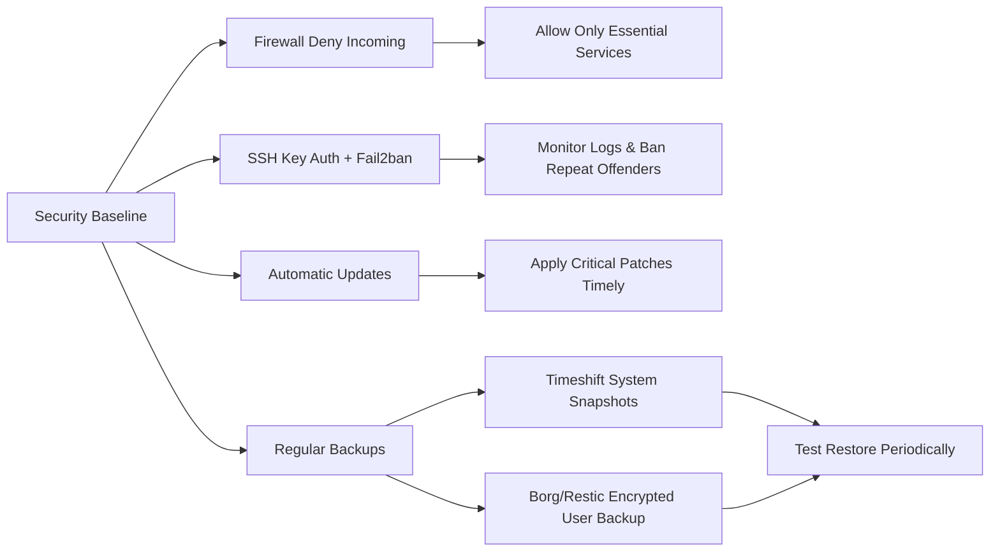

<br>

## 6. Performance Tuning and Advanced Management

After security, the focus shifts to extracting maximum efficiency and managing more complex configurations. This section covers kernel‑level tuning, boot optimization, network enhancements, and virtualization.

### 6.1 Kernel Module Management

- The Linux kernel loads modules dynamically as hardware is detected, but sometimes a problematic module must be prevented from loading. Use `lsmod` to list loaded modules and `modprobe -r <module>` to remove one temporarily. To permanently blacklist a module—for example, the `nouveau` driver when using the NVIDIA proprietary driver—create a `.conf` file in `/etc/modprobe.d/` containing `blacklist <module>`. Afterward, update the initramfs (`sudo update-initramfs -u`) to ensure the module is not loaded early in boot. Module parameters can also be passed at load time to fine‑tune behavior, such as enabling power saving for a wireless card. Careful management of modules ensures that only necessary and compatible drivers occupy kernel memory, reducing potential conflicts and improving stability.

### 6.2 Boot Performance Analysis

- Long boot times are often caused by services that can be deferred or disabled. The `systemd-analyze` tool provides precise timing data. Use `systemd-analyze blame` to list services by initialization time, and `systemd-analyze critical-chain` to visualize the dependency tree and identify bottlenecks. Once you identify non‑critical services that delay the boot process, you can disable them with `sudo systemctl disable <service>` or set them to start after boot using a timer or socket activation. For systems with multiple kernels, periodically remove old kernel images and their associated modules (`sudo apt autoremove --purge` on Debian) to free space in `/boot` and simplify the boot menu. These optimizations, while not always dramatic, contribute to a snappier start‑up experience and a cleaner system footprint.

### 6.3 Network Optimization and DNS

- Moving beyond DHCP, configuring a static IP address and custom DNS resolvers can improve network reliability and speed. On distributions using NetworkManager, `nmcli` or `nmtui` allow you to set static addresses and DNS servers (e.g., Cloudflare’s `1.1.1.1` or Quad9’s `9.9.9.9`). For systems using `systemd-networkd`, configuration files in `/etc/systemd/network/` define these settings. Faster DNS resolution reduces the latency of every web request, and privacy‑respecting resolvers prevent your ISP from logging every domain you visit. For advanced setups, `systemd-resolved` provides per‑interface DNS configuration and DNSSEC validation. Verify your changes with `resolvectl status` and by pinging external hosts.

### 6.4 Virtualization with KVM/QEMU and VirtualBox

- A complete development environment often requires running virtual machines. KVM (Kernel‑based Virtual Machine) combined with QEMU provides near‑native performance for Linux guests and, with UEFI/OVMF, supports modern operating systems like Windows 11. Install `qemu-kvm`, `libvirt-daemon-system`, `libvirt-clients`, and `virt-manager`. Add your user to the `libvirt` and `kvm` groups, then log out and back in to allow socket access. Verify that `kvm-ok` reports acceleration is available. For users who prefer Oracle VirtualBox, add its official repository and install `virtualbox-7.1` (or latest). Always install the corresponding Extension Pack for USB 2.0/3.0, RDP, and disk encryption. Bridge networking (`bridge-utils`) enables VMs to appear as separate devices on the local network, a crucial step for server‑like deployments. Properly configured virtualization extends the utility of a single machine for testing, isolated development, and running legacy software.

<br>

## 7. Validation and Ongoing Maintenance

The final stage is to verify that all configurations are active and that the system remains healthy over time. This section provides a checklist of validation commands and promotes a culture of continuous engagement with the Linux community.

### 7.1 Configuration and Service Audit

- Perform a systematic audit to confirm that security and performance services are running. Check the status of the firewall (`sudo ufw status` or `sudo firewall-cmd --state`), fail2ban (`sudo systemctl status fail2ban`), and SSH (`sudo systemctl status sshd`). Verify that the correct graphics driver is loaded (`glxinfo -B` or `nvidia-smi`). Ensure that Flatpak applications are listed with `flatpak list` and that any Snap installations are intentional. Run `systemd-analyze` to review boot performance after your changes, and check disk usage with `df -h` and `ncdu`. This audit not only catches misconfigurations but also builds familiarity with the system’s normal operational state, making future anomalies easier to spot.

### 7.2 Package Cache Cleanup and Space Reclamation

- Over time, package caches and orphaned dependencies consume disk space. Use `sudo apt autoremove --purge && sudo apt clean` on Debian/Ubuntu to remove unneeded packages and clear the local repository of downloaded package files. On Fedora, `sudo dnf autoremove && sudo dnf clean all` accomplishes the same. Regularly clearing old journal logs (`sudo journalctl --vacuum-size=200M`) prevents `/var/log` from filling up. Tools like `bleachbit` (GUI) can deep‑clean application caches, though they should be used with caution on system directories. A lean system not only saves storage but also reduces the number of packages that need to be updated and audited, indirectly improving security.

### 7.3 Community Engagement and Continual Learning

- Linux is sustained by its communities. After securing and tuning your system, take time to explore your distribution’s official forums, wikis, and IRC/Matrix channels. Subscribing to security mailing lists or RSS feeds for your distribution keeps you informed of critical updates and emerging best practices. Consider contributing back by writing documentation, reporting bugs, or helping newcomers. The knowledge gained from performing this post‑installation guide forms a solid foundation, but the landscape evolves rapidly. By staying connected, you ensure that your system remains not only a productive tool but also a platform for growth and collaboration within the broader open‑source ecosystem.

<br><br><br><br>

<h1 align="center">Linux Kernel: A Comprehensive Guide.</h1>

<br>

## Table of Contents

1. Introduction
2. Architecture Overview
3. Kernel Design Models
4. Core Subsystems
5. Kernel Releases and Development Model
6. Configuring and Building the Kernel
7. Kernel Variants and Specialized Builds
8. Kernel Debugging and Instrumentation
9. Conclusion
10. References

<br>

## 1. Introduction

The Linux kernel is the core component of any Linux-based operating system. It runs in a privileged mode (kernel mode) and manages hardware resources on behalf of user-space applications. Understanding the kernel is essential for system administrators, developers, and anyone working with Linux systems.

This document provides a detailed overview of the Linux kernel's architecture, subsystems, release model, build process, variants, and debugging techniques. It is written in simple, clear English and is suitable for a broad audience.

<br>

## 2. Architecture Overview

### 2.1 User Space vs Kernel Space

Linux divides system memory into two distinct regions:

| Region | Privilege Level | Purpose | Examples |
|--------|----------------|---------|----------|
| User Space | Limited (unprivileged) | Runs user applications and libraries | Web browsers, text editors, databases |
| Kernel Space | Full (privileged) | Manages hardware, memory, and processes | Scheduler, memory manager, device drivers |

User programs cannot directly access hardware or kernel memory. Instead, they request services through **system calls** — well-defined APIs that transition execution from user space into kernel space.

### 2.2 System Call Flow

The following diagram illustrates how a user application interacts with hardware through the kernel:

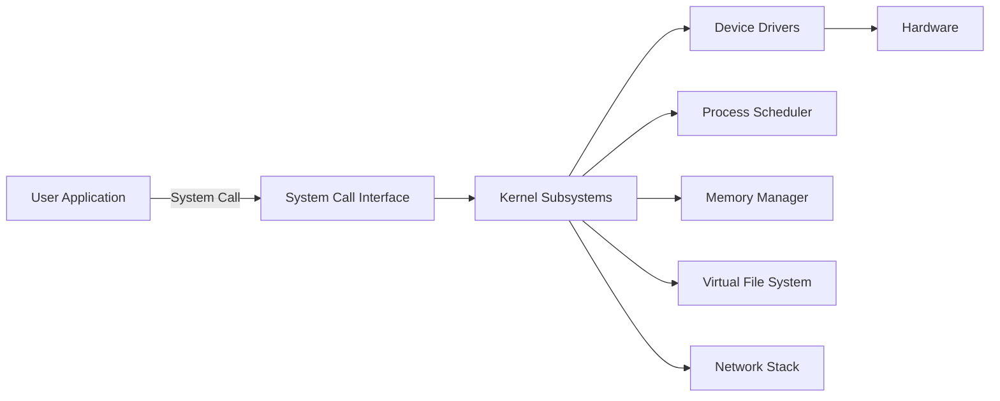

When an application calls `read()`, `write()`, or `open()`, the kernel processes the request, coordinates with the appropriate subsystem, and uses device drivers to communicate with hardware.

### 2.3 Internal Structure

Internally, the kernel is divided into:

- A **core** that provides fundamental services (scheduling, memory management, inter-process communication)
- **Device drivers** that interface with hardware
- **Logical subsystems** (file systems, networking, process scheduler) that run together in kernel space

All these components share the same kernel address space and coordinate to provide a complete operating system environment.

<br>

## 3. Kernel Design Models

### 3.1 Monolithic Kernel (Linux's Approach)

Linux uses a **monolithic kernel** architecture. In a monolithic kernel, all core operating system services — scheduling, memory management, file systems, and most device drivers — execute in the same privileged address space. There is no hardware-enforced isolation between them.

**Advantages:**
- Fast function calls between subsystems
- High performance due to shared memory space
- Direct access to hardware

**Disadvantages:**
- A bug in one module can crash the entire kernel
- Larger kernel image size
- Less isolation between components

### 3.2 Modular Monolithic Design

Despite being monolithic, Linux is also **modular**. Many components — especially device drivers — can be compiled as **loadable kernel modules** (LKMs). These modules can be loaded or unloaded at runtime without rebooting the system.

This combination gives Linux the performance of a monolithic design with the flexibility of dynamic modules. The kernel exports symbols to modules and enforces license compatibility through mechanisms like `EXPORT_SYMBOL` and `EXPORT_SYMBOL_GPL`.

### 3.3 Comparison of Kernel Architectures

| Architecture | Description | Examples | Isolation | Performance |
|-------------|-------------|----------|-----------|-------------|
| Monolithic | All services run in kernel space | Linux, traditional UNIX | Low | High |
| Microkernel | Minimal kernel; services run in user space | MINIX, QNX | High | Lower (IPC overhead) |
| Hybrid | Blends monolithic and microkernel approaches | Windows NT, macOS XNU | Medium | Medium |
| Exokernel | Minimal kernel exposing hardware directly to applications | XOK, Nemesis | High | Variable |

### 3.4 Microkernel vs Monolithic

A **microkernel** pushes many services into user-space processes and leaves only minimal functions (inter-process communication, basic scheduling) in the kernel. This emphasizes modularity and reliability through isolation.

Linus Torvalds has famously dismissed the "hybrid kernel" label as marketing, stating that systems like Windows NT are essentially monolithic kernels with some modular characteristics.

### 3.5 Exokernel Model

An **exokernel** is a minimalist kernel that exposes hardware directly to applications, allowing user-space libraries to implement abstractions. Exokernels are extremely small, implementing only protection and resource multiplexing. While Linux is not an exokernel, understanding this model highlights Linux's choice of rich kernel abstractions (such as the Virtual File System) to balance ease of use with performance.

<br>

## 4. Core Subsystems

The Linux kernel comprises numerous subsystems, each handling a vital aspect of the system. The following diagram shows the major subsystems and their relationships:

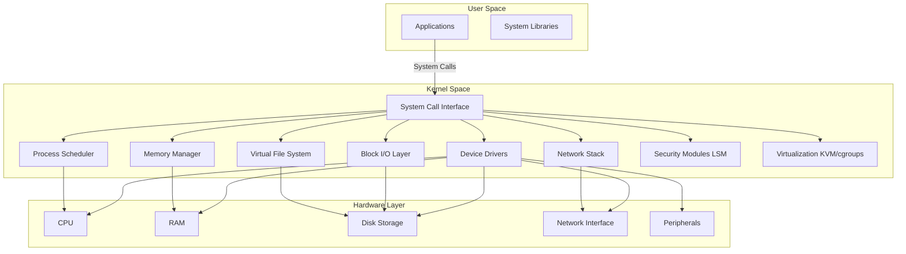

### 4.1 Process and Task Scheduling

Linux supports **preemptive multitasking** with **symmetric multiprocessing** (SMP). Each CPU core runs the scheduler, which decides which process or thread (task) to execute next.

| Scheduler | Status | Key Features |
|-----------|--------|--------------|
| Completely Fair Scheduler (CFS) | Default until Linux 6.6 | Fair sharing using virtual runtimes; red-black tree for efficiency |
| EEVDF (Earliest Eligible Virtual Deadline First) | Default since Linux 6.6 (late 2023) | Fair scheduling based on virtual deadlines; improved responsiveness |

The scheduler manages priorities, time slices, and CPU affinity to ensure responsive, parallel execution of many processes. Developers can adjust priorities using `nice` values or the `sched_setscheduler()` system call.

### 4.2 Memory Management

Linux provides **virtual memory** for processes, with paging, page tables, and a sophisticated allocator.

| Feature | Description |
|---------|-------------|
| Virtual Memory | Each process sees its own linear address space; kernel maps to physical memory |
| Paging | Memory divided into fixed-size pages; page tables translate virtual to physical addresses |
| Page Cache | Keeps recently accessed disk data in memory to improve I/O performance |
| MGLRU (Multi-Generational LRU) | Advanced page replacement algorithm; merged in Linux 6.1 |
| Memory Zones | DMA, Normal, and High Memory zones for different hardware needs |
| Slab/SLUB Allocator | Efficient allocation of kernel objects |
| Swappiness | Tunable parameter (`/proc/sys/vm/swappiness`) controlling swap behavior |

The kernel also handles NUMA (Non-Uniform Memory Access), hugepages, and live memory balancing.

### 4.3 Virtual File System (VFS)

Linux implements a unified **Virtual File System** layer on top of various concrete file-system drivers.

| File System | Type | Common Use |
|-------------|------|------------|
| ext4 | On-disk | General-purpose Linux file system |
| XFS | On-disk | High-performance, scalable file system |
| Btrfs | On-disk | Advanced features (snapshots, checksums, compression) |
| FAT/NTFS | On-disk | Compatibility with other operating systems |
| NFS/SMB | Network | Network-attached storage |
| procfs (`/proc`) | Virtual | Kernel and process information |
| sysfs (`/sys`) | Virtual | Hardware and driver information |
| devfs (`/dev`) | Virtual | Device files |

Applications perform generic file operations (`open`, `read`, `write`, `stat`), and the VFS dispatches these to the appropriate file-system driver. This allows multiple file-system formats to coexist transparently.

### 4.4 Block I/O and Scheduling

The kernel's **block layer** handles disk and block-device I/O. It manages request queues and provides pluggable I/O schedulers.

| Component | Description |
|-----------|-------------|
| blk-mq (Multi-Queue Block I/O) | Modern framework for high-performance storage |
| Kyber | Low-latency scheduler for fast devices (NVMe, SSDs) |
| BFQ (Budget Fair Queuing) | Interactive scheduler for HDDs and desktop workloads |
| Request Merging | Combines adjacent I/O requests for efficiency |

These optimizations can be tuned to improve throughput or reduce latency under heavy I/O.

### 4.5 Networking Stack

Linux includes a full **TCP/IP stack** and supports many protocols.

| Feature | Description |
|---------|-------------|
| Socket API | TCP, UDP, raw sockets |
| Packet Routing | In-kernel routing tables and forwarding |
| Netfilter | Firewalling framework (iptables, nftables) |
| XDP/eBPF | High-performance packet processing |
| Tunnels | GRE, IPsec, VXLAN |
| Network Drivers | Ethernet, Wi-Fi, and other interface drivers |

The networking stack is highly modular — network drivers are separate modules, and filters can attach dynamically.

### 4.6 Device Drivers

Device drivers are perhaps the largest part of the kernel. They interact with hardware such as PCI devices, USB peripherals, GPUs, and input devices.

| Subsystem | Purpose |
|-----------|---------|
| Linux Device Model | Unified abstraction for device discovery and power management |
| sysfs | Exposes device hierarchy to user space |
| udev | Device manager for user-space device events |
| DRM/KMS | Graphics drivers (Direct Rendering Manager) |
| ALSA | Sound subsystem |
| USB | Universal Serial Bus support |
| PCI | Peripheral Component Interconnect support |

Drivers can be built into the kernel or compiled as loadable modules. The kernel provides abstractions to simplify driver development and hardware enumeration.

### 4.7 Synchronization and Concurrency

To manage multi-CPU safety, Linux employs several synchronization mechanisms:

| Mechanism | Use Case |
|-----------|----------|
| Spinlocks | Short critical sections in interrupt context |
| Mutexes | Longer critical sections in process context |
| RCU (Read-Copy Update) | Read-mostly data structures |
| Atomic Operations | Lock-free primitives |

The kernel also has special concurrency contexts: **interrupt context** (code running for hardware interrupts) and **process context** (code running on behalf of a process). Interrupt handlers must use careful locking to stay performant.

The kernel's preemption model allows kernel tasks to be preempted in `PREEMPT` or `PREEMPT_RT` configurations, improving real-time responsiveness.

### 4.8 Virtualization Support

Linux includes built-in support for virtualization:

| Technology | Description |
|------------|-------------|
| KVM (Kernel Virtual Machine) | Hardware-assisted virtualization |
| Xen | Paravirtualization |
| Namespaces | Isolation of PID, mount, network, user, and other resources |
| cgroups (Control Groups) | Resource limiting and accounting |
| VFIO/SR-IOV | Direct PCI device passthrough to virtual machines |
| LXC/Docker | OS-level virtualization using namespaces and cgroups |

### 4.9 Security Mechanisms

Linux implements both discretionary and mandatory access controls:

| Mechanism | Description |
|-----------|-------------|
| UNIX Permissions | Traditional owner/group/other permissions |
| POSIX ACLs | Fine-grained access control lists |
| SELinux | Mandatory access control (NSA-developed) |
| AppArmor | Path-based mandatory access control |
| seccomp | System call filtering |
| KASLR | Kernel address-space layout randomization |
| Stack Canaries | Protection against buffer overflows |
| KSPP | Kernel Self Protection Project (hardening features) |

Many of these hardening features are enabled in specialized hardened kernels.

<br>

## 5. Kernel Releases and Development Model

### 5.1 Release Cycle

Linux kernel development is community-driven, with Linus Torvalds maintaining the mainline branch.

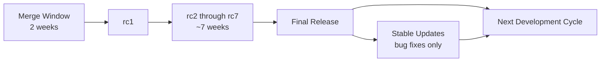

1. After each mainline release, a **two-week merge window** opens where new features are accepted.
2. Then approximately **seven weeks of release candidates** (rc1, rc2, ..., typically rc7) follow for bug-fix stabilization.
3. New mainline kernels are released roughly **every 9–10 weeks**.
4. After release, the version becomes a **stable kernel**, receiving only bug fixes (no new features).

Stable updates (e.g., 6.6.1, 6.6.2) appear weekly or as needed.

### 5.2 Long Term Support (LTS) Kernels

Periodically, certain stable kernels are declared **Long Term Support** (LTS). These are maintained for 2–6 years by kernel developers to serve users requiring long-term reliability.

| LTS Version | Approximate Maintenance Period |
|-------------|-------------------------------|
| 5.4 | Until December 2025 |
| 5.10 | Until December 2026 |
| 5.15 | Until October 2026 |
| 6.1 | Until December 2026 |
| 6.6 | Until December 2026 |
| 6.12 | Until December 2026+ |

The choice of a new LTS version depends on industry demand and feature maturity.

> **Note:** Major version numbers in Linux are arbitrary. Moving from 5.x to 6.x does not inherently indicate a major redesign.

### 5.3 Branch Categories on kernel.org

The official kernel.org site categorizes releases into three main branches:

| Branch | Description |
|--------|-------------|
| Mainline | Latest development kernel; new features merged here |
| Stable | Bug-fix-only updates to a released mainline kernel |
| Longterm (LTS) | Stable kernels maintained for extended periods |

Development pre-releases labeled **rcN** (release candidates) appear weekly during the bug-fix period.

### 5.4 Distribution Kernels

Commercial Linux distributions typically backport fixes and provide their own kernel packages.

| Distribution | Kernel Strategy |
|--------------|-----------------|
| RHEL | Modified older-base kernel with patches for new hardware and security; ~10-year support lifecycle |
| Ubuntu LTS | Based on LTS kernels with hardware enablement and distribution-specific patches |
| Fedora | Closer to mainline; frequent updates |

A useful way to check if you run a vanilla or distribution kernel is `uname -r`. If the version has a dash suffix (e.g., `5.15.0-64-generic`), it is a vendor or distribution kernel. Distribution kernels are not hosted on kernel.org and are supported by the respective vendor.

<br>

## 6. Configuring and Building the Kernel

### 6.1 Kbuild System

The Linux kernel uses a custom build system called **Kbuild**. At compile time, users select features via a **Kconfig** interface.

| Tool | Description |
|------|-------------|
| `make menuconfig` | Text-based menu configuration |
| `make xconfig` | Graphical configuration (Qt) |
| `make gconfig` | Graphical configuration (GTK) |
| `make defconfig` | Default configuration for the architecture |

The configuration database is organized as a tree of menus and options. Each option (bool, tristate, etc.) can enable or disable features or drivers. Dependencies determine which options are visible.

### 6.2 Typical Build Steps

```bash
# Step 1: Configure the kernel
make menuconfig

# Step 2: Compile the kernel and modules (parallel build)
make -j$(nproc)

# Step 3: Install modules and kernel
sudo make modules_install
sudo make install
```

After building, the kernel is typically installed along with its `System.map` and initial RAM disk (`initrd`), and the bootloader (GRUB) is updated to boot it.

### 6.3 Kernel Configuration Options

Kernel configuration influences system behavior greatly:

| Option | Effect |
|--------|--------|
| `CONFIG_PREEMPT` | Makes the kernel fully preemptible |
| `CONFIG_PREEMPT_RT` | Real-time preemption (merged into mainline in Linux 6.12) |
| `CONFIG_SECURITY_SELINUX` | Enables SELinux support |
| `CONFIG_MODULES` | Enables loadable kernel modules |
| `CONFIG_BLK_DEV_NVME` | NVMe storage support |

There are hundreds of options covering networking protocols, file-system drivers, architecture-specific settings, and more. This allows Linux to be tuned for anything from tiny embedded systems to massive servers.

### 6.4 Loadable Kernel Modules

Modules are pieces of code inserted into the running kernel to add functionality without rebooting.

| Command | Purpose |
|---------|---------|
| `insmod` | Insert a module manually |
| `rmmod` | Remove a module |
| `modprobe` | Insert or remove a module with dependency handling |
| `lsmod` | List loaded modules |
| `modinfo` | Show module information |

This modularity is why Linux is described as **monolithic but modular**: the code can be split into binary modules that load dynamically.

<br>

## 7. Kernel Variants and Specialized Builds

Beyond the official branches, many kernel variants exist for special purposes:

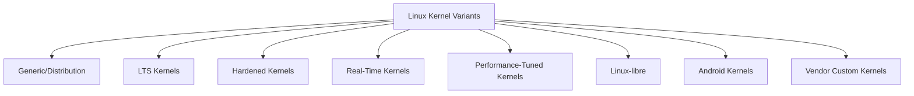

### 7.1 Comparison of Kernel Variants

| Variant | Purpose | Key Features |
|---------|---------|--------------|
| Generic (Distribution) | Standard desktop/server use | Broad hardware support, distribution patches |
| LTS | Long-term reliability | Maintained for 2–6 years; bug fixes only |
| Hardened | Security-focused | Strict configurations, KSPP patches, disabled dangerous features |
| Real-Time (PREEMPT_RT) | Time-critical tasks | Nearly all kernel code preemptible; deterministic latency |
| Performance-Tuned (Zen, Liquorix) | Desktop responsiveness | Aggressive schedulers, low-latency settings, optimized I/O |
| Linux-libre | Completely free software | All proprietary firmware/drivers removed (FSF-endorsed) |
| Android (GKI) | Mobile devices | Generic Kernel Image with vendor modules for hardware |
| Vendor Custom | Specialized hardware | OEM-specific patches and drivers |

### 7.2 Android Generic Kernel Image (GKI)

Android devices run a modified Linux kernel. Since Linux 5.10, Android introduced the **Generic Kernel Image (GKI)** project:

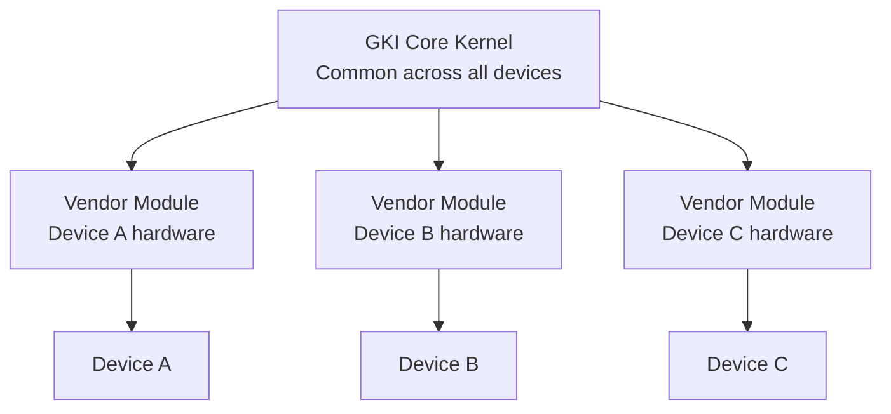

A single generic kernel core is combined with separate vendor modules for hardware-specific drivers. This modular structure allows OEMs to update hardware drivers independently of the core Android kernel. For example, Android 15 uses a 6.6 GKI kernel with downloadable vendor modules.

### 7.3 Real-Time Kernels

For time-critical tasks (audio production, industrial control), **PREEMPT_RT** patches make Linux more deterministic. Historically maintained as a separate patchset, many RT features were merged into mainline Linux 6.12. Active RT branches (e.g., 6.12-rt, 6.6-rt) continue to be maintained on kernel.org for real-time use cases.

### 7.4 Hardened Kernels

The Linux-hardened project and similar patches add security protections:

- Disabling `/dev/mem` and other dangerous features
- Randomizing kernel memory (KASLR)
- Enforcing strict pointer bounds
- Stack Clash protection
- Control-Flow Integrity (CFI)

Such kernels minimize attack surface at the cost of disabling some functionality.

### 7.5 Linux-libre

The FSF-sponsored **linux-libre** project produces a kernel tree with all proprietary firmware and drivers removed. It is a rebased Linux kernel stripped of any non-free blobs, intended for completely free distributions. Users trade off some hardware support (e.g., certain Wi-Fi firmware) for ideological purity.

<br>

## 8. Kernel Debugging and Instrumentation

Kernel debugging requires special tools since bugs can crash the whole system.

### 8.1 Common Debugging Techniques

| Technique | Tools | Purpose |
|-----------|-------|---------|
| Logging | `printk()`, `dmesg`, `/var/log/kern.log` | Log messages from kernel code |
| Interactive Debuggers | KGDB (with GDB), KDB | Breakpoints and stepping through kernel code |
| Tracing/Profiling | Ftrace, perf, eBPF, SystemTap | Trace function calls, measure latencies, diagnose bottlenecks |
| Pseudo-filesystems | `/proc`, `/sys`, debugfs (`/sys/kernel/debug`) | Inspect and tune kernel state at runtime |
| Crash Analysis | `crash` tool, vmcore | Analyze frozen memory images after a panic |
| Live Patching | kpatch | Apply fixes without rebooting |

### 8.2 Debugging Workflow

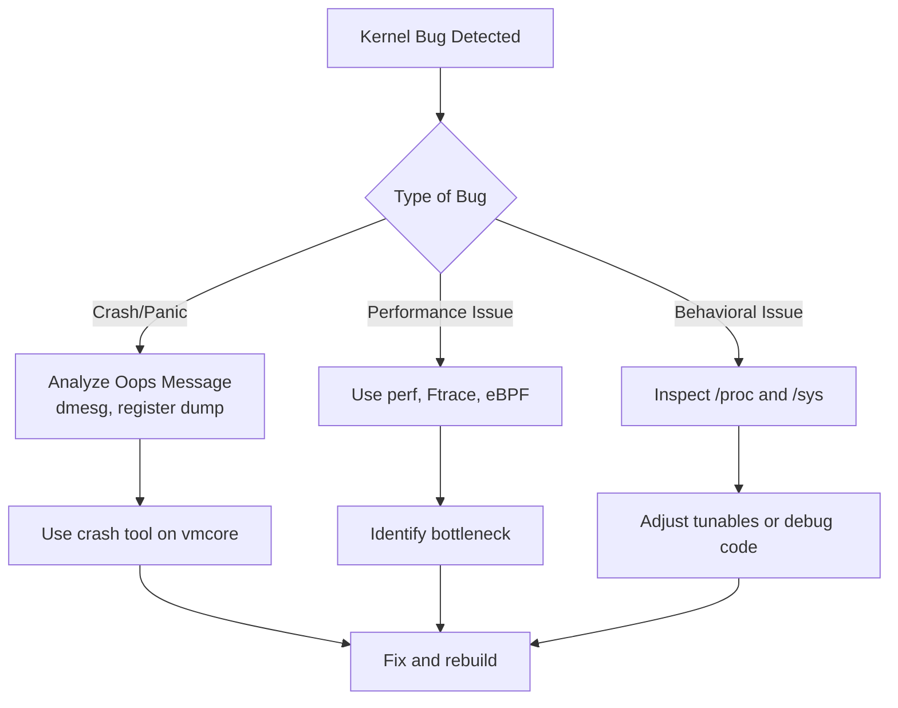

### 8.3 Printk and Logs

Developers add `printk()` statements in code to log messages. The kernel ring buffer can be viewed via `dmesg` or `/var/log/kern.log`. During early boot, an initramfs console shows messages. After a panic, logs indicate where the crash occurred via an "oops" message with a register dump.

### 8.4 Tracing and Profiling

Linux has powerful tracing capabilities:

- **Ftrace**: Function tracer built into the kernel
- **perf**: Performance events and profiling (supports Flame Graphs)
- **eBPF/BPF**: Dynamic tracing and packet filtering
- **SystemTap**: Scripting language for kernel instrumentation

For example, `perf` can profile CPU usage, interrupts, cache misses, and scheduler behavior. The debugfs interface at `/sys/kernel/debug/tracing` provides access to tracepoints.

<br>

## 9. Conclusion

The Linux kernel is a complex, layered system that combines a monolithic design with modular flexibility. It supports a wide array of hardware and use cases, from tiny embedded devices to massive servers. Its ongoing development and rich feature set — SMP, virtualization, containers, eBPF, and more — are driven by a global community.

By understanding its architecture (user space vs kernel space, subsystems, and design models), release model (mainline, stable, and LTS branches), and build process, you can configure and use Linux kernels tailored to practically any need. Whether you require a bleeding-edge performance kernel, a secure hardened build, a real-time kernel for industrial control, or the standard distribution kernel, Linux offers variants and mechanisms to meet those requirements.

<br>

## 10. References

- Official Linux kernel documentation: https://docs.kernel.org
- Kernel.org: https://kernel.org
- Kernel Newbies Wiki: https://kernelnewbies.org
- LWN.net (Linux Weekly News): https://lwn.net
- Linux Kernel Mailing List (LKML) archives: https://lore.kernel.org
- Android Common Kernels: https://source.android.com/devices/architecture/kernel
- Linux-libre project: https://www.fsfla.org/ikiwiki/selibre/linux-libre/
 
<br><br><br><br>

<h1 align="center">The Vim and Neovim Guide.</h1>

<br><br>

**A practical reference for Linux users of all experience levels**

> **Document conventions:** `<leader>` means the configured leader key. The example Neovim setup in this guide uses the **Space** key as `<leader>`. `Ctrl + x` means hold `Ctrl` and press `x`. Commands beginning with `:` are Ex commands typed in Command-line mode. Shell commands are shown separately. Review any script before running it and back up existing configuration first.

<br>

## Table of Contents

1. Introduction
2. Vim vs Neovim: Understanding the Differences
3. Getting Started
4. Intermediate Usage
5. Advanced Usage
6. Plugin Management
7. Popular Plugins
8. Vim and Neovim Distributions
9. Useful Utilities and Daily Workflows
10. Practical Neovim IDE Setup on Debian
11. Shortcut Keys and Commands Reference
12. Troubleshooting
13. Further Resources
14. Conclusion

<br>

## 1. Introduction

Vim, short for **Vi IMproved**, and its modern fork **Neovim** are two of the most powerful, flexible, and enduring text editors in the Unix and Linux ecosystem. They are more than simple text editors: they are keyboard-driven text manipulation platforms that can be shaped into lightweight editors, system administration tools, or full software development environments.

This guide explains both editors from the ground up. It begins with the modal editing model, moves through essential commands and intermediate workflows, and then covers advanced topics such as Language Server Protocol integration, Treesitter, plugin managers, distributions, and a practical Neovim IDE setup. The installation guidance applies to major Linux distribution families, including Debian/Ubuntu, Fedora/RHEL-compatible systems, Arch Linux, openSUSE, Alpine Linux, Gentoo, and Void Linux. FreeBSD is included only as a Unix-like reference.

The goal is not to list every Vim command. The goal is to give you a clear, accurate, deployment-ready reference that takes you from beginner-level modal editing to advanced, IDE-like customization while remaining understandable and maintainable.

<br>

## 2. Vim vs Neovim: Understanding the Differences

Vim and Neovim share the same core editing philosophy: modal editing, composable commands, and keyboard-first workflows. They differ in development model, scripting, plugin architecture, built-in features, and modern integrations.

| **Aspect** | **Vim** | **Neovim** |
| :--- | :--- | :--- |
| **Origin** | Created by Bram Moolenaar in 1991 as an improvement over Vi. Vim has decades of stability and broad availability. | Forked from Vim in 2014 to refactor the codebase, accelerate development, and add modern capabilities while preserving compatibility with the Vim editing model. |
| **Development model** | Historically led by a single maintainer with a conservative release style. After Bram Moolenaar’s passing in 2023, the project continues under community maintainers. Stability and backward compatibility remain priorities. | Community-driven with open governance and a faster release cycle. New features and plugin APIs tend to arrive sooner. |
| **Asynchronous support** | Vim 8 introduced jobs, channels, and timers. Many plugins use them, but asynchronous behavior is not as deeply integrated into the plugin ecosystem as in Neovim. | Built with asynchronous job control as a core design principle. Language servers, linters, and completion engines can run in the background without blocking the UI. |
| **Scripting** | Primarily Vimscript. Vim 9 introduced Vim9 script with performance and syntax improvements. Vim9 script is specific to Vim. | Embeds Lua as a first-class configuration and scripting language. Supports legacy Vimscript, but does **not** support Vim9 script. Also provides a powerful RPC API. |
| **Configuration** | Typically `~/.vimrc` or `~/.vim/vimrc`, written in Vimscript. | Follows the XDG Base Directory Specification. Main configuration is usually `~/.config/nvim/init.lua` or `init.vim`. |
| **Plugin architecture** | Plugins are often synchronous by default, though Vim’s job API can be used. The ecosystem is mature and broad. | Designed for asynchronous plugins. Many modern plugins are written in Lua and load lazily. |
| **Built-in LSP** | No built-in LSP client. Requires external plugins such as `coc.nvim` or `vim-lsp`. | Includes a built-in LSP client. Additional plugins such as `nvim-lspconfig` simplify server configuration. |
| **Treesitter** | Not built in. Syntax highlighting is traditionally regex-based, though plugins can add Treesitter support. | Includes the `vim.treesitter` API. Practical highlighting, folding, and parser management usually require the `nvim-treesitter` plugin and installed parsers. |
| **Terminal** | Includes a terminal emulator since Vim 8.1, with limited integration compared with Neovim. | Includes a fully integrated `:terminal` and supports terminal-oriented plugins. |
| **User interface** | Terminal UI plus GUI front-ends such as gVim and MacVim. | Terminal UI with modern terminal features. GUI front-ends such as Goneovim, VimR, and others use Neovim’s API. |

### Choosing Between Vim and Neovim

- **Choose Vim when stability, ubiquity, and minimal dependencies matter most.** Vim is often available on servers, minimal systems, and rescue environments. It is an excellent choice for system administration and quick edits over SSH.
- **Choose Neovim when you want modern defaults, Lua configuration, built-in LSP, asynchronous plugins, and a fast-moving ecosystem.** Neovim is a strong choice for software development and IDE-like customization.
- **Do not treat the choice as permanent.** Many users learn modal editing in Vim and later adopt Neovim, or use both depending on the system.
- **Check your distribution’s package version.** Stable Linux distributions may provide older Neovim releases. If a plugin requires a newer Neovim, use an official AppImage, Flatpak, Snap, or a source build.

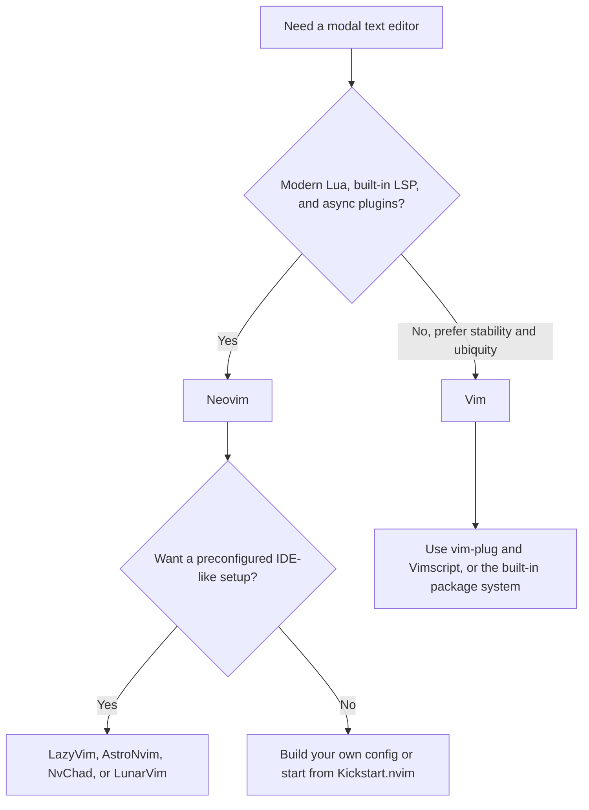

<br>

## 3. Getting Started

### 3.1 Installation Across Linux Distributions

Vim is often preinstalled on many Linux systems, but minimal images may not include it. Neovim usually requires installation. Use your distribution’s package manager first. Package names and available versions vary.

| **Distribution family** | **Vim installation** | **Neovim installation** | **Notes** |
| :--- | :--- | :--- | :--- |
| Debian / Ubuntu | `sudo apt update && sudo apt install vim` | `sudo apt update && sudo apt install neovim` | Debian stable may provide an older Neovim. Use AppImage or Flatpak if a newer version is required. |
| Fedora / RHEL-compatible | `sudo dnf install vim-enhanced` | `sudo dnf install neovim` | RHEL and CentOS Stream may require EPEL for Neovim. |
| Arch Linux | `sudo pacman -S vim` | `sudo pacman -S neovim` | Arch usually provides recent versions. |
| openSUSE | `sudo zypper install vim` | `sudo zypper install neovim` | Use `zypper search` if package names differ. |
| Alpine Linux | `sudo apk add vim` | `sudo apk add neovim` | Alpine packages are minimal; install additional tools as needed. |
| Gentoo | `sudo emerge app-editors/vim` | `sudo emerge app-editors/neovim` | USE flags affect features such as clipboard and Python support. |
| Void Linux | `sudo xbps-install -S vim` | `sudo xbps-install -S neovim` | Verify package availability with `xbps-query`. |
| FreeBSD | `sudo pkg install vim` | `sudo pkg install neovim` | Unix-like system, included for completeness; not a Linux distribution. |

### 3.2 Alternative Installation Methods

- **Official Neovim AppImage:** Download from the Neovim GitHub releases page, make it executable, and place it in a directory in your `PATH`, such as `~/.local/bin`.
- **Flatpak:** Install from Flathub where available. Verify the application ID and remote configuration before use.
- **Snap:** Available on systems with Snap installed. Use only if Snap is supported by your distribution.
- **Source compilation:** Useful when you need a newer version or custom build options. Install build dependencies first, then follow the official Neovim build instructions. Avoid replacing system-managed binaries without understanding the impact.
- **Version managers and portable installs:** Useful for testing multiple Neovim versions, but keep configuration paths clear to avoid conflicts.

### 3.3 Essential Dependencies

The following tools are commonly required by plugin managers, fuzzy finders, LSP servers, and clipboard integrations. Debian/Ubuntu commands are shown as examples; adapt them for your distribution.

| **Dependency** | **Purpose** | **Debian/Ubuntu example** |
| :--- | :--- | :--- |
| Git | Plugin management and cloning repositories | `sudo apt install git` |
| Curl | Downloading files and bootstrapping plugin managers | `sudo apt install curl` |
| Ripgrep | Fast recursive search, often used by Telescope | `sudo apt install ripgrep` |
| fd / fd-find | Fast file searching for fuzzy finders | `sudo apt install fd-find` |
| Node.js and npm | Some LSP servers and plugins | `sudo apt install nodejs npm` |
| Python 3 and pip | Some plugins and language servers | `sudo apt install python3 python3-pip` |
| pynvim | Python provider for Neovim | `pip3 install --user pynvim` |
| Neovim npm package | Node.js provider for Neovim | `npm install -g neovim` |
| xclip or wl-clipboard | System clipboard integration on X11 or Wayland | `sudo apt install xclip` or `sudo apt install wl-clipboard` |

> **Debian note:** The `fd-find` package may install the binary as `fdfind`, not `fd`. Some plugins expect `fd`. You can create a user-local symlink if needed:
>
> ```bash
> mkdir -p ~/.local/bin
> ln -sf "$(command -v fdfind)" ~/.local/bin/fd
> ```
>
> Ensure `~/.local/bin` is in your `PATH`.

### 3.4 Verifying the Installation

After installation, verify the editor and available features:

```bash
vim --version
nvim --version
```

Check for features such as `+clipboard`, `+python3`, and `+terminal`. For Neovim, run `:checkhealth` inside the editor to diagnose common issues.

### 3.5 The Modal Editor Concept

Vim and Neovim are **modal editors**. Different tasks use different modes. This is the most important concept for new users. Instead of typing directly into a document at all times, you navigate and manipulate text in Normal mode, enter Insert mode only when you need to type, and use Visual and Command-line modes for selection and commands.

| **Mode** | **Purpose** | **How to enter** | **How to leave** |
| :--- | :--- | :--- | :--- |
| **Normal mode** | Navigate, delete, copy, paste, and run editing commands | Default mode when the editor starts; press `Esc` from other modes | Return here after completing actions |
| **Insert mode** | Type and edit text like a conventional editor | `i`, `a`, `o`, `O`, `I`, `A` | `Esc` or `Ctrl + [` |
| **Visual mode** | Select text by character, line, or block | `v`, `V`, `Ctrl + v` | `Esc` |
| **Command-line mode** | Run Ex commands such as save, quit, substitute, and configuration commands | `:` | `Enter` to run, `Esc` to cancel |

```mermaid
flowchart TD
    N[Normal mode] -->|i, a, o, O, I, A| I[Insert mode]
    I -->|Esc or Ctrl + [| N
    N -->|v, V, Ctrl + v| V[Visual mode]
    V -->|Esc| N
    N -->|:| C[Command-line mode]
    C -->|Enter| N
    C -->|Esc| N
    V -->|y, d, c, >, <, etc.| N
```

#### Why Modal Editing Works

- **Separation of concerns reduces cognitive load.** Navigation, selection, and text insertion are distinct tasks, so the editor does not force one behavior onto every keystroke.
- **Composable commands enable concise operations.** In Normal mode, an operator such as `d` can be combined with a motion such as `w` to delete a word, or with `$` to delete to the end of a line.
- **Muscle memory develops quickly.** Once basic movements and operators become automatic, editing becomes fast and precise.
- **Keyboard-driven workflows maximize efficiency.** You can perform most editing tasks without leaving the home row or reaching for a mouse.

### 3.6 Basic Movement and Editing

The following commands form the foundation of daily editing. Practice them in a test file or with `vimtutor` until they become automatic.

| **Category** | **Command** | **Action** |
| :--- | :--- | :--- |
| Character movement | `h` `j` `k` `l` | Move left, down, up, right |
| Word movement | `w` | Jump forward to the beginning of the next word |
| Word movement | `b` | Jump backward to the beginning of the previous word |
| Word movement | `e` | Jump to the end of the current word |
| Line movement | `0` | Jump to the beginning of the line |
| Line movement | `^` | Jump to the first non-blank character of the line |
| Line movement | `$` | Jump to the end of the line |
| File movement | `gg` | Jump to the first line of the file |
| File movement | `G` | Jump to the last line of the file |
| File movement | `:{number}` | Jump to a specific line number |
| Scrolling | `Ctrl + d` | Scroll down half a page |
| Scrolling | `Ctrl + u` | Scroll up half a page |
| Scrolling | `zz` | Center the cursor line in the window |
| Insert | `i` | Insert before the cursor |
| Insert | `a` | Insert after the cursor |
| Insert | `o` | Open a new line below and enter Insert mode |
| Insert | `O` | Open a new line above and enter Insert mode |
| Delete | `x` | Delete the character under the cursor |
| Delete | `dd` | Delete the current line |
| Copy | `yy` | Yank (copy) the current line |
| Paste | `p` | Paste after the cursor |
| Paste | `P` | Paste before the cursor |
| Undo | `u` | Undo the last change |
| Redo | `Ctrl + r` | Redo a previously undone change |

### 3.7 Saving, Exiting, and File Commands

| **Command** | **Action** | **Notes** |
| :--- | :--- | :--- |
| `:w` | Write the current file | Saves the current buffer |
| `:w filename` | Save as a new file | Writes to the specified file |
| `:wq` | Save and quit | Standard save-and-exit command |
| `:x` | Save and quit | Writes only if there are changes |
| `:q` | Quit | Fails if there are unsaved changes |
| `:q!` | Quit without saving | Discards unsaved changes |
| `:qa` | Quit all windows and tabs | Fails if any buffer has unsaved changes |
| `:qa!` | Quit all without saving | Discards all changes |
| `ZZ` | Save and quit | Normal-mode shortcut |
| `ZQ` | Quit without saving | Normal-mode shortcut |

<br>

## 4. Intermediate Usage

### 4.1 Buffers, Windows, and Tabs

Buffers, windows, and tabs are different concepts. A buffer is an in-memory representation of a file. A window is a viewport that displays a buffer. A tab is a collection of windows, similar to a virtual desktop.

| **Concept** | **Command** | **Action** |
| :--- | :--- | :--- |
| Buffer | `:e filename` | Open a file into a new buffer |
| Buffer | `:ls` or `:buffers` | List open buffers |
| Buffer | `:bnext` / `:bprev` | Move to the next or previous buffer |
| Buffer | `:buffer N` | Switch to buffer number `N` |
| Buffer | `:bd` | Delete a buffer from the buffer list |
| Buffer | `:b#` | Switch to the previously used buffer |
| Window | `:split filename` or `:sp` | Create a horizontal split |
| Window | `:vsplit filename` or `:vsp` | Create a vertical split |
| Window | `Ctrl + w` then `h/j/k/l` | Move between windows |
| Window | `Ctrl + w` then `=` | Equalize window sizes |
| Window | `Ctrl + w` then `q` | Close the current window |
| Window | `:only` | Close all windows except the current one |
| Tab | `:tabnew filename` | Open a file in a new tab |
| Tab | `:tabs` | List open tabs |
| Tab | `:tabnext` / `:tabprev` | Move to the next or previous tab |
| Tab | `:tabclose` | Close the current tab |
| Tab | `gt` / `gT` | Go to the next or previous tab in Normal mode |

### 4.2 Marks, Registers, and Macros

| **Feature** | **Command** | **Action** |
| :--- | :--- | :--- |
| Mark | `m{a-z}` | Set a local mark at the cursor position |
| Mark | `'a` | Jump to the line of mark `a` |
| Mark | `` `a `` | Jump to the exact line and column of mark `a` |
| Mark | `A-Z` | Use a global mark across files |
| Mark | `:marks` | List all marks |
| Register | `"0` to `"9` | Access recent yanks and deletions |
| Register | `"a` to `"z` | Use named registers |
| Register | `"+` and `"*` | Access the system clipboard and primary selection when available |
| Register | `"xyy` | Yank the current line into register `x` |
| Register | `"xp` | Paste from register `x` |
| Register | `:reg` | List registers and their contents |
| Macro | `q{register}` | Start recording a macro into a register |
| Macro | `q` | Stop recording |
| Macro | `@a` | Replay the macro stored in register `a` |
| Macro | `@@` | Replay the last used macro |

### 4.3 Search and Replace

| **Command** | **Action** | **Notes** |
| :--- | :--- | :--- |
| `/pattern` | Search forward | Use `n` and `N` to repeat |
| `?pattern` | Search backward | Use `n` and `N` to repeat |
| `n` / `N` | Next or previous search result | Repeats the last search |
| `*` / `#` | Search for the word under the cursor | Forward or backward |
| `:s/old/new/g` | Replace all occurrences on the current line | Current line only |
| `:10,20s/old/new/g` | Replace in lines 10 through 20 | Range substitution |
| `:%s/old/new/g` | Replace in the whole file | `%` means the entire file |
| `:%s/old/new/gc` | Replace with confirmation | `y` replaces, `n` skips, `a` replaces all, `q` quits, `l` replaces and quits |
| `:g/pattern/d` | Delete all lines containing `pattern` | Global command |
| `:v/pattern/d` | Delete all lines not containing `pattern` | Inverted global command |
| `:g/pattern/t$` | Copy matching lines to the end of the file | Useful for collecting lines |
| `:'<,'>s/old/new/g` | Replace only inside a Visual selection | The range is added automatically |

Example: swap the first two words on every line:

```vim
:%s/\(\w\+\)\s\+\(\w\+\)/\2 \1/g
```

### 4.4 Undo Tree and Persistent Undo

Vim and Neovim support non-linear undo history. Persistent undo saves undo history to disk so changes can be undone after closing and reopening a file. Persistent undo is **not enabled by default** in either editor; configure it explicitly.

| **Command** | **Action** |
| :--- | :--- |
| `u` | Undo the last change |
| `Ctrl + r` | Redo the last undone change |
| `:earlier 10m` | Go back to the state from 10 minutes ago |
| `:later 5s` | Move forward 5 seconds in undo history |
| `:undolist` | List undo branches |

Vim configuration example:

```vim
set undofile
set undodir=~/.vim/undo
```

Create the undo directory first:

```bash
mkdir -p ~/.vim/undo
```

Neovim Lua configuration example:

```lua
vim.opt.undofile = true
vim.opt.undodir = vim.fn.stdpath("state") .. "/undo"
```

Create the directory if needed:

```bash
mkdir -p ~/.local/state/nvim/undo
```

<br>

## 5. Advanced Usage

### 5.1 Language Server Protocol Integration

The Language Server Protocol provides IDE-like features such as completion, go-to-definition, references, hover documentation, rename, code actions, and diagnostics. Neovim includes a built-in LSP client. Vim requires external plugins such as `coc.nvim` or `vim-lsp`.

| **Action** | **Example mapping or command** | **Notes** |
| :--- | :--- | :--- |
| Go to definition | `gd` | Mapping must be configured in your setup |
| Go to declaration | `gD` | Mapping must be configured |
| Show references | `gr` | Mapping must be configured |
| Hover documentation | `K` | Mapping must be configured |
| Go to implementation | `gi` | Mapping must be configured |
| Rename symbol | `<leader>rn` | Example mapping |
| Code actions | `<leader>ca` | Example mapping |
| Format buffer | `<leader>f` | Example mapping |
| Previous / next diagnostic | `[d` / `]d` | Often configured by LSP plugins or your config |
| Check LSP status | `:checkhealth vim.lsp` or `:LspInfo` where available | `:LspInfo` availability depends on your plugin setup |

Use `nvim-lspconfig` to simplify server configuration. Use `mason.nvim` or your package manager to install language servers. In Vim, `coc.nvim` provides a full extension host, while `vim-lsp` provides a lighter LSP client.

### 5.2 Treesitter for Enhanced Syntax and Analysis

Neovim includes the `vim.treesitter` API, but practical syntax highlighting, parser management, incremental selection, folding, and indentation usually require the `nvim-treesitter` plugin and installed parsers.

- **Robust syntax highlighting:** Treesitter parses code into a syntax tree, so highlighting can reflect semantic structure rather than only regular-expression patterns.
- **Incremental selection:** You can expand or shrink selections based on syntax nodes when mappings are configured.
- **Code folding:** Fold functions, classes, and blocks based on syntax structure.
- **Smart indentation:** Indentation can follow language syntax more accurately.

| **Command** | **Action** |
| :--- | :--- |
| `:TSInstall <language>` | Install a Treesitter parser |
| `:TSUpdate` | Update installed parsers |
| `:TSInstallInfo` | Show parser installation status |

Incremental selection keys such as `<CR>` and `<BS>` are not universal defaults; they depend on your configuration. Configure them explicitly if you want them.

### 5.3 Customization with Lua and Vimscript

Vimscript is the traditional configuration language for Vim. Neovim supports legacy Vimscript and also provides Lua as a first-class configuration language. Neovim does **not** support Vim9 script.

Vimscript example:

```vim
set number
set tabstop=4
set shiftwidth=4
nnoremap <leader>w :w<CR>
```

Equivalent Neovim Lua example:

```lua
vim.opt.number = true
vim.opt.tabstop = 4
vim.opt.shiftwidth = 4
vim.keymap.set("n", "<leader>w", ":w<CR>", { silent = true })
```

A modular Lua configuration is easier to maintain as it grows. Common patterns include separate files for options, keymaps, plugins, and language-specific settings.

### 5.4 Git Integration

**vim-fugitive** is a mature Git integration plugin for Vim and Neovim. It lets you run common Git workflows without leaving the editor.

| **Command** | **Action** |
| :--- | :--- |
| `:Gstatus` | View Git status in a buffer |
| `:Gdiff` | Show a diff for the current file |
| `:Gblame` | Show Git blame annotations |
| `:Gcommit` | Commit changes |
| `:Gpush` / `:Gpull` | Push or pull changes |
| `:Glog` | View commit history for the current file |

Other useful Git plugins include **gitsigns.nvim** for Neovim, which shows diff markers in the sign column, and **vim-gitgutter** for Vim.

<br>

## 6. Plugin Management

Plugin managers automate installation, updates, and loading. Choosing a manager depends on whether you use Vim or Neovim and how much automation you want.

| **Manager** | **Language** | **Key features** | **Status and guidance** |
| :--- | :--- | :--- | :--- |
| **Pathogen** | Vimscript | Simple runtime path management. Does not download plugins. | Very simple and minimal. Suitable for manual plugin management. |
| **Vundle** | Vimscript | Declarative plugin list in `.vimrc`; automatic downloads. | Older manager. Still used, but less common for new setups. |
| **vim-plug** | Vimscript | Parallel updates, lazy-loading, post-update hooks, rollback. | Reliable and simple choice for Vim and Neovim. |
| **packer.nvim** | Lua | Lua-based plugin specification, lazy-loading, dependency management. | Legacy for many users. Avoid for new Neovim setups unless you have an existing configuration. |
| **lazy.nvim** | Lua | Lazy-loading by default, profiling, interactive UI, dependency handling. | Recommended modern choice for Neovim. |
| **Built-in package system** | Vimscript | Native package support in Vim 8+ and Neovim. | Lightweight, but updates are manual. |

### 6.1 vim-plug Example

```vim
call plug#begin()
Plug 'tpope/vim-fugitive'
Plug 'preservim/nerdtree', { 'on': 'NERDTreeToggle' }
Plug 'vim-airline/vim-airline'
call plug#end()
```

Common commands:

```vim
:PlugInstall
:PlugUpdate
:PlugClean
```

### 6.2 lazy.nvim Example

```lua
{
  "nvim-treesitter/nvim-treesitter",
  build = ":TSUpdate",
  config = function()
    require("nvim-treesitter.configs").setup({
      ensure_installed = { "lua", "javascript", "python" },
      highlight = { enable = true },
      indent = { enable = true },
    })
  end,
}
```

Common commands:

```vim
:Lazy
:Lazy sync
:Lazy update
:Lazy profile
```

### 6.3 Built-in Package Support

Both Vim 8+ and Neovim support native packages. Check your package path with:

```vim
:set packpath?
```

Common locations include:

- Vim: `~/.vim/pack/vendor/start/` and `~/.vim/pack/vendor/opt/`
- Neovim: `~/.local/share/nvim/site/pack/vendor/start/` and `~/.local/share/nvim/site/pack/vendor/opt/`

Plugins in `start/` load automatically. Plugins in `opt/` can be loaded on demand with `:packadd plugin_name`. This system is lightweight, but you must manage updates yourself.

<br>

## 7. Popular Plugins

The plugin ecosystem is large. The table below lists widely used plugins by category.

| **Category** | **Plugin** | **Purpose** |
| :--- | :--- | :--- |
| Status line | **vim-airline** | Lightweight, customizable status line and tabline |
| Status line | **lightline.vim** | Minimalist status line configured in Vimscript |
| Status line | **lualine.nvim** | Modern Neovim status line written in Lua |
| File explorer | **NERDTree** | Classic tree-style file explorer |
| File explorer | **nvim-tree.lua** | Lua-based file explorer for Neovim |
| File explorer | **vim-vinegar** | Enhances the built-in netrw explorer |
| Fuzzy finder | **fzf.vim** | Integrates the fzf fuzzy finder |
| Fuzzy finder | **telescope.nvim** | Extensible fuzzy finder for Neovim |
| Git | **vim-fugitive** | Comprehensive Git integration |
| Git | **vim-gitgutter** | Git diff markers in the sign column for Vim |
| Git | **gitsigns.nvim** | Git diff markers and hunk actions for Neovim |
| Linting | **ale** | Asynchronous linting engine |
| Syntax | **vim-polyglot** | Language packs for syntax and filetype detection |
| Syntax | **nvim-treesitter** | Treesitter-based highlighting and analysis |
| Completion | **YouCompleteMe** | Code-completion engine for Vim |
| Completion | **coc.nvim** | Node.js-based extension host with LSP and completion |
| Completion | **nvim-cmp** | Completion framework for Neovim |
| Snippets | **LuaSnip** | Snippet engine for Neovim |
| Utilities | **vim-surround** | Add, change, or delete surrounding characters |
| Utilities | **commentary.vim** | Toggle comments with `gc` and `gcc` |
| Utilities | **vim-repeat** | Makes many plugin actions repeatable with `.` |
| Utilities | **vim-sneak** / **easymotion** | Fast movement to visible text |

Always read each plugin’s documentation for its exact commands, mappings, and configuration requirements.

<br>

## 8. Vim and Neovim Distributions

A distribution is a preconfigured Vim or Neovim setup that bundles plugins, settings, and keymaps to provide an IDE-like experience. Distributions are useful for beginners and as sources of inspiration for advanced users.

| **Distribution** | **Base editor** | **Philosophy** | **Best for** |
| :--- | :--- | :--- | :--- |
| **SpaceVim** | Vim and Neovim | Inspired by Spacemacs; uses a layer system and mnemonic keybindings | Users who like layered configuration and Spacemacs-style workflows |
| **LunarVim** | Neovim | IDE layer with sane defaults, LSP, completion, Treesitter, and file explorer | Users who want a curated IDE-like setup with a simple config |
| **AstroNvim** | Neovim | Aesthetic, feature-rich, and extensible; uses lazy.nvim | Users who want a polished setup with modular configuration |
| **NvChad** | Neovim | Speed and a sleek UI; Lua-based configuration and themes | Users who want a fast, modern-looking setup |
| **LazyVim** | Neovim | Powered by lazy.nvim; full IDE-like defaults | Users who want a modern, modular, well-maintained Neovim IDE |
| **Kickstart.nvim** | Neovim | Minimal single-file starting point, not a full distribution | Learners who want to build their own configuration from a solid base |

### Choosing the Right Distribution

- **Choose LazyVim or AstroNvim** if you want a complete, modern Neovim IDE with minimal manual setup.
- **Choose LunarVim or NvChad** if you want a curated but customizable experience with a distinct visual style.
- **Choose Kickstart.nvim** if you want to learn how Neovim configuration works and build your own setup incrementally.
- **Choose SpaceVim** if you prefer a layer-based approach similar to Spacemacs. Verify the project’s current maintenance status before adopting it for production.
- **Check mappings and defaults carefully.** Distributions often define their own `<leader>` mappings. Do not assume that mappings from one distribution apply to another.

<br>

## 9. Useful Utilities and Daily Workflows

### 9.1 Opening Files and Folders

| **Method** | **Command or key** | **Action** |
| :--- | :--- | :--- |
| Shell | `nvim path/to/file` | Open a file directly |
| Shell | `nvim path/to/directory` | Open a directory, usually in netrw unless configured otherwise |
| Ex command | `:e path/to/file` | Open a file in a new buffer |
| Ex command | `:cd path/to/directory` | Change the working directory |
| Built-in explorer | `:Ex` | Open the netrw file explorer |
| Example config | `<leader>e` | Toggle NvimTree in the example setup |
| Telescope | `<leader>ff` | Find files in the example setup |

### 9.2 vimdiff: Visual File Comparison

`vimdiff` opens two or more files side by side and highlights differences. It is useful for reviewing changes and resolving merge conflicts.

```bash
vimdiff file1 file2
nvim -d file1 file2
```

| **Command or key** | **Action** |
| :--- | :--- |
| `]c` | Jump to the next difference |
| `[c` | Jump to the previous difference |
| `:diffupdate` | Refresh diff highlighting |
| `:diffget` or `do` | Pull the change from the other window |
| `:diffput` or `dp` | Push the change to the other window |
| `zr` / `zm` | Reduce or increase folding |

### 9.3 ctags: Code Navigation

`ctags` generates an index of source code symbols so you can jump to definitions.

```bash
ctags -R .
```

| **Command or key** | **Action** |
| :--- | :--- |
| `Ctrl + ]` | Jump to the tag under the cursor |
| `Ctrl + t` | Jump back from a tag |
| `:tag symbol` | Jump directly to a symbol |
| `:tselect symbol` | Choose from multiple definitions |
| `:tags` | Show the tag stack |

Package names vary. On Debian/Ubuntu, install `universal-ctags`. On Fedora and Arch, the `ctags` package may provide Universal Ctags.

### 9.4 vimtutor and Built-in Learning

Most Vim installations include `vimtutor`, an interactive tutorial:

```bash
vimtutor
```

Neovim also provides `:Tutor`. Use the built-in help system extensively:

```vim
:help
:help user-manual
:help topic
```

### 9.5 External Commands and Integration

Vim and Neovim can run shell commands and filter text.

| **Command** | **Action** |
| :--- | :--- |
| `:!command` | Run a shell command |
| `:read !command` or `:r !command` | Insert command output into the buffer |
| `:%!command` | Filter the entire file through a command |
| `:%!sort` | Sort all lines in the file |
| `:%!uniq` | Remove duplicate adjacent lines |
| `:w !sudo tee % > /dev/null` | Save a read-only file with sudo |

Use external command integration carefully. Review commands before running them on important files.

<br>

## 10. Practical Neovim IDE Setup on Debian

This section provides a modular Neovim setup using `lazy.nvim`. It is written for Debian/Ubuntu as an example. Adapt package installation commands for other distributions.

> **Important:** Review the configuration before use. Back up any existing `~/.config/nvim` directory. Plugin defaults and requirements change over time; check each plugin’s documentation.

### 10.1 Prerequisites

```bash
sudo apt update
sudo apt install -y neovim git curl ripgrep fd-find nodejs npm python3-pip
pip3 install --user pynvim
npm install -g neovim
```

If your distribution provides an older Neovim than your chosen plugins require, use an official Neovim AppImage or Flatpak build.

### 10.2 Directory Structure

```text
~/.config/nvim/
├── init.lua
└── lua/
    ├── vim-options.lua
    └── plugins.lua
```

Create the directories:

```bash
mkdir -p ~/.config/nvim/lua
```

### 10.3 `init.lua`: Main Entry Point

Create `~/.config/nvim/init.lua`:

```lua
-- Bootstrap lazy.nvim
local lazypath = vim.fn.stdpath("data") .. "/lazy/lazy.nvim"

if not (vim.uv or vim.loop).fs_stat(lazypath) then
  vim.fn.system({
    "git",
    "clone",
    "--filter=blob:none",
    "https://github.com/folke/lazy.nvim.git",
    "--branch=stable",
    lazypath,
  })
end

vim.opt.rtp:prepend(lazypath)

-- Load core options and keymaps
require("vim-options")

-- Load plugins
require("lazy").setup("plugins")
```

### 10.4 `lua/vim-options.lua`: Editor Options and Keymaps

Create `~/.config/nvim/lua/vim-options.lua`:

```lua
-- Indentation
vim.opt.expandtab = true
vim.opt.tabstop = 2
vim.opt.softtabstop = 2
vim.opt.shiftwidth = 2

-- Leader key
vim.g.mapleader = " "

-- Appearance and behavior
vim.o.background = "light"
vim.opt.swapfile = false
vim.opt.number = true
vim.opt.relativenumber = true
vim.opt.mouse = "a"
vim.opt.clipboard = "unnamedplus"

-- Window navigation
vim.keymap.set("n", "<C-k>", ":wincmd k<CR>", { silent = true })
vim.keymap.set("n", "<C-j>", ":wincmd j<CR>", { silent = true })
vim.keymap.set("n", "<C-h>", ":wincmd h<CR>", { silent = true })
vim.keymap.set("n", "<C-l>", ":wincmd l<CR>", { silent = true })

-- General keymaps
vim.keymap.set("n", "<leader>h", ":nohlsearch<CR>", { silent = true })
vim.keymap.set("n", "<leader>w", ":w<CR>", { silent = true })
vim.keymap.set("n", "<leader>q", ":q<CR>", { silent = true })
vim.keymap.set("n", "<leader>e", ":NvimTreeToggle<CR>", { silent = true })
vim.keymap.set("n", "<leader>t", ":ToggleTerm<CR>", { silent = true })

-- Format current buffer through LSP
vim.keymap.set("n", "<leader>f", function()
  vim.lsp.buf.format({ async = true })
end, { silent = true })

-- LSP keymaps
vim.keymap.set("n", "gD", vim.lsp.buf.declaration, { silent = true })
vim.keymap.set("n", "gd", vim.lsp.buf.definition, { silent = true })
vim.keymap.set("n", "K", vim.lsp.buf.hover, { silent = true })
vim.keymap.set("n", "gi", vim.lsp.buf.implementation, { silent = true })
vim.keymap.set("n", "<leader>rn", vim.lsp.buf.rename, { silent = true })
vim.keymap.set("n", "<leader>ca", vim.lsp.buf.code_action, { silent = true })
vim.keymap.set("n", "gr", vim.lsp.buf.references, { silent = true })
```

> **Correction note:** Use `vim.o.background` for the `background` option, not `vim.g.background`. Use `vim.opt.number` and `vim.opt.relativenumber` for global option values. `vim.wo.number` only affects the current window.

### 10.5 `lua/plugins.lua`: Plugin Configuration

Create `~/.config/nvim/lua/plugins.lua`:

```lua
return {
  -- Color scheme
  {
    "catppuccin/nvim",
    name = "catppuccin",
    priority = 1000,
    config = function()
      require("catppuccin").setup()
      vim.cmd.colorscheme("catppuccin")
    end,
  },

  -- Fuzzy finder
  {
    "nvim-telescope/telescope.nvim",
    dependencies = { "nvim-lua/plenary.nvim" },
    config = function()
      local builtin = require("telescope.builtin")
      vim.keymap.set("n", "<leader>ff", builtin.find_files, {})
      vim.keymap.set("n", "<leader>fg", builtin.live_grep, {})
      vim.keymap.set("n", "<leader>fb", builtin.buffers, {})
      vim.keymap.set("n", "<leader>fh", builtin.help_tags, {})
    end,
  },

  -- Treesitter
  {
    "nvim-treesitter/nvim-treesitter",
    build = ":TSUpdate",
    config = function()
      require("nvim-treesitter.configs").setup({
        ensure_installed = {
          "lua",
          "javascript",
          "python",
          "bash",
          "typescript",
          "html",
          "css",
        },
        sync_install = false,
        auto_install = true,
        highlight = { enable = true },
        indent = { enable = true },
      })
    end,
  },

  -- File explorer
  {
    "nvim-tree/nvim-tree.lua",
    dependencies = { "nvim-tree/nvim-web-devicons" },
    config = function()
      require("nvim-tree").setup()
    end,
  },

  -- LSP configuration
  {
    "neovim/nvim-lspconfig",
    dependencies = { "hrsh7th/cmp-nvim-lsp" },
    config = function()
      local lspconfig = require("lspconfig")
      local capabilities = require("cmp_nvim_lsp").default_capabilities()

      lspconfig.lua_ls.setup({ capabilities = capabilities })
      lspconfig.pyright.setup({ capabilities = capabilities })
      lspconfig.tsserver.setup({ capabilities = capabilities })
      lspconfig.bashls.setup({ capabilities = capabilities })
    end,
  },

  -- Completion
  {
    "hrsh7th/nvim-cmp",
    dependencies = {
      "hrsh7th/cmp-nvim-lsp",
      "hrsh7th/cmp-buffer",
      "hrsh7th/cmp-path",
      "L3MON4D3/LuaSnip",
    },
    config = function()
      local cmp = require("cmp")

      cmp.setup({
        snippet = {
          expand = function(args)
            require("luasnip").lsp_expand(args.body)
          end,
        },
        mapping = cmp.mapping.preset.insert({
          ["<C-b>"] = cmp.mapping.scroll_docs(-4),
          ["<C-f>"] = cmp.mapping.scroll_docs(4),
          ["<C-Space>"] = cmp.mapping.complete(),
          ["<C-e>"] = cmp.mapping.abort(),
          ["<CR>"] = cmp.mapping.confirm({ select = true }),
        }),
        sources = cmp.config.sources({
          { name = "nvim_lsp" },
          { name = "buffer" },
          { name = "path" },
        }),
      })
    end,
  },

  -- Git integration
  {
    "lewis6991/gitsigns.nvim",
    config = function()
      require("gitsigns").setup()
    end,
  },

  -- Terminal integration
  {
    "akinsho/toggleterm.nvim",
    config = function()
      require("toggleterm").setup()
    end,
  },

  -- Status line
  {
    "nvim-lualine/lualine.nvim",
    config = function()
      require("lualine").setup()
    end,
  },
}
```

### 10.6 Installing Plugins and Language Servers

After creating the configuration files, install plugins headlessly:

```bash
nvim --headless "+Lazy! sync" +qa
```

Install common language servers. Package names and availability vary:

```bash
sudo npm install -g pyright typescript typescript-language-server bash-language-server
```

For Lua, install `lua-language-server` through your package manager or `mason.nvim`. For Python, `pyright` is used in the example. You can replace it with `basedpyright` or another server if preferred.

### 10.7 Example Keybindings for This Setup

| **Key combination** | **Action** |
| :--- | :--- |
| `<leader>e` | Toggle file explorer (NvimTree) |
| `<leader>ff` | Find files with Telescope |
| `<leader>fg` | Live grep with Telescope |
| `<leader>fb` | List buffers with Telescope |
| `<leader>fh` | Search help tags with Telescope |
| `<leader>t` | Toggle terminal |
| `<leader>f` | Format the current buffer through LSP |
| `<leader>w` | Save the current file |
| `<leader>q` | Quit |
| `<leader>h` | Clear search highlights |
| `gd` | Go to definition |
| `gD` | Go to declaration |
| `K` | Show hover documentation |
| `gi` | Go to implementation |
| `<leader>rn` | Rename symbol |
| `<leader>ca` | Code actions |
| `gr` | Show references |
| `Ctrl + h/j/k/l` | Navigate windows |

> Mappings are not universal. If you use a distribution such as LazyVim, AstroNvim, NvChad, or LunarVim, check that distribution’s documentation because its defaults may differ.

### 10.8 First-Run Workflow

1. Open a project directory: `nvim /path/to/project`.
2. Press `<leader>e` to open the file explorer.
3. Press `<leader>ff` to find files by name.
4. Press `<leader>fg` to search inside files.
5. Open a source file and wait for the language server to attach.
6. Use `gd`, `K`, `gr`, and `<leader>ca` for code navigation and actions.
7. Press `<leader>f` to format the current buffer when a formatter is available.
8. Press `<leader>t` to open an integrated terminal.
9. Run `:checkhealth` to diagnose missing providers, clipboard issues, and LSP problems.

<br>

## 11. Shortcut Keys and Commands Reference

### 11.1 Normal Mode Essentials

| **Key** | **Action** |
| :--- | :--- |
| `h` `j` `k` `l` | Move left, down, up, right |
| `w` / `b` | Jump forward or backward by word |
| `0` / `$` | Go to the start or end of the line |
| `gg` / `G` | Go to the first or last line |
| `Ctrl + d` / `Ctrl + u` | Scroll half a page down or up |
| `zz` | Center the cursor line |
| `i` / `a` | Insert before or after the cursor |
| `o` / `O` | Open a new line below or above |
| `x` | Delete the character under the cursor |
| `dd` | Delete the current line |
| `yy` | Yank the current line |
| `p` / `P` | Paste after or before the cursor |
| `u` | Undo |
| `Ctrl + r` | Redo |
| `/pattern` | Search forward |
| `?pattern` | Search backward |
| `n` / `N` | Repeat search forward or backward |
| `*` / `#` | Search for the word under the cursor |
| `:w` | Save |
| `:q` | Quit |
| `:wq` or `:x` | Save and quit |
| `:q!` | Quit without saving |
| `ZZ` | Save and quit |
| `ZQ` | Quit without saving |

### 11.2 Insert Mode and Command-Line Mode

| **Context** | **Key or command** | **Action** |
| :--- | :--- | :--- |
| Insert mode | `Ctrl + h` | Delete the previous character |
| Insert mode | `Ctrl + w` | Delete the previous word |
| Insert mode | `Ctrl + u` | Delete to the beginning of the line |
| Insert mode | `Ctrl + t` | Indent the current line |
| Insert mode | `Ctrl + d` | Unindent the current line |
| Insert mode | `Ctrl + n` / `Ctrl + p` | Next or previous completion suggestion |
| Command-line mode | `Ctrl + a` | Jump to the beginning of the command line |
| Command-line mode | `Ctrl + e` | Jump to the end of the command line |
| Command-line mode | `Ctrl + f` | Open command-line editing window |
| Command-line mode | `Up` / `Down` | Scroll through command history |

### 11.3 Visual Mode

| **Key** | **Action** |
| :--- | :--- |
| `v` | Character-wise Visual mode |
| `V` | Line-wise Visual mode |
| `Ctrl + v` | Block-wise Visual mode |
| `y` | Yank selection |
| `d` | Delete selection |
| `c` | Change selection |
| `J` | Join selected lines |
| `U` | Uppercase selection |
| `u` | Lowercase selection |
| `~` | Toggle case |
| `>` / `<` | Indent or unindent selection |

### 11.4 LSP and Treesitter Reference

| **Tool** | **Key or command** | **Action** |
| :--- | :--- | :--- |
| LSP | `gd` | Go to definition |
| LSP | `gD` | Go to declaration |
| LSP | `gr` | Show references |
| LSP | `K` | Show hover documentation |
| LSP | `gi` | Go to implementation |
| LSP | `<leader>rn` | Rename symbol |
| LSP | `<leader>ca` | Code actions |
| LSP | `<leader>f` | Format buffer |
| LSP | `[d` / `]d` | Previous or next diagnostic |
| LSP | `:checkhealth vim.lsp` | Check LSP health |
| Treesitter | `:TSInstall <language>` | Install a parser |
| Treesitter | `:TSUpdate` | Update parsers |
| Treesitter | `:TSInstallInfo` | Show parser status |

<br>

## 12. Troubleshooting

| **Issue** | **Likely cause** | **Resolution** |
| :--- | :--- | :--- |
| Treesitter parsers are missing | Parsers were not installed | Run `:TSInstall <language>` and `:TSUpdate` |
| Syntax highlighting looks incomplete | Parser missing or disabled | Check `:TSInstallInfo`; verify `highlight = { enable = true }` |
| LSP features do not work | Language server not installed or not attached | Install the server, then run `:checkhealth vim.lsp` or `:LspInfo` where available |
| Completion does not appear | `nvim-cmp` not configured or LSP not attached | Check plugin setup and LSP status |
| Plugins do not load | Plugin manager state is inconsistent | Run `:Lazy sync`; open `:Lazy` to inspect errors |
| Neovim starts slowly | Too many plugins load at startup | Run `:Lazy profile` and `nvim --startuptime /tmp/nvim-startup.log` |
| Clipboard does not work | Missing clipboard provider or no `+clipboard` support | Install `xclip` or `wl-clipboard`; run `:checkhealth`; check `nvim --version` |
| `fd` is not found on Debian | The binary is named `fdfind` | Create a symlink from `fdfind` to `fd` in `~/.local/bin` |
| Configuration file is not loaded | Wrong path | Run `:echo stdpath("config")`; the default is `~/.config/nvim` |
| Neovim version is too old for a plugin | Distribution package is outdated | Use AppImage, Flatpak, Snap, or a newer build |
| `:LspInfo` is unavailable | Depends on plugin version or Neovim version | Use `:checkhealth vim.lsp` instead |
| Persistent undo does not work | Not enabled or undo directory missing | Set `undofile` and `undodir`; create the directory |

<br>

## 13. Further Resources

- **Built-in help:** `:help`, `:help user-manual`, `:help topic`
- **Interactive tutorials:** `vimtutor` for Vim, `:Tutor` for Neovim
- **Official Vim documentation:** [vim.org/docs.php](https://www.vim.org/docs.php)
- **Official Neovim documentation:** [neovim.io/doc](https://neovim.io/doc/)
- **Vimcasts:** Free screencasts at [vimcasts.org](http://vimcasts.org/)
- **Practical Vim by Drew Neil:** A well-regarded book for building Vim editing skills
- **Vim Cheat Sheet:** [vim.rtorr.com](https://vim.rtorr.com/)
- **VimAwesome:** Searchable plugin index at [vimawesome.com](https://vimawesome.com/)
- **Awesome Neovim:** Curated plugin list at [github.com/rockerBOO/awesome-neovim](https://github.com/rockerBOO/awesome-neovim)
- **Vi and Vim Stack Exchange:** [vi.stackexchange.com](https://vi.stackexchange.com/)
- **Community forums:** Vim and Neovim communities on Reddit and Discord

<br>

## 14. Conclusion

Vim and Neovim are long-term tools. The initial learning curve is real, but the payoff is a fast, precise, keyboard-driven editing workflow that works across local machines, remote servers, and many programming languages. Start with the modal basics, practice the core movements and operators, and add configuration only when you understand the problem it solves.

Use this guide as a reference rather than a checklist. Install one editor, learn the essential commands, configure persistent undo and sensible options, then add plugins and LSP support gradually. If you choose a distribution, read its documentation and learn its mappings before customizing it. If you build your own configuration, keep it modular and review changes carefully.

The most important step is consistent practice. Use `vimtutor`, edit real files, and refine your setup as your workflow evolves. Over time, Vim or Neovim becomes not just an editor but a durable, personal interface for working with text.
 

<br><br><br><br>

<h1 align="center">FORECASTING INDIAN STOCK MARKET DATA USING PYTHON.</h1>

<br><br>

## 1. Introduction

Forecasting stock market prices is a core activity in financial analysis and investment strategy. Accurate forecasts help retail traders, analysts, and portfolio managers make informed decisions, manage risk, and optimise returns. This document explains how to build a complete stock-price forecasting system for the Indian stock market using Python, with a focus on the Meta Prophet library.

The guide is written for a mixed audience: retail traders who want to understand the methodology, and developers who need ready-to-deploy code templates. All examples use simple, clear English. Ticker-specific values are replaced with placeholders so that the same templates can be reused across indices, stocks, and sectors listed on the National Stock Exchange (NSE) and the Bombay Stock Exchange (BSE).

The document covers data acquisition, preprocessing, model training, forecast generation, evaluation, real-time prediction, and a roadmap for future enhancements. Every code block is designed as a reusable template with clearly marked extension points.

<br>

## 2. Project Objectives

The project has five primary objectives:

| Objective | Description |
|---|---|
| Historical Data Retrieval | Download daily OHLCV data for any Indian index or stock using a configurable ticker placeholder. |
| Data Preprocessing | Clean the data, remove timezone artefacts, filter weekends, and prepare a Prophet-compatible frame. |
| Model Training | Train a Prophet model with Indian holiday awareness and configurable seasonality. |
| Future Forecasting | Generate forward-looking price estimates with confidence intervals. |
| Evaluation and Monitoring | Measure forecast accuracy using MAE, MSE, RMSE, MAPE, and Directional Accuracy. |

A secondary objective is to keep the codebase modular so that new models, indicators, and data sources can be added without rewriting the core pipeline.

<br>

## 3. Tools and Libraries

| Library | Purpose |
|---|---|
| `yfinance` | Downloads historical market data from Yahoo Finance. |
| `pandas` | Data manipulation, cleaning, and tabular reporting. |
| `numpy` | Numerical operations and reproducibility controls. |
| `prophet` | Time-series forecasting with trend, seasonality, and holiday components. |
| `plotly` | Interactive candlestick, line, and confidence-band charts. |
| `scikit-learn` | Evaluation metrics such as MAE and MSE. |

### Installation

```bash
pip install yfinance pandas numpy prophet plotly scikit-learn
```

> Note: The legacy package name `fbprophet` is deprecated. Use `prophet` as shown above.

<br>

## 4. End-to-End Workflow

The following diagram shows the complete forecasting pipeline from data acquisition to final output.

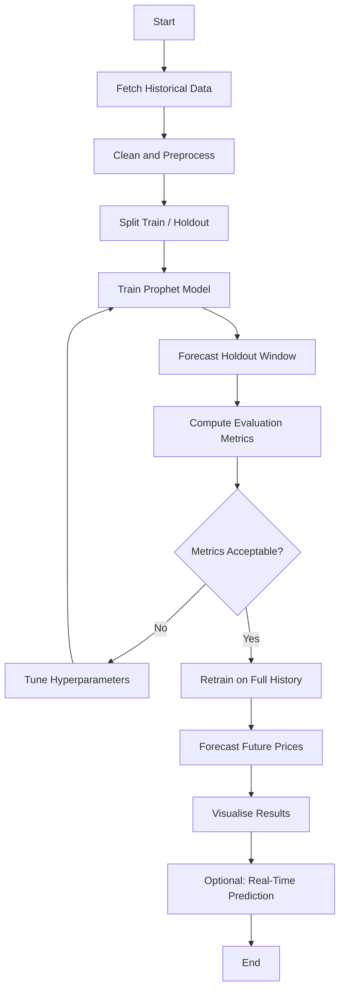

### Data Preprocessing Pipeline

```mermaid
flowchart LR
    A[Raw OHLCV Data] --> B[Reset Index]
    B --> C[Remove Timezone]
    C --> D[Keep Weekdays Only]
    D --> E[Sort by Date]
    E --> F[Drop Missing Close]
    F --> G[Prophet Frame: ds and y]
```

<br>

## 5. Data Collection and Preprocessing

### 5.1 Configuration

All configurable values are collected in one place. Replace the placeholder with any valid ticker symbol supported by your data provider.

```python
# ----------------------------------------------------------------------
# Configuration Template
# ----------------------------------------------------------------------
# EXTENSION POINT: Move this block to a config.yaml or .env file
#                  for multi-environment deployments.

TICKER              = "<YOUR_TICKER_SYMBOL>"   # e.g., an index or stock symbol
HISTORY_PERIOD      = "10y"                   # 1y, 2y, 5y, 10y, max
FORECAST_HORIZON    = 90                      # Trading days to forecast ahead
HOLDOUT_DAYS        = 60                      # Days reserved for evaluation
CONFIDENCE_INTERVAL = 0.80                    # Prophet uncertainty band

PROPHET_PARAMS = dict(
    changepoint_prior_scale = 0.05,
    holidays_prior_scale    = 5.0,
    seasonality_prior_scale = 10.0,
    changepoint_range       = 0.90,
    daily_seasonality       = False,
    weekly_seasonality      = True,
    yearly_seasonality      = True,
    interval_width          = CONFIDENCE_INTERVAL,
)
```

### 5.2 Configuration Reference

| Parameter | Default | Description |
|---|---|---|
| `TICKER` | Placeholder | Symbol for the index or stock to forecast. |
| `HISTORY_PERIOD` | `10y` | How much historical data to download. |
| `FORECAST_HORIZON` | `90` | Number of trading days to project forward. |
| `HOLDOUT_DAYS` | `60` | Last N trading days held back for evaluation. |
| `CONFIDENCE_INTERVAL` | `0.80` | Width of the prediction interval. |
| `changepoint_prior_scale` | `0.05` | Controls trend flexibility. Higher values allow sharper trend changes. |
| `holidays_prior_scale` | `5.0` | Strength of holiday effects. |
| `seasonality_prior_scale` | `10.0` | Strength of seasonal components. |
| `changepoint_range` | `0.90` | Fraction of history where trend changes are allowed. |

### 5.3 Fetching and Cleaning Data

```python
import pandas as pd
import yfinance as yf

def fetch_price_data(
    ticker: str = TICKER,
    period: str = HISTORY_PERIOD,
) -> pd.DataFrame:
    """
    Download daily OHLCV data and return a cleaned DataFrame.

    Cleaning steps:
      1. Reset the index so Date becomes a column.
      2. Remove timezone information (Prophet requires tz-naive dates).
      3. Keep Monday to Friday rows only.
      4. Sort ascending by date.
      5. Drop rows where the Close price is missing.

    Raises:
        RuntimeError: If no data is returned for the given ticker.
    """
    raw = yf.Ticker(ticker).history(period=period, auto_adjust=False)

    if raw is None or raw.empty:
        raise RuntimeError(
            f"No data returned for ticker '{ticker}'. "
            "Verify the symbol and your network connection."
        )

    df = raw.reset_index()
    df["Date"] = pd.to_datetime(df["Date"]).dt.tz_localize(None)
    df = df[["Date", "Open", "High", "Low", "Close", "Volume"]]
    df = df[df["Date"].dt.weekday < 5]
    df = df.sort_values("Date").reset_index(drop=True)
    df = df.dropna(subset=["Close"]).reset_index(drop=True)
    return df
```

### 5.4 Descriptive Statistics

After cleaning, print a compact statistical summary to sanity-check the data.

```python
def describe_prices(prices: pd.DataFrame) -> pd.DataFrame:
    """Return a transposed summary with an added range column."""
    summary = prices[["Open", "High", "Low", "Close", "Volume"]].describe().T
    summary["range"] = summary["max"] - summary["min"]
    return summary[["mean", "std", "min", "max", "range"]]
```

| Statistic | Meaning |
|---|---|
| `mean` | Average value over the period. |
| `std` | Standard deviation; measures volatility. |
| `min` | Lowest observed value. |
| `max` | Highest observed value. |
| `range` | Difference between max and min. |

### 5.5 Candlestick Chart with Moving Average

```python
import plotly.graph_objects as go

def plot_candlestick(prices: pd.DataFrame, sma_window: int = 20) -> go.Figure:
    """
    Build a candlestick chart with a simple moving average overlay.

    EXTENSION POINT: Add more traces here for RSI, MACD, or Bollinger Bands.
    """
    prices = prices.copy()
    prices[f"SMA_{sma_window}"] = prices["Close"].rolling(window=sma_window).mean()

    fig = go.Figure()
    fig.add_trace(go.Candlestick(
        x=prices["Date"],
        open=prices["Open"], high=prices["High"],
        low=prices["Low"],   close=prices["Close"],
        name="OHLC",
        increasing_line_color="#26A69A",
        decreasing_line_color="#EF5350",
    ))
    fig.add_trace(go.Scatter(
        x=prices["Date"], y=prices[f"SMA_{sma_window}"],
        mode="lines", name=f"SMA {sma_window}",
        line=dict(color="#FF9800", width=1.6),
    ))
    fig.update_layout(
        title=f"Daily Candlestick with SMA({sma_window})",
        xaxis_title="Date", yaxis_title="Price (INR)",
        template="plotly_white", height=560,
        xaxis_rangeslider_visible=False,
        legend=dict(orientation="h", yanchor="bottom", y=1.02, xanchor="right", x=1),
    )
    return fig
```

<br>

## 6. Model Training with Prophet

### 6.1 Preparing the Prophet Frame

Prophet requires exactly two columns: `ds` (date) and `y` (target value).

```python
def to_prophet_frame(df: pd.DataFrame) -> pd.DataFrame:
    """Convert a price DataFrame to Prophet's ds/y schema."""
    out = df[["Date", "Close"]].rename(columns={"Date": "ds", "Close": "y"})
    out["ds"] = pd.to_datetime(out["ds"])
    return out.reset_index(drop=True)
```

### 6.2 Train / Holdout Split

```python
def split_train_holdout(
    full: pd.DataFrame,
    holdout_days: int = HOLDOUT_DAYS,
) -> tuple[pd.DataFrame, pd.DataFrame]:
    """Split the full frame into training and holdout slices."""
    train = full.iloc[:-holdout_days].reset_index(drop=True)
    holdout = full.iloc[-holdout_days:].reset_index(drop=True)
    return train, holdout
```

| Slice | Purpose |
|---|---|
| Train | Used to fit the model. |
| Holdout | Used only for evaluation; never seen during training. |

### 6.3 Building and Fitting the Model

```python
from prophet import Prophet

def build_and_fit(df_train: pd.DataFrame) -> Prophet:
    """
    Build and fit a Prophet model.

    Indian country holidays are added so that the model accounts for
    NSE trading holidays such as Diwali, Holi, and Independence Day.

    EXTENSION POINT: Add custom regressors here (e.g., crude oil prices,
                     USD/INR exchange rate, or sector indices).
    """
    model = Prophet(**PROPHET_PARAMS)
    model.add_country_holidays(country_name="IN")
    model.fit(df_train)
    return model
```

| Component | Effect |
|---|---|
| Trend | Captures long-term direction of the index. |
| Weekly seasonality | Captures recurring day-of-week patterns. |
| Yearly seasonality | Captures annual cycles such as fiscal-year effects. |
| Indian holidays | Adjusts forecasts around market holidays. |
| Changepoints | Detect shifts in trend direction. |

<br>

## 7. Forecast Generation

### 7.1 Holdout Forecast

```python
def forecast_window(
    model: Prophet,
    periods: int,
) -> pd.DataFrame:
    """Generate a business-day future frame and predict over it."""
    future = model.make_future_dataframe(periods=periods, freq="B")
    future = future[future["ds"].dt.weekday < 5]
    return model.predict(future)
```

### 7.2 Forward Forecast on Full History

After the holdout evaluation is complete, retrain on the entire dataset and generate the forward-looking forecast.

```python
def build_forward_forecast(
    full: pd.DataFrame,
    horizon: int = FORECAST_HORIZON,
) -> tuple[Prophet, pd.DataFrame]:
    """Retrain on full history and return the model and forward-only forecast."""
    model_full = build_and_fit(full)
    forecast = forecast_window(model_full, horizon)
    last_known = full["ds"].max()
    future_only = forecast[forecast["ds"] > last_known].copy()
    return model_full, future_only
```

### 7.3 Forecast Output Table

| Column | Description |
|---|---|
| `Date` | Forecast date in YYYY-MM-DD format. |
| `Forecast` | Point estimate (`yhat`). |
| `Lower Bound` | Lower edge of the confidence interval. |
| `Upper Bound` | Upper edge of the confidence interval. |

<br>

## 8. Model Evaluation

### 8.1 Metric Definitions

| Metric | Full Form | Interpretation |
|---|---|---|
| MAE | Mean Absolute Error | Average absolute difference in price units. Lower is better. |
| MSE | Mean Squared Error | Average squared difference; penalises large errors. Lower is better. |
| RMSE | Root Mean Squared Error | Square root of MSE; same units as price. Lower is better. |
| MAPE | Mean Absolute Percentage Error | Average error as a percentage of actual price. Lower is better. |
| DirAcc | Directional Accuracy | Percentage of correctly predicted up/down movements. Higher is better. |

### 8.2 Metric Implementation

```python
import numpy as np
from sklearn.metrics import mean_absolute_error, mean_squared_error

def mean_absolute_percentage_error(y_true, y_pred) -> float:
    """MAPE expressed as a percentage."""
    y_true, y_pred = np.asarray(y_true), np.asarray(y_pred)
    mask = y_true != 0
    if mask.sum() == 0:
        return float("nan")
    return float(np.mean(np.abs((y_true[mask] - y_pred[mask]) / y_true[mask])) * 100)

def directional_accuracy(y_true, y_pred) -> float:
    """Percentage of bars where the up/down direction was predicted correctly."""
    y_true, y_pred = np.asarray(y_true), np.asarray(y_pred)
    if len(y_true) < 2:
        return float("nan")
    actual_dir = np.sign(np.diff(y_true))
    pred_dir   = np.sign(np.diff(y_pred))
    return float(np.mean(actual_dir == pred_dir) * 100)

def metric_report(y_true, y_pred) -> dict:
    """Return MAE, MSE, RMSE, MAPE, and DirAcc in one dictionary."""
    mae  = mean_absolute_error(y_true, y_pred)
    mse  = mean_squared_error(y_true, y_pred)
    return {
        "MAE": mae,
        "MSE": mse,
        "RMSE": float(np.sqrt(mse)),
        "MAPE (%)": mean_absolute_percentage_error(y_true, y_pred),
        "DirAcc (%)": directional_accuracy(y_true, y_pred),
    }
```

### 8.3 Aligning Actuals and Predictions

Always merge on the `ds` column before computing metrics. This prevents silent length mismatches when the model skips non-trading days.

```python
def evaluate_holdout(
    holdout: pd.DataFrame,
    forecast_holdout: pd.DataFrame,
) -> tuple[pd.DataFrame, dict]:
    """Merge actuals with predictions and compute the metric report."""
    eval_df = holdout.merge(
        forecast_holdout[["ds", "yhat", "yhat_lower", "yhat_upper"]],
        on="ds", how="left",
    ).dropna()
    metrics = metric_report(eval_df["y"], eval_df["yhat"])
    return eval_df, metrics
```

### 8.4 Holdout Forecast Chart

```python
def plot_holdout(eval_df: pd.DataFrame, confidence: float = CONFIDENCE_INTERVAL) -> go.Figure:
    """Plot actual vs predicted values over the holdout window."""
    fig = go.Figure()
    fig.add_trace(go.Scatter(
        x=eval_df["ds"], y=eval_df["y"],
        mode="lines+markers", name="Actual",
        line=dict(color="#1E88E5", width=2),
    ))
    fig.add_trace(go.Scatter(
        x=eval_df["ds"], y=eval_df["yhat"],
        mode="lines+markers", name="Predicted",
        line=dict(color="#E53935", width=2, dash="dash"),
    ))
    fig.add_trace(go.Scatter(
        x=pd.concat([eval_df["ds"], eval_df["ds"][::-1]]),
        y=pd.concat([eval_df["yhat_upper"], eval_df["yhat_lower"][::-1]]),
        fill="toself", fillcolor="rgba(229,57,53,0.15)",
        line=dict(color="rgba(0,0,0,0)"),
        name=f"{int(confidence * 100)}% Prediction Interval",
    ))
    fig.update_layout(
        title="Holdout Forecast",
        xaxis_title="Date", yaxis_title="Price (INR)",
        template="plotly_white", height=520,
        legend=dict(orientation="h", yanchor="bottom", y=1.02, xanchor="right", x=1),
    )
    return fig
```

### 8.5 Full-History Chart with Forecast

```python
def plot_full_forecast(
    full: pd.DataFrame,
    future_only: pd.DataFrame,
    horizon: int = FORECAST_HORIZON,
    confidence: float = CONFIDENCE_INTERVAL,
) -> go.Figure:
    """Plot historical actuals, forward forecast, and confidence band."""
    last_known = full["ds"].max()
    fig = go.Figure()
    fig.add_trace(go.Scatter(
        x=full["ds"], y=full["y"],
        mode="lines", name="Actual (History)",
        line=dict(color="#1E88E5", width=1.8),
    ))
    fig.add_trace(go.Scatter(
        x=future_only["ds"], y=future_only["yhat"],
        mode="lines", name="Forecast",
        line=dict(color="#E53935", width=2),
    ))
    fig.add_trace(go.Scatter(
        x=pd.concat([future_only["ds"], future_only["ds"][::-1]]),
        y=pd.concat([future_only["yhat_upper"], future_only["yhat_lower"][::-1]]),
        fill="toself", fillcolor="rgba(229,57,53,0.15)",
        line=dict(color="rgba(0,0,0,0)"),
        name=f"{int(confidence * 100)}% Prediction Interval",
    ))
    fig.add_shape(
        type="line",
        x0=last_known, x1=last_known,
        y0=0, y1=1, yref="paper",
        line=dict(color="Gray", width=1, dash="dot"),
    )
    fig.update_layout(
        title=f"Full History and {horizon}-Day Forecast",
        xaxis_title="Date", yaxis_title="Price (INR)",
        template="plotly_white", height=560,
        legend=dict(orientation="h", yanchor="bottom", y=1.02, xanchor="right", x=1),
    )
    return fig
```

### 8.6 Component Plots

Prophet exposes the decomposed components (trend, weekly, yearly, holidays). These help diagnose whether the model is capturing the right signals.

```python
def plot_components(model: Prophet, forecast: pd.DataFrame):
    """Return a matplotlib figure with trend and seasonality breakdowns."""
    fig = model.plot_components(forecast)
    fig.suptitle("Prophet Components: Trend, Weekly, Yearly", y=1.02, fontsize=14)
    fig.tight_layout()
    return fig
```

<br>

## 9. Real-Time Prediction

Real-time prediction is optional and intended for intraday monitoring. The function below fetches the latest bar and runs the trained model on a one-step-ahead future frame.

```python
import time

def real_time_prediction(
    model: Prophet,
    ticker: str = TICKER,
    poll_seconds: int = 60,
) -> None:
    """
    Continuously print one-step-ahead predictions at a fixed interval.

    Stop with Ctrl+C. The function is designed as a monitoring loop,
    not as a trading signal generator.

    EXTENSION POINT: Replace the print statement with a call to your
                     alerting service, dashboard, or broker API.
    """
    try:
        while True:
            stock = yf.Ticker(ticker)
            _ = stock.history(period="1d")  # Warm up the data feed

            future = model.make_future_dataframe(periods=1, freq="B")
            forecast = model.predict(future)

            latest = forecast.iloc[-1]
            print(
                f"[{latest['ds']:%Y-%m-%d %H:%M}] "
                f"Predicted price: {latest['yhat']:.2f} INR "
                f"(range {latest['yhat_lower']:.2f} - {latest['yhat_upper']:.2f})"
            )
            time.sleep(poll_seconds)
    except KeyboardInterrupt:
        print("Real-time prediction stopped by user.")
```

> Important: This function assumes the model was trained on data up to the most recent trading day. For production use, retrain or refresh the model on a scheduled basis so that the forecast does not drift.

<br>

## 10. Main Execution Template

The entry point wires the modules together. Replace the placeholder ticker before running.

```python
if __name__ == "__main__":
    # 1. Fetch and clean
    prices = fetch_price_data()
    print(prices.tail())
    print(describe_prices(prices))

    # 2. Prepare and split
    full = to_prophet_frame(prices)
    train, holdout = split_train_holdout(full)

    # 3. Fit on training slice and evaluate on holdout
    model_holdout = build_and_fit(train)
    forecast_holdout = forecast_window(model_holdout, HOLDOUT_DAYS)
    eval_df, metrics = evaluate_holdout(holdout, forecast_holdout)

    # 4. Retrain on full history and forecast forward
    model_full, future_only = build_forward_forecast(full)

    # 5. Summary
    last_close = float(full["y"].iloc[-1])
    end_forecast = float(future_only["yhat"].iloc[-1])
    change_pct = (end_forecast - last_close) / last_close * 100

    print("Forecast Summary")
    print(f"Last close          : {last_close:,.2f} INR")
    print(f"Forecast horizon end: {end_forecast:,.2f} INR")
    print(f"Implied change      : {change_pct:+.2f}%")
    for name, value in metrics.items():
        print(f"{name:12s}: {value:,.2f}")
```

<br>

## 11. Roadmap for Future Development

The features below are planned enhancements. Each one is designed as a drop-in module so that existing templates continue to work.

| Feature | Purpose | Extension Point |
|---|---|---|
| Input validation | Reject invalid tickers and periods before fetching data. | Wrap `fetch_price_data` with a validator. |
| Customisable model parameters | Expose Prophet hyperparameters through a UI or config file. | Pass a `params` argument to `build_and_fit`. |
| Multiple ticker support | Compare several symbols on a single chart. | Loop over a ticker list in the main block. |
| Customisable plots | Allow users to set colours, line styles, and titles. | Add a `style` dictionary to each plot function. |
| Improved error handling | Provide clear feedback when the model fails to fit. | Catch `ValueError` inside `build_and_fit`. |
| Save plots | Export charts as PNG or JPEG. | Call `fig.write_image("output.png")`. |
| Export data | Save historical and forecast tables as CSV. | Call `future_only.to_csv("forecast.csv")`. |
| Technical indicators | Add MACD, RSI, and Bollinger Bands. | Extend the `plot_candlestick` trace list. |
| Real-time updates | Refresh the model on a schedule. | Wrap the main block in a `schedule` or `APScheduler` job. |
| Performance dashboard | Show metrics in a live panel. | Integrate with Streamlit or Dash. |

### Suggested Release Sequence

```mermaid
flowchart LR
    R1[Release 1: Core Forecast] --> R2[Release 2: Validation and Config]
    R2 --> R3[Release 3: Multi-Ticker and Indicators]
    R3 --> R4[Release 4: Export and Dashboard]
    R4 --> R5[Release 5: Real-Time Monitoring]
```

<br>

## 12. Conclusion

This document presented a complete, deployment-ready framework for forecasting Indian stock market data using Python and Prophet. The code is organised as small, testable functions with clearly marked extension points. Retail traders can use the pipeline to generate forward-looking price ranges and monitor model accuracy. Developers can extend the templates with new data sources, indicators, or dashboards without restructuring the codebase.

<br>

Key takeaways:

| Takeaway | Why It Matters |
|---|---|
| Keep configuration separate from logic. | Makes the pipeline reusable across tickers and environments. |
| Always evaluate on a holdout window. | Prevents overfitting and gives honest accuracy estimates. |
| Report MAE, RMSE, MAPE, and DirAcc together. | Each metric captures a different dimension of forecast quality. |
| Retrain on full history before the final forecast. | Uses the most recent data available for production output. |
| Design every function as a template. | Future features can be added without breaking existing behaviour. |

The templates in this guide are intentionally conservative. They favour clarity and correctness over complexity, which makes them suitable for educational content, internal tooling, and small-scale production deployments alike.

<br><br><br><br>
  
<h1 align="center">COMPREHENSIVE GUIDE TO DOCKER CONTAINERIZATION.</h1>

<br><br>

## Table of Contents
1. [Introduction to Containerization](#introduction)
2. [Docker Architecture and Components](#architecture)
3. [Docker vs. Virtual Machines: A Technical Comparison](#docker-vs-vms)
4. [Core Docker Concepts](#core-concepts)
5. [Docker Installation and Setup](#installation)
6. [Working with Docker Images](#images)
7. [Container Management and Operations](#containers)
8. [Docker Networking and Storage](#networking-storage)
9. [Docker Compose for Multi-Container Applications](#compose)
10. [Docker Security Best Practices](#security)
11. [Docker in CI/CD Pipelines](#cicd)
12. [Orchestration with Kubernetes](#kubernetes)
13. [Production Deployment Considerations](#production)
14. [Command Reference and Cheat Sheet](#cheatsheet)

 
## Introduction to Containerization {#introduction}

### The Problem: Environment Inconsistency
- Traditional software development faces the persistent challenge of environment inconsistency, commonly manifested as the "it works on my machine" syndrome. This occurs when applications behave differently across development, testing, and production environments due to variations in operating systems, libraries, dependencies, and configurations. Containerization addresses this fundamental issue by encapsulating applications with their complete runtime environment, ensuring consistent behavior regardless of the underlying infrastructure. The historical approach of manual environment replication is error-prone and time-consuming, often leading to deployment failures and extended troubleshooting cycles.

### What is Containerization?
- Containerization is a lightweight virtualization technology that packages applications along with their dependencies, libraries, configuration files, and runtime environment into self-contained, executable units called containers. Unlike traditional virtualization that virtualizes hardware, containers virtualize at the operating system level, sharing the host system's kernel while maintaining process isolation. This approach provides the benefits of virtualization—isolation, portability, and consistency—without the overhead of running multiple complete operating systems. Containers leverage kernel features like namespaces and control groups (cgroups) to create isolated execution environments that appear as discrete systems to applications while efficiently sharing host resources.

### The Evolution and Adoption of Docker
- Docker, initially released in 2013, revolutionized container technology by providing a standardized, developer-friendly platform for creating, deploying, and managing containers. While container concepts existed previously through technologies like LXC (Linux Containers), Docker simplified the process with intuitive tooling, a robust ecosystem, and a centralized registry (Docker Hub). The platform's rapid adoption transformed software development practices, enabling microservices architectures, DevOps methodologies, and cloud-native applications. Today, Docker serves as the de facto standard for containerization, supported by major cloud providers and integrated into modern development workflows across industries.

## Docker Architecture and Components {#architecture}

### Docker Engine: The Core Runtime
```mermaid
graph TD
    A[Docker Client] -->|REST API| B[Docker Daemon]
    B --> C[Containers]
    B --> D[Images]
    B --> E[Networks]
    B --> F[Storage]
    G[Registries<br/>Docker Hub/Private] --> B
```

- The Docker Engine represents the core runtime system that executes and manages containers on a host machine. It operates as a client-server application comprising three primary components: the Docker Daemon (dockerd), the REST API, and the Docker Client. The daemon runs persistently in the background, managing Docker objects such as images, containers, networks, and volumes. It listens for API requests and executes container operations, while the REST API exposes endpoints for programmatic interaction. The Docker Client provides the command-line interface that developers use to issue commands, which are then translated into API calls to the daemon. This architecture enables both local and remote management of Docker environments.

### Docker Objects: Building Blocks
- Docker utilizes several key objects that form the foundation of containerized applications. Images serve as read-only templates with instructions for creating containers, built from layered filesystems that enable efficient storage and distribution. Containers are runnable instances of images, providing isolated execution environments with writable layers for runtime changes. Networks facilitate communication between containers and external systems through various drivers (bridge, host, overlay, etc.). Volumes provide persistent data storage mechanisms that exist independently of container lifecycles. These objects work together to create portable, scalable application environments that can be managed programmatically through Docker's API.

### Docker Registry Ecosystem
- Docker registries function as repositories for storing and distributing Docker images, with Docker Hub serving as the default public registry containing official and community images. Organizations typically implement private registries (Docker Trusted Registry, Azure Container Registry, Amazon ECR, Google Container Registry) to maintain control over proprietary images and enhance security. Registries support image versioning through tags, enabling precise deployment of specific application versions. Image layers are stored efficiently across registries, with only unique layers being transferred during push/pull operations, optimizing bandwidth utilization and storage requirements.

## Docker vs. Virtual Machines: A Technical Comparison {#docker-vs-vms}

### Architectural Differences

| **Aspect** | **Docker Containers** | **Virtual Machines** |
|------------|----------------------|---------------------|
| **Virtualization Level** | OS-level (shared kernel) | Hardware-level (hypervisor) |
| **Isolation** | Process-level (namespaces, cgroups) | Full OS isolation |
| **Startup Time** | Seconds to milliseconds | Minutes to seconds |
| **Performance** | Near-native (minimal overhead) | Higher overhead (5-15%) |
| **Resource Usage** | Lightweight (MBs) | Heavyweight (GBs) |
| **Portability** | High (consistent environment) | Moderate (hardware dependencies) |
| **Security** | Process isolation, shared kernel | Strong (complete separation) |
| **Image Size** | Typically MBs | Typically GBs |

### Use Case Analysis
- Virtual Machines excel in scenarios requiring complete operating system isolation, heterogeneous environments (running different OS types on same hardware), legacy application support, and strong security boundaries between workloads. They provide traditional infrastructure virtualization suitable for monolithic applications, compliance requirements mandating full separation, and environments where kernel customization is necessary. Docker containers thrive in microservices architectures, continuous integration/delivery pipelines, cloud-native applications, and development environments where rapid iteration, efficient resource utilization, and consistent deployment are prioritized. Many organizations implement hybrid approaches, running containers within VMs to balance isolation benefits with container efficiency.

### Resource Efficiency and Performance
- Docker containers demonstrate superior resource efficiency by sharing the host operating system kernel and eliminating redundant OS instances. This architecture reduces memory footprint, accelerates startup times (from minutes to seconds), and minimizes storage requirements through layered images and copy-on-write mechanisms. Performance overhead is typically 1-2% compared to native execution, whereas VMs incur 5-15% overhead due to hardware emulation and multiple kernel instances. However, containers' shared kernel approach introduces potential security considerations and compatibility constraints when applications require specific kernel versions or modifications.

## Core Docker Concepts {#core-concepts}

### The Dockerfile: Infrastructure as Code
- Dockerfiles serve as declarative blueprints for building Docker images, implementing infrastructure-as-code principles for environment definition. These text files contain sequential instructions that Docker executes to assemble an image, with each instruction creating a new layer in the filesystem. Key instructions include FROM (base image specification), RUN (command execution during build), COPY/ADD (file addition), ENV (environment variable definition), EXPOSE (network port declaration), and CMD/ENTRYPOINT (container execution commands). Dockerfiles enable version-controlled, reproducible environment builds that eliminate manual configuration drift and ensure consistent deployments across environments.

### Images: Immutable Application Packages
- Docker images represent immutable, read-only templates containing application code, dependencies, libraries, and configuration files required to run an application. Images utilize a union filesystem (Overlay2, aufs, devicemapper) that stacks multiple read-only layers, with each layer representing filesystem changes from specific Dockerfile instructions. This layered approach enables efficient storage, distribution, and caching—identical layers are shared across images, reducing storage requirements and download times. Images are identified by cryptographic hashes (SHA256) and human-readable tags (version labels), providing both integrity verification and semantic versioning.

### Containers: Runnable Application Instances
- Containers constitute runnable instances created from Docker images, providing isolated, writable environments for application execution. When a container launches, Docker adds a thin writable layer (container layer) atop the underlying image layers, employing copy-on-write semantics to preserve image immutability. This architecture enables multiple containers to share the same base image while maintaining independent runtime states. Containers leverage kernel namespaces for isolation (PID, network, mount, IPC, UTS, user) and control groups (cgroups) for resource limitation (CPU, memory, I/O), ensuring predictable performance and security boundaries between co-located applications.

## Docker Installation and Setup {#installation}

### Platform-Specific Installation

**Linux Installation:**
```bash
# Ubuntu/Debian
sudo apt-get update
sudo apt-get install docker-ce docker-ce-cli containerd.io

# RHEL/CentOS
sudo yum install -y yum-utils
sudo yum-config-manager --add-repo https://download.docker.com/linux/centos/docker-ce.repo
sudo yum install docker-ce docker-ce-cli containerd.io

# Verify installation
sudo systemctl start docker
sudo systemctl enable docker
sudo docker run hello-world
```

**Windows/macOS via Docker Desktop:**
- Docker Desktop provides an integrated solution for Windows and macOS, bundling Docker Engine, Docker CLI, Docker Compose, Kubernetes, and management UI. The installation includes lightweight virtual machines (Windows Hyper-V/Linux VM on Windows, HyperKit on macOS) that host the Docker daemon, enabling container execution on non-Linux systems. Docker Desktop simplifies networking configuration, volume management, and provides seamless filesystem integration between host and containers. Recent versions include Docker Scout for vulnerability scanning and Docker Build Cloud integration for accelerated builds.

### Post-Installation Configuration
- After installation, configure Docker for production readiness by creating a dedicated docker user group to enable non-root access (`sudo usermod -aG docker $USER`), adjusting daemon configuration (`/etc/docker/daemon.json`) for logging, storage drivers, and network settings, and implementing resource limits to prevent container resource exhaustion. Security hardening includes configuring TLS for remote API access, enabling user namespace remapping for additional isolation, and setting up audit logging for compliance requirements. Regular updates of Docker Engine and base images should be incorporated into maintenance procedures.

### Validation and Testing
- Validate Docker installation by executing `docker version` to verify client and server components, `docker info` to examine system configuration and resource utilization, and `docker run hello-world` to test basic container execution. For comprehensive validation, deploy a sample multi-container application using Docker Compose to verify networking, volume mounting, and inter-container communication. Performance testing should confirm that container startup times meet expectations and that resource isolation functions correctly under load conditions.

## Working with Docker Images {#images}

### Image Lifecycle Management

```mermaid
graph LR
    A[Dockerfile] -->|docker build| B[Local Image]
    B -->|docker tag| C[Tagged Image]
    C -->|docker push| D[Registry]
    D -->|docker pull| E[Deployment Host]
    E -->|docker run| F[Container]
    G[Base Images] --> A
```

- Docker image management follows a systematic lifecycle from creation through distribution to eventual deprecation. The process begins with Dockerfile authoring, proceeds to local image building (`docker build`), continues with tagging for version identification (`docker tag`), advances to registry upload for distribution (`docker push`), and culminates in deployment via image retrieval (`docker pull`) and container instantiation (`docker run`). Image maintenance includes regular vulnerability scanning, version updates for base images and dependencies, and archival of deprecated versions for rollback capabilities. Automated pipelines should incorporate image signing and verification to ensure integrity throughout the distribution chain.

### Building Efficient Images
- Optimize Docker image construction by implementing multi-stage builds that separate build-time dependencies from runtime requirements, significantly reducing final image size. Leverage .dockerignore files to exclude unnecessary files (node_modules, .git, build artifacts) from build context, accelerating build processes and minimizing security exposure. Order Dockerfile instructions strategically, placing frequently changing instructions (COPY for source code) after stable dependencies (RUN for package installation) to maximize layer caching. Select minimal base images (Alpine Linux, distroless images) that provide essential functionality without unnecessary packages, reducing attack surface and deployment footprint.

### Security Scanning and Vulnerability Management
- Integrate security scanning into the image build pipeline using Docker Scout, Trivy, or Clair to identify vulnerabilities in base images and dependencies. Scanning tools analyze image layers against vulnerability databases (NVD, vendor advisories), categorizing issues by severity (CRITICAL, HIGH, MEDIUM, LOW) and providing remediation guidance. Implement automated scanning policies that block deployment of images with critical vulnerabilities while allowing exceptions with documented justification. Regularly update base images and dependencies to incorporate security patches, and maintain a software bill of materials (SBOM) for audit compliance and vulnerability impact assessment.

## Container Management and Operations {#containers}

### Container Lifecycle Operations

| **Operation** | **Command** | **Description** |
|--------------|-------------|-----------------|
| **Create** | `docker create` | Creates container without starting |
| **Start** | `docker start` | Starts existing container |
| **Run** | `docker run` | Creates and starts container |
| **Stop** | `docker stop` | Graceful shutdown (SIGTERM) |
| **Kill** | `docker kill` | Forceful termination (SIGKILL) |
| **Pause** | `docker pause` | Suspends container processes |
| **Unpause** | `docker unpause` | Resumes suspended container |
| **Restart** | `docker restart` | Stops then starts container |
| **Remove** | `docker rm` | Deletes stopped container |

- Container lifecycle management encompasses creation, execution, monitoring, and termination of container instances. The `docker run` command combines creation and startup, accepting numerous flags for resource limits, network configuration, volume mounting, and environment variables. Graceful shutdown via `docker stop` allows applications to complete transactions and clean up resources, while `docker kill` provides immediate termination for unresponsive containers. Container removal (`docker rm`) eliminates stopped containers, with the `-v` flag removing associated anonymous volumes to prevent storage leakage.

### Resource Management and Limits
- Docker provides granular control over container resource allocation through cgroups, preventing noisy neighbor issues and ensuring predictable performance. CPU limits can be specified as shares (relative weighting), periods/quota (absolute limits), or CPU set restrictions (specific cores). Memory limits enforce hard boundaries with optional swap allocations, while memory reservation guarantees minimum availability. I/O throttling restricts disk and network bandwidth usage. These limits should be configured based on application profiling, with monitoring to adjust allocations as workload patterns evolve. Kubernetes provides more sophisticated resource management with Quality of Service classes (Guaranteed, Burstable, BestEffort).

### Monitoring and Debugging
- Effective container monitoring employs multiple approaches: `docker stats` provides real-time resource utilization metrics, `docker logs` retrieves stdout/stderr output with timestamp and stream options, `docker events` streams system events for audit trails, and `docker top` displays running processes within containers. For production environments, integrate with centralized logging (ELK stack, Loki) and monitoring (Prometheus, Datadog) solutions that aggregate metrics across containers and hosts. Debugging techniques include interactive shell access (`docker exec -it container sh`), container inspection (`docker inspect`), filesystem exploration (`docker diff`), and network troubleshooting (`docker network inspect`).

## Docker Networking and Storage {#networking-storage}

### Network Models and Configuration

**Docker Network Drivers:**
- **Bridge**: Default network driver providing NAT isolation, suitable for single-host container communication
- **Host**: Removes network isolation, containers share host's network namespace
- **Overlay**: Enables multi-host networking for Swarm clusters, using VXLAN encapsulation
- **Macvlan**: Assigns MAC addresses to containers, making them appear as physical devices
- **None**: Disables all networking, useful for specialized security requirements

- Docker's networking subsystem provides flexible connectivity models for various deployment scenarios. Bridge networks offer simplicity and isolation for development environments, while overlay networks enable seamless communication across distributed container clusters. Network creation includes subnet specification, gateway configuration, and internal/external accessibility options. Docker's embedded DNS facilitates service discovery within user-defined networks, automatically resolving container names to IP addresses. For production deployments, implement network policies to restrict inter-container communication according to principle of least privilege.

### Persistent Storage Strategies

**Volume Management Commands:**
```bash
# Create and manage volumes
docker volume create app-data
docker volume ls
docker volume inspect app-data
docker volume prune  # Remove unused volumes

# Mount volumes in containers
docker run -v app-data:/var/lib/data app-image
docker run --mount source=app-data,target=/var/lib/data app-image
```

- Docker volumes provide persistent, shareable data storage that exists independently of container lifecycles, essential for stateful applications (databases, file stores). Named volumes offer managed storage with configurable drivers (local, NFS, cloud storage plugins), while bind mounts directly map host directories into containers. Volume drivers enable integration with enterprise storage systems and cloud providers. Implement volume backup strategies that account for application consistency requirements, using container-native backup tools or storage platform capabilities. For sensitive data, encrypt volumes at rest and manage access through appropriate permission models.

### Filesystem and Storage Drivers
- Docker supports multiple storage drivers (Overlay2, aufs, devicemapper, btrfs, zfs) that implement the union filesystem for layering images and managing container writable layers. Overlay2 serves as the recommended default for modern Linux kernels, providing performance efficiency and stability. Storage driver selection impacts I/O performance, memory usage, and stability characteristics, with recommendations varying by Linux distribution and workload type. Monitor storage driver metrics for excessive inode consumption, layer proliferation, and performance degradation, implementing cleanup procedures (`docker system prune`) as part of routine maintenance.

## Docker Compose for Multi-Container Applications {#compose}

### Compose File Structure and Syntax

**Example docker-compose.yml:**
```yaml
version: '3.8'
services:
  web:
    build: .
    ports:
      - "8080:80"
    environment:
      - DATABASE_URL=postgres://db:5432/app
    depends_on:
      - db
    networks:
      - app-network
    volumes:
      - ./app:/usr/src/app
  
  db:
    image: postgres:14
    environment:
      POSTGRES_PASSWORD: secret
    volumes:
      - postgres-data:/var/lib/postgresql/data
    networks:
      - app-network

volumes:
  postgres-data:

networks:
  app-network:
    driver: bridge
```

- Docker Compose employs YAML files to define multi-service applications, specifying service configurations, networks, volumes, and dependencies in a declarative format. The syntax supports environment variable substitution, extension fields for reuse, and conditional deployment profiles. Services define container specifications including build context, image sources, port mappings, environment variables, volume mounts, and resource constraints. Networks and volumes are declared at the root level and referenced by services, enabling shared infrastructure across containers. Compose files support multiple file merging for environment-specific configurations (docker-compose.override.yml).

### Development Workflow Integration
- Docker Compose significantly enhances development workflows by enabling single-command environment provisioning (`docker-compose up`), dependency management through service definitions, and consistent environment replication across team members. Developers can define development-specific configurations (bind mounts for code synchronization, debugging ports, development tooling) in override files that don't affect production builds. Integration with IDEs (Visual Studio Code Docker extension) provides graphical management and debugging capabilities. For testing, Compose creates isolated environments that can be provisioned and destroyed on demand, ensuring test consistency and simplifying continuous integration pipelines.

### Production Considerations
- While Docker Compose excels in development and testing environments, production deployments typically require orchestration platforms (Kubernetes, Docker Swarm) for high availability, scaling, and advanced lifecycle management. However, Compose files can serve as foundation specifications for production definitions, with tools like Kompose facilitating conversion to Kubernetes manifests. Production Compose deployments should implement health checks, logging configurations, resource limits, and restart policies. For limited production use cases, Docker Compose supports secrets management, config objects, and deployment constraints, though orchestration platforms offer more robust solutions for distributed applications.

## Docker Security Best Practices {#security}

### Security Principles and Implementation

**Defense in Depth Strategy:**
- **Host Security**: Harden host OS, minimize attack surface, regular patching
- **Image Security**: Use trusted base images, scan for vulnerabilities, sign images
- **Runtime Security**: Apply least privilege, use read-only filesystems, limit capabilities
- **Network Security**: Segment networks, encrypt traffic, implement firewalls
- **Orchestration Security**: Enable RBAC, audit logging, pod security policies

- Docker security follows a defense-in-depth approach, addressing risks at multiple layers from host infrastructure to application code. Begin with host hardening: minimize installed packages, implement mandatory access control (SELinux/AppArmor), and regularly update the kernel and Docker Engine. Image security requires using minimal base images from trusted sources, scanning for vulnerabilities during build and runtime, and signing images to verify integrity. Runtime security involves restricting container capabilities (--cap-drop), running as non-root users, and implementing read-only root filesystems where possible.

### Configuration Hardening
- Secure Docker daemon configuration by disabling legacy registry protocols (--disable-legacy-registry), enabling user namespace support for additional isolation, and configuring TLS for remote API access. Implement resource limits to prevent denial-of-service attacks through resource exhaustion. Utilize Docker's security options: --security-opt for AppArmor/SELinux profiles, --read-only for immutable containers, and --tmpfs for ephemeral temporary storage. Network segmentation through user-defined networks limits lateral movement, while encrypted overlay networks protect inter-node communication in clusters. Regular security audits should verify compliance with CIS Docker Benchmark recommendations.

### Secrets Management and Access Control
- Docker provides native secrets management through Docker Swarm secrets or Docker Compose secrets, storing sensitive data (passwords, API keys, certificates) encrypted at rest and transmitted securely to containers. For Kubernetes environments, utilize Secrets resources with appropriate encryption at rest. Implement role-based access control (RBAC) for Docker Enterprise or Kubernetes, granting minimal necessary permissions to users and service accounts. Audit logging should capture all Docker API calls, image pulls, and container lifecycle events for security monitoring and compliance reporting. Regularly rotate credentials and secrets, automating the process where possible.

## Docker in CI/CD Pipelines {#cicd}

### Pipeline Integration Patterns

**Sample CI/CD Pipeline with Docker:**
```mermaid
graph LR
    A[Code Commit] --> B[Build Stage]
    B --> C[Test Stage]
    C --> D[Security Scan]
    D --> E[Push to Registry]
    E --> F[Deploy to Staging]
    F --> G[Integration Tests]
    G --> H[Promote to Production]
    
    subgraph B [Build Stage]
        B1[Checkout Code]
        B2[Docker Build]
        B3[Unit Tests]
    end
    
    subgraph D [Security Stage]
        D1[Vulnerability Scan]
        D2[Compliance Check]
        D3[Image Signing]
    end
```

- Docker integrates seamlessly into CI/CD pipelines, enabling consistent environment provisioning at each stage. Build stages utilize Docker for reproducible builds, with multi-stage builds separating development dependencies from runtime images. Testing stages leverage Docker Compose to create isolated test environments with all dependent services, ensuring consistent test execution. Security scanning stages automatically analyze images for vulnerabilities before promotion. Deployment stages use infrastructure-as-code approaches, with Docker images serving as immutable deployment artifacts that progress through environment promotion (dev → staging → production).

### Build Optimization Strategies
- Optimize Docker builds within CI/CD pipelines by implementing layer caching strategies, using buildkit for parallel layer building, and leveraging Docker Build Cloud for distributed build execution. Employ cache-from directives to reuse layers from previous builds, significantly reducing build times for incremental changes. Implement build arguments for environment-specific configurations while maintaining image consistency. Use .dockerignore files to minimize build context size, accelerating context transfer in remote build environments. For large monorepos, consider selective context building or separate image builds for independent components.

### Deployment Automation
- Automate Docker deployment through infrastructure-as-code tools (Terraform, CloudFormation) that provision host infrastructure, container orchestration platforms, and supporting services. Implement blue-green or canary deployment strategies using orchestration platform features (Kubernetes deployments, service meshes) to minimize downtime and risk. Automate rollback procedures that revert to previous known-good images when health checks fail. Monitoring integration should provide deployment verification through synthetic transactions, real-user monitoring, and business metrics correlation. Post-deployment, automated cleanup should remove unused images and containers to conserve resources.

## Orchestration with Kubernetes

### Kubernetes Architecture Overview

**Core Kubernetes Components:**
- **Control Plane**: API Server, Scheduler, Controller Manager, etcd
- **Nodes**: Kubelet, Container Runtime, Kube-Proxy
- **Pods**: Smallest deployable units, one or more containers
- **Services**: Network abstraction for pod access
- **Deployments**: Declarative updates for pods and replicasets
- **ConfigMaps/Secrets**: Configuration and sensitive data management

- Kubernetes extends Docker's container capabilities to distributed environments, providing automated deployment, scaling, and management of containerized applications. The architecture comprises a control plane that makes global decisions and nodes that run container workloads. Pods represent the smallest deployable units, encapsulating one or more containers with shared storage and network namespace. Controllers (Deployments, StatefulSets, DaemonSets) manage pod lifecycles according to declarative specifications. Services provide stable network endpoints for dynamic pod collections, while Ingress manages external access to services.

### Resource Definitions and Management
- Kubernetes uses YAML manifests to define resources declaratively, specifying desired state rather than imperative commands. Key resource types include Pods for container execution, Services for networking, Deployments for stateless applications, StatefulSets for stateful applications with stable identity, ConfigMaps for configuration data, and Secrets for sensitive information. Resource requests and limits ensure appropriate scheduling and prevent resource exhaustion. Horizontal Pod Autoscaling automatically adjusts replica counts based on metrics, while Vertical Pod Autoscaling modifies resource requests. Custom Resource Definitions (CRDs) extend the API for specialized workloads.

### Production Kubernetes Considerations
- Production Kubernetes deployments require careful planning around high availability, disaster recovery, security, and operational management. Implement multi-node control planes with etcd clustering for high availability. Configure pod anti-affinity rules to distribute workloads across failure domains. Establish backup procedures for etcd data and persistent volumes. Security measures include network policies for pod communication restrictions, pod security policies/admission controllers, RBAC for access control, and regular vulnerability scanning of container images. Monitoring should aggregate metrics, logs, and traces across the cluster with alerting for abnormal conditions.

## Production Deployment Considerations {#production}

### Infrastructure Requirements

**Production Docker Host Requirements:**
- **Hardware**: Adequate CPU, memory, and I/O capacity with redundancy
- **Operating System**: Minimal, security-hardened Linux distribution
- **Networking**: Low latency, sufficient bandwidth, network segmentation
- **Storage**: High-performance, redundant storage with backup capabilities
- **Monitoring**: Comprehensive metrics collection and alerting
- **Security**: Regular patching, intrusion detection, audit logging

- Production Docker deployments require robust infrastructure designed for availability, performance, and security. Host systems should employ enterprise-grade hardware with redundant components, running minimal, security-hardened operating systems. Network architecture must support container communication patterns with appropriate bandwidth, latency, and segmentation. Storage systems should provide high performance for stateful workloads with snapshot and replication capabilities. Implement infrastructure monitoring that captures host metrics, container performance, and application health indicators. Security infrastructure must include vulnerability scanning, intrusion detection, and comprehensive audit logging.

### High Availability and Disaster Recovery
- Achieve high availability through container replication across multiple hosts, with orchestration platforms automatically rescheduling containers during host failures. Implement health checks that accurately reflect application readiness and liveness, enabling automatic recovery from transient failures. Load balancing distributes traffic across container instances, with gradual rollout capabilities for updates. Disaster recovery plans should include regular backups of persistent volumes, configuration state, and etcd data (for Kubernetes), with documented recovery procedures tested periodically. Geographic distribution protects against site failures, though introduces complexity for data consistency and latency.

### Performance Optimization
- Performance optimization begins with appropriate resource allocation based on application profiling, avoiding both overallocation (wasted resources) and underallocation (performance degradation). Implement quality of service classes to prioritize critical workloads. Storage performance tuning includes selecting appropriate storage drivers, optimizing mount options, and implementing caching where beneficial. Network performance optimization involves choosing appropriate network plugins, tuning kernel parameters, and implementing service meshes for advanced traffic management. Regular performance testing under load identifies bottlenecks before they impact production users, enabling proactive optimization.

## Command Reference and Cheat Sheet

### Essential Docker Commands

| **Category** | **Command** | **Description** |
|-------------|-------------|-----------------|
| **System** | `docker version` | Show Docker version |
| **System** | `docker info` | Display system information |
| **System** | `docker system prune` | Remove unused data |
| **Images** | `docker images` | List images |
| **Images** | `docker build -t name .` | Build image |
| **Images** | `docker rmi image` | Remove image |
| **Containers** | `docker ps` | List running containers |
| **Containers** | `docker run -it image` | Run container interactively |
| **Containers** | `docker exec -it container sh` | Execute command in container |
| **Containers** | `docker logs container` | View container logs |
| **Networking** | `docker network ls` | List networks |
| **Networking** | `docker network inspect` | Inspect network |
| **Volumes** | `docker volume ls` | List volumes |
| **Registry** | `docker pull image` | Pull image from registry |
| **Registry** | `docker push image` | Push image to registry |

### Docker Compose Commands

| **Command** | **Description** |
|------------|-----------------|
| `docker-compose up` | Start services |
| `docker-compose up -d` | Start services detached |
| `docker-compose down` | Stop and remove services |
| `docker-compose ps` | List services |
| `docker-compose logs` | View service logs |
| `docker-compose exec service cmd` | Execute command in service |
| `docker-compose build` | Build service images |
| `docker-compose config` | Validate and view config |
| `docker-compose pull` | Pull service images |
| `docker-compose restart` | Restart services |

### Advanced Operations
- For production troubleshooting: `docker stats` provides real-time container metrics, `docker events` streams system events, and `docker diff` shows filesystem changes. Resource management includes `docker update` to modify container constraints without restart. Swarm mode commands (`docker swarm init`, `docker service create`) manage clustered deployments. Docker Buildx enables advanced build features including multi-architecture images. Context management (`docker context`) facilitates switching between local and remote Docker environments. Experimental features should be evaluated in non-production environments before deployment.

### Best Practices Summary
- Adopt infrastructure-as-code principles for reproducible environments. Implement security scanning throughout the container lifecycle. Use minimal base images to reduce attack surface. Configure resource limits to ensure predictable performance. Implement comprehensive logging and monitoring. Regularly update images and dependencies. Use orchestration for production workloads. Design stateless applications when possible, with external persistence for state. Test failure scenarios to ensure resilience. Document deployment procedures and recovery plans. Continuously evaluate new Docker features and security recommendations.

 
## Conclusion

Docker containerization represents a fundamental shift in how applications are developed, shipped, and deployed, providing consistency across environments from developer laptops to production clusters. By mastering Docker fundamentals—images, containers, Dockerfiles, networking, and storage—developers and operators can build robust, portable applications. Advanced topics including security hardening, orchestration with Kubernetes, and production deployment considerations ensure containerized applications meet enterprise requirements for reliability, security, and performance.

The Docker ecosystem continues to evolve with new tools and capabilities, but the core principles of containerization remain constant: encapsulation, isolation, portability, and efficiency. Organizations adopting Docker should focus on establishing patterns and practices that leverage these principles while adapting to their specific operational requirements. As container technology matures, it forms the foundation for cloud-native architectures that enable rapid innovation and resilient systems at scale.

For continued learning, explore Docker's official documentation, participate in community forums, and experiment with sample applications to build practical experience. The journey from container novice to production expert requires both conceptual understanding and hands-on practice, but delivers significant benefits in development velocity, deployment reliability, and operational efficiency.


<br><br><br><br> 
