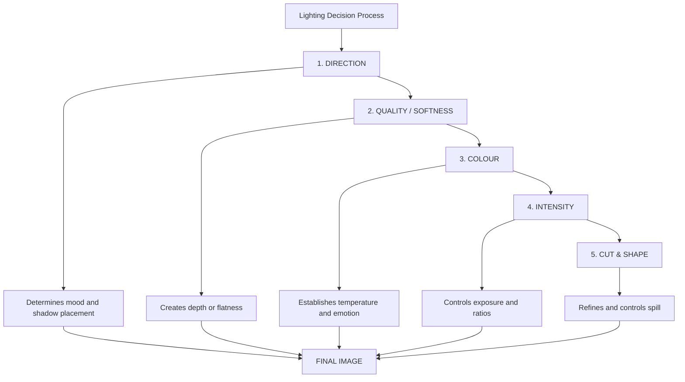
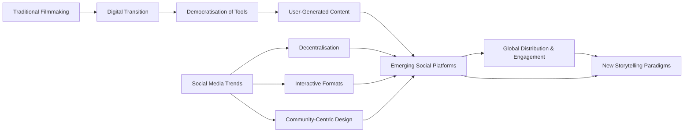

    
 
<h1 align="center">MASTERCLASS IN EPIC CINEMATOGRAPHY.</h1>

    

    

  

## INTRODUCTION: THE JOURNEY FROM FAN TO FILMMAKER

Every great cinematographer starts exactly where you are right now. The moment you decide to pick up a camera and shoot something, no matter how small or imperfect, you transform from a spectator into a creator. This masterclass is designed for absolute beginners who dream of creating visuals that feel legendary, immersive, and emotionally powerful.

Cinematography is not about owning expensive equipment or mastering every technical detail. It is the art of telling stories through light, composition, movement, and colour. The greatest filmmakers share one common trait: they serve the story first. A beautifully lit shot means nothing if it does not help the audience feel something. This guide will walk you through every essential concept, from the basic building blocks of a shot to advanced lighting techniques, all explained in clear, simple language.

By the end of this masterclass, you will understand how to think like a cinematographer, how to make creative choices that serve your narrative, and how to practice effectively even when you are working alone. Let us begin the journey toward creating images that stay with the audience forever.

 

## SECTION 1: THE FUNDAMENTAL BUILDING BLOCKS

### 1.1 Understanding the Language of Film

Before you can create epic visuals, you must understand the basic vocabulary of filmmaking. Just as a writer learns letters, words, and sentences, a cinematographer learns frames, shots, and scenes.

| Term | Definition | Why It Matters |
|------|------------|-----------------|
| Frame | A single still image; the basic unit of a moving picture | Every decision you make lives inside this boundary |
| Shot | One continuous recording from "action" to "cut" | This is your primary tool for storytelling |
| Scene | A unit of story in continuous time and location | Multiple shots combine to create a scene |
| Sequence | A series of scenes connected by a unified idea | This is how you build larger narrative moments |
| Montage | A series of short shots edited to condense time or information | Useful for showing progress, passage of time, or emotional connections |
| Aspect Ratio | The proportional relationship between the frame's width and height | Different ratios create different emotional experiences |

A frame is the most basic unit of cinema, yet it holds infinite possibilities. Within that rectangular boundary, you decide what the audience sees and, more importantly, what they do not see. Every object, every shadow, every colour within the frame communicates something to the viewer. Legendary cinematographers understand that what you exclude is often as powerful as what you include. By carefully choosing the boundaries of your frame, you control the audience's focus and guide their emotional journey through your story. The frame is your canvas, and every element within it must earn its place. Nothing should be in the frame by accident.

A shot is the active recording between the moment the director calls "action" and the moment they call "cut." Each shot is an opportunity to reveal character, advance plot, or create mood. Beginner filmmakers often rush through their shots without considering their individual purpose. Every single shot should have a reason to exist. Ask yourself: What does this shot contribute that no other shot could? Does it show a reaction, establish a location, reveal a detail, or create tension? When every shot earns its place, your film becomes stronger as a whole. A shot that serves no purpose is a shot that should be cut. Never film a shot just because it looks cool.

A scene is constructed from multiple shots unified by time and location. Think of a scene as a complete dramatic unit with its own beginning, middle, and end. Within a scene, you might use wide shots to establish space, medium shots to show interaction, and close-ups to reveal emotion. The way you transition between these shots creates rhythm and pacing. A well-constructed scene feels effortless to watch because the visual choices support the emotional truth of the moment. When you plan your scenes, consider what each character is feeling and how your camera can make the audience feel that same emotion. Scenes are the building blocks of your narrative structure.

A sequence connects multiple scenes to express a larger idea or action. For example, a chase sequence might include scenes in a car, on foot, and in a building, all edited together to create rising tension. Sequences are where your storytelling power multiplies because you can show cause and effect across time and space. Legendary sequences stay in audience memory long after individual shots fade. To build effective sequences, think about the emotional arc you want to create and how each scene contributes to that arc. The sequence is where your film breathes and moves as a living entity rather than as disconnected moments.

Montage is a powerful technique where you compress time or information by showing a series of short shots. A training montage shows improvement over weeks in two minutes. A falling-in-love montage shows the development of a relationship through brief, meaningful moments. The key to effective montage is selecting the perfect few images that represent the entire journey. Each shot in a montage should feel like a poem's line, contributing to a larger emotional or narrative statement. When done well, montage creates efficiency and emotional impact simultaneously. Montage is the art of saying more with less, of letting the audience fill in the gaps between the images you provide.

Aspect ratio is the proportional relationship between your frame's width and height. Wider aspect ratios create a cinematic, expansive feel that draws the eye across the frame horizontally. Taller aspect ratios create intimacy and can make characters feel more confined or focused upon. The choice of aspect ratio is one of the first creative decisions you make because it affects every composition that follows. Different stories demand different aspect ratios. A sweeping landscape epic might demand width. A claustrophobic psychological drama might demand height. Your aspect ratio is not a technical afterthought; it is a storytelling choice that sets the stage for everything else.

### 1.2 Shot Sizes: Choosing How Close to Get

The distance between your camera and your subject dramatically changes how the audience feels. Closer shots create intimacy and intensity. Wider shots create context and scale.

| Shot Size | Abbreviation | Description | Emotional Effect |
|-----------|--------------|-------------|------------------|
| Extreme Wide Shot | EWS | Subject is very small within vast environment | Isolation, wonder, scale, awe |
| Long Shot | LS | Full subject with significant environment | Context, relationship to space |
| Wide Shot | WS | Full body with some surroundings | Action clarity, body language |
| Medium Long Shot | MLS | From knees up | Balance of action and expression |
| Medium Shot | MS | From waist up | Conversation, interaction, natural distance |
| Medium Close-Up | MCU | From chest up | Emotional connection, engagement |
| Close-Up | CU | Face or specific detail | Intimacy, importance, internal experience |
| Extreme Close-Up | ECU | Very small detail | Intensity, mystery, significance |

The extreme wide shot places your subject as a tiny figure within a massive environment. This shot tells the audience that the setting is as important as the character, if not more so. Use extreme wides to establish scale, to show characters overwhelmed by their circumstances, or to create a sense of wonder at the world you have built. The human eye naturally seeks out the figure in these shots, so composition remains important even when the subject appears small. Legendary extreme wides make the audience feel small alongside the character, creating shared vulnerability or awe. Do not overuse the extreme wide shot, as its power comes from contrast with closer shots. When you do use it, ensure your composition is strong enough to hold interest without relying on facial expression or dialogue.

The wide shot shows your subject's full body while still revealing the surrounding environment. This is often called a master shot because it can contain an entire scene's action from start to finish. Wide shots excel at showing physical performance, blocking, and spatial relationships between characters. When you film a conversation in wide shot, the audience watches body language and movement rather than facial expressions. This creates a different kind of engagement, more observational than emotional. Many beginner filmmakers abandon wide shots too quickly, but holding on a wide shot allows the audience to feel like they are watching real people in a real space. Wide shots are also excellent for action sequences because they clarify who is doing what to whom.

The medium shot, from waist up, is the workhorse of dialogue scenes. It shows enough of the body to communicate gesture and posture while bringing us close enough to read facial expressions. Medium shots feel natural because they approximate the distance of a normal conversation. When you cut between medium shots of two characters talking, the audience feels present in the room with them. The medium shot is safe, reliable, and effective, which is why it appears in almost every film. Do not avoid medium shots simply because they are common; they are common because they work. However, relying exclusively on medium shots can make your film feel like television rather than cinema. Vary your shot sizes within scenes to create visual rhythm and to emphasise emotional peaks.

The close-up is where cinema becomes truly magical. By filling the frame with a face, you invite the audience into that character's inner world. Every micro-expression, every shift in the eyes, every subtle tension becomes visible and meaningful. Close-ups demand strong performances because there is nowhere to hide. Legendary directors use close-ups sparingly so that when they arrive, they carry tremendous weight. A close-up after a series of wider shots signals to the audience: pay attention, this matters. The extreme close-up intensifies this effect, isolating a single eye, a hand trembling, or an object of significance. When you cut to a close-up, you are making a promise to the audience that what they are about to see is worth their full attention. Break that promise, and you lose their trust. Honour it, and you create moments they will never forget.

When choosing shot sizes, think about emotional distance as a spectrum. Wide shots create emotional distance, allowing the audience to observe objectively like a witness from across the street. Medium shots create conversational distance, as if the audience is standing in the room. Close-ups eliminate distance entirely, forcing empathy and connection as if the audience is inside the character's mind. By varying your shot sizes throughout a scene, you control how the audience feels moment by moment. A scene that starts wide and slowly moves closer as tension builds creates an almost physical sense of pressure. A sudden cut to extreme close-up can shock the audience into heightened awareness. Shot size is not just a technical choice; it is an emotional tool of immense power. Learn to wield it deliberately, and your storytelling will transform.

 

## SECTION 2: CAMERA ANGLES, HEIGHT, AND MOVEMENT

### 2.1 The Psychology of Camera Angles

Where you place your camera relative to your subject changes the power dynamic between the audience and the character. Every angle tells a different story.

| Angle Type | Description | Psychological Effect |
|------------|-------------|----------------------|
| Eye-Level | Camera level with subject's eyes | Neutral, natural, relatable, equal |
| High Angle | Camera looks down on subject | Diminishes power, creates vulnerability, pity |
| Low Angle | Camera looks up at subject | Increases power, creates dominance, heroism |
| Bird's-Eye View | Directly overhead | Detached, godlike, revealing, anonymous |
| Worm's-Eye View | Directly from below | Extreme power, disorientation, unease |
| Dutch Tilt | Camera tilted on its axis | Imbalance, unease, madness, intoxication |

The eye-level shot is your baseline neutral angle. When the camera sits at the same height as the character's eyes, the audience sees them as an equal. This angle creates relatability and normalcy. Most conversation scenes use eye-level shots because they feel natural and unobtrusive. However, even eye-level can be expressive if you consider the character's literal eye level. Filming a child from their eye level puts the audience in their world, making adult characters seem towering and imposing. Eye-level does not mean boring; it means honest. The emotional content of an eye-level shot comes entirely from performance and composition rather than from angle-induced power dynamics. When you want the audience to simply be with a character without judgment, eye-level is your angle.

The high angle shot looks down on a character, making them appear smaller, weaker, or more vulnerable. When you shoot from above, the audience feels a sense of superiority or pity toward the subject. High angles are perfect for moments of defeat, sadness, or when a character realises they are trapped or outmatched. The higher the angle, the more extreme the effect. An extreme high angle removes the character's face entirely, reducing them to a shape and making them anonymous. This can represent fate watching from above or the character's insignificance in a larger world. Use high angles when you want the audience to look down upon a character, whether with pity, judgment, or a godlike sense of overview.

The low angle shot looks up at a character, making them appear powerful, dominant, or heroic. When the camera sits below eye level, the character towers over us, and we feel small in comparison. Low angles are classic choices for villains, heroes, and any moment of triumph or intimidation. However, low angles can also create unease when used unexpectedly on a character we thought was harmless. The angle does not always match the character's actual power; it can suggest how they see themselves or how the story wants us to see them in that moment. A character shot from a low angle who then fails becomes more tragic because we saw them as larger than life before their fall. Use low angles when you want the audience to look up to a character, whether in admiration, fear, or awe.

The bird's-eye view looks straight down from directly overhead, removing the subject from their normal spatial context. This angle is the most detached and observational because it is not a perspective humans naturally experience. Bird's-eye views are excellent for showing patterns, revealing spatial relationships, or demonstrating the scale of a crowd or landscape. They can also represent a character's out-of-body experience or a moment of cosmic perspective. Because this angle is so unusual, it always draws attention to itself. Use it only when you want the audience to consciously notice the camera's position. A bird's-eye view should feel earned, as if the story has risen to a moment that demands this perspective. Reserve bird's-eye views for moments of revelation, transition, or when the audience needs to see the larger pattern that characters cannot see from ground level.

The Dutch tilt, also called the oblique angle, involves tilting the camera so the horizon line is not level. This creates immediate visual tension and signals that something is wrong. Dutch angles are common in horror, thriller, and psychological dramas because they reflect a character's disoriented or unstable mental state. A conversation shot with a Dutch angle tells the audience that this interaction is not normal or trustworthy. The world itself seems off-kilter, mirroring the character's internal experience. Use this technique sparingly because its power comes from contrast with level shots. If everything is tilted, nothing feels tilted. Save the Dutch tilt for moments of genuine disruption, madness, or moral uncertainty. A single Dutch angle in an otherwise level film will sear itself into the audience's memory because it represents the moment when everything changed.

### 2.2 Camera Movement: When and Why to Move

Movement is one of the most powerful tools in your cinematic vocabulary. A moving camera creates energy, reveals information, and guides attention. However, movement must always serve the story.

| Movement Type | Description | Best Used For |
|---------------|-------------|----------------|
| Static Shot | No camera movement | Stability, tension, observation, contemplation |
| Pan | Horizontal rotation from fixed point | Following action, revealing space, connecting elements |
| Tilt | Vertical rotation from fixed point | Revealing height, following vertical movement |
| Dolly / Push-In | Camera moves toward subject | Emotional intensification, importance, discovery |
| Pull-Out | Camera moves away from subject | Isolation, revelation, context, loss |
| Tracking Shot | Camera moves alongside subject | Following journey, immersion, exploration |
| Handheld | Unstabilised camera movement | Urgency, realism, chaos, intimacy |
| Steadicam / Gimbal | Smooth, stabilised movement | Graceful following, dreamlike exploration |
| Crane / Jib | Vertical or arcing movement | Grand reveal, scale, majesty, transcendence |

The static shot, where the camera does not move at all, is often the most powerful choice you can make. When the camera remains still, the audience's attention focuses entirely on what moves within the frame. Static shots create a sense of observation, as if we are watching real events unfold without any directorial interference. They can build tremendous tension because we cannot escape what is happening inside the frame. We are trapped with the characters, forced to witness their experience without the relief of camera movement. Many legendary scenes use static cameras to let performances breathe and to let audiences feel the weight of the moment. Do not assume that moving the camera always improves a shot. Sometimes, stillness is the boldest and most emotionally devastating choice you can make.

The push-in, where the camera moves slowly toward the subject, is one of cinema's most effective emotional intensifiers. As the subject grows larger in the frame, the audience feels drawn into their thoughts and feelings, as if the camera itself is leaning in to listen more closely. A slow push-in during a moment of realisation or decision tells the audience that this internal moment matters enormously. The speed of the push-in communicates the urgency of the emotion: a glacial push-in feels contemplative and weighty, while a faster push-in feels urgent and alarming. The reverse movement, the pull-out, creates distance and often signals a shift from personal to contextual. Pulling away from a character as they experience loss or discovery makes them feel smaller in their world, as if the universe is expanding beyond their personal tragedy.

Tracking shots, where the camera moves alongside a moving subject, immerse the audience in the character's journey. When the camera walks beside a character, we feel like we are walking with them, sharing their path and their perspective. This creates intimacy and shared experience. Tracking shots can also reveal environments gradually, turning space into a character itself that unfolds over time rather than being presented all at once. Long tracking shots demonstrate technical mastery but should never feel like showing off. The audience should be so absorbed in the story that they do not notice the camera movement at all. If a tracking shot calls attention to itself without serving the story, it has failed regardless of its technical achievement. A great tracking shot disappears into the story while still creating its emotional effect.

Handheld camera movement creates immediacy and controlled chaos. The slight shake and unpredictability of handheld shooting makes the audience feel like they are present in an uncontrolled, real situation rather than a staged one. War films, documentaries, and intimate dramas use handheld to create urgency and authenticity. The key to effective handheld is intentionality, not randomness. Random shaking is distracting and amateur, but controlled, purposeful instability creates tension and presence. Many cinematographers use a technique called breathing handheld where the camera has subtle, organic movement even during static moments, creating a sense of life and imperfection. Handheld can also be used sparingly within otherwise static scenes to mark moments of emotional or physical disruption. When a film transitions from smooth, controlled movement to handheld, the audience feels that something has fundamentally changed in the character's world. Use handheld to signal that control has been lost.

Crane and jib shots move the camera vertically or in grand arcs, creating a sense of scale and spectacle. When the camera rises to reveal a vast army, a beautiful landscape, or the true scope of a situation, the audience feels awe. Crane shots can also move from wide to close in a continuous motion, connecting environment to character in a single fluid movement that would otherwise require an edit. These shots require planning and equipment but create images that linger in memory long after the film ends. Even a small jib arm on a low budget can create crane-like movement that elevates your production value far beyond what a static tripod can achieve. The key is to reserve crane shots for moments that genuinely deserve their grandeur. A crane shot for an ordinary conversation will feel absurd. A crane shot for a moment of transcendence will feel earned and unforgettable. When the story rises to a higher level, let the camera rise with it.

 

## SECTION 3: THE ART AND SCIENCE OF LIGHTING

### 3.1 The Five Characteristics of Lighting

Lighting is the single most important factor in achieving cinematic imagery. You can have an amazing camera with the best lenses, but without good lighting, your footage will never look legendary. Understanding the five characteristics of lighting will transform how you approach every shot. These characteristics should be considered in a specific order to work efficiently and avoid wasted effort.

Direction is the most important lighting characteristic because it dictates the mood of your scene and takes the longest to adjust on set. Where you place your light relative to your subject determines where shadows fall and how the audience perceives the character's emotional state. Front lighting, where the light comes from behind the camera, creates flat, two-dimensional images with few shadows. Side lighting splits the face into light and shadow, creating drama and mystery that suggests inner conflict or hidden depths. Backlighting separates the subject from the background and creates beautiful rim highlights that make the subject pop. The direction you choose must serve the story you are telling at that specific moment. Always establish your direction first because changing it later will require repositioning every other light in your setup, wasting precious time on set.

Quality, also called softness, refers to how defined or undefined the edges of your shadows appear. Hard light creates sharp, well-defined shadows with a dramatic, often harsh feel that emphasises texture and creates tension. Soft light creates gentle transitions between light and shadow, which is generally more flattering and naturalistic for human faces. The size of your light source relative to your subject determines softness. A large source creates soft light that wraps around your subject. A small source creates hard light with sharp shadow edges. You can make any light softer by increasing its effective size through diffusion material or by moving your light closer to your subject. Quality is your second decision because it fundamentally affects how the audience perceives texture and depth. After you set direction, decide whether that direction should feel hard and dramatic or soft and gentle.

Colour is the third characteristic you should set, after direction and quality. Colour in lighting is controlled through colour temperature and through RGB colour mixing for creative effects. Lower Kelvin numbers produce warm, orange-tinted light that feels like household bulbs, firelight, or sunset. Higher Kelvin numbers produce cool, blue-tinted light that feels like daylight, moonlight, or overcast skies. Your camera's white balance setting tells the camera what colour should appear neutral white. By deliberately mismatching your white balance to your light sources, you can create warm or cool colour casts throughout your image that establish mood before the audience even consciously registers them. Colour should come after direction and quality because changing either of those characteristics will affect your exposure and may require you to adjust your colour intensity. Lock in your creative colour choices early, then refine them as needed.

Intensity refers to the brightness of your light. However, absolute brightness matters less than the ratios between different lights in your scene. The key-to-fill ratio describes how much brighter your main light is than your fill light on the shadow side of your subject. A 2:1 ratio creates subtle, natural modelling that feels realistic and gentle. An 8:1 ratio creates dramatic, high-contrast images that feel tense and stylised. The foreground-to-background ratio determines how much your subject pops from their environment. Generally, making your subject one to one-and-a-half stops brighter than the background creates natural separation while maintaining realism. Set your intensity after direction, quality, and colour because adjusting any of those three will change your exposure. Save intensity for fourth to avoid constantly re-measuring and re-adjusting your lights.

Cut and shape is the final characteristic, refined after you have set direction, quality, colour, and intensity. Using flags, nets, barn doors, and other tools, you shape the light to hit exactly where you want it and to stay away from where you do not want it. A flag placed between the light and the background can prevent spill that would otherwise brighten your background and reduce subject separation. The further your flag is from the light source, the cleaner and sharper the cut will be. When using diffusion, place your flags between the diffusion and your subject rather than between the light and diffusion. This gives you cleaner cuts without affecting the softness of your light. Shaping light is what separates professional cinematography from amateur work because it demonstrates control and intentionality. A professional can put light exactly where it belongs and nowhere else. An amateur lets light fall wherever physics sends it. Be the professional.

### 3.2 Lighting Directions and Their Emotional Impact

The placement of your key light relative to your subject creates dramatically different looks and feelings. Learning to recognise these patterns will transform how you watch movies and how you light your own scenes.

| Lighting Direction | Light Position | Nose Shadow Pattern | Emotional Feel |
|--------------------|----------------|---------------------|-----------------|
| Front Light | Behind or level with camera | No visible nose shadow | Flat, neutral, undramatic, news-like |
| Butterfly Light | High and in front | Butterfly shape under nose | Glamorous, flattering, powerful, heroic |
| Rembrandt Light | 45 degrees high and to side | Triangle of light on shadow cheek | Natural, three-dimensional, classic, artistic |
| Side Light | 90 degrees to subject | Half face lit, half shadow | Dramatic, mysterious, intense, conflicted |
| Edge / Kicker | Behind subject, 15-45 degrees off | No face light, rim only | Separation, depth, outline, silhouette |
| Backlight | Directly behind subject | No face light, silhouette | Mysterious, iconic, isolating, majestic |

Front lighting, where the light comes from behind the camera, is rarely used in professional cinematography because it eliminates depth and makes your image feel flat and two-dimensional. When you front-light a face, all shadows fall directly behind the features, removing the natural contours that give the face three-dimensional form. The subject looks wide, flat, and oddly artificial despite technically being well-exposed. Additionally, front lighting tends to splash onto the background behind your subject, making it harder to keep your background darker than your subject. There are specific occasions when front lighting works, such as for news broadcasts, certain commercial looks, or horror films where you want a character to look unnatural or disturbed. But for cinematic storytelling, you should generally avoid placing your light on the same axis as your camera.

Butterfly lighting places your key light high and directly in front of your subject, angled down to create a butterfly-shaped shadow under the nose. This lighting pattern is flattering on many faces because it emphasises cheekbones and creates shadows under the chin that slim the face while keeping the eyes bright and expressive. The nose shadow is small and centred, which draws attention upward to the eyes rather than down to the nose. Butterfly lighting also makes it easier to control light on the background because the light is pointing downward rather than straight ahead, naturally keeping spill off the background. However, this pattern can be challenging for subjects with deep eye sockets, as the downward angle can cast eye sockets into shadow, making the character look tired or sinister. A bounce board placed below the chin can fill these shadows while maintaining the butterfly pattern's overall structure.

Rembrandt lighting, named after the Dutch painter who used it extensively in his portraits, is one of cinema's most beloved lighting patterns because it looks both natural and artistic simultaneously. To achieve Rembrandt lighting, place your key light approximately 45 degrees to the side of your subject and 45 degrees above their eyeline, angled down toward the face. The signature feature of this pattern is a triangle of light that appears on the shadow side of the face, formed by the nose shadow connecting with the cheek shadow. This triangle should be no wider than the eye and no longer than the nose to achieve the classic Rembrandt look. The rest of the shadow side of the face remains dark but not completely black, creating depth while retaining detail. Rembrandt lighting naturally lights both sides of the face with a single source, creating depth and dimension that feels both honest and artistic.

Side lighting, where the light comes from 90 degrees to the subject, splits the face exactly in half between light and shadow. This dramatic pattern is perfect for moments of conflict, mystery, or moral ambiguity when a character is literally divided between two opposing forces. A character lit from the side feels split, as if they are wrestling with two sides of themselves or hiding something from the world. In practice, a pure 90-degree side light can create a shadow cast by the subject's own nose that extends across the lit half of the face in an unflattering way. To avoid this, pull your light slightly toward the camera, to about 80 degrees, which eliminates the distracting nose shadow while maintaining the dramatic split-light effect. Side lighting is common in film noir, westerns, and any genre dealing with moral complexity. The line between light and shadow literally cuts across the character, visualising their internal conflict in every frame.

Edge lighting and backlighting place the light behind the subject, creating rim highlights on the shoulders and head without illuminating the face directly. Edge lights wrap slightly around the subject's features from behind and to the side, creating a beautiful outline that separates dark hair from dark backgrounds. Pure backlights stay directly behind, creating a complete silhouette when no other lights are present. These lighting directions are almost always used in combination with other lights because they cannot expose the face on their own. Their purpose is separation: a bright rim light against a dark background makes the subject pop out in three dimensions, literally outlining them against their environment. When you watch a movie and see a beautiful halo of light around a character's hair and shoulders, you are seeing expert use of edge and backlighting.

### 3.3 Understanding Soft Light vs. Hard Light

The quality of your light dramatically affects the mood and perceived production value of your image. Soft light is generally more flattering and naturalistic, while hard light creates drama and edge. Neither is inherently better; they are different tools for different emotional goals.

| Light Quality | Shadow Edge | Source Size Relative to Subject | Best Used For |
|---------------|-------------|--------------------------------|----------------|
| Hard Light | Sharp, well-defined, distinct | Small source or far distance | Drama, horror, noir, texture, tension |
| Soft Light | Gradual, undefined, feathered | Large source or close distance | Beauty, naturalism, flattering portraits, romance |
| Diffused Light | Very soft, minimal umbra | Light passed through diffusion material | Extreme softness, even illumination, dreamlike |

Hard light creates sharp, well-defined shadows with a distinct, crisp edge between light and dark areas. The sun on a cloudless day produces hard light, as does a bare light bulb, an undiffused LED, or a spotlight from a distance. Hard light emphasises texture, wrinkles, pores, and every imperfection, which is why it is often used in horror films, dramas, and film noir to create harsh, uncomfortable, honest images that refuse to flatter the subject. The drama of hard light comes from the extreme contrast it creates: bright highlights fall off quickly into deep, dark shadows with little transition in between. To achieve hard light, use a small light source or place your source far from your subject. The smaller the source appears from your subject's perspective, the harder the light will be. Hard light also creates the longest, most dramatic shadows, which can be used as compositional elements themselves.

Soft light creates gentle, gradual transitions between light and shadow, with edges that blur and feather rather than cutting sharply. An overcast sky produces the softest light imaginable, with shadows so gentle they barely seem to exist. Light passing through a large diffusion frame also creates soft light, as does light bounced off a white wall or ceiling. Soft light is flattering to human skin because the large source wraps around the subject, filling in tiny surface imperfections and reducing their visibility from almost every angle. The shadows under the nose and chin become gentle suggestions rather than harsh lines, making the face appear smoother and more youthful. Soft light also wraps around objects, illuminating surfaces that hard light would miss entirely, creating a more complete, three-dimensional feel. To create soft light, use a large light source or place your source very close to your subject. Soft light is the foundation of most beauty, romance, and naturalistic cinematography.

The science of soft light involves understanding the umbra and penumbra of a shadow. The umbra is the dark center of a shadow where no light reaches at all from any angle. The penumbra is the fuzzy perimeter where some light reaches obliquely while other angles remain blocked. Hard light produces a large umbra with a very small, almost invisible penumbra, creating the sharp edge we associate with hard shadows. Soft light produces a small or nonexistent umbra with a very large, expansive penumbra, creating the gradual, feathered transition we associate with soft shadows. When you diffuse a light, you are effectively turning a small source into a large one by scattering its rays in many directions. The diffusion material becomes the new light source, and its size relative to your subject determines the softness. Understanding this principle helps you create soft light even with small fixtures by moving them close and adding diffusion.

You can control softness through several practical techniques on set. Moving a light closer to your subject makes it softer because its relative size increases from the subject's perspective. Moving a light farther away makes it harder because its relative size decreases. Adding diffusion material between the light and subject makes the light softer by scattering the beam and increasing the effective source size. Using a larger softbox or diffusion frame makes the light softer than using a smaller one because the source itself is physically larger. Bouncing light off a wall or ceiling creates very soft, ambient illumination because the wall becomes a massive source, sometimes several feet across. For the softest possible light, combine multiple techniques: use a large source, place it extremely close, and add heavy diffusion. This creates light so soft that shadows almost disappear entirely.

Every cinematographer develops preferences for light quality, but the best work often mixes hard and soft sources within the same scene for maximum depth and interest. A soft key light on the face creates flattering beauty and approachability, while a hard edge light creates crisp separation that cuts through the softness for definition. A hard backlight cuts through a soft overall illumination to create dramatic rim highlights that outline the subject against a dark background. The contrast between hard and soft sources within the same frame adds visual interest and depth that a single quality cannot achieve. Do not fall into the trap of believing that soft light is always better or more professional. Hard light has its place, and learning when to use each quality is a mark of growing expertise. Watch your favourite films and notice how they mix qualities within single shots.

 

## SECTION 4: COMPOSITION FOR CINEMATIC IMPACT

### 4.1 The Rules of Visual Arrangement

Composition is the arrangement of visual elements within your frame. Great composition guides the audience's eye, creates emotional responses, and makes your images feel intentional and artistic rather than accidental and amateur.

The rule of thirds is the most common compositional guideline, and it has survived for centuries because it works reliably for human visual perception. Imagine two horizontal lines and two vertical lines dividing your frame into nine equal rectangles. The four points where these lines intersect are natural focal points where the human eye instinctively wants to land. Placing your subject on one of these intersection points creates a more dynamic and interesting image than placing them in the exact center. The rule of thirds also applies to horizons: placing the horizon on the top third line emphasises the ground and foreground, making the earth the subject. Placing the horizon on the bottom third line emphasises the sky and atmosphere, making the heavens the subject. Breaking the rule of thirds by centering your subject can be powerful when used intentionally, but learn the rule before you break it. Centering creates formality, symmetry, and sometimes a sense of being trapped or confronted. Use the rule of thirds as your default, then break it when you have a reason.

Leading lines are natural or artificial lines within your frame that guide the audience's eye toward your subject or through your image along a path. Roads, hallways, staircases, bridges, tree branches, rivers, fence lines, and architectural features can all serve as leading lines when positioned thoughtfully. When you place your subject at the convergence point of multiple leading lines, you create a powerful visual magnet that pulls attention exactly where you want it from any starting point in the frame. Leading lines can also create a sense of journey or discovery, as the eye follows the line through space, uncovering the image gradually rather than seeing it all at once. Even chaotic, broken, or jagged lines can serve a purpose, creating unease, suggesting a disrupted world, or representing a character's fractured mental state. Be intentional about every line in your frame, asking whether it helps guide the eye toward your subject or pulls attention away.

Depth and layering transform a flat two-dimensional image into a window into a three-dimensional world. The most effective way to create depth is to include foreground, midground, and background elements in your frame, each at a different distance from the camera. The foreground element might be slightly out of focus, creating a frame within your frame and establishing physical space between the camera lens and the subject. The midground typically contains your main subject and is usually in sharp focus. The background provides context, environment, and atmosphere, and may be softer or darker than the subject. When all three layers are visible and separated by visible distance, the audience senses the space between them, creating a feeling of being present in a real, volumetric environment rather than watching a flat picture. Even in tight close-ups, you can create depth by placing your subject away from the background and adding subtle foreground elements like a shoulder, a hand, or an object near the lens. Depth is what makes cinema feel like cinema rather than like theatre.

Negative space is the empty or open area surrounding your main subject within the frame. Far from being wasted space that should be filled, negative space creates emotional context and visual breathing room that gives the subject significance. A subject surrounded by vast negative space feels lonely, isolated, overwhelmed, or small in their world, depending on the context. A subject with minimal negative space feels important, trapped, claustrophobic, or dominant because they fill the frame so completely. The balance between subject and negative space is a storytelling decision, not a technical error. In epic cinematography, negative space often conveys scale and wonder, making the audience feel the immensity of the world you have created while a single small figure navigates it. Do not fear empty space; learn to use it as actively as you use your subject. The space around a character tells you how they relate to their environment and whether they belong within it or are alien to it.

Headroom and look room are specific applications of negative space in shots featuring people. Headroom is the space between the top of the subject's head and the top edge of the frame. Too much headroom makes the subject feel disconnected, floating, or as if they are sinking in the frame. Too little headroom feels claustrophobic and oppressive, as if the frame itself is pressing down on the character. The rule of thirds often guides headroom, placing the subject's eyes on the top third line, which naturally creates appropriate headroom for most shots. Look room is the space in front of the subject's face in the direction they are looking or moving. When a character looks or moves toward one side of the frame, leaving space in that direction feels natural, allowing them room to look or move into. Placing the subject at the edge of the frame with no look room in the direction they face creates immediate tension and suggests confinement, obsession, or that something important exists behind them that they cannot see. Look room is active storytelling through composition alone. Use it to create comfort or tension as the scene demands.

### 4.2 Advanced Composition Techniques for Epic Imagery

Once you have mastered the fundamentals, you can explore compositional techniques that elevate your work from competent to legendary. These advanced methods create images that linger in the audience's memory long after the film ends.

| Technique | Description | Emotional Effect |
|-----------|-------------|-------------------|
| Frame Within a Frame | Subject enclosed by another shape | Focus, separation, voyeurism, intimacy |
| Symmetry | Mirroring elements on both sides of frame | Order, power, formality, obsession |
| Foreground Elements | Objects placed close to lens, often out of focus | Depth, intimacy, obstruction, mystery |
| One-Point Perspective | Lines converge on single central point | Grandeur, focus, journey, inevitability |
| Short Siding | Subject faces edge of frame with no look room | Tension, unease, mystery, confinement |

Frame within a frame uses elements in your environment to create a literal, physical frame around your subject within the larger frame of the shot. Doors, windows, archways, tree branches, mirrors, tunnels, and even other people positioned in the foreground can create this effect. The inner frame focuses the audience's attention on the subject by narrowing the visual field, while the outer frame provides context, environment, and atmosphere. Frame within a frame can also create a sense of voyeurism, as if the audience is watching from a hidden position, peeking through a keyhole or around a corner. This technique is particularly effective for moments of revelation, intimacy, or when a character is unaware they are being observed. When you see a character through a window frame or a doorway, you feel like you are glimpsing a private moment that you were not meant to see, which increases emotional engagement and tension.

Symmetry, where the left and right sides of the frame mirror each other almost exactly, creates images of power, order, formality, and sometimes psychological obsession. Certain legendary directors made symmetry a signature of their visual style because it creates a sense of control and intentionality that asymmetry cannot match. Symmetrical compositions feel intentional, almost architectural, making them perfect for moments of authority, ritual, ceremony, or when a character is imposing their will on their environment. However, symmetry can also feel cold, inhuman, or oppressive because real life is rarely perfectly balanced. Perfect symmetry suggests design rather than nature, intention rather than accident. Use symmetry when you want the audience to feel the weight of structure, tradition, or a character's controlling nature. Break symmetry when you want to introduce chaos, humanity, freedom, or emotional messiness.

Foreground elements add depth, intimacy, and sometimes obstruction to your compositions. By placing something close to the lens, you create a physical sense of space between the camera and the subject, as if the audience is looking past something to see the main action. The foreground element might be completely out of focus or partially in focus, depending on your storytelling needs and the distance from the lens. Foreground elements can also represent a character's perspective: a blurred shoulder in the foreground suggests we are watching from someone else's point of view, sharing their physical position in the scene. Environmental foreground elements like leaves, furniture, architectural details, or atmospheric effects make the world feel tangible, textured, and lived-in rather than like a sterile set. The simplest way to improve a flat, boring composition is to find something interesting to place in the foreground. A locked-off shot with no foreground feels like a photograph. The same shot with a branch, a railing, or a shoulder in the foreground feels like a point of view.

One-point perspective composition creates powerful images of journey, focus, and inevitability. By placing your subject at the convergence point of parallel lines, you create a natural vanishing point that draws the eye directly to the subject along the strongest possible visual path. This technique emphasises the subject's isolation or importance within their environment, because everything in the frame seems to point toward them. One-point perspective can also create a sense of destiny or inevitability, as if the subject is being pulled or drawn toward the center of the frame by forces beyond their control. The symmetry inherent in one-point perspective adds grandeur and formality, making even mundane locations feel significant and composed. For epic cinematography, one-point perspective shots of vast environments with a single small human figure at the center create unforgettable images of scale, wonder, and the human place within a larger universe.

Short siding, also called looking off-frame or facing the edge, places your subject at the edge of the frame facing toward the nearer edge rather than toward the open space of the frame. This violates the normal rule of providing look room in the direction of the subject's gaze, which creates immediate visual tension and psychological unease. Short siding suggests that the subject is trapped, confused, disoriented, or that something important exists off-screen behind them that they cannot see. The audience feels uncomfortable because they cannot see what the character is looking at, or they sense that the character is too close to the edge of their world with nowhere to go. Use short siding deliberately for moments of psychological distress, danger, mystery, or when a character is about to be surprised from behind. As with all rules, breaking the rule of look room effectively requires understanding why the rule exists in the first place and what emotional effect the violation creates. A short-sided shot should never feel like a mistake; it should feel like a choice that puts the audience on edge.

 

## SECTION 5: COLOUR AS A STORYTELLING TOOL

### 5.1 Understanding Colour Temperature and White Balance

Colour is not merely decorative; it is a powerful psychological tool that shapes how audiences feel about every moment in your film. Understanding colour temperature and white balance gives you control over the emotional temperature of every scene.

| Colour Temperature | Kelvin Range | Typical Sources | Emotional Association |
|--------------------|--------------|-----------------|----------------------|
| Warm White | 2000K - 3200K | Candles, firelight, household bulbs, sunrise/sunset | Intimacy, comfort, danger, romance, nostalgia |
| Neutral White | 3200K - 4500K | Studio fixtures, early morning, late afternoon | Balanced, natural, neutral, honest |
| Cool White | 4500K - 6500K | Daylight, overcast sky, fluorescent tubes | Clinical, cold, objective, alert |
| Blue Sky | 6500K - 10000K | Open sky, shade, blue hour, high altitude | Cold, isolated, melancholy, mystery, infinite |

Colour temperature is measured in Kelvin, with lower numbers appearing warmer and higher numbers appearing cooler. This might seem counterintuitive because we associate blue with cold and red with heat in everyday life, but the measurement comes from physics: as a theoretical black body radiator is heated, it glows red first at lower temperatures, then white, then blue at the highest temperatures. Your camera's white balance setting tells the camera what colour should appear as neutral white. When you set your camera to 3200K, you are telling it that 3200K light is pure white. Any light that is warmer will appear orange or amber. Any light that is cooler will appear blue or cyan. Understanding this relationship is fundamental to controlling the colour of your images intentionally rather than accepting whatever the camera decides. Colour temperature is not a technical nuisance to be corrected away; it is a creative tool to be wielded with intention.

Your brain automatically colour corrects the world around you without your conscious awareness, which is why a white piece of paper looks white whether you are standing in warm candlelight at 2000K or cool daylight at 5600K. Your brain knows the paper should be white, so it compensates your perception. Your camera does not have this ability unless you tell it what white should look like in each situation. This is why understanding white balance is essential for achieving consistent, intentional colour in your images. If you set your white balance incorrectly for your light sources, every image from that setup will have an unwanted colour cast that shifts your intended mood in directions you did not choose. Professional cinematographers choose their white balance deliberately to create specific moods, not just to achieve technical accuracy. They decide whether a scene should feel warm or cool and set their white balance to create that feeling, even if it means whites do not look purely white. Creative intention over technical accuracy, always.

You can create powerful emotional effects by deliberately mismatching your white balance to your light sources, a technique called off-balance or creative white balance. Setting your camera to 3200K while using 5600K daylight creates a cold, blue image that can suggest moonlight, winter, isolation, or a clinical, unwelcoming environment. Setting your camera to 5600K while using 3200K tungsten lights creates a warm, orange image that feels like sunset, candlelight, intimacy, or nostalgia. These mismatches are how filmmakers create the iconic looks associated with different times of day or emotional states without waiting for the actual sun to be in the right position. The key is consistency: once you establish a colour language for your scene, stick with it so the audience subconsciously learns what to expect from your visual world. A sudden shift in colour temperature can signal a shift in time, location, or psychological state. Used intentionally, white balance mismatch is a powerful storytelling tool. Used accidentally, it looks like a mistake. Be intentional.

Practical light sources within your frame should motivate the colour of your added film lights. If a lamp with a warm bulb appears in the shot, any additional light you add to illuminate the scene should have a similar colour temperature so the audience believes the lamp is providing the illumination. If sunlight streams through a window, your added light should match daylight colour temperature or slightly warmer to mimic sunlight bouncing off the floor and walls. If a character is standing under a fluorescent light, the scene should feel slightly green or cool. Mismatched colour temperatures create a world that feels false because our brains know that all light in a single physical environment should share similar characteristics. Motivated lighting that matches the colour of visible sources is the foundation of naturalistic cinematography. The audience may not consciously notice that your added light matches the lamp, but they will subconsciously feel that the scene is coherent and real. Violate this principle, and they will feel that something is wrong without knowing why. Motivate your colour, and your world will feel believable.

Colour contrast, using opposing colours within the same frame, creates visual excitement and directs attention to specific areas. Complementary colours create the most vibrant, energetic contrast when placed near each other. When your subject is warmer than your background, they naturally pop forward visually, appearing closer to the camera than the cooler background. When your background shifts to a complementary colour relative to your subject, the depth between layers increases dramatically. Many blockbuster films use a teal-and-orange colour palette because human skin tones naturally fall in the orange to amber range, while skies, shadows, and water naturally tend toward blue and teal. This combination creates automatic, effortless separation between subjects and their environments without additional lighting or production design. Understanding basic colour theory gives you a powerful tool for guiding where the audience looks and how they feel about what they see. A subject surrounded by complementary colours feels highlighted. A subject that blends into the background colours feels hidden or integrated. Use colour contrast to direct attention as surely as composition does.

### 5.2 Colour Grading vs. Colour Correction

The colour work you do in post-production is equally important as the colour choices you make on set. Understanding the difference between correction and grading will help you plan your workflow and communicate with editors and colourists.

| Process | Purpose | Timing | Tools |
|---------|---------|--------|-------|
| Colour Correction | Technical consistency, proper exposure, neutral balance | Before grading, immediately after picture lock | Primary wheels, curves, scopes, waveforms |
| Colour Grading | Creative look, mood enhancement, stylistic choices | After correction, as the final creative pass | LUTs, secondary corrections, power windows |

Colour correction is the technical, non-creative process of making your footage consistent from shot to shot and technically correct for exhibition. You adjust exposure to ensure no shot is too bright or too dark beyond recovery. You balance white so that whites appear neutral across all shots from the same scene, regardless of lighting changes between takes. You match colours so that cuts between different camera angles, different lighting setups, or different shooting days feel seamless and continuous. Colour correction has no creative intent beyond making the footage ready for grading. Think of it as preparing a clean, consistent canvas before you begin to paint artistically. Without proper correction, your creative grade will look inconsistent and amateur, with shots shifting colour randomly from cut to cut. With good correction, your footage becomes a clean slate for artistic expression, ready to receive whatever creative look you imagine. Never skip correction. It is the foundation upon which all creative colour work is built.

Colour grading is the creative process of applying a stylistic look to your corrected footage. This is where you make artistic decisions that affect mood, emotion, and visual style. You might shift all the shadows toward blue to create a cold, isolated, melancholic feeling that matches a character's emotional state. You might add warmth to skin tones to make characters feel more alive, present, and approachable. You might desaturate specific colours to draw attention to a single vibrant object. Grading is where the magic happens, where footage transforms from technically correct to artistically expressive. But grading can only work effectively on properly corrected footage. Many beginners skip correction and jump straight to grading, which is why their final images look inconsistent, with skin tones shifting unnaturally from shot to shot and colours that fight rather than harmonise. Correction first, then grading. Always.

Look-Up Tables are preset mathematical formulas that apply a specific colour transformation to your footage. LUTs can be great starting points for learning colour grading or for achieving consistent looks across large projects with multiple cameras. However, relying entirely on LUTs without understanding what they are doing to your image limits your creative growth and leaves you helpless when a LUT does not work for your specific footage. Professional colourists often use LUTs as technical transforms but then grade manually on top of that foundation to create their unique look. A LUT should be a tool in your arsenal, not a shortcut that replaces learning. When you understand colour science, colour theory, and your grading tools, you can create any look you imagine, not just the looks that come with your LUT pack. The best LUT in the world cannot fix poor lighting or bad exposure, but it can enhance excellent footage into something extraordinary. Learn to grade without LUTs first, then use LUTs as efficiency tools once you understand what they are doing.

The most powerful colour grading tool is the secondary correction, which allows you to adjust specific colours or specific areas of the frame independently from the rest of the image. You can track a subject's face throughout a shot and warm their skin tone while cooling the background, making them pop without affecting the environment. You can select the blue in the sky and make it more dramatic and saturated without affecting the green grass or the actor's skin below. You can isolate a prop or a set element and change its colour entirely to better draw attention or to fix a production design mistake. Secondary corrections are what separate professional colour work from simple filter applications or basic LUT usage. Learning to use power windows, hue vs. hue curves, and qualifiers will transform your grading capabilities from amateur to professional. These tools require practice, but they are worth the investment.

Less is almost always more in colour grading, especially for beginners. The goal of professional grading is to enhance the image, not to announce that grading has occurred. If an audience member notices your colour grade before they notice the story, you have likely pushed too far into artificial, garish territory. The most legendary films have colour grades that feel inevitable, as if the world always looked that way and no other palette would be possible. Start with subtle adjustments: a gentle shift toward warmth in a romantic scene, a slight desaturation in a depressing scene, a subtle coolness in a scene about isolation. Push further only when the story demands it and when you have the experience to know you are not ruining your image. Trust your taste, but also trust restraint. Watch your grade on multiple displays to ensure it works everywhere. A grade that looks perfect on your editing monitor but muddy on a phone has failed. The audience will watch your work on many devices, and your grade must work on all of them.

 

## SECTION 6: STORYTELLING THROUGH VISUAL LANGUAGE

### 6.1 The Philosophy of Cinematic Storytelling

Epic cinematography is not about creating beautiful images for their own sake. It is about creating images that serve the story so effectively that the audience never notices the cinematography at all. The goal is immersion, not admiration.

The most important question you can ask before any creative decision is: what do I want the audience to feel? Not "does this look cool?" or "is this technically impressive?" but purely and simply, what feeling am I trying to create in this exact moment? Every choice about shot size, camera angle, lighting direction, colour palette, camera movement, and composition should answer that question directly. If you cannot articulate what feeling a particular shot serves, that shot probably does not belong in your film. Legendary cinematographers can explain the emotional purpose of every frame they capture because they started with emotion and worked backward to technique. Technical skill without emotional intent produces hollow images that impress nobody. The audience may not know why a shot works, but they will feel the difference between technique that serves emotion and technique that serves only itself. Start with feeling. Everything else follows.

Theme is the central, unifying idea of your film, the message or question that everything in the story exists to explore. Before you make any visual choices, you must understand your film's theme. A film about isolation should look different from a film about connection. A film about hope should look different from a film about despair. A film about order should look different from a film about chaos. Your visual language should be an expression of your theme in every frame, from the first shot to the last. If your theme is "technology dehumanises us," your compositions might become more symmetrical and cold as the film progresses, your lighting might become harder and more contrasty, your camera movement might become more mechanical. If your theme is "love conquers all," your colours might warm over time, your lighting might become softer and more flattering, your movement might become more fluid and organic. The best cinematography is thematic cinematography, where visual style and narrative meaning are inseparable.

Subtext is what lies beneath the surface of dialogue and action, the true emotional or psychological reality that characters hide from each other and sometimes from themselves. A character might say "I am fine" while their body language and the lighting around them suggest the opposite. The cinematographer's job is to reveal subtext through visual choices that the audience feels even if they cannot articulate them. A character who says they are happy but is lit with harsh, contrasty shadows and isolated in a wide frame creates a contradiction that the audience registers subconsciously. Visual subtext is what makes cinema different from theatre or literature. Movies can show what words cannot say, what characters cannot admit. The greatest cinematic moments often involve no dialogue at all, only images that communicate complex emotional truths through composition, light, and movement. Learn to trust the image to carry meaning. Your audience is smarter than you think. They will understand what you show them without being told.

Performance capture and virtual production are expanding what is possible in cinematography, but the fundamentals remain exactly the same. Whether you are lighting a real actor on a real set with real lights or a digital character in a virtual environment with simulated lighting, you are still making choices about composition, movement, and light that serve the story. The technology changes, but human emotion does not. A digital character lit poorly will feel as false and unmoving as a real actor lit poorly. A virtual environment composed without intention will fail to immerse the audience no matter how many polygons or how much rendering power was used. Learn the timeless principles of visual storytelling, and you will be ready for whatever technology the future brings. Chase the feeling, not the gear. The technology is a means to an emotional end, not the end itself. A film made with an expensive camera and poor lighting will look worse than a film made with a phone and beautiful lighting. Always prioritise the principles over the equipment.

The audience wants to feel something when they watch your work. They do not care about your camera model, your lens collection, your technical challenges, or how difficult a shot was to achieve. They care about whether the story moved them, whether they connected with the characters, whether they felt something true. Every time you choose a complicated camera move over a simple one, ask yourself whether the complexity serves the story or serves your ego. Every time you add an extra light, ask whether it improves the emotional impact or just adds visual clutter. Every time you consider a flashy transition or a showy effect, ask whether it helps the audience feel what you want them to feel or just shows off what you can do. Cinematography is not about showing off; it is about disappearing. When your work is truly great, the audience will say, "What a great movie," not "What a great shot." That is the highest compliment a cinematographer can receive. Your goal is to be invisible, to serve something larger than yourself. Make them feel something. Nothing else matters.

### 6.2 The Five-Line Story Method for Visual Planning

Before you ever touch a camera, you must understand what story you are telling. The five-line method is a simple but powerful tool for distilling any story to its emotional essence, which then guides every visual decision you make.

| Line | Focus | Question to Answer |
|------|-------|-------------------|
| 1 | Situation | Where are we and what is happening at the start? |
| 2 | Desire | What does the character want to achieve or obtain? |
| 3 | Conflict | What gets in the way or creates tension? |
| 4 | Change | What shifts or turns the story in a new direction? |
| 5 | Result | How is the new reality different from the beginning? |

The first line establishes the situation, which is your story's starting point. Where are we physically and emotionally? What is happening in the character's world as the story begins? What is the normal reality that will soon be disrupted? The situation gives the audience a baseline, a "before" picture against which they will measure everything that follows. Without a clear situation, the audience does not know what is at stake or what normal looks like. Your visual choices in this opening phase should establish the ordinary world before the story's inciting incident disrupts it. The situation line answers the question: where do we begin? Get this right, and the audience will understand everything that follows.

The second line identifies the desire, which is what the character wants to achieve, obtain, or become by the end of the story. The desire creates forward momentum and gives the audience a reason to invest in the character's journey. When the audience knows what the character wants, they begin to hope for success and fear failure. The desire can be external or internal. Your visual choices around the desire should make the character's goal feel tangible and important. Close-ups on the object of desire, lighting that emphasises it, composition that draws attention to it. The desire line answers the question: what does the character want? Without a clear desire, the story has no engine and the audience has no reason to care what happens next. Make the desire clear, make it specific, and make the audience feel its importance through your visuals.

The third line introduces the conflict, which is everything that stands between the character and their desire. Obstacles, antagonists, internal flaws, bad timing, misunderstandings, physical barriers, social pressures, personal fears. Conflict is what makes stories interesting because it creates uncertainty and tension. If the character could simply walk to their desire without resistance, there would be no story worth telling. Your visual choices around conflict should make the obstacles feel real and formidable. Hard lighting for external threats, unsettling angles for psychological barriers, compositions that trap the character within the frame. The conflict line answers the question: what gets in the way? The best conflicts are specific, personal, and difficult to overcome. Generic problems create generic stories. Specific problems create memorable ones. Make the audience feel the weight of every obstacle through your visual choices.

The fourth line identifies the change, which is the turning point where something shifts. A new understanding, an unexpected event, a choice that cannot be undone, a revelation that changes everything. The change is the moment when the story pivots from setup to resolution, from problem to attempted solution. Your visual choices around the change should signal its importance to the audience. A change in lighting quality, a shift in colour palette, a new camera movement, a different shot size. Something visual should announce that we have entered new territory. The change line answers the question: what shifts? Without a clear change, the story feels flat and linear, like a straight line rather than a journey. The change is what makes the story worth telling, the moment when something genuinely different happens. Signal this moment visually so the audience feels the shift as deeply as the character does.

The fifth line delivers the result, which is the new reality after the change has occurred and the conflict has been resolved. How is the situation different from where we began? Did the character get what they wanted? Did they get something better or something worse? Did they learn something that changes what they want? The result gives the audience closure and meaning, a sense that the journey was worth taking. Your visual choices in the result should reflect the emotional truth of the ending. Warm, soft light for happy endings. Cold, hard light for sad ones. Open, expansive compositions for freedom. Tight, confined compositions for continued imprisonment. The result line answers the question: how does it end? A strong result makes the audience feel that the story mattered. A weak result makes them feel they wasted their time. Use these five lines as your guide for every visual decision. If a shot does not serve one of these five lines, question whether it belongs in your film.

 

## SECTION 7: PRACTICING YOUR CINEMATOGRAPHY SKILLS

### 7.1 How to Get Better When You Are Alone

Most beginner cinematographers do not have access to crews, actors, expensive equipment, or professional sets. This does not mean you cannot improve. Some of the world's greatest directors started with no resources and no formal training. What they had was the willingness to begin.

Pick up any camera and shoot something today. It does not matter if it is a smartphone, a webcam, a borrowed DSLR, or an old camcorder from a garage sale. It does not matter if your subject is a friend, a family member, a pet, a houseplant, or an object on your desk. The single most important step is to start, to transform from someone who thinks about filmmaking into someone who makes films. Put your name on it as the cinematographer. Now you are a cinematographer. Everything after that is just negotiating the scale of your projects and the quality of your results. Do not wait until you have the perfect camera, because the perfect camera does not exist. Do not wait until you have the perfect script, because scripts become perfect through filming and revising, not through endless planning. Do not wait until you feel ready, because you will never feel ready. Waiting is the enemy of progress. Shoot something today, no matter how small or imperfect. The act of creating is what makes you a filmmaker, not the quality of the result.

Study the work of cinematographers you admire, but do not just watch their films for entertainment or passive appreciation. Watch them actively, with intention and analysis. Pause on images that move you and ask yourself a series of questions: where is the light coming from relative to the subject? What is the quality of that light? Where is the camera placed relative to the subject's eye level? What is the composition doing with foreground, midground, and background? How does the colour make you feel, and what specific colour choices create that feeling? Take screenshots and save them in a reference folder on your phone or computer organised by technique. When you are planning your own shots, consult your reference folder for inspiration and for solutions to problems you have not yet encountered. The more you analyse great work, the more its principles will seep into your own instincts. You will start to see the craft behind the magic, and then you can begin to create your own magic.

Recreate shots from your favourite movies using whatever resources you have available at home. You do not need the same equipment; you just need to understand the principles behind the shot. If a film uses a particular three-point lighting setup, try to achieve a similar effect with a single lamp, a white bedsheet as diffusion, and a piece of cardboard as a flag. If a film uses a specific camera movement, try to replicate it with a tripod, an office chair with wheels, or even just your hands. The process of reverse-engineering shots teaches you more than any tutorial ever could because you are actively problem-solving rather than passively receiving information. You will discover why certain choices work and why others are difficult to execute. You will learn to see the invisible craft behind every image. You will develop an intuitive understanding of light, composition, and movement that no amount of theory can provide. Every great cinematographer started by copying the greats who came before. Copying is how you learn. Your own style will emerge from the combination of all your influences, not from trying to be original before you have mastered the basics.

Make short films about mundane, everyday activities to practice storytelling without the pressure of a complex narrative or expensive production. Film yourself making breakfast, but try to make the process feel epic and significant. Film your morning commute, but find the beauty, the tension, or the humour in ordinary moments. Film a houseplant, but treat it as a character with hopes and fears. The challenge of making boring things interesting is the best possible practice because it forces you to rely entirely on craft rather than on exciting subject matter. You cannot hide behind an interesting location or a dramatic story. You must create the interest through your choices as a cinematographer. If you can make a cup of coffee being brewed feel cinematic, you can make anything feel cinematic. These small exercises build your visual vocabulary, your technical proficiency, and your creative confidence without requiring actors, locations, permits, or budgets. The best practice is the practice you actually do, not the practice you dream about doing someday. Start small, but start now.

Document your practice and post it publicly, even if you are not proud of the results. Posting creates accountability, forcing you to finish what you start rather than abandoning projects at 80 percent completion. Posting also tracks your growth over time, creating a visual diary of your journey. When you feel stuck, discouraged, or convinced that you are not improving, look back at your early work and see how far you have come. The progress will be invisible day to day but obvious year to year. Sharing your work also invites feedback and community. Other filmmakers will offer suggestions you had not considered, point out blind spots in your thinking, and share techniques that worked for them. Some will be inspired by your journey and will share their own work in return. Do not wait until you are "good enough" to share. Share the process, not just the product. Share the failures alongside the successes. The journey is what matters, and the community you build along the way is what will sustain you through the difficult moments when you want to quit.

### 7.2 Common Mistakes and How to Avoid Them

Every cinematographer makes mistakes, especially when starting out. Knowing what to watch for will help you avoid the most common pitfalls and accelerate your learning curve dramatically.

| Mistake | Why It Happens | How to Fix |
|---------|----------------|------------|
| Flat lighting | Light placed on camera axis | Move light to side or high angle, shoot from shadow side |
| No depth | Subject too close to background | Pull subject forward, add foreground elements |
| Unmotivated movement | Moving camera without reason | Ask: does this move serve the story? If not, lock it off |
| Overexposed skies | Bright background beyond camera's dynamic range | Shoot at better time, add ND filtration, frame differently |
| Inconsistent colour | Changing white balance mid-scene without matching lights | Lock white balance, match all lights to same colour temperature |

Flat lighting is the most common beginner mistake, and it is also the easiest to fix once you understand the principle. Flat lighting happens when you place your light directly behind the camera or on the same axis as the lens. From the subject's perspective, the light is coming from exactly the same direction as the camera. This eliminates all visible shadows on the subject's face because the shadows fall directly behind the features where the camera cannot see them. The result is a two-dimensional image with no sense of depth, shape, or form. The solution is simple but transformative: move your light. Place it to the side of the camera, above the camera, or behind the subject. Shoot from the shadow side, meaning your camera is on the opposite side of your subject from the light source. This single adjustment will transform your images from amateur to professional in a way that no camera upgrade ever could. If you only learn one lighting principle from this entire masterclass, learn this one. Flat lighting kills cinematic feeling instantly, no matter how expensive your camera.

Lack of depth occurs when your subject is placed too close to the background, either pressed directly against a wall or standing just inches in front of a flat surface. Without physical space between subject and background, all three layers of depth collapse into one flat plane. The image becomes a cutout rather than a window into a volumetric space. The solution is physical, not technical: pull your subject away from the background. Even a few feet of separation allows the background to fall slightly out of focus and creates visible depth cues. In very small spaces where you cannot create physical distance, shoot into corners rather than flat walls. The converging lines of a corner naturally create the illusion of depth even without physical separation. Adding foreground elements, even slightly out of focus ones, further enhances the three-dimensional feel by adding a near layer to complement the subject layer and the background layer. Depth is what makes cinema feel like cinema rather than like theatre. Fight for it in every shot. Never let your subject hug the wall.

Unmotivated camera movement happens when you move the camera simply because you have a gimbal or a stabiliser, or because you think movement looks professional or cinematic. The audience can sense when movement serves no purpose, even if they cannot articulate why. Before you move the camera, ask yourself a series of questions: what does this movement communicate? Is it revealing new information that was previously hidden? Is it following a character's physical journey through space? Is it creating a specific emotional effect that stillness could not achieve? Is it motivated by something within the story? If you cannot answer these questions with confidence, do not move the camera. Some of the most powerful shots in cinema history are completely static, locked off on a tripod with no movement whatsoever. A locked-off camera forces the audience to pay attention to what moves within the frame, which is often more interesting than camera movement itself. Movement should be a tool in your arsenal, not your default setting. Every move should have a reason. Every reason should serve the story.

Overexposed skies are a chronic problem when shooting outdoors, especially in bright daylight conditions. The dynamic range of most cameras cannot simultaneously hold detail in a bright sky and detail in a shadowed foreground subject. The result is a blown-out white sky with no detail, texture, or colour, which looks amateur and immediately signals low production value. Solutions include shooting during golden hour when the sky is less contrasty and the light is warmer and more flattering. Using neutral density filters to reduce overall exposure while keeping your aperture and shutter speed where you want them. Framing your shots to minimise sky, using tree branches, buildings, or the subject itself to block the brightest areas. Some cinematographers embrace the overexposed sky as a stylistic choice, particularly in bright, sunny comedies or certain music video aesthetics, but this works only when intentional and consistent. An unintended blown-out sky just looks like a mistake. Plan your outdoor shots around the sun's position, and you will avoid the most common outdoor cinematography error.

Inconsistent colour across shots ruins the illusion of continuous reality more than almost any other technical error. When you cut from one camera angle to another and the colour temperature shifts noticeably, the audience feels the "bump" even if they do not consciously know why. The scene feels wrong, disjointed, or poorly put together. The solution is simple but requires discipline: lock your white balance rather than using auto white balance. Choose a specific Kelvin setting and stick with it for the entire scene, regardless of what the camera's auto system recommends. Ensure all your lights match that colour temperature, using gels or RGB controls to adjust any mismatched fixtures. Check every shot on a calibrated monitor to confirm consistency before moving on. In post-production, colour correction can fix minor mismatches, but you cannot polish a fundamentally inconsistent image into seamless perfection. Get it right in camera, and your editor and colourist will thank you. Your audience will never notice your colour consistency, which is exactly the point. Invisibility is the goal.

 

## CONCLUSION: THE JOURNEY AHEAD

You now have the foundational knowledge to begin your journey as a cinematographer. You understand shot sizes, camera angles, movement, lighting, composition, colour, and storytelling. You know how to plan, how to practice, and what mistakes to avoid. You have the five-line method for distilling stories to their essence and the five characteristics of lighting for shaping those stories visually.

But knowledge without action is useless. The difference between someone who dreams of making films and someone who makes films is simply this: the filmmaker picks up the camera. Do not wait for permission. Do not wait for the perfect gear. Do not wait until you feel ready. You will never feel ready. Readiness is a myth. Courage is the willingness to begin before you are prepared, to make mistakes in public, to learn by doing rather than by waiting.

Your first films will be imperfect. Your lighting will be inconsistent. Your compositions will be awkward. Your colour will be strange. Your stories will feel simple. This is not failure; this is learning. Every master was once a beginner who refused to quit. The only way to become good is to first be bad, then be less bad, then be okay, then be good. There is no shortcut. There is only the work, the hours, the failed experiments, the shots that did not work, the scenes that had to be reshot, the lessons learned through doing rather than through reading.

Go shoot something today. Put your name on it. You are a cinematographer now. The rest is just negotiation.

 

## QUICK REFERENCE: CINEMATIC SHOT DECISION GUIDE

| What You Want the Audience to Feel | Shot Size | Camera Angle | Light Direction | Movement |
|-------------------------------------|-----------|--------------|-----------------|----------|
| Intimacy, connection, internal experience | Close-Up | Eye-Level | Rembrandt or Butterfly | Static or slow push-in |
| Power, dominance, triumph | Medium or Wide | Low Angle | Front or Butterfly | Static or slow dolly forward |
| Vulnerability, weakness, defeat | Wide | High Angle | Side or Rembrandt | Static or pull-out |
| Chaos, urgency, realism | Handheld, any size | Dutch Tilt or Eye-Level | Hard, contrasty, side | Handheld, whip pans |
| Grandeur, scale, wonder | Extreme Wide | Eye-Level or High | Natural backlight | Crane, drone, or static reveal |
| Mystery, suspense, the unknown | Medium or Close-Up | Side or Low | Edge or Kicker | Slow push-in or static |
| Isolation, loneliness, abandonment | Wide or Extreme Wide | High or Eye-Level | Single source, side | Static or slow pull-out |
| Romance, warmth, safety | Medium or Close-Up | Eye-Level | Butterfly or Rembrandt | Slow push-in or static |
| Danger, threat, fear | Wide or Close-Up | Low or Dutch | Hard light, side or under | Handheld or sudden push-in |
| Hope, possibility, freedom | Wide or Extreme Wide | Low or Eye-Level | Backlight or edge | Crane up or tracking forward |

 

*This masterclass is designed to be your starting point, not your ending point. Use these principles as foundations, then break them intentionally when your story demands something different. The rules exist to serve you, not to constrain you. Learn them, master them, understand why they work, then transcend them with intention and purpose. That is the path to legendary cinematography. Now go make something.*

    

<h1 align="center">The Cinematographer’s Reference Guide.</h1>

 

A comprehensive, structured reference for filmmakers, cinematographers, and visual storytellers. This guide consolidates essential terminology, techniques, and concepts from pre-production through post‑production, organised into twelve logical sections with tabular data for quick lookup and consistent understanding.

 

## Part I: Foundational Film Grammar

| Term | Definition | Application / Why It Matters |
|------|------------|------------------------------|
| Frame | A single still image; the basic unit of a moving picture (typically 24 frames per second for cinema). | Every compositional and lighting decision lives inside this boundary. |
| Shot | One continuous recording from “action” to “cut”. | The primary building block of a film; shots are edited together to create scenes. |
| Scene | A unit of story taking place in continuous time and location, constructed from multiple shots. | Example: two people talking in a café. |
| Sequence | A series of scenes connected by a unified idea or dramatic action. | Example: a complete car chase or a training montage. |
| Act | A major section of narrative structure. | Act 1: Setup, Act 2: Confrontation, Act 3: Resolution. |
| Montage | A series of short shots edited together to condense time, information, or an idea. | Training montage, falling‑in‑love montage, historical recap. |
| Visual Language / Storytelling | Conveying narrative and emotion through images, light, colour, and composition rather than dialogue. | The core of cinematic craft; “show, don’t tell”. |
| Film Grammar | The accepted conventions and rules of film construction (e.g., 180‑degree rule, 30‑degree rule) that audiences intuitively understand. | Ensures spatial and temporal continuity; avoids confusing the viewer. |
| Mise‑en‑scène | Everything placed in front of the camera: sets, props, lighting, costumes, and actor positioning. | Controls the overall look and meaning of a shot. |

 

## Part II: Shot Sizes & Framing

| Abbreviation | Name | Description | Emotional Effect / Typical Use |
|--------------|------|-------------|--------------------------------|
| EWS | Extreme Wide Shot | Vast environment, subject very small or absent. | Epic scale, isolation, wonder, awe. |
| LS | Long Shot | Shows the full subject and a large amount of environment. | Context, spatial relationship, character’s place in the world. |
| WS | Wide Shot | Subject’s full body with surrounding area. | Action clarity, body language, master shot for scenes. |
| MLS | Medium Long Shot (3/4 shot) | Frames subject from approximately the knees up. | Balance of action and facial expression. |
| MS | Medium Shot | From waist up. | Conversation, interaction, natural distance. |
| MCU | Medium Close‑Up | From chest or shoulders up. | Emotional connection, engagement, common for interviews. |
| CU | Close‑Up | Frames a specific part of the subject, usually the face. | Intimacy, internal experience, importance. |
| ECU | Extreme Close‑Up | Isolates a very small detail (eye, key, wound). | Intensity, mystery, significance. |
| Two Shot | Two Shot | Frames two subjects together. | Highlights relationship, dialogue, shared space. |
| OTS | Over‑the‑Shoulder | Framed from behind one character’s shoulder, looking at another. | Dialogue continuity, creates perspective and connection. |
| POV | Point of View | Shows what a character is seeing. | Strong audience immersion, subjective experience. |

 

## Part III: Composition & Visual Design

| Term | Definition | Visual Effect / Storytelling Use |
|------|------------|----------------------------------|
| Aspect Ratio | Proportional relationship between width and height (e.g., 16:9, 2.39:1). | Shapes the canvas for composition; wider ratios feel cinematic, taller ratios feel intimate or confined. |
| Rule of Thirds | Dividing the frame into a 3×3 grid; placing subjects along lines or intersections. | Balanced, dynamic shots; avoids static centering. |
| Leading Lines | Lines within the frame (roads, hallways, arms) that guide the viewer’s eye to the subject. | Creates depth, direction, and visual flow. |
| Symmetry & Balance | Arranging elements for visual harmony (symmetry) or intentional tension (asymmetry balanced by visual weight). | Symmetry = order, power, formality; asymmetry = tension, naturalism. |
| Depth / Layers | Using foreground, midground, and background to create a sense of three dimensions. | Makes the image feel immersive and volumetric. |
| Negative Space | Empty space around the main subject. | Conveys loneliness, scale, focus, or peace. |
| Frame within a Frame | Using architectural or natural elements (windows, doorways) to enclose the subject. | Adds depth, focus, and a sense of voyeurism. |
| Headroom | Space between the top of a subject’s head and the top of the frame. | Correct headroom feels natural; too much or too little creates unease. |
| Look Room / Nose Room | Space in front of a subject’s face in the direction they are looking or moving. | Provides visual comfort; removing it creates tension. |
| Blocking | Planned movement and positioning of actors within a scene. | Dictates camera placement and composition; essential for storytelling. |
| Visual Motif | A recurring visual element (colour, shape, object) that carries symbolic meaning. | Reinforces theme and creates subconscious connections. |
| Texture | Visual surface quality of objects (rough, smooth, shiny), often revealed by lighting. | Adds realism and tactile interest. |

 

## Part IV: Camera Angles & Height

| Angle / Height | Description | Psychological Effect |
|----------------|-------------|----------------------|
| Eye‑Level Shot | Camera at subject’s eye height. | Neutral, natural, relatable, equal. |
| High Angle Shot | Camera looks down on the subject. | Diminishes power, creates vulnerability, pity. |
| Low Angle Shot | Camera looks up at the subject. | Increases power, dominance, heroism or menace. |
| Bird’s‑Eye View | Camera directly down from a high vantage point. | Detached, godlike, reveals layout and geography. |
| Worm’s‑Eye View | Camera directly up from a very low position. | Extreme power, disorientation, makes objects immense. |
| Dutch Tilt / Oblique Angle | Camera tilted on its roll axis. | Imbalance, unease, madness, intoxication. |
| Camera Height (general) | Physical height of the camera relative to the subject. | Even small changes affect perceived power and intimacy. |
| Camera Distance (general) | Physical space between camera and subject. | Dictates shot size and emotional closeness. |

 

## Part V: Camera Movement (The Kinetic Voice)

| Movement | Description | Best Used For / Emotional Effect |
|----------|-------------|----------------------------------|
| Static Shot | Camera does not move; fixed on a tripod. | Stability, tension, observation, contemplation. |
| Pan | Horizontal rotation left/right from a fixed point. | Following action, revealing space, connecting elements. |
| Tilt | Vertical rotation up/down from a fixed point. | Revealing height, following vertical movement. |
| Whip Pan | Extremely fast pan with motion blur. | Stylised transition, energy, chaos. |
| Dolly | Camera moves forward/backward on a wheeled platform. | Smooth, cinematic movement; push‑in for emotional intensification. |
| Truck | Camera moves left/right laterally. | Following a subject sideways, revealing spatial relationships. |
| Pedestal | Camera moves vertically up/down. | Revealing height, dramatic entrances or exits. |
| Push‑In | Dolly toward the subject. | Emotional intensification, importance, discovery. |
| Pull‑Out | Dolly away from the subject. | Isolation, revelation, loss, context. |
| Tracking Shot | Camera moves alongside a subject, often on tracks or a vehicle. | Immersion, journey, exploration. |
| Steadicam / Gimbal Shot | Stabilised camera movement where the operator moves smoothly. | Floating, dreamlike, graceful following. |
| Handheld Shot | Camera held by operator; slight shake. | Urgency, realism, chaos, intimacy. |
| Crane / Jib Shot | Camera moves vertically or in a wide arc using a crane or jib arm. | Grand reveals, scale, majesty, transcendence. |
| Arc Shot | Camera moves in a curved path around the subject, keeping them centered. | Dynamic, cinematic, explores the subject’s environment. |
| 360° Shot | Camera moves in a full circle around the subject. | Fully explores space, creates immersive or disorienting effect. |
| Drone Shot | Aerial shot from a flying drone. | Sweeping, epic views, establishing large environments. |
| Motivated Camera | Movement justified by on‑screen action or character perspective. | Makes movement feel natural and story‑driven. |

 

## Part VI: Colour & Light Fundamentals

| Term | Definition | Role in Storytelling |
|------|------------|----------------------|
| Colour Palette | Selected range of colours used throughout a film. | Creates cohesive look and mood; reinforces theme. |
| Colour Theory | Use of colour to evoke specific emotions (e.g., red = passion/danger, blue = cold/sadness). | Guides audience feelings without dialogue. |
| Colour Temperature | Warmth or coolness of light, measured in Kelvin (K). Warm light ≈ 3200K (orange), cool light ≈ 5600K (blue). | Sets emotional temperature; warm = intimacy, cool = detachment. |
| Colour Correction | Technical process of balancing exposure, contrast, and white balance for consistency across shots. | Prepares footage for creative grading; ensures technical accuracy. |
| Colour Grading | Creative process of applying a stylistic colour “look” (teal‑and‑orange, desaturated, etc.) to final edited footage. | Defines the film’s visual signature and emotional arc. |
| LUT (Look‑Up Table) | Preset colour profile used in grading to apply a specific look instantly. | Speeds up workflow; provides consistent starting point. |
| Dynamic Range | Camera’s ability to capture detail in both the brightest highlights and the darkest shadows. | Determines how much texture and information can be retained in high‑contrast scenes. |
| Log / RAW | Flat, low‑contrast recording formats that preserve maximum dynamic range and colour data. | Provides flexibility for colour grading and exposure adjustment in post‑production. |

 

## Part VII: Storytelling & Directing Roles

| Role | Responsibility |
|------|----------------|
| Director | Creative leader responsible for the film’s overall vision, guiding performances, and unifying all departments. |
| Cinematographer (DP / DOP) | Head of photography; responsible for camera, lighting, and visual execution of the director’s vision. |
| Producer | Oversees business, logistics, financing, and management of the production. |
| Theme | Central, unifying idea or message of the film (e.g., “revenge is futile”). |
| Tone | Overall mood or atmosphere (e.g., dark, comedic, suspenseful). |
| Genre | Category based on narrative and stylistic conventions (e.g., horror, sci‑fi, drama). |
| Subtext | Underlying meaning or emotion not explicitly stated in dialogue, revealed through performance, framing, and visuals. |
| Beat | Small unit of action or shift in emotion within a scene; fundamental building block of performance. |
| Performance | Actor’s portrayal of a character through voice, movement, and expression. |

 

## Part VIII: Pre‑Production Planning

| Term | Definition | Purpose |
|------|------------|---------|
| Script / Screenplay | Written blueprint containing dialogue, action, and scene descriptions. | Guides every department; the foundation of the film. |
| Storyboard | Visual plan of the film; drawn comic‑style frames showing composition and camera movement. | Pre‑visualises shots; communicates vision to crew. |
| Shot List | Detailed technical checklist of every shot required, including size, angle, and movement. | Organises shooting; ensures no necessary shot is missed. |
| Mood Board | Collage of images, colours, textures, and lighting references. | Defines the visual style and emotional palette. |
| Location Scouting / Recce | Process of finding and assessing filming locations for logistical and aesthetic suitability. | Saves time and prevents on‑set surprises. |
| Production Design | Overall design of the film’s visual environment, including sets, locations, and props. | Creates the believable world of the story. |
| Costume Design | Design and creation of clothing worn by characters. | Defines personality, status, and period. |
| Casting / Audition | Process of selecting actors for roles. | Finds the right performer to embody the character. |
| Schedule | Timeline organising shooting days, locations, and scenes. | Ensures efficient use of time and resources. |
| Call Sheet | Daily document distributed to cast and crew with call times, locations, scene numbers, and contact information. | Keeps everyone informed and on track. |

 

## Part IX: Production (The Shoot)

| Term | Meaning | When / How Used |
|------|---------|------------------|
| Rolling | Call that the camera is recording. | Just before action; signals that footage is being captured. |
| Speed | Call that the sound recorder is running at correct speed and recording. | Usually follows “rolling” – both are needed for sync sound. |
| Sticks | A tripod. | Slang for any fixed support that holds the camera steady. |
| On Marks / Marks | Taped positions on the floor for actors to hit. | Ensures focus and framing; allows actors to hit their blocking. |
| Back to One | Instruction for actors and crew to return to starting positions for another take. | Resets the scene for a fresh attempt. |
| Cheating | Adjusting an actor’s position or object for a better camera angle without breaking screen direction or continuity. | Makes compositions work without physically moving entire sets. |
| Crossing | An actor’s movement across the frame. | Often used to reveal or hide elements; requires careful blocking. |
| Eyeline Match | Ensuring an actor’s gaze is consistent to a specific point off‑screen across different shots. | Maintains spatial logic and POV continuity. |
| MOS | Shooting without recording synchronised sound (from “Mit Out Sound”). | Used for cutaways, B‑roll, or when dialogue will be replaced in ADR. |
| Hero Shot / Money Shot | Most important, visually striking, or expensive shot in a scene or film. | The image that sells the moment; often planned extensively. |

 

## Part X: Post‑Production & Editing

| Term | Definition | Stage / Role |
|------|------------|---------------|
| Editing | Process of selecting, trimming, and assembling shots into a coherent sequence. | Core of post‑production; creates rhythm and meaning. |
| Timeline | Workspace in editing software where clips are arranged in order. | Visual representation of the sequence. |
| Cut | Basic transition; instantaneous change from one shot to the next. | Most common transition; builds continuity or contrast. |
| Transition | Visual effect moving from one shot to another (e.g., fade, dissolve, wipe). | Signals passage of time, change of location, or mood shift. |
| Jump Cut | Abrupt cut within the same framing of the same subject. | Creates jarring effect or condenses time (used in documentary or avant‑garde work). |
| Match Cut | Cut that matches the visual composition or action of the previous shot. | Seamless or thematic link between two scenes or ideas. |
| Cut on Action | Editing during a movement to make the transition feel invisible and continuous. | Preserves fluidity and hides the edit. |
| Long Take / Oner | Long continuous shot with no cuts. | Requires complex choreography; creates immersion or tension. |
| VFX (Visual Effects) | Digital imagery created or manipulated in post‑production (explosions, creatures, environments). | Adds elements impossible or impractical to capture on set. |
| Green Screen / Chroma Key | Filming subjects against a coloured backdrop (usually green) to be replaced digitally. | Enables virtual backgrounds and environments. |
| Sound Design / Foley | Creation and integration of sound effects (footsteps, cloth rustle, door creaks). | Adds realism and emotional texture. |
| ADR (Automated Dialogue Replacement) | Re‑recording dialogue in a studio to replace poor‑quality production audio. | Improves clarity and performance consistency. |
| Background Score | Film’s musical soundtrack. | Underscores emotion, tension, and narrative beats. |
| Export / Render | Output of the final edited film into a viewable file. | Produces the master for distribution. |
| Picture Lock | Stage where the visual cut is finalised and no further changes will be made. | Signals that colour grading, sound mixing, and VFX can begin. |

 

## Part XI: Lighting Techniques & Modifiers

### Lighting Setups & Styles

| Setup / Style | Description | Typical Use / Emotional Effect |
|---------------|-------------|--------------------------------|
| Three‑Point Lighting | Key light (main), fill light (shadow control), backlight (separation). | Foundation of most narrative lighting; creates depth and modelling. |
| High‑Key Lighting | Low contrast, bright fill light, few shadows. | Comedies, musicals, upbeat commercials; airy and optimistic. |
| Low‑Key Lighting | High contrast, dominant shadows, minimal fill. | Film noir, thrillers, horror; mysterious, dramatic, dangerous. |
| Chiaroscuro | Dramatic high‑contrast lighting with deep shadows and strong shafts of light. | Originates from painting; defines film noir and expressionist styles. |
| Naturalism | Lighting that mimics real‑world sources faithfully, even if artificially created. | Drama, realism; often uses motivated practicals and soft fill. |

### Core Lighting Terms

| Term | Definition |
|------|------------|
| Key Light | Primary, most intense light source on the subject; establishes main direction and character of light. |
| Fill Light | Softer, less intense light used to illuminate shadow areas; controls contrast without eliminating shadows. |
| Backlight / Rim Light / Hair Light | Light behind the subject, often at a high angle, to separate them from the background and create a bright edge. |
| Practical Light | Visible light source within the scene (table lamp, window, neon sign); motivates lighting and adds realism. |
| Motivated Lighting | Lighting that appears to come from a natural or practical source within the scene, even if off‑camera lights enhance it. |
| Ambient Light / Available Light | Existing light at a location (sunlight, overhead fluorescents, streetlamps). May be augmented or replaced. |
| Lighting Ratio | Contrast between key light and fill light. High ratio (e.g., 4:1) creates dramatic shadows; low ratio (e.g., 1:1) creates flat illumination. |
| Hard Light | Sharp, well‑defined shadows and crisp highlights; produced by a small or distant source (direct sun, bare bulb). |
| Soft Light | Gentle, diffused shadows with soft edges; produced by a large or close source (overcast sky, light through a softbox). |

### Light Modifiers & Tools

| Tool | Function |
|------|----------|
| Softbox | Fabric box that diffuses light from a bulb; produces soft, even illumination. |
| Diffusion (Silk, Frost, Grid Cloth) | Material placed between light and subject to soften and spread the beam. |
| Flag / Cutter | Opaque black panel used to block light from spilling onto unwanted areas; creates negative fill or shapes shadows. |
| Bounce Board / Reflector | White or silver surface used to reflect and soften light into shadow areas as fill. |
| Gel | Coloured, heat‑resistant sheet placed over a light to change colour temperature (CTO for warming, CTB for cooling) or for creative colour effects. |
| Barn Doors | Adjustable metal flaps attached to a light to control the beam’s shape and spill. |

 

## Part XII: Lenses & Optics

| Term | Definition | Visual Characteristic |
|------|------------|----------------------|
| Focal Length | Measured in millimetres (mm); determines angle of view and magnification. | Shorter = wider view; longer = magnifies distant subjects. |
| Prime Lens | Fixed focal length (e.g., 50mm). | Sharper, faster (wider aperture), consistent character. |
| Zoom Lens | Variable focal length (e.g., 24‑70mm). | Flexible, allows optical zoom without moving the camera. |
| Aperture / T‑Stop / f‑Stop | Opening inside the lens that controls light reaching the sensor. | Lower numbers (T/1.4) = more light, shallow depth of field; higher numbers (T/16) = less light, deep focus. |
| Depth of Field (DOF) | Range of distance in front of the lens that appears acceptably sharp. | Shallow DOF isolates subject; deep DOF keeps everything in focus. |
| Shallow Focus | Only a narrow plane is in focus (e.g., face with blurred background). | Achieved with wide aperture, long focal length, or close subject distance. |
| Deep Focus | Foreground to background in focus. | Achieved with narrow aperture, wide‑angle lens, or distant subject. |
| Rack Focus / Pull Focus | Changing focus during a shot to shift viewer attention from one subject to another at a different distance. | Guides attention; reveals relationships or surprises. |
| Bokeh | Aesthetic quality of out‑of‑focus areas. | Smooth, creamy bokeh is prized; harsh or busy bokeh is distracting. |
| Wide‑Angle Lens (typically < 35mm) | Exaggerates perspective; foreground larger, background recedes. | Deep depth of field; creates space, immersion, or distortion. |
| Normal Lens (35‑50mm) | Roughly approximates human vision. | Minimal perspective distortion; natural, neutral storytelling. |
| Telephoto Lens (typically > 70mm) | Compresses perspective; foreground and background appear closer. | Shallow depth of field; isolates subjects, flattens faces, creates voyeuristic feel. |
| Anamorphic Lens | Squeezes a wider image horizontally onto the frame, then unsqueezed during projection. | Oval bokeh, horizontal lens flares, distinct widescreen character (often 2.39:1). |
| Spherical Lens | Standard lens type that projects a circular image onto the frame. | Renders bokeh as round shapes; more common and affordable. |
| Lens Flare | Artifacts of light scattering inside the lens when a bright source hits the glass. | Can be controlled (avoided) or embraced for stylistic effect. |
| Chromatic Aberration (CA) | Colour fringing (usually purple or green) around high‑contrast edges. | Generally a flaw, though some vintage lenses have characterful CA. |
| ND Filter (Neutral Density) | Dark filter placed in front of or inside the lens to reduce light without affecting colour. | Allows shooting with wide apertures in bright conditions; preserves shallow DOF. |
| Polarizer (Polarising Filter) | Reduces reflections from non‑metallic surfaces (water, glass, foliage) and deepens blue skies. | Increases colour saturation and contrast in outdoor shots. |
| Macro Lens | Designed for extreme close‑up focus on very near subjects. | Reveals tiny details (insects, eyes, textures); very shallow DOF. |

 

*This reference guide is intended as a living document. Master the vocabulary, then use it to serve your story. Consistency and intentionality will always matter more than the size of your camera or the number of your lights.*

    

<h1 align="center">The Art and Technology Shaping the Future of Storytelling in the Age of Emerging Social Media Platforms and Global Connectivity.</h1>

  

### Table of Contents

1. Introduction: The Convergence of Visual Storytelling and Digital Connectivity
2. The Evolution of Filmmaking and Cinematography
3. Emerging Social Media Platforms: A New Communication Paradigm
4. The Intersection: How Emerging Platforms Transform Filmmaking
5. Global Connectivity as a Catalyst for Visual Storytelling
6. Applications Across Industries
7. Future Trends and Technologies
8. Challenges and Opportunities
9. Conclusion

 

## 1. Introduction: The Convergence of Visual Storytelling and Digital Connectivity

Filmmaking and cinematography have long been powerful tools for shaping human perception, emotion, and culture. Traditionally confined to cinema screens and broadcast television, visual storytelling is now undergoing a profound transformation driven by two parallel forces: the relentless advancement of filmmaking technology and the explosive growth of emerging social media platforms. These platforms, built on principles of decentralisation, interactivity, and global reach, are redefining not only how stories are told but also who tells them, who watches them, and how they generate value.

This document explores the symbiotic relationship between the art and technology of filmmaking and the ecosystem of emerging social media platforms. It examines how global connectivity is democratising content creation, enabling new narrative forms, and creating unprecedented opportunities for businesses, educators, activists, and artists. By understanding this convergence, filmmakers, cinematographers, and content strategists can position themselves at the forefront of the next era of storytelling.

 

## 2. The Evolution of Filmmaking and Cinematography

### 2.1 From Celluloid to Pixels

Filmmaking is the multi-stage process of creating motion pictures that tell stories through visual and auditory elements. Cinematography, a subset of filmmaking, is the art and technique of capturing those visuals using cameras, lighting, composition, and movement. Together, they form the backbone of modern visual media.

The evolution from celluloid film to digital imaging has been the single most transformative shift in the industry. Digital cameras have democratised access, allowing independent creators to achieve image quality that once required Hollywood budgets. Practical effects have been supplemented and often replaced by computer-generated imagery (CGI), enabling fantastical worlds and creatures. More recently, virtual production techniques—using LED volumes and real-time rendering—have blurred the line between physical sets and digital environments.

### 2.2 Key Components of Modern Filmmaking

| Component | Description | Impact on Storytelling |
|-----------|-------------|------------------------|
| Pre‑production & Scriptwriting | Development of script, storyboards, shot lists, casting, location scouting, budgeting. | Ensures visual and narrative coherence before a single frame is shot. |
| Camera Work & Equipment | Selection of cameras, lenses, rigs, and accessories to achieve desired mood and perspective. | Dictates the visual language, intimacy, and scale of the story. |
| Lighting & Composition | Manipulation of light quality, direction, colour, and arrangement of elements within the frame. | Controls emotional tone, depth, and audience focus. |
| Sound & Music | Design of dialogue, Foley effects, ambient sound, and musical score. | Enhances immersion and emotional resonance; often subconscious. |
| Post‑production & Editing | Assembly of shots, transitions, visual effects (VFX), colour grading, and sound mixing. | Shapes pacing, rhythm, and final narrative meaning. |

### 2.3 The Role of the Cinematographer

The Director of Photography (DP) or cinematographer is the head of the camera and lighting department. They translate the director’s vision into concrete visual choices: lens selection, camera placement, movement, lighting setups, and colour palette. In the age of social media, the cinematographer’s role has expanded to include optimisation for multiple screen sizes, aspect ratios, and viewing contexts—from a cinema screen to a vertical smartphone feed.

 

## 3. Emerging Social Media Platforms: A New Communication Paradigm

### 3.1 Definition and Characteristics

Emerging social media platforms are digital networks that have gained significant traction but have not yet reached the universal adoption of legacy platforms such as Facebook, Instagram, Twitter, or TikTok. They often differentiate themselves through niche focus, innovative features, or alternative governance models.

Key characteristics include:

- **Decentralisation**: Many new platforms use blockchain or peer‑to‑peer architectures to give users control over their data and content, reducing reliance on centralised servers and advertising models.

- **Interactive Content Creation**: Emphasis on live‑streaming, augmented reality (AR) filters, virtual reality (VR) spaces, and interactive storytelling that allows audiences to influence narrative outcomes.

- **Community‑Centric Design**: Platforms built around specific interests, professions, or causes, fostering deeper engagement than broad, algorithm‑driven feeds.

- **Privacy and Security**: Enhanced encryption, anonymous browsing options, and granular user‑controlled data settings address growing concerns over surveillance and data misuse.

### 3.2 Comparison: Traditional vs. Emerging Platforms

| Feature | Traditional Platforms (e.g., Facebook, Instagram) | Emerging Platforms (e.g., Mastodon, BeReal, Discord, TikTok alternatives) |
|---------|---------------------------------------------------|----------------------------------------------------------------------------|
| Data Control | Centralised, company‑owned | Decentralised, user‑owned or federated |
| Content Format | Mixed (text, image, video) | Often specialised (short‑form video, audio, live, AR/VR) |
| Monetisation | Ad‑based, influencer marketing | Subscriptions, tokenisation, direct creator payments |
| Algorithm | Proprietary, engagement‑optimised | Often chronological or community‑moderated |
| Audience Reach | Mass, global | Niche, interest‑aligned |
| Content Lifespan | Ephemeral (Stories) or persistent | Varies; some platforms prioritise permanence |

 

## 4. The Intersection: How Emerging Platforms Transform Filmmaking

### 4.1 Democratisation of Production and Distribution

- **Lowered Barriers to Entry**: High‑quality cameras are now built into smartphones; free or low‑cost editing and colour grading software (DaVinci Resolve, CapCut) puts professional tools in anyone’s hands. Emerging platforms provide immediate global distribution without the need for traditional gatekeepers (studios, distributors, broadcasters).

- **Vertical and Square Formats**: Platforms like Instagram Reels, TikTok, and YouTube Shorts have normalised vertical aspect ratios (9:16) and square (1:1). Cinematographers must now plan for multiple aspect ratios or shoot with safe zones that allow reframing without losing critical action.

- **Short‑Form Visual Language**: The rise of 15‑ to 60‑second videos has birthed a new editing grammar: rapid cuts, punchy sound design, text overlays, and hooks within the first two seconds. Traditional long‑form narrative techniques must be adapted or discarded.

### 4.2 New Narrative Forms

| Format | Description | Example |
|--------|-------------|---------|
| Interactive Stories | Viewers make choices that affect plot outcomes. | Netflix’s *Bandersnatch*; interactive Instagram Stories with polls. |
| 360° and VR Video | Immersive, viewer‑controlled perspective. | Facebook 360, YouTube VR; documentary journalism in conflict zones. |
| AR‑Filter Narratives | Augmented reality overlays that change the story environment or character appearance. | Snapchat Lens Studio; Instagram AR effects used in branded content. |
| Live‑Streamed Cinema | Real‑time performance with audience interaction via chat, tipping, or voting on next actions. | Twitch streamer‑led improv narratives; live theatre streamed on Kick. |
| Collaborative User‑Generated Content | Multiple creators contribute shots or scenes to a single narrative, often coordinated through a hashtag or platform challenge. | TikTok “chain” videos; collaborative short films on Discord. |

### 4.3 The Creator Economy and Direct Monetisation

Emerging platforms enable filmmakers to bypass traditional funding and distribution models. Through subscriptions (Patreon, OnlyFans), tokenised rewards (Rally, BitClout), and virtual goods (Twitch bits, YouTube Super Chats), creators can earn directly from their audience. This shifts the incentive structure from chasing mass appeal to cultivating loyal, niche communities.

 

## 5. Global Connectivity as a Catalyst for Visual Storytelling

### 5.1 Real‑Time Cross‑Cultural Collaboration

- **Remote Production Workflows**: Cloud‑based editing (Frame.io, Blackmagic Cloud), real‑time review tools, and virtual production techniques allow cinematographers, directors, and editors on different continents to work together as if in the same room.

- **Language and Cultural Bridging**: Automated translation and subtitling tools (e.g., YouTube’s auto‑translate, AI dubbing services) enable a single video to reach audiences in dozens of languages without re‑shooting. This fosters genuine cross‑cultural exchange and global fandoms.

### 5.2 Amplification of Under‑Represented Voices

- **Decentralised Platforms as Safe Havens**: For activists, minority groups, and filmmakers in regions with strict censorship, decentralised or encrypted platforms offer a space to distribute documentaries, news, and art without fear of takedown or surveillance.

- **Crowdsourced Funding and Feedback**: Global connectivity allows creators to raise production budgets via crowdfunding (Kickstarter, GoFundMe) and to receive audience feedback during pre‑production, building a community that feels invested in the final work.

### 5.3 Accelerated Trend Lifecycles and Viral Storytelling

- **Memetic Narrative Structures**: Stories now spread through remix, reaction, and parody. A single cinematic moment can become a template for thousands of user‑generated variations within days.

- **Algorithm as Co‑Storyteller**: Platform algorithms determine which videos are seen, effectively curating the collective narrative. Filmmakers must understand algorithmic preferences (watch time, completion rate, shares) to gain visibility—a skill distinct from traditional cinematic craft.

 

## 6. Applications Across Industries

| Industry | Application of Filmmaking + Emerging Social Platforms |
|----------|-------------------------------------------------------|
| Entertainment | Short‑form episodic series on TikTok; interactive VR concerts; transmedia franchises spanning multiple platforms. |
| Advertising & Marketing | User‑generated branded challenges; AR filter campaigns; influencer‑led narrative ads that feel like native content. |
| Virtual Reality (VR) & Augmented Reality (AR) | 360° documentaries; AR museum guides; immersive training simulations for remote teams. |
| Video Games | Cinematic cutscenes distributed as social teasers; player‑generated “machinima” (game engine films) shared on Discord. |
| Education & Training | Micro‑learning videos on LinkedIn Learning; documentary shorts for awareness campaigns; virtual field trips via VR platforms. |
| Political & Social Movements | Live‑streamed protests; encrypted documentary distribution; grassroots fundraising videos with global reach. |

 

## 7. Future Trends and Technologies

```mermaid
flowchart TD
    subgraph "Technological Drivers"
        A1[AI & Machine Learning]
        A2[VR / AR / MR]
        A3[Blockchain / Web3]
        A4[5G / Edge Computing]
        A5[High‑Resolution Sensors]
    end
    
    subgraph "Filmmaking Impacts"
        B1[Automated editing & colour grading]
        B2[Virtual production & real‑time rendering]
        B3[Decentralised distribution & NFT monetisation]
        B4[Low‑latency remote collaboration]
        B5[8K+ capture for cropping & reframing]
    end
    
    subgraph "Social Platform Impacts"
        C1[AI‑generated personalised narratives]
        C2[Persistent VR social spaces]
        C3[Crypto‑backed creator economies]
        C4[Seamless live streaming from any device]
        C5[Vertical & adaptive aspect ratios]
    end
    
    A1 --> B1
    A1 --> C1
    A2 --> B2
    A2 --> C2
    A3 --> B3
    A3 --> C3
    A4 --> B4
    A4 --> C4
    A5 --> B5
    A5 --> C5
```

### 7.1 Artificial Intelligence (AI) and Automation

- **Scriptwriting Assistance**: AI tools (ChatGPT, Jasper) help generate loglines, synopses, and even scene‑by‑scene outlines. Human oversight remains essential for nuance and emotional truth.

- **Automated Editing**: AI can assemble rough cuts based on dialogue transcription, shot quality, and emotional analysis of facial expressions. DaVinci Resolve’s “Cut Page” and Adobe Sensei are early examples.

- **Colour Grading and Sound Mixing**: AI‑powered colour matching between shots and dialogue de‑noising reduce manual labour, allowing cinematographers to focus on creative decisions.

- **Generative Visual Effects**: Text‑to‑video models (Sora, Runway Gen‑2) can produce short clips from prompts, potentially replacing stock footage and simple B‑roll.

### 7.2 Immersive and Interactive Storytelling

- **VR and AR Maturation**: As headsets become lighter and more affordable, social VR platforms (VRChat, Horizon Worlds) will host feature‑length narrative experiences where audiences explore environments and interact with characters in real time.

- **Mixed Reality (MR) Production**: Combining live actors with virtual sets rendered in real time (as used in *The Mandalorian*) will become accessible to independent productions via LED walls and game engine software (Unreal Engine, Unity).

### 7.3 Higher Resolution and Variable Frame Rates

- **8K and Beyond**: Ultra‑high resolution allows cinematographers to shoot wide and later reframe for vertical, square, or 16:9 without losing detail. This “shoot once, publish everywhere” workflow is essential for cross‑platform content.

- **High Frame Rate (HFR)**: 60 fps, 120 fps, and even 240 fps provide smooth motion for action sequences and slow‑motion flexibility. However, HFR can break the “cinematic look” (traditionally 24 fps); filmmakers must choose based on platform and genre.

### 7.4 Sustainability in Filmmaking

- **Virtual Sets and Remote Production**: Reducing physical travel, set construction, and energy consumption through digital environments and cloud‑based collaboration.

- **Electric and Solar‑Powered Gear**: LED lighting panels, battery‑operated cameras, and solar‑charging stations lower the carbon footprint of location shoots.

- **Green Streaming**: Social platforms are optimising video compression to reduce data‑centre energy use, though the trend toward higher resolution counterbalances these gains.

### 7.5 Decentralised and Blockchain‑Enabled Platforms

- **NFTs for Film Financing**: Selling limited‑edition digital assets (clips, posters, behind‑the‑scenes footage) as NFTs can fund independent productions while building a community of stakeholders.

- **Token‑Gated Content**: Creators can restrict access to premium videos to users holding a specific cryptocurrency or token, enabling direct fan funding without platform ad revenue.

- **Immutable Provenance**: Blockchain can certify the authenticity of a video, combating deepfakes and unauthorised redistribution—critical for journalists and documentary filmmakers.

 

## 8. Challenges and Opportunities

### 8.1 Key Challenges

| Challenge | Description | Potential Mitigation |
|-----------|-------------|----------------------|
| Oversaturation | Millions of videos uploaded daily; algorithmic discovery is unreliable. | Niche targeting, community building, cross‑promotion. |
| Shortened Attention Spans | Users may skip after 2‑3 seconds. | Hook‑heavy editing; vertical framing; immediate value proposition. |
| Monetisation Instability | Platform policies and revenue shares change unpredictably. | Diversify across platforms; direct subscriptions; merchandise. |
| Technical Fragmentation | Multiple aspect ratios, codecs, and upload specifications. | Master in high resolution; use automated transcoding tools. |
| Misinformation and Deepfakes | AI‑generated synthetic media erodes trust. | Blockchain verification; forensic watermarking; media literacy campaigns. |
| Digital Inequality | Not all regions have high‑speed internet or modern devices. | Optimise for low‑bandwidth; provide downloadable versions. |

### 8.2 Opportunities

- **Global Niche Audiences**: A film about a specific subculture can find its viewers anywhere in the world, thanks to algorithmic recommendations and translation tools.

- **Real‑Time Audience Feedback**: Social comments and analytics inform creators about what works, enabling iterative improvement during a series or even within a live stream.

- **Lower Risk Experimentation**: Short‑form, low‑budget tests can validate story concepts before committing to a feature‑length production.

- **Direct Creator‑Audience Relationships**: Patreon, Discord, and similar platforms transform passive viewers into active community members who support ongoing work.

 

## 9. Conclusion

Filmmaking and cinematography are no longer confined to the silver screen. Emerging social media platforms, driven by decentralisation, interactivity, and global connectivity, have democratised the tools of production and distribution. Today, a single filmmaker with a smartphone can reach a worldwide audience, iterate based on real‑time feedback, and monetise directly through blockchain‑based tokens or subscriptions.

However, this new landscape demands new skills: understanding algorithmic curation, mastering multiple aspect ratios, engaging with communities authentically, and navigating ethical challenges around misinformation and data privacy. The core principles of visual storytelling—light, composition, movement, colour, and emotional truth—remain as vital as ever. They are the timeless foundation upon which all cinematic art rests.

As we look to the future, the convergence of AI, VR/AR, high‑resolution capture, and decentralised platforms will continue to blur the line between creator and audience, between physical and virtual production. Filmmakers and cinematographers who embrace these technologies while honouring the craft will shape not only the future of entertainment but also the way humanity communicates, learns, and connects across every border.

The story is no longer just on the screen. It is in the comments, the remixes, the live chats, and the shared experiences of a globally connected audience. The next chapter of cinematic history is being written collaboratively, one vertical video at a time.

    

<h1 align="center">Cinematography for Content Creators.</h1>

 

## Course Overview: 

Cinematography for Content Creators is a comprehensive, industry-aligned program designed to bridge the gap between classical visual storytelling and the modern creator economy. Moving beyond traditional filmmaking—which focused solely on cameras, lighting, and composition—this course integrates critical business, algorithmic, and platform-specific knowledge essential for today’s multi-platform landscape. Participants learn to plan, shoot, and edit compelling narratives while simultaneously mastering monetisation strategies, search engine optimization, platform algorithms, brand collaborations, and long-term business development. Drawing from real-world data on creator revenue distribution (2024–2026), the curriculum emphasises audience ownership, diversified income streams, and the strategic use of AI tools without violating platform authenticity policies. By combining the artistic foundations of shot sizes, camera angles, lighting direction, colour theory, and composition with the tactical realities of YouTube’s sampling algorithm, TikTok’s engagement metrics, and emerging social platforms, this course transforms content creators from passive uploaders into strategic visual storytellers who can sustainably grow, monetise, and future-proof their channels.

 

## Learning Outcomes

The following table outlines the core learning outcomes of the Cinematography for Content Creators program, organised by key competency area. Each outcome is directly actionable and aligned with current platform requirements.

| Competency Area | Learning Outcome | Practical Application |
|----------------|------------------|----------------------|
| Pre-production & Scriptwriting | Plan content using the five-line story method (Situation, Desire, Conflict, Change, Result) to ensure narrative clarity and emotional impact. | Write scripts that maintain viewer retention by alternating context and conflict, using “but/therefore” structures instead of linear “and then” sequences. |
| Camera Work & Equipment | Select appropriate shot sizes (EWS to ECU), camera angles (eye-level, high, low, Dutch), and movement types (static, dolly, handheld, crane) based on desired emotional effect. | Execute a cinematic shot decision guide: e.g., use low-angle wide shots for power and dominance, or close-ups with slow push-ins for intimacy and internal experience. |
| Lighting & Composition | Apply the five characteristics of lighting in order (Direction, Quality, Colour, Intensity, Cut/Shape) and choose lighting patterns (Rembrandt, butterfly, side, edge) to control mood and depth. | Set up a three-point lighting system with motivated practicals, using hard light for drama and soft light for flattering naturalism, while maintaining proper key-to-fill ratios. |
| Sound & Music | Capture clean production audio and use sound design (dialogue, Foley, ambient, score) to enhance emotional resonance and narrative subtext. | Record room tone, avoid on-camera microphone noise, and layer background music that complements rather than competes with dialogue. |
| Post-production & Editing | Perform colour correction (technical consistency) followed by colour grading (creative look), and use transitions (cuts, dissolves, wipes) purposefully to control pacing. | Grade footage using secondary corrections (power windows, hue vs. hue) to separate subjects from backgrounds, and avoid over-grading that distracts from story. |
| Monetisation | Diversify revenue beyond platform payouts using sponsorships, affiliate marketing, digital products, memberships, and merchandise, based on creator revenue distribution data. | Build a revenue mix where platform payouts are 10–40%, sponsorships 30–60%, and owned products/services 10–50%, reducing dependency on ad revenue alone. |
| Algorithms | Understand the sampling-and-boosting process: how platforms test content with ~200 viewers, measure average watch duration, engagement rate, and session share, then expand reach based on positive signals. | Optimise retention by adding value refills every 60–90 seconds, hooking viewers within the first 30 seconds, and maintaining a consistent topic niche to improve fit score accuracy. |
| Search Engine Optimization | Use the KVS framework (Keyword, Video, SEO): research long-tail keywords with no exact title match, create content that answers the query within the first minute, and place the keyword at the title’s beginning. | Write 500+ word descriptions with primary keyword at top, add timestamped chapters, and upload corrected transcripts to improve AI citation and search ranking. |
| Collaboration & Brand Promotions | Pitch sponsors using audience demographics, engagement metrics, and past performance data; negotiate rates based on estimated CPM (cost per mille) and added value (integration complexity, exclusivity, usage rights). | Create a media kit with top-performing videos’ retention graphs, audience loyalty indicators (return viewers, comments), and a clear rate card for shout-outs, integrations, and long-term partnerships. |
| Long-Term Business Strategy | Build a sustainable creator business by reinvesting earnings into production quality, developing owned platforms (newsletters, courses, communities), and adhering to platform policies on AI disclosure and authentic content. | Apply the portfolio mindset: produce evergreen videos that accumulate views over years, avoid policy violations (inauthentic content, undisclosed AI), and use channels as assets for long-term compounding growth. |

    
 
