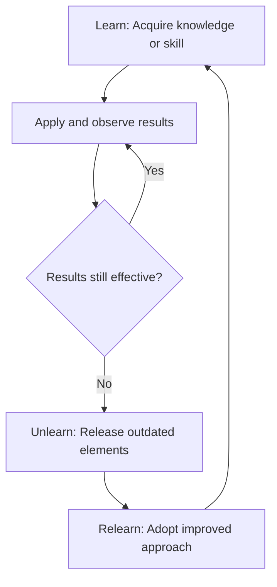

    

<h1 align="center">BECOME A POLYMATH</h1>

    

    

  

### Overview

A polymath is someone who builds real skill in more than one field and learns how to connect those fields. It is not about knowing a little about everything or collecting random facts. It is a long term practice of going deep in two or three different areas while also learning enough in other related areas to be useful.

This matters more now because most important problems in finance, health, technology, and society do not fit inside one subject. People who can understand different experts, ask clear questions, and bring ideas together tend to create more lasting value. In that sense, being a polymath is not against specialization. It is a way to make specialization more useful and more able to adapt when tools, jobs, and industries change.

 

### Why Polymathy Matters in the Post AI Era

Hyper-specialization in one narrow tool or routine task is becoming easier to automate. What remains hard to automate is judgment, taste, ethics, storytelling, and the ability to connect context across fields.

A polymath is a deep generalist, not a know-it-all. You do not need to master everything. You need real depth in two or three unrelated fields and the ability to move ideas between them. That transfer is the real skill. It is taking a mental model from one field and using it to solve a problem in another.

The most useful people now will combine fields such as technology plus ethics, biology plus design, or business plus storytelling. They will ask better questions and frame better problems. AI can generate, optimize, and execute. Polymaths decide what matters, connect contexts, and turn output into meaning.

Becoming a polymath requires deliberate depth. Watching short explainers is not enough. It requires reading primary books, doing projects, building things, and spending real hours practicing each field. Depth earns credibility. Breadth creates originality.

 

### Outcomes of Becoming a Polymath

- **You become more flexible in how you think.** You learn to switch between different ways of thinking, such as analytical, creative, numerical, or psychological. This helps you look at a problem from a new angle when your first approach does not work, and it keeps you from getting stuck in one way of seeing things.

- **You get better at solving problems.** When you know methods from more than one field, you have more options to try. You might use an idea from engineering to fix a problem in finance, or an idea from psychology to improve how you communicate. That larger set of options often leads to better and more practical solutions.

- **You become more creative.** Many new ideas come from the meeting point of two fields that do not usually talk to each other. If you work at those meeting points, you are more likely to notice patterns and combinations that specialists miss.

- **You adapt faster when things change.** If one tool or industry becomes less relevant, you are not starting from zero. Because you already have skills in other areas, you can move into new work more quickly and learn the new parts with less effort.

- **You communicate and bring ideas together more clearly.** You learn how to explain complex ideas to different kinds of people and to translate between experts who use different language. This is useful for building products, working in teams, and leading projects that need more than one kind of knowledge.

- **You become more resilient in your career.** If you depend on only one narrow skill or one type of job, any change can be risky. When your skills apply in several places, you can find useful work in more situations and you are less tied to a single employer or industry.

- **You develop better judgment.** Learning across history, philosophy, economics, and science helps you avoid narrow assumptions. You get better at seeing the second order effects of a decision, spotting incentives that are not obvious, and judging an idea beyond its first impression.

- **You become better at leading and working with others.** Leading today often means bringing specialists together rather than being the best specialist yourself. If you understand enough of each field to ask the right questions, you can align a team and help them solve a problem from different sides.

- **You build a system for learning that lasts.** To become a polymath, you need a simple, repeatable way to learn. That means reading serious books, doing real projects, practicing deliberately, and getting feedback. Once you have that system, it keeps you relevant as technology and society keep changing.

- **You gain broader ethical and social awareness.** Exposure to different fields helps you understand how knowledge affects people and institutions. This makes your decisions more responsible and your work more useful to others.

 

> Becoming a polymath is a direction, not a destination. It does not require genius, unlimited time, or formal credentials. It requires curiosity, discipline, and a willingness to connect ideas across boundaries. The outcome is not a title but a way of thinking that is broad enough to see context, deep enough to be useful, and flexible enough to keep learning.

    
 
<h1 align="center">LEARNING -> UNLEARNING -> RELEARNING</h1>
<h3 align="center">A PRACTICAL FRAMEWORK FOR ADAPTIVE GROWTH AND CONTINUOUS TRANSFORMATION</h3>
 
  

### Table of Contents

1. Introduction  
2. A Note on the Toffler Attribution  
3. Defining the Three Pillars  
4. What Unlearning Is Not  
5. Principles Versus Methods  
6. The Complete Cycle  
7. Why This Matters in a Changing World  
8. The Neuroscience of Adaptive Change  
9. Psychological and Emotional Barriers  
10. Practical Application for Individuals  
11. A Practical Unlearning Protocol  
12. Organizational and Team Application  
13. Real-World Examples  
14. Indicators of Healthy Relearning  
15. Simple Exercises to Build the Skill  
16. Wisdom from Practitioners and Thinkers  
17. The Deeper Dimension of Growth  
18. Core Formulations  
19. A Caution Against Over-Unlearning  
20. The Signature Principle  
21. Conclusion  
22. Reflection Questions  

 

### 1. Introduction

In an era defined by rapid technological progress, shifting social expectations, and constant disruption, the ability to learn, unlearn, and relearn has become a core human capacity. This framework offers a practical way to adapt, grow, and remain effective across personal and professional life.

The idea is commonly linked to the futurist Alvin Toffler. It describes a continuous cycle rather than a one-time achievement. Learning expands capacity. Unlearning removes what no longer serves. Relearning installs improved approaches while retaining useful wisdom. Together these three processes support lifelong adaptation.

This documentation presents the concept in clear language, grounded in psychological insight, practical steps, and real examples. It is designed for individuals, teams, and organizations that want to stay relevant and capable in changing conditions.

 

### 2. A Note on the Toffler Attribution

The well-known statement reads:

> “The illiterate of the 21st century will not be those who cannot read and write, but those who cannot learn, unlearn, and relearn.”

This wording is widely attributed to Alvin Toffler. Careful examination shows that the exact phrasing does not appear in his book *Future Shock*. The underlying idea matches Toffler’s emphasis on continuous adaptation in a fast-changing world. For accuracy, the statement is best described as commonly attributed rather than a direct quotation from a single published source.

 

### 3. Defining the Three Pillars

**Learning** is the process of acquiring new knowledge, skills, habits, or perspectives. It forms the foundation of growth. Learning includes absorbing fresh information, developing new competencies, expanding understanding, and building on existing foundations. A simple example is learning a new software program or beginning to study a foreign language.

**Unlearning** is the deliberate release of outdated beliefs, habits, knowledge, or methods that no longer produce effective results. It is frequently the most difficult stage. Unlearning requires humility to recognize that current knowledge may be incomplete, courage to leave comfortable patterns, openness to alternatives, and acceptance that past success does not guarantee future relevance. An example is setting aside sole reliance on manual processes once automation tools deliver clearer efficiency.

**Relearning** is the adoption of a new or improved way of thinking or acting after the old approach has been released. Relearning integrates fresh knowledge with retained wisdom, new methods with useful past experience, and updated frameworks with enduring principles. An example is mastering an updated version of familiar software after setting aside habits formed with the previous version.

These three processes work together. Learning alone can lead to accumulation without refinement. Unlearning without relearning can create emptiness. Relearning without prior unlearning often collides with residual old patterns.

 

### 4. What Unlearning Is Not

Unlearning is frequently misunderstood. It is not:

- Forgetting everything previously known  
- Rejecting all past experience  
- Pretending to be ignorant  
- Devaluing genuine expertise  
- Returning to a complete starting point  

Instead, unlearning involves:

- Temporarily suspending assumptions so new information can be considered  
- Retiring methods that no longer deliver results  
- Updating mental models  
- Creating space for better approaches  
- Preserving useful wisdom while releasing rigid attachments  

A precise description is: Unlearning is not forgetting. It is updating.

 

### 5. Principles Versus Methods

Not every element of past knowledge should be discarded. A clear distinction helps maintain balance:

| Type          | Should it be unlearned? | Example                                      |
|---------------|-------------------------|----------------------------------------------|
| Principles    | Usually no              | Integrity, empathy, curiosity, fairness      |
| Methods       | Often yes               | Manual processes, outdated tools, fixed routines |
| Beliefs       | Sometimes               | “This is the only correct way”               |
| Identities    | Carefully               | “I am the person who always handles this alone” |

Preserve core principles and values. Unlearn limiting methods and rigid beliefs. Approach identity-level change with care so that growth does not erode a stable sense of self.

 

### 6. The Complete Cycle

The process follows a repeating sequence rather than a single straight line.

**Simple illustration**

| Stage     | Action                      | Example                                              |
|-----------|-----------------------------|------------------------------------------------------|
| Learn     | Acquire an initial skill    | Learning to type with two fingers                    |
| Unlearn   | Recognize limitations       | Realizing two-finger typing is slow and error-prone  |
| Relearn   | Adopt a better method       | Learning touch typing with all ten fingers           |

**The continuous loop**

Each completed relearning becomes the foundation for the next cycle of learning. As circumstances change, the newly adopted approach may itself require examination and adjustment. This creates an ongoing pattern of growth and adaptation across a lifetime.

The diagram shows that the cycle is self-reinforcing. Effective results keep the current approach in use. Ineffective results trigger unlearning and relearning, which then feed new learning.

 

### 7. Why This Matters in a Changing World

The pace of change continues to accelerate. Knowledge half-life is shortening. Skills that once remained valuable for decades can lose relevance within a few years. Methods that produced strong results in one context often fail when conditions shift.

Clinging to outdated knowledge and methods carries clear costs. Individuals and organizations risk becoming less relevant in their fields, missing opportunities for improvement, remaining controlled by old paradigms, and settling into patterns of unrealized potential.

Those who practice the full cycle gain corresponding advantages. They navigate change with greater confidence, maintain competitive position, experience ongoing development and satisfaction, and actively shape their direction rather than being shaped by external forces alone.

 

### 8. The Neuroscience of Adaptive Change

The human brain remains capable of change throughout life. This capacity is known as neuroplasticity. Neural pathways strengthen with repeated use and weaken when they are no longer activated.

Unlearning reduces the strength of older pathways that support outdated habits or beliefs. Relearning strengthens new pathways that support improved approaches. The process resembles updating software: the older program often needs to be set aside before the newer version can run cleanly.

A related idea appears across many wisdom traditions: a full cup cannot receive more liquid. A mind occupied by rigid beliefs, outdated self-definitions, fixed assumptions, or pride in past knowledge has limited room for new understanding. Unlearning creates the necessary mental space.

 

### 9. Psychological and Emotional Barriers

Unlearning encounters resistance because it can feel threatening. Common sources of resistance include:

- Ego: the sense that one should already know the answer  
- Identity: the belief that a particular method or role defines who one is  
- Status: the position of being the recognized expert  
- Security: fear about what remains if a familiar approach is released  
- Sunk cost: the feeling that previous investment makes change too expensive  

These barriers are natural. They arise from the mind’s preference for consistency and predictability. Progress becomes easier when environments treat mistakes as information rather than as personal failure. Psychological safety accelerates the willingness to examine and update existing patterns.

 

### 10. Practical Application for Individuals

Four foundational steps support effective unlearning:

1. Accept that current knowledge may no longer be the only or best answer.  
2. Temporarily set aside existing knowledge without discarding its useful elements, approaching the topic with beginner’s openness.  
3. Engage new material without immediate comparison or judgment.  
4. Seek teachers who achieve strong results, including people from different generations or backgrounds.

Useful questions for self-examination include:

- Which beliefs have I outgrown?  
- Which patterns no longer support my growth?  
- How would I approach this if I knew nothing about it?  
- If I were beginning today, what method would I choose?

A comparison of mindsets clarifies the difference in practice:

| Situation          | Fixed approach                          | Adaptive approach                                      |
|--------------------|-----------------------------------------|--------------------------------------------------------|
| New technology     | “We have always done it this way.”      | “If I knew nothing, how would I learn this today?”     |
| Career transition  | “I have already mastered my role.”      | “What brought me here will not necessarily take me further.” |
| Feedback           | “I already know this.”                  | “What can I learn from this perspective?”              |

 

### 11. A Practical Unlearning Protocol

A structured sequence helps turn the concept into repeatable action:

1. Notice — Identify a result that is no longer acceptable.  
2. Name — Identify the assumption or habit that produces the result.  
3. Suspend — Decide whether the current approach can be set aside temporarily.  
4. Seek — Observe people who achieve better results and examine their methods.  
5. Experiment — Test a small new approach under controlled conditions.  
6. Reflect — Evaluate what worked, what did not, and why.  
7. Integrate — Combine retained wisdom with the improved method.  
8. Teach — Explain the updated approach to others; teaching often reveals remaining gaps.

This protocol can be applied to skills, habits, professional practices, and personal patterns.

 

### 12. Organizational and Team Application

The same cycle operates at the collective level. Teams and organizations benefit when they:

- Conduct regular after-action reviews that examine both successes and shortfalls  
- Reward thoughtful questions as highly as correct answers  
- Practice reverse mentoring so less experienced members can challenge assumptions  
- Create conditions in which people can safely state that an established method is no longer working  
- Treat intelligent experiments that do not succeed as sources of information rather than as grounds for penalty  

An organization that can examine and update its own previously successful practices is better positioned to avoid becoming limited by its past achievements.

 

### 13. Real-World Examples

**Career progression**  
An individual contributor succeeds through personal technical skill. Moving into management requires unlearning the habit of performing every task personally and relearning the practices of delegation and shared accountability. Further progression into leadership requires unlearning directive control and relearning the capacity to inspire and align others. The consistent insight is that the approaches that produced earlier success often become obstacles at the next level.

**Business strategy**  
A strategy that worked in one market or era can fail under new conditions. A leader who previously treated “aspirational” branding as synonymous with exclusivity may need to unlearn that association and relearn that aspiration can coexist with accessibility, relevance, and clear focus.

**Personal development**  
A person who learned strength through the consistent suppression of vulnerability may need to unlearn the belief that openness equals weakness and relearn that authentic connection depends on appropriate openness.

 

### 14. Indicators of Healthy Relearning

Observable signs that the cycle is functioning well include:

- Faster adjustment to new situations  
- Reduced defensiveness when receiving corrective information  
- Increased curiosity toward differing viewpoints  
- Ability to articulate both the previous and the updated models  
- Improved outcomes with reduced friction  
- Recognition by others as a source of adaptable thinking  

These indicators provide feedback that the process is producing genuine development rather than surface-level change.

 

### 15. Simple Exercises to Build the Skill

- Empty-cup journal: Write responses to the question “What am I currently pretending not to know?”  
- Assumption audit: List five beliefs about current work or life and examine whether each remains accurate.  
- Reverse mentoring: Intentionally learn a practical skill or perspective from someone younger or less senior.  
- Thirty-day experiment: Apply a new method for a fixed period before evaluating its value.  
- Beginner’s-mind practice: Approach a familiar situation as if encountering it for the first time and note what becomes visible.

Regular use of these exercises strengthens the capacity to move through the cycle with less resistance.

 

### 16. Wisdom from Practitioners and Thinkers

Bob Proctor observed that continuous unlearning and relearning is a lifelong requirement rather than a temporary phase.

T. E. Lawrence distinguished between those who dream passively and those who act on their visions with open eyes. The capacity to revise internal models supports the second kind of dreaming.

Across many accounts of sustained achievement, a consistent pattern appears: the individuals who continue to progress treat learning as a permanent stance. That stance rests on humility, which creates the conditions for accurate self-assessment and genuine updating.

 

### 17. The Deeper Dimension of Growth

Learning can be understood as filling the mental cup. Unlearning empties space that has become occupied by limiting material. Relearning allows updated understanding to take root.

Unlearning is not the loss of knowledge. It is the release of illusion—the recognition that previous certainty may have been incomplete. The resulting openness permits clearer perception, better judgment, and more accurate response to current conditions.

Self-development is not the discovery of a final fixed answer. It is the ongoing refinement of the questions one asks. Because conditions continue to change, the process itself does not reach a permanent end.

 

### 18. Core Formulations

On the three processes:  
“The future belongs to those who can learn with curiosity, unlearn with humility, and relearn with courage.”  

“Knowledge opens doors. Unlearning removes the walls. Relearning builds a better future.”  

“Learning gives knowledge. Unlearning gives freedom. Relearning gives mastery.”  

“Learn to grow. Unlearn to evolve. Relearn to lead.”  

On adaptation:  
“To master tomorrow, learn relentlessly, unlearn fearlessly, and relearn continuously.”  

“In conditions of rapid change, the decisive skill is not fixed intelligence but the willingness to learn, unlearn, and relearn.”  

On growth:  
“Growth begins when new material is learned, accelerates when obsolete material is released, and becomes transformative when what truly matters is relearned.”  

“Every lasting breakthrough begins with a lesson learned, an illusion released, and a better method installed.”  

 

### 19. A Caution Against Over-Unlearning

Unlearning can be misused as a justification for constant novelty. Not every established practice is obsolete. Enduring principles, ethical standards, deep relationships, and thoroughly tested methods often retain value across changing conditions. The required capacity is discernment: the ability to distinguish what must be updated from what should be preserved.

A balanced statement is: Learn what is true. Unlearn what is limiting. Relearn what is needed.

 

### 20. The Signature Principle

The most capable minds are defined less by the volume of knowledge they hold and more by their readiness to acquire what is new, release what is outdated, and install what is required. That readiness forms a reliable path toward clearer understanding, practical innovation, and sustained effectiveness.

 

### 21. Conclusion

Learning, unlearning, and relearning constitute a way of operating rather than a temporary technique. The process requires humility to acknowledge incomplete knowledge, courage to release comfortable certainties, openness to unfamiliar perspectives and teachers, and wisdom to combine retained insight with improved methods.

In environments that continue to change, the ability to move repeatedly through these three stages provides both practical advantage and a foundation for ongoing personal fulfillment. A true expert remains willing to approach new material with the openness of a beginner whenever conditions demand it.

> “A stagnant mind collects answers. A growing mind continually revises its questions.”

 

### 22. Reflection Questions

1. What is one specific belief or method I need to examine and potentially release so that new learning becomes possible?  
2. Where am I maintaining an approach primarily because it feels familiar rather than because it remains effective?  
3. Who might I learn from that I have previously overlooked or undervalued?  
4. What would I attempt if I fully accepted that I can learn whatever is required?
 
    
