    

<h1 align="center">BECOME A POLYMATH</h1>

    

    

  

### Overview

A polymath is someone who builds real skill in more than one field and learns how to connect those fields. It is not about knowing a little about everything or collecting random facts. It is a long term practice of going deep in two or three different areas while also learning enough in other related areas to be useful.

This matters more now because most important problems in finance, health, technology, and society do not fit inside one subject. People who can understand different experts, ask clear questions, and bring ideas together tend to create more lasting value. In that sense, being a polymath is not against specialization. It is a way to make specialization more useful and more able to adapt when tools, jobs, and industries change.

 

### Why Polymathy Matters in the Post AI Era

Hyper-specialization in one narrow tool or routine task is becoming easier to automate. What remains hard to automate is judgment, taste, ethics, storytelling, and the ability to connect context across fields.

A polymath is a deep generalist, not a know-it-all. You do not need to master everything. You need real depth in two or three unrelated fields and the ability to move ideas between them. That transfer is the real skill. It is taking a mental model from one field and using it to solve a problem in another.

The most useful people now will combine fields such as technology plus ethics, biology plus design, or business plus storytelling. They will ask better questions and frame better problems. AI can generate, optimize, and execute. Polymaths decide what matters, connect contexts, and turn output into meaning.

Becoming a polymath requires deliberate depth. Watching short explainers is not enough. It requires reading primary books, doing projects, building things, and spending real hours practicing each field. Depth earns credibility. Breadth creates originality.

 

### Outcomes of Becoming a Polymath

- **You become more flexible in how you think.** You learn to switch between different ways of thinking, such as analytical, creative, numerical, or psychological. This helps you look at a problem from a new angle when your first approach does not work, and it keeps you from getting stuck in one way of seeing things.

- **You get better at solving problems.** When you know methods from more than one field, you have more options to try. You might use an idea from engineering to fix a problem in finance, or an idea from psychology to improve how you communicate. That larger set of options often leads to better and more practical solutions.

- **You become more creative.** Many new ideas come from the meeting point of two fields that do not usually talk to each other. If you work at those meeting points, you are more likely to notice patterns and combinations that specialists miss.

- **You adapt faster when things change.** If one tool or industry becomes less relevant, you are not starting from zero. Because you already have skills in other areas, you can move into new work more quickly and learn the new parts with less effort.

- **You communicate and bring ideas together more clearly.** You learn how to explain complex ideas to different kinds of people and to translate between experts who use different language. This is useful for building products, working in teams, and leading projects that need more than one kind of knowledge.

- **You become more resilient in your career.** If you depend on only one narrow skill or one type of job, any change can be risky. When your skills apply in several places, you can find useful work in more situations and you are less tied to a single employer or industry.

- **You develop better judgment.** Learning across history, philosophy, economics, and science helps you avoid narrow assumptions. You get better at seeing the second order effects of a decision, spotting incentives that are not obvious, and judging an idea beyond its first impression.

- **You become better at leading and working with others.** Leading today often means bringing specialists together rather than being the best specialist yourself. If you understand enough of each field to ask the right questions, you can align a team and help them solve a problem from different sides.

- **You build a system for learning that lasts.** To become a polymath, you need a simple, repeatable way to learn. That means reading serious books, doing real projects, practicing deliberately, and getting feedback. Once you have that system, it keeps you relevant as technology and society keep changing.

- **You gain broader ethical and social awareness.** Exposure to different fields helps you understand how knowledge affects people and institutions. This makes your decisions more responsible and your work more useful to others.

 

> Becoming a polymath is a direction, not a destination. It does not require genius, unlimited time, or formal credentials. It requires curiosity, discipline, and a willingness to connect ideas across boundaries. The outcome is not a title but a way of thinking that is broad enough to see context, deep enough to be useful, and flexible enough to keep learning.

    
 
<h1 align="center">LEARNING -> UNLEARNING -> RELEARNING</h1>
<h3 align="center">A PRACTICAL FRAMEWORK FOR ADAPTIVE GROWTH AND CONTINUOUS TRANSFORMATION</h3>
 
  

### Table of Contents

1. Introduction  
2. A Note on the Toffler Attribution  
3. Defining the Three Pillars  
4. What Unlearning Is Not  
5. Principles Versus Methods  
6. The Complete Cycle  
7. Why This Matters in a Changing World  
8. The Neuroscience of Adaptive Change  
9. Psychological and Emotional Barriers  
10. Practical Application for Individuals  
11. A Practical Unlearning Protocol  
12. Organizational and Team Application  
13. Real-World Examples  
14. Indicators of Healthy Relearning  
15. Simple Exercises to Build the Skill  
16. Wisdom from Practitioners and Thinkers  
17. The Deeper Dimension of Growth  
18. Core Formulations  
19. A Caution Against Over-Unlearning  
20. The Signature Principle  
21. Conclusion  
22. Reflection Questions  

 

### 1. Introduction

In an era defined by rapid technological progress, shifting social expectations, and constant disruption, the ability to learn, unlearn, and relearn has become a core human capacity. This framework offers a practical way to adapt, grow, and remain effective across personal and professional life.

The idea is commonly linked to the futurist Alvin Toffler. It describes a continuous cycle rather than a one-time achievement. Learning expands capacity. Unlearning removes what no longer serves. Relearning installs improved approaches while retaining useful wisdom. Together these three processes support lifelong adaptation.

This documentation presents the concept in clear language, grounded in psychological insight, practical steps, and real examples. It is designed for individuals, teams, and organizations that want to stay relevant and capable in changing conditions.

 

### 2. A Note on the Toffler Attribution

The well-known statement reads:

> “The illiterate of the 21st century will not be those who cannot read and write, but those who cannot learn, unlearn, and relearn.”

This wording is widely attributed to Alvin Toffler. Careful examination shows that the exact phrasing does not appear in his book *Future Shock*. The underlying idea matches Toffler’s emphasis on continuous adaptation in a fast-changing world. For accuracy, the statement is best described as commonly attributed rather than a direct quotation from a single published source.

 

### 3. Defining the Three Pillars

**Learning** is the process of acquiring new knowledge, skills, habits, or perspectives. It forms the foundation of growth. Learning includes absorbing fresh information, developing new competencies, expanding understanding, and building on existing foundations. A simple example is learning a new software program or beginning to study a foreign language.

**Unlearning** is the deliberate release of outdated beliefs, habits, knowledge, or methods that no longer produce effective results. It is frequently the most difficult stage. Unlearning requires humility to recognize that current knowledge may be incomplete, courage to leave comfortable patterns, openness to alternatives, and acceptance that past success does not guarantee future relevance. An example is setting aside sole reliance on manual processes once automation tools deliver clearer efficiency.

**Relearning** is the adoption of a new or improved way of thinking or acting after the old approach has been released. Relearning integrates fresh knowledge with retained wisdom, new methods with useful past experience, and updated frameworks with enduring principles. An example is mastering an updated version of familiar software after setting aside habits formed with the previous version.

These three processes work together. Learning alone can lead to accumulation without refinement. Unlearning without relearning can create emptiness. Relearning without prior unlearning often collides with residual old patterns.

 

### 4. What Unlearning Is Not

Unlearning is frequently misunderstood. It is not:

- Forgetting everything previously known  
- Rejecting all past experience  
- Pretending to be ignorant  
- Devaluing genuine expertise  
- Returning to a complete starting point  

Instead, unlearning involves:

- Temporarily suspending assumptions so new information can be considered  
- Retiring methods that no longer deliver results  
- Updating mental models  
- Creating space for better approaches  
- Preserving useful wisdom while releasing rigid attachments  

A precise description is: Unlearning is not forgetting. It is updating.

 

### 5. Principles Versus Methods

Not every element of past knowledge should be discarded. A clear distinction helps maintain balance:

| Type          | Should it be unlearned? | Example                                      |
|---------------|-------------------------|----------------------------------------------|
| Principles    | Usually no              | Integrity, empathy, curiosity, fairness      |
| Methods       | Often yes               | Manual processes, outdated tools, fixed routines |
| Beliefs       | Sometimes               | “This is the only correct way”               |
| Identities    | Carefully               | “I am the person who always handles this alone” |

Preserve core principles and values. Unlearn limiting methods and rigid beliefs. Approach identity-level change with care so that growth does not erode a stable sense of self.

 

### 6. The Complete Cycle

The process follows a repeating sequence rather than a single straight line.

**Simple illustration**

| Stage     | Action                      | Example                                              |
|-----------|-----------------------------|------------------------------------------------------|
| Learn     | Acquire an initial skill    | Learning to type with two fingers                    |
| Unlearn   | Recognize limitations       | Realizing two-finger typing is slow and error-prone  |
| Relearn   | Adopt a better method       | Learning touch typing with all ten fingers           |

**The continuous loop**

Each completed relearning becomes the foundation for the next cycle of learning. As circumstances change, the newly adopted approach may itself require examination and adjustment. This creates an ongoing pattern of growth and adaptation across a lifetime.

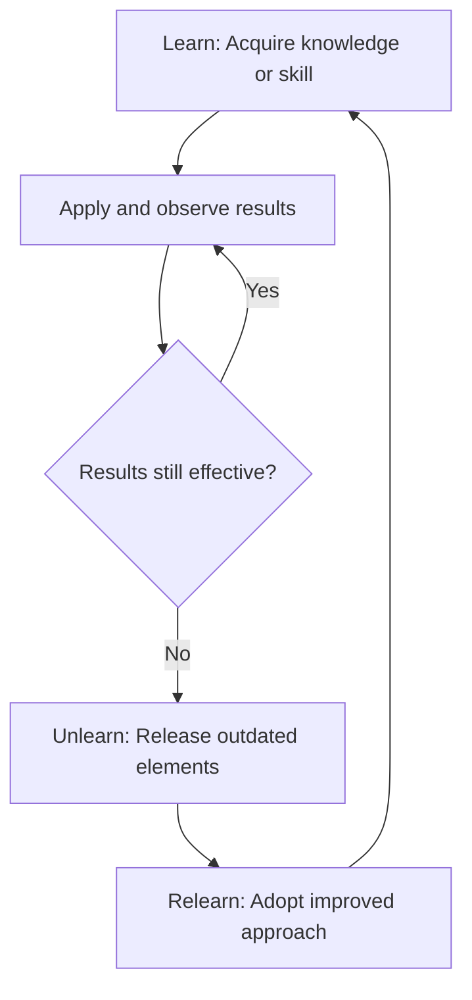

The diagram shows that the cycle is self-reinforcing. Effective results keep the current approach in use. Ineffective results trigger unlearning and relearning, which then feed new learning.

 

### 7. Why This Matters in a Changing World

The pace of change continues to accelerate. Knowledge half-life is shortening. Skills that once remained valuable for decades can lose relevance within a few years. Methods that produced strong results in one context often fail when conditions shift.

Clinging to outdated knowledge and methods carries clear costs. Individuals and organizations risk becoming less relevant in their fields, missing opportunities for improvement, remaining controlled by old paradigms, and settling into patterns of unrealized potential.

Those who practice the full cycle gain corresponding advantages. They navigate change with greater confidence, maintain competitive position, experience ongoing development and satisfaction, and actively shape their direction rather than being shaped by external forces alone.

 

### 8. The Neuroscience of Adaptive Change

The human brain remains capable of change throughout life. This capacity is known as neuroplasticity. Neural pathways strengthen with repeated use and weaken when they are no longer activated.

Unlearning reduces the strength of older pathways that support outdated habits or beliefs. Relearning strengthens new pathways that support improved approaches. The process resembles updating software: the older program often needs to be set aside before the newer version can run cleanly.

A related idea appears across many wisdom traditions: a full cup cannot receive more liquid. A mind occupied by rigid beliefs, outdated self-definitions, fixed assumptions, or pride in past knowledge has limited room for new understanding. Unlearning creates the necessary mental space.

 

### 9. Psychological and Emotional Barriers

Unlearning encounters resistance because it can feel threatening. Common sources of resistance include:

- Ego: the sense that one should already know the answer  
- Identity: the belief that a particular method or role defines who one is  
- Status: the position of being the recognized expert  
- Security: fear about what remains if a familiar approach is released  
- Sunk cost: the feeling that previous investment makes change too expensive  

These barriers are natural. They arise from the mind’s preference for consistency and predictability. Progress becomes easier when environments treat mistakes as information rather than as personal failure. Psychological safety accelerates the willingness to examine and update existing patterns.

 

### 10. Practical Application for Individuals

Four foundational steps support effective unlearning:

1. Accept that current knowledge may no longer be the only or best answer.  
2. Temporarily set aside existing knowledge without discarding its useful elements, approaching the topic with beginner’s openness.  
3. Engage new material without immediate comparison or judgment.  
4. Seek teachers who achieve strong results, including people from different generations or backgrounds.

Useful questions for self-examination include:

- Which beliefs have I outgrown?  
- Which patterns no longer support my growth?  
- How would I approach this if I knew nothing about it?  
- If I were beginning today, what method would I choose?

A comparison of mindsets clarifies the difference in practice:

| Situation          | Fixed approach                          | Adaptive approach                                      |
|--------------------|-----------------------------------------|--------------------------------------------------------|
| New technology     | “We have always done it this way.”      | “If I knew nothing, how would I learn this today?”     |
| Career transition  | “I have already mastered my role.”      | “What brought me here will not necessarily take me further.” |
| Feedback           | “I already know this.”                  | “What can I learn from this perspective?”              |

 

### 11. A Practical Unlearning Protocol

A structured sequence helps turn the concept into repeatable action:

1. Notice — Identify a result that is no longer acceptable.  
2. Name — Identify the assumption or habit that produces the result.  
3. Suspend — Decide whether the current approach can be set aside temporarily.  
4. Seek — Observe people who achieve better results and examine their methods.  
5. Experiment — Test a small new approach under controlled conditions.  
6. Reflect — Evaluate what worked, what did not, and why.  
7. Integrate — Combine retained wisdom with the improved method.  
8. Teach — Explain the updated approach to others; teaching often reveals remaining gaps.

This protocol can be applied to skills, habits, professional practices, and personal patterns.

 

### 12. Organizational and Team Application

The same cycle operates at the collective level. Teams and organizations benefit when they:

- Conduct regular after-action reviews that examine both successes and shortfalls  
- Reward thoughtful questions as highly as correct answers  
- Practice reverse mentoring so less experienced members can challenge assumptions  
- Create conditions in which people can safely state that an established method is no longer working  
- Treat intelligent experiments that do not succeed as sources of information rather than as grounds for penalty  

An organization that can examine and update its own previously successful practices is better positioned to avoid becoming limited by its past achievements.

 

### 13. Real-World Examples

**Career progression**  
An individual contributor succeeds through personal technical skill. Moving into management requires unlearning the habit of performing every task personally and relearning the practices of delegation and shared accountability. Further progression into leadership requires unlearning directive control and relearning the capacity to inspire and align others. The consistent insight is that the approaches that produced earlier success often become obstacles at the next level.

**Business strategy**  
A strategy that worked in one market or era can fail under new conditions. A leader who previously treated “aspirational” branding as synonymous with exclusivity may need to unlearn that association and relearn that aspiration can coexist with accessibility, relevance, and clear focus.

**Personal development**  
A person who learned strength through the consistent suppression of vulnerability may need to unlearn the belief that openness equals weakness and relearn that authentic connection depends on appropriate openness.

 

### 14. Indicators of Healthy Relearning

Observable signs that the cycle is functioning well include:

- Faster adjustment to new situations  
- Reduced defensiveness when receiving corrective information  
- Increased curiosity toward differing viewpoints  
- Ability to articulate both the previous and the updated models  
- Improved outcomes with reduced friction  
- Recognition by others as a source of adaptable thinking  

These indicators provide feedback that the process is producing genuine development rather than surface-level change.

 

### 15. Simple Exercises to Build the Skill

- Empty-cup journal: Write responses to the question “What am I currently pretending not to know?”  
- Assumption audit: List five beliefs about current work or life and examine whether each remains accurate.  
- Reverse mentoring: Intentionally learn a practical skill or perspective from someone younger or less senior.  
- Thirty-day experiment: Apply a new method for a fixed period before evaluating its value.  
- Beginner’s-mind practice: Approach a familiar situation as if encountering it for the first time and note what becomes visible.

Regular use of these exercises strengthens the capacity to move through the cycle with less resistance.

 

### 16. Wisdom from Practitioners and Thinkers

Bob Proctor observed that continuous unlearning and relearning is a lifelong requirement rather than a temporary phase.

T. E. Lawrence distinguished between those who dream passively and those who act on their visions with open eyes. The capacity to revise internal models supports the second kind of dreaming.

Across many accounts of sustained achievement, a consistent pattern appears: the individuals who continue to progress treat learning as a permanent stance. That stance rests on humility, which creates the conditions for accurate self-assessment and genuine updating.

 

### 17. The Deeper Dimension of Growth

Learning can be understood as filling the mental cup. Unlearning empties space that has become occupied by limiting material. Relearning allows updated understanding to take root.

Unlearning is not the loss of knowledge. It is the release of illusion—the recognition that previous certainty may have been incomplete. The resulting openness permits clearer perception, better judgment, and more accurate response to current conditions.

Self-development is not the discovery of a final fixed answer. It is the ongoing refinement of the questions one asks. Because conditions continue to change, the process itself does not reach a permanent end.

 

### 18. Core Formulations

On the three processes:  
“The future belongs to those who can learn with curiosity, unlearn with humility, and relearn with courage.”  

“Knowledge opens doors. Unlearning removes the walls. Relearning builds a better future.”  

“Learning gives knowledge. Unlearning gives freedom. Relearning gives mastery.”  

“Learn to grow. Unlearn to evolve. Relearn to lead.”  

On adaptation:  
“To master tomorrow, learn relentlessly, unlearn fearlessly, and relearn continuously.”  

“In conditions of rapid change, the decisive skill is not fixed intelligence but the willingness to learn, unlearn, and relearn.”  

On growth:  
“Growth begins when new material is learned, accelerates when obsolete material is released, and becomes transformative when what truly matters is relearned.”  

“Every lasting breakthrough begins with a lesson learned, an illusion released, and a better method installed.”  

 

### 19. A Caution Against Over-Unlearning

Unlearning can be misused as a justification for constant novelty. Not every established practice is obsolete. Enduring principles, ethical standards, deep relationships, and thoroughly tested methods often retain value across changing conditions. The required capacity is discernment: the ability to distinguish what must be updated from what should be preserved.

A balanced statement is: Learn what is true. Unlearn what is limiting. Relearn what is needed.

 

### 20. The Signature Principle

The most capable minds are defined less by the volume of knowledge they hold and more by their readiness to acquire what is new, release what is outdated, and install what is required. That readiness forms a reliable path toward clearer understanding, practical innovation, and sustained effectiveness.

 

### 21. Conclusion

Learning, unlearning, and relearning constitute a way of operating rather than a temporary technique. The process requires humility to acknowledge incomplete knowledge, courage to release comfortable certainties, openness to unfamiliar perspectives and teachers, and wisdom to combine retained insight with improved methods.

In environments that continue to change, the ability to move repeatedly through these three stages provides both practical advantage and a foundation for ongoing personal fulfillment. A true expert remains willing to approach new material with the openness of a beginner whenever conditions demand it.

> “A stagnant mind collects answers. A growing mind continually revises its questions.”

 

### 22. Reflection Questions

1. What is one specific belief or method I need to examine and potentially release so that new learning becomes possible?  
2. Where am I maintaining an approach primarily because it feels familiar rather than because it remains effective?  
3. Who might I learn from that I have previously overlooked or undervalued?  
4. What would I attempt if I fully accepted that I can learn whatever is required?

    

<h1 align="center">LIVING JEET KUNE DO</h1> 
 
  

Jeet Kune Do, which translates as “Way of the Intercepting Fist,” is not a rigid martial art style with fixed techniques or unchanging forms. Bruce Lee developed it as a living process of continuous growth, honest self-expression, and practical effectiveness. Living Jeet Kune Do means applying its core ideas every day in training, work, relationships, and personal challenges. The central message remains simple and clear: stay fluid, stay efficient, and stay authentic.

The philosophy rests on a few guiding ideas that shape both combat and daily life. Practitioners are encouraged to be like water, to absorb what is useful while discarding what is useless, and to add what is specifically their own. The famous statements “Using no way as way” and “Having no limitation as limitation” express the freedom at the heart of the method. Jeet Kune Do trains both body and mind so that correct action can arise naturally, without the interference of rigid patterns or ego.

This documentation presents Living Jeet Kune Do in full detail. It explains the philosophical foundation, the practical tools of combat, the way the system adapts to every male body type, and the method for building personal combat frameworks. The goal is to give readers a clear, usable understanding that can be applied both in the training hall and in everyday life.

 

### Core Philosophical Principles

Jeet Kune Do is built on a small number of clear ideas that influence every technical choice and life decision. The most important principle is “Using no way as way; having no limitation as limitation.” This means the system is not closed. A practitioner is free to use any method that proves effective. The true goal is mental and physical freedom rather than loyalty to any single style or tradition.

Three operational values support this freedom: simplicity, directness, and the form of no form. Simplicity requires the removal of everything unnecessary so that action goes straight to the heart of the problem. Directness demands the shortest and most efficient path to the objective. Freedom, often called the form of no form, allows honest self-expression without being locked into fixed patterns.

The practical rule that follows from these ideas is well known: absorb what is useful, reject what is useless, and add what is specifically your own. A student may study boxing, fencing, Wing Chun, wrestling, or any other source. Only those elements that work for the individual are retained. Everything else is discarded. The final step is the addition of personal discoveries that arise from honest research of one’s own experience. The aim is never to become a copy of Bruce Lee. The aim is to become the most effective version of oneself.

| Principle                  | Meaning                              | Practical Result                     |
|----------------------------|--------------------------------------|--------------------------------------|
| Using no way as way        | No fixed style                       | Freedom to adapt                     |
| Simplicity                 | Remove the unnecessary               | Faster, clearer action               |
| Directness                 | Shortest path to the goal            | Less time for the opponent to react  |
| Freedom (form of no form)  | No rigid patterns                    | Honest self-expression              |
| Absorb what is useful      | Keep what works, discard the rest    | Personal and effective method        |

 

### Key Physical and Tactical Concepts

Philosophy becomes usable skill through a set of core tactical ideas. The defining concept is interception, or “Jeet.” Instead of waiting for an attack to land and then responding, the practitioner seeks to strike the opponent during the attack or at the moment the opponent’s intention becomes clear. This approach turns the opponent’s forward movement into a liability.

Closely related is the principle of simultaneous defense and offense. One movement can both protect and attack. Separate blocking followed by a counter is avoided whenever possible because it creates a time gap that a skilled opponent can exploit. Centreline theory, inherited and refined from Wing Chun, provides a spatial framework. The imaginary vertical line that runs down the centre of the body is both protected and attacked. The fighter who controls the centreline usually controls the engagement.

Economy of motion requires that every action use the least distance, time, and energy while still delivering power and accuracy. Wasted or telegraphic movements are eliminated. Broken rhythm complements this economy by changing speed, timing, and flow so that the opponent cannot predict the next action.

These ideas are organized strategically through the Five Ways of Attack. Single Direct Attack delivers one clean, decisive strike when an opening already exists. Attack by Combination uses a rapid series of strikes to overwhelm the defense. Progressive Indirect Attack creates an opening by drawing a reaction and then exploiting it. Hand Immobilization Attack traps or controls a limb before striking. Attack by Drawing deliberately invites an attack so that a counter can be launched. These categories are tools for thinking rather than rigid formulas. They can be mixed, adapted, and personalized.

 

### Be Like Water: The Heart of Adaptability

The most recognizable expression of Jeet Kune Do is the instruction to be like water. Water has no fixed shape. It can flow gently around obstacles or crash with great force. It takes the form of any container and, over time, can wear down the hardest rock. In practical terms this means the practitioner does not cling to fixed techniques or fixed identities. What no longer works is continuously discarded. The readiness to change direction instantly is cultivated every day.

Jeet Kune Do is not opposed to form or structure. Forms and technical frameworks can be useful tools. The problem arises only when a person clings to them after the situation has changed. Real combat is alive and unpredictable. Training must therefore prepare the fighter for constant change. Bruce Lee used the metaphor of a boat: Jeet Kune Do is a vessel that carries a person across the water. Once the other side is reached, the boat is left behind rather than carried on the back. Even the name Jeet Kune Do itself is only a temporary convenience.

This adaptability is the reason the system works for every male body type. The method does not ask how a person can change the body to fit a predetermined technique. It asks how the technique can be changed to fit the body that is present.

 

### Jeet Kune Do and Male Body Types

Most men are a mixture of body types. Training and nutrition can shift appearance significantly, yet the underlying structure still influences which tools feel natural and powerful. The classic somatotypes provide a useful starting point. The ectomorph tends toward a lean, narrow frame with long limbs and finds muscle gain difficult. The mesomorph possesses a naturally athletic build with broad shoulders and responds readily to training. The endomorph has a wider, denser base and gains both muscle and fat more easily.

Structural shapes offer another practical lens. A rectangular build has shoulders, waist, and hips of similar width. An inverted triangle or V-shape shows broad shoulders and a narrow waist. A triangular or pear shape has narrower shoulders and a wider lower body. An oval or round shape carries more mass in the midsection. A trapezoid shape displays the classic athletic taper.

Fighter categories translate these descriptions into combat terms. The wiry or lean fighter, often between sixty-five and seventy-five kilograms, relies on speed, endurance, and angles. The athletic or balanced fighter, roughly seventy-five to ninety kilograms, combines power and speed and can use the full range of tools. The powerful or stocky fighter, ninety to one hundred five kilograms, emphasizes strength, durability, trapping, and close-range pressure. The dense or heavy fighter above one hundred five kilograms draws on raw power, clinch control, and grappling.

| Body Type     | Typical Characteristics              | Preferred JKD Emphasis                          |
|---------------|--------------------------------------|-------------------------------------------------|
| Ectomorph     | Lean, long limbs, fast metabolism    | Speed, angles, footwork, straight intercepts    |
| Mesomorph     | Broad shoulders, athletic            | Balanced use of all tools, direct pressure      |
| Endomorph     | Wider, denser base                   | Structure, trapping, close range, heavy pressure|

The same four ranges of combat—kicking, punching, trapping, and grappling—remain available to every body type. What changes is the emphasis and the selection of tools within those ranges.

 

### The Practical Tools of Jeet Kune Do

The tools of Jeet Kune Do form a comprehensive library rather than a fixed curriculum. Offensive strikes include a full range of hand techniques such as the jab, cross, hooks, uppercuts, overhand, hammer fist, and back fist. Leg strikes cover the front kick, push kick, roundhouse, side kick, back kick, low kicks, calf kicks, and various knee strikes. Elbows supply short-range cutting and rising attacks that are especially useful in the clinch.

Defensive movements emphasize economy and simultaneous action. Parries, slips, bobs, ducks, weaves, rolls, and shoulder rolls allow the practitioner to avoid or redirect force while remaining in position to counter. Pure blocking is used only when necessary. Footwork provides the foundation that makes every strike and defense effective. Fundamental steps, boxing-oriented shuffles and pivots, angular triangle steps drawn from Kali and Silat influences, evasive movements, and explosive bursts give the fighter the ability to create superior angles, enter, exit, and change rhythm at will.

Clinching tools include the basic clinch, collar ties, underhooks, overhooks, body locks, and head control. From these positions the practitioner can deliver knees and elbows or execute trips, sweeps, and takedowns. Grappling tools cover single-leg and double-leg takedowns, classical throws, the sprawl as a defensive response, primary ground positions such as mount, guard, and side control, ground-and-pound, and methods of escape and standing up. Jeet Kune Do treats grappling as one of the four ranges and values the ability to control the opponent and return to striking range when advantageous.

Supporting strength work develops the physical base that all of these tools require. Progressive bodyweight exercises such as push-up and pull-up variations build pushing strength, pulling strength, grip, and core stability without the need for a full gym. The emphasis remains functional: every exercise must contribute to combat performance.

 

### Building Custom Combat Frameworks

Jeet Kune Do does not prescribe fixed combinations that every student must memorize. Instead it supplies a method for constructing personal frameworks. The Five Ways of Attack serve as a strategic grammar. The practitioner selects tools that suit body type and attributes, links them with efficient footwork, tests the combinations against a resisting partner, retains only what continues to work when fatigue appears, and discards the rest.

A simple structure for personal combinations begins with an entry that uses footwork and a lead tool, continues with an intermediate action such as a combination or trap, finishes with a power tool or angle change, and ends with a recovery that returns the fighter to a ready stance. This process turns the large library of tools into a living, personal system that remains open to further refinement.

 

### From the Training Hall to Daily Life

The same principles that produce effective combat also support personal development. Self-cultivation moves through recognizable stages: partiality, in which a person clings to one extreme or fixed view; fluidity, in which opposites are seen as complementary; emptiness, in which no fixed position is held; and finally the continuous dynamic balance and honest expression that characterize mature Jeet Kune Do.

Psychological resilience grows from non-attachment to fixed identities and outcomes. Emotional regulation is achieved by channeling feeling into clear action rather than suppressing it or allowing it to explode. The daily practice of emptying the cup, remaining like water, seeking the root of problems, continuing to learn, absorbing what is useful, practicing economy of motion in one’s schedule and commitments, and maintaining humility supports healthy relationships and steady growth.

Interception in combat becomes the early recognition of problems or opportunities in life. Broken rhythm becomes the ability to interrupt unhelpful habits. Simplicity and directness become clear communication and efficient work. Honest self-expression becomes the courage to live without performing a false self. The ultimate purpose of Living Jeet Kune Do is liberation from three constraints: rigid external systems, self-imposed limitations, and inauthenticity.

 

### Visual Summary

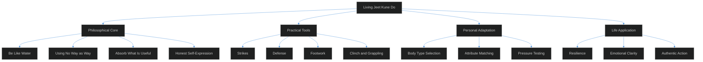

 

Living Jeet Kune Do is a continuous process rather than a finished product. It asks the practitioner to train the body, empty the mind of unnecessary clutter, and meet each moment with clarity and directness. The tools form a library. Body type, personal strengths, and the demands of real situations decide which tools remain and which are set aside. Train the tools, test them under pressure, keep only what works, and continue to refine. Stay fluid. Stay efficient. Stay honest. That is the daily practice of Jeet Kune Do.

  

 
<h1 align="center">JEET KUNE DO STRENGTH TRAINING FRAMEWORK</h1>
<h3 align="center">A PRACTICAL SYSTEM FOR REAL-WORLD CAPACITY, EFFICIENCY, AND CONTINUOUS ADAPTATION.</h3>

  

Jeet Kune Do is not a fixed collection of techniques. It is a living process of honest self-expression, continuous growth, and practical effectiveness. Bruce Lee described it through two core ideas: using no way as way, and having no limitation as limitation. Applied to strength training, every exercise, tool, and method is treated only as a temporary instrument. The practitioner keeps what works under real conditions, discards what fails, and adds what is specifically useful for their own body and life.

The goal is not aesthetic muscle or social approval. The goal is internal strength, the ability to function under chaotic and incomplete recovery, and the maintenance of health inside the real constraints of modern life: imperfect food, limited sleep, chronic stress, restricted time and space, and constant environmental load. Relative strength (force relative to bodyweight), aerobic efficiency, load-bearing durability, mobility under fatigue, and rapid recovery take priority. Extra mass that raises energy cost without improving work capacity is treated as a liability.

Training therefore begins with bodyweight and minimal equipment. Progress is measured by density of work, recoverable volume, and sustained capacity rather than peak load alone. The system remains fluid. What is useful today may be discarded tomorrow when conditions or the individual change.

**Core Philosophical Foundations**

Using no way as way means the practitioner is never trapped by any single method or style. Having no limitation as limitation means the only real restriction is the one the individual refuses to leave.

Simplicity is not reduced power. It is power without waste. The shortest effective path is the strongest path. Anything extra is energy and time given away.

Be like water. Flow around what cannot be broken. Crash through what will not move. Take the shape the moment demands. What no longer serves must be released. Daily decrease of the unnecessary is the path of real growth.

Absorb what is useful. Reject what is useless. Add what is specifically your own. Research your own experience. Everything else is only reference.

Keep only what still works when you are tired. Test every tool under pressure. What survives becomes yours. There are no fixed combinations, only living frameworks built from honest testing.

Stay fluid. Stay efficient. Stay honest.

**The Five Interconnected Pillars**

The framework is organized around five pillars that support one another. No pillar stands alone.

1. Strength and Relative Strength  
Develop the ability to move bodyweight and external loads efficiently through compound patterns, bodyweight exercises, and isometrics. Priority is force production relative to body mass and the ability to express that force under fatigue.

2. Endurance and Work Capacity  
Cultivate sustained output and the capacity to repeat high-effort efforts despite incomplete recovery. This includes aerobic base, density of training, and repeated-effort tolerance.

3. Mobility and Agility  
Preserve joint integrity, loaded range of motion, directional change, and motor control when tired. Mobility without control under load is incomplete.

4. Loaded Carries and Marching Capacity  
Build direct transfer to real-world demands such as rucking, object transport, prolonged locomotion, and the ability to move under load for extended periods.

5. Recovery and Resilience  
Protect sleep quality, manage stress, maintain tissue durability, and restore the capacity to train again within a short interval. Adaptation occurs during recovery, not during the session itself.

These pillars operate under modern constraints. The system never assumes perfect nutrition, unlimited recovery, or ideal conditions.

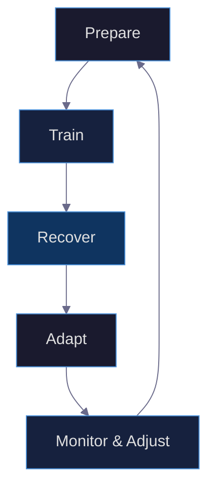

**Preparation Sequence**

Preparation follows a fixed, efficient order that raises temperature, mobilizes joints, activates tissue, primes the nervous system, and rehearses movement without creating unnecessary fatigue.

1. Temperature elevation (light movement or easy locomotion).  
2. Dynamic mobility through full available ranges.  
3. Joint preparation and controlled articulation.  
4. Isometric activation in key positions.  
5. Progressive tendon loading (light to moderate).  
6. Neuromuscular priming (low-load explosive or patterned work).  
7. Movement rehearsal of the day’s primary patterns.

This sequence is short and purposeful. It prepares tissue and the nervous system so that the main work can begin cleanly.

**Isometrics as Foundation**

Isometric holds form the foundational layer of strength. They establish positional tension, tissue tolerance, and motor control before dynamic loading begins. Holds in lengthened, mid-range, and shortened positions build the ability to generate force where it is needed.

Full range of motion remains the default for developing strength across complete patterns and maximizing functional transfer. Lengthened partials (work performed in the stretched position) are applied strategically where mechanical tension is highest. They may serve as primary work on stretch-dominant exercises or as post-failure intensifiers. Shortened partials are restricted to specialized needs such as lockout strength or joint management.

**Tool Library – Selection, Not Prescription**

All tools exist inside a library, not a fixed prescription. Selection is governed by individual structure, available resources, recovery status, and real-world demands. Tools that fail to transfer under fatigue are discarded.

Primary categories:

- Bodyweight patterns (push, pull, squat, hinge, carry, locomotion, core anti-extension and anti-rotation).  
- Bands and minimal elastic resistance.  
- Free weights (dumbbells, kettlebells, barbells where space and skill allow).  
- Cables and machines when they provide useful constant tension or joint-friendly options.  
- Outdoor objects, sandbags, farmer implements, and natural terrain.  
- Grip tools (thick grips, towels, rollers, pinches) because grip links every pull and carry.

Preference is always given to tools that develop relative strength, work capacity, and transfer under fatigue with the least complexity.

**Body Morphology Continuum**

Body structure exists on a continuum. Emphasis shifts according to structure while the same fundamental movement ranges remain available to all.

- Leaner frames often benefit from economy of motion, speed, and angular efficiency.  
- Athletic intermediate builds respond well to balanced pressure and mixed methods.  
- Denser frames often require greater attention to structural integrity, joint management, and metabolic volume.

The body is not a limitation. It is the starting point. Natural weapons and structural strengths are sharpened first. The technique is adapted to the body, never the reverse.

**Nutrition Under Constraint**

Nutrition follows the same constraints-first logic. Food is fuel and building material, not ideology.

Core principles remain adequacy (enough energy to support training and recovery), balance across macronutrients, diversity of food sources, moderation of free sugars, sodium, and highly processed items, and safety.

For strength and work-capacity training:

- Protein targets higher than sedentary minimums when sources allow (commonly 1.4–2.2 g per kg bodyweight distributed across meals).  
- Carbohydrate supports high-intensity and high-volume sessions.  
- Total energy must match or slightly exceed expenditure during periods of progressive training.  
- Hydration is individualized; sweat losses and environment dictate needs.  
- Minimally processed foods form the foundation. Moderately processed items are used for convenience. Highly processed items are limited.

Training-day eating adjusts to the session type. Strength days emphasize energy, protein, and carbohydrate. Longer outdoor or high-volume days increase carbohydrate and electrolyte attention. Recovery days prioritize nutrient density and total intake.

Supplements are secondary. Food remains primary. Evidence-supported options (creatine monohydrate, caffeine in context, protein powder for convenience) are used only when justified by need and recovery status.

**Recovery and Resilience**

Recovery is not passive rest. It is active management of the conditions that allow adaptation.

Sleep quality and duration (generally 7–9 hours for most adults) form the non-negotiable base. Stress management, tissue care (mobility, light movement, appropriate soft-tissue work), and the ability to train again within a short interval determine long-term progress.

Daily monitoring of simple signals guides decisions:

- Sleep quality and duration  
- Energy and motivation  
- Muscle soreness versus joint pain  
- Performance markers  
- Hydration and appetite  
- Stress load  

When signals indicate incomplete recovery, training is modified or reduced. Consistency under imperfect conditions is more valuable than perfect sessions that cannot be repeated.

**Operational Cycle**

The cycle is continuous and simple:

Prepare → Train → Recover → Adapt → Monitor → Adjust → Repeat.

Consistency under real constraints is the decisive variable. The framework is a process, not a finished product. The practitioner trains the body, empties the mind of unnecessary complexity, and meets each moment with clarity and directness.

**Sample Weekly Structure (Adaptable Template)**

A practical template that can be scaled by available time, equipment, and recovery:

| Day | Primary Focus | Secondary Emphasis | Notes |
|-----|---------------|--------------------|-------|
| 1 | Strength – Lower + Carries | Mobility under load | Squats/hinges, isometrics, farmer or ruck work |
| 2 | Strength – Upper + Pull/Push | Grip and core | Horizontal and vertical patterns, isometrics |
| 3 | Work Capacity / Conditioning | Agility and change of direction | Density circuits, short intervals, locomotion |
| 4 | Loaded Carries + Marching | Recovery movement | Rucking, object carries, easy aerobic |
| 5 | Strength – Mixed or Weak Points | Mobility and joint prep | Address individual needs |
| 6 | Optional capacity or skill | Full recovery emphasis | Light technical or outdoor work |
| 7 | Full recovery | Sleep, nutrition, light mobility | No forced training |

Volume, intensity, and density are adjusted according to daily readiness signals. Progress is measured by denser work at the same quality, improved recovery between efforts, and maintained or improved relative strength.

**Exercise Selection Principles**

- Prefer multi-joint patterns that transfer to real movement.  
- Include both push and pull in balanced proportions.  
- Train all major movement patterns to avoid structural imbalance.  
- Progress load, density, or complexity only when form and recovery allow.  
- Prioritize quality of movement under fatigue over maximum load.  
- Test every exercise for usefulness under tired conditions. Discard what fails.

 

**Monitoring and Honest Feedback**

Simple tracking is sufficient:

- External load (what was done: sets, reps, distance, time, weight).  
- Internal response (how the body felt: RPE, breathing, residual fatigue).  
- Recovery markers (sleep, soreness, joint status, motivation).  

Periodic retesting of key patterns (relative strength markers, work-capacity circuits, carry distances or times) guides adjustment. The process is continuous evaluation, not rigid adherence to a plan written weeks earlier.

 

**Integration with Broader Health**

Healthcare sits above the training system. Exercise is one component of health, not a replacement for medical care. Preventive practices, hygiene, appropriate screening, and professional evaluation of persistent pain or unusual symptoms remain essential. Training is modified or paused when health signals require it.

Environmental awareness (heat, cold, air quality, terrain) and personal safety practices are treated as part of the same practical framework.

 

**Closing Orientation**

Jeet Kune Do style strength training is not a destination. It is the continuous process of becoming more effective and more free under real conditions. Train the tools. Test them hard. Keep only what is true for you. Then refine again.

Stay fluid. Stay efficient. Stay honest.

 

> This framework synthesizes practical principles of relative strength, work capacity, mobility under load, real-world carry and locomotion ability, and recovery resilience. It is designed for deployment under imperfect modern constraints. Individual requirements vary by structure, age, recovery capacity, available resources, and health status. Professional medical or coaching guidance should be sought when specific conditions or limitations are present. The system remains open to continuous honest testing and refinement.

  

<h1 align="center">OPERATIONAL CYCLE</h1>
<h3 align="center">PREPARE → TRAIN → RECOVER → ADAPT → MONITOR → ADJUST → REPEAT</h3>

  

The following tables organize practical elements of the system strictly around the continuous operational cycle. All content is drawn from the source data, refined for clarity, consistency, and real-world constraints. Emphasis remains on relative strength, work capacity under incomplete recovery, transfer under fatigue, minimal unnecessary complexity, and honest daily adjustment.

 

### 1. PREPARE

Preparation raises tissue temperature, mobilizes joints, activates positional strength, primes the nervous system, and rehearses the day’s patterns without creating fatigue that reduces main-session quality.

**Preparation Sequence Table**

| Step | Action | Purpose | Duration Guidance | Key Cues | Notes |
|------|--------|---------|-------------------|----------|-------|
| 1 | Temperature elevation | Increase blood flow and tissue readiness | 3–8 minutes | Light locomotion, easy cycling, or shadow movement | Keep intensity low; avoid early fatigue |
| 2 | Dynamic mobility | Open available joint ranges through movement | 4–8 minutes | Controlled swings, circles, and pattern-specific mobility | Full available range; no forced stretching |
| 3 | Joint preparation | Articulate major joints under light load | 2–4 minutes | Controlled rotations and isolations at ankles, hips, spine, shoulders, wrists | Smooth, pain-free motion only |
| 4 | Isometric activation | Establish positional tension and tissue tolerance | 3–6 minutes | Holds in lengthened, mid-range, and shortened positions of key patterns | Build tension without exhaustion |
| 5 | Progressive tendon loading | Prepare connective tissue for higher forces | 2–4 minutes | Light to moderate progressive loading of tendons | Gradual increase only |
| 6 | Neuromuscular priming | Activate fast-twitch recruitment and coordination | 2–5 minutes | Low-load explosive or patterned movements | Quality over quantity |
| 7 | Movement rehearsal | Practice the day’s primary patterns at reduced intensity | 3–6 minutes | Exact patterns planned for the session at sub-maximal effort | Confirm readiness and technique |

**Preparation Readiness Check Table**

| Signal | Ready Indicator | Caution Indicator | Action if Caution |
|--------|-----------------|-------------------|-------------------|
| Joint status | Full comfortable range, no sharp pain | Stiffness or localized pain | Reduce intensity or skip high-load patterns |
| Energy level | Adequate for planned work | Marked fatigue or low motivation | Shorten session or shift to recovery focus |
| Sleep quality (prior night) | Sufficient restorative sleep | Poor or interrupted sleep | Lower volume or density |
| Muscle soreness | Mild residual only | Deep or joint-related pain | Modify or replace affected patterns |
| Hydration | Normal urine color, no thirst | Dark urine or strong thirst | Prioritize fluid intake before training |

 

### 2. TRAIN

Training applies the stimulus across the five pillars. Selection prioritizes multi-joint patterns that transfer under fatigue, relative strength, and work capacity. Tools are chosen from the available library according to structure, resources, and recovery status.

**Training Focus by Pillar Table**

| Pillar | Primary Goal | Preferred Methods | Progress Metric | Constraints Note |
|--------|--------------|-------------------|-----------------|------------------|
| Strength & Relative Strength | Force relative to body mass; expression under fatigue | Compound patterns, isometrics, bodyweight progressions, free weights | Improved density or load at same quality | Excess mass without capacity gain is liability |
| Endurance & Work Capacity | Sustained and repeated high-effort output | Density circuits, short intervals, locomotion under fatigue | More quality work in same time or faster recovery between efforts | Incomplete recovery is expected; manage volume |
| Mobility & Agility | Joint integrity and control under load and fatigue | Loaded mobility, directional change, motor-control drills | Maintained or improved range and control when tired | Mobility without loaded control is incomplete |
| Loaded Carries & Marching | Real-world load transport and prolonged locomotion | Farmer carries, sandbag carries, rucking, object transport | Distance, time, or load at maintained posture | Direct transfer priority |
| Recovery & Resilience (during session) | Tissue tolerance and capacity to continue | Controlled isometrics, quality movement under fatigue | Ability to maintain form as fatigue rises | Stop or modify when form breaks |

**Exercise Selection Principles Table**

| Principle | Application | Discard Criterion |
|-----------|-------------|-------------------|
| Multi-joint priority | Prefer patterns that move multiple joints and transfer to real movement | Isolation that fails to transfer under fatigue |
| Push–pull balance | Include both horizontal and vertical push and pull | Persistent imbalance that creates structural stress |
| Full range default | Train complete available ranges | Forced range that produces pain or loss of control |
| Lengthened partials (strategic) | Use in stretched position where mechanical tension is highest | Over-use that compromises recovery or technique |
| Quality under fatigue | Maintain form as fatigue accumulates | Any tool or load that consistently breaks form |
| Tool library approach | Select from bodyweight, bands, free weights, cables, outdoor objects, grip tools | Any tool that fails real-world transfer test |

**Sample Session Structure Table (Adaptable)**

| Phase | Content | Intensity | Rest Guidance |
|-------|---------|-----------|---------------|
| Main strength block | Primary compound patterns + isometrics | High relative effort | Sufficient for quality next set |
| Work-capacity or carry block | Density circuits, intervals, or loaded locomotion | Moderate to high | Incomplete recovery accepted |
| Mobility / control finisher | Loaded mobility or directional drills | Low to moderate | Minimal |
| Session close | Light movement or breathing down-regulation | Very low | None required |

 

### 3. RECOVER

Recovery is active management of the conditions that allow adaptation. It includes immediate post-session actions, daily nutrition and hydration, sleep, and tissue care.

**Immediate Post-Session Recovery Table**

| Priority Order | Action | Details | Purpose |
|----------------|--------|---------|---------|
| 1 | Fluid replacement | Replace estimated sweat losses; include sodium when losses are high | Restore hydration status |
| 2 | Electrolyte attention | Sodium primary; others as needed by environment and sweat rate | Support fluid balance and function |
| 3 | Carbohydrate | Especially after high-volume or high-intensity sessions | Begin glycogen restoration |
| 4 | Protein | 20–40 g high-quality protein when practical | Support repair processes |
| 5 | Light movement / mobility | Easy locomotion or gentle mobility | Promote circulation without added stress |
| 6 | Cool-down breathing | Slow diaphragmatic breathing | Support parasympathetic shift |

**Daily Recovery Support Table**

| Domain | Target / Practice | Key Considerations |
|--------|-------------------|--------------------|
| Sleep | 7–9 hours quality sleep for most adults | Non-negotiable base for adaptation |
| Nutrition | Adequate total energy + protein (commonly 1.4–2.2 g/kg when sources allow) distributed across meals | Match intake to training load; prioritize whole foods |
| Hydration | Individualized; monitor urine color, thirst, body-mass changes | Environment and sweat rate dictate needs |
| Tissue care | Light mobility, foam rolling or soft-tissue work as tolerated | Avoid aggressive work that increases fatigue |
| Stress management | Identify stressors; use simple coping methods | Chronic stress impairs recovery |
| Alcohol / substances | Minimize or avoid | Impairs sleep, recovery, and performance |

**Training-Day Nutrition Emphasis Table**

| Day Type | Energy Focus | Protein Focus | Carbohydrate Focus | Additional Notes |
|----------|--------------|---------------|--------------------|------------------|
| Strength | Adequate total energy | Higher emphasis | Support performance | Pre- and post-session intake useful |
| Work capacity / conditioning | Match expenditure | Maintain baseline | Higher when volume is high | Fluids and electrolytes important |
| Loaded carries / outdoor | Sufficient total energy | Maintain | Elevated for longer sessions | Sodium replacement may be needed |
| Recovery day | Nutrient-dense total intake | Maintain | Moderate | Support repair without excess volume |

 

### 4. ADAPT

Adaptation is the outcome of the stimulus plus recovery. It is expressed as improved relative strength, higher work capacity, better mobility under fatigue, greater carry/marching ability, and faster return to readiness.

**Adaptation Markers Table**

| Domain | Positive Adaptation Signal | Stagnation or Negative Signal |
|--------|----------------------------|-------------------------------|
| Relative strength | Same or higher force relative to body mass | Declining performance at same body mass |
| Work capacity | More quality work in same time or faster recovery between efforts | Persistent inability to recover between efforts |
| Mobility under load | Maintained or improved range and control when tired | Loss of range or control under fatigue |
| Carry / marching | Longer distance, higher load, or better posture under load | Breakdown in posture or reduced capacity |
| Recovery speed | Quicker return to readiness after sessions | Prolonged residual fatigue or soreness |
| Body composition | Functional tissue maintained or improved without excess energy cost | Mass gain that raises energy cost without capacity gain |

 

### 5. MONITOR

Monitoring uses simple, practical signals to determine readiness and guide decisions. Complex tracking is unnecessary; consistency of basic observations is sufficient.

**Daily Monitoring Signals Table**

| Signal Category | Specific Markers | How to Observe | Decision Implication |
|-----------------|------------------|----------------|----------------------|
| Sleep | Duration and quality | Subjective rating + hours | Poor sleep → reduce volume or intensity |
| Energy & motivation | Subjective energy and desire to train | Simple scale (low / moderate / high) | Low → modify or recover |
| Muscle status | Soreness level and location | Distinguish muscle soreness from joint pain | Joint pain → protect or rest affected area |
| Joint status | Swelling, stiffness, pain | Daily check of key joints | Persistent issues → professional evaluation |
| Performance | Quality of recent sessions | Form, density, or load maintained | Decline → investigate recovery or load |
| Hydration | Thirst, urine color, body-mass change | Simple visual and scale checks | Deficit → prioritize fluids |
| Stress & appetite | Mental load and hunger signals | Subjective rating | High stress or appetite loss → reduce training stress |
| Resting heart rate / HRV (optional) | Elevated resting HR or reduced HRV | Morning measurement if tracked | Elevated stress signal → recovery focus |

**Know-When-Not-to-Train Table**

| Symptom | Action | Reason |
|---------|--------|--------|
| Severe or unusual chest pain | Stop and seek urgent medical care | Possible cardiac issue |
| Fainting or severe dizziness | Stop and seek urgent medical care | Neurological or cardiovascular concern |
| Severe breathing difficulty | Stop and seek urgent medical care | Respiratory emergency |
| New neurological symptoms | Stop and seek medical evaluation | Possible neurological issue |
| Significant heat-illness signs | Stop, cool, seek care if needed | Heat exhaustion or stroke risk |
| Serious injury (fracture, severe sprain) | Medical evaluation | Structural damage |
| Persistent unexplained weakness | Medical evaluation | Possible systemic issue |

 

### 6. ADJUST

Adjustment is the active response to monitoring data. Volume, intensity, density, exercise selection, or full rest are modified according to signals. Consistency under imperfect conditions is valued more than perfect but unsustainable sessions.

**Adjustment Decision Table**

| Monitoring Outcome | Primary Adjustment | Secondary Options | Goal |
|--------------------|--------------------|-------------------|------|
| Full readiness | Proceed with planned session | Maintain or slightly increase density | Progressive stimulus |
| Partial readiness | Reduce volume or intensity | Replace high-load with lower-load or isometric work | Maintain stimulus without excess fatigue |
| Poor recovery | Shift to recovery-focused session or full rest | Emphasize sleep, nutrition, light mobility | Restore capacity |
| Persistent joint issue | Protect or temporarily remove offending pattern | Seek professional evaluation if ongoing | Preserve long-term capacity |
| Environmental stress (heat, poor air, etc.) | Reduce intensity or move indoors | Increase fluid and electrolyte attention | Safety first |
| Accumulated fatigue over days | Deload volume or density for several days | Focus on quality movement and recovery practices | Prevent over-reaching |

**Progression Variables Table (When Ready)**

| Variable | How to Progress | Limit Condition |
|----------|-----------------|-----------------|
| Density | More quality work in same time | Form remains intact |
| Load | Gradual increase when form and recovery allow | Relative strength priority |
| Complexity | Add directional change, unstable surfaces, or fatigue | Control is maintained |
| Volume | Additional sets or sessions only when recovery supports | Avoid chronic incomplete recovery |
| Carry / march demand | Distance, load, or terrain difficulty | Posture and breathing stay controlled |

 

### 7. REPEAT

The cycle returns to Prepare. Consistency of the process under real constraints is the decisive variable. Each repetition is informed by the previous Monitor and Adjust steps. No phase is permanent; the system remains open to continuous honest testing and refinement.

**Cycle Integrity Checklist Table**

| Checkpoint | Question | Desired Answer |
|------------|----------|----------------|
| Prepare | Was tissue and nervous system readiness achieved without excess fatigue? | Yes |
| Train | Was the stimulus applied with quality under the available recovery? | Yes |
| Recover | Were sleep, nutrition, hydration, and tissue care addressed? | Yes |
| Adapt | Are positive markers appearing over time? | Progressive trend |
| Monitor | Were simple daily signals observed and recorded? | Yes |
| Adjust | Was the next session modified according to signals? | Yes |
| Overall | Is the process sustainable under current life constraints? | Yes |

This operational structure keeps every action subordinate to practical effectiveness, recovery capacity, and honest feedback. The cycle continues indefinitely, refined by what actually works for the individual under real conditions.

  

<h1 align="center">GYM EQUIPMENT</h1>

  

> **Disclaimer:** This master equipment table is provided for educational and informational purposes only. It does not constitute medical, fitness, or training advice. Individual requirements vary by age, health status, training experience, injury history, available equipment, and goals. Always consult a qualified healthcare professional or certified trainer before beginning or modifying any exercise program. Proper form, progressive loading, and recovery take priority over load or volume. Stop any exercise that causes sharp pain and seek professional evaluation for persistent issues. Equipment use carries inherent risk of injury. Users assume full responsibility for safe application. This table is a general reference only and does not replace individualized programming or professional instruction.

 

| Category | Equipment | Primary Function | Primary Muscle Groups | Secondary Muscle Groups | Typical Exercises / Use Cases |
|----------|-----------|------------------|-----------------------|-------------------------|-------------------------------|
| Bodyweight / Calisthenics | Push-up Board / Handles | Structured push variations; deeper range | Chest (Pectoralis Major/Minor) | Anterior Deltoids, Triceps, Core | Push-ups, deficit push-ups, knee push-ups |
| Bodyweight / Calisthenics | Parallettes | Elevated support for advanced calisthenics | Chest, Shoulders, Triceps, Core | Lats, Stabilizers | Push-ups, L-sits, handstand progressions |
| Bodyweight / Calisthenics | Handstand Push-up Bars | Inverted pressing | Shoulders (Deltoids) | Triceps, Upper Chest, Core | Handstand push-ups |
| Bodyweight / Calisthenics | Door-Frame / Wall-Mounted Pull-up Bar | Vertical pulling | Latissimus Dorsi, Upper Back | Biceps, Rear Deltoids, Forearms, Core | Pull-ups, chin-ups, dead hangs, muscle-ups |
| Bodyweight / Calisthenics | Gymnastic Rings | Unstable bodyweight training | Full Upper Body + Core | Stabilizers, Grip | Rows, pull-ups, dips, support holds |
| Bodyweight / Calisthenics | Dip Bars | Parallel-bar support and dips | Chest, Triceps | Anterior Deltoids, Core | Dips, support holds |
| Bodyweight / Calisthenics | Ab Wheel / Roller | Anti-extension core work | Rectus Abdominis, Core | Hip Flexors, Shoulders | Rollouts, knee rollouts |
| Bodyweight / Calisthenics | Suspension Trainer | Adjustable full-body resistance | Full Body | Core, Stabilizers | Rows, presses, lunges, core variations |
| Resistance Bands | Loop Bands / Mini Loop Bands | Variable elastic resistance | Glutes, Hips, Full Body | Stabilizers | Squats, glute bridges, lateral walks, activation |
| Resistance Bands | Tube Bands + Handles | Portable resistance for push/pull | Chest, Back, Shoulders, Arms | Core | Presses, rows, curls, pushdowns |
| Resistance Bands | Heavy / Power Bands | High-tension assistance or resistance | Full Body | Grip | Assisted pull-ups, banded squats, deadlifts |
| Free Weights – Dumbbells | Fixed / Hex / Rubber-Coated Dumbbells | Unilateral and bilateral loading | Full Body (pattern-dependent) | Stabilizers | Presses, rows, squats, lunges, curls, raises |
| Free Weights – Dumbbells | Adjustable / Loadable Dumbbells | Progressive loading in limited space | Full Body | Stabilizers | Same as fixed dumbbells with adjustable load |
| Free Weights – Barbells | Olympic / Standard Barbell | Heavy compound loading | Full Body (pattern-dependent) | Core, Grip | Squats, deadlifts, bench press, rows, overhead press |
| Free Weights – Barbells | EZ Curl Bar | Reduced wrist stress for arm work | Biceps, Triceps | Forearms | Curls, skull crushers |
| Free Weights – Barbells | Trap / Hex Bar | Neutral-grip deadlift variation | Posterior Chain, Quads | Core, Grip | Trap-bar deadlifts, carries |
| Free Weights – Kettlebells | Cast-Iron / Competition Kettlebells | Ballistic and strength-endurance work | Posterior Chain, Core, Shoulders | Grip, Stabilizers | Swings, goblet squats, cleans, presses, carries |
| Free Weights – Functional | Sandbag | Odd-object strength | Full Body | Core, Grip | Squats, carries, cleans, shouldering |
| Free Weights – Functional | Farmer’s Handles / Loaded Carries | Grip + loaded locomotion | Grip, Traps, Core, Posterior Chain | Full Body | Farmer walks, suitcase carries |
| Free Weights – Functional | Medicine / Slam / Wall Ball | Power and core | Core, Shoulders, Full Body | Legs | Slams, throws, Russian twists, wall balls |
| Machines – Chest | Seated / Incline Chest Press | Guided horizontal / incline pressing | Chest | Anterior Deltoids, Triceps | Chest press variations |
| Machines – Chest | Pec Deck / Fly Machine | Isolation fly movement | Chest | Anterior Deltoids | Flyes |
| Machines – Back | Lat Pulldown | Vertical pulling | Latissimus Dorsi | Biceps, Rear Deltoids | Wide / close-grip pulldowns |
| Machines – Back | Seated Cable Row / T-Bar Row | Horizontal pulling | Mid-Back, Lats | Biceps, Rear Deltoids | Rows |
| Machines – Shoulders | Seated Shoulder Press | Guided overhead pressing | Deltoids | Triceps | Overhead press |
| Machines – Shoulders | Lateral Raise Machine | Isolation lateral raise | Lateral Deltoids | Traps | Lateral raises |
| Machines – Legs | Leg Press (Horizontal / 45°) | Guided lower-body pressing | Quadriceps, Glutes | Hamstrings, Core | Leg press |
| Machines – Legs | Leg Extension | Isolated knee extension | Quadriceps | — | Leg extensions |
| Machines – Legs | Lying / Seated Leg Curl | Isolated knee flexion | Hamstrings | — | Leg curls |
| Machines – Legs | Hack Squat | Guided squat variation | Quadriceps, Glutes | Core | Hack squats |
| Machines – Legs | Hip Abductor / Adductor | Isolated hip movement | Hip Abductors / Adductors | Glutes | Abductions, adductions |
| Machines – Legs | Standing / Seated Calf Raise | Isolated plantar flexion | Gastrocnemius / Soleus | — | Calf raises |
| Machines – Core / Posterior | Glute-Ham Developer (GHD) | Posterior chain + core | Hamstrings, Glutes, Erector Spinae | Core | Glute-ham raises, back extensions |
| Machines – Core / Posterior | Roman Chair / Hyperextension | Back extension | Erector Spinae | Glutes, Hamstrings | Back extensions |
| Cables / Pulleys | Dual Cable Crossover / Functional Trainer | Constant-tension multi-planar work | Full Body (pattern-dependent) | Stabilizers | Flyes, rows, presses, face pulls, woodchops |
| Cables / Pulleys | Lat Pulldown / Low Row Station | Vertical and horizontal pulling | Lats, Mid-Back | Biceps, Rear Deltoids | Pulldowns, rows |
| Cables / Pulleys | Single Cable Station | Isolation and unilateral work | Pattern-dependent | Stabilizers | Curls, pushdowns, lateral raises, face pulls |
| Power Racks / Stands | Power Rack / Half Rack / Squat Stands | Safe heavy compound lifting | Full Body (squat, press, pull) | Core | Squats, overhead press, rack pulls, pull-ups |
| Power Racks / Stands | Smith Machine | Guided barbell path | Quads, Glutes, Chest, Shoulders | — | Squats, presses |
| Benches | Flat / Adjustable / FID Bench | Support for pressing and isolation | Chest, Shoulders, Triceps (pressing) | Core | Bench press, incline press, flyes, seated work |
| Benches | Preacher Curl Bench | Isolated biceps support | Biceps | — | Preacher curls |
| Grip / Forearm | Hand Grippers (Adjustable / Progressive) | Crush grip strength | Forearm Flexors, Grip | — | Gripper squeezes |
| Grip / Forearm | Wrist Roller | Wrist flexor / extensor endurance | Wrist Flexors / Extensors | Forearms | Wrist roller |
| Grip / Forearm | Wrist Curl Bar | Isolated wrist work | Wrist Flexors / Extensors | Forearms | Wrist curls, reverse wrist curls |
| Grip / Forearm | Fat-Grip / Towel Attachments | Thick-grip overload | Forearms, Grip | — | Applied to pulls, carries, hangs |
| Grip / Forearm | Pinch Blocks / Plate Pinches | Pinch grip | Thumb, Pinch Strength | Forearms | Plate pinches |
| Grip / Forearm | Gyro Ball | Dynamic forearm endurance | Wrist, Forearm | — | Gyro rotation |
| Cardio / Conditioning | Jump Rope / Speed / Weighted Rope | Cardio + coordination | Full Body (calves, shoulders, core) | — | Skipping intervals |
| Cardio / Conditioning | Battle Rope | High-intensity conditioning + grip | Full Body, Grip, Core | Shoulders | Waves, slams |
| Cardio / Conditioning | Plyometric Box | Explosive lower-body power | Quads, Glutes, Calves | Core | Box jumps, step-ups |
| Cardio / Conditioning | Agility Ladder / Cones | Footwork and change of direction | Lower Body, Core | — | Ladder drills, cone drills |
| Cardio / Conditioning | Rowing Machine | Full-body cardio | Posterior Chain, Lats, Core, Legs | — | Steady or interval rowing |
| Cardio / Conditioning | Exercise / Spin Bike | Lower-body cardio | Quads, Hamstrings, Calves | — | Steady or interval cycling |
| Mobility / Recovery | Yoga / Exercise Mat | Floor work and stretching surface | — | — | Stretching, mobility, core work |
| Mobility / Recovery | Foam Roller | Self-myofascial release | — | — | Rolling major muscle groups |
| Mobility / Recovery | Massage / Lacrosse Ball | Targeted trigger-point release | — | — | Spot release |
| Mobility / Recovery | Stretching Strap / Yoga Blocks / Wheel | Assisted and supported mobility | — | — | Stretching, spinal mobility |
| Mobility / Recovery | Percussion Massager | Deep tissue recovery | — | — | Soft-tissue work (avoid joints) |
| Specialty / Weighted | Weighted Vest / Dip Belt | Added load for bodyweight or carries | Full Body (pattern-dependent) | — | Weighted pull-ups, dips, walks |
| Specialty / Weighted | Ankle / Wrist Weights | Localized added load | Pattern-dependent | — | Leg raises, walks |
| Specialty | Sled / Prowler | Push / pull conditioning | Full Body, Posterior Chain | Core, Grip | Sled pushes, drags |

**Notes on Hierarchy and Consistency**  
- Categories follow functional grouping: bodyweight → resistance bands → free weights → machines → cables → racks/benches → grip → cardio → mobility.  
- Primary muscles are those most heavily loaded by the equipment’s main use. Secondary muscles are consistently recruited stabilizers or synergists.  
- Compound equipment (barbells, kettlebells, racks) lists “Full Body (pattern-dependent)” because the same tool trains different groups according to the exercise selected.  
- Isolation machines list only the primary target.  
- All entries are drawn from the source data and standardized for consistent language and column structure.

  

<h1 align="center">PRE-WORKOUT PREPARATION & TIGHTNESS WARM-UP</h1>

  

| Phase | Sub-Phase | Component / Exercise | Primary Function | Dosage / Guidance | Key Notes |
|-------|-----------|----------------------|------------------|-------------------|-----------|
| 1. Temperature & Circulation | General Movement | Walking / Easy Marching in Place / Light Step-Touch / Easy Jog in Place / Heel-to-Glute Walk-Jog / High-Knee March / Cycling / Rowing / Jumping Jacks / Step-Ups / Low-Intensity Skipping / Shadow Boxing | Raise muscle temperature and blood flow | 3–7 min total (or 2–3 min focused) | Low intensity; rhythmic; soft landing |
| 2. Dynamic Mobility | Neck & Upper Body | Chin Tucks / Neck Turns / Shoulder Rolls / Arm Circles / Arm Swings Across Chest / Overhead Reaches / Torso Rotations | Cervical, shoulder, and thoracic mobility | 5–20 reps or 10 forward + 10 backward | Controlled; no force; gentle retraction |
| 2. Dynamic Mobility | Spine & Core | Cat-Cow / Standing Side Bends / Standing Pelvic Tilts / Hip Circles | Spinal and pelvic mobility | 8–15 reps or 8–10 each direction | Controlled; breathe; anterior-posterior tilt |
| 2. Dynamic Mobility | Hips & Glutes | Hip Openers / Standing Knee Circles / Leg Swings Front-to-Back / Leg Swings Side-to-Side / Bodyweight Good Mornings / Glute Bridges / World’s Greatest Stretch / Deep Squat Pry / Cossack Squats | Hip mobility, external rotation, hinge, and multi-planar range | 8–15 reps or 4–6 each side | Controlled arc; soft knees; elbow-to-knee push |
| 2. Dynamic Mobility | Legs & Ankles | Bodyweight Squats / Reverse Lunges / Walking Lunges / Lateral Lunges / Knee-to-Chest Steps / Butt Kicks / Calf Raises / Ankle Circles | Lower-body and ankle mobility | 6–20 reps or 20–30 sec | Full available depth; controlled step; heel to glute |
| 3. Joint Preparation (CARs) | Neck | Chin Tucks / Controlled Rotations | Cervical readiness | Controlled; pain-free | Smooth motion only |
| 3. Joint Preparation (CARs) | Shoulders | Scapular Circles / Scapular Push-Ups / Wall Slides / Band Pull-Aparts / External Rotations | Shoulder girdle readiness | Controlled; pain-free | Smooth motion only |
| 3. Joint Preparation (CARs) | Elbows | Flexion-Extension / Pronation-Supination | Elbow readiness | Controlled; pain-free | Smooth motion only |
| 3. Joint Preparation (CARs) | Wrists | Wrist Circles / Flexion-Extension / Finger Opening-Closing | Wrist readiness | Controlled; pain-free | Smooth motion only |
| 3. Joint Preparation (CARs) | Hips | Hip CARs / 90/90 Transitions / Hip Airplanes | Hip readiness | Controlled; pain-free | Smooth motion only |
| 3. Joint Preparation (CARs) | Knees | Controlled Knee Bends / Terminal Knee Extensions | Knee readiness | Controlled; pain-free | Smooth motion only |
| 3. Joint Preparation (CARs) | Ankles | Ankle CARs / Tibialis Raises / Calf Raises / Knee-over-Toe Movements | Ankle readiness | Controlled; pain-free | Smooth motion only |
| 4. Isometric Activation | Lower Body | Wall Sit / Split-Squat Hold / Glute Bridge Hold / Calf-Raise Hold | Positional lower-body activation | 15–45 sec; 1–2 sets | Short holds; no fatigue |
| 4. Isometric Activation | Core | Plank / Side Plank / Copenhagen Plank | Core positional activation | 15–45 sec; 1–2 sets | Maintain alignment |
| 4. Isometric Activation | Upper Body | Push-Up Hold / Scapular Hold / Grip Hold | Upper-body positional activation | 10–30 sec; 1–2 sets | Controlled |
| 5. Tendon Preparation | Achilles / Calf | Ankle Pumps / Calf Raises / Isometric Calf Holds | Progressive tendon loading | Light-moderate; controlled | Gradual only |
| 5. Tendon Preparation | Patellar | Mini Squats / Spanish Squat / Wall Sit | Progressive tendon loading | Light-moderate; controlled | Gradual only |
| 5. Tendon Preparation | Hamstring | Glute Bridges / Hip Hinges / Light RDLs | Progressive tendon loading | Light-moderate; controlled | Gradual only |
| 5. Tendon Preparation | Rotator Cuff | Band External / Internal Rotation | Progressive tendon loading | Light-moderate; controlled | Gradual only |
| 5. Tendon Preparation | Elbow / Wrist | Light Wrist Curls / Reverse Curls / Pronation-Supination / Grip Work | Progressive tendon loading | Light-moderate; controlled | Gradual only |
| 6. Neuromuscular Activation | Balance & Stability | Single-Leg Balance / Single-Leg Reach | Coordination and stability | Low volume; high quality | Controlled |
| 6. Neuromuscular Activation | Core Coordination | Bird Dog / Dead Bug / Bear Crawl / Inchworms | Core and contralateral control | Low volume; high quality | Maintain alignment |
| 6. Neuromuscular Activation | Agility & Power Prep | Lateral Shuffle / Carioca / Low Pogo Jumps / Low Skips / Low Bounds / Controlled Hops / Landing Practice / Plank Shoulder Taps / Slow Mountain Climbers | Change-of-direction and landing mechanics | Low volume; high quality | Not conditioning |
| 7. Movement-Pattern Rehearsal | Squat | Bodyweight Squat → Goblet → Progressive Warm-Up Sets | Pattern-specific preparation | Technique first; gradual load | Resemble main work |
| 7. Movement-Pattern Rehearsal | Deadlift | Hip Hinge → Unloaded RDL → Light Deadlift → Working Weight | Pattern-specific preparation | Technique first; gradual load | Resemble main work |
| 7. Movement-Pattern Rehearsal | Bench | Arm Circles → Band Work → Empty Bar → Progressive Sets | Pattern-specific preparation | Technique first; gradual load | Resemble main work |
| 7. Movement-Pattern Rehearsal | Overhead Press | Shoulder Mobility → Band External Rotation → Empty Bar → Progressive Sets | Pattern-specific preparation | Technique first; gradual load | Resemble main work |
| 7. Movement-Pattern Rehearsal | Pull-Up | Scapular Pull-Ups → Assisted → Working Sets | Pattern-specific preparation | Technique first; gradual load | Resemble main work |
| 8. Progressive Ramp-Up | Strength Specific | Empty Bar → Intermediate Loads → Working Set | Specific preparation for working weight | Example: Empty ×10 → 40% ×8 → 60% ×5 → 75% ×3 → 90% ×1–2 → Working | Maintain technique |
| 9. Potentiation (Optional) | Explosive | Pogo / Vertical / Broad Jumps / Med-Ball Throws / Explosive Push-Ups / Kettlebell Swings / Short Accelerations / Light Sled Pushes | Explosive activation for power/speed sessions | Low volume; high quality | Optional; not conditioning |
| 10. Sport / Workout-Specific | Strength | Mobility → Activation → Ramp-Up Sets | Exact system preparation | General then specific | Avoid fatigue |
| 10. Sport / Workout-Specific | Running | Jog → Dynamic Mobility → Drills → Strides | Exact system preparation | Gradual intensity | Avoid fatigue |
| 10. Sport / Workout-Specific | Cycling | Easy Cycling → Cadence Increases → Short Harder Efforts | Exact system preparation | Gradual intensity | Avoid fatigue |
| 10. Sport / Workout-Specific | Martial Arts | Mobility → Footwork → Shadowboxing → Technical Drills | Exact system preparation | Skill focus | Avoid fatigue |
| 10. Sport / Workout-Specific | Basketball | Jog → Mobility → Lateral Movement → Jumps → Shooting | Exact system preparation | Skill focus | Avoid fatigue |
| 10. Sport / Workout-Specific | Swimming | General Warm-Up → Shoulder Mobility → Easy Laps → Progressive Intensity | Exact system preparation | Gradual intensity | Avoid fatigue |

**Simple 10-Minute Version**

| Exercise | Dosage |
|----------|--------|
| March / Jog in Place | 60 sec |
| Arm Circles | 30 sec |
| Shoulder Rolls | 30 sec |
| Torso Rotations | 30 sec |
| Hip Circles | 30 sec |
| Leg Swings | 30 sec per leg |
| Bodyweight Squats | 15 reps |
| Walking / Reverse Lunges | 8 per leg |
| Inchworms | 5–8 reps |
| Cat-Cow | 10 reps |
| Glute Bridges | 15 reps |
| Calf Raises | 20 reps |

**Area-Specific Additions for Particular Tightness**

| Restricted Area | Recommended Additions | Dosage Guidance |
|-----------------|-----------------------|-----------------|
| Neck / Shoulders | Chin Tucks + Shoulder Rolls + Arm Circles | Controlled; 8–12 reps or 20–30 sec |
| Chest | Gentle Doorway / Chest Stretch | Mild; post-warm-up if needed |
| Upper Back | Cat-Cow + Thoracic Rotations | 8–12 reps |
| Lower Back | Pelvic Tilts + Cat-Cow | 10–15 reps |
| Hips | Hip Circles + Hip Openers + Lunges | 8–12 per side |
| Hamstrings | Leg Swings + Good Mornings | 10–15 reps |
| Quads | Controlled Knee Bends + Reverse Lunges | 8–12 reps |
| Calves | Ankle Pumps + Calf Raises | 15–20 reps |
| Ankles | Ankle Circles + Controlled Knee-over-Toe | 10 each direction |

**Practical 10–20 Minute Template**

| Phase | Approx. Time |
|-------|--------------|
| Temperature / Circulation | 3–5 min |
| Dynamic Mobility | 3–5 min |
| Joint Preparation | 2–3 min |
| Muscle / Isometric Activation | 2–3 min |
| Tendon Preparation | 2–3 min |
| Neuromuscular Activation | 1–3 min |
| Exercise-Specific Ramp-Up | 3–7 min |

**Core Sequence**  
Temperature → Circulation → Dynamic Mobility → Joint Preparation → Muscle Activation → Isometrics → Tendon Loading → Neuromuscular Activation → Movement Rehearsal → Progressive Ramp-Up → (Optional Potentiation) → Train

  

<h1 align="center">BODYWEIGHT EXERCISES</h1>

  

| Category | Sub-Category | Exercise | Primary Function | Primary Muscles | Secondary / Notes | Difficulty |
|----------|--------------|----------|------------------|-----------------|-------------------|------------|
| Push | Horizontal | Standard Push-Up | Horizontal pressing | Chest | Anterior Deltoids, Triceps, Core | Basic |
| Push | Horizontal | Wide Push-Up | Horizontal pressing (wider) | Chest | Anterior Deltoids, Triceps, Core | Basic |
| Push | Horizontal | Narrow / Close-Grip / Diamond Push-Up | Horizontal pressing (triceps emphasis) | Triceps, Chest | Anterior Deltoids, Core | Basic–Intermediate |
| Push | Horizontal | Incline Push-Up | Horizontal pressing (easier angle) | Chest | Anterior Deltoids, Triceps, Core | Basic |
| Push | Horizontal | Decline Push-Up | Horizontal pressing (harder angle) | Chest, Shoulders | Triceps, Core | Intermediate |
| Push | Horizontal | Knee / Wall Push-Up | Horizontal pressing (regression) | Chest | Anterior Deltoids, Triceps, Core | Basic |
| Push | Horizontal | Staggered / Offset / Uneven Push-Up | Unilateral horizontal pressing | Chest | Anterior Deltoids, Triceps, Core, Stabilizers | Intermediate |
| Push | Horizontal | Archer / Typewriter Push-Up | Unilateral horizontal pressing | Chest | Anterior Deltoids, Triceps, Core | Intermediate–Advanced |
| Push | Horizontal | One-Arm / Assisted One-Arm Push-Up | Unilateral horizontal pressing | Chest, Triceps | Core, Stabilizers | Advanced |
| Push | Horizontal | Pseudo-Planche / Planche Push-Up | Advanced horizontal pressing | Chest, Shoulders, Triceps | Core, Stabilizers | Advanced |
| Push | Horizontal | Hindu / Dive-Bomber Push-Up | Dynamic full-range pressing | Chest, Shoulders, Triceps | Core, Mobility | Intermediate |
| Push | Horizontal | Spiderman / T / Rotational / Shoulder-Tap Push-Up | Dynamic / rotational pressing | Chest, Core | Shoulders, Triceps, Obliques | Intermediate |
| Push | Horizontal | Explosive / Clap / Double-Clap / Superman / Behind-Back Clap Push-Up | Plyometric pressing | Chest, Shoulders, Triceps | Core, Power | Intermediate–Advanced |
| Push | Vertical | Pike / Elevated Pike Push-Up | Vertical pressing progression | Shoulders | Triceps, Upper Chest, Core | Intermediate |
| Push | Vertical | Wall / Assisted / Freestanding / Deficit Handstand Push-Up | Vertical pressing | Shoulders | Triceps, Upper Chest, Core | Intermediate–Advanced |
| Pull | Vertical | Pull-Up / Chin-Up / Neutral / Wide / Close / Mixed-Grip | Vertical pulling | Lats, Upper Back | Biceps, Rear Deltoids, Grip, Core | Intermediate |
| Pull | Vertical | Commando / Archer / Typewriter / Towel / L-Sit / Knee-Raise / Chest-to-Bar / Sternum Pull-Up | Advanced / varied vertical pulling | Lats, Upper Back | Biceps, Grip, Core | Intermediate–Advanced |
| Pull | Vertical | Muscle-Up / Bar / Strict Muscle-Up | Pull-to-press transition | Lats, Chest, Triceps, Shoulders | Core, Grip | Advanced |
| Pull | Vertical | Explosive / One-Arm Assisted / One-Arm / Negative One-Arm Pull-Up | Unilateral / explosive vertical pulling | Lats, Upper Back | Biceps, Grip, Core | Advanced |
| Pull | Scapular / Hang | Scapular Pull-Up / Dead Hang / Active Hang / Flexed-Arm Hang / Commando / Towel / Fingertip Hang | Scapular control & grip endurance | Upper Back, Grip | Forearms, Shoulders | Basic–Intermediate |
| Pull | Horizontal | Bodyweight / Inverted / Feet-Elevated / Archer / One-Arm Row | Horizontal pulling | Mid-Back, Lats | Biceps, Rear Deltoids, Core | Basic–Advanced |
| Squat | Bilateral | Bodyweight / Wide / Narrow / Sumo / Prisoner / Hindu / Deep / Pause / Tempo / Pulse / Half / Quarter Squat | Knee-dominant lower-body | Quads, Glutes | Core, Hamstrings | Basic–Intermediate |
| Squat | Isometric | Wall Sit | Isometric knee-dominant hold | Quads, Glutes | Core | Basic |
| Squat | Unilateral | Assisted Single-Leg / Single-Leg / Pistol / Box Pistol / Shrimp / Skater / Cossack / Sissy / Cyclist Squat | Unilateral knee-dominant | Quads, Glutes | Core, Stabilizers, Balance | Intermediate–Advanced |
| Squat | Split | Split / Bulgarian / Rear-Foot-Elevated Split Squat | Split-stance knee-dominant | Quads, Glutes | Core, Stabilizers | Intermediate |
| Squat | Explosive | Jump / Tuck / 180° / 360° / Squat-to-Knee-Tuck | Plyometric squat | Quads, Glutes, Calves | Core, Power | Intermediate–Advanced |
| Lunge | Linear | Forward / Reverse / Walking / Alternating / Stationary / Split-Stance / Deficit Lunge | Split-stance locomotion | Quads, Glutes | Hamstrings, Core, Stabilizers | Basic–Intermediate |
| Lunge | Lateral / Multiplanar | Lateral / Curtsy / Crossover / Skater / Pendulum Lunge | Multiplanar split-stance | Quads, Glutes, Hips | Core, Stabilizers | Intermediate |
| Lunge | Explosive | Jumping / Switch / Split-Jump / Bulgarian Split Jump | Plyometric lunges | Quads, Glutes | Core, Power | Intermediate–Advanced |
| Lunge | Dynamic | Reverse / Forward / Lateral Lunge to Knee Drive | Dynamic split + knee drive | Quads, Glutes, Hip Flexors | Core | Intermediate |
| Posterior Chain | Bridge / Thrust | Glute Bridge / Single-Leg / Marching / Feet-Elevated / Long-Lever / Hip Thrust / Single-Leg Hip Thrust / Frog Pump | Hip extension | Glutes | Hamstrings, Core | Basic–Intermediate |
| Posterior Chain | Isolation | Donkey Kick / Straight-Leg / Fire Hydrant / Standing Hip Extension | Isolated hip extension / abduction | Glutes, Hips | Core | Basic |
| Posterior Chain | Hinge | Single-Leg RDL / Bodyweight Good Morning / Reverse Hyperextension | Hip hinge | Hamstrings, Glutes | Core, Lower Back | Intermediate |
| Posterior Chain | Curl | Nordic / Assisted Nordic / Hamstring Walkout / Sliding Leg Curl / Single-Leg Hamstring Bridge | Knee flexion / posterior chain | Hamstrings | Glutes, Core | Intermediate–Advanced |
| Calves | Raise | Standing / Single-Leg / Bent-Knee / Seated / Donkey / Isometric Calf Raise | Plantar flexion | Gastrocnemius / Soleus | — | Basic–Intermediate |
| Calves | Tibialis | Tibialis Raise / Single-Leg Tibialis Raise | Dorsiflexion | Tibialis Anterior | — | Basic |
| Calves | Locomotion / Plyometric | Heel / Toe Walk / Ankle Hops / Pogos / Single-Leg Pogos / Jump Rope (no rope) / Calf Bounce | Lower-leg endurance & reactivity | Calves | — | Basic–Intermediate |
| Core | Flexion | Crunch / Sit-Up / Half / Curl-Up / Reverse / V-Up / Tuck-Up / Jackknife / Toe Touch / Butterfly / Straight-Leg Sit-Up | Spinal flexion | Rectus Abdominis | Hip Flexors | Basic–Intermediate |
| Core | Lower Abs | Lying / Straight-Leg / Bent-Knee / Hanging Knee / Hanging Leg / Toes-to-Bar / Reverse / Flutter / Scissor / Alternating Leg Raise | Hip flexion + lower abs | Lower Abs, Hip Flexors | Core | Intermediate–Advanced |
| Core | Anti-Extension | Plank / Long-Lever / RKC / Body-Saw / Walk / Shoulder-Tap / Bear / Hollow Hold / Hollow Rock / Dead Bug / Bird Dog | Anti-extension bracing | Core (Transverse, Rectus) | Shoulders, Stabilizers | Basic–Intermediate |
| Core | Anti-Rotation / Obliques | Side Plank / Hip Lift / Reach-Through / Copenhagen / Russian Twist / Bicycle / Cross-Body Mountain Climber / Windshield Wipers / Hanging Windshield / Oblique V-Up / Heel Touches | Anti-rotation / lateral flexion | Obliques | Core, Stabilizers | Intermediate–Advanced |
| Full-Body | Conditioning | Burpee / Squat Thrust / Mountain Climber / Bear / Crab / Inchworm / Beast / Leopard / Spiderman / Duck Walk / Frog Jump / Broad Jump / Bear Jump / Tuck Jump / Burpee variations | Integrated conditioning | Full Body | Conditioning, Coordination | Intermediate |
| Full-Body | Ground Flow | Sit-Through / Beast Reach / Beast Shoulder Tap / Crab Reach / Shin Box Get-Up / Technical Stand-Up / Ground-to-Standing | Ground-based movement | Full Body, Core | Mobility, Coordination | Intermediate |
| Explosive / Plyometric | Lower | Jump Squat / Tuck / Broad / Vertical / Box / Depth / Drop / Split / Skater / Lateral Bound / Single-Leg Bound / Hurdle / Frog / Star / Seal / Power Skip / Alternating Bounds | Lower-body power | Quads, Glutes, Calves | Core, Power | Intermediate–Advanced |
| Explosive / Plyometric | Upper | Clap / Explosive / Plyometric Push-Up | Upper-body power | Chest, Shoulders, Triceps | Core, Power | Intermediate–Advanced |
| Athletic Conditioning | Locomotion | High Knees / Butt Kicks / A-Skip / B-Skip / Power Skip / Lateral Shuffle / Carioca / Sprint / Hill Sprint / Shuttle / Suicide / Backpedal / Side Shuffle | Speed & conditioning | Full Body | Conditioning | Basic–Intermediate |
| Athletic Conditioning | Combat / Ground | Shadow Boxing / Shadow Wrestling / Sprawls / Technical Stand-Up / Ground Movement Flow | Sport-specific conditioning | Full Body | Coordination | Intermediate |
| Gymnastics / Skills | Inversion / Balance | Handstand / Headstand / Crow / Frog Stand / Handstand Walk / Press Handstand / One-Arm Handstand | Inversion & balance | Shoulders, Core | Stabilizers, Balance | Intermediate–Advanced |
| Gymnastics / Skills | Planche / Lever | Tuck / Advanced Tuck / Straddle / Full Planche / Front Lever variations / Back Lever variations / Human Flag variations | Advanced static strength | Shoulders, Lats, Core | Full Upper Body, Grip | Advanced |
| Gymnastics / Skills | Sit / Transition | L-Sit / V-Sit / Manna / Muscle-Up / Ring Muscle-Up / Skin-the-Cat / Planche Push-Up / Front-Lever / Back-Lever Pull-Up / One-Arm Pull-Up | Advanced static & dynamic | Core, Shoulders, Lats | Grip, Full Upper Body | Advanced |
| Crawling / Ground | Crawl Patterns | Bear / Reverse / Lateral / Leopard / Low / Army / Crab / Reverse / Lateral / Duck / Frog / Ape / Monkey / Beast / Spiderman Crawl | Ground locomotion | Full Body, Core | Shoulders, Hips, Coordination | Basic–Intermediate |
| Crawling / Ground | Flow | Beast Reach / Shoulder Tap / Sit-Through / Kick-Through / Crab Reach / Shin Box / Technical Stand-Up / Ground Switch / Scorpion / Rolling | Ground flow & transitions | Full Body, Core | Mobility, Coordination | Intermediate |
| Mobility | Lower Body | Deep Squat Hold / Cossack Hold / Hip Flexor / World’s Greatest / 90/90 / Shin Box / Pigeon / Frog / Butterfly / Hamstring Fold / Jefferson Curl / Calf / Ankle Dorsiflexion | Mobility & flexibility | Hips, Hamstrings, Ankles | — | Basic–Intermediate |
| Mobility | Upper / Spine | Cat-Cow / Thoracic Rotation / Thread the Needle / Shoulder Circles / Arm Swings / Wall Slides / Scapular Push-Up / Scapular Pull-Up / Wrist Circles / Extension / Flexion Stretch | Spinal & shoulder mobility | Spine, Shoulders, Wrists | — | Basic |
| Isometrics | Lower / Core | Wall Sit / Plank / Side Plank / Hollow / Superman / Glute Bridge / Squat / Deep Squat / Lunge / Split Squat / Calf Raise Hold | Positional strength | Pattern-dependent | Core, Stabilizers | Basic–Intermediate |
| Isometrics | Upper / Hang | Push-Up Bottom / Top Hold / Handstand / L-Sit / V-Sit / Front Lever / Back Lever / Planche / Flexed-Arm / Dead Hang | Positional upper-body strength | Shoulders, Core, Grip | — | Intermediate–Advanced |
| Balance | Lower | Single-Leg Stand / Reach / Squat / Pistol / Cossack / Skater / Single-Leg RDL / Heel-to-Toe / Lateral Reach / Eyes-Closed / Single-Leg Calf Raise | Balance & single-leg control | Stabilizers, Glutes | Core, Proprioception | Basic–Advanced |
| Balance | Upper | Handstand / Crow / Frog Stand / Handstand Walk | Inversion balance | Shoulders, Core | Stabilizers | Intermediate–Advanced |
| Neck / Scapular | Isometrics | Neck Flexion / Extension / Lateral / Chin Tuck / Scapular Retraction / Depression Hold | Neck & scapular control | Neck, Upper Back | — | Basic (caution advised) |

**Classification Framework**  
All exercises map to the movement families: Push · Pull · Squat · Lunge · Hinge · Bridge · Carry (limited in pure bodyweight) · Crawl · Rotate · Brace · Jump · Sprint · Hang · Balance · Mobility · Isometric · Skill.

  

<h1 align="center">ISOMETRIC - JOINT STABILITY & TENDON LOADING</h1>

  

| Category | Sub-Category | Exercise | Primary Area / Target | Dosage / Hold | Key Notes |
|----------|--------------|----------|-----------------------|---------------|-----------|
| Isometric | Lower Body | Wall Sit | Quads / Knees | 20–45 sec | Controlled; back against wall |
| Isometric | Lower Body | Split-Squat Hold | Quads / Glutes | 15–30 sec/side | Maintain position |
| Isometric | Lower Body | Glute Bridge Hold | Glutes | 20–30 sec | Engage glutes |
| Isometric | Lower Body | Calf-Raise Hold | Calves / Achilles | 15–30 sec | Full range |
| Isometric | Lower Body | Tibialis Raise Hold | Shin / Ankle | 15–30 sec | Dorsiflexion |
| Isometric | Lower Body | Hip-Flexor Hold | Hip Flexors | 15–30 sec/side | Controlled |
| Isometric | Lower Body | Adductor Squeeze | Inner Thigh | 10–30 sec | Squeeze object or knees |
| Isometric | Lower Body | Hamstring Bridge Hold | Hamstrings | 20–30 sec | Controlled |
| Isometric | Lower Body | Quad Set | Quadriceps | ~10 sec | Tighten without movement |
| Isometric | Lower Body | Knee-Extension Hold | Quads / Knee | 10–30 sec | Resisted or free |
| Isometric | Core | Plank | Core / Shoulders | 20–45 sec | Straight line; breathe |
| Isometric | Core | Side Plank | Obliques / Hip | 15–30 sec/side | Maintain alignment |
| Isometric | Upper Body | Push-Up Hold | Chest / Shoulders / Triceps | 10–30 sec | Controlled position |
| Isometric | Upper Body | Scapular Wall Press | Shoulder Girdle | 15–30 sec | Retract and hold |
| Isometric | Upper Body | Biceps Flexion Hold | Biceps | 15–30 sec | Mid-range |
| Isometric | Upper Body | Triceps Extension Hold | Triceps | 15–30 sec | Mid-range |
| Isometric | Ankle | Ankle Inversion Hold | Ankle Stabilizers | 10–20 sec | Controlled |
| Isometric | Ankle | Ankle Eversion Hold | Ankle Stabilizers | 10–20 sec | Controlled |
| Isometric | Grip | Grip Squeeze Hold | Forearm / Hand | 10–30 sec | Controlled |
| Isometric | Upper Back | Towel Pull-Apart Hold | Upper Back / Shoulders | 10–20 sec | Controlled tension |
| Joint Stability | Neck | Chin-Tuck Hold | Cervical Stabilizers | Controlled | Gentle |
| Joint Stability | Neck | Isometric Neck Flexion | Cervical Flexors | Controlled | Pain-free |
| Joint Stability | Neck | Isometric Neck Extension | Cervical Extensors | Controlled | Pain-free |
| Joint Stability | Neck | Isometric Lateral Neck Press | Cervical Lateral Stabilizers | Controlled | Pain-free |
| Joint Stability | Neck | Controlled Neck Turns | Cervical Mobility + Control | Controlled | No force |
| Joint Stability | Shoulders | Scapular Retractions | Scapular Stabilizers | Controlled | Retract and hold |
| Joint Stability | Shoulders | Scapular Push-Ups | Scapular Stabilizers | Controlled | Protract-retract |
| Joint Stability | Shoulders | Wall Slides | Scapular + Shoulder Control | Controlled | Smooth motion |
| Joint Stability | Shoulders | External-Rotation Band Holds | Rotator Cuff | Controlled | Mid-range |
| Joint Stability | Shoulders | Internal-Rotation Band Holds | Rotator Cuff | Controlled | Mid-range |
| Joint Stability | Shoulders | Band Pull-Aparts | Rear Delts + Scapula | Controlled | Squeeze scapulae |
| Joint Stability | Shoulders | Y-T-W Raises | Scapular Stabilizers | Controlled | Low load |
| Joint Stability | Shoulders | Shoulder External Rotations | Rotator Cuff | Controlled | Pain-free |
| Joint Stability | Elbows | Biceps Curls | Elbow Flexors | Controlled | Full range |
| Joint Stability | Elbows | Hammer Curls | Brachialis + Elbow | Controlled | Neutral grip |
| Joint Stability | Elbows | Triceps Extensions | Elbow Extensors | Controlled | Full range |
| Joint Stability | Elbows | Triceps Press-Downs | Elbow Extensors | Controlled | Full range |
| Joint Stability | Elbows | Wrist Flexion | Wrist Flexors | Controlled | Full range |
| Joint Stability | Elbows | Wrist Extension | Wrist Extensors | Controlled | Full range |
| Joint Stability | Wrists & Hands | Wrist Circles | Wrist Mobility + Control | Controlled | Both directions |
| Joint Stability | Wrists & Hands | Wrist Flexion / Extension | Wrist Stabilizers | Controlled | Full range |
| Joint Stability | Wrists & Hands | Pronation / Supination | Forearm Rotators | Controlled | Full range |
| Joint Stability | Wrists & Hands | Finger Extensions | Finger Extensors | Controlled | Open against resistance |
| Joint Stability | Wrists & Hands | Hand-Gripper Squeezes | Grip Strength | Controlled | Progressive |
| Joint Stability | Wrists & Hands | Plate Pinch Holds | Pinch Grip | Controlled | Hold duration |
| Joint Stability | Wrists & Hands | Towel Wringing | Forearm + Grip | Controlled | Both directions |
| Joint Stability | Wrists & Hands | Rice-Bucket Hand Movements | Hand Intrinsic Muscles | Controlled | Varied patterns |
| Joint Stability | Spine / Core | Bird Dog | Core + Contralateral Control | Controlled | Maintain alignment |
| Joint Stability | Spine / Core | Dead Bug | Core Anti-Extension | Controlled | Press low back |
| Joint Stability | Spine / Core | Front Plank | Core Stability | Controlled | Straight line |
| Joint Stability | Spine / Core | Side Plank | Lateral Core Stability | Controlled | Alignment |
| Joint Stability | Spine / Core | Pallof Press | Anti-Rotation Core | Controlled | Resist rotation |
| Joint Stability | Spine / Core | McGill Curl-Up | Core Endurance | Controlled | Minimal range |
| Joint Stability | Spine / Core | Back Extension | Posterior Chain Control | Controlled | Neutral spine |
| Joint Stability | Spine / Core | Controlled Trunk Rotation | Rotational Control | Controlled | Limited range |
| Joint Stability | Hips | Glute Bridge | Glute + Hip Extension | Controlled | Squeeze at top |
| Joint Stability | Hips | Single-Leg Bridge | Unilateral Glute Control | Controlled | Level hips |
| Joint Stability | Hips | Clamshell | Hip External Rotators | Controlled | Keep pelvis stable |
| Joint Stability | Hips | Hip Abduction | Hip Abductors | Controlled | Side-lying or standing |
| Joint Stability | Hips | Hip Adduction | Hip Adductors | Controlled | Controlled squeeze |
| Joint Stability | Hips | Monster Walks | Hip Abductors + Control | Controlled | Band tension |
| Joint Stability | Hips | Lateral Band Walks | Hip Abductors | Controlled | Stay low |
| Joint Stability | Hips | Single-Leg Balance | Hip + Ankle Stability | Controlled | Minimal sway |
| Joint Stability | Hips | Single-Leg Romanian Deadlift | Hip Hinge + Balance | Controlled | Soft knee |
| Joint Stability | Knees | Terminal Knee Extension | Quad + Knee Control | Controlled | Full extension |
| Joint Stability | Knees | Wall Sit | Quad Endurance + Stability | Controlled | Knees over ankles |
| Joint Stability | Knees | Mini Squat | Knee Control | Controlled | Shallow range |
| Joint Stability | Knees | Split Squat | Unilateral Knee Stability | Controlled | Upright torso |
| Joint Stability | Knees | Step-Up | Knee + Hip Control | Controlled | Full foot contact |
| Joint Stability | Knees | Step-Down | Eccentric Knee Control | Controlled | Slow descent |
| Joint Stability | Knees | Reverse Lunge | Knee + Hip Stability | Controlled | Controlled step |
| Joint Stability | Knees | Single-Leg Squat Progression | Advanced Knee Control | Controlled | Gradual depth |
| Joint Stability | Ankles & Feet | Calf Raises | Calf + Ankle Stability | Controlled | Full range |
| Joint Stability | Ankles & Feet | Single-Leg Calf Raises | Unilateral Ankle Stability | Controlled | Balance |
| Joint Stability | Ankles & Feet | Tibialis Raises | Tibialis Anterior | Controlled | Dorsiflexion |
| Joint Stability | Ankles & Feet | Toe Raises | Toe Extensors | Controlled | Lift toes |
| Joint Stability | Ankles & Feet | Ankle Inversion | Ankle Inverters | Controlled | Pain-free |
| Joint Stability | Ankles & Feet | Ankle Eversion | Ankle Everters | Controlled | Pain-free |
| Joint Stability | Ankles & Feet | Single-Leg Balance | Ankle Proprioception | Controlled | Minimal sway |
| Joint Stability | Ankles & Feet | Short-Foot Exercise | Intrinsic Foot Muscles | Controlled | Arch lift |
| Joint Stability | Ankles & Feet | Toe Curls | Foot Intrinsics | Controlled | Grip with toes |
| Joint Stability | Ankles & Feet | Heel-to-Toe Raises | Ankle Control | Controlled | Smooth transition |
| Tendon Loading | Achilles / Calf | Ankle Pumps | Initial tendon loading | Controlled | Low stress |
| Tendon Loading | Achilles / Calf | Ankle Circles | Initial tendon loading | Controlled | Both directions |
| Tendon Loading | Achilles / Calf | Double-Leg Calf Raises | Progressive tendon loading | Controlled | Full range |
| Tendon Loading | Achilles / Calf | Calf-Raise Isometric Hold | Isometric tendon loading | 15–30 sec | Mid or end range |
| Tendon Loading | Achilles / Calf | Slow Calf Raises | Eccentric-biased loading | Controlled | Slow tempo |
| Tendon Loading | Achilles / Calf | Bent-Knee Calf Raises | Soleus-biased loading | Controlled | Soft knees |
| Tendon Loading | Achilles / Calf | Single-Leg Calf Raises | Unilateral progressive loading | Controlled | Balance |
| Tendon Loading | Achilles / Calf | Controlled Heel Lowering | Eccentric tendon loading | Slow | Full control |
| Tendon Loading | Patellar / Knee | Mini Squats | Progressive tendon loading | Controlled | Shallow |
| Tendon Loading | Patellar / Knee | Wall Sit | Isometric tendon loading | 20–45 sec | Controlled |
| Tendon Loading | Patellar / Knee | Spanish Squat | Progressive tendon loading | Controlled | Band or support |
| Tendon Loading | Patellar / Knee | Split-Squat Hold | Isometric tendon loading | 15–30 sec/side | Controlled |
| Tendon Loading | Patellar / Knee | Slow Squats | Eccentric-biased loading | Slow tempo | Full available depth |
| Tendon Loading | Patellar / Knee | Step-Ups | Progressive tendon loading | Controlled | Full contact |
| Tendon Loading | Patellar / Knee | Controlled Step-Downs | Eccentric tendon loading | Slow | Controlled descent |
| Tendon Loading | Patellar / Knee | Reverse Lunges | Progressive tendon loading | Controlled | Controlled step |
| Tendon Loading | Hamstring | Glute Bridge | Initial tendon loading | Controlled | Squeeze |
| Tendon Loading | Hamstring | Hamstring Bridge Hold | Isometric tendon loading | 20–30 sec | Controlled |
| Tendon Loading | Hamstring | Hip Hinge | Progressive tendon loading | Controlled | Soft knees |
| Tendon Loading | Hamstring | Romanian Deadlift | Progressive tendon loading | Controlled | Soft knees |
| Tendon Loading | Hamstring | Single-Leg RDL | Unilateral progressive loading | Controlled | Balance |
| Tendon Loading | Hamstring | Slow Hamstring Curls | Eccentric-biased loading | Slow tempo | Controlled |
| Tendon Loading | Hamstring | Nordic Hamstring Progression | Advanced eccentric loading | Controlled | Gradual |
| Tendon Loading | Quadriceps | Quad Sets | Initial tendon loading | ~10 sec | Tighten |
| Tendon Loading | Quadriceps | Straight-Leg Raise | Progressive tendon loading | Controlled | Lock knee |
| Tendon Loading | Quadriceps | Wall Sit | Isometric tendon loading | 20–45 sec | Controlled |
| Tendon Loading | Quadriceps | Spanish Squat | Progressive tendon loading | Controlled | Band or support |
| Tendon Loading | Quadriceps | Split-Squat Hold | Isometric tendon loading | 15–30 sec/side | Controlled |
| Tendon Loading | Quadriceps | Slow Squat | Eccentric-biased loading | Slow tempo | Controlled |
| Tendon Loading | Quadriceps | Step-Up | Progressive tendon loading | Controlled | Full contact |
| Tendon Loading | Hip / Glute | Glute Bridge | Progressive tendon loading | Controlled | Squeeze |
| Tendon Loading | Hip / Glute | Single-Leg Bridge | Unilateral progressive loading | Controlled | Level hips |
| Tendon Loading | Hip / Glute | Hip Abduction | Progressive tendon loading | Controlled | Side-lying or standing |
| Tendon Loading | Hip / Glute | Side-Lying Leg Raise | Progressive tendon loading | Controlled | Controlled lift |
| Tendon Loading | Hip / Glute | Monster Walk | Progressive tendon loading | Controlled | Band tension |
| Tendon Loading | Hip / Glute | Lateral Band Walk | Progressive tendon loading | Controlled | Stay low |
| Tendon Loading | Hip / Glute | Controlled Single-Leg Squat | Advanced progressive loading | Controlled | Gradual depth |
| Tendon Loading | Shoulder / Rotator Cuff | Band External Rotation | Progressive tendon loading | Controlled | Elbow at side |
| Tendon Loading | Shoulder / Rotator Cuff | Band Internal Rotation | Progressive tendon loading | Controlled | Elbow at side |
| Tendon Loading | Shoulder / Rotator Cuff | Isometric External Rotation | Isometric tendon loading | 10–20 sec | Controlled |
| Tendon Loading | Shoulder / Rotator Cuff | Isometric Internal Rotation | Isometric tendon loading | 10–20 sec | Controlled |
| Tendon Loading | Shoulder / Rotator Cuff | Scapular Retraction | Scapular + tendon support | Controlled | Squeeze |
| Tendon Loading | Shoulder / Rotator Cuff | Wall Slides | Progressive tendon loading | Controlled | Smooth |
| Tendon Loading | Shoulder / Rotator Cuff | Light Face Pulls | Progressive tendon loading | Controlled | External rotation bias |
| Tendon Loading | Shoulder / Rotator Cuff | Controlled Lateral Raises | Progressive tendon loading | Controlled | Low load |
| Tendon Loading | Elbow / Forearm | Wrist Extension | Progressive tendon loading | Controlled | Full range |
| Tendon Loading | Elbow / Forearm | Wrist Flexion | Progressive tendon loading | Controlled | Full range |
| Tendon Loading | Elbow / Forearm | Reverse Wrist Curls | Progressive tendon loading | Controlled | Full range |
| Tendon Loading | Elbow / Forearm | Hammer Curls | Progressive tendon loading | Controlled | Neutral grip |
| Tendon Loading | Elbow / Forearm | Pronations | Progressive tendon loading | Controlled | Full range |
| Tendon Loading | Elbow / Forearm | Supinations | Progressive tendon loading | Controlled | Full range |
| Tendon Loading | Elbow / Forearm | Isometric Grip | Isometric tendon loading | 10–30 sec | Controlled |
| Tendon Loading | Elbow / Forearm | Finger Extensions | Progressive tendon loading | Controlled | Open against resistance |

**Practical Sequence Integration**  
Temperature → Mobility → Isometric Activation → Joint Stability → Tendon Preparation → Main Training

  

<h1 align="center">REGULAR GYM EXERCISES</h1>

  

**Master Gym Exercise Catalog**

| Body Region / Pattern | Bodyweight / Minimal Equipment | Free Weights (Dumbbell / Barbell / Kettlebell) | Cables / Machines | Primary Function / Target |
|-----------------------|--------------------------------|------------------------------------------------|-------------------|---------------------------|
| Chest | Push-up / Wide / Diamond / Decline / Incline / Archer / Pseudo-Planche / Hindu / Dips / Push-up Hold | Barbell Bench Press / Dumbbell Bench Press / Incline Dumbbell Press / Dumbbell Fly / Landmine Press | Chest Press Machine / Incline Chest Press Machine / Pec-Deck / Chest Fly / Cable Crossover / Cable Chest Press | Horizontal / Incline Push |
| Back | Superman / Bird Dog / Reverse Snow Angel / Prone Y-T-W / Inverted Row / Pull-up / Chin-up / Scapular Pull-up / Bodyweight Back Extension / Bear Crawl | Barbell Row / T-Bar Row / Dumbbell Row / Dumbbell Pullover | Lat Pulldown / Seated Cable Row / Chest-Supported Row / Machine High Row / Cable Straight-Arm Pulldown / Machine Pullover | Horizontal / Vertical Pull |
| Shoulders | Pike Push-up / Handstand Push-up Progression / Plank Shoulder Tap / Scapular Push-up / Wall Handstand Hold / Bear Crawl / Wall Slides | Overhead Press / Dumbbell Shoulder Press / Arnold Press / Lateral Raise / Front Raise / Rear-Delt Fly / Landmine Press | Cable Lateral Raise / Cable Face Pull / Reverse Pec-Deck / Machine Shoulder Press | Vertical Push / Lateral Raise / Rear Delt |
| Biceps | Chin-up / Neutral-Grip Chin-up / Inverted Row | Dumbbell Curl / Alternating Curl / Hammer Curl / Incline Curl / Concentration Curl / Preacher Curl / Barbell Curl / EZ-Bar Curl | Cable Curl / Machine Curl | Elbow Flexion |
| Triceps | Close-Grip Push-up / Diamond Push-up / Bench Dip / Parallel-Bar Dip / Bodyweight Triceps Extension | Overhead Dumbbell Extension / Skull Crusher / Close-Grip Bench Press / Dumbbell Kickback | Cable Pushdown / Rope Pushdown / Reverse-Grip Pushdown / Overhead Cable Extension / Triceps Extension Machine | Elbow Extension |
| Forearms / Grip | Dead Hang / Towel Hang / Pull-up Bar Hang / Farmer’s Carry (bodyweight objects) / Plate Pinch / Hand Gripper / Finger Extensions / Rice-Bucket / Towel Wringing / Rope Climb / Rope Pull | Farmer’s Carry / Suitcase Carry / Dumbbell Hold / Barbell Hold / Wrist Curl / Reverse Wrist Curl / Wrist Roller / Hammer Rotation / Pronation / Supination / Fat-Grip Holds | Cable Wrist Work (if available) | Grip / Wrist Flexion-Extension / Pronation-Supination |
| Core / Abdominals | Plank / Side Plank / Reverse Plank / Hollow-Body Hold / Dead Bug / Bird Dog / Mountain Climber / Bear Crawl / V-Up / Sit-up / Crunch / Bicycle Crunch / Leg Raise / Hanging Leg Raise / L-Sit / Russian Twist / Flutter Kicks / Heel Taps / Dragon Flag Progression | Weighted Crunch / Ab Wheel Rollout | Cable Crunch / Pallof Press / Cable Rotation / Decline Sit-up / Captain’s-Chair Knee Raise / Machine Crunch | Anti-Extension / Anti-Rotation / Flexion |
| Glutes | Glute Bridge / Single-Leg Glute Bridge / Hip Thrust (bodyweight) / Donkey Kick / Fire Hydrant / Step-up / Bulgarian Split Squat / Reverse Lunge / Walking Lunge / Squat / Sumo Squat | Romanian Deadlift / Single-Leg RDL / Barbell Hip Thrust / Smith-Machine Hip Thrust | Cable Kickback / Hip-Abduction Machine | Hip Extension / Abduction |
| Quadriceps | Bodyweight Squat / Wall Sit / Split Squat / Reverse Lunge / Forward Lunge / Walking Lunge / Bulgarian Split Squat / Step-up / Step-down / Pistol Squat Progression / Sissy Squat | Goblet Squat / Front Squat / Back Squat | Hack Squat / Leg Press / Smith Squat / Leg Extension | Knee Extension / Squat Pattern |
| Hamstrings | Glute Bridge / Single-Leg Bridge / Hip Hinge / Good Morning / Single-Leg RDL / Nordic Curl / Sliding Leg Curl / Stability-Ball Leg Curl | Romanian Deadlift / Stiff-Leg Deadlift / Conventional Deadlift / Sumo Deadlift | Seated Leg Curl / Lying Leg Curl / Standing Leg Curl | Knee Flexion / Hip Hinge |
| Calves | Standing Calf Raise / Single-Leg Calf Raise / Calf Raise on Step / Isometric Calf Hold / Jump Rope / Pogo Jumps | Seated Calf Raise (dumbbell) / Donkey Calf Raise | Calf Machine / Seated Calf Machine | Plantar Flexion |
| Tibialis / Shin | Tibialis Raise / Toe Raises / Heel Walks / Wall Tibialis Raises | Resistance-Band Dorsiflexion | Tibialis Machine (if available) | Dorsiflexion |
| Hips / Adductors / Abductors | Cossack Squat / Lateral Lunge / Side Lunge / Copenhagen Plank / Side-Lying Leg Raise / Clamshell / Hip Airplane / Monster Walk / Lateral Band Walk | — | Cable Hip Abduction / Cable Hip Adduction / Hip-Abduction Machine / Hip-Adduction Machine | Hip Abduction / Adduction / Stability |
| Full-Body / Compound | Burpee / Push-up / Pull-up / Dip / Squat / Lunge / Bear Crawl / Crab Walk / Inchworm / Mountain Climber / Broad Jump / Jump Squat | Deadlift / Squat / Front Squat / Clean / Clean & Press / Snatch / Thruster / Turkish Get-up / Kettlebell Swing / Farmer’s Carry / Dumbbell Clean & Press / Dumbbell Thruster / Barbell Complex | — | Multi-Joint Power / Strength |
| Functional / Athletic | Bear Crawl / Crab Walk / Turkish Get-up (bodyweight) / Shuttle Runs / Agility Ladder / Cone Drills | Sled Push / Sled Pull / Farmer’s Walk / Suitcase Carry / Waiter’s Carry / Sandbag Carry / Sandbag Shouldering / Medicine-Ball Slam / Throw / Rotational Throw / Box Jump / Broad Jump / Lateral Bounds | Battle-Rope Waves / Slams | Work Capacity / Power / Agility |
| Cardio / Conditioning | Running / Walking / Hill Walking / Jump Rope / Jumping Jacks / High Knees / Butt Kicks / Burpees / Mountain Climbers / Shuttle Runs / Sprinting / Stair Running / Shadow Boxing | — | Treadmill / Incline Treadmill / Exercise Bike / Spin Bike / Assault Bike / Elliptical / Stair Climber / Rowing Machine / Ski Erg / Arc Trainer | Aerobic / Anaerobic Capacity |
| Mobility / Recovery | Cat-Cow / World’s Greatest Stretch / 90/90 Hip Rotation / Hip CARs / Shoulder CARs / Ankle CARs / Thoracic Rotation / Deep Squat Hold / Cossack Mobility / Leg Swings / Arm Swings / Neck Mobility / Wrist Mobility / Breathing Drills | — | Foam Rolling / Massage Ball Work / Light Stretching | Range of Motion / Recovery |

  

<h1 align="center">OUTDOOR FUNCTIONAL TRAINING</h1>

  

| Category | Sub-Category | Exercise / Activity | Primary Function | Notes |
|----------|--------------|---------------------|------------------|-------|
| Natural-Load Carrying | Object Carry | Stone / Rock / Boulder Carry | Loaded locomotion | Start light; stable objects |
| Natural-Load Carrying | Object Carry | Sandbag Carry / Bear-Hug Carry | Loaded locomotion | Progressive loading |
| Natural-Load Carrying | Object Carry | Log Carry / Shoulder / Front / Bear-Hug | Loaded locomotion | Awkward load |
| Natural-Load Carrying | Object Carry | Firewood / Bucket / Water-Can / Water-Bucket Carry | Loaded locomotion | Real-world simulation |
| Natural-Load Carrying | Object Carry | Backpack / Hiking-Pack Carry | Loaded locomotion | Terrain variation |
| Natural-Load Carrying | Grip Carry | Farmer Carry / Suitcase Carry | Grip + loaded locomotion | Bilateral or unilateral |
| Natural-Load Carrying | Positional Carry | Overhead / Front-Rack / Zercher / Bear-Hug Carry | Positional strength under load | Maintain posture |
| Natural-Load Carrying | Partner / Team | Two-Person / Partner / Dummy / Tire Carry | Shared or awkward load | Coordination |
| Natural-Load Carrying | Terrain | Uphill / Downhill / Stair / Hill Loaded Carry | Loaded locomotion on terrain | Controlled pace |
| Stone & Boulder | Lifting | Stone Lifting / Ground-to-Waist / Ground-to-Shoulder | Natural strength | Rounded, manageable objects |
| Stone & Boulder | Carry / Load | Stone Shoulder / Bear-Hug Carry / Loading / Platform Loading | Loaded transport | Safety area |
| Stone & Boulder | Movement | Boulder Rolling / Pushing / Dragging / Pulling | Whole-body force | Controlled |
| Stone & Boulder | Strength | Stone Squats / Lunges / Deadlift / Clean / Press / To-Shoulder | Strength under awkward load | Technique priority |
| Stone & Boulder | Power | Stone Toss / Throw / Rotational Throw | Power projection | Clear safety area |
| Log Training | Carry | Log Carry / Shoulder / Front / Bear-Hug | Awkward loaded locomotion | Stable logs |
| Log Training | Drag / Pull / Push | Log Drag / Pull / Push | Whole-body pulling / pushing | Controlled |
| Log Training | Lift | Log Lift / Clean / To-Shoulder | Strength under awkward load | Technique priority |
| Log Training | Strength | Log Squat / Lunge / Press / Rotation | Multi-joint under load | Controlled |
| Log Training | Power / Team | Log Toss / Partner / Team Carry / Relay / Obstacle Course | Power and coordination | Safety area |
| Hammer / Sledgehammer | Strikes | Sledgehammer Strikes / Alternating / Overhead / Side-to-Side / Rotational | Rotational power + conditioning | Tire or purpose-built target |
| Hammer / Sledgehammer | Other | Two-Handed Swings / Controlled Lifts / Carry / Drag | Strength + conditioning | Controlled technique |
| Axe / Chopping | Skill | Wood Chopping / Log Splitting / Branch Cutting / Firewood Processing | Real-world work capacity | Supervision; tool safety |
| Axe / Chopping | Training Alternative | Axe-Pattern Swings / Med-Ball Wood-Chop / Cable / Band Wood-Chop / Sledgehammer Tire Strikes / Rotational Throws | Rotational power | Safer substitutes |
| Sawing / Manual Labor | Sawing | Hand-Sawing / Two-Person Crosscut / Bow-Saw / Push-Pull / Log Cutting / Repetitive / Alternating-Side | Work capacity + upper-body endurance | Tool safety |
| Sawing / Manual Labor | Circuit | Saw-and-Carry / Cut → Lift → Carry → Stack | Combined work capacity | Real-world sequence |
| Rope Training | Climbing | Rope Climb (with / without legs) | Grip + pulling + trunk | Safety first |
| Rope Training | Pulling | Rope Pull / Seated / Standing / Hand-over-Hand / Sled / Tire / Heavy-Object Drag / Tug / Traverse | Grip + pulling strength | Controlled |
| Rope Training | Hanging / Swinging | Rope Hang / Towel Hang / Rope Swing / Rope Bridge | Grip + shoulder stability | Controlled |
| Rope Training | Battle Rope | Waves / Slams / Alternating Waves / Circles | Shoulder endurance + conditioning | High intensity |
| Pulling & Dragging | Objects | Sled / Tire / Log / Rope / Sandbag / Stone / Partner / Dummy Drag | Whole-body pulling | Forward / Backward / Uphill |
| Pulling & Dragging | Variations | Hand-over-Hand / Bear-Crawl / Low-Crawl Drag | Combined locomotion + pull | Controlled |
| Climbing | Natural / Outdoor | Tree / Rock / Boulder / Hill / Steep-Slope / Scrambling / Rope / Ladder / Net / Pole Climb | Climbing strength + coordination | Sturdy structures only; safety |
| Climbing | Obstacle | Wall / Fence / Cargo-Net / Rope-Net / Monkey Bars / Horizontal / Vertical Ladder / Climbing Wall / Traverse Wall / Over-Under | Obstacle navigation | Controlled progression |
| Crawling | Patterns | Bear / Crab / Leopard / Army / Low / Panther / Lizard / Reverse / Sideways Crawl | Locomotion + core + shoulders | Controlled form |
| Crawling | Terrain / Load | Uphill / Downhill / Hill Climb / Under Obstacles / Through Tunnels / Loaded / Rope-Pull Crawl | Work capacity under constraint | Low impact |
| Jumping | Vertical / Horizontal | Vertical / Broad / Standing Long / Tuck / Squat / Split / Lateral / Skater Jump | Power development | Low volume initially |
| Jumping | Hops / Bounds | Single-Leg / Double-Leg / Forward / Backward Hops / Bounding | Power + landing mechanics | Controlled |
| Jumping | Terrain | Hill / Stair / Low Hurdle / Box / Sand Jumps / Rope Skipping | Power on varied surfaces | Gradual progression |
| Running | Basic | Walking / Fast Walking / Jogging / Running / Sprinting | Locomotion endurance / speed | Terrain variation |
| Running | Terrain | Hill / Trail / Beach / Sand / Grass / Barefoot (gradual) | Environmental conditioning | Gradual adaptation |
| Running | Intervals | Sprint → Walk / Crawl / Carry / Climb / Jump / Hill Sprint / Shuttle / Fartlek / Trail Intervals / Stair Running | Speed-endurance + transitions | Low volume; high quality |
| Hiking & Loaded Hiking | Terrain | Hiking / Hill / Mountain / Trail / Cross-Country / Uneven-Terrain Walking | Endurance + terrain navigation | Progressive distance |
| Hiking & Loaded Hiking | Loaded | Loaded Hiking / Rucksack Marching / Backpack Stair / Uphill Loaded / Incline Intervals | Loaded endurance | Moderate load |
| Water / Swimming | Strokes | Freestyle / Breaststroke / Backstroke / Sidestroke | Aquatic locomotion | Supervision; safety |
| Water / Swimming | Conditioning | Treading Water / Water Jogging / Swim Intervals / Long-Distance / Open-Water / Pool Sprints | Aquatic capacity | Conditions matter |
| Water / Swimming | Movement | Water Walking / Running / Aquatic Lunges / Squats / Jumps / Pool Push-Offs / Deep-Water Treading | Low-impact conditioning | Controlled |
| Rowing / Boat | Paddling | Canoe / Kayak / Rowboat / Dragon-Boat / Standing Paddleboard / Sit-on-Top Kayak / Team Rowing | Pulling + rotation + endurance | Coordination |
| Rowing / Boat | Conditioning | Paddle Intervals / Long-Distance / Sprint / Alternating-Side | Work capacity on water | Progressive |
| Cycling | Terrain | Road / Mountain / Trail / Gravel / Off-Road / Hill | Aerobic + terrain | Safety equipment |
| Cycling | Conditioning | Sprint / Intervals / Long-Distance / Loaded / Hill Climbs / Bike → Run Transitions | Aerobic + transition | Progressive intensity |
| Balance & Terrain | Surfaces | Log / Beam / Rock Balancing / Uneven-Ground / Trail / Hill Traversing / Stepping-Stone / Sand / Mud / Shallow-Water / Uneven Stair / Lateral Hill Walking | Balance + proprioception | Controlled |
| Balance & Terrain | Single-Leg | Single-Leg Balance | Ankle + hip stability | Minimal sway |
| Combinations | Amphibious | Run → Swim → Run / Swim → Climb → Carry / Run → Water Entry → Swim → Hill Climb / Swim → Rope Pull → Carry | Multi-environment transitions | Rapid change |
| Combinations | Carry + Climb | Water-Can / Backpack / Sandbag / Log / Stone / Bucket → Hill / Stairs / Wall / Crawl / Rope Climb / Sprint | Work capacity under load | Real-world demand |
| Obstacle Course | Structure | Run → Crawl → Climb → Jump → Carry → Drag → Balance → Hang → Pull → Push → Sprint | Multi-skill work capacity | Safety; progression |
| Obstacle Course | Elements | Walls / Hurdles / Tires / Ropes / Nets / Logs / Sandbags / Cargo Nets / Balance Beams / Trenches / Low Tunnels / Climbing Walls / Monkey Bars / Rope Bridges / Stepping Stones | Navigation under fatigue | Controlled |
| Outdoor Calisthenics | Bodyweight | Push-ups / Pull-ups / Chin-ups / Dips / Squats / Lunges / Step-ups / Burpees / Mountain Climbers / Planks / Side Planks / Hanging Knee / Leg Raises / L-Sits / Handstands / Pistol Progression / Muscle-Up Progression | Relative strength outdoors | Trees / bars / parks (safe) |
| Farmer / Laborer | Work Simulation | Carry / Stack Firewood / Carry Water / Feed Bags / Move Sandbags / Load-Unload / Push-Pull Wheelbarrow / Digging / Shoveling / Raking / Sweeping / Carry Tools / Move Rocks / Logs / Materials | Real-world work capacity | Safety first |
| Team Training | Partner / Group | Partner Carries / Wheelbarrow Walks / Team Log Carries / Tug-of-War / Rope / Tire Pulling / Relay Races / Sandbag / Bucket / Water-Can / Obstacle Relay / Team Rowing / Dragon-Boat / Synchronized / Rescue-Dummy Carries | Shared work capacity + coordination | Communication |
| Animal-Inspired | Locomotion | Bear / Crab / Duck / Frog / Monkey / Ape / Gorilla / Lizard / Leopard Crawl / Bunny Hops / Kangaroo Jumps / Spider Crawl | Coordination + mobility + locomotion variety | Controlled |
| Natural-Terrain | Environmental | Uphill / Downhill Walking-Running / Stair Climbing / Rock Scrambling / Sand / Mud / Trail / Forest / Beach / Snow Walking-Running / Shallow-Water / Stream Crossing / Uneven-Ground Movement | Environmental resistance | Conditions awareness |

**Master Outdoor Taxonomy**  
Running · Hiking · Cycling · Swimming · Rowing/Paddling · Climbing · Crawling · Jumping · Carrying · Dragging · Pulling · Pushing · Throwing · Stone/Boulder · Log · Rope · Hammer · Manual Labor · Balance · Obstacle · Team · Animal Movement · Terrain Conditioning

  

<h1 align="center">COMBAT COMPONENT TAXONOMY</h1>

  

| Category | Sub-Category | Technique | Primary Function | Notes |
|----------|--------------|-----------|------------------|-------|
| Stance / Guard | High-line | High Guard | Protect head and upper body | Double-arm or forehead coverage |
| Stance / Guard | High-line | Shell / Peek-a-Boo / Cover | Compact head protection | Tight defensive posture |
| Stance / Guard | High-line | Long Guard / Shoulder Guard / Frame | Distance management and framing | Common in Muay Thai / MMA |
| Stance / Guard | General | Combat Stance / Idle / Ready | Base ready position | Foundation for all movement |
| Footwork | Fundamental | Forward / Backward / Side / Diagonal Step | Basic directional movement | Core locomotion |
| Footwork | Fundamental | Shuffle / Slide / Pivot / Switch / Reset / Recovery / Drop / Split / Check Step | Stance maintenance and repositioning | Rhythm and balance |
| Footwork | Boxing | Pendulum / Step-and-Slide / Push / Pull / L-Step / V-Step / Outside-Inside Pivot / Circle / Angle / Exit / Cut-off / Pressure / D-Step | Boxing-specific movement | Angle creation and range control |
| Footwork | Muay Thai / Kickboxing | Thai Step / March / Skip / Hop / Step-through / Angle-out / Ring-cutting | Kickboxing range and pressure | Supports kicks and clinch |
| Footwork | Karate | Ayumi-ashi / Tsugi-ashi / Yori-ashi / Okuri-ashi / Suri-ashi / Hiki-ashi / Kaiten / Tai-sabaki / Irimi / Tenkan / Tenshin / Nagashi | Traditional Japanese footwork | Entering, turning, evasion |
| Footwork | Taekwondo | Slide / Shuffle / Switch / Skip / Hop / Cut / Pivot / Turning / Crescent / Bounce | Kicking-oriented movement | Supports dynamic kicks |
| Footwork | Wrestling / Grappling | Level-change / Penetration / Sprawl / Circle / Hip-switch / Granby | Level change and entry | Takedown setup |
| Footwork | MMA | Cage-cutting / Cage-circling / Lateral Shuffle / Pressure / Angle Change / Entry / Exit | Cage-aware movement | Integrated striking-grappling |
| Footwork | Fencing | En Garde / Advance / Retreat / Lunge / Recovery / Ballestra / Flèche / Passata Sotto | Linear blade footwork | Explosive entry and recovery |
| Footwork | Capoeira | Ginga / Esquiva / Negativa / Rolê / Au | Rhythmic and evasive base | Ground-to-standing transitions |
| Footwork | JKD / Kali / Silat | Pendulum / Burst / Stop-hit / Broken-rhythm / Triangle (Male/Female/Reverse/Side) / Passing / Destruction / Offline / Angular | Angular and broken-rhythm movement | Interception and angle emphasis |
| Footwork | Angular / Triangle | V-Step / L-Step / T-Step / X-Step / Triangle / Diamond / Box / Star / Spiral / Figure-eight | Angular repositioning | Creates new lines of attack |
| Footwork | Evasive | Slip / Duck / Weave / Roll / Pull-back / Lean-back / Side-step Evade / Angle-out / Pivot Escape / Circle-out / Spin-out | Evasion under pressure | Combines with head movement |
| Footwork | Explosive | Sprint / Burst / Dash / Hop / Skip / Bound / Leap / Jump / Split / Power / Shuffle Burst / Crossover / Lateral Sprint / Backpedal / Change-of-Direction | High-speed movement | Athletic and chase patterns |
| Footwork | Rhythm | Bounce / Broken Rhythm / Stutter / Feint / Freeze / Delayed / Tempo Change / Stop-and-Go | Timing disruption | Feints and rhythm breaks |
| Punches | Straight | Jab / Double-Triple Jab / Cross / Straight Rear-Lead / Body Jab-Cross / Long Guard Punch | Linear hand strikes | Core boxing punches |
| Punches | Hook / Swing | Lead-Rear Hook / Short-Long / Body-Head / Shovel / Check / Overhand / Swinging / Wide / Horizontal / Corkscrew Hook | Circular hand strikes | Power and angle strikes |
| Punches | Uppercut | Lead-Rear / Short-Long / Body / Rising / Shovel Uppercut | Vertical rising strikes | Close-range power |
| Punches | Overhand | Lead-Rear / Looping / Overhand Counter | Overhead looping strikes | Power and counter tool |
| Punches | Other | Backfist / Spinning Backfist / Hammer Fist / Ridge-hand / Palm / Spear-hand / Superman / Leaping / Corkscrew | Alternative hand strikes | Style-specific variations |
| Kicks | Front | Front / Push / Teep / Snap / Thrust / Stomp / Rising | Linear forward kicks | Range and disruption |
| Kicks | Round | Roundhouse / Thai Roundhouse / Low / Calf / Inside-Outside Low / Body / Head / High / Switch / Brazilian | Circular power kicks | Primary striking tool in kickboxing/Muay Thai |
| Kicks | Side | Side / Lead-Rear / Thrust / Snap / Push / Spinning / Jumping | Lateral thrusts | Distance and power |
| Kicks | Back | Back / Spinning / Reverse / Jumping | Rear-linear kicks | Surprise and power |
| Kicks | Hook / Crescent | Hook / Spinning Hook / Crescent / Reverse / Inside-Outside Crescent | Circular or arcing kicks | Head and body targets |
| Kicks | Axe / Downward | Axe / Inside-Outside / Jumping Axe | Downward striking | Vertical attack line |
| Kicks | Spinning / Jumping | Spinning Back-Hook-Side-Roundhouse-Heel / Tornado / 360 / 540 / Jumping-Flying variations | Rotational and aerial kicks | Advanced power and range |
| Knees | Straight / Diagonal | Straight / Lead-Rear / Long-Short / Clinch / Body-Head / Diagonal / Curving / Side / Horizontal / Switch / Step-up / Jumping / Flying / Skip / Stomp | Close-range knee strikes | Clinch and mid-range tool |
| Elbows | Basic / Advanced | Lead-Rear / Horizontal / Diagonal / Downward / Upward / Vertical / Side / Short-Long / Spinning / Reverse / Back / Jumping / Flying / Slash / Spike | Close-range cutting strikes | High-damage clinch and pocket tool |
| Defense | Hand / Arm | Inside-Outside-Downward-Upward Parry / Two-hand / Redirect / Deflection / Hand-Wrist Check / Forearm / Rising-Downward / Cross-arm / Elbow Shield | Hand and arm deflection | Redirects incoming strikes |
| Defense | Kick | Leg / Shin / Knee Check / Low-Kick Check / Body-Kick Block / Catch / Scoop / Shin-Knee Shield | Lower-body defense | Protects against kicks |
| Defense | Full-body | Shell / Long Guard / Shoulder Guard / Frame / Clinch Frame / Wall-Frame | Comprehensive coverage | Integrates with clinch |
| Head Movement | Evasion | Slip (Lead-Rear / Inside-Outside / Left-Right / Double) / Duck / Weave / Bob / Roll / Pull / Lean / Shoulder Roll / Level Change / Dip / Sway | Head and upper-body evasion | Creates counter opportunities |
| Clinch | Positions | Single-Double Collar Tie / Thai Plum / Double-Single Underhook / Overhook / Over-Under / Body Lock (Front-Rear) / Bear Hug / Wrist / Two-on-One / Russian Tie / Arm-Head-Biceps-Elbow Control / Muay Thai / Cage Clinch | Close-range control | Striking and takedown platform |
| Clinch | Actions | Pummel / Hand Fight / Frame / Post / Pull / Push / Snap / Drag / Turn / Rotate / Off-balance / Knee / Elbow / Short Punch / Dirty Boxing / Trip / Sweep / Throw / Takedown / Break / Exit / Re-enter | Clinch fighting actions | Transitions to strikes or grappling |
| Takedowns | Wrestling | Single-Double Leg / High Crotch / Low Single / Blast Double / Body Lock / Ankle Pick / Knee Tap / Fireman’s Carry / Duck-under / Snapdown / Go-behind / Mat Return | Level-change entries | Primary wrestling attacks |
| Takedowns | Clinch | Inside-Outside Trip / Foot Sweep / Knee Tap / Body-Lock / Hip Toss / Lateral Drop / Sag Headlock / Arm Drag | Clinch-based takedowns | From collar ties and underhooks |
| Throws | General | Hip / Shoulder / Over-the-Shoulder / Harai-style / Outer-Inner Reap / Foot Sweep / Sacrifice / Lateral / Fireman’s / Suplex / Belly-to-Back / Back Arch / Hip Toss / Arm / Head-and-Arm | Projection techniques | Judo and wrestling influence |
| Grappling Controls | Standing / Ground | Standing / Wrist / Two-on-One / Front Headlock / Head-and-Arm / Side Control / North-South / Mount / Half-Full Guard / Back / Turtle / Knee-on-Belly / Leg / Ride / Chest-to-Chest / Cage | Positional dominance | Control before submission or strike |
| Ground Movement | Escapes / Transitions | Technical Stand-up / Shrimp / Hip Escape / Bridge / Granby / Shoulder-Forward-Backward Roll / Sit-out / Hip Switch / Wall Walk / Knee Slide-Walk / Crawl / Combat Base | Positional recovery and movement | Fundamental grappling mobility |
| Sweeps / Reversals | Guard / Positional | Hip / Scissor / Flower / Butterfly / Technical Stand-up / Tripod / Elevator / Pendulum / Knee-bar / Hip-bump / Bridge / Granby / Sit-out | Bottom-to-top transitions | Guard retention and reversal |
| Escapes | Positional | Guard / Mount / Side-Control / Back-Control / Headlock / Front-Headlock / Wrist / Clinch / Cage / Bridge-and-Roll / Shrimp / Hip / Frame / Wall Walk | Escape from disadvantage | Return to neutral or advantageous position |
| Submissions | Chokes | Rear Naked / Guillotine / Triangle / Arm Triangle / D’Arce / Anaconda / Ezekiel / Front Headlock | Air or blood restriction | Finish from dominant positions |
| Submissions | Arm Locks | Armbar / Americana / Kimura / Straight Arm Lock / Omoplata | Elbow or shoulder isolation | Joint manipulation |
| Submissions | Leg Locks | Straight Ankle / Heel Hook / Kneebar / Toe Hold / Calf Slicer / Knee Compression | Lower-body joint attacks | Entanglement-based finishes |
| Counters | General | Punch-Kick-Knee-Elbow Counter / Counterpunch-Kick-Knee-Elbow / Parry-Slip-Roll-Duck-Check-Catch-Sprawl-Takedown-Throw-Clinch-Submission-Sweep Counter | Response after defense | Immediate offensive reply |
| Transitions | Striking to Grappling | Jab-Cross-Hook → Clinch / Level Change / Double-Single Leg / Body Lock / Low-Body Kick → Takedown / Clinch → Knee-Elbow-Trip-Throw-Takedown | Seamless phase changes | MMA integration tool |
| Impact / Reaction | Hit Response | Light-Heavy / Body-Head-Leg Hit / Stagger / Flinch / Recoil / Knockback / Knockdown / Slip-Spin from Impact / Fall / Trip / Stumble / Kneel / Collapse / Roll after Fall / Get-up / Combat Recovery / Wall-Cage Impact | Realistic impact simulation | Animation and training feedback |
| Combat States | Condition | Idle / Combat Stance / Guard / Ready / Advance / Retreat / Attack / Counter / Defense / Stunned / Staggered / Knocked Down / Grounded / Clinched / Grappling / Escaping / Recovering / Exhausted / Down / Get-up / Victory / Defeat | State machine positions | System architecture for animation / AI |

 

**Master Architecture Flow**  
Stance → Footwork → Entry → Strike (Punch / Kick / Knee / Elbow) → Defense (Block / Parry / Slip / Duck / Weave / Roll) → Counter → Clinch → Takedown / Throw → Ground Position → Sweep / Escape / Control → Submission / Finish → Reaction → Recovery

  

<h1 align="center">MARTIAL ARTS WORLDWIDE</h1>

  

| Region / Family | Martial Art / Style | Primary Type | Key Focus / Characteristics | Notes |
|-----------------|---------------------|--------------|-----------------------------|-------|
| Boxing & Western Striking | Boxing | Striking | Punches, footwork, defense | Olympic and professional combat sport |
| Boxing & Western Striking | Bare-knuckle Boxing | Striking | Unprotected fist striking | Historical and modern variants |
| Boxing & Western Striking | Savate / Boxe Française | Striking | Kicks + punches | French kickboxing |
| Boxing & Western Striking | Canne de Combat | Weapon | Stick fighting | French cane system |
| Boxing & Western Striking | American / Dutch / Full-contact Kickboxing | Striking | Punches + kicks | Sport kickboxing rulesets |
| Boxing & Western Striking | Shootboxing | Hybrid | Striking + throws | Japanese hybrid sport |
| Boxing & Western Striking | Sanshou / Sanda | Hybrid | Striking + throws | Chinese combat sport |
| Boxing & Western Striking | Lethwei | Striking | Punches, kicks, elbows, knees, headbutts | Burmese bare-knuckle |
| Boxing & Western Striking | Muay Thai | Striking | Eight limbs (fists, elbows, knees, shins) | Thai national sport |
| Boxing & Western Striking | Muay Boran | Striking | Traditional Thai combat | Pre-sport Muay Thai |
| Boxing & Western Striking | Pradal Serey / Kun Khmer | Striking | Cambodian kickboxing | Similar to Muay Thai |
| Boxing & Western Striking | Muay Lao | Striking | Lao kickboxing | Regional variant |
| Boxing & Western Striking | Bokator | Hybrid | Cambodian traditional system | Striking + grappling elements |
| Boxing & Western Striking | Tomoi | Striking | Malaysian kickboxing | Regional style |
| Boxing & Western Striking | Yaw-Yan | Striking | Filipino kickboxing | “Dance of Death” |
| Boxing & Western Striking | Panantukan / Sikaran | Striking | Filipino empty-hand striking | Part of FMA |
| Japanese | Shotokan / Goju-ryu / Shito-ryu / Wado-ryu / Uechi-ryu / Kyokushin / Ashihara / Enshin / Shorin-ryu / Isshin-ryu / Seido / Chito-ryu / Ryuei-ryu / Matsubayashi-ryu / Kudo | Striking | Karate family (punch, kick, block, kata) | Multiple ryuha |
| Japanese | Jujutsu / Jujitsu / Daito-ryu / Hontai Yoshin-ryu / Hakko-ryu / Tenjin Shinyo-ryu / Takenouchi-ryu / Yoshin-ryu / Small Circle / Danzan-ryu | Grappling | Joint locks, throws, control | Classical and modern |
| Japanese | Kodokan / Kosen / Freestyle / Para Judo | Grappling | Throws, pins, submissions | Olympic sport |
| Japanese | Aikido / Aikikai / Yoshinkan / Shodokan / Iwama / Ki Society | Grappling | Throws, locks, blending | Defensive emphasis |
| Japanese | Kenjutsu / Iaijutsu / Iaido / Kendo / Naginatajutsu / Sojutsu / Jojutsu / Jodo / Bojutsu / Kobudo / Kyudo / Ninjutsu / Battodo | Weapon | Sword, staff, spear, bow, traditional weapons | Bujutsu and modern do forms |
| Chinese | Shaolin / Wing Chun / Taijiquan / Bagua Zhang / Xing Yi / Bajiquan / Tongbei / Pigua / Choy Li Fut / Hung Gar / Bak Mei / White Crane / Eagle Claw / Praying Mantis / Northern-Southern styles / Cha Quan / Hua Quan / Mizong / Liu He Ba Fa / Yiquan | Striking / Hybrid | Striking, internal-external, animal styles | Kung Fu / Wushu umbrella |
| Chinese | Sanda / Sanshou | Hybrid | Striking + throws | Modern combat sport |
| Chinese | Shuai Jiao | Wrestling | Chinese jacket wrestling | Throws and takedowns |
| Chinese | Chin Na / Qin Na | Grappling | Joint locks and seizing | Control methods |
| Korean | Taekwondo (Kukkiwon / ITF) | Striking | Kicks emphasis | Olympic sport |
| Korean | Tang Soo Do / Soo Bahk Do | Striking | Traditional Korean striking | Karate-influenced |
| Korean | Hapkido / Hwa Rang Do / Kuk Sool Won / Han Mu Do / Hankido / Gongkwon Yusul | Hybrid | Strikes, locks, throws, weapons | Comprehensive systems |
| Korean | Ssireum / Taekkyon / Subak | Wrestling / Striking | Traditional Korean wrestling and kicking | Folk and classical |
| Korean | Gungdo / Haidong Gumdo / Kumdo | Weapon | Archery and sword | Traditional Korean weapons |
| Southeast Asian | Krabi-Krabong / Lerdrit | Weapon / Striking | Thai weapons and military | Traditional Thai |
| Southeast Asian | Bando / Banshay / Naban / Thaing | Hybrid | Burmese systems | Striking and grappling |
| Southeast Asian | Vovinam / Viet Vo Dao / Vo Co Truyen / Nhat Nam | Hybrid | Vietnamese systems | Strikes, locks, weapons |
| Southeast Asian | Pencak Silat / Silat (Harimau / Cimande / Cikalong / Merpati Putih / Bakti Negara / Gayong / Cekak / Lintau / Kuntao / Tarung Derajat) | Hybrid | Indonesian-Malaysian systems | 150+ styles in Malaysia alone |
| Filipino | Arnis / Eskrima / Kali / Modern Arnis / Balintawak / Doce Pares / Pekiti-Tirsia / Inosanto / Lameco / Sayoc / Kalis Ilustrisimo / San Miguel / Serrada | Weapon / Hybrid | Stick, blade, empty-hand | FMA family |
| Filipino | Panantukan / Pananjakman / Dumog / Sikaran / Suntukan | Striking / Grappling | Filipino empty-hand | Boxing, kicking, wrestling elements |
| Indian | Kalaripayattu / Silambam / Gatka / Thang-Ta / Huyen Langlon / Adimurai / Varma Kalai / Marma Adi / Kuttu Varisai | Hybrid / Weapon | South Indian and regional systems | Strikes, weapons, vital points |
| Indian | Malla-yuddha / Kushti / Pehlwani / Vajra-mushti / Musti Yuddha / Mukna / Inbuan | Wrestling | Traditional Indian wrestling | Grappling emphasis |
| Central Asian | Kurash / Alysh / Er enish / Kuresi / Kok boru / Mongolian Bökh / Chidaoba / Gushtigiri | Wrestling | Traditional jacket and folk wrestling | Regional wrestling traditions |
| Russian / Eastern European | Sambo (Combat / Sport) / Systema / ROSS / Kadochnikov / ARB / Russian Boxing / Combat Hopak | Hybrid / Military | Grappling + striking / combatives | Sport and military systems |
| Wrestling (Global) | Freestyle / Greco-Roman / Folkstyle / Collegiate / Catch / Submission / Beach / Lancashire / Cumberland / Cornish / Devon / Scottish Backhold / Collar-and-elbow / Gouren / Glíma / Schwingen / Ringen / Yağlı Güreş / Karakucak / Senegalese / Laamb / Nuba / Canarian / Lucha Canaria / Luta Livre | Wrestling | Global folk and sport wrestling | Dozens of regional variants |
| Brazilian | Brazilian Jiu-Jitsu / Gracie / 10th Planet / Luta Livre / Capoeira (Angola / Regional) / Vale Tudo | Grappling / Hybrid / Movement | Ground fighting, submissions, rhythmic combat | Modern and traditional |
| African | Dambe / Laamb / Senegalese Wrestling / Nuba / Engolo / Moraingy / Tahtib / Istunka / Zulu / Nguni / Donga / Surma / Musangwe | Striking / Wrestling / Weapon | Traditional African combat | Stick, fist, wrestling |
| Middle Eastern | Varzesh-e Pahlavani / Koshti / Krav Maga / Kapap / Hisardut / Tahtib | Wrestling / Military | Persian wrestling and Israeli combatives | Traditional and modern |
| Turkish | Yağlı Güreş / Karakucak / Aba / Şalvar Güreşi / Matrak | Wrestling / Weapon | Oil wrestling and traditional Turkish | Cultural combat sports |
| European | Savate / Canne / Bartitsu / HEMA / Longsword / Ringen / Lucha Canaria / Juego del Palo / Jogo do Pau / Pankration / Glíma / Schwingen / Chidaoba / Combat Hopak | Striking / Weapon / Wrestling / Hybrid | Historical and folk European systems | Includes HEMA and regional wrestling |
| Military / Combatives | Krav Maga / Kapap / Defendo / SPEAR / LINE / MCMAP / MACP / Systema / Combat Sambo / Fairbairn / Applegate / CQC / Police DT | Military | Reality-based self-defense | Military and law-enforcement systems |
| Hybrid | MMA / Jeet Kune Do / Kajukenbo / Kudo / Shootfighting / Shoot Wrestling / Pancrase / Combat Submission Wrestling / American Kenpo | Hybrid | Integrated striking + grappling | Modern mixed systems |
| Ancient / Historical | Pankration / Ancient Greek Boxing-Wrestling / Roman Gladiatorial / Medieval European / HEMA / Viking / Celtic / Ottoman / Ancient Egyptian-Indian-Chinese-Japanese | Historical | Classical combat systems | Historical reconstruction and study |
| Folk / Cultural | Laamb / Dambe / Glíma / Schwingen / Gouren / Bökh / Ssireum / Kurash / Yağlı Güreş / Canarian / Huka-huka / Pehlwani / Kushti / Scottish Backhold / Cornish / Lancashire | Folk | Cultural wrestling and fighting traditions | Often linked to festivals and identity |
| Dance / Movement | Capoeira / Engolo / Tahtib / Combat Hopak / certain Silat and Kung Fu forms | Movement / Hybrid | Combat integrated with dance or performance | Cultural and combative overlap |

 

**Primary Classification Families**  
Punching · Kicking · Kickboxing · Elbow/Knee · Grappling · Throws · Submission · Wrestling · Clinch · Weapon · Military · Hybrid · Traditional · Folk · Ancient
 
    

<h1 align="center">GEOPOLITICS SIMPLIFIED FOR BEGINNERS</h1>

 
  

## Quick Reference Card: Geopolitics in One Minute

| Concept | Summary |
|---------|---------|
| **Definition** | Geopolitics is how geography shapes power and politics. |
| **Three Core Concepts** | Territory, Resources, Power Projection. |
| **Four Pillars of Analysis** | Geography, Borders, Economy, Defense. |
| **Key Principle** | No permanent friends or enemies – only permanent interests. |
| **Daily Practice** | Read headlines, check a map, write three lines. |
| **Mindset** | Stay analytical, not emotional. Avoid propaganda and blind nationalism. |

 

## Table of Contents

**Front Matter**
- Quick Reference Card
- Preface

**Part One: Foundations**
- 1.1 What Is Geopolitics?
- 1.2 Why Geography Matters
- 1.3 Core Concepts: Territory, Resources, and Power Projection

**Part Two: Analytical Framework**
- 2.1 The Four Pillars of Geopolitical Analysis
- 2.2 Understanding Power: Strategy, Economics, and Technology

**Part Three: Historical Development of Geopolitical Thought**
- 3.1 Ancient and Classical Influences
- 3.2 The 19th Century: Foundational Thinkers
- 3.3 Classical Geopolitical Theories (1900–1945)
- 3.4 Nazi Misuse and Post-War Discrediting
- 3.5 Revival and Modern Thinkers

**Part Four: How Nations Behave**
- 4.1 Competition, Cooperation, and Conflict
- 4.2 Alliances and Rivalries
- 4.3 Borders and Strategic Locations

**Part Five: The Modern Geopolitical Landscape**
- 5.1 From the Cold War to the Unipolar Moment (1989–2000)
- 5.2 The Post-9/11 Era and the Global War on Terror
- 5.3 The Return of Great-Power Rivalry
- 5.4 Emerging Multipolarity
- 5.5 Climate Change as a Geopolitical Driver

**Part Six: Geopolitics by Region**
- 6.1 Asian Geopolitics
- 6.2 Middle East Geopolitics
- 6.3 Western Geopolitics: Europe and North America
- 6.4 Latin American Geopolitics
- 6.5 African Geopolitics
- 6.6 The Arctic and Antarctica

**Part Seven: Common Misconceptions and Ethical Considerations**
- 7.1 Common Misconceptions About Geopolitics
- 7.2 A Note on Ethics and Geopolitics
- 7.3 How Geopolitics Affects Your Daily Life

**Part Eight: Practical Guide for Beginners**
- 8.1 A 20-Minute Daily Routine
- 8.2 How to Think Analytically, Not Emotionally
- 8.3 What to Avoid
- 8.4 Test Your Understanding

**Part Nine: A Catalog of Major Geopolitical Wars**
- 9.1 Introduction: War as Geopolitics in Action
- 9.2 Ancient World (Before 500 CE)
- 9.3 Medieval and Early Modern Era (500–1789 CE)
- 9.4 Revolutionary and Napoleonic Era (1789–1815)
- 9.5 The Nineteenth Century (1815–1914)
- 9.6 The World Wars and Interwar Period (1914–1945)
- 9.7 The Cold War Era (1945–1991)
- 9.8 The Modern Era (1991–Present)
- 9.9 Analytical Framework for Wars
- 9.10 Quick Reference Summary Table

**Appendices**
- A. Glossary of Essential Terms
- B. Recommended Sources and Further Reading
- C. Timeline of Major Geopolitical Thinkers

**Conclusion**

 

## Preface

This document provides a structured introduction to geopolitics for beginners. It explains how geography shapes political behavior, introduces key analytical frameworks, traces the historical development of geopolitical thought, applies these concepts to regions around the world, and offers practical guidance for daily study. A comprehensive catalog of major geopolitical wars is included as a reference.

This document is intended for educational and reference purposes. It reflects historical scholarship as of 2026. For conflicts marked ongoing, events continue to develop and readers should consult current news sources for the latest information.
 
 

# Part One: Foundations

## 1.1 What Is Geopolitics?

Geopolitics is the study of how a country's geography influences its politics and international relations. Every nation operates under constraints and opportunities shaped by:

- Location and terrain
- Natural resources
- Climate and demographics
- Transportation networks
- Military capacity and technology
- Economic systems and energy supplies

In simple terms, geopolitics explains why countries compete over physical spaces to gain strategic advantages – such as control over trade routes or access to raw materials. It helps us understand why nations sign trade deals or go to war, why alliances form, why rivalries emerge, and how global power is distributed.

The term geopolitics was first used around 1900 by Swedish political scientist Rudolf Kjellén. He described the spatial dimensions of state competition and policy formulation. However, the core ideas – that geography shapes politics – are much older.

Geopolitics is not a secret science reserved for experts. It is a way of seeing the world that is accessible to anyone willing to learn basic concepts and practice consistent observation.

 

## 1.2 Why Geography Matters

Geography provides the stage upon which all human political activity unfolds. The physical features of the Earth – mountains, rivers, deserts, oceans, and plains – create natural advantages and limitations.

- A country with defensible mountain borders faces different security challenges than a nation on open plains.
- A state with access to warm-water ports has different trade and naval possibilities than a landlocked country.
- Nations with abundant natural resources possess economic leverage that others lack.

Geography is not destiny, but it is a powerful constraint. Leaders make choices, but they make those choices within the physical realities their nation inherits. As geographer Halford Mackinder noted, nature controls in large measure, but it is man – not nature – that initiates action.

 

## 1.3 Core Concepts: Territory, Resources, and Power Projection

Understanding geopolitics requires mastering three interconnected concepts.

**Territory** – The land, maritime, and aerial domain under a state's sovereign control. Territory determines defensive posture, demographic base, and access to strategic features such as coasts, rivers, and mountains. Larger or advantageously positioned territory provides strategic depth against invasion.

**Natural Resources** – Resources such as fossil fuels, rare earth minerals, freshwater, and fertile soil serve as the economic and logistical foundation of geopolitical competition. Abundance confers leverage and wealth; dependency creates vulnerability.

**Power Projection** – A state's ability to extend military, economic, or diplomatic influence beyond its immediate borders. This capacity depends on naval fleets, airlift infrastructure, forward bases, and secure supply chains. The United States, for example, projects power globally through aircraft carrier strike groups. In contrast, landlocked powers face inherent limits on their reach.

These three elements form a causal loop:

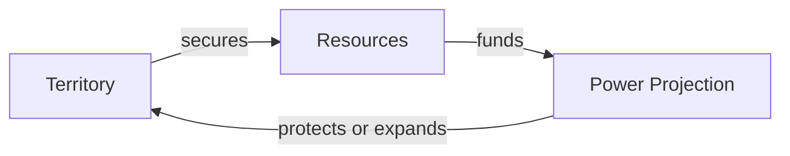

 

# Part Two: Analytical Framework

## 2.1 The Four Pillars of Geopolitical Analysis

To analyze any geopolitical issue, focus on four pillars. This framework keeps analysis structured and avoids information overload.

| Pillar | What It Examines | Example Questions |
|--------|------------------|-------------------|
| Geography | Physical location, terrain, climate, access to seas | Is the country coastal or landlocked? Are there natural barriers? |
| Borders | Land and maritime boundaries, disputes, strategic chokepoints | Where are tensions highest? Who controls key straits or canals? |
| Economy | Trade routes, supply chains, energy security, resource dependence | What does the country import and export? How vulnerable are its supply lines? |
| Defense | Military capabilities, alliances, exercises, basing | What is the state's military posture? Who are its allies and adversaries? |

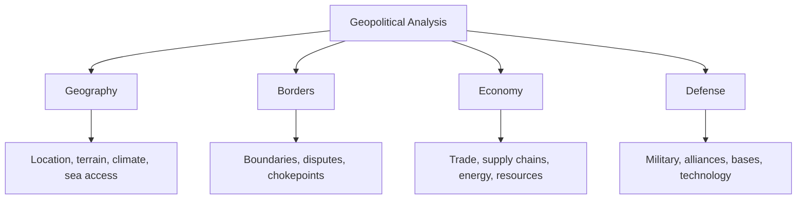

Using these four pillars, any news event can be quickly assessed. Ask: Which pillar is most relevant? What does geography tell us about this conflict? How do economic dependencies shape the outcome?

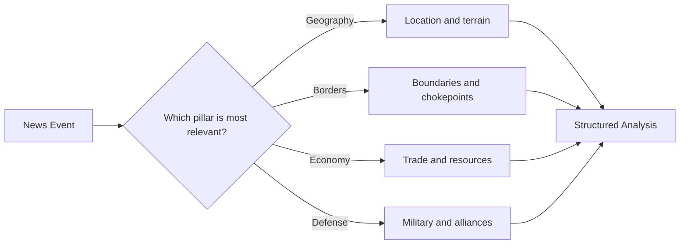

 

## 2.2 Understanding Power: Strategy, Economics, and Technology

These three dimensions form the web of geopolitical power.

**Geo-strategy** – The use of military operations on a grand scale and tactical plans on specific terrains for territorial control. This includes defending existing territory and, in certain cases, expanding it.

**Geo-economics** – The use of economic means (trade, investment, sanctions) to structurally influence world power distribution. A state that controls valuable resources can leverage that control for political and strategic advantage.

**Geo-technology** – Any technology that allows a state to control or master physical space. Historically, this has included railways for controlling landlocked areas and naval technologies for controlling sea lanes. Modern examples include satellite surveillance, cyber capabilities, and precision-guided munitions.

These three dimensions are not separate categories but elements of a complex, interconnected web. Pulling one aspect affects all others. Ignoring one aspect has detrimental effects on the others.

 

# Part Three: Historical Development of Geopolitical Thought

## 3.1 Ancient and Classical Influences

Long before the term geopolitics existed, thinkers observed how geography shaped power.

- **Thucydides** (c. 400 BCE) – In his History of the Peloponnesian War, he described how Athens' maritime position and Sparta's inland location drove their rivalry.
- **Sun Tzu** (c. 5th century BCE) – In The Art of War, he classified terrains and advised adapting strategy to physical conditions.
- **Kautilya** (c. 4th century BCE) – In the Arthashastra, he formulated the Mandala theory, viewing neighboring states as natural threats due to proximity.

These ancient insights anticipated modern ideas about geography as a constraint on state behavior.

 

## 3.2 The 19th Century: Foundational Thinkers

In the 19th century, geographers began articulating theories that emphasized the causal influence of physical geography on political organization and state formation.

**Carl Ritter (1779–1859)** – A foundational figure in modern geography. He argued that the Earth's physical structure – mountains, rivers, and continental configurations – predetermines the developmental paths of nations.

**Friedrich Ratzel (1844–1904)** – A German geographer who viewed the state as a living organism requiring territory for survival and growth. He introduced the concept of Lebensraum (living space) – the requisite territorial expanse needed for a state's needs. Ratzel argued that states, like biological organisms, expand or contract in response to population pressure and resource availability.

 

## 3.3 Classical Geopolitical Theories (1900–1945)

**Rudolf Kjellén (1864–1922)** – A Swedish political scientist who coined the term geopolitics around 1900. He integrated Ratzel's ideas with state functions such as economics and demographics.

**Alfred Thayer Mahan (1840–1914)** – An American naval officer and historian. In his 1890 work The Influence of Sea Power Upon History, Mahan argued that national greatness and prosperity depend on sea power. He contended that countries with strong navies, merchant marines, and control of strategic chokepoints would dominate global commerce and, consequently, global politics. His theories profoundly influenced the naval expansions of the United States, Germany, and Japan.

**Halford Mackinder (1861–1947)** – An English geographer and politician. In his 1904 paper The Geographical Pivot of History, Mackinder introduced the Heartland Theory. He identified a vast landmass stretching from Eastern Europe to Siberia as the pivot area – a region resistant to sea power due to its interior location. With railroads enabling rapid mobilization, Mackinder argued that control of this Heartland could lead to world domination.

His famous dictum summarizes the theory:

> Who rules Eastern Europe commands the Heartland. Who rules the Heartland commands the World-Island. Who rules the World-Island commands the world.

The World-Island refers to the combined landmass of Eurasia and Africa.

**Nicholas Spykman (1893–1943)** – A Dutch-American geographer who revised Mackinder. In his 1942 book America's Strategy in World Politics, Spykman argued that the Rimland – the coastal fringes of Eurasia (Europe, the Middle East, South Asia, and East Asia) – was more decisive than the Heartland. Control of the Rimland, with its large populations, industrial bases, and access to both land and sea, determines global power. His maxim: Who controls the Rimland rules Eurasia; who rules Eurasia controls the destinies of the world.

 

## 3.4 Nazi Misuse and Post-War Discrediting

German geographer Karl Haushofer (1869–1946) adapted Ratzel's and Kjellén's ideas into Geopolitik, which influenced Nazi expansionist rhetoric. Although Haushofer's direct role in Nazi policy remains debated, the association of geopolitics with militarism and totalitarianism led to its academic discredit after World War II. For decades, the term geopolitics was avoided in Western scholarship.

 

## 3.5 Revival and Modern Thinkers

Geopolitics re-entered mainstream discourse in the 1970s through the work of:

**Henry Kissinger** – U.S. Secretary of State (1973–1977) who applied balance-of-power realism to Cold War strategy.

**Zbigniew Brzezinski** – National Security Advisor to President Jimmy Carter (1977–1981). In his 1997 book The Grand Chessboard, he framed Eurasia as a chessboard where the United States must prevent any single power from dominating the region – a direct continuation of Mackinder's logic.

Since the end of the Cold War, geopolitics has regained legitimacy as a tool for analyzing great-power competition, energy security, and regional conflicts.

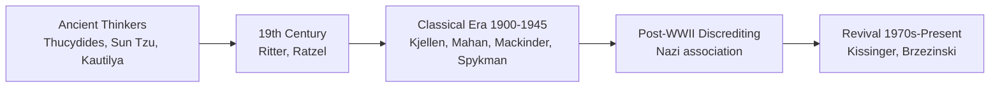

 

# Part Four: How Nations Behave

## 4.1 Competition, Cooperation, and Conflict

Countries behave similarly to individuals in a competitive environment. Some compete for power, some form alliances, some fight, and some negotiate. This is not a matter of good or evil but of interests.

- **Competition** arises when two or more states seek the same strategic advantage – for example, control over a disputed sea or access to rare minerals.
- **Cooperation** occurs when shared interests outweigh differences – trade agreements, intelligence sharing, or joint infrastructure projects.
- **Conflict** ranges from diplomatic disputes to full-scale war. Geography often determines where and why conflicts erupt: borders, rivers, and resource deposits are common flashpoints.

A key principle to remember: in geopolitics, there are no permanent friends or permanent enemies – only permanent interests.

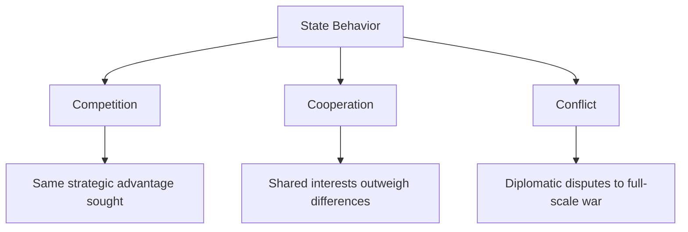

 

## 4.2 Alliances and Rivalries

Alliances form when nations share common interests or face common threats. Rivalries emerge when interests conflict or when geography places nations in unavoidable proximity.

Examples:
- The Cold War rivalry between the United States and the Soviet Union.
- The contemporary competition between the United States and China.
- The enduring tensions between India and Pakistan.

 

## 4.3 Borders and Strategic Locations

Border disputes occur where geography creates ambiguity or where historical claims overlap. Mountain borders are often sensitive because they provide natural defensive positions. Maritime borders are increasingly important as nations assert claims over offshore resources and navigation rights.

Strategic locations – chokepoints such as the Strait of Hormuz, the Suez Canal, the Panama Canal, and the Strait of Malacca – hold outsized importance because control over these narrow passages can disrupt global trade and military movement.

| Chokepoint | Location | Strategic Importance |
|------------|----------|----------------------|
| Strait of Hormuz | Between Iran and Oman | Approximately 20% of global oil passes through |
| Suez Canal | Egypt | Connects Mediterranean and Red Seas; Europe-Asia trade |
| Panama Canal | Panama | Connects Atlantic and Pacific Oceans |
| Strait of Malacca | Between Malaysia and Indonesia | Primary shipping lane for East Asian trade |
| Bab el-Mandeb | Between Yemen and Djibouti | Southern entrance to Red Sea; Suez Canal access |

 

# Part Five: The Modern Geopolitical Landscape

## 5.1 From the Cold War to the Unipolar Moment (1989–2000)

The collapse of the Soviet Union in 1991 ended the Cold War bipolar structure (two superpowers: US and USSR). The United States emerged as the sole superpower – a period sometimes called the unipolar moment. Optimism about democracy and free markets spread, captured by Francis Fukuyama's phrase the end of history.

During this period, NATO expanded eastward, the European Union enlarged, and market economies spread across former communist states.

 

## 5.2 The Post-9/11 Era and the Global War on Terror

The terrorist attacks of September 11, 2001, shifted U.S. foreign policy toward the Global War on Terror. The invasions of Afghanistan (2001) and Iraq (2003) demonstrated both the power and the limits of modern militaries. These long conflicts cost trillions of dollars and thousands of lives, yet failed to achieve stable outcomes.

 

## 5.3 The Return of Great-Power Rivalry

By the 2010s, the world had moved toward multipolarity – a system with multiple centers of power.

- **China's Rise** – Rapid economic growth (averaging over 9 percent annually for decades) transformed China into a strategic rival of the United States. The Belt and Road Initiative (launched 2013) expanded Chinese influence across Eurasia and beyond.
- **Russia's Resurgence** – Under Vladimir Putin, Russia used energy exports and military force (Georgia 2008, Ukraine 2014 and 2022) to reassert itself as a global power.
- **Other Poles** – India, the European Union (as an economic bloc), and regional powers such as Turkey, Iran, and Brazil contribute to a more complex global landscape.

 

## 5.4 Emerging Multipolarity

A multipolar world features multiple power centers – such as the US, China, Russia, India, and regional blocs – with no single hegemon dictating outcomes. Key traits include flexible alliances, regional influence, and complex interactions across economic, military, and ideological domains.

Unlike bipolar systems (for example, the Cold War US-USSR), multipolarity can increase instability risks through miscalculations. However, it also creates opportunities for smaller states to hedge between competing powers.

| System Type | Description | Example Period |
|-------------|-------------|----------------|
| Unipolar | One dominant superpower | US after 1991 |
| Bipolar | Two competing superpowers | US-USSR Cold War |
| Multipolar | Three or more major powers | Emerging contemporary system |

 

## 5.5 Climate Change as a Geopolitical Driver

Climate change is increasingly shaping geopolitical competition and cooperation.

- **Arctic Melting** – Melting ice opens new shipping routes (Northern Sea Route, Northwest Passage) and access to untapped oil, gas, and minerals. This intensifies competition among Russia, the US, Canada, Norway, and China.
- **Water Scarcity** – Transboundary rivers (Nile, Indus, Tigris-Euphrates, Mekong) create tension between upstream and downstream nations.
- **Climate Migration** – Climate-induced displacement may destabilize regions and increase cross-border pressures.
- **Energy Transition** – Renewable energy shifts dependency from oil-producing states to countries controlling critical minerals (lithium, cobalt, rare earths).

 

# Part Six: Geopolitics by Region

## 6.1 Asian Geopolitics

Asia is the world's most populous and economically dynamic continent. It contains multiple power centers and flashpoints.

**Key Topics:**

- **China's Rise and Neighborhood** – How China uses the Belt and Road Initiative to expand influence across Central, South, and Southeast Asia. The strategic importance of the South China Sea and the Nine-Dash Line.
- **India as a Rising Power** – India's location between China and the Indian Ocean. Its relationships with Pakistan (Kashmir dispute), Nepal, Bangladesh, and Sri Lanka. India's role in the Quad and its strategic autonomy.
- **Japan and South Korea** – U.S. allies facing North Korean threats and Chinese pressure. Japan's reinterpretation of its pacifist constitution. History-related tensions between Seoul and Tokyo.
- **Southeast Asia and ASEAN** – How the Association of Southeast Asian Nations tries to balance between China and the United States. The importance of the Strait of Malacca for global trade.
- **Central Asia** – The former Soviet republics caught between Russian, Chinese, and Western influence. Energy pipelines and the New Silk Road.
- **Korean Peninsula** – The division between North and South Korea. Nuclear weapons, missile tests, and the role of China, US, and Japan.

 

## 6.2 Middle East Geopolitics

The Middle East is defined by energy resources, religious divides, and external intervention.

**Key Topics:**

- **The Strait of Hormuz and Energy Security** – Why control of this narrow passage between Iran and Oman affects global oil prices.
- **Iran and Its Proxies** – Iran's influence through Hezbollah (Lebanon), Houthis (Yemen), and militias in Iraq and Syria. The nuclear issue and sanctions.
- **Saudi Arabia and the Gulf Monarchies** – Oil wealth, OPEC, the rivalry with Iran, and the Saudi-led coalition in Yemen. Vision 2030 and economic diversification.
- **Israel and Palestine** – The long-standing conflict over land, borders, Jerusalem, and refugees. The Abraham Accords and normalization with Arab states.
- **Turkey's Regional Ambitions** – Control of the Bosporus and Dardanelles straits. Turkish military involvement in Syria, Iraq, Libya, and Azerbaijan.
- **The Suez Canal** – Egypt's strategic waterway connecting Europe and Asia. Its vulnerability to closure or disruption.
- **External Powers** – The United States, Russia, and China competing for influence through military bases, arms sales, and infrastructure investment.

 

## 6.3 Western Geopolitics: Europe and North America

The West has been the dominant geopolitical center for centuries, but its position is shifting.

**Key Topics:**

- **The United States as a Global Power** – Naval supremacy, alliance networks (NATO, bilateral treaties), dollar dominance, and the debate between interventionism and isolationism.
- **NATO and European Security** – The North Atlantic Treaty Organization's role in containing Russia. The impact of the Ukraine war on European defense spending.
- **The European Union** – How 27 countries coordinate trade, law, and foreign policy. The euro currency, Schengen free travel, and internal divisions (east-west, north-south).
- **Germany and France as Leaders** – The Franco-German engine of European integration. Germany's energy transition and industrial base. France's independent nuclear and foreign policy.
- **Russia as a Western Neighbor** – Russia's relationship with Europe: energy dependence, historical distrust, and conflict over Ukraine and Georgia. The Kaliningrad exclave.
- **Brexit and the United Kingdom** – Why Britain left the EU and how it now pursues a global role outside the bloc. The UK-U.S. special relationship.
- **The Arctic** – Melting ice opening new shipping routes and resource competition among US, Canada, Russia, Norway, and Denmark (Greenland).

 

## 6.4 Latin American Geopolitics

Often overlooked, Latin America has its own dynamics and is increasingly a stage for great-power competition.

**Key Topics:**

- **The Panama Canal** – A critical chokepoint connecting the Atlantic and Pacific. Its importance for US and global trade.
- **US Influence in the Hemisphere** – The Monroe Doctrine (America for the Americans). Sanctions on Cuba, Venezuela, and Nicaragua. Migration from Central America.
- **China's Growing Presence** – Chinese investment in infrastructure (ports, railways, energy) and loans to countries like Brazil, Argentina, and Peru. The race for lithium (needed for electric vehicle batteries).
- **Brazil as a Regional Leader** – The largest economy in South America. Amazon rainforest geopolitics. BRICS membership and balancing between US and China.
- **Venezuela's Collapse** – How oil dependency and political crisis led to mass migration affecting neighboring Colombia, Brazil, and the Caribbean.
- **The Darien Gap** – A dangerous jungle route used by migrants heading to North America. Why no road connects Central and South America.

 

## 6.5 African Geopolitics

Africa is the world's fastest-growing continent demographically and a new frontier for resource competition.

**Key Topics:**

- **Critical Minerals** – The Democratic Republic of Congo (cobalt), Zambia (copper), Zimbabwe (lithium), and other nations supplying materials for batteries, electronics, and renewable energy.
- **Chinese and Western Competition** – China's Belt and Road projects (ports, railways, roads) versus Western initiatives like the G7's Partnership for Global Infrastructure.
- **The Horn of Africa** – Strategic location near the Bab el-Mandeb chokepoint. Ethiopia, Somalia, and the breakaway region of Somaliland. Gulf powers (Saudi, UAE, Turkey) building military bases.
- **The Sahel and Jihadism** – The desert belt from Mali to Sudan. Instability, military coups, and the withdrawal of French and UN forces. Russia's Wagner Group presence.
- **Nigeria and South Africa** – The two largest economies. Nigeria's oil and internal security challenges. South Africa's leadership in sub-Saharan Africa and BRICS.
- **The Nile River Dispute** – Ethiopia's Grand Ethiopian Renaissance Dam versus Egypt's and Sudan's water security concerns.

 

## 6.6 The Arctic and Antarctica

These polar regions are becoming more important due to climate change and resource scarcity.

**Key Topics:**

- **Arctic Shipping Routes** – The Northern Sea Route (Russia) and Northwest Passage (Canada). Shorter distances between Asia, Europe, and North America.
- **Resource Competition** – Oil, gas, rare earth minerals, and fish stocks. Claims by Arctic nations (US, Russia, Canada, Norway, Denmark/Greenland).
- **Military Activity** – Russia rebuilding Arctic bases and icebreaker fleet. NATO's increased patrols. China declaring itself a near-Arctic state.
- **Antarctica** – Governed by the Antarctic Treaty (1959), which bans military activity and mineral mining. Pressure from climate change and potential future resource disputes.

 

# Part Seven: Common Misconceptions and Ethical Considerations

## 7.1 Common Misconceptions About Geopolitics

| Misconception | Reality |
|---------------|---------|
| Geopolitics predicts the future with certainty. | Geopolitics identifies probabilities and constraints, not certainties. |
| Geography determines everything (environmental determinism). | Geography sets the stage; human choices and technology matter greatly. |
| Geopolitics is only for governments and experts. | Anyone can learn it with consistent daily observation. |
| Geopolitics is always about war and conflict. | It also explains trade agreements, alliances, and peaceful cooperation. |
| The term is tainted by Nazi associations. | Classical geopolitics was misused; modern geopolitics is a neutral analytical tool. |

 

## 7.2 A Note on Ethics and Geopolitics

Understanding geopolitics does not mean endorsing every action taken by states. You can analyze why a nation acts a certain way (interests, geography, security) while still holding moral judgments about its actions. Analytical clarity and ethical conviction are not opposites; they are complements. Knowing the constraints leaders face helps you propose realistic solutions, not just idealistic ones.

 

## 7.3 How Geopolitics Affects Your Daily Life

You may think geopolitics is distant, but it touches you directly:

- **Fuel Prices** at the pump depend on stability in the Persian Gulf.
- **Food Costs** rise when grain-producing regions face conflict or drought.
- **Job Security** in manufacturing relies on global supply chains and trade policies.
- **Internet Access** and data privacy are shaped by tech rivalries between nations.
- **Travel and Migration** rules change with diplomatic relations and border disputes.

 

# Part Eight: Practical Guide for Beginners

## 8.1 A 20-Minute Daily Routine

You do not need a degree to understand geopolitics. A consistent daily routine builds knowledge over time.

| Activity | Time | What to Do |
|----------|------|-------------|
| Read headlines | 10 minutes | Ask: who is meeting whom? Why are leaders visiting certain countries? What outcomes emerged? |
| Map check | 5 minutes | Locate every country mentioned. Observe its neighbors, access to water, strategic position. |
| Reflect and write | 5 minutes | Write three lines: what happened, why it happened, how it affects your nation. |

**Keep a Notebook.** Each day, write the date, one issue, and three bullet reflections. At the end of each week, review your notes. This builds structured thinking and confidence.

**Keep a Printed World Map** on your wall where you study daily. Geography is visual; seeing the relative positions of countries builds intuition that reading alone cannot provide.

 

## 8.2 How to Think Analytically, Not Emotionally

After reading any analysis, ask yourself: If I were advising my country, what would my priorities be for security, economy, and diplomacy?

- Do not blindly support or blindly criticize.
- Learn to see both sides of any international dispute.
- Remember: there are no permanent friends or enemies – only permanent interests.

Officers and strategic thinkers do not think primarily with emotion; they think with structure and evidence. Use the four-pillar framework (geography, borders, economy, defense) to ground your analysis in facts.

 

## 8.3 What to Avoid

- Sensational shouting debates
- Propaganda pages (state media often slants narratives to favor their interests)
- Fake breaking news reels
- Blind nationalism without understanding

Stay calm, stay analytical, stay balanced. Cross-verify information from multiple sources. Distinguish facts from opinions by checking for loaded language, omissions, or logical fallacies.

 

## 8.4 Test Your Understanding

1. A country is landlocked and has no major rivers. Which pillar is most challenged? (Economy / Power projection)
2. True or false: Geography always determines a nation's fate.
3. Name one maritime chokepoint and explain why it matters.
4. According to Mackinder, what is the Heartland?
5. What is the difference between unipolarity and multipolarity?

**Answers:**

1. Economy and power projection are both challenged; landlocked states face higher trade costs and limited naval reach.
2. False. Geography constrains but does not determine outcomes; leadership and technology matter.
3. Examples: Strait of Hormuz (oil transit), Suez Canal (Europe-Asia trade), Strait of Malacca (East Asian trade).
4. The Eurasian interior from Eastern Europe to Siberia, resistant to sea power.
5. Unipolarity: one dominant superpower. Multipolarity: three or more major powers of comparable capability.

 

# Part Nine: A Catalog of Major Geopolitical Wars

## 9.1 Introduction: War as Geopolitics in Action

War represents geopolitics in its most intense and visible form. It is the continuation of political competition by violent means. While tragic in human terms, wars are critical moments where the underlying forces that shape international relations become starkly visible.

This catalog documents major geopolitical conflicts from ancient times to the present. Each entry includes the conflict name, date range, and a brief explanation of its geopolitical significance. The catalog is organized chronologically by historical era to help readers trace patterns across time.

The conflicts listed here are not exhaustive. Rather, they represent the most geopolitically significant wars that reshaped borders, redistributed power, altered trade routes, and transformed the international order.

As you study these conflicts, pay attention to recurring themes: competition over fertile land and water, control of trade routes, the rise and fall of empires, alliance systems that escalate local disputes, and the persistent tension between land-based and maritime powers.

**A Note on Timeline Notation:** This catalog uses BCE (Before Common Era) and CE (Common Era), which are equivalent to BC and AD respectively.

 

## 9.2 Ancient World (Before 500 CE)

These conflicts often involved the rise and fall of empires, control of trade routes, and competition over fertile land and water resources.

### Trojan War (c. 1260–1180 BCE)

This legendary conflict between the Achaeans (Greeks) and the city of Troy illustrates early competition for control of strategic waterways. Troy occupied a commanding position near the Dardanelles, a narrow strait connecting the Aegean Sea to the Sea of Marmara and ultimately the Black Sea. Control of Troy meant control of maritime trade between the Mediterranean and Black Sea regions.

### Assyrian Conquests (c. 853–612 BCE)

The Neo-Assyrian Empire conducted systematic military campaigns that created the first true empire in world history, stretching from Mesopotamia to Egypt. Assyrian expansion was driven by the need for security through strategic depth, access to timber and metal resources lacking in the Assyrian heartland, and control of trade routes connecting the Persian Gulf to the Mediterranean. Their empire collapsed when overextension combined with a coalition of subject peoples (Medes and Babylonians) exploited Assyrian exhaustion.

### Greco-Persian Wars (499–449 BCE)

This series of conflicts between the Persian Empire and the Greek city-states represents a classic case of a land-based empire clashing with a maritime coalition. Key battles included Marathon (490 BCE), Thermopylae (480 BCE), Salamis (480 BCE), and Plataea (479 BCE). The Greek victory preserved the independence of the Greek world and allowed the subsequent flourishing of Classical Greek civilization. The war demonstrated that a coalition of smaller maritime powers could defeat a larger land empire when defending narrow geographical chokepoints.

### Peloponnesian War (431–404 BCE)

This devastating civil war between Athens and Sparta and their respective allies is a foundational case study in international relations. The war illustrates the Thucydides Trap, a term coined by political scientist Graham Allison referring to the tendency for a rising power (Athens) to frighten an established power (Sparta) into conflict. Athens, a naval and commercial democracy, had built a maritime empire that controlled trade routes and extracted tribute from allies. Sparta, a land-based militaristic oligarchy, led a coalition of states fearful of Athenian dominance. The war lasted twenty-seven years, exhausted both sides, and ended with Spartan victory. However, Sparta could not maintain hegemony over the Greek world. The resulting power vacuum allowed Macedon under Philip II and Alexander the Great to conquer the weakened Greek states. The war teaches that hegemonic conflict between two great powers can destroy both and pave the way for a third power.

### Conquests of Alexander the Great (336–323 BCE)

In just thirteen years, Alexander of Macedon conquered the Persian Empire and extended Greek control from Egypt to the Indus River valley. This campaign fundamentally reshaped the geopolitical map of the ancient world. Alexander's conquests merged Greek and Persian cultures, creating the Hellenistic period that facilitated trade and cultural exchange across three continents. The empire fragmented after Alexander's death into successor kingdoms (the Diadochi) including Ptolemaic Egypt, Seleucid Persia, and Antigonid Macedon.

### Punic Wars (264–146 BCE)

Three wars fought between Rome and Carthage for control of the Western Mediterranean. Carthage, a Phoenician colony in modern Tunisia, dominated maritime trade in the western Mediterranean. Rome, expanding from central Italy, sought control of Sicily and access to Mediterranean sea lanes.

- **First Punic War (264–241 BCE):** Rome built its first major navy and defeated Carthage at sea, gaining Sicily.
- **Second Punic War (218–201 BCE):** Carthaginian general Hannibal invaded Italy across the Alps. He won major battles but could not take Rome itself. Rome counterattacked in Spain and North Africa, forcing Carthage to surrender and give up its overseas territories.
- **Third Punic War (149–146 BCE):** Rome, fearing Carthaginian revival, besieged and destroyed the city completely. Survivors were enslaved, and according to legend, salt was plowed into the soil.

The Roman victory established Rome as the dominant power in the Western Mediterranean. The acquisition of overseas territories transformed Rome from an Italian city-state into a Mediterranean empire. The wealth and slaves from conquest enriched Roman elites but also created social tensions that contributed to the collapse of the Roman Republic.

### Roman-Persian Wars (66 BCE–628 CE)

A series of conflicts spanning over seven centuries between the Roman Empire (later the Byzantine Empire) and the Parthian Empire (later the Sassanian Empire). This rivalry represents one of history's longest-running geopolitical competitions. The contested territory included Armenia, Mesopotamia, and the Caucasus, regions that served as buffer zones between the two empires. Neither empire could permanently defeat the other due to the geographic and logistical challenges of projecting power across the vast distances involved. The final and most destructive phase (602–628 CE) exhausted both empires, leaving them vulnerable to the sudden emergence of Arab Muslim armies that would conquer Persia entirely and strip Byzantium of its eastern and southern provinces within a generation.

### Han–Xiongnu War (133 BCE–89 CE)

A prolonged conflict between the Han Dynasty of China and the Xiongnu, a nomadic confederation controlling the Eurasian steppe north of China. This war illustrates the persistent tension between settled agricultural civilizations and nomadic pastoral peoples. The Xiongnu raided Chinese frontier settlements for goods they could not produce. The Han Dynasty responded with a combination of military expeditions, diplomatic maneuvers (marriage alliances, tribute payments), and the extension of the Great Wall. Han Emperor Wu (reigned 141–87 BCE) pursued an aggressive forward policy, sending armies deep into the steppe and establishing military colonies in what is now Gansu Province and Xinjiang. The conflict opened the Silk Road trade routes connecting China to Central Asia, Persia, and eventually Rome. The Han victory pushed the Xiongnu westward, contributing to later migrations that would affect Europe (the Huns).

### Wars of the Three Kingdoms (220–280 CE)

Following the collapse of the Han Dynasty, China fragmented into three competing states: Wei in the north, Shu in the southwest, and Wu in the southeast. This period of division and warfare lasted sixty years and is immortalized in the classic Chinese novel Romance of the Three Kingdoms. Geopolitically, the conflict illustrates how China's geography tends toward fragmentation along natural boundaries: the Yellow River plain (Wei), the Sichuan basin (Shu), and the Yangtze River valley (Wu). The eventual reunification under the Jin Dynasty in 280 CE restored centralized control, but the pattern of division and reunification would repeat throughout Chinese history.

 

## 9.3 Medieval and Early Modern Era (500–1789 CE)

This era was defined by religious conflict, the struggle for trade routes, and the rise of powerful centralized states.

### Muslim Wars of Expansion (623–732 CE)

Following the death of the Prophet Muhammad in 632 CE, Arab Muslim armies rapidly conquered territories from Spain to Central Asia. This expansion was driven by religious motivation, demographic pressure in Arabia, and the power vacuum left by the exhausted Byzantine and Sassanian Empires. Key conquests included Syria (634–638), Egypt (639–642), Persia (633–654), North Africa (647–709), and Spain (711–718). The expansion was halted in the west at the Battle of Tours (732) by Frankish forces under Charles Martel, and in the east by the Byzantine defense of Constantinople (717–718). The conquests created a vast Islamic caliphate that facilitated trade, scholarship, and cultural exchange across three continents.

### Crusades (1096–1291 CE)

A series of religious wars sanctioned by the Latin Church to secure control of holy sites in the Levant, particularly Jerusalem. The Crusades were also motivated by European demographic growth, the desire of younger sons of nobles for land and wealth, and Byzantine requests for military assistance against Seljuk Turkish expansion. The First Crusade (1096–1099) captured Jerusalem and established Crusader states. Subsequent Crusades failed to maintain or expand these territories. The Crusades had lasting geopolitical consequences: they weakened the Byzantine Empire, intensified Muslim-Christian tensions, stimulated European trade with the East through Italian city-states (Venice, Genoa), and transferred knowledge from the Islamic world to Europe.

### Mongol Invasions and Conquests (1206–1368 CE)

Under Genghis Khan and his successors, the Mongols created the largest contiguous land empire in history, stretching from Korea to Eastern Europe and from Siberia to Persia. Mongol success rested on superior cavalry tactics, meritocratic military organization, psychological warfare, and the ability to coordinate operations across vast distances. The Mongol Empire briefly unified the Eurasian landmass, facilitating trade and cultural exchange along the Silk Road (the Pax Mongolica). However, the empire fragmented into four khanates (Yuan Dynasty in China, Ilkhanate in Persia, Chagatai Khanate in Central Asia, Golden Horde in Russia) that gradually assimilated into local cultures. The Mongol conquests had profound demographic, political, and epidemiological consequences, including the transmission of the Black Death along trade routes they had opened.

### Hundred Years' War (1337–1453 CE)

A prolonged conflict between the Kingdom of England and the Kingdom of France over succession to the French throne and control of territory within France. England initially prevailed through superior longbow tactics (Crécy, 1346; Poitiers, 1356; Agincourt, 1415). France eventually triumphed through the leadership of figures like Joan of Arc, the development of professional standing armies, and the use of artillery. The war's consequences included the emergence of strong national identities in both England and France, the decline of feudal military organization in favor of professional armies funded by taxation, and the permanent separation of English and French crowns.

### Wars of the Roses (1455–1487 CE)

A series of civil wars fought for control of the English throne between rival branches of the Plantagenet dynasty: the House of Lancaster (red rose) and the House of York (white rose). The conflict decimated the English nobility and culminated in the victory of Henry Tudor (Henry VII), who united the houses by marrying Elizabeth of York. The Wars of the Roses established the Tudor dynasty and centralized royal authority in England, paving the way for England's emergence as a major European power in the sixteenth century.

### Ottoman-Persian Wars (1514–1823 CE)

A series of conflicts spanning over three centuries between the Ottoman Empire (Sunni Muslim, Turkic) and the Safavid Empire (Shia Muslim, Persian) and its successors. The wars were fought over control of Mesopotamia, the Caucasus, and eastern Anatolia. The rivalry had both religious dimensions (Sunni versus Shia) and geopolitical dimensions (control of trade routes and buffer territories). The Treaty of Zuhab (1639) established borders that largely correspond to the modern Iran-Iraq and Iran-Turkey frontiers.

### Thirty Years' War (1618–1648 CE)

A devastating religious and political conflict in Central Europe that reshaped the balance of power. The war began as a religious conflict between Protestant and Catholic states within the Holy Roman Empire following the Bohemian Revolt against Habsburg rule. It expanded into a wider European war involving Sweden, France, Spain, Denmark, and the Dutch Republic. The Peace of Westphalia (1648) ended the war and established principles fundamental to the modern international system: recognition of state sovereignty, non-interference in domestic affairs of other states, and the legal equality of states regardless of size or power. The Holy Roman Empire was effectively dissolved as a unified political entity, leaving Germany fragmented into over three hundred sovereign states.

### English Civil War (1642–1651 CE)

A series of armed conflicts between Parliamentarians (Roundheads) and Royalists (Cavaliers) over the governance of England, Scotland, and Ireland. The war resulted in the trial and execution of King Charles I (1649), the abolition of the monarchy, and the establishment of the Commonwealth under Oliver Cromwell. Although the monarchy was restored in 1660, the war established the principle that the monarch could not govern without Parliament's consent. The Glorious Revolution of 1688 confirmed this constitutional settlement.

### Seven Years' War (1756–1763 CE)

Often described as the first true world war, the Seven Years' War was fought across Europe, North America, the Caribbean, West Africa, India, and the Philippines. The primary geopolitical driver was colonial rivalry between Great Britain and France for control of North America (where the conflict was known as the French and Indian War) and India. Consequences included British acquisition of Canada and Florida, British dominance in India at French expense, and the recognition of Prussia as a great power. The enormous debt Britain accumulated during the war led to increased taxation of the American colonies, directly precipitating the American Revolution.

### American Revolutionary War (1775–1783 CE)

The war by which thirteen British colonies in North America won independence and established the United States of America. The war demonstrated that a colonial rebellion could defeat a major European power when supported by that power's rivals (France, Spain, and the Dutch Republic all entered the war against Britain). The war created the first modern republic based on Enlightenment principles of popular sovereignty and individual rights.

 

## 9.4 Revolutionary and Napoleonic Era (1789–1815)

### French Revolutionary Wars (1792–1802 CE)

Following the French Revolution of 1789, the revolutionary government faced military intervention from neighboring monarchies seeking to restore the French monarchy and contain revolutionary ideas. The wars saw the emergence of the levée en masse (mass conscription), which created citizen armies of unprecedented size. French armies, motivated by revolutionary nationalism rather than dynastic loyalty, achieved remarkable successes against the professional armies of the old regimes. By 1802, France had expanded its territory to the Rhine, created satellite republics in the Netherlands, Switzerland, and Italy, and forced Austria and Prussia to accept French dominance in Western Europe.

### Napoleonic Wars (1803–1815 CE)

Under Napoleon Bonaparte, who seized power in 1799 and declared himself Emperor in 1804, France achieved temporary hegemony over continental Europe. Napoleon's military genius enabled him to defeat every major European power except Britain, which remained secure behind its naval supremacy. Napoleon's attempt to enforce a continental blockade against British trade (the Continental System) alienated Russia and led to his disastrous invasion of Russia in 1812. The destruction of Napoleon's Grande Armée in Russia encouraged a coalition of powers (Britain, Russia, Prussia, Austria) to defeat France in 1814 and again at Waterloo in 1815. Consequences included the Congress of Vienna (1815), which redrew European borders to create a balance of power and established the Concert of Europe.

 

## 9.5 The Nineteenth Century (1815–1914)

### Revolutions of 1848 (1848–1849 CE)

A wave of revolutionary uprisings across Europe demanding constitutional government, national independence, and social reform. While most revolutions were suppressed by conservative forces, they demonstrated the power of nationalist and liberal ideas. The failures of 1848 taught nationalists that unification would require the leadership of strong states and realist diplomacy backed by military force rather than popular uprisings alone.

### Wars of Italian Unification (1848–1871 CE)

A series of conflicts that unified the Italian peninsula under the Kingdom of Piedmont-Sardinia. Key wars included the First Italian War of Independence (1848–1849), the Second Italian War of Independence (1859) fought with French support against Austria, and the Expedition of the Thousand (1860) led by Giuseppe Garibaldi. The unification was completed with the annexation of Venetia (1866) and Rome (1870). Italian unification altered the European balance of power by creating a new medium-sized power in the Mediterranean.

### Wars of German Unification (1864–1871 CE)

Under Chancellor Otto von Bismarck, Prussia fought three wars that unified Germany under Prussian leadership:

- **Second Schleswig War (1864):** Prussia and Austria defeated Denmark, gaining control of Schleswig-Holstein.
- **Austro-Prussian War (1866):** Prussia defeated Austria in a seven-week campaign, excluding Austria from German affairs.
- **Franco-Prussian War (1870–1871):** Prussia and its German allies defeated France. The war resulted in the proclamation of the German Empire at Versailles (1871) and the annexation of Alsace-Lorraine from France.

A unified Germany, with the largest population and most dynamic economy in Western Europe, became the continent's dominant land power. The annexation of Alsace-Lorraine created lasting French resentment that contributed to the alliance systems leading to World War I.

### Mexican-American War (1846–1848 CE)

A conflict between the United States and Mexico following the U.S. annexation of Texas (1845). The United States sought to expand westward to the Pacific Ocean under the ideology of Manifest Destiny. The war resulted in decisive American victory and the Treaty of Guadalupe Hidalgo (1848), through which Mexico ceded approximately half its territory (modern California, Nevada, Utah, Arizona, New Mexico, and parts of Colorado and Wyoming) to the United States.

### Scramble for Africa (1881–1914 CE)

The rapid colonization of Africa by European powers, formalized at the Berlin Conference (1884–1885). European states partitioned Africa with minimal regard for existing ethnic, linguistic, or political boundaries. The scramble was driven by industrial demand for raw materials, strategic competition among European powers, nationalist prestige, and a civilizing mission ideology. By 1914, only Ethiopia and Liberia remained independent. The arbitrary borders drawn by colonial powers created lasting problems, including ethnic conflicts, weak state institutions, and economic dependencies.

### Spanish-American War (1898 CE)

A brief conflict between the United States and Spain that resulted in American acquisition of Spain's remaining overseas empire. American victory resulted in Cuban independence (under U.S. supervision), and U.S. acquisition of Puerto Rico, Guam, and the Philippines. The war marked the emergence of the United States as a global power with overseas possessions and strategic interests in both the Caribbean and the Pacific.

### Boxer Rebellion (1899–1901 CE)

An anti-foreign, anti-colonial, and anti-Christian uprising in China led by the Society of Righteous and Harmonious Fists (Boxers). An eight-nation alliance (Britain, France, Germany, Russia, Japan, United States, Italy, Austria-Hungary) intervened militarily to relieve the besieged foreign legations in Beijing. The suppression of the rebellion demonstrated China's weakness and the determination of foreign powers to maintain their privileges. The humiliation contributed to the 1911 revolution that overthrew the Qing and established the Republic of China.

### American Civil War (1861–1865 CE)

The deadliest war in American history, fought between the Union (northern states) and the Confederacy (southern states that seceded). The primary cause was slavery and its expansion into western territories. The Union victory preserved the United States as a single nation, abolished slavery (13th Amendment), and established federal supremacy over the states. Geopolitically, the war demonstrated that the United States could mobilize immense industrial and human resources for total war. A unified United States was positioned to become a great power.

### Russo-Japanese War (1904–1905 CE)

A conflict between the Russian Empire and the Empire of Japan over rival imperial ambitions in Manchuria and Korea. Japan launched a surprise attack on the Russian fleet at Port Arthur (February 1904) and subsequently defeated Russian armies in Manchuria. The Japanese naval victory at Tsushima (May 1905) shocked the world. The Treaty of Portsmouth (mediated by U.S. President Theodore Roosevelt) recognized Japanese dominance in Korea and southern Manchuria. The war was the first time an Asian power had defeated a European power in modern warfare, inspiring anti-colonial movements across Asia. Russia's humiliation contributed to the 1905 Revolution. Japan's victory emboldened militarists who would later pursue further expansion.

 

## 9.6 The World Wars and Interwar Period (1914–1945)

### World War I (1914–1918 CE)

The First World War shattered four empires (German, Austro-Hungarian, Ottoman, Russian), redrew the map of Europe and the Middle East, and set the stage for future conflict. The war was caused by a combination of factors: the alliance system that divided Europe into two armed camps, militarism and the arms race, imperial competition, and nationalism. The immediate trigger was the assassination of Archduke Franz Ferdinand of Austria-Hungary by a Serbian nationalist on June 28, 1914.

The war was characterized by industrial-scale slaughter. The Western Front became a static trench system. New weapons (machine guns, artillery, poison gas, tanks, aircraft) made offensive operations extremely costly. The United States entered the war in 1917 after German submarine warfare threatened American shipping. American manpower and material tipped the balance, and Germany requested an armistice on November 11, 1918.

**Consequences:**
- Collapse of the German, Austro-Hungarian, Ottoman, and Russian Empires. The Bolshevik Revolution in Russia (1917) created the world's first communist state.
- Redrawn borders creating new nation-states: Poland, Czechoslovakia, Yugoslavia, Austria, Hungary, Finland, Estonia, Latvia, Lithuania.
- Treaty of Versailles (1919) imposed harsh reparations and territorial losses on Germany. These terms fueled German resentment and the rise of Nazism.
- The League of Nations was created but lacked enforcement mechanisms and the participation of the United States.
- The Ottoman Empire's Arab territories were divided between Britain and France under the Sykes-Picot Agreement (1916), creating the modern states of Iraq, Syria, Lebanon, Jordan, and Palestine. The Balfour Declaration (1917) promised British support for a Jewish homeland in Palestine.
- Europe lost its position as the undisputed center of the global economy. The United States emerged as the world's leading creditor nation.

### Russian Civil War (1917–1922 CE)

A multi-party civil war in the former Russian Empire following the Bolshevik Revolution of October 1917. The Red Army (Bolsheviks) fought against the White Army (a loose coalition of monarchists, liberals, and socialists opposed to Bolshevik rule) and against foreign intervention forces. The Red Army, under Leon Trotsky's leadership, eventually prevailed. The war consolidated Bolshevik control over most of the former Russian Empire, leading to the establishment of the Soviet Union in 1922.

### Spanish Civil War (1936–1939 CE)

A conflict between the Republican government (supported by leftist factions) and Nationalist rebels led by General Francisco Franco (supported by conservatives, monarchists, and fascists). The war became a proxy conflict and testing ground for the major ideological blocs of the 1930s. Nazi Germany and Fascist Italy provided extensive military support to Franco. The Soviet Union provided limited support to the Republic, while Western democracies pursued a policy of non-intervention. Franco's victory established a fascist-aligned dictatorship in Spain that would last until his death in 1975.

### World War II (1939–1945 CE)

The deadliest war in human history, with an estimated 70 to 85 million deaths. The war cemented the global power of the United States and Soviet Union and led to the creation of the United Nations.

**Causes:**
- The Treaty of Versailles, which imposed punitive terms on Germany and created lasting resentment that extremist movements exploited.
- The failure of collective security and appeasement. Britain and France allowed Nazi Germany to remilitarize the Rhineland (1936), annex Austria (1938), and seize the Sudetenland from Czechoslovakia (1938 Munich Agreement).
- Axis expansionism: Germany sought Lebensraum in Eastern Europe; Italy sought a Mediterranean empire; Japan sought a Greater East Asia Co-Prosperity Sphere.
- The Nazi-Soviet Pact (August 1939), which secretly divided Eastern Europe between Germany and the Soviet Union.

**Course of the War:**
Germany invaded Poland on September 1, 1939. Britain and France declared war two days later. Germany conquered most of Western Europe in 1940. The Battle of Britain (1940) prevented German invasion of the United Kingdom. Germany invaded the Soviet Union in June 1941 (Operation Barbarossa), opening the Eastern Front. Japan attacked Pearl Harbor on December 7, 1941, bringing the United States into the war. Germany surrendered in May 1945. Japan surrendered in August 1945 after the United States dropped atomic bombs on Hiroshima and Nagasaki.

**Consequences:**
- Unprecedented death and destruction. The Holocaust, the systematic genocide of six million Jews and millions of others, demonstrated the depths of human cruelty.
- The United States and Soviet Union emerged as superpowers.
- The nuclear age began.
- The United Nations was created to replace the League of Nations.
- Decolonization accelerated as European colonial powers were weakened.
- The Cold War began almost immediately. NATO (1949) and the Warsaw Pact (1955) institutionalized the division of Europe.
- Germany and Korea were divided into occupation zones that became separate states.
- The Bretton Woods system (1944) established the U.S. dollar as the world's reserve currency and created the International Monetary Fund and World Bank.

---

## 9.7 The Cold War Era (1945–1991)

### Cold War (1947–1991 CE)

The overarching global struggle that shaped the second half of the twentieth century. The Cold War was a geopolitical, ideological, and economic competition between two superpowers with fundamentally different visions for organizing society and the international system. The United States championed liberal democracy, capitalism, and free trade. The Soviet Union championed communism, state-controlled economies, and a sphere of influence in Eastern Europe. The conflict was cold because direct war between the superpowers risked nuclear annihilation. Instead, competition played out through proxy wars in the developing world, arms races, space exploration, espionage, propaganda, and economic and technological competition. The Cold War ended with the collapse of communist regimes in Eastern Europe (1989), the reunification of Germany (1990), and the dissolution of the Soviet Union itself (1991).

### Greek Civil War (1946–1949 CE)

A conflict between the Greek government (supported by Britain and later the United States) and communist insurgents. The war was one of the first proxy conflicts of the Cold War. The Truman Doctrine (1947), in which the United States pledged to support free peoples resisting communist subjugation, was announced in response to the crisis in Greece and Turkey. American military and economic aid helped the Greek government defeat the communist insurgency.

### Korean War (1950–1953 CE)

The first major hot war of the Cold War. Following Japan's defeat in World War II, Korea was divided at the 38th parallel into a Soviet-occupied North and American-occupied South. On June 25, 1950, North Korean forces invaded the South with Soviet approval. The United Nations Security Council authorized a U.S.-led coalition to repel the invasion. UN forces pushed North Korean forces back to the Chinese border, prompting China to intervene. The war settled into a stalemate near the original border. An armistice was signed in 1953, but no peace treaty has ever been concluded. Consequences included massive casualties, the permanent division of Korea, a continued U.S. military presence in South Korea, and China's emergence as a military power.

### Vietnam War (1955–1975 CE)

A costly proxy war in Southeast Asia. After the French defeat at Dien Bien Phu (1954), the Geneva Accords temporarily divided Vietnam at the 17th parallel. The United States, fearing the spread of communism under the Domino Theory, gradually escalated its involvement. Despite immense firepower and over 500,000 troops at peak deployment, the United States could not defeat the North Vietnamese and Viet Cong insurgency. The Tet Offensive (1968) demonstrated that the war was not winnable on American terms. The United States withdrew in 1973, and South Vietnam fell to communist forces in 1975. Consequences included over three million deaths, the unification of Vietnam under communist rule, refugee crises, the Cambodian genocide, and a lasting Vietnam Syndrome in the United States.

### Soviet-Afghan War (1979–1989 CE)

A Soviet military intervention to support the communist government of Afghanistan against mujahideen insurgents. The Soviet Union sought to maintain a friendly government on its southern border. The United States, Saudi Arabia, and Pakistan provided extensive support to the mujahideen through the CIA's Operation Cyclone. The war became a quagmire for the Soviet Union. Soviet casualties totaled approximately 15,000 to 26,000 dead. The war contributed to the collapse of the Soviet Union by draining its economy and demoralizing its military. The mujahideen victory led to civil war and eventual Taliban rule (1996–2001). Among the foreign fighters who joined the mujahideen was Osama bin Laden, who would later found Al-Qaeda.

### Iran-Iraq War (1980–1988 CE)

A prolonged and bloody conflict between Iran and Iraq. Iraq, under Saddam Hussein, invaded Iran in 1980 seeking to take advantage of post-revolutionary chaos in Iran and to seize control of the Shatt al-Arab waterway and the oil-rich Khuzestan province. The war settled into a brutal stalemate with chemical weapons used by Iraq. Both superpowers tilted toward Iraq, though the Iran-Contra affair revealed covert American arms sales to Iran. The war ended in a stalemate with massive casualties and economic devastation. Iraq emerged deeply indebted to Gulf Arab states, a factor that contributed to its invasion of Kuwait in 1990.

### Falklands War (1982 CE)

A brief but significant conflict between Argentina and the United Kingdom over the Falkland Islands. Argentina's military junta, facing domestic unrest, invaded the islands in April 1982. Britain assembled a naval task force and recaptured the islands after a ten-week campaign. The war demonstrated the continued relevance of naval power projection and the willingness of a democratic power to use force to defend territory. The Argentine defeat contributed to the collapse of the military junta and the restoration of democracy in Argentina.

### Persian Gulf War (1990–1991 CE)

A UN-sanctioned war to expel Iraqi forces from Kuwait. On August 2, 1990, Iraq invaded and annexed Kuwait. The United States assembled a coalition of 34 nations and obtained UN Security Council authorization to use force. Operation Desert Storm began with a massive air campaign followed by a ground offensive that liberated Kuwait in just 100 hours. The coalition did not advance to Baghdad. Consequences included Iraqi withdrawal from Kuwait, Saddam Hussein remaining in power but subject to no-fly zones and economic sanctions, a permanent U.S. military presence in Saudi Arabia, and the demonstration of American military dominance in conventional warfare.

 

## 9.8 The Modern Era (1991–Present)

### Yugoslav Wars (1991–2001 CE)

A series of ethnically-based wars and conflicts in the former Yugoslavia following the collapse of communist rule. The wars included the Ten-Day War in Slovenia (1991), the Croatian War of Independence (1991–1995), the Bosnian War (1992–1995), and the Kosovo War (1998–1999). The conflicts were characterized by ethnic cleansing, genocide (notably the Srebrenica massacre of 1995), and the involvement of NATO military forces. The wars resulted in the breakup of Yugoslavia into seven independent states. The conflicts demonstrated the dangers of ethno-nationalism in multi-ethnic states and the challenges of international intervention in civil wars.

### First Congo War and Second Congo War (1996–1997 and 1998–2003 CE)

The First Congo War resulted in the overthrow of Zaire's long-time dictator Mobutu Sese Seko. The Second Congo War, sometimes called Africa's World War, involved nine African countries and numerous armed groups fighting for control of the Democratic Republic of the Congo's vast mineral wealth (cobalt, coltan, diamonds, gold, copper). The war resulted in an estimated 5.4 million deaths, mostly from disease and starvation, making it the deadliest conflict since World War II. The wars demonstrated how competition for critical minerals can fuel prolonged conflict.

### Second Chechen War (1999–2009 CE)

A conflict between the Russian Federation and the Chechen Republic of Ichkeria, a separatist region in the North Caucasus. Under Vladimir Putin, Russia pursued a brutal counterinsurgency campaign that re-established federal control over Chechnya. The war demonstrated Russia's determination to prevent further territorial fragmentation after the Soviet collapse and its willingness to use overwhelming force to suppress separatism.

### Global War on Terror (2001–2021 CE)

The overarching campaign launched by the United States after the terrorist attacks of September 11, 2001. The campaign included military operations in Afghanistan and Iraq, drone strikes in multiple countries, enhanced security and surveillance measures, and efforts to counter terrorist financing and ideology. The campaign's outcomes were mixed: Al-Qaeda's core leadership was decimated and Osama bin Laden was killed (2011), but terrorist threats persisted and new groups (including ISIS) emerged.

### War in Afghanistan (2001–2021 CE)

The longest war in American history. Following the 9/11 attacks, the United States and its allies invaded Afghanistan to overthrow the Taliban regime. The initial invasion succeeded rapidly, but the subsequent nation-building effort and counterinsurgency campaign proved protracted and costly. The war lasted twenty years, cost over two trillion dollars, and resulted in over 170,000 deaths. The United States withdrew in August 2021, and the Taliban quickly recaptured Kabul. The war demonstrated the limits of military power in achieving political outcomes in societies with weak institutions and deep ethnic divisions.

### Iraq War (2003–2011 CE)

A U.S.-led invasion of Iraq that overthrew Saddam Hussein's regime but resulted in prolonged instability and sectarian conflict. The primary justification for war was the claim (later proven false) that Iraq possessed weapons of mass destruction. The invasion rapidly defeated Iraqi conventional forces, but the subsequent occupation faced a brutal insurgency and sectarian civil war. Over 4,400 U.S. troops were killed, and Iraqi civilian deaths are estimated at over 150,000. No weapons of mass destruction were found, severely damaging U.S. credibility. The war's consequences included increased Iranian influence in Iraq, the rise of ISIS, and a regional power vacuum that contributed to the Syrian Civil War.

### Russo-Georgian War (2008 CE)

A brief war between Russia and Georgia over the breakaway regions of South Ossetia and Abkhazia. In August 2008, Georgia launched a military operation to retake South Ossetia. Russia responded with a large-scale invasion, defeating Georgian forces and recognizing the independence of both breakaway regions. The war demonstrated Russia's willingness to use military force to maintain influence in its near abroad and its opposition to NATO expansion.

### Libyan Civil War (2011 CE)

A NATO-led military intervention in Libya's civil war that resulted in the overthrow and death of long-time dictator Muammar Gaddafi. The intervention was authorized by UN Security Council Resolution 1973. The post-Gaddafi power vacuum led to prolonged instability, militia warfare, and the emergence of ISIS affiliates in Libya. The intervention demonstrated both the capacity of Western air power to enable regime change and the difficulties of post-conflict stabilization.

### Syrian Civil War (2011–Present)

A complex multi-sided civil war that began with peaceful protests against the Assad regime and escalated into a devastating conflict involving numerous domestic and international actors. The Assad regime (supported by Russia and Iran) fought against various rebel groups, Kurdish forces, and jihadist groups including ISIS. The war resulted in over 500,000 deaths, the displacement of half of Syria's pre-war population, and widespread destruction. The conflict demonstrated Russia's return as a major military power in the Middle East and the humanitarian consequences of protracted civil wars.

### War in Donbas (2014–2022 CE)

An armed conflict in eastern Ukraine between Ukrainian government forces and Russian-backed separatists in the Donetsk and Luhansk regions. The conflict began after Russia's annexation of Crimea (March 2014) and a pro-Western revolution in Ukraine. The war settled into a frozen conflict along a static front line. The conflict resulted in approximately 14,000 deaths and demonstrated Russia's willingness to use hybrid warfare to destabilize neighbors seeking closer ties with the West.

### Second Nagorno-Karabakh War (2020 CE)

A six-week war between Azerbaijan and Armenia over the disputed Nagorno-Karabakh region. Azerbaijan, with advanced drone technology supplied by Turkey and Israel, achieved a decisive victory, recapturing territories lost in the First Nagorno-Karabakh War (1988–1994). The war demonstrated the effectiveness of modern drone warfare, Turkey's growing influence in the Caucasus, and Russia's reduced willingness to protect Armenia despite a formal security alliance.

### Russia-Ukraine War (2022–Present)

A major conventional war on the European continent that has reshaped NATO, European energy policy, and global alliances. On February 24, 2022, Russia launched a full-scale invasion of Ukraine. Ukraine mounted a determined defense, preventing Russia from capturing Kyiv and subsequently reclaiming territory in successful counteroffensives. The war has settled into a grinding conflict of attrition along fortified front lines.

**Consequences (as of April 2026):**
- Hundreds of thousands of military and civilian casualties.
- Over ten million Ukrainians displaced internally or as refugees.
- NATO reinvigorated: Finland and Sweden joined the alliance (2023 and 2024). Member states increased defense spending.
- European Union reduced dependence on Russian energy.
- Unprecedented Western sanctions imposed on Russia's economy.
- Deepened strategic alignment between Russia and China.
- Global food and energy price shocks.
- War remains ongoing with no immediate prospect of a negotiated settlement.

### Israel-Hamas War (2023–Present)

A major conflict triggered by Hamas's attack on Israel on October 7, 2023, in which approximately 1,200 Israelis were killed and 250 taken hostage. Israel responded with a massive military campaign in Gaza. The war is the latest and deadliest escalation in the long-running Israeli-Palestinian conflict.

**Consequences (as of April 2026):**
- Extensive destruction in Gaza, with tens of thousands of Palestinian deaths.
- Regional escalation: Hezbollah (Lebanon) and Houthis (Yemen) launched attacks on Israel. The United States and United Kingdom conducted strikes against Houthi targets.
- Direct Iran-Israel military exchanges occurred in 2025.
- Saudi-Israeli normalization talks are indefinitely stalled.
- Widespread international protests and diplomatic actions.
- The prospect of a two-state solution appears more distant than at any time in recent decades.

### Iran-Israel War (2025 CE)

A brief but significant direct military confrontation between Iran and Israel, long-time rivals who had previously fought through proxies. The exchange involved missile and drone strikes and demonstrated the shifting dynamics of the Middle East. The conflict highlighted Iran's missile and drone capabilities and Israel's air defense systems. While the exchange was limited in duration, it marked a new phase in the Iran-Israel rivalry and increased the risk of wider regional war.

 

## 9.9 Analytical Framework for Wars

### The Four Pillars Applied

To analyze any of the wars in this catalog systematically, apply the four-pillar framework from the main geopolitics guide.

| Pillar | What to Examine in Wartime | Example Questions |
|--------|---------------------------|-------------------|
| Geography | Terrain, climate, distances, natural barriers, strategic locations | Did mountains or rivers shape the campaign? Was control of a chokepoint decisive? |
| Borders | Contested boundaries, buffer zones, access routes, maritime claims | What territory was disputed? Did the war change borders? |
| Economy | Resources at stake, trade route control, economic warfare, war financing | What resources did each side seek? How did blockades affect the outcome? |
| Defense | Military capabilities, alliance contributions, technology, strategy | What was the balance of forces? Did technology provide a decisive advantage? |

### Recurring Drivers Across Eras

| Driver | Description | Examples Across Eras |
|--------|-------------|----------------------|
| Rising Power Threatens Established Power | The Thucydides Trap: fear of a rising challenger leads to preventive war. | Peloponnesian War, World War I, U.S.-China tensions today |
| Control of Strategic Chokepoints | Narrow passages essential for trade or military movement. | Trojan War (Dardanelles), World War II (Suez Canal), Cold War (Strait of Hormuz) |
| Access to Resources | Fertile land, water, minerals, energy sources. | Assyrian Conquests, Scramble for Africa, Persian Gulf War, Congo Wars |
| Religious or Ideological Conflict | Wars justified by or driven by belief systems. | Crusades, Thirty Years' War, Cold War, Global War on Terror |
| National Unification or Independence | Creation of new nation-states or consolidation of fragmented territories. | Italian and German Unification, American Revolutionary War, Yugoslav Wars |
| Imperial Overreach and Collapse | Empires expand beyond sustainable limits and face coalitions of rivals. | Mongol Conquests, Napoleonic Wars, Soviet-Afghan War |
| Alliance Systems Escalating Local Conflicts | A local dispute draws in major powers through alliance commitments. | World War I (Balkan crisis), Thirty Years' War (Bohemian revolt) |

 

## 9.10 Quick Reference Summary Table

| War | Date | Primary Geopolitical Driver | Major Outcome |
|-----|------|----------------------------|----------------|
| Trojan War | c. 1260–1180 BCE | Control of Dardanelles strait | Legendary; illustrates strategic chokepoint importance |
| Assyrian Conquests | c. 853–612 BCE | Resource access, strategic depth | First true empire; overextension led to collapse |
| Greco-Persian Wars | 499–449 BCE | Land empire vs. maritime coalition | Greek independence preserved; Classical civilization flourished |
| Peloponnesian War | 431–404 BCE | Rising power (Athens) vs. established power (Sparta) | Both exhausted; Macedon rose to dominate Greece |
| Conquests of Alexander | 336–323 BCE | Macedonian expansionism | Hellenistic world created; empire fragmented after death |
| Punic Wars | 264–146 BCE | Control of Western Mediterranean | Rome destroyed Carthage; became dominant Mediterranean power |
| Roman-Persian Wars | 66 BCE–628 CE | Buffer zone competition | Mutual exhaustion; vulnerable to Arab Muslim expansion |
| Han-Xiongnu War | 133 BCE–89 CE | Sedentary empire vs. nomadic confederation | Opened Silk Road; Xiongnu pushed westward |
| Three Kingdoms | 220–280 CE | Fragmentation after Han collapse | Illustrates China's tendency toward geographic division |
| Muslim Expansion | 623–732 CE | Religious motivation, power vacuum | Vast Islamic caliphate created; Mediterranean divided |
| Crusades | 1096–1291 CE | Religious war, trade route control | Weakened Byzantium; stimulated East-West trade |
| Mongol Conquests | 1206–1368 CE | Steppe empire expansion | Largest contiguous land empire; facilitated Silk Road trade |
| Hundred Years' War | 1337–1453 CE | Dynastic succession, territorial control | National identities forged; England turned maritime |
| Wars of the Roses | 1455–1487 CE | Dynastic civil war | Tudor dynasty established; royal authority centralized |
| Ottoman-Persian Wars | 1514–1823 CE | Sunni-Shia rivalry, buffer territories | Established modern Iran-Iraq-Turkey borders |
| Thirty Years' War | 1618–1648 CE | Religion and Habsburg power | Peace of Westphalia; modern state system born |
| English Civil War | 1642–1651 CE | Constitutional governance | Parliamentary supremacy established |
| Seven Years' War | 1756–1763 CE | Colonial rivalry | Britain dominant globally; French North American empire lost |
| American Revolutionary War | 1775–1783 CE | Colonial independence | United States created; first modern republic |
| French Revolutionary Wars | 1792–1802 CE | Revolutionary ideology vs. monarchy | Spread nationalism; France expanded to Rhine |
| Napoleonic Wars | 1803–1815 CE | French hegemony, British naval supremacy | Congress of Vienna; Concert of Europe established |
| Mexican-American War | 1846–1848 CE | Manifest Destiny | U.S. became continental power with Pacific coast |
| Revolutions of 1848 | 1848–1849 CE | Liberalism and nationalism | Failed but taught nationalists state-led unification was necessary |
| Italian Unification | 1848–1871 CE | National unification | Italy unified; new Mediterranean power created |
| German Unification | 1864–1871 CE | Prussian-led unification | Germany unified; European balance of power altered |
| American Civil War | 1861–1865 CE | Slavery and federal supremacy | U.S. preserved as unified industrial power |
| Scramble for Africa | 1881–1914 CE | Resource competition, imperial prestige | Africa arbitrarily divided; lasting post-colonial problems |
| Spanish-American War | 1898 CE | American overseas expansion | U.S. became global power with Caribbean and Pacific possessions |
| Boxer Rebellion | 1899–1901 CE | Anti-colonial uprising | Demonstrated Chinese weakness; foreign powers maintained privileges |
| Russo-Japanese War | 1904–1905 CE | Asian land vs. European power | Japan emerged as major power; Russia humiliated |
| World War I | 1914–1918 CE | Alliances, nationalism, imperialism | Four empires collapsed; Versailles set stage for WWII |
| Russian Civil War | 1917–1922 CE | Bolshevik consolidation | Soviet Union established; isolated revisionist power |
| Spanish Civil War | 1936–1939 CE | Proxy war for fascism vs. communism | Franco victory; testing ground for WWII |
| World War II | 1939–1945 CE | Revisionism, appeasement, ideology | Bipolar world; UN created; nuclear age began |
| Greek Civil War | 1946–1949 CE | First Cold War proxy conflict | Truman Doctrine; U.S. containment policy established |
| Korean War | 1950–1953 CE | Containment of communism | Korea divided; China emerged as military power |
| Vietnam War | 1955–1975 CE | Domino Theory | U.S. defeat; Vietnam syndrome; Cambodia genocide |
| Soviet-Afghan War | 1979–1989 CE | Soviet expansionism | USSR weakened; mujahideen and Al-Qaeda rose |
| Iran-Iraq War | 1980–1988 CE | Regional rivalry, border disputes | Stalemate; Iraq indebted; set stage for Gulf War |
| Falklands War | 1982 CE | Territorial sovereignty | British victory; Argentine junta fell |
| Persian Gulf War | 1990–1991 CE | Iraqi aggression, oil security | Saddam remained; U.S. presence in Saudi Arabia |
| Yugoslav Wars | 1991–2001 CE | Ethno-nationalism | Yugoslavia dissolved into seven states |
| Congo Wars | 1996–2003 CE | Resource competition | Deadliest conflict since WWII; weak state institutions |
| Second Chechen War | 1999–2009 CE | Russian territorial integrity | Chechnya returned to Russian control; Islamist terrorism |
| Global War on Terror | 2001–2021 CE | Counterterrorism | Mixed outcomes; prolonged wars; ISIS emerged |
| War in Afghanistan | 2001–2021 CE | Taliban removal, nation-building | Longest U.S. war; Taliban returned to power |
| Iraq War | 2003–2011 CE | WMD claims, regime change | Sectarian war; ISIS rose; Iranian influence expanded |
| Russo-Georgian War | 2008 CE | Russian near abroad influence | Russia recognized breakaway regions; NATO expansion check |
| Libyan Civil War | 2011 CE | NATO intervention | Gaddafi overthrown; post-conflict instability |
| Syrian Civil War | 2011–Present | Multi-sided proxy war | Massive casualties and displacement; Russian return to Middle East |
| War in Donbas | 2014–2022 CE | Russian hybrid warfare | Frozen conflict; prelude to full-scale invasion |
| Second Nagorno-Karabakh War | 2020 CE | Territorial dispute | Azerbaijani victory with drone warfare; Turkey's influence grew |
| Russia-Ukraine War | 2022–Present | NATO expansion, Russian revisionism | NATO reinvigorated; European energy shift; ongoing |
| Israel-Hamas War | 2023–Present | Long-standing Israeli-Palestinian conflict | Regional escalation; stalled normalization; ongoing |
| Iran-Israel War | 2025 CE | Direct Iran-Israel confrontation | Brief but significant escalation; new phase in rivalry |

 

# Appendices

## Appendix A: Glossary of Essential Terms

| Term | Definition |
|------|-------------|
| Bipolar World | International system dominated by two superpowers (for example, US and USSR during Cold War). |
| Chokepoint | Narrow passage controlling access to a region (for example, Strait of Hormuz, Suez Canal). |
| Geo-economics | Use of economic means (trade, investment, sanctions) to influence world power distribution. |
| Geo-strategy | Use of military force to influence territorial control and power distribution. |
| Geo-technology | Technology that allows a state to control or master physical space (railways, satellites, cyber). |
| Heartland | Mackinder's term for the Eurasian interior from Eastern Europe to Siberia. |
| Hegemon | Dominant power in an international system. |
| Lebensraum | Living space – Ratzel's concept of territory required for state survival (later misused by Nazis). |
| Multipolarity | International system with three or more major powers of comparable capability. |
| Power Projection | Ability to extend military, economic, or diplomatic influence beyond a state's borders. |
| Rimland | Spykman's term for the coastal fringes of Eurasia – Europe, Middle East, South and East Asia. |
| Unipolarity | International system dominated by a single superpower (for example, United States after 1991). |

 

## Appendix B: Recommended Sources and Further Reading

### Free and Public Data Sources

- SIPRI Military Expenditure Database
- IMF World Economic Outlook
- IISS The Military Balance
- World Bank World Development Indicators
- UN Comtrade

### Foundational Books for Beginners

- Halford Mackinder, Democratic Ideals and Reality (1919) – the classic Heartland statement.
- Zbigniew Brzezinski, The Grand Chessboard (1997) – modern application to US strategy.
- John J. Mearsheimer, The Tragedy of Great Power Politics (2001) – offensive realism.
- Robert D. Kaplan, The Revenge of Geography (2012) – accessible overview of geographic constraints.

### News Outlets Known for Fact-Based Reporting

- Reuters (reuters.com) – global wire service; minimal bias.
- Associated Press (apnews.com) – factual wire reporting.
- BBC News (bbc.com/news) – in-depth UK, EU, and global coverage.
- Al Jazeera (aljazeera.com) – strong on international affairs and Middle East and Asia.
- NPR (npr.org) – non-profit depth on US and world politics and economy.

### Daily Habits

- Keep a printed world map on your wall.
- Read one serious news source that explains context.
- Practice the 20-minute routine daily. Consistency beats intensity.

 

## Appendix C: Timeline of Major Geopolitical Thinkers

| Thinker | Period | Key Contribution |
|---------|--------|------------------|
| Thucydides | c. 400 BCE | Analyzed power rivalry between Athens and Sparta |
| Sun Tzu | c. 5th century BCE | Classified terrain and strategy in The Art of War |
| Kautilya | c. 4th century BCE | Formulated Mandala theory of neighboring states |
| Carl Ritter | 1779–1859 | Argued physical geography predetermines national development |
| Friedrich Ratzel | 1844–1904 | Introduced Lebensraum; viewed state as living organism |
| Alfred Thayer Mahan | 1840–1914 | Argued sea power determines national greatness |
| Halford Mackinder | 1861–1947 | Heartland Theory; pivot area of world politics |
| Rudolf Kjellén | 1864–1922 | Coined term geopolitics |
| Nicholas Spykman | 1893–1943 | Rimland Theory; revised Mackinder |
| Henry Kissinger | b. 1923 | Applied balance-of-power realism to Cold War |
| Zbigniew Brzezinski | 1928–2017 | Framed Eurasia as chessboard in The Grand Chessboard |

 

Geopolitics is not about memorizing every conflict or treaty. It is about developing a framework for asking the right questions: where is this happening, why does that location matter, what resources are at stake, and what constraints does geography impose on the actors involved?

With consistent practice, these questions become automatic. The headlines that once seemed chaotic begin to reveal structure. The actions of nations that once appeared arbitrary begin to show logic. This is the value of geopolitical awareness – not prediction with certainty, but understanding with clarity.

Start today. Keep a map nearby. Read for ten minutes. Write three lines. In thirty days, you will see the world differently.

    

<h1 align="center">THE INDIAN SUBCONTINENT - INVASIONS - MIGRATIONS AND INDIGENOUS EMPIRES</h1>

    

## Quick Reference: The Subcontinent in One Page

| Theme | Summary |
|-------|---------|
| **Primary Invasion Route** | The northwestern passes (Khyber, Bolan, Gomal) through the Hindu Kush mountains |
| **Key Pattern** | Foreign incursions → settlement → assimilation → new dynasties → indigenous resistance and renewal |
| **Major Invaders** | Aryans, Persians, Greeks, Shakas, Kushans, Hunas, Arabs, Turks, Mongols, Timurids, Mughals, Afghans, Europeans |
| **Major Indigenous Empires** | Maurya, Gupta, Chola, Vijayanagara, Maratha, Sikh, Ahom, Mysore |
| **Central Dynamic** | Competition between land-based Central Asian powers and settled Indian kingdoms, later joined by maritime European powers |
| **Lasting Impact** | Syncretic culture, diverse languages, religious pluralism, administrative systems, and military technologies |

 

## Table of Contents

**Front Matter**
- Quick Reference
- Preface
- A Note on Terminology and Dates

**Part One: The Geography of Invasion**
- 1.1 Why the Northwest?
- 1.2 The Passes and Routes
- 1.3 Migration, Invasion, and Incursion: Definitions

**Part Two: Foreign Incursions and Invasions (Chronological)**
- 2.1 Ancient Invaders (c. 1800 BCE – 500 CE)
- 2.2 Medieval Invaders (c. 700 – 1500 CE)
- 2.3 Early Modern Invaders (c. 1500 – 1800 CE)
- 2.4 Summary Table of Foreign Invaders

**Part Three: Indigenous Empires and Kingdoms**
- 3.1 Ancient Period (c. 1500 BCE – 500 CE)
- 3.2 Early Medieval and Medieval Period (c. 500 – 1500 CE)
- 3.3 Late Medieval and Early Modern Period (c. 1500 – 1850 CE)
- 3.4 Summary Table of Indigenous Empires

**Part Four: Patterns, Impacts, and Analysis**
- 4.1 Recurring Drivers of Invasion
- 4.2 Impact on Indian Civilization
- 4.3 Resistance and Adaptation
- 4.4 The Delhi Sultanate: A Bridge Between Worlds

**Appendices**
- A. Unified Timeline
- B. Glossary
- C. Further Reading

 

## Preface

The Indian subcontinent has been shaped by waves of migration, invasion, and cultural exchange over more than three thousand years. This document provides a structured overview of these movements and the indigenous empires that rose, fell, and adapted in response.

The guide is organized chronologically. Part One explains why the subcontinent's geography made it both vulnerable and resilient. Part Two catalogs foreign incursions from the Aryans to the Europeans. Part Three covers the major indigenous empires and kingdoms. Part Four analyzes recurring patterns and lasting impacts.

 

## A Note on Terminology and Dates

This document uses BCE (Before Common Era) and CE (Common Era), which are equivalent to BC and AD respectively.

The term "invasion" is used broadly to include armed conquest, migration, and incursion. Where scholars debate whether a movement was a migration or an invasion (notably the Aryan case), this is noted. The term "indigenous" refers to empires and kingdoms that originated within the subcontinent, as distinct from foreign-origin dynasties.

 

# Part One: The Geography of Invasion

## 1.1 Why the Northwest?

The Indian subcontinent is bounded by formidable natural barriers:

- **The Himalayas** to the north – the world's highest mountains, impassable to large armies.
- **The Thar Desert** to the west – difficult to cross with large forces.
- **The Indian Ocean** to the south – accessible only to maritime powers.
- **Dense forests and hills** to the northeast – hostile terrain for invaders.

The primary gap in this natural defense system is the **northwestern frontier** – the region corresponding to modern Afghanistan and Pakistan's Khyber Pakhtunkhwa province. Here, the Hindu Kush mountain range is pierced by several passes that have served as invasion corridors for millennia.

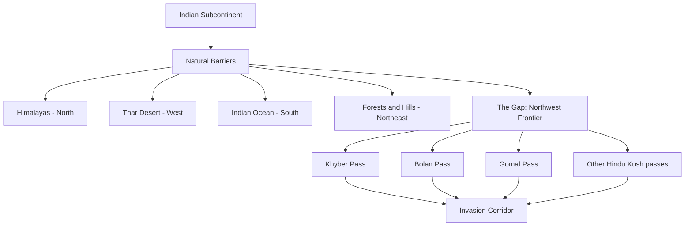

This geographic vulnerability explains a recurring pattern in South Asian history: almost every major foreign invader entered through the northwest. The passes were narrow enough to be defended, but the kingdoms of the Gangetic plains rarely maintained permanent garrisons there. Once an invader crossed the passes, the fertile plains of Punjab and the Ganges valley lay open.

 

## 1.2 The Passes and Routes

| Pass | Location | Historical Significance |
|------|----------|------------------------|
| Khyber Pass | Between Afghanistan and Pakistan | Most famous invasion route; used by Aryans, Persians, Greeks, Kushans, Ghaznavids, Ghurids, Mughals, Afghans, and others |
| Bolan Pass | Balochistan, Pakistan | Alternative southern route; used by Alexander's forces and later invaders |
| Gomal Pass | Between Afghanistan and Pakistan | Southern route used by various Central Asian groups |
| Hindu Kush passes | Various | Alexander crossed the Hindu Kush; later invaders followed similar routes |

The routes converged on the Punjab – the "land of five rivers" – which served as the gateway to the rest of the subcontinent. From Punjab, invaders could move east toward the Gangetic plains or south toward Gujarat and the Deccan.

 

## 1.3 Migration, Invasion, and Incursion: Definitions

| Term | Definition | Example |
|------|------------|---------|
| Migration | Movement of a people into a region, often gradual and peaceful | Aryan migrations (c. 1800–1500 BCE) |
| Invasion | Armed entry by a foreign force seeking conquest or plunder | Alexander's campaign (327–325 BCE) |
| Incursion | A raid or brief penetration, often for plunder rather than permanent conquest | Mahmud of Ghazni's raids (1001–1030 CE) |
| Settlement | Permanent establishment of a foreign-origin community | Kushan and Indo-Greek kingdoms |

These categories overlap. The Aryans likely migrated over centuries, with some conflict and some coexistence. Alexander invaded but did not stay. Mahmud raided repeatedly but did not establish permanent rule. The Ghurids conquered and founded a lasting dynasty. Understanding these distinctions helps clarify the historical record.

 

# Part Two: Foreign Incursions and Invasions (Chronological)

## 2.1 Ancient Invaders (c. 1800 BCE – 500 CE)

### Aryans / Indo-European Tribes (c. 1800–1500 BCE)

**Nature of Movement:** Gradual migration, not a single invasion.

**Key Facts:**
- Semi-nomadic pastoral groups from Central Asia moved through the northwestern passes into Punjab and the Gangetic plains over several centuries.
- They brought the Indo-Aryan languages (ancestors of Sanskrit and most modern North Indian languages), early Vedic culture, and social structures that would evolve into the caste system.
- Scholarly debate continues over the scale, timing, and nature of the migration. The "Aryan Invasion Theory" of the 19th century has been substantially revised; most scholars now describe a complex process of migration, cultural exchange, and gradual settlement.

**Geopolitical Significance:** The Aryan migration fundamentally reshaped the subcontinent's linguistic, religious, and social landscape. The Vedic texts composed by these peoples became foundational to Hinduism.

 

### Persians / Achaemenid Empire (c. 535–518 BCE)

**Nature of Movement:** Armed conquest and annexation.

**Key Facts:**
- **Cyrus the Great** (c. 535 BCE) annexed regions west of the Indus River, including Gandhara.
- **Darius I** (c. 518 BCE) extended control into parts of Punjab and Sindh, organizing the region into satrapies (provinces) and introducing coinage.
- The Persian Empire was the first foreign power to establish administrative control over parts of the subcontinent.

**Geopolitical Significance:** Persian rule introduced new administrative models, coinage, and cultural exchange. The region became part of a transcontinental empire stretching from the Aegean to the Indus. Persian influence on art, language, and governance would be felt for centuries.

 

### Greeks / Macedonians (327–325 BCE)

**Nature of Movement:** Armed invasion and conquest.

**Key Facts:**
- **Alexander the Great** invaded the northwestern frontier in 327 BCE, crossed the Hindu Kush, and descended into the Punjab.
- He crossed the Indus River and defeated **King Porus** of the Pauravas at the **Battle of the Hydaspes** (326 BCE). According to tradition, Alexander was so impressed by Porus's courage that he restored him to his throne as a vassal.
- Alexander's troops, exhausted and homesick, mutinied at the Beas River, refusing to advance further east. Alexander was forced to turn back.
- He died in Babylon in 323 BCE, and his empire fragmented.

**Geopolitical Significance:** Alexander's invasion opened direct contact between the Greek world and India. It created the conditions for the Indo-Greek kingdoms that would later blend Greek and Indian culture. The invasion also demonstrated the limits of even the most powerful foreign armies when faced with determined local resistance and the sheer scale of the subcontinent.

 

### Seleucid Empire (305–303 BCE)

**Nature of Movement:** Attempted reconquest.

**Key Facts:**
- **Seleucus I Nicator**, one of Alexander's generals, attempted to reclaim the eastern territories of Alexander's empire.
- He was defeated by **Chandragupta Maurya**, the founder of the Maurya Empire.
- The two rulers concluded a treaty: Seleucus ceded the territories of Gandhara, Arachosia, and Gedrosia to Chandragupta in exchange for 500 war elephants and a marriage alliance.

**Geopolitical Significance:** This treaty marked the first time an Indian empire had defeated a major Hellenistic power and forced territorial concessions. The 500 elephants proved valuable to Seleucus in his western campaigns. The treaty established a stable frontier between the Maurya Empire and the Hellenistic world.

 

### Indo-Greeks / Graeco-Bactrians (c. 180 BCE)

**Nature of Movement:** Invasion and settlement.

**Key Facts:**
- **King Demetrius** of Bactria (a Greek kingdom in Central Asia) crossed the Hindu Kush and established rule over parts of northern and western India.
- The Indo-Greek kingdoms lasted for over a century, with notable rulers including **Menander** (Milinda), who is remembered in Buddhist texts for his philosophical dialogues with the monk Nagasena.
- The Indo-Greeks produced a remarkable fusion of Greek and Indian art, particularly in the Gandhara region, where Buddhist sculpture shows clear Hellenistic influence.

**Geopolitical Significance:** The Indo-Greek period represents one of the most creative cultural syntheses in South Asian history. Greek coinage, art, and astronomy influenced Indian traditions, while Greek rulers adopted local languages and religious patronage.

 

### Shakas (Scythians) and Pahlavas (Parthians) (1st Century BCE – 1st Century CE)

**Nature of Movement:** Migration, invasion, and displacement of earlier rulers.

**Key Facts:**
- The Shakas (Scythians) were nomadic Central Asian groups who pushed southward into Punjab, Gandhara, and western India.
- They displaced the Indo-Greek rulers and established their own kingdoms, including the **Western Satraps** who ruled parts of Gujarat and Malwa.
- The Pahlavas (Indo-Parthians) followed, seizing control of Gandhara and parts of the northwest in the 1st century CE.
- Notable Shaka ruler: **Rudradaman I**, who repaired the Sudarshana Lake and patronized Sanskrit literature.

**Geopolitical Significance:** The Shakas and Pahlavas continued the pattern of Central Asian groups entering through the northwest and establishing hybrid kingdoms. They contributed to the complex cultural mosaic of the period and were later absorbed into the broader Indian political landscape.

 

### Kushans (Yuezhi Tribes) (1st Century CE)

**Nature of Movement:** Invasion and empire-building.

**Key Facts:**
- The Kushans, descendants of the Yuezhi tribes of Central Asia, established a vast empire stretching from Central Asia deep into northern India.
- **Kujula Kadphises** founded the Kushan Empire; **Kanishka** (c. 127–150 CE) was its most famous ruler.
- Kanishka patronized Buddhism, convened the Fourth Buddhist Council, and facilitated the spread of Buddhism along the Silk Road to China and beyond.
- The Kushans produced the Gandhara and Mathura schools of art, blending Greek, Persian, and Indian influences.

**Geopolitical Significance:** The Kushan Empire was a bridge between the Mediterranean world, Central Asia, China, and India. It controlled key trade routes and facilitated the spread of Buddhism across Asia.

 

### Hunas (White Huns / Alchon Huns) (c. 458 CE)

**Nature of Movement:** Invasion and raiding.

**Key Facts:**
- Central Asian nomadic groups (often called White Huns or Alchon Huns) began incursions into the northwest in the mid-5th century CE.
- Under rulers like **Mihirakula**, they overran Gandhara and Punjab and pushed into the Gangetic plains.
- Their repeated incursions destabilized and eventually weakened the **Gupta Empire**, which had dominated northern India for over a century.

**Geopolitical Significance:** The Huna invasions marked the end of the Gupta "Golden Age" and contributed to the political fragmentation of northern India in the 6th century. The Hunas were eventually absorbed or driven out, but their incursions left lasting scars on the region.

 

## 2.2 Medieval Invaders (c. 700 – 1500 CE)

### Arabs / Umayyad Caliphate (712 CE)

**Nature of Movement:** Armed conquest and administration.

**Key Facts:**
- **Muhammad bin Qasim**, a young Arab general, conquered Sindh and parts of southern Punjab in 711–712 CE.
- He defeated **Raja Dahir** of Sindh and established Islamic administration in the region.
- Sindh became a province of the Umayyad Caliphate, introducing Islamic law, administration, and culture to the western frontier.
- Arab rule in Sindh was relatively tolerant of local customs and religious practices, setting a precedent for later Muslim rulers.

**Geopolitical Significance:** The Arab conquest of Sindh was the first establishment of Islamic rule in the subcontinent. It opened a new chapter in the region's history and created a lasting Muslim presence in the northwest.

 

### Ghaznavids / Turks (1001–1030 CE)

**Nature of Movement:** Repeated raids for plunder.

**Key Facts:**
- **Mahmud of Ghazni** conducted seventeen raids into northern and western India between 1001 and 1030 CE.
- His most famous raid was the sack of the **Somnath temple** in Gujarat (1025 CE), which he plundered for its wealth.
- Mahmud's raids were primarily for plunder and wealth, not permanent conquest. He established a base in Ghazni (modern Afghanistan) and used the wealth to build a magnificent capital.
- He also patronized scholars like **Al-Biruni**, who wrote a detailed account of Indian society and science.

**Geopolitical Significance:** Mahmud's raids weakened the defenses of northern India, exposed the wealth of Indian temples and cities, and established a pattern of Central Asian Turkic incursions that would culminate in the establishment of the Delhi Sultanate.

 

### Ghurids (1175–1192 CE)

**Nature of Movement:** Armed conquest and dynasty-building.

**Key Facts:**
- **Muhammad of Ghor** (Mu'izz al-Din Muhammad) defeated **Prithviraj Chauhan** at the **Second Battle of Tarain** in 1192 CE.
- The First Battle of Tarain (1191) had resulted in a defeat for Muhammad of Ghor; he returned the following year with a larger, better-prepared army and won decisively.
- The victory at Tarain laid the direct foundation for Muslim rule in North India and the establishment of the **Delhi Sultanate** (1206–1526).
- Muhammad of Ghor's generals, including **Qutb al-Din Aibak**, became the first rulers of the Delhi Sultanate.

**Geopolitical Significance:** The Ghurid conquest marked a turning point. Unlike earlier raiders, the Ghurids established a lasting dynasty that would rule much of northern India for over three centuries. The Delhi Sultanate that emerged from their conquest became a major center of Islamic culture, architecture, and administration.

 

### Mongols (13th–14th Centuries)

**Nature of Movement:** Raiding and incursion.

**Key Facts:**
- Various Mongol armies, particularly from the **Chagatai Khanate**, repeatedly raided the northwestern borderlands and marched toward Delhi.
- The **Delhi Sultanate**, under rulers like **Alauddin Khalji** (1296–1316), faced numerous Mongol incursions.
- Alauddin Khalji successfully repelled several major Mongol invasions, earning a reputation as a skilled military commander.
- The Mongols never established permanent rule in India, but their raids destabilized the region and diverted resources toward defense.

**Geopolitical Significance:** The Mongol threat forced the Delhi Sultanate to maintain a large standing army and fortified frontier. The successful defense against the Mongols strengthened the Sultanate's military institutions and its legitimacy as a protector of the subcontinent.

 

### Timurids / Tamerlane (1398 CE)

**Nature of Movement:** Invasion and massive plunder.

**Key Facts:**
- **Timur** (Tamerlane), the Central Asian conqueror, invaded India in 1398.
- He sacked **Delhi** with massive devastation, massacring thousands of inhabitants and plundering the city's wealth.
- The invasion shattered the **Tughlaq dynasty** and left the Delhi Sultanate severely weakened.
- Timur did not stay to rule; he returned to Central Asia, leaving a power vacuum in northern India.

**Geopolitical Significance:** Timur's invasion was one of the most destructive in the subcontinent's history. It accelerated the decline of the Delhi Sultanate and created conditions for the rise of new powers, including the Sayyid and Lodi dynasties, and eventually the Mughals.

 

### Mughals (1526 CE)

**Nature of Movement:** Armed conquest and empire-building.

**Key Facts:**
- **Babur**, a descendant of Timur and Genghis Khan, defeated **Ibrahim Lodi** at the **First Battle of Panipat** in 1526.
- Babur used superior artillery and cavalry tactics to defeat the larger Lodi army.
- He founded the **Mughal Empire**, which would become one of the most powerful and culturally rich empires in Indian history.
- The Mughals ruled much of the subcontinent for over three centuries, until their decline in the 18th and 19th centuries.

**Geopolitical Significance:** The Mughal Empire represented the last great Central Asian invasion that resulted in permanent rule. Under rulers like Akbar, Jahangir, Shah Jahan, and Aurangzeb, the Mughals created a centralized administration, a unified currency system, and a remarkable cultural synthesis. The empire's decline in the 18th century opened the door for European colonial expansion.

 

## 2.3 Early Modern Invaders (c. 1500 – 1800 CE)

### Afghans / Persians (18th Century)

**Nadir Shah (1739):**
- The Persian ruler **Nadir Shah** invaded India in 1739, defeated the Mughal army at the **Battle of Karnal**, and occupied Delhi.
- He ordered a massacre of Delhi's inhabitants and plundered the city's wealth, including the **Peacock Throne** and the **Koh-i-Noor diamond**.
- The invasion exposed the weakness of the Mughal Empire and accelerated its decline.

**Ahmad Shah Durrani (1748–1767):**
- **Ahmad Shah Durrani** (Abdali), the founder of the Durrani Empire in Afghanistan, launched multiple invasions into northern India.
- He fought the **Third Battle of Panipat** in 1761 against the Maratha Confederacy. The battle resulted in a decisive Afghan victory and heavy casualties on both sides.
- Durrani's invasions further destabilized northern India and weakened the Marathas, creating opportunities for other powers.

**Geopolitical Significance:** The 18th-century Afghan and Persian invasions demonstrated the continued vulnerability of the subcontinent's northwest frontier. They accelerated the fragmentation of the Mughal Empire and contributed to the rise of regional powers like the Marathas, Sikhs, and eventually the British.

 

### European Powers / British (16th–18th Centuries)

**Nature of Movement:** Maritime trade, military intervention, and political conquest.

**Key Facts:**
- **Portuguese** explorer **Vasco da Gama** reached India in 1498, opening the sea route from Europe.
- The **Dutch**, **French**, and **British** established trading companies in the 17th century.
- The **British East India Company** (EIC) gradually transitioned from a trading company into a political and military power.
- The **Battle of Plassey** (1757) was a turning point: the EIC, under **Robert Clive**, defeated the Nawab of Bengal, Siraj-ud-Daulah, and gained control of Bengal's revenues.
- Over the next century, the EIC expanded its control through wars, treaties, and administrative reforms, eventually becoming the dominant power in the subcontinent.

**Geopolitical Significance:** The European powers represented a new kind of invasion: maritime, commercial, and bureaucratic. Unlike earlier invaders, the British did not come through the northwest passes; they came by sea and gradually established political control through a combination of military force, diplomatic maneuvering, and administrative efficiency. The Battle of Plassey is often considered the beginning of British colonial rule in India.

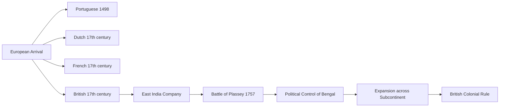

 

## 2.4 Summary Table of Foreign Invaders

| Invader | Date | Nature | Key Figure | Lasting Impact |
|---------|------|--------|------------|----------------|
| Aryans / Indo-European Tribes | c. 1800–1500 BCE | Migration | - | Vedic culture, Indo-Aryan languages, social structures |
| Persians (Achaemenid) | c. 535–518 BCE | Conquest | Cyrus, Darius I | Administrative satrapies, coinage, transcontinental trade |
| Greeks / Macedonians | 327–325 BCE | Invasion | Alexander the Great | Indo-Greek cultural synthesis, Gandhara art |
| Seleucid Empire | 305–303 BCE | Attempted reconquest | Seleucus I | Treaty with Chandragupta Maurya, stable frontier |
| Indo-Greeks | c. 180 BCE | Invasion and settlement | Demetrius, Menander | Greek-Indian art, coinage, astronomy |
| Shakas / Scythians | 1st century BCE | Migration and invasion | Rudradaman I | Western Satraps, cultural exchange |
| Pahlavas / Indo-Parthians | 1st century CE | Invasion | Gondophares | Control of Gandhara, trade routes |
| Kushans | 1st century CE | Invasion and empire | Kujula Kadphises, Kanishka | Spread of Buddhism, Silk Road trade, Gandhara art |
| Hunas / White Huns | c. 458 CE | Invasion and raiding | Mihirakula | Weakened Gupta Empire, political fragmentation |
| Arabs | 712 CE | Conquest | Muhammad bin Qasim | Islamic rule in Sindh, Islamic administration |
| Ghaznavids | 1001–1030 CE | Raids for plunder | Mahmud of Ghazni | Weakened northern defenses, exposed wealth |
| Ghurids | 1175–1192 CE | Conquest and dynasty | Muhammad of Ghor | Foundation of Delhi Sultanate |
| Mongols | 13th–14th centuries | Raiding | Chagatai khans | Military buildup of Delhi Sultanate |
| Timurids | 1398 CE | Invasion and plunder | Timur | Sacked Delhi, weakened Tughlaq dynasty |
| Mughals | 1526 CE | Conquest and empire | Babur | Mughal Empire, cultural synthesis |
| Persians (Afsharid) | 1739 CE | Invasion and plunder | Nadir Shah | Plundered Delhi, exposed Mughal weakness |
| Afghans (Durrani) | 1748–1767 CE | Invasion | Ahmad Shah Durrani | Third Battle of Panipat, weakened Marathas |
| Europeans / British | 16th–18th centuries | Trade, conquest, colonization | Vasco da Gama, Robert Clive | British colonial rule |

 

# Part Three: Indigenous Empires and Kingdoms

## 3.1 Ancient Period (c. 1500 BCE – 500 CE)

### Mahajanapadas (c. 600–345 BCE)

**Overview:** A group of sixteen powerful oligarchies and kingdoms across northern India.

**Key Facts:**
- The Mahajanapadas emerged in the Gangetic plains during the later Vedic period.
- **Magadha** emerged as the dominant kingdom under the **Haryanka Dynasty** (ruled by **Bimbisara** and **Ajatashatru**).
- Later dynasties, the **Shishunaga** and **Nanda**, further consolidated Magadha's power.
- The Mahajanapadas period saw the rise of urbanization, coinage, and new religious movements (Buddhism and Jainism).

**Geopolitical Significance:** The Mahajanapadas laid the political and cultural foundations for the first great Indian empires. Magadha's dominance in the Gangetic plains created a power base that would be inherited by the Mauryas.

 

### Maurya Empire (322–185 BCE)

**Overview:** The first empire to unify most of the Indian subcontinent.

**Key Facts:**
- Founded by **Chandragupta Maurya** after defeating the Nandas and Seleucus I Nicator.
- **Chanakya** (Kautilya), Chandragupta's advisor, wrote the **Arthashastra**, a foundational text on statecraft, economics, and military strategy.
- **Ashoka the Great** (reigned c. 268–232 BCE) expanded the empire to its greatest extent, covering most of the subcontinent except the far south.
- After the **Kalinga War** (c. 261 BCE), Ashoka renounced violence and embraced Buddhism, propagating the religion across Asia.
- The empire declined after Ashoka's death and ended with the assassination of the last Maurya ruler by Pushyamitra Shunga.

**Geopolitical Significance:** The Maurya Empire was the first to demonstrate the possibility of unifying the subcontinent under a single administration. Ashoka's patronage of Buddhism transformed the religion into a major world faith. The Arthashastra remains a classic text on geopolitics and statecraft.

 

### Sangam Era Kingdoms (c. 300 BCE – 300 CE)

**Overview:** The three ancient Tamil dynasties ruling the far south.

| Kingdom | Region | Notable Ruler | Key Features |
|---------|--------|---------------|--------------|
| Cheras | Modern Kerala and Tamil Nadu | Cheran Senguttuvan | Trade with Rome, spice exports |
| Cholas (Early) | Cauvery delta | Karikala Chola | Built the Grand Anicut dam, irrigation systems |
| Pandyas (Early) | Madurai region | - | Pearl fisheries, patronized Sangam literature |

**Geopolitical Significance:** The Sangam kingdoms controlled the lucrative spice trade with the Roman Empire. They produced the Sangam literature, one of the oldest bodies of Tamil poetry. Their maritime trade connected India to Southeast Asia and the Mediterranean world.

 

### Satavahana Dynasty (c. 2nd Century BCE – 2nd Century CE)

**Overview:** A Deccan-based dynasty that acted as a cultural bridge between north and south India.

**Key Facts:**
- Based in the Deccan region (modern Andhra Pradesh, Telangana, and Maharashtra).
- **Gautamiputra Satakarni** (reigned c. 106–130 CE) defeated the Western Shaka invaders and consolidated Satavahana power.
- The dynasty patronized Buddhism and constructed important Buddhist monuments, including the Amaravati Stupa.
- They were notable for their matrilineal naming conventions and their patronage of Prakrit literature.

**Geopolitical Significance:** The Satavahanas controlled the trade routes between the Gangetic plains and the southern ports, facilitating commerce and cultural exchange. They successfully resisted Shaka incursions, preserving Deccan autonomy.

 

### Gupta Empire (c. 319–550 CE)

**Overview:** Known as the "Golden Age of India" due to immense advancements in science, art, and literature.

**Key Facts:**
- **Chandragupta I** (reigned c. 319–335 CE) founded the imperial dynasty.
- **Samudragupta** (reigned c. 335–375 CE) was a military genius known as the "Napoleon of India" for his extensive conquests.
- **Chandragupta II** (Vikramaditya, reigned c. 375–415 CE) defeated the Western Shaka rulers and patronized legendary scholars like **Kalidasa**.
- The Gupta period saw advances in mathematics (the decimal system, zero), astronomy (Aryabhata), medicine (Sushruta), and art (Ajanta caves, Sarnath Buddha).
- The empire declined under pressure from the Hunas and internal fragmentation.

**Geopolitical Significance:** The Gupta Empire represents the classical zenith of Indian civilization. Its cultural and scientific achievements influenced the entire Asian world. The decline of the Guptas marked the end of the classical era and the beginning of medieval India.

 

## 3.2 Early Medieval and Medieval Period (c. 500 – 1500 CE)

### Vardhana Dynasty / Kingdom of Kannauj (c. 606–647 CE)

**Overview:** Following the fall of the Guptas, Harshavardhana unified northern India.

**Key Facts:**
- **Harshavardhana** (reigned c. 606–647 CE) established his capital at **Kannauj** and ruled much of northern India.
- He was a great patron of the arts and Buddhism, and his court was visited by the Chinese pilgrim **Xuanzang** (Hiuen Tsang), who left a detailed account of India.
- Harsha's empire dissolved after his death, leading to a period of regional fragmentation.

**Geopolitical Significance:** Harsha's reign represented a brief revival of imperial unity in northern India after the Gupta collapse. His patronage of Buddhism and his diplomatic relations with China are notable.

 

### Tripartite Struggle Dynasties (c. 750–1000 CE)

**Overview:** Three major empires fought for control of northern India, specifically Kannauj.

| Dynasty | Region | Notable Ruler | Key Features |
|---------|--------|---------------|--------------|
| Gurjara-Pratiharas | Western and northern India | Mihira Bhoja | Controlled the northwest frontier, resisted Arab incursions |
| Palas | Bengal and Bihar | Dharmapala | Created great centers of learning (Vikramashila, Nalanda) |
| Rashtrakutas | Deccan | Amoghavarsha I | Carved the Kailash Temple at Ellora |

**Geopolitical Significance:** The Tripartite Struggle weakened all three powers and left northern India vulnerable to foreign invasion. The eventual victors were the Ghurids, who established the Delhi Sultanate.

 

### Chalukya & Pallava Dynasties (6th–9th Centuries CE)

**Overview:** Great rivals in the Deccan and South India.

**Key Facts:**
- **Badami Chalukyas:** Notable ruler **Pulakeshin II** (reigned c. 610–642 CE) famously stopped Harsha's southward expansion at the Narmada River. He was later defeated by the Pallava king Narasimhavarman I.
- **Pallavas:** Ruled from Kanchipuram and built the monolithic shore temples of Mahabalipuram. **Narasimhavarman I** (reigned c. 630–668 CE) defeated Pulakeshin II and briefly occupied the Chalukya capital.

**Geopolitical Significance:** The Chalukya-Pallava rivalry shaped the political landscape of South India for centuries. Their patronage of art and architecture produced some of India's most iconic monuments.

 

### Imperial Chola Empire (c. 850–1279 CE)

**Overview:** A resurgent Tamil empire that dominated South India, Sri Lanka, and parts of Southeast Asia.

**Key Facts:**
- **Rajaraja Chola I** (reigned c. 985–1014 CE) built the magnificent **Brihadisvara Temple** in Thanjavur and expanded the empire through military campaigns.
- **Rajendra Chola I** (reigned c. 1014–1044 CE) expanded the empire to the Ganges River (earning the title "Gangaikonda Chola") and sent a powerful navy across the Bay of Bengal to Sumatra and Malaya.
- The Cholas controlled the lucrative maritime trade routes connecting India, Southeast Asia, and China.

**Geopolitical Significance:** The Chola Empire was the greatest maritime power in Indian history. Its naval expeditions to Southeast Asia represented a unique projection of Indian power across the seas. The Cholas' administrative systems and temple architecture influenced Southeast Asian civilizations.

 

### Rajput Kingdoms (c. 7th–12th Centuries CE)

**Overview:** Numerous clans that ruled western and central India, including Rajasthan and Madhya Pradesh.

**Key Facts:**
- The **Chahamanas (Chauhans)** of Ajmer were among the most prominent Rajput clans.
- **Prithviraj Chauhan** (reigned c. 1178–1192 CE) famously fought Muhammad of Ghor at the Battles of Tarain.
- The Rajputs were known for their martial culture, fort architecture, and patronage of the arts.

**Geopolitical Significance:** The Rajput kingdoms formed a buffer between the Gangetic plains and the northwest frontier. Their defeat at the Second Battle of Tarain opened the way for the Delhi Sultanate.

 

### Vijayanagara Empire (1336–1646 CE)

**Overview:** Founded in South India to resist northern sultanate expansions.

**Key Facts:**
- Founded by the brothers **Harihara I** and **Bukka Raya I** of the Sangama dynasty.
- Its zenith was reached under **Krishnadevaraya** (reigned 1509–1529 CE) of the Tuluva dynasty.
- Krishnadevaraya's reign marked a golden era for Telugu and Kannada literature and architecture.
- The empire controlled the lucrative trade in spices, textiles, and precious stones.
- It declined after the **Battle of Talikota** (1565) against the Deccan Sultanates and was eventually absorbed by the Mughals and other powers.

**Geopolitical Significance:** Vijayanagara was the last great Hindu empire of South India. It served as a bulwark against northern expansion and a center of cultural patronage. Its capital, Hampi, was one of the largest and wealthiest cities in the world.

 

### Gajapati Empire (1434–1541 CE)

**Overview:** The Suryavamsi dynasty ruled over Kalinga (modern Odisha) and vast swathes of coastal Andhra.

**Key Facts:**
- Founded by **Kapilendra Deva**, who usurped the throne of the Eastern Ganga dynasty.
- The Gajapatis maintained fierce military resistance against neighboring sultanates.
- They were great patrons of temple architecture, including the Sun Temple at Konark (completed earlier but patronized by the dynasty).

**Geopolitical Significance:** The Gajapati Empire controlled the important trade routes along the eastern coast and maintained the cultural and political independence of Odisha during a period of widespread conquest.

 

## 3.3 Late Medieval and Early Modern Period (c. 1500 – 1850 CE)

### Ahom Kingdom (1228–1826 CE)

**Overview:** Established in the Brahmaputra valley of Assam, the Ahoms ruled for nearly 600 years.

**Key Facts:**
- Founded by **Sukaphaa** in 1228.
- The Ahoms successfully resisted repeated Mughal invasions.
- **Lachit Borphukan**, a legendary Ahom commander, defeated Mughal forces at the **Battle of Saraighat** (1671) in a naval engagement on the Brahmaputra River.
- The kingdom was eventually annexed by the British after the **Treaty of Yandabo** (1826) following the First Anglo-Burmese War.

**Geopolitical Significance:** The Ahom Kingdom preserved the independence of the northeast against Mughal expansion. The Battle of Saraighat is celebrated as one of the greatest military victories in Assamese history.

 

### Maratha Empire (1674–1818 CE)

**Overview:** Founded by Chhatrapati Shivaji Maharaj, who used guerrilla warfare to carve out an independent kingdom.

**Key Facts:**
- **Shivaji** (reigned 1674–1680) established the Maratha kingdom from the Bijapur Sultanate and the Mughal Empire.
- In the 18th century, under the administration of the **Peshwas** (Prime Ministers like **Baji Rao I**), the Maratha Confederacy expanded to control the majority of the Indian subcontinent.
- The Marathas were checked at the **Third Battle of Panipat** (1761) by Ahmad Shah Durrani.
- The empire fragmented into semi-independent states (Gaekwads, Holkars, Scindias, Bhonsles) and was eventually defeated by the British in the **Anglo-Maratha Wars**.

**Geopolitical Significance:** The Maratha Empire was the last major indigenous power to challenge foreign dominance before the British conquest. Shivaji's guerrilla warfare tactics and administrative innovations influenced later Indian military and political thought.

 

### Sikh Empire (1799–1849 CE)

**Overview:** Formed out of the various Sikh Misls in the Punjab region.

**Key Facts:**
- **Maharaja Ranjit Singh** (reigned 1801–1839) unified the Sikh Misls into a powerful, modernized empire.
- He successfully kept the British East India Company at bay during his lifetime through a combination of military strength and diplomatic skill.
- The Sikh Empire had a modern army with European-style training and artillery.
- After Ranjit Singh's death, the empire declined due to internal divisions and was eventually annexed by the British after the **Anglo-Sikh Wars**.

**Geopolitical Significance:** The Sikh Empire was the last major indigenous kingdom to resist British expansion in northern India. Ranjit Singh's military modernization and secular governance (he employed Hindus, Muslims, and Sikhs in his administration) are notable.

 

### Kingdom of Mysore (Wodeyar Dynasty)

**Overview:** Ruled the southern Deccan from Mysore (modern Karnataka).

**Key Facts:**
- In the late 18th century, control was temporarily seized by military commanders **Hyder Ali** and his son **Tipu Sultan** ("The Tiger of Mysore").
- Tipu Sultan fought four fierce **Anglo-Mysore Wars** against the British, using advanced rocketry and diplomatic alliances with France.
- Tipu Sultan was killed in the **Fourth Anglo-Mysore War** (1799) at the Battle of Srirangapatna.
- The Wodeyar dynasty was restored under British suzerainty.

**Geopolitical Significance:** Mysore under Hyder Ali and Tipu Sultan was the most formidable indigenous challenge to British expansion in southern India. Tipu's military innovations, including the use of iron-cased rockets, influenced the development of rocket artillery.

 

## 3.4 Summary Table of Indigenous Empires

| Empire / Kingdom | Period | Region | Notable Ruler | Key Feature |
|------------------|--------|--------|---------------|-------------|
| Mahajanapadas | c. 600–345 BCE | Northern India | Bimbisara, Ajatashatru | 16 kingdoms; Magadha dominant |
| Maurya Empire | 322–185 BCE | Most of subcontinent | Chandragupta, Ashoka | First pan-Indian empire; Buddhism |
| Sangam Kingdoms | c. 300 BCE–300 CE | Far south | Karikala Chola | Tamil literature, spice trade |
| Satavahana Dynasty | c. 2nd century BCE–2nd century CE | Deccan | Gautamiputra Satakarni | Cultural bridge; defeated Shakas |
| Gupta Empire | c. 319–550 CE | Northern India | Samudragupta, Chandragupta II | "Golden Age"; science, art, literature |
| Vardhana Dynasty | c. 606–647 CE | Northern India | Harshavardhana | Brief imperial unity; patron of Buddhism |
| Tripartite Struggle | c. 750–1000 CE | Northern India | Mihira Bhoja, Dharmapala | Three-way struggle for Kannauj |
| Chalukya & Pallava | 6th–9th centuries CE | Deccan and South | Pulakeshin II, Narasimhavarman I | Rivalry; temple architecture |
| Imperial Chola Empire | c. 850–1279 CE | South India, Sri Lanka, SE Asia | Rajaraja I, Rajendra I | Maritime empire; naval expeditions |
| Rajput Kingdoms | c. 7th–12th centuries CE | Western and central India | Prithviraj Chauhan | Martial culture; buffer against invasions |
| Vijayanagara Empire | 1336–1646 CE | South India | Krishnadevaraya | Bulwark against sultanates; Hampi |
| Gajapati Empire | 1434–1541 CE | Odisha and coastal Andhra | Kapilendra Deva | Temple patronage; anti-sultanate resistance |
| Ahom Kingdom | 1228–1826 CE | Assam (Brahmaputra valley) | Lachit Borphukan | Resisted Mughal invasions; Saraighat |
| Maratha Empire | 1674–1818 CE | Most of India | Shivaji, Baji Rao I | Guerrilla warfare; Peshwa administration |
| Sikh Empire | 1799–1849 CE | Punjab | Maharaja Ranjit Singh | Modernized army; last resistance to British |
| Kingdom of Mysore | Wodeyar dynasty | Southern Deccan | Hyder Ali, Tipu Sultan | Anglo-Mysore Wars; rocketry |

 

# Part Four: Patterns, Impacts, and Analysis

## 4.1 Recurring Drivers of Invasion

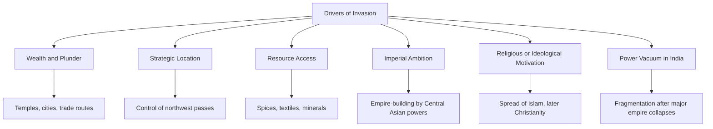

| Driver | Description | Examples |
|--------|-------------|----------|
| Wealth and Plunder | India was renowned for its wealth; temples, cities, and trade routes attracted raiders | Mahmud of Ghazni, Nadir Shah, Timur |
| Strategic Location | Control of the northwest passes meant control of access to the subcontinent | Persians, Greeks, Kushans |
| Resource Access | Spices, textiles, minerals, and agricultural wealth | Europeans, Ghaznavids |
| Imperial Ambition | Central Asian powers sought to expand their empires | Mughals, Ghurids |
| Religious Motivation | Spread of Islam (later Christianity) | Arabs, Ghurids, Europeans |
| Power Vacuum | Fragmentation after the collapse of major Indian empires invited invasion | After Gupta decline, after Mughal decline |

 

## 4.2 Impact on Indian Civilization

### Cultural Synthesis

Each invasion brought new cultural elements that blended with existing Indian traditions:

- **Greek influence:** Gandhara art, coinage, astronomy
- **Persian influence:** Administrative models, language (Persian became a court language under the Mughals), art
- **Central Asian influence:** Military techniques, architecture (domes, arches, gardens)
- **Islamic influence:** Architecture (mosques, tombs, forts), cuisine, music, literature
- **European influence:** Language (English), education, legal systems, infrastructure

### Religious Pluralism

The subcontinent became a meeting ground for Hinduism, Buddhism, Jainism, Islam, Christianity, Sikhism, and other faiths. This pluralism was sometimes marked by conflict and sometimes by coexistence and synthesis. The Bhakti and Sufi movements produced devotional poetry that transcended religious boundaries.

### Political Fragmentation and Unity

The subcontinent oscillated between periods of imperial unity (Maurya, Gupta, Mughal) and fragmentation (post-Gupta, post-Mughal). The northwest frontier remained a persistent vulnerability. The British conquest represented the first time the entire subcontinent was unified under a single foreign power.

### Military and Technological Exchange

India absorbed military technologies from invaders (horse archery, artillery, fortification techniques) and developed its own (war elephants, rocketry). The British East India Company's military superiority was based on a combination of technology, discipline, and administrative efficiency.

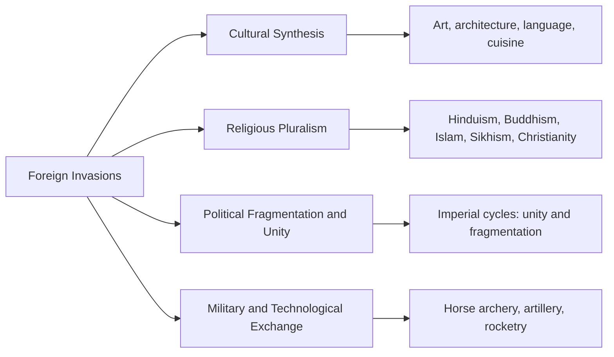

 

## 4.3 Resistance and Adaptation

Indigenous powers resisted invasions through several strategies:

| Strategy | Example |
|----------|---------|
| Military Resistance | Porus against Alexander; Prithviraj Chauhan against Muhammad of Ghor; Marathas against Mughals and Afghans |
| Guerrilla Warfare | Shivaji's campaigns against the Mughals and Bijapur Sultanate |
| Diplomatic Maneuvering | Chandragupta Maurya's treaty with Seleucus; Ranjit Singh's diplomacy with the British |
| Fortification | Rajput forts; Vijayanagara's fortifications; Ahom river defenses |
| Alliance-Building | Maratha Confederacy; Sikh Misls united under Ranjit Singh |
| Cultural Assimilation | Indo-Greek and Kushan rulers adopted local religions and customs |

 

## 4.4 The Delhi Sultanate: A Bridge Between Worlds

The **Delhi Sultanate** (1206–1526) is not included in either the "foreign invaders" or "indigenous empires" lists, but it deserves special mention as a bridge between the two.

| Aspect | Detail |
|--------|--------|
| Origin | Founded by Qutb al-Din Aibak, a former slave-general of Muhammad of Ghor |
| Dynasties | Slave (Mamluk), Khalji, Tughlaq, Sayyid, Lodi |
| Nature | Foreign-origin (Turkic, Afghan) but Indian in administration, culture, and identity |
| Achievements | Centralized administration, Persianate culture, architecture (Qutb Minar, Tughlaqabad), resistance to Mongols |
| Legacy | Created the political and cultural framework that the Mughals later inherited |

The Delhi Sultanate demonstrates the complexity of the invasion-settlement-assimilation cycle. Its rulers were of foreign origin but became Indian in their governance and patronage. They defended the subcontinent against the Mongols, promoted trade and urbanization, and left a lasting architectural and cultural legacy.

 

# Appendices

## Appendix A: Unified Timeline

| Date | Event |
|------|-------|
| c. 1800–1500 BCE | Aryan migrations into northwest India |
| c. 600–345 BCE | Mahajanapadas period |
| c. 535–518 BCE | Persian conquest of northwest India |
| 327–325 BCE | Alexander the Great's invasion |
| 322–185 BCE | Maurya Empire |
| 305–303 BCE | Seleucid-Maurya treaty |
| c. 180 BCE | Indo-Greek kingdoms established |
| 1st century BCE | Shaka migrations into western India |
| 1st century CE | Kushan Empire established |
| c. 319–550 CE | Gupta Empire |
| c. 458 CE | Huna invasions |
| c. 606–647 CE | Harshavardhana's reign |
| 712 CE | Arab conquest of Sindh |
| c. 750–1000 CE | Tripartite Struggle |
| c. 850–1279 CE | Imperial Chola Empire |
| 1001–1030 CE | Mahmud of Ghazni's raids |
| 1192 CE | Second Battle of Tarain; foundation of Delhi Sultanate |
| 1206–1526 CE | Delhi Sultanate |
| 1336–1646 CE | Vijayanagara Empire |
| 1398 CE | Timur's invasion and sack of Delhi |
| 1526 CE | First Battle of Panipat; Mughal Empire founded |
| 1674–1818 CE | Maratha Empire |
| 1739 CE | Nadir Shah's invasion |
| 1761 CE | Third Battle of Panipat |
| 1757 CE | Battle of Plassey; British ascendancy in Bengal |
| 1799–1849 CE | Sikh Empire |
| 1857 CE | Indian Rebellion; end of Mughal rule; beginning of direct British rule |

 

## Appendix B: Glossary

| Term | Definition |
|------|-------------|
| **Achaemenid Empire** | The first Persian Empire, founded by Cyrus the Great |
| **Anglo-Mysore Wars** | Four wars between the Kingdom of Mysore and the British East India Company (1767–1799) |
| **Arthashastra** | Ancient Indian treatise on statecraft, economics, and military strategy by Kautilya |
| **Bhakti movement** | Devotional Hindu movement emphasizing personal devotion to God |
| **Chagatai Khanate** | Mongol state in Central Asia that repeatedly raided India |
| **Delhi Sultanate** | Muslim dynasty of Turkic and Afghan origin that ruled northern India (1206–1526) |
| **Gandhara** | Ancient region in modern Afghanistan/Pakistan; center of Greco-Buddhist art |
| **Hunas** | Central Asian nomadic group (White Huns) who invaded India in the 5th century CE |
| **Khyber Pass** | Mountain pass connecting Afghanistan and Pakistan; primary invasion route |
| **Mahajanapadas** | Sixteen major kingdoms and oligarchies of ancient northern India |
| **Misl** | Sovereign Sikh states that were later unified by Ranjit Singh |
| **Peshwa** | Prime Minister of the Maratha Empire; effective ruler in the 18th century |
| **Satrap** | Provincial governor in the Persian Empire |
| **Satavahana** | Deccan dynasty that controlled trade routes between north and south India |
| **Sufi movement** | Mystical Islamic movement that emphasized personal experience of God |
| **Tarain, Battles of** | Two battles (1191, 1192) between Prithviraj Chauhan and Muhammad of Ghor |
| **Tripartite Struggle** | Three-way contest for control of Kannauj among the Gurjara-Pratiharas, Palas, and Rashtrakutas |
| **Vedic culture** | Early Indo-Aryan culture based on the Vedas, foundational texts of Hinduism |

 

## Appendix C: Further Reading

### General Surveys

- Romila Thapar, *A History of India*, Volume 1 (Penguin, 1990)
- Burton Stein, *A History of India* (Wiley-Blackwell, 2010)
- Hermann Kulke and Dietmar Rothermund, *A History of India* (Routledge, 2016)

### On Invasions and Foreign Rule

- André Wink, *Al-Hind: The Making of the Indo-Islamic World* (Brill, 1990–2004)
- Peter Jackson, *The Delhi Sultanate: A Political and Military History* (Cambridge University Press, 1999)
- Richard M. Eaton, *India in the Persianate Age, 1000–1765* (University of California Press, 2019)

### On Indigenous Empires

- R.S. Sharma, *India's Ancient Past* (Oxford University Press, 2005)
- K.A. Nilakanta Sastri, *A History of South India* (Oxford University Press, 1976)
- Stewart Gordon, *The Marathas 1600–1818* (Cambridge University Press, 1993)
- Khushwant Singh, *A History of the Sikhs*, Volume 1 (Oxford University Press, 2004)

### On the Geography of Invasion

- Robert D. Kaplan, *The Revenge of Geography* (Random House, 2012) – includes discussion of South Asian geography
- Halford Mackinder, *Democratic Ideals and Reality* (1919) – classic geopolitical framework

### Primary Sources in Translation

- Kautilya, *The Arthashastra*, translated by L.N. Rangarajan (Penguin, 1992)
- Xuanzang, *Si-Yu-Ki: Buddhist Records of the Western World*, translated by Samuel Beal (1884)
- Al-Biruni, *Alberuni's India*, translated by Edward Sachau (1910)

 

The Indian subcontinent's history is a story of repeated incursions through the northwestern passes, followed by settlement, cultural synthesis, and the rise of new indigenous powers. The pattern is not one of simple conquest and defeat but of complex interaction, adaptation, and renewal.

Geography made the subcontinent both vulnerable and resilient. The northwest frontier was a persistent weak point, but the subcontinent's sheer size, population, and cultural depth absorbed invaders and transformed them over time. The Aryans became Indian; the Greeks became Indo-Greek; the Kushans patronized Buddhism; the Mughals created a syncretic culture; the British left a mixed legacy of modernization and exploitation.

Understanding this history is essential for anyone seeking to understand modern South Asia. The patterns of invasion, resistance, and synthesis are not merely historical curiosities; they continue to shape the region's politics, culture, and international relations.

The lesson is not that invasions were inevitable or that resistance was futile. Rather, it is that civilizations endure not by resisting all change but by absorbing it, adapting to it, and transforming it into something new. The Indian subcontinent is a testament to that resilience.

 
    

    

<h1 align="center">HISTORY OF INDIAN LANGUAGES</h1>

  

India’s linguistic landscape is one of the most diverse in the world. The subcontinent is home to multiple independent language families, continuous literary traditions spanning more than two thousand years, and writing systems that largely evolved from a single ancient source. This guide presents a clear, structured account of the origins, development, and interconnections of Indian languages. It draws on linguistic classification, historical evidence, epigraphy, and documented literary traditions. The language is kept simple and clear so that general readers can follow the material easily. The document is suitable for publication on educational or informational websites.

Three related but distinct concepts help organise the material:

- **Language family**: the historical relationship between languages that share a common ancestor.
- **Historical language**: an attested language used in a particular period (for example, Vedic Sanskrit or Old Tamil).
- **Writing system**: the script used to represent a language. A language can change its script without changing its linguistic ancestry.

Language families describe historical linguistic relationships. They are not racial or ethnic categories. A speaker’s language does not determine personal identity, ancestry, or cultural practices.

 

### 1. Major Language Families of India

India does not descend from a single ancestral language. Several distinct language families coexist. The four largest and most widely recognised are Indo-Aryan, Dravidian, Austroasiatic, and Sino-Tibetan (also called Trans-Himalayan). Smaller groups and language isolates also exist. According to analyses based on Census of India data, Indo-Aryan languages account for the large majority of speakers, followed by Dravidian, with Austroasiatic and Sino-Tibetan forming smaller but historically important shares.

#### 1.1 Indo-Aryan

Part of the larger Indo-European family (specifically the Indo-Iranian branch). Early forms appear in Vedic Sanskrit, which was transmitted orally for centuries. These languages developed through Middle Indo-Aryan stages (various Prakrits and Pali) and later regional varieties known as Apabhraṃśa before becoming the modern languages.

Major examples include Hindi, Bengali, Marathi, Punjabi, Gujarati, Odia, Assamese, Urdu, Sindhi, Kashmiri, Nepali, Konkani, Maithili, and Dogri. Within Indo-Aryan, scholars often distinguish broad regional groups such as Northwestern (Punjabi, Sindhi, Kashmiri), Western (Gujarati, Rajasthani varieties), Central (Hindi and related), Eastern (Bengali, Assamese, Odia, Maithili), and Southern (Marathi, Konkani).

Modern Indo-Aryan languages generally descend through regional spoken traditions rather than directly from Classical Sanskrit.

#### 1.2 Dravidian

An independent family with no proven genetic link to Indo-Aryan. Linguists reconstruct a common ancestor called Proto-Dravidian. The deeper geographical origin of Proto-Dravidian remains debated; modern distribution alone cannot settle the question. Tamil has the oldest continuous literary record among living Indian languages. Other major members are Telugu, Kannada, and Malayalam. Minority languages include Tulu, Gondi, Kurukh (Oraon), Kui, and Brahui (spoken mainly in present-day Pakistan and neighbouring areas).

Dravidian languages are often grouped into South, South-Central, Central, and North branches. They are characterised by agglutinative grammar and have long interacted with Indo-Aryan languages, leading to shared structural features.

#### 1.3 Austroasiatic

This family includes the Munda branch (Santali, Mundari, Ho, Korku, Sora and others) concentrated in eastern and central India, and Khasi in Meghalaya. These languages are related to Austroasiatic languages of Southeast Asia. Their precise prehistoric arrival in the subcontinent remains a subject of research. Munda languages preserve important non-Indo-Aryan and non-Dravidian traditions and have contributed vocabulary related to plants, agriculture, and local ecology to neighbouring languages.

#### 1.4 Sino-Tibetan / Trans-Himalayan

Spoken mainly in the Himalayas and the northeastern states. Examples include Bodo, Meitei (Manipuri), Mizo, various Naga languages, Lepcha, Kokborok, and many languages of Arunachal Pradesh. Mountain geography, migration, and trade strongly shaped their diversification. These languages often show tonal features and complex systems of classifiers or verb morphology.

#### 1.5 Language Isolates and Smaller Groups

A few languages do not fit neatly into the major families:

- The Andamanese languages (Great Andamanese, Onge, Jarawa, and the poorly documented Sentinelese) are highly endangered and genetically distinct or still poorly classified.
- Nihali, spoken in parts of Madhya Pradesh and Maharashtra, is often treated as a language isolate or a heavily influenced isolate.
- A small number of other varieties in central India and the northeast remain unclassified or are the subject of ongoing research.

These smaller groups show that India’s linguistic map is richer than the four major families alone.

 

### 2. Origin and Evolution of Indian Scripts

Virtually all indigenous Indian scripts descend from the **Brahmi script**. The earliest extensive evidence appears in the rock and pillar edicts of Emperor Ashoka in the 3rd century BCE. In the northwest, the Kharosthi script (written from right to left and related to Aramaic traditions) was also used during the same period for some Prakrit inscriptions. Scripts used for Urdu, Kashmiri, and (in some contexts) Sindhi derive instead from Arabic-Persian traditions.

Brahmi gradually divided into two major regional branches that produced the modern scripts still in use.

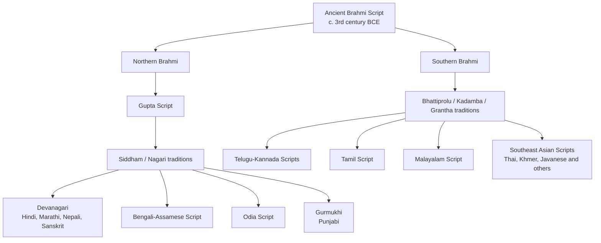

**Northern Branch**  
Evolved through the Gupta script into the Nagari family. This produced Devanagari and the closely related eastern and northwestern scripts (Bengali-Assamese, Odia, Gurmukhi).

**Southern Branch**  
Produced more rounded forms suited to writing on palm leaves. It gave rise to the Telugu, Kannada, Tamil, and Malayalam scripts, as well as several Southeast Asian writing systems.

**Script Reform and Standardization in the Modern Period**  
The 19th and 20th centuries brought major changes driven by printing, education, and administration. Many scripts were standardized for type and teaching. Notable developments include:

- Standardization of Gurmukhi in the Sikh tradition under Guru Angad Dev and later refinements.
- Orthographic reforms in Bengali and Odia.
- Creation of the Ol Chiki script for Santali in 1925 by Pandit Raghunath Murmu.
- Revival and official recognition of Meitei Mayek for Meitei.
- Continued use of multiple scripts by some languages (Konkani, Sindhi, Kashmiri). Some languages historically used Modi (for Marathi) or other regional styles that later declined with printing.

Scripts and language families remain independent. A language can adopt a new writing system without changing its linguistic ancestry. Urdu’s use of a Perso-Arabic script, for example, does not make it a Semitic language; it remains Indo-Aryan.

 

### 3. Chronological Outline of Linguistic History

Spoken languages almost always predate the earliest surviving written records. The timeline below marks major documented stages.

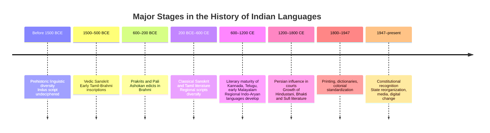

| Period              | Key Developments |
|---------------------|------------------|
| Before 1500 BCE    | Diverse prehistoric speech communities already present. The language(s) of the Indus Valley Civilization remain unidentified because the Indus script is undeciphered. Claims that definitively identify it with any modern language family are hypotheses, not established facts. |
| c. 1500–500 BCE    | Vedic Sanskrit develops within the Indo-Aryan tradition and is transmitted orally. Early contact with other communities leaves traces in vocabulary and structure. Later centuries see Tamil-Brahmi inscriptions. Pāṇini’s grammatical work (*Aṣṭādhyāyī*) systematises Sanskrit around the 4th century BCE. |
| c. 600–200 BCE     | Middle Indo-Aryan languages (Prakrits and Pali) become important in administration, religion, and literature. Ashoka’s edicts provide clear evidence of regional variation. Brahmi and Kharosthi scripts are in use. Pali becomes associated with Theravada Buddhist texts; various Prakrits appear in Jain traditions. |
| 200 BCE–600 CE     | Classical Sanskrit literature expands (epics, drama, philosophy). Tamil Sangam literature flourishes. Regional scripts diversify. Contact among language families continues. Early inscriptions in Kannada and other southern languages appear. |
| 600–1200 CE        | Distinct literary traditions mature for Kannada (*Kavirājamārga*, 9th century), Telugu, and early Malayalam. Eastern, western, and northern Indo-Aryan languages develop clearer regional identities. Court patronage and religious movements support vernacular writing. |
| 1200–1800 CE       | Persian becomes influential in many courts and administrations. Arabic and Persian vocabulary enters several languages. Hindustani speech forms (ancestors of modern Hindi and Urdu) develop. Bhakti and Sufi literature strengthen regional languages (for example, works in Awadhi, Braj, and Marathi). |
| 1800–1947          | Printing, dictionaries, grammars, modern education, and colonial administration accelerate standardization of many languages. Missionary and administrative efforts produce early grammars and dictionaries. |
| 1947–present       | Constitutional recognition, state reorganization on linguistic lines, mass media, migration, cinema, and digital communication reshape language use. The Eighth Schedule lists 22 scheduled languages. Classical language status has been expanded. |

 

### 4. Classical Languages of India

India officially recognizes languages as classical on the basis of high antiquity (recorded history of early texts or inscriptions spanning roughly 1,500–2,000 years), a body of ancient literature considered a valuable heritage, and knowledge texts (including prose, epigraphy, and inscriptions). The classical form may be distinct from the modern language.

As of 2024 (and continuing in subsequent years), eleven languages hold classical status:

- Tamil (2004)
- Sanskrit (2005)
- Telugu (2008)
- Kannada (2008)
- Malayalam (2013)
- Odia (2014)
- Marathi (2024)
- Pali (2024)
- Prakrit (2024)
- Assamese (2024)
- Bengali (2024)

This designation is a modern governmental and cultural recognition. It does not alter the linguistic family classification of the languages. Classical status brings special support for scholarly research, education, preservation, and digitisation, including Centres of Excellence established for several of these languages.

 

### 5. Origins of Major Modern Languages

#### 5.1 Indo-Aryan Languages

| Modern Language | Historical Development |
|-----------------|------------------------|
| Hindi          | Evolved mainly from western and central Indo-Aryan varieties through Śaurasenī Prakrit and later Apabhraṃśa stages. Modern Standard Hindi is based on the Kharī Bolī dialect and was standardized in the 19th–20th centuries. Written in Devanagari. Related regional varieties such as Braj, Awadhi, and Bhojpuri have rich literary histories. |
| Urdu           | Shares the same Hindustani grammatical base as Hindi (Kharī Bolī) but incorporates extensive Persian, Arabic, and Turkic vocabulary. Standardized in the Perso-Arabic (Nastaʿlīq) script. Developed in the context of Delhi Sultanate and Mughal courts and later literary culture. |
| Bengali        | Developed from eastern Māgadhī Prakrit and Gauḍa Apabhraṃśa. Strong medieval literary tradition including the Caryāpada and later Vaishnava literature. Written in the Bengali-Assamese script. |
| Assamese       | Emerged from eastern Indo-Aryan varieties in the Brahmaputra Valley. Distinct medieval literary record, including the works of the Bhakti movement under Śaṅkaradeva. |
| Odia           | Traced to Oḍra Māgadhī Prakrit. Distinctive rounded script historically shaped by writing on palm leaves. Early inscriptions and a continuous literary tradition from the medieval period. |
| Marathi        | Linked to Māhārāṣṭrī Prakrit. Long literary history; historically also used the Modi script. Early texts include the works of the Mahānubhāva tradition and later Bhakti poets such as Jñāneśvar and Tukārām. Now mainly Devanagari. |
| Gujarati       | Developed from Gūrjar Apabhraṃśa. Script is a Devanagari variant without the continuous top line. Medieval Jain and later Bhakti literature contributed to its development. |
| Punjabi        | Northwestern Indo-Aryan development. Gurmukhi script standardized by Guru Angad Dev; Shahmukhi (Perso-Arabic) used in Pakistan. Sikh scriptural tradition and Sufi poetry are central to its literary history. |
| Sindhi         | Northwestern Indo-Aryan with strong Persian and Arabic influence. Uses both Perso-Arabic and Devanagari scripts. Reflects the cultural history of the lower Indus region. |
| Kashmiri       | Dardic branch of Indo-Aryan. Strong Persian and Sanskrit contact. Primarily Perso-Arabic script. Distinct phonology and a literary tradition including both Sanskrit-influenced and Persianate works. |
| Nepali         | Western Himalayan Indo-Aryan development, expanded with the growth of the Gorkha kingdom. Devanagari script. |
| Konkani        | Western coastal Indo-Aryan with regional variation and contact with Marathi, Kannada, and Portuguese. Multiple scripts have been used historically. |
| Maithili       | Eastern Indo-Aryan language of the Mithila region with a notable medieval literature, including the works of Vidyāpati. |
| Dogri          | Western Pahari Indo-Aryan variety associated with the Jammu region. |

#### 5.2 Dravidian Languages

| Modern Language | Historical Development |
|-----------------|------------------------|
| Tamil          | Oldest continuous classical literature among living Indian languages (Sangam corpus). Early inscriptions in Tamil-Brahmi and Vatteluttu. Retains distinctive Dravidian grammar while absorbing contact vocabulary. Key early works include *Tolkāppiyam* and the Sangam anthologies. |
| Telugu         | South-Central Dravidian. Early inscriptions and major literary development from the first millennium CE onward. Heavy Sanskrit vocabulary influence. Court literature flourished under various Deccan kingdoms. |
| Kannada        | Southern Dravidian. Oldest substantial inscription is the Halmidi inscription (c. 450 CE). Literary landmark: *Kavirājamārga* (9th century). Rich tradition of Champu and later medieval literature. |
| Malayalam      | Differentiated from the western Tamil continuum roughly between the 9th and 13th centuries. Strong Sanskrit influence. Script evolved from Grantha. Early works show gradual separation from Tamil. |
| Tulu           | Southern Dravidian language of coastal Karnataka with rich oral traditions and later written literature. |
| Gondi, Kurukh, Kui, Brahui | Important minority Dravidian languages of central India and (in the case of Brahui) Balochistan. Their histories are closely connected with Adivasi communities and oral traditions. |

#### 5.3 Austroasiatic and Sino-Tibetan Languages

Santali, Mundari, Ho, and related Munda languages preserve important non-Indo-Aryan, non-Dravidian traditions in eastern and central India. Khasi links India to the wider Austroasiatic world. In the northeast and Himalayas, Bodo, Meitei, Mizo, and numerous Naga and other languages illustrate the long-standing presence of Sino-Tibetan speech communities. Meitei has a historical literary tradition and the revived Meitei Mayek script. Many of these languages have complex oral literatures and are increasingly documented in written form.

 

### 6. Mutual Influences Among Languages

Languages in India have never developed in isolation. Centuries of contact produced both lexical borrowing and structural convergence (areal features).

- Sanskrit contributed large formal vocabularies (tatsama and tadbhava words) to both Indo-Aryan and Dravidian languages. Many technical, religious, and abstract terms entered regional languages this way.
- Prakrits and Pali served as important vehicles for Buddhist and Jain literature and public inscriptions. They also influenced the development of later regional Indo-Aryan languages.
- Persian and Arabic entered many languages through medieval courts, administration, and religion, most visibly in Urdu, Hindi, Punjabi, and Bengali. Words related to governance, law, culture, and daily life were adopted.
- Portuguese and later English introduced loanwords connected with trade, technology, law, education, administration, and modern life. English continues to supply technical and scientific vocabulary.
- Long-term contact produced shared structural features between Indo-Aryan and Dravidian languages. Examples include the widespread use of retroflex consonants, certain word-order patterns, and quotative constructions. Austroasiatic and Sino-Tibetan languages have also participated in regional patterns of convergence.

Contact is therefore as important as genetic descent in understanding the history of Indian languages.

 

### 7. Language and the Formation of Modern States

After independence, linguistic identity played a major role in the reorganization of India’s internal boundaries. The demand for linguistic states gained strength after the creation of Andhra State in 1953 following the fast and death of Potti Sriramulu. The States Reorganisation Commission (Fazl Ali Commission) examined the issue, and the States Reorganisation Act of 1956, together with the Seventh Constitutional Amendment, redrew the map largely along linguistic lines. The earlier classification of Part A, B, and C states was abolished, creating a system of states and union territories.

Examples of linguistic reorganization include the formation or adjustment of states for speakers of Telugu, Tamil, Kannada, Malayalam, Marathi, Gujarati, and others. Subsequent changes (such as the division of Bombay State into Maharashtra and Gujarat in 1960, and the reorganization of Punjab in 1966) continued this process. Language history therefore continues to influence political geography and administration in the present day, while administrative convenience, economic factors, and national integration also shaped final boundaries.

 

### 8. Official Recognition and Contemporary Diversity

India’s Constitution lists **22 Scheduled Languages** in the Eighth Schedule. These enjoy official recognition for various governmental and educational purposes. Approximate speaker figures below are drawn primarily from the 2011 Census of India (the most comprehensive publicly available detailed language data). Numbers are rounded and refer mainly to mother-tongue speakers unless otherwise noted; total speakers (including second- and third-language users) are higher for several languages, especially Hindi and English.

| Language              | Primary Script(s)              | Principal Regions                  | Approximate Speakers (2011 Census, mother tongue) |
|-----------------------|--------------------------------|------------------------------------|---------------------------------------------------|
| Assamese             | Assamese                      | Assam                             | ~15 million                                      |
| Bengali              | Bengali                       | West Bengal, Tripura              | ~97 million                                      |
| Bodo                 | Devanagari                    | Assam (Bodoland)                  | ~1.5 million                                     |
| Dogri                | Devanagari                    | Jammu                             | ~2.5 million                                     |
| Gujarati             | Gujarati                      | Gujarat                           | ~55–60 million                                   |
| Hindi                | Devanagari                    | Several northern and central states | ~528 million                                    |
| Kannada              | Kannada                       | Karnataka                         | ~44 million                                      |
| Kashmiri             | Perso-Arabic                  | Kashmir                           | ~7 million                                       |
| Konkani              | Devanagari / Roman            | Goa                               | ~2.3 million                                     |
| Maithili             | Devanagari                    | Bihar                             | ~13 million                                      |
| Malayalam            | Malayalam                     | Kerala                            | ~35 million                                      |
| Manipuri (Meitei)    | Meitei Mayek / Bengali        | Manipur                           | ~1.8 million                                     |
| Marathi              | Devanagari                    | Maharashtra                       | ~83 million                                      |
| Nepali               | Devanagari                    | Sikkim, Darjeeling                | ~3 million                                       |
| Odia                 | Odia                          | Odisha                            | ~38 million                                      |
| Punjabi              | Gurmukhi                      | Punjab                            | ~33 million                                      |
| Sanskrit             | Devanagari                    | Classical / liturgical            | ~25 thousand                                     |
| Santali              | Ol Chiki                      | Jharkhand, West Bengal, Odisha    | ~7.5 million                                     |
| Sindhi               | Perso-Arabic / Devanagari     | Gujarat, Maharashtra (diaspora)   | ~1.7 million                                     |
| Tamil                | Tamil                         | Tamil Nadu                        | ~69 million                                      |
| Telugu               | Telugu                        | Andhra Pradesh, Telangana         | ~81 million                                      |
| Urdu                 | Perso-Arabic                  | Uttar Pradesh, Bihar, Telangana, Delhi | ~51 million                                 |

Beyond the 22 scheduled languages, census data record more than 120 major languages and over 19,000 mother tongues or dialects. Several large speech communities often classified administratively as Hindi dialects function as full languages in daily life, including Bhojpuri, Rajasthani varieties, Magahi, Chhattisgarhi, and Haryanvi.

English serves as an associate official language of the Union and remains the primary link language for higher education, science, law, and interstate communication. Informal mixed codes such as Hinglish are widespread in urban and digital contexts. Multilingualism is common: many Indians speak one or more languages in addition to their mother tongue.

 

### 9. Endangered Languages and Revitalization

Many smaller languages and dialects face pressure from dominant regional languages, internal migration, urbanization, and education conducted mainly in Hindi or English. Linguistic surveys and census records show that a significant number of India’s thousands of mother tongues are endangered. The Andamanese languages, certain Naga varieties, and many tribal languages of central and eastern India are particularly vulnerable.

Positive efforts include community-led documentation, the creation of new scripts (such as Ol Chiki), inclusion of minority languages in education where feasible, academic projects that record oral literature and grammar, and digital initiatives for language preservation. Revitalization remains an ongoing challenge and opportunity. Classical language status and Centres of Excellence also support research and preservation for several historically important languages.

 

### 10. Linguistic Density of the Subcontinent

The Indian subcontinent contains a high concentration of linguistic diversity within a continuous landmass. A journey of roughly 1,500 kilometres can cross several major language families, distinct scripts, and separate literary traditions. This density results from long-term coexistence of multiple language families, varied geography (mountains, plateaus, river valleys, and coasts), layered migrations, and continuous cultural contact rather than recent political fragmentation. The subcontinent’s linguistic richness is comparable to that of entire continents in other parts of the world, yet it exists within a single continuous political and cultural space.

 

### 11. Key Conclusions

1. India contains multiple independent language families. Indo-Aryan and Dravidian are the largest by number of speakers and historical documentation, yet Austroasiatic, Sino-Tibetan, and smaller isolates form essential parts of the total picture.
2. Sanskrit is the classical literary language of the Indo-Aryan tradition, not the direct parent of every Indian language. Modern Indo-Aryan languages developed through regional Middle Indo-Aryan stages. Dravidian and Austroasiatic languages have separate ancestries.
3. Spoken language almost always predates the earliest written evidence. The first surviving inscription or manuscript does not mark the birth of a language.
4. The Indus script remains undeciphered. Claims that definitively identify it with any modern language family are hypotheses, not established facts.
5. Contact, migration, religion, trade, and political institutions have continuously shaped vocabulary, structure, and literary cultures across family boundaries.
6. Scripts and languages follow independent histories. Most indigenous scripts descend from Brahmi, yet languages can and do adopt new writing systems.
7. Language continues to influence modern political and educational arrangements, while many smaller languages require active documentation and support. Official recognition through the Eighth Schedule and classical language status reflects both historical depth and contemporary policy.

 

### 12. Further Reading

Reliable starting points for deeper study include:

- Census of India — Language Division reports and mother-tongue tables (especially the 2011 language data)
- Linguistic Survey of India (historical volumes, with awareness that modern scholarship has refined some classifications)
- Comparative linguistic studies of the Indo-Aryan and Dravidian families
- Primary epigraphic sources, especially the Ashokan edicts and early Tamil-Brahmi inscriptions
- Academic handbooks on Dravidian languages, the history of writing systems in South Asia, and the classical languages of India
- Official notifications and reports on classical language status and Centres of Excellence

    

<h1 align="center">THE GLOBAL LANDSCAPE OF LANGUAGES - HISTORY - DISTRIBUTION AND INFLUENCE</h1>

  

Languages shape how people communicate, conduct business, govern societies, and preserve culture. Across history, certain languages have expanded far beyond their places of origin through trade, conquest, migration, religion, and colonialism. Today, a relatively small number of languages dominate international communication, education, science, and commerce, while thousands of others remain vital at regional or local levels.

This documentation examines the major languages that serve as primary means of communication in government, business, and daily public life across more than 140 countries and territories. It combines current speaker estimates and geographic patterns with deeper historical context. The aim is a clear, structured overview written in straightforward English for general readers.

### Historical Foundations of Global Languages

Languages have risen and declined as tools of wider communication for thousands of years. Their success has almost always depended on political power, economic networks, religious authority, or cultural prestige rather than on any inherent superiority of the language itself.

#### Ancient and Classical Periods

In the ancient Near East, Akkadian (a Semitic language written in cuneiform) became the diplomatic and administrative language of Mesopotamia and surrounding regions from roughly 2500 to 1000 BCE. Treaties, royal correspondence, and trade records from Egypt to Anatolia were often written in Akkadian, even when the local population spoke something else. Later, Aramaic replaced it as the everyday lingua franca of the Assyrian and Persian empires. By the time of the Achaemenid Empire (6th–4th centuries BCE), Aramaic was used from Egypt to India for administration and commerce.

Classical Greek spread dramatically after the conquests of Alexander the Great (336–323 BCE). Greek became the language of government, philosophy, science, and elite culture across the eastern Mediterranean and into Central Asia. Even after the political unity of Alexander’s empire broke apart, Greek remained the common language of the Hellenistic kingdoms and later of the eastern Roman Empire. The New Testament was written in Greek, which helped the language retain influence long after political power shifted.

Latin followed a similar path under the Roman Empire. As Rome expanded across the Mediterranean and into western Europe, Latin became the language of law, administration, the army, and eventually of the Christian Church in the West. After the western empire collapsed in the 5th century CE, spoken Latin gradually evolved into the Romance languages (Spanish, Portuguese, French, Italian, Romanian, and others). Written Latin, however, continued as the language of scholarship, diplomacy, and the Catholic Church for more than a thousand years.

In East Asia, Classical Chinese served a comparable role. For more than two thousand years it was the written language of government, literature, and high culture not only in China but also in Korea, Japan, and Vietnam. Official documents, poetry, and philosophical texts were composed in Classical Chinese even when the local spoken languages were very different. This shared written tradition created a long-lasting cultural sphere across East Asia.

#### Medieval and Early Modern Expansions

The rise of Islam in the 7th century CE produced one of the most rapid and lasting language expansions in history. Arabic spread with the early Muslim conquests from the Arabian Peninsula across North Africa, the Levant, Mesopotamia, and into Spain and Central Asia. Within a few generations, Arabic became the language of administration, religion, scholarship, and daily life across a vast territory. Classical Arabic, the language of the Quran, retained special prestige even as local spoken varieties developed. Cities such as Baghdad, Cairo, and Córdoba became major centers of learning where Arabic was the medium of science, philosophy, and literature.

Persian (Farsi) experienced a major revival under the later Islamic dynasties, especially the Samanids, Ghaznavids, and Safavids. It became a refined literary and court language from Anatolia to India. For centuries, Persian was the language of poetry, administration, and high culture in much of Central and South Asia. The Mughal Empire in India, for example, used Persian as its official language even though the rulers themselves were of Turkic origin and the majority of the population spoke Indo-Aryan languages.

Turkic languages also expanded through successive migrations and empires, from the Seljuks to the Ottomans and the various Central Asian khanates. Ottoman Turkish, heavily influenced by Persian and Arabic, served as the administrative language of a multi-ethnic empire that stretched from the Balkans to North Africa and the Middle East.

#### The Age of European Colonialism (15th–20th Centuries)

From the late 15th century onward, European colonial expansion permanently reshaped the global language map.

- Spanish and Portuguese spread through the Iberian empires. Spanish became the dominant language of administration, the Church, and urban life across most of the Americas from Mexico to Chile and Argentina. Portuguese took root in Brazil and in coastal enclaves in Africa and Asia (Angola, Mozambique, Goa, Macau, Timor). In many places, indigenous languages continued to be spoken, but Spanish or Portuguese became the language of power and upward mobility.
- English expanded first with English settlement in North America, the Caribbean, and later Australia and New Zealand. In the 18th and 19th centuries the British Empire carried English to large parts of Africa, South Asia, Southeast Asia, and the Pacific. English often functioned as a neutral language among diverse local populations. After independence, many former colonies retained English for government, higher education, and inter-ethnic communication (examples include India, Nigeria, Kenya, Singapore, and the Philippines).
- French followed French colonial holdings in North and West Africa, the Caribbean, Indochina, and parts of the Indian Ocean. In many of these territories French remained an official or working language after independence, especially in administration and education.
- Dutch left a smaller but lasting footprint in Indonesia (where it influenced the development of modern Indonesian), Suriname, and the Caribbean. German had a more limited colonial presence but still shaped language policy in parts of Africa and the Pacific before the First World War.

Colonial languages did not simply replace local languages. In many regions they became additional layers in complex multilingual societies. Local lingua francas such as Swahili in East Africa and Malay (later standardized as Indonesian) continued to grow because they were useful for trade and inter-group communication.

#### Modern Globalization and the Rise of English

After the mid-20th century, the economic, scientific, and cultural influence of the United States accelerated the global role of English. English became the primary language of international science, aviation, diplomacy, popular culture, and later the internet. Former British colonies that had kept English as an official language reinforced this trend. At the same time, large national languages such as Mandarin Chinese, Hindi, Spanish, Arabic, and Portuguese continued to expand through demographic growth and state education systems.

These historical layers explain why a limited number of languages today function as working languages in dozens of countries even when they are not the sole mother tongue of the entire population.

### Current Geographic Distribution of Major Languages

The tables below list the primary language or languages used for government, business, and everyday public communication in each country or territory. These reflect functional major languages rather than purely legal official status. Indigenous, regional, and minority languages remain important in many places but are secondary for broader national communication.

#### North America (15 countries and territories)

| Country / Territory     | Major Language(s)          |
|-------------------------|----------------------------|
| United States           | English                    |
| Canada                  | English, French            |
| Mexico                  | Spanish                    |
| Guatemala               | Spanish                    |
| Honduras                | Spanish                    |
| El Salvador             | Spanish                    |
| Nicaragua               | Spanish                    |
| Costa Rica              | Spanish                    |
| Panama                  | Spanish                    |
| Cuba                    | Spanish                    |
| Dominican Republic      | Spanish                    |
| Haiti                   | Haitian Creole, French     |
| Jamaica                 | English                    |
| Trinidad and Tobago     | English                    |
| Puerto Rico             | Spanish, English           |

Spanish predominates south of the United States and Canada because of Spanish colonial rule that began in the early 16th century. English dominates in the United States, Canada (alongside French in parts of the country), and several Caribbean nations with British colonial histories. Haiti retains strong French influence from its colonial past together with Haitian Creole, which developed from French and African languages.

#### South America (12 countries)

| Country     | Major Language(s)     |
|-------------|-----------------------|
| Brazil      | Portuguese            |
| Argentina   | Spanish               |
| Colombia    | Spanish               |
| Peru        | Spanish               |
| Venezuela   | Spanish               |
| Chile       | Spanish               |
| Ecuador     | Spanish               |
| Bolivia     | Spanish, Quechua      |
| Paraguay    | Spanish, Guarani      |
| Uruguay     | Spanish               |
| Guyana      | English               |
| Suriname    | Dutch                 |

Portuguese became the language of Brazil through Portuguese colonization that began in 1500. Spanish spread across the rest of the continent under Spanish rule. Guyana and Suriname reflect British and Dutch colonial legacies. In Bolivia and Paraguay, indigenous languages (Quechua and Guarani) hold official status and widespread everyday use alongside Spanish, illustrating how colonial and pre-colonial languages can coexist.

#### Europe (35 countries)

| Country                  | Major Language(s)                  |
|--------------------------|------------------------------------|
| United Kingdom           | English                            |
| Germany                  | German                             |
| France                   | French                             |
| Spain                    | Spanish                            |
| Italy                    | Italian                            |
| Portugal                 | Portuguese                         |
| Netherlands              | Dutch                              |
| Belgium                  | Dutch, French, German              |
| Switzerland              | German, French, Italian            |
| Austria                  | German                             |
| Poland                   | Polish                             |
| Sweden                   | Swedish                            |
| Norway                   | Norwegian                          |
| Denmark                  | Danish                             |
| Finland                  | Finnish, Swedish                   |
| Ireland                  | English                            |
| Czech Republic           | Czech                              |
| Slovakia                 | Slovak                             |
| Hungary                  | Hungarian                          |
| Romania                  | Romanian                           |
| Bulgaria                 | Bulgarian                          |
| Greece                   | Greek                              |
| Ukraine                  | Ukrainian, Russian                 |
| Russia                   | Russian                            |
| Belarus                  | Russian, Belarusian                |
| Serbia                   | Serbian                            |
| Croatia                  | Croatian                           |
| Slovenia                 | Slovenian                          |
| Bosnia and Herzegovina   | Bosnian, Serbian, Croatian         |
| Albania                  | Albanian                           |
| North Macedonia          | Macedonian                         |
| Iceland                  | Icelandic                          |
| Luxembourg               | Luxembourgish, French, German      |
| Malta                    | Maltese, English                   |
| Cyprus                   | Greek, Turkish                     |

Europe shows the greatest internal linguistic diversity among the regions listed. Most countries use a single national language for public life, with notable multilingual states such as Belgium, Switzerland, and Luxembourg. The modern national languages largely solidified during the 19th and 20th centuries as nation-states formed. Russian retains significant use in parts of Eastern Europe and the former Soviet space because of the earlier expansion of the Russian Empire and the Soviet Union.

#### Middle East and North Africa (20 countries)

| Country                | Major Language(s)            |
|------------------------|------------------------------|
| Saudi Arabia           | Arabic                       |
| United Arab Emirates   | Arabic, English              |
| Qatar                  | Arabic, English              |
| Kuwait                 | Arabic                       |
| Bahrain                | Arabic                       |
| Oman                   | Arabic                       |
| Egypt                  | Arabic                       |
| Jordan                 | Arabic                       |
| Lebanon                | Arabic, French               |
| Israel                 | Hebrew, Arabic               |
| Turkey                 | Turkish                      |
| Iran                   | Persian (Farsi)              |
| Iraq                   | Arabic, Kurdish              |
| Syria                  | Arabic                       |
| Yemen                  | Arabic                       |
| Morocco                | Arabic, French, Berber       |
| Algeria                | Arabic, French               |
| Tunisia                | Arabic, French               |
| Libya                  | Arabic                       |
| Sudan                  | Arabic                       |

Arabic became dominant across most of this region through the Arab-Muslim conquests of the 7th and 8th centuries and the continuing prestige of Classical Arabic in religion and education. Persian remained central in Iran through successive Persianate dynasties. Turkish solidified as the national language of Turkey after the end of the Ottoman Empire and the language reforms of the 1920s. French remains influential in several North African countries because of 19th- and 20th-century colonial rule. English functions as a practical second language in several Gulf states for business and international communication.

#### Sub-Saharan Africa (25 countries)

| Country                            | Major Language(s)                       |
|------------------------------------|-----------------------------------------|
| Nigeria                            | English, Hausa, Yoruba, Igbo            |
| South Africa                       | English, Afrikaans, Zulu                |
| Kenya                              | Swahili, English                        |
| Tanzania                           | Swahili, English                        |
| Ethiopia                           | Amharic                                 |
| Ghana                              | English                                 |
| Uganda                             | English, Swahili                        |
| Rwanda                             | Kinyarwanda, English, French            |
| Democratic Republic of the Congo   | French, Swahili, Lingala                |
| Republic of the Congo              | French, Lingala                         |
| Cameroon                           | French, English                         |
| Senegal                            | French, Wolof                           |
| Côte d'Ivoire                      | French                                  |
| Angola                             | Portuguese                              |
| Mozambique                         | Portuguese                              |
| Zimbabwe                           | English, Shona                          |
| Zambia                             | English                                 |
| Botswana                           | English, Setswana                       |
| Namibia                            | English                                 |
| Mauritius                          | English, French, Mauritian Creole       |
| Madagascar                         | Malagasy, French                        |
| Mali                               | French, Bambara                         |
| Niger                              | French, Hausa                           |
| Burkina Faso                       | French                                  |
| Benin                              | French                                  |

European colonial languages (English, French, Portuguese) became official or widely used languages of government and education because colonial administrations needed a common medium across diverse populations. After independence, many countries kept these languages for practical reasons. At the same time, major African languages such as Swahili, Hausa, Yoruba, and others continued to grow as regional lingua francas. Swahili, for example, had already spread along East African trade routes before European colonization and was later promoted by post-independence governments.

#### Asia-Pacific (35+ countries and territories)

| Country / Territory   | Major Language(s)                     |
|-----------------------|---------------------------------------|
| China                 | Mandarin Chinese                      |
| India                 | Hindi, English                        |
| Japan                 | Japanese                              |
| South Korea           | Korean                                |
| North Korea           | Korean                                |
| Indonesia             | Indonesian                            |
| Pakistan              | Urdu, English                         |
| Bangladesh            | Bengali                               |
| Philippines           | Filipino, English                     |
| Vietnam               | Vietnamese                            |
| Thailand              | Thai                                  |
| Malaysia              | Malay, English                        |
| Singapore             | English, Mandarin, Malay, Tamil       |
| Cambodia              | Khmer                                 |
| Laos                  | Lao                                   |
| Myanmar               | Burmese                               |
| Nepal                 | Nepali                                |
| Sri Lanka             | Sinhala, Tamil                        |
| Mongolia              | Mongolian                             |
| Kazakhstan            | Kazakh, Russian                       |
| Uzbekistan            | Uzbek, Russian                        |
| Turkmenistan          | Turkmen, Russian                      |
| Kyrgyzstan            | Kyrgyz, Russian                       |
| Tajikistan            | Tajik, Russian                        |
| Afghanistan           | Pashto, Dari (Persian)                |
| Australia             | English                               |
| New Zealand           | English                               |
| Fiji                  | English, Fijian, Fiji Hindi           |
| Papua New Guinea      | English, Tok Pisin                    |
| Samoa                 | Samoan, English                       |
| Tonga                 | Tongan, English                       |
| Hong Kong             | Cantonese, English                    |
| Taiwan                | Mandarin Chinese                      |

Mandarin Chinese was promoted as a national standard language in the 20th century, building on a much older written tradition. In India, Hindi and English both serve important national roles: Hindi as the most widely spoken Indo-Aryan language and English as a neutral link language inherited from British rule. Indonesian was deliberately developed from Malay in the 20th century as a unifying national language for a highly diverse archipelago. Russian remains important in Central Asia because of the earlier expansion of the Russian Empire and the Soviet period.

**Total coverage: approximately 142 countries and territories.**

### The Most Widely Spoken Languages by Total Speakers

The ranking below reflects approximate total speakers (native plus second-language users) based on recent Ethnologue-aligned estimates. Numbers are rounded and can vary slightly by source and year because second-language proficiency is difficult to measure precisely.

| Rank  | Language                  | Primary Script     | Approximate Total Speakers | Core Regions of Use                                      |
|-------|---------------------------|--------------------|----------------------------|----------------------------------------------------------|
| 1     | English                   | Latin              | 1.5 billion                | United States, United Kingdom, Canada, Australia, and 60+ countries |
| 2     | Mandarin Chinese          | Hanzi              | 1.18 billion               | China, Taiwan, Singapore                                 |
| 3     | Hindi                     | Devanagari         | 609 million                | India                                                    |
| 4     | Spanish                   | Latin              | 559 million                | Spain, Mexico, and most of Latin America                 |
| 5     | Arabic                    | Arabic             | 335 million                | Middle East and North Africa (25+ countries)             |
| 6     | French                    | Latin              | 312 million                | France, Canada, and many African countries               |
| 7     | Bengali                   | Bengali            | 284 million                | Bangladesh, parts of India                               |
| 8     | Portuguese                | Latin              | 267 million                | Brazil, Portugal, Angola, Mozambique                     |
| 9     | Russian                   | Cyrillic           | 253 million                | Russia, Belarus, parts of Central Asia                   |
| 10    | Indonesian                | Latin              | ~250–300 million           | Indonesia                                                |
| 11    | Urdu                      | Arabic-based       | 231–246 million            | Pakistan, India                                          |
| 12    | German                    | Latin              | 134 million                | Germany, Austria, Switzerland                            |
| 13    | Japanese                  | Kanji / Kana       | 126 million                | Japan                                                    |
| 14    | Swahili                   | Latin              | 100+ million               | Kenya, Tanzania, and East Africa                         |
| 15    | Turkish                   | Latin              | ~90 million                | Turkey and related communities                           |
| 16–26 | Vietnamese, Korean, Italian, Persian, Thai, and several major Indian languages (Marathi, Telugu, Tamil, Gujarati, etc.), Polish, Javanese | Various | 50–90 million each | Concentrated in specific countries or regions |

English leads by a wide margin when second-language speakers are included. Mandarin Chinese has the largest number of native speakers. The top ten languages together account for a substantial share of the world’s population.

### Language Families of the Top Languages

A brief overview of major language families helps readers see deeper historical connections among the most widely spoken languages.

| Language Family     | Key Languages from the List                                      | Approximate Share of Top Speakers | Historical Notes                                                                 |
|---------------------|------------------------------------------------------------------|-----------------------------------|----------------------------------------------------------------------------------|
| Indo-European       | English, Hindi, Spanish, French, Portuguese, Russian, Bengali, Urdu, German, etc. | Largest group among the top 26   | Spread from a common ancestor spoken thousands of years ago; expanded through migration, empires, and colonialism |
| Sino-Tibetan        | Mandarin Chinese                                                 | Very large native base            | Continuous written tradition in East Asia for over 3,000 years                   |
| Afro-Asiatic        | Arabic                                                           | Major across MENA                 | Semitic branch; Arabic expanded with the early Islamic caliphates                |
| Austronesian        | Indonesian, Malay, Javanese                                      | Strong in Southeast Asia & Pacific| Spread by seafaring peoples across islands                                       |
| Japonic / Koreanic  | Japanese, Korean                                                 | Regionally concentrated           | Distinct families with long independent histories                                |
| Niger-Congo         | Swahili and many African languages                               | Important regional lingua francas | Largest family in Africa by number of languages                                  |

### Writing Systems at a Glance

- **Latin script** dominates the list (English, Spanish, French, Portuguese, Indonesian, German, Turkish, Vietnamese, Swahili, and many others).
- Other major systems include Hanzi (Chinese), Arabic script (Arabic, Persian, Urdu), Devanagari and related Indic scripts (Hindi, Marathi, etc.), Cyrillic (Russian), Hangul (Korean), and the Japanese mixed system (Kanji + Kana).

### Key Patterns and Insights

- English functions as a major language in more than 60 countries and is the leading global lingua franca for international business, science, and travel.
- Spanish is the primary language across most of Latin America (approximately 21 countries) outside Brazil.
- Arabic is the dominant language across roughly 25 countries in the Middle East and North Africa.
- French remains a major language in nearly 30 countries, especially across West and Central Africa.
- Portuguese is spoken as a major language in fewer countries (about nine) but reaches a large population because of Brazil.
- Several languages with very large speaker bases (Hindi, Bengali, Indonesian, Japanese, Korean) are concentrated in one or a small number of countries yet remain globally significant because of population size and economic weight.

These patterns reflect both historical expansion and modern demographic realities.

### Mechanisms of Language Spread

The following diagram summarizes the main historical pathways that produced today’s major global languages:

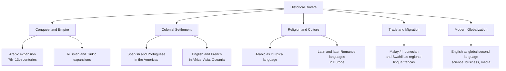

An additional view of the post-colonial pattern common in Africa and parts of Asia:

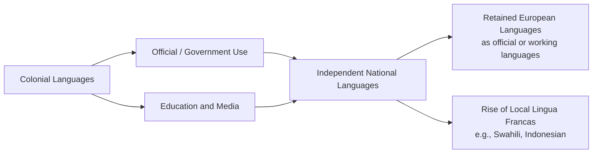

### Future Trends

Demographic growth in Africa and parts of South Asia, continued use of English in education and technology, and the rising economic weight of countries such as India, Indonesia, and Brazil will keep the current top languages influential. Arabic, Portuguese, and French are expected to gain speakers mainly through population growth in Africa. At the same time, many smaller languages face pressure from urbanization, education policies, and media, making documentation and education efforts important for preserving linguistic diversity.

### Conclusion

The present distribution of major languages is the product of long historical processes rather than accident. Ancient empires, religious movements, colonial expansion, demographic growth, and the practical need for shared communication have all played roles. English currently holds the broadest international reach, while Mandarin Chinese, Spanish, Arabic, Hindi, and French each command large and distinct spheres of influence.

Understanding both the current map and the historical forces behind it helps explain why certain languages dominate government, education, and commerce in specific regions. It also highlights the continuing importance of regional and indigenous languages that sustain local identity and knowledge even as a smaller set of languages facilitates global interaction.

Languages continue to evolve. Understanding which ones serve as bridges across countries helps in education, business, travel, and cultural exchange. The patterns shown here are a snapshot of the early 21st century and will keep shifting with population, technology, and policy.

### Methodology Note

Speaker numbers are approximate totals (native + second-language users) drawn from recent Ethnologue-aligned estimates. Country-level language use reflects functional major languages for government, business, and public life rather than strict legal status only. Figures can shift over time with population changes, education policy, and economic developments. For the most precise current data, consult primary sources such as Ethnologue and national census publications.

    

<h1 align="center">Studying Philosophy: Resources, Traditions, and Paths to Intellectual Freedom.</h1>

  

## Table of Contents

1. Introduction  
2. How to Use This Guide  
3. Part I: The Philosophy Learning Ecosystem  
   - Reference Websites  
   - YouTube Channels  
   - Free University Courses  
   - Podcasts  
   - Blogs and Magazines  
   - Online Communities  
   - Academic Journals  
   - Ten Core Resources  
   - Six-Month Study Roadmap  
4. Part II: Traditions of Freedom and Inner Liberation  
   - Western and Cross-Traditional Philosophies  
   - Japanese Traditions  
   - Additional Global Traditions  
   - Comparative Rankings and the Freedom Axis  
5. Part III: Key Figures in the Pursuit of Freedom  
   - The Mount Rushmore of Intellectual Fearlessness  
   - Individualists and Masters of Inner Freedom  
   - Realist and Strategic Thinkers  
   - Builders and Guardians of Reason  
   - Historical Challengers of Philosophy  
   - The Core Canon of Twelve  
6. Part IV: Thematic Synthesis  
   - The Seven Great Questions of Freedom  
   - Final Observations  
   - Guiding Inscription  
7. Appendix A: Master Resource Summary  
8. Appendix B: Glossary of Key Terms  
9. Appendix C: Scope Note  

 

## Introduction

This guide is a complete learning ecosystem for anyone who wishes to study philosophy seriously, independently, and without unnecessary cost. It gathers reliable reference works, video courses, podcasts, essays, communities, academic journals, structured reading paths, and the major traditions that address freedom from social conditioning, desire, fear, power, and illusion.

The guide is written in clear and simple English. Technical terms are explained when they first appear. The material is arranged so that a beginner can begin at the beginning, while an advanced reader can move directly to primary texts, comparative traditions, and critical inquiry. Philosophy is treated here not only as an academic subject but as a way of life: a practice of questioning, examining, and transforming the self.

No single resource and no single tradition is complete. The rankings and comparisons in this guide are teaching aids, not final judgments. They are meant to help readers see differences in emphasis, not to replace careful reading and independent thought.

 

## How to Use This Guide

A reader new to philosophy should begin with Part I. Start with the Stanford Encyclopedia of Philosophy and the Internet Encyclopedia of Philosophy for reference, use Wireless Philosophy or Crash Course Philosophy for orientation, and follow the six-month roadmap. A reader already familiar with the basics may move directly to Part II and Part III, where the traditions of freedom and the key figures are discussed.

A reader interested in a specific question—such as freedom from social approval, freedom from desire, or freedom from fear—should consult the Seven Great Questions of Freedom in Part IV. A reader interested in building a personal reading list should consult the Core Canon of Twelve and the Master Resource Summary.

The guide is designed for website publication. It may be reproduced and shared for educational purposes.

 

# Part I: The Philosophy Learning Ecosystem

## 1. Essential Philosophy Websites

These websites form the foundation of serious independent study. They are free, scholarly, and regularly maintained.

| Resource | Link | Description | Best For |
|---|---|---|---|
| Stanford Encyclopedia of Philosophy (SEP) | [plato.stanford.edu](https://plato.stanford.edu) | The gold standard reference. Every entry is written and maintained by specialists in the field. | Intermediate and advanced readers who want precise, up-to-date overviews of concepts, arguments, and historical figures. |
| Internet Encyclopedia of Philosophy (IEP) | [iep.utm.edu](https://iep.utm.edu) | More accessible than the SEP while remaining academically rigorous. | Beginners who need clear introductions before moving to denser material. |
| PhilPapers | [philpapers.org](https://philpapers.org) | The largest online index of philosophy papers, books, and research. | Readers who have moved beyond introductory overviews and want primary or secondary scholarly literature. |
| Daily Nous | [dailynous.com](https://dailynous.com) | News, commentary, and discussion from within the professional philosophy community. | Staying current with debates and institutional developments. |
| Philosophy Now | [philosophynow.org](https://philosophynow.org) | An accessible magazine written for general readers. | Bridging academic philosophy and everyday concerns. |

These five sites alone provide reliable reference material, beginner-friendly explanations, research access, professional news, and popular exposition. The SEP is more demanding; the IEP is more welcoming. Used together, they cover the needs of most independent learners.

 

## 2. Best YouTube Channels for Philosophy

### Beginner Level

| Channel | Link | Description |
|---|---|---|
| Wireless Philosophy (Wi-Phi) | [youtube.com/@WirelessPhilosophy](https://www.youtube.com/@WirelessPhilosophy) | Short animated lessons on logic, ethics, metaphysics, and epistemology. Frequently recommended by educators for clarity and structure. |
| Crash Course Philosophy | [youtube.com playlist](https://www.youtube.com/playlist?list=PL8dPuuaLjXtNgK6MZucdYldNkMybYIHKR) | Fast-paced survey of major ideas and historical periods. Good for rapid orientation. |
| The School of Life | [theschooloflife.com](https://www.theschooloflife.com) | Practical philosophy applied to daily life, relationships, and emotional questions. |

### Intermediate to Advanced Level

| Channel | Link | Description |
|---|---|---|
| Gregory B. Sadler | [youtube.com/@GregoryBSadler](https://www.youtube.com/@GregoryBSadler) | Detailed, text-based explanations of classic works. Suitable for close reading of primary sources. |
| Kane B | [youtube.com/@KaneB](https://www.youtube.com/@KaneB) | Clear, rigorous analysis of arguments and contemporary debates. |
| Daniel Bonevac | [youtube.com/@danielbonevac](https://www.youtube.com/@danielbonevac) | University-level lecture series covering systematic topics. |
| Michael Sugrue | [youtube.com/@dr.michaelsugrue](https://www.youtube.com/@dr.michaelsugrue) | Lectures on major philosophers and intellectual history, noted for breadth and narrative skill. |
| Carneades.org | [youtube.com/@CarneadesofCyrene](https://www.youtube.com/@CarneadesofCyrene) | Careful examination of arguments and philosophical traditions. |

### Entertaining and Contemporary

| Channel | Link | Description |
|---|---|---|
| Philosophy Tube | [youtube.com/@PhilosophyTube](https://www.youtube.com/@PhilosophyTube) | Engaging presentations that connect philosophy to current cultural questions. |
| Wisecrack | [youtube.com/@WisecrackEDU](https://www.youtube.com/@WisecrackEDU) | Popular culture analyzed through philosophical lenses. |
| Einzelgänger | [youtube.com/@Einzelganger](https://www.youtube.com/@Einzelganger) | Focus on Stoicism, Eastern thought, and practical self-development. |

A sensible progression is to begin with Wireless Philosophy or Crash Course, then move to Sadler, Kane B, or Sugrue for depth. The entertaining channels are useful for motivation and cultural connection, but they should not replace primary texts or scholarly reference works.

 

## 3. Free University-Level Courses

| Course | Institution | Link | Description |
|---|---|---|---|
| Open Yale Courses – Philosophy | Yale University | [oyc.yale.edu/philosophy](https://oyc.yale.edu/philosophy) | Structured lectures and readings covering major philosophical topics. |
| Justice with Michael Sandel | Harvard University | [justiceharvard.org](https://justiceharvard.org) | Famous course on political philosophy and moral reasoning. |
| Shelly Kagan’s Course on Death | Yale University | [oyc.yale.edu/philosophy/phil-176](https://oyc.yale.edu/philosophy/phil-176) | Philosophical examination of death, immortality, and the meaning of life. |
| MIT OpenCourseWare Philosophy | MIT | [ocw.mit.edu](https://ocw.mit.edu) | A range of philosophy courses with lecture notes and readings. |

These courses supply structured lectures, readings, and often discussion materials at no cost. They function as informal university modules that a motivated learner can complete independently.

 

## 4. Best Philosophy Podcasts

| Podcast | Link | Description |
|---|---|---|
| Philosophy Bites | [philosophybites.com](https://philosophybites.com) | Short interviews with leading philosophers on single topics. |
| Philosophy Talk | [philosophytalk.org](https://www.philosophytalk.org) | Radio-style discussions of classic and contemporary issues. |
| History of Philosophy Without Any Gaps | [historyofphilosophy.net](https://historyofphilosophy.net) | Systematic historical survey from the earliest recorded thought onward. |
| The Partially Examined Life | [partiallyexaminedlife.com](https://partiallyexaminedlife.com) | Conversational close readings of primary texts. |
| Philosopher’s Zone | [abc.net.au](https://www.abc.net.au/listen/programs/philosopherszone) | Australian Broadcasting Corporation series covering a wide range of themes. |

Podcasts are especially useful for commuting or repeated listening while consolidating ideas from reading. They are not a substitute for careful reading, but they help learners hear how philosophers reason in real time.

 

## 5. Blogs and Online Magazines

| Publication | Link | Description |
|---|---|---|
| The Stone (New York Times) | [nytimes.com/column/the-stone](https://www.nytimes.com/column/the-stone) | Philosophy column featuring essays by contemporary philosophers. |
| Aeon Essays | [aeon.co](https://aeon.co) | Long-form essays on philosophy, science, psychology, and culture. |
| 3 Quarks Daily | [3quarksdaily.com](https://3quarksdaily.com) | Curated selections of thoughtful writing across disciplines. |
| Philosophy Now | [philosophynow.org](https://philosophynow.org) | Accessible magazine bridging academic and popular philosophy. |
| Daily Nous | [dailynous.com](https://dailynous.com) | News and commentary from the philosophy profession. |

These outlets offer essays that are longer than social-media posts yet shorter and more approachable than academic journal articles. They keep philosophical conversation connected to public life.

 

## 6. Online Communities

| Community | Link | Description |
|---|---|---|
| r/askphilosophy | [reddit.com/r/askphilosophy](https://www.reddit.com/r/askphilosophy/) | Carefully moderated subreddit where specialists and advanced students answer questions. One of the most reliable public forums for accurate guidance. |
| r/philosophy | [reddit.com/r/philosophy](https://www.reddit.com/r/philosophy/) | Broader discussion of texts and ideas. |
| Philosophy Stack Exchange | [philosophy.stackexchange.com](https://philosophy.stackexchange.com) | Question-and-answer format with community voting for quality. |

These communities allow learners to test understanding, receive corrections, and discover further reading. They should be used with care: online answers vary in quality, and the best communities are those that reward evidence, clarity, and respectful disagreement.

 

## 7. Academic Journals for Serious Study

| Journal | Link | Description |
|---|---|---|
| The Philosophical Review | [read.dukeupress.edu](https://read.dukeupress.edu/the-philosophical-review) | One of the oldest and most respected philosophy journals. |
| Mind | [academic.oup.com/mind](https://academic.oup.com/mind) | A leading journal in analytic philosophy. |
| Ethics | [journals.uchicago.edu](https://www.journals.uchicago.edu/toc/et/current) | Focused on moral, political, and legal philosophy. |
| Journal of Philosophy | [pdcnet.org/jphil](https://www.pdcnet.org/jphil) | Publishes articles across all areas of philosophy. |

Access is often limited by institutional subscription, but abstracts and some open-access articles remain freely available. These journals represent the highest standard of peer-reviewed philosophical research.

 

## 8. Ten Core Resources for Complete Beginners to Advanced Learners

If a reader were limited to only ten resources, the following set is sufficient to move from first exposure to advanced independent study.

| Number | Resource | Type |
|---|---|---|
| 1 | Stanford Encyclopedia of Philosophy | Reference |
| 2 | Internet Encyclopedia of Philosophy | Reference |
| 3 | PhilPapers | Research Index |
| 4 | Wireless Philosophy | Video Lessons |
| 5 | Gregory B. Sadler | Video Lectures |
| 6 | Kane B | Video Lectures |
| 7 | History of Philosophy Without Any Gaps | Podcast |
| 8 | Philosophy Bites | Podcast |
| 9 | Aeon | Essays |
| 10 | r/askphilosophy | Community |

These ten resources supply reference material, video teaching, historical narrative, short interviews, essays, and community feedback. Together they carry a learner from first exposure to advanced independent study.

 

## 9. Six-Month Reading and Study Roadmap

A structured six-month roadmap converts scattered resources into progressive learning.

### Month 1: Foundations

1. Wireless Philosophy videos  
2. Selected Internet Encyclopedia of Philosophy articles  
3. Plato’s *Apology*  
4. Marcus Aurelius’ *Meditations*

### Month 2: Core Topics

- Ethics  
- Free will  
- Knowledge  
- Personal identity  

After each topic, read the corresponding Stanford Encyclopedia entry. This practice builds the habit of moving from introductory explanation to scholarly overview.

### Months 3–6: Major Traditions

- Ancient Greek philosophy  
- Stoicism  
- Existentialism  
- Buddhism  
- Analytic philosophy  
- Political philosophy  

Alternate primary texts with secondary overviews from the SEP or IEP. The goal is not to finish everything but to develop the ability to read, compare, and question.

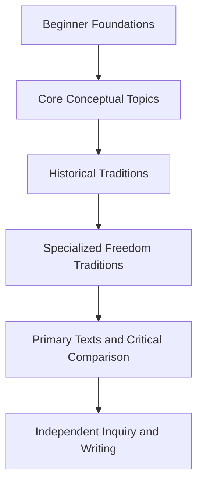

This sequence builds conceptual vocabulary before historical breadth and then moves toward specialized questions of freedom and independence.

 

# Part II: Traditions of Freedom and Inner Liberation

## 10. Western and Cross-Traditional Philosophies of Freedom

Not every philosophical tradition is equally useful for someone seeking to reduce psychological dependence on social approval, status, consumer desire, or external validation. The following traditions address that goal most directly. They are arranged from the most radical rejection of social convention to more balanced or inward approaches.

### Cynicism (Diogenes of Sinope)

**Core claim:** Society manufactures artificial needs. Wealth, reputation, and status are chains. Freedom is achieved through radical self-sufficiency (*autarkeia*) and living according to nature rather than convention.

**Attacks:** Career worship, consumerism, reputation management, and fear of judgment.

**Practice:** Voluntary discomfort, simplicity, frank speech (*parrhesia*), and refusal to shape oneself for public approval.

### Stoicism (Epictetus, Seneca, Marcus Aurelius)

**Core claim:** Suffering arises from dependence on things outside one’s control. Freedom consists in needing less, wanting less, and mastering one’s own judgments and character.

**Attacks:** Emotional dependence, validation-seeking, and fear of loss.

**Practice:** Negative visualization, voluntary hardship, and the distinction between what is and is not “up to us.”

Stoicism permits participation in society while refusing to become its slave. It does not require withdrawal from the world; it requires a disciplined inner stance toward the world.

### Existentialism (Kierkegaard, Nietzsche, Sartre, Camus)

**Core claim:** Society supplies ready-made identities—citizen, employee, consumer, believer. Authenticity requires creating one’s own values and accepting radical responsibility.

**Attacks:** Herd mentality, passive role-playing, and unexamined obedience.

### Nietzschean Philosophy

**Core claim:** Most people live by inherited “herd” values. Freedom demands questioning every belief, overcoming conditioning, and creating new values.

**Focus:** Self-overcoming, intellectual independence, and growth rather than peace or withdrawal.

### Asceticism (Cross-Traditional)

**Core claim:** Every desire owns a portion of the self. Reducing compulsion increases freedom.

**Practice:** Fasting, simplicity, renunciation, and disciplined self-denial.

Asceticism appears across many traditions. It should be approached with care: the aim is freedom from compulsive attachment, not self-harm or contempt for the body.

### Taoism (Laozi and Zhuangzi)

**Core claim:** Society overcomplicates life through artificial striving and status competition. Freedom returns through naturalness, simplicity, and effortless action (*wu wei*).

### Buddhism

**Core claim:** The deepest chain is craving itself, not merely social structures. Liberation requires ending attachment, ego-clinging, and compulsive desire.

**Practice:** Meditation, mindfulness, and non-attachment.

### Comparative Ranking by Emphasis on Breaking Mental Chains

The following scores are comparative teaching aids. They indicate emphasis, not objective measurement.

| Philosophy | Self-Denial | Independence | Anti-Conformity | Freedom Focus |
|---|---:|---:|---:|---:|
| Cynicism | 10/10 | 10/10 | 10/10 | 10/10 |
| Nietzsche | 5/10 | 10/10 | 10/10 | 10/10 |
| Existentialism | 4/10 | 10/10 | 9/10 | 10/10 |
| Stoicism | 8/10 | 9/10 | 7/10 | 9/10 |
| Buddhism | 10/10 | 8/10 | 6/10 | 10/10 |
| Taoism | 6/10 | 8/10 | 8/10 | 9/10 |
| Asceticism | 10/10 | 8/10 | 5/10 | 9/10 |

A practical combination used by many seekers of inner freedom is:

1. **Cynicism** – Reject artificial needs.  
2. **Stoicism** – Master emotion and desire.  
3. **Nietzsche** – Create your own values.  
4. **Buddhism** – Dissolve attachment and ego.

Together, they form a framework for becoming difficult to manipulate by status, approval, fear, advertising, ideology, or social pressure.

 

## 11. Japanese Traditions of Discipline, Emptiness, and Detachment

Japanese philosophy often seeks freedom through discipline, simplicity, and emptiness rather than open rebellion against society.

### Zen Buddhism (Dōgen, Hakuin Ekaku)

The conditioned mind that produces opinions, identities, and comparisons is itself the prison. Zen seeks direct experience before concepts and social labels.

**Practices:** Zazen (meditation), silence, solitude, and observing thoughts without identification.

**Key question:** Who are you before every label you have been given?

### Bushidō and Miyamoto Musashi

Bushidō teaches self-control, courage, honor, acceptance of death, and mastery over fear. A samurai was expected to act from principle rather than comfort.

Musashi’s *Book of Five Rings* stresses self-reliance, relentless practice, independence of thought, indifference to luxury, and emotional control. He resembles a blend of Stoicism, Zen, Bushidō, and Nietzschean self-overcoming.

### Wabi-Sabi

Beauty exists in imperfection, incompleteness, impermanence, and aging. It values simplicity, modesty, solitude, and freedom from material attachment.

**Attacks:** Perfectionism, status competition, consumerism, and image management.

### Shugendō

A mountain ascetic tradition combining Buddhist, Shinto, and Taoist influences. Practitioners deliberately seek isolation, physical hardship, mountain training, fasting, and endurance.

**Core idea:** Comfort weakens awareness. Hardship reveals reality.

### Mushin (“No-Mind”)

A Zen ideal meaning acting without mental clutter, anxiety, self-consciousness, or overthinking. The swordsman, artist, or monk acts spontaneously because the ego is not interfering.

**Attacks:** Overanalysis, social anxiety, and self-image obsession.

### Mono no Aware

Sensitivity to the passing nature of things. Cherry blossoms are beautiful because they fall. Youth is precious because it disappears. Life gains meaning because it ends.

**Attacks:** Clinging, possessiveness, and fear of change.

### Ranking of Japanese Traditions for Inner Freedom

| Tradition | Independence | Self-Denial | Anti-Conformity | Inner Freedom |
|---|---:|---:|---:|---:|
| Zen | 10/10 | 9/10 | 9/10 | 10/10 |
| Musashi | 10/10 | 8/10 | 9/10 | 9/10 |
| Shugendō | 8/10 | 10/10 | 8/10 | 9/10 |
| Bushidō | 8/10 | 8/10 | 6/10 | 8/10 |
| Wabi-Sabi | 7/10 | 7/10 | 8/10 | 9/10 |
| Mono no Aware | 6/10 | 6/10 | 5/10 | 9/10 |

A coherent Japanese path for breaking mental chains is: **Zen → Mushin → Musashi’s self-reliance → Wabi-Sabi acceptance of imperfection.**

 

## 12. Additional Global Traditions of Radical Non-Attachment and Liberation

Beyond the well-known Western and Japanese schools, several other traditions focus explicitly on liberation from conditioning, possession, and ego.

| Tradition | Core Idea | Primary Practice |
|---|---|---|
| Jainism | Radical non-possessiveness (*aparigraha*). Attachment to things, people, status, or even the ego itself binds the self. | Fasting, minimal possessions, celibacy, radical simplicity, strict self-discipline. |
| Advaita Vedānta | Freedom through dissolving identification with temporary roles, body, career, and personal story. True nature is beyond social and psychological labels. | Self-inquiry and realization of the self as beyond all identities. |
| Sufism | Purification of the self from vanity, pride, and attachment through detachment (*zuhd*). The ego is the prison. | Solitude, remembrance (*dhikr*), simplicity, humility, discipline. |
| Christian Desert Fathers | Withdrawal into silence and simplicity to escape social conditioning and distraction. | No luxury, no status, no crowds, no distractions; silence and self-observation. |
| Pyrrhonism | Suspension of judgment to avoid psychological slavery to fixed beliefs. | Training oneself to suspend judgment rather than cling to certainty. |
| Indigenous Vision-Quest Traditions | Temporary isolation, fasting, and solitude to discover identity independent of tribal expectation. | Isolation, fasting, wilderness, solitude. |
| Existential Anarchism (Max Stirner) | Critique of abstract “spooks” (nation, morality, ideology, society) that possess the individual. | Questioning which beliefs are actually one’s own. |

### Freedom Axis: Primary Chain Each Tradition Targets

| Tradition | Main Chain Being Broken |
|---|---|
| Cynicism | Social approval |
| Stirner | Ideology and abstract ideals |
| Nietzsche | Herd morality |
| Stoicism | Emotional dependence |
| Jainism | Possessions and attachment |
| Zen | Thought and identity |
| Sufism | Ego |
| Advaita Vedānta | Separate self |
| Taoism | Artificial striving |
| Buddhism | Craving itself |

Across cultures a common direction appears: reduce what controls the mind until external forces can no longer command it.

 

# Part III: Key Figures in the Pursuit of Freedom

## 13. The Mount Rushmore of Intellectual Fearlessness

These figures were not merely intellectuals. They refused to bow to kings, crowds, institutions, traditions, or popular opinion.

| Philosopher | Weapon | Key Contribution |
|---|---|---|
| Socrates | Relentless questioning | Walked around Athens publicly exposing false wisdom. Chose death rather than abandon the examined life. |
| Diogenes of Sinope | Shameless truth | Mocked wealth, politics, status, social etiquette, and intellectual pretension. Lived with almost nothing and treated kings and beggars alike. |
| Friedrich Nietzsche | Genealogical destruction | Questioned religion, morality, nationalism, conformity, and herd thinking. Asked: “Which of your values are actually yours?” |
| Epictetus | Internal sovereignty | Born a slave. Taught that no one can enslave your judgment unless you allow it. External circumstances are beyond our control, but our choices and character remain ours. |

 

## 14. Great Individualists and Masters of Inner Freedom

### Great Individualists

| Figure | Contribution |
|---|---|
| Miyamoto Musashi | Lived largely outside conventional structures. Distrusted comfort and dependence. Pursued mastery and self-reliance. |
| Max Stirner | Argued that people become possessed by abstractions: nation, religion, morality, society. Asked: “Why obey ideas simply because others do?” |
| Ralph Waldo Emerson | The prophet of self-reliance. His essays are a declaration of independence from conformity. |

### Masters of Inner Freedom

| Figure | Contribution |
|---|---|
| Gautama Buddha | The true chains are craving, attachment, and ignorance. Freedom means liberation from compulsive wanting. |
| Laozi | One of history’s greatest critics of artificial living. Emphasized simplicity, humility, and naturalness. His rebellion is quiet, not revolutionary. |
| Mahavira | Humanity’s most uncompromising advocate of non-possession. Asked: “What remains when all attachment is removed?” |
| Nagarjuna | Dismantled attachment to concepts themselves—not just possessions, not just beliefs, but even philosophical certainty. |

### Existential and Spiritual Radicals

| Figure | Contribution |
|---|---|
| Albert Camus | Faced a universe without guaranteed meaning. His answer was neither despair nor obedience but existential rebellion. |
| Jean-Paul Sartre | Central idea: You are condemned to be free. No excuses. No hiding behind society or destiny. You are responsible. |
| Jalal al-Din Rumi | Taught freedom through dissolving the ego—not through domination or status, but through inner transformation. |
| Simone Weil | Pursued truth, self-denial, and spiritual discipline with almost frightening seriousness. Philosopher of attention. |

 

## 15. Realist and Strategic Thinkers

These figures confront power, suffering, and human nature without softening the picture.

| Thinker | Core Contribution |
|---|---|
| Niccolò Machiavelli | Separated politics from moral idealism. Analyzed how power actually operates, not how philosophers wish it worked. |
| Arthur Schopenhauer | Existence is driven by a blind, insatiable Will. Escape routes through art, compassion, asceticism, and renunciation of endless wanting. |
| Thomas Hobbes | Realistic assessment of human competition and the need for order. Asked: “What are humans actually like when nobody is watching?” |
| Emil Cioran | Sharp observations on despair, boredom, civilization, and illusion. His writing is strangely liberating because it attacks comforting illusions. |
| Michel de Montaigne | Persistent self-questioning and intellectual honesty. Treated certainty as dangerous. Asked: “How do you know you’re right?” |
| Michel Foucault | Mapped invisible forms of power in schools, medicine, prisons, language, and institutions. Revealed how systems shape people without obvious coercion. |
| Carl Jung | Confrontation with the shadow and unconscious forces. Asked: “What unconscious forces are running your life?” |
| Baltasar Gracián | Strategic self-mastery and worldly wisdom. His *The Art of Worldly Wisdom* combines Stoicism, Machiavellian realism, and practical judgment. |

A focused reading sequence for intellectual freedom is:

**Socrates → Diogenes → Epictetus → Buddha → Laozi → Machiavelli → Schopenhauer → Nietzsche → Stirner → Foucault**

 

## 16. Builders, Guardians, and Defenders of Reason

Not every major figure was a rebel. Some constructed frameworks for social order or defended the limits of reason.

| Figure | Contribution |
|---|---|
| Confucius | Self-cultivation, duty, respect, and moral leadership as foundations of a livable society. Asked: “How do we build a society worth belonging to?” |
| Al-Ghazali | Critique of overreaching philosophical claims in *The Incoherence of the Philosophers*. Bridge between philosophy, theology, mysticism, and skepticism. |
| Ibn Rushd (Averroes) | Defended the compatibility of reason and revelation. Argued that truth cannot contradict truth. |
| Ibn Khaldun | Analyzed the rise, cohesion, corruption, and decline of civilizations. A precursor to sociology and historiography. |
| Sun Tzu | Strategic realism applied to conflict. Asked: “How do you win without becoming trapped in unnecessary conflict?” |
| Chanakya (Kautilya) | Discussed statecraft, espionage, economics, and political survival nearly 1,800 years before Machiavelli. |
| Zhuangzi | Playful dismantling of rigid identities and certainty. His butterfly dream asks: “Am I a man dreaming I’m a butterfly, or a butterfly dreaming I’m a man?” |
| Baruch Spinoza | Commitment to reason under conditions of exile and rejection. Challenged religious dogma, superstition, and authoritarian interpretations. |
| Blaise Pascal | Recognized the emotional and contradictory nature of human beings. “The heart has reasons that reason does not know.” |

 

## 17. Historical Challengers of Philosophy

Philosophers have repeatedly been tested by rulers, strategists, and realists.

| Challenger | Confrontation with Philosophy |
|---|---|
| Alexander the Great | Met Diogenes. Offered him anything; Diogenes replied, “Stand out of my light.” A duel between conquering the world and conquering the need to conquer. |
| Qin Shi Huang | Unified China and elevated Legalism while suppressing rival schools, especially Confucian traditions. His message: order matters more than wisdom; obedience matters more than debate. |
| Han Feizi | A philosopher who regarded many philosophers as detached dreamers. Argued that societies are governed not by virtue but by incentives, institutions, law, and power. |
| Julius Caesar | Embodied the challenge: can contemplation compete with decisive action? |
| Genghis Khan | Reminded civilization that it is fragile. Forced intellectual traditions to confront violence, survival, and adaptation. |
| Napoleon Bonaparte | Read extensively but exposed the gap between ideas and execution. Asked: is wisdom knowing what should be done, or making it happen? |
| Carl von Clausewitz | Insisted that reality is messy: uncertainty, friction, confusion, unintended consequences. Did to military theory what Machiavelli did to politics. |

These encounters force philosophy to answer whether its claims survive when people are selfish, afraid, ambitious, or armed.

 

## 18. The Core Canon of Twelve for Independence and Resistance to Conditioning

For someone seeking independence, self-denial, freedom from social conditioning, fearlessness in speech, and resistance to manipulation, the canon would be:

| Number | Philosopher | Primary Attack |
|---|---|---|
| 1 | Socrates | Fear of questioning |
| 2 | Diogenes of Sinope | Social approval |
| 3 | Epictetus | Emotional dependence |
| 4 | Friedrich Nietzsche | Herd morality |
| 5 | Gautama Buddha | Craving |
| 6 | Laozi | Artificial striving |
| 7 | Mahavira | Possessions and attachment |
| 8 | Nagarjuna | Conceptual attachment |
| 9 | Miyamoto Musashi | Comfort and dependence |
| 10 | Max Stirner | Ideology and abstract ideals |
| 11 | Albert Camus | Despair and meaninglessness |
| 12 | Ralph Waldo Emerson | Conformity |

Together, they attack almost every chain that binds people: fear of death, fear of judgment, fear of authority, attachment to possessions, attachment to identity, attachment to ideology, attachment to desire, and attachment to social approval.

Among all of them, the two most uncompromising figures are still **Socrates** and **Diogenes**: one was willing to die rather than stop questioning, and the other was willing to be mocked by everyone rather than live a lie.

 

# Part IV: Thematic Synthesis

## 19. The Seven Great Questions of Freedom

Every thinker discussed in this guide is answering one or more of these questions.

| Question | Traditions and Figures | Their Answer |
|---|---|---|
| 1. How do I become free from society? | Diogenes, Stirner, Nietzsche, Zhuangzi | Stop worshipping the crowd. |
| 2. How do I become free from desire? | Buddha, Schopenhauer, Jainism, Zen | Stop chasing what enslaves you. |
| 3. How do I become free from fear? | Stoics, Epictetus, Musashi, Bushidō | Accept loss and death. |
| 4. How do I become free from illusion? | Socrates, Al-Ghazali, Sextus Empiricus, Montaigne | Question what you think you know. |
| 5. How do I become free from power? | Foucault, Laozi, Diogenes | Understand how systems shape you. |
| 6. How do I become free from ego? | Sufis, Zen, Advaita Vedānta, Nagarjuna | The self you are defending may be the prison. |
| 7. How do I become free while living in reality? | Machiavelli, Han Feizi, Chanakya, Sun Tzu, Ibn Khaldun | Understand the world as it is, not as you would like it to be. |

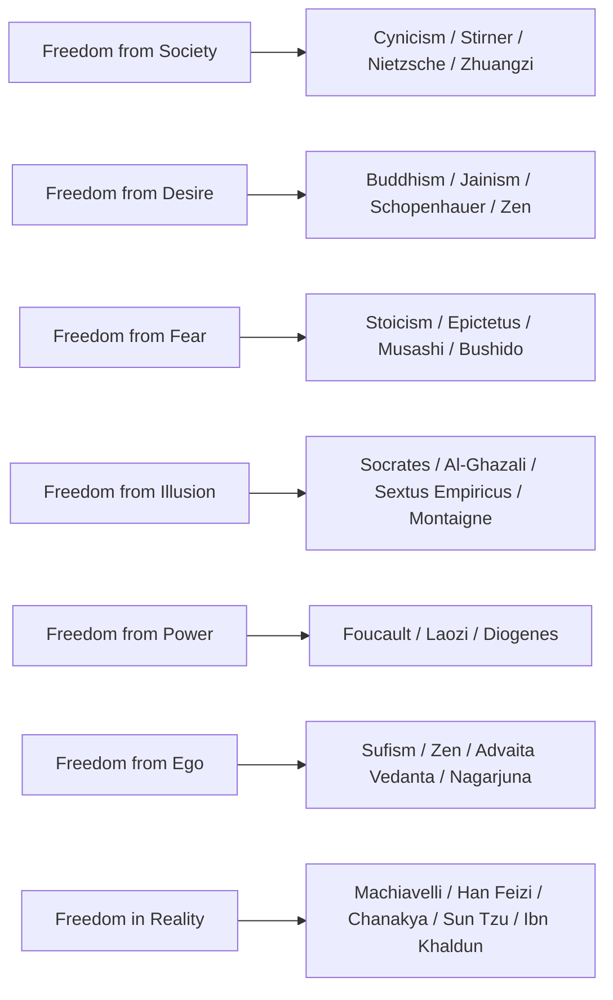

 

## 20. Final Observations and Guiding Principles

Across Greek, Indian, Chinese, Japanese, Islamic, and European traditions, the greatest thinkers repeatedly warn against the same dangers:

- Blindly following the crowd  
- Becoming a slave to desire  
- Confusing status with worth  
- Mistaking beliefs for truth  
- Allowing fear to dictate decisions  
- Assuming one knows oneself  
- Assuming society knows what is best  
- Assuming immunity to self-deception  

Different languages. Different centuries. Different civilizations. Same battle.

A practical synthesis suitable for placement above a personal library or study space is:

> **Question everything. Need little. Master yourself. Create your own path.**

This formulation draws from Socrates’ examined life, Diogenes’ self-sufficiency, the Buddha’s ending of craving, and Nietzsche’s call to create values. It summarizes the convergent direction of the traditions and resources assembled in this guide.

 

## Conclusion

The materials listed here—websites, courses, videos, podcasts, communities, primary texts, and the traditions of freedom—constitute a complete, free, and publicly accessible philosophy learning ecosystem. A reader who follows the structured path, consults the core ten resources, and engages the freedom traditions with seriousness can progress from complete beginner to independent, critically informed philosophical inquiry.

Philosophy, at its best, is not merely a subject to be studied but a way of life to be practiced. The resources and traditions in this guide provide both the tools and the maps. The journey remains yours to undertake.

 

# Appendix A: Master Resource Summary

| Category | Top Recommendation | Secondary Recommendation |
|---|---|---|
| Encyclopedia | Stanford Encyclopedia of Philosophy | Internet Encyclopedia of Philosophy |
| Research Index | PhilPapers | Philosophy Stack Exchange |
| YouTube (Beginner) | Wireless Philosophy | Crash Course Philosophy |
| YouTube (Advanced) | Gregory B. Sadler | Kane B |
| Free Course | Open Yale Courses | MIT OpenCourseWare |
| Podcast | Philosophy Bites | History of Philosophy Without Any Gaps |
| Blog or Magazine | Aeon | The Stone (New York Times) |
| Community | r/askphilosophy | Philosophy Stack Exchange |
| Academic Journal | The Philosophical Review | Mind |
| Freedom Tradition | Cynicism, Stoicism, Buddhism | Zen, Taoism, Jainism |

 

# Appendix B: Glossary of Key Terms

| Term | Meaning |
|---|---|
| Autarkeia | Self-sufficiency; the Cynic and Stoic ideal of needing little from the world. |
| Parrhesia | Frank or fearless speech; speaking truth without flattering power. |
| Wu wei | Effortless action or non-striving; a Taoist idea of acting in harmony with nature. |
| Aparigraha | Non-possessiveness; the Jain principle of reducing attachment to things and status. |
| Zuhd | Detachment or ascetic simplicity in Sufism. |
| Mushin | “No-mind”; acting without anxious self-consciousness or mental clutter. |
| Mono no aware | Sensitivity to the passing nature of things. |
| Wabi-sabi | Beauty in imperfection, incompleteness, and impermanence. |
| Self-overcoming | Nietzsche’s idea of continually overcoming one’s current self and inherited values. |
| Negative visualization | Stoic practice of imagining loss to reduce fear and increase gratitude. |
| Suspension of judgment | Pyrrhonian practice of refusing to cling to certainty. |
| Herd morality | Nietzsche’s term for values adopted unthinkingly from the crowd. |
| Spooks | Max Stirner’s term for abstract ideas that rule the individual from within. |
| Shadow | Jung’s term for hidden or repressed parts of the personality. |

 

# Appendix C: Scope Note

This guide focuses on resources and traditions for studying philosophy. It does not cover unrelated fields such as physical training, translation software, or comedy performance, except where a philosophical principle is directly relevant. The rankings and comparisons are educational aids, not final judgments. Readers should approach ascetic and intense practices with care and should not treat philosophical ideas as a substitute for medical or psychological support.

 
    
