<br><br><br><br>
 

<h1 align="center">THE HISTORY AND TAXONOMY OF PROGRAMMING LANGUAGES.</h1>

<br><br><br><br>

<p align="center">
    <a href="https://github.com/advancedscientificcomputing" target="_blank" rel="noopener noreferrer">
        
    </a>
</p>


<br><br>

<div align="center">
 
</div>

<br>

<div align="center">

[](https://skillicons.dev)
[](https://skillicons.dev)
[](https://skillicons.dev)
[](https://skillicons.dev)
[](https://skillicons.dev)
[](https://skillicons.dev)
[](https://skillicons.dev)

</div>

<div align="center">

[](https://skillicons.dev)
[](https://skillicons.dev)
[](https://skillicons.dev)
[](https://skillicons.dev)
[](https://skillicons.dev)
[](https://skillicons.dev)
[](https://skillicons.dev)

</div>

<div align="center">

[](https://skillicons.dev)
[](https://skillicons.dev)
[](https://skillicons.dev)
[](https://skillicons.dev)
[](https://skillicons.dev)
[](https://skillicons.dev)
[](https://skillicons.dev)

</div>

<br><br>


### Executive Summary

Programming languages constitute the fundamental interface between human cognitive intent and computational execution. Their evolution mirrors the profound transformation of computing from specialized laboratory apparatus into ubiquitous global infrastructure. This document presents a comprehensive historical analysis, a structured technical taxonomy, and a practical reference framework for understanding programming languages from their binary origins through contemporary multi-paradigm developments. It serves as a definitive resource for researchers, software engineers, educators, and technology strategists seeking to contextualize current technical landscapes within the broader arc of computing history.

<br>

## 1. The Dawn of Programming: The Foundational Era (1940s–1950s)

The earliest period of computing was defined by a direct, unmediated relationship between the programmer and the hardware. This era established the fundamental principles of instruction execution and the first tentative steps toward symbolic abstraction.

### 1.1 Machine Code and Assembly: The Hardware Interface
The initial method of programming involved the direct input of **Machine Code**, which consists of binary patterns corresponding directly to specific processor operations. This practice required the programmer to possess exhaustive knowledge of the hardware architecture, including precise memory addressing schemes and instruction set layouts. Such programs were inherently non-portable; code written for one machine architecture could not function on another without complete rewriting.

The development of **Assembly Language** provided the first layer of abstraction. It replaced raw binary sequences with human-readable mnemonic instructions such as `ADD`, `MOV`, and `JMP`, alongside symbolic labels for memory locations. While this innovation improved development speed and reduced error rates compared to machine code, it remained a one-to-one mapping to hardware instructions. Assembly programming still demanded manual register allocation and explicit management of the call stack, tying the programmer closely to the underlying silicon.

### 1.2 Pioneering High-Level Conceptualizations
Even before high-level languages became practical, visionary computer scientists were designing theoretical frameworks for more expressive programming.

- **Plankalkül (Plan Calculus, 1945):** Conceived by Konrad Zuse for his Z4 computer, Plankalkül represents the first documented high-level programming language design in history. Although it was not implemented during Zuse's lifetime due to wartime and post-war constraints, the design was remarkably prescient. It introduced sophisticated concepts including structured data types, conditional execution branches, iterative loops, and operations on multidimensional arrays. Its theoretical significance lies in its demonstration that programming could transcend raw binary manipulation decades before this became standard industry practice.
- **Short Code (1949):** Developed by John Mauchly for the UNIVAC I, Short Code introduced the revolutionary concept of an interpreter. Rather than writing machine instructions, programmers could write mathematical expressions in a notation resembling algebra. The interpreter would translate these expressions line-by-line into machine code during execution. This approach drastically reduced the cognitive load on the user, shifting focus from hardware specifics to problem-solving logic, albeit at the cost of slower execution speed compared to compiled or hand-written assembly code.
- **The A-0 System and Autocode (1950s):** The A-0 System, created by Grace Hopper, is recognized as the world's first compiler. It allowed programmers to call pre-written mathematical subroutines using a higher-level notation, which the system would then "compile" into a complete machine code program. Its successors, **A-1, A-2, and A-3**, refined this process. Concurrently, **Autocode** (1954) developed by Alick Glennie for the Manchester Mark 1, became the first language to be fully compiled directly from a high-level specification to executable machine instructions, marking a pivotal shift away from interpretive overhead for performance-critical tasks.

<br>

## 2. The First Generation of High-Level Languages (Late 1950s–1960s)

This period witnessed the emergence of the first widely adopted high-level languages, each designed to dominate a specific computational domain and establish a distinct philosophical approach that continues to influence modern design.

### 2.1 FORTRAN: The Scientific Workhorse
**FORTRAN** (FORmula TRANslation), released by IBM in 1957 under the leadership of John Backus, was engineered specifically for high-performance scientific and engineering computation. Its primary innovation was the generation of machine code that was nearly as efficient as that produced by skilled assembly language programmers. This efficiency was critical for persuading a skeptical engineering community to abandon low-level coding. FORTRAN provided native support for complex numbers, arrays, and mathematical functions, which are essential for numerical modeling. Its continued evolution—through standards like Fortran 90, 2003, and 2018 incorporating object-oriented and concurrent features—cements its ongoing relevance in high-performance computing (HPC) fields such as computational fluid dynamics, climate simulation, and nuclear physics research.

### 2.2 LISP: Symbolic Computation and Artificial Intelligence
**LISP** (LISt Processor), conceived by John McCarthy at MIT in 1958, introduced a fundamentally different model of computation based on symbolic expressions rather than numbers. It pioneered several concepts now considered essential in modern programming, including recursive function calls, dynamic memory allocation with automatic garbage collection, and the property of homoiconicity—where the structure of code is identical to the structure of data (both are lists). This enabled powerful metaprogramming capabilities, allowing LISP programs to analyze, generate, and modify other LISP programs with ease. For decades, LISP and its dialects (**Common Lisp**, **Scheme**) served as the primary vehicles for artificial intelligence research, expert systems, and the exploration of functional programming paradigms.

### 2.3 COBOL: The Language of Business
**COBOL** (COmmon Business-Oriented Language), standardized in 1959 with significant influence from Grace Hopper, was designed to address the data processing needs of large enterprises and government agencies. Its syntax deliberately mimics English prose to enhance readability for non-programmer managers and auditors. COBOL excels at processing large sequential files and performing decimal arithmetic required for accurate financial calculations—capabilities that distinguish it from scientific languages like FORTRAN. Despite frequent predictions of its demise, the immense volume of business logic encoded in COBOL ensures its persistence; it is estimated that hundreds of billions of lines of COBOL code remain in active use within global banking, insurance, and mainframe infrastructure, representing a significant long-term maintenance and modernization challenge.

### 2.4 ALGOL: The Theoretical Foundation
The **ALGOL** (ALGOrithmic Language) family, particularly **ALGOL 58** and **ALGOL 60**, contributed more to the theory of programming languages than to practical application. ALGOL 60 introduced the concept of **block structure** (code delimited by `begin` and `end`), **lexical scoping** (controlling variable visibility), and the formal definition of syntax using **Backus-Naur Form (BNF)**. These innovations provided the essential scaffolding for structured programming. While ALGOL 60 saw limited commercial adoption in the United States, its design profoundly shaped the next generation of influential languages, most notably Pascal and C. **ALGOL 68** expanded upon this foundation with a highly orthogonal design, though its complexity hindered widespread acceptance.

### 2.5 BASIC: Democratizing Access
**BASIC** (Beginner's All-purpose Symbolic Instruction Code), created in 1964 by John Kemeny and Thomas Kurtz at Dartmouth College, was designed with a clear pedagogical mission: to bring programming to students in the humanities and sciences who lacked a technical background. It achieved this through an extremely simple syntax and an interactive interpreter that provided immediate feedback. The microcomputer revolution of the late 1970s and early 1980s propelled BASIC to massive popularity, as variants like Microsoft BASIC became the standard interface for millions of personal computer users. Although largely superseded in professional development, the philosophy of an approachable, immediate programming environment lives on in modern educational tools like Scratch and the interactive REPLs (Read-Eval-Print Loops) of Python and JavaScript.

<br>

## 3. Systems Programming and Paradigm Diversification (1970s–1980s)

The maturation of operating systems and the growth of software complexity demanded languages that offered both high-level structure and low-level control. This era produced the bedrock of modern infrastructure and saw the proliferation of diverse programming models.

### 3.1 C: The Portable Systems Language
**C**, developed by Dennis Ritchie at Bell Laboratories in 1972, emerged from the necessity to rewrite the UNIX operating system in a language more maintainable than assembly yet capable of precise hardware manipulation. Its design philosophy emphasizes minimalism, efficiency, and a close mapping between language constructs and underlying machine instructions. Key features include pointer arithmetic for direct memory access, a concise and expressive syntax, and a small, portable standard library. The combination of high-level flow control with low-level memory access made C uniquely suited for building operating system kernels, embedded firmware, and performance-critical application engines. It remains the lingua franca of systems programming, forming the implementation foundation for languages like C++, Java, Python, and Rust.

### 3.2 The Rise of Object Orientation: Simula and Smalltalk
The object-oriented paradigm, now a cornerstone of software engineering, was established through two seminal languages. **Simula** (1964) introduced the concepts of classes, objects, inheritance, and virtual methods to facilitate discrete-event simulation. **Smalltalk**, developed at Xerox PARC in the 1970s, refined these ideas into a "pure" object-oriented environment where every entity—from an integer to a window—is an object communicating via message passing. Smalltalk was not merely a language but an entire graphical development ecosystem, directly inspiring the design of modern window-based user interfaces (GUIs) and iterative development environments.

### 3.3 Declarative and Specialized Languages
The systems programming era also fostered the exploration of radically different problem-solving approaches beyond imperative step-by-step instructions.

- **SQL (Structured Query Language, 1974):** SQL exemplifies the declarative programming paradigm. Instead of specifying *how* to retrieve data (loop through records, compare values), the programmer declares *what* data is required. The relational database management system (RDBMS) then optimizes and executes the query plan. This separation of specification from implementation has made SQL the universal standard for interacting with structured data.
- **Prolog (Programming in Logic, 1972):** Prolog introduced logic programming, wherein programs consist of a set of facts and inference rules. The runtime system performs automated reasoning and backtracking to find solutions that satisfy the stated logical constraints. This model proved highly effective for expert systems, natural language processing, and computational linguistics.
- **Ada (1980):** Commissioned by the United States Department of Defense, Ada was designed for large-scale, long-lived, safety-critical systems. It emphasizes strong typing, modularity, and built-in support for real-time concurrency and exception handling. These features make Ada suitable for avionics, air traffic control, and military hardware where software failure carries catastrophic risk.

<br>

## 4. The Internet and Managed Code Era (1990s–2000s)

The proliferation of the World Wide Web and the shift toward networked computing demanded languages that prioritized portability, security, and developer productivity over raw execution speed.

### 4.1 Java: The Virtual Machine Promise
**Java**, launched by Sun Microsystems in 1995, popularized the paradigm of compiling source code to an intermediate bytecode format executed on a virtual machine (the JVM). This architecture enabled the "write once, run anywhere" (WORA) promise, allowing the same Java program to run unchanged on any platform with a compatible JVM. Combined with automatic memory management (garbage collection) and a vast standard library, Java reduced entire classes of bugs related to memory leaks and platform-specific dependencies. While initial adoption was fueled by browser applets, Java's true dominance materialized in enterprise server-side computing, where its stability, scalability, and mature ecosystem power countless financial and logistical backend systems.

### 4.2 JavaScript: The Accidental Ubiquity of the Web
**JavaScript** was created by Brendan Eich in 1995 as a lightweight scripting language to add interactivity to the Netscape Navigator browser. Despite design compromises made under extreme time pressure, its monopoly position as the only language natively understood by web browsers propelled it to unparalleled global deployment. The 2000s saw the maturation of the platform through standards like ES6, which added modern syntax and module support. The release of **Node.js** in 2009 extended JavaScript's reach to server-side development, enabling full-stack development in a single language. Today, **TypeScript**—a typed superset of JavaScript—addresses the maintainability challenges of large-scale JavaScript applications.

### 4.3 Python: The Rise of Readability and Community
**Python**, conceived by Guido van Rossum in 1991, was designed with a counter-cultural emphasis on code readability and developer happiness. Its use of significant whitespace and an expressive, English-like syntax lowers the barrier to entry. Python's "batteries included" philosophy ensures a rich standard library is available out of the box. More importantly, its open and welcoming community cultivated an ecosystem of third-party libraries that has proven transformative. Libraries like NumPy and Pandas established Python as the dominant force in data science and analytics, while frameworks like Django and Flask made it a go-to choice for web development. Python's design trade-off—sacrificing raw execution speed for developer velocity—has been decisively validated by modern software economics.

### 4.4 Web Specialists: PHP and Ruby
- **PHP** evolved from a set of personal home page tools into a ubiquitous server-side language. Its primary advantage was its seamless embedding within HTML, enabling rapid dynamic web page creation. It powered the LAMP stack (Linux, Apache, MySQL, PHP) that defined the first generation of web application hosting. Modern PHP versions have significantly improved performance and type safety.
- **Ruby**, guided by Yukihiro Matsumoto's principle of "optimizing for programmer happiness," achieved breakout success with the **Ruby on Rails** web framework. Rails introduced "convention over configuration," a philosophy that drastically reduces the amount of boilerplate code required to build a database-backed web application. This focus on developer ergonomics influenced countless subsequent frameworks across other languages.

### 4.5 C#: Managed Code in the Microsoft Ecosystem
**C#**, created by Anders Hejlsberg at Microsoft, is a multi-paradigm language that integrates deeply with the .NET Framework. It combines the performance and control of C++ with the safety and productivity of Java. The language has continuously evolved, introducing innovative features like **LINQ** (Language Integrated Query) for declarative data manipulation and the `async`/`await` pattern for simplified asynchronous programming. With the open-sourcing of .NET Core, C# has transitioned into a truly cross-platform language suitable for cloud services, mobile development via Xamarin/MAUI, and game development via the Unity engine.

<br>

## 5. Modern Systems and Domain-Specific Languages (2010s–Present)

The current decade is characterized by a return to systems-level concerns—concurrency, memory safety, and performance—but with the benefit of decades of language design research.

### 5.1 Go: Simplicity for the Cloud
**Go**, designed at Google in 2009, addresses the complexities of building software at internet scale. It rejects much of the feature accretion seen in older languages in favor of a deliberately small and orthogonal specification. Its most celebrated features are **goroutines** (lightweight concurrent threads) and **channels** (a built-in mechanism for safe communication between them). Combined with static linking that produces single, dependency-free binaries, Go has become the language of choice for cloud infrastructure, microservices, and DevOps tooling, exemplified by projects like Docker and Kubernetes.

### 5.2 Rust: Memory Safety Without Garbage Collection
**Rust**, sponsored by Mozilla Research and stable since 2015, solves a fundamental tension in systems programming: achieving C++-level performance while guaranteeing memory safety. It accomplishes this through a novel **ownership model** and a **borrow checker**, which statically analyze the code at compile time to prevent use-after-free errors, data races, and buffer overflows. This allows Rust to eliminate the need for a garbage collector entirely. As a result, Rust is uniquely suited for the most demanding software foundations: operating system kernels, browser engines, and secure cryptographic libraries. Its emphasis on reliability has earned it adoption in critical infrastructure from Microsoft Windows to the Linux kernel.

### 5.3 A Spectrum of Modern Specialization
The contemporary landscape is increasingly characterized by languages optimized for specific ecosystems or computational models.

- **Swift (2014):** Apple's successor to Objective-C, featuring a focus on safety and expressive syntax through features like optionals and protocol-oriented programming. It is the standard for development across iOS, macOS, watchOS, and visionOS.
- **Kotlin (2011):** A modern, concise language that runs on the JVM and interoperates seamlessly with Java. Google's endorsement of Kotlin as the preferred language for Android development has driven its rapid ascent.
- **Julia (2012):** A dynamic language designed for high-performance scientific and numerical computing. Its just-in-time (JIT) compilation using LLVM allows it to approach the speed of C and Fortran while retaining the interactive ease of Python or R.
- **Elixir (2011):** A functional language built on the battle-tested Erlang VM (BEAM). It excels at building distributed, fault-tolerant, and highly concurrent systems, such as messaging platforms and real-time services, leveraging the Actor model for concurrency management.

<br>

## 6. Evolutionary Patterns and Technical Trade-offs

Analyzing the historical progression of programming languages reveals recurring patterns and inherent tensions that shape design decisions.

### 6.1 The Abstraction Trajectory
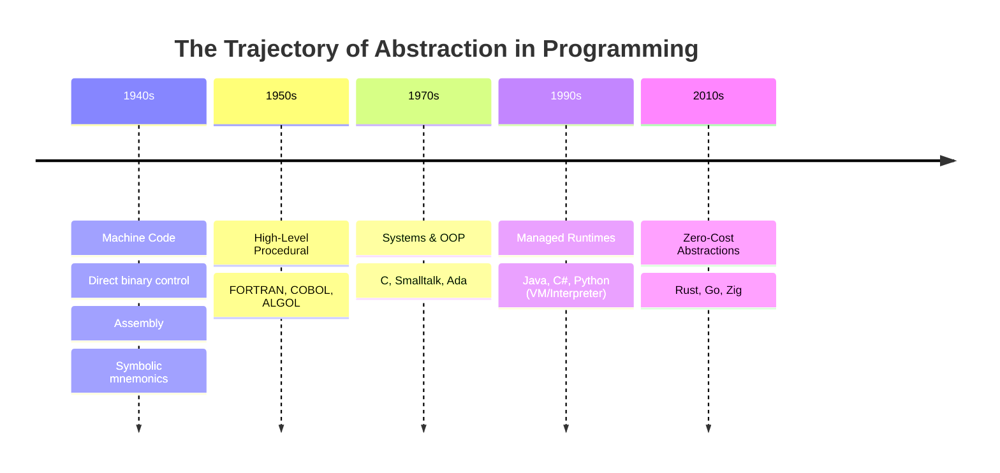
The consistent direction of language evolution is toward higher levels of abstraction, which allow developers to express complex ideas more succinctly and safely. The cost of this abstraction, however, has historically been a reduction in runtime performance or an increase in memory overhead. Modern languages like Rust and modern C++ idioms attempt to achieve **"zero-cost abstractions"**—providing high-level expressive power that compiles away to the same efficient machine code as a hand-written low-level implementation.

### 6.2 The Safety Versus Control Continuum
There exists a perpetual tension between the programmer's need for fine-grained control and the system's need for safety and reliability.

- **C and C++** offer maximum control and performance but place the entire burden of memory safety on the developer.
- **Java and C#** offer strong safety guarantees through managed runtimes and garbage collection but abstract away direct memory management.
- **Rust** represents a third path: it provides **compile-time safety** equivalent to managed languages but with **runtime performance** equivalent to systems languages. This is achieved by shifting the cost of verification from runtime to compile time.

### 6.3 Paradigm Synthesis: The Multi-Paradigm Reality
The historical boundaries between programming paradigms have become porous. Modern, pragmatic language design increasingly adopts a multi-paradigm approach.

- **C# and Scala** seamlessly blend object-oriented design with functional programming concepts like lambda expressions, higher-order functions, and immutable data structures.
- **Python** supports procedural scripts, object-oriented class hierarchies, and functional list comprehensions equally well.
- **JavaScript** has evolved from a simple prototype-based object model to include robust functional programming utilities.

This synthesis reflects the practical reality that different sub-problems within a single software project are best solved using different mental models and language features.

<br>

## 7. Practical Guidance for Language Selection and Learning

For engineering leaders and developers, language selection is a strategic architectural decision with long-term implications.

### 7.1 Selection Criteria for Projects
When evaluating a language for a new project, the following weighted factors should be considered:

| Criterion | Weight | Considerations |
| :--- | :--- | :--- |
| **Performance & Scale** | High | Does the application require low latency (C++, Rust, Go) or is it throughput-bound (Java, C#)? |
| **Ecosystem & Libraries** | High | Does the language have mature, secure libraries for the specific domain (e.g., data science, web servers)? |
| **Team Expertise** | Medium | What is the existing skill set of the development team? The cost of context switching is non-trivial. |
| **Platform Target** | Medium | Is the target mobile (Swift/Kotlin), embedded (C/Rust/Zig), or browser-based (TypeScript/Elm)? |
| **Concurrency Model** | Medium | Does the application require heavy parallel processing? Languages with robust concurrency primitives (Go, Elixir) may simplify architecture. |
| **Long-term Maintainability** | High | Strong, static typing (Rust, TypeScript, C#) tends to reduce bug density and improve refactoring safety over large codebases. |

### 7.2 A Recommended Learning Trajectory
For individuals seeking a robust foundation in computer science and software engineering:

- **Phase 1: Fundamentals.** Begin with a language that emphasizes explicit memory and data structures, such as **C** or **Go**. This provides an essential mental model of how computers actually operate beneath layers of abstraction.
- **Phase 2: Systems Thinking.** Study **Rust** or advanced **C++** to understand the modern approaches to memory safety, ownership, and low-level optimization.
- **Phase 3: Productivity and Ecosystems.** Master a high-productivity language like **Python** or **TypeScript**. This unlocks the vast ecosystems for web development, data analysis, and automation.
- **Phase 4: Paradigm Expansion.** Learn a purely functional language like **Haskell** or **Elm**. Even if never used professionally, this experience will profoundly change how you approach state management and side effects in imperative code.

### 7.3 Managing Legacy Systems
The prevalence of COBOL, FORTRAN, and older C++ dialects requires specific strategies:
- **Interoperability over Rewrite:** Instead of a costly and risky full rewrite, modern languages can interface with legacy libraries using **Foreign Function Interfaces (FFI)** . A Rust or Python service can call into a validated, high-performance FORTRAN numerical library.
- **Incremental Migration:** Gradually replace critical paths or security-sensitive components with memory-safe alternatives (e.g., rewriting a network-facing C module in Rust) while keeping the core business logic intact.
- **Strategic Assessment:** Evaluate the total cost of ownership. If the system is stable and secure, maintenance may be preferable to modernization. If security patches or new features are impossible to implement, a phased modernization plan is required.

<br>

## 8. Future Directions and Emerging Frontiers

The evolution of programming languages is poised to accelerate in response to new hardware capabilities and new classes of computational problems.

### 8.1 Language-Level Innovations
- **Formal Verification and Dependent Types:** Languages like **Idris**, **Lean**, and **F*** are pushing the boundaries of type systems to prove mathematical properties about program behavior at compile time. This is critical for smart contracts and high-assurance cryptography.
- **Heterogeneous Computing:** As hardware becomes more diverse (CPUs, GPUs, TPUs, FPGAs), languages and compilers like **Mojo** and frameworks like **MLIR** aim to provide a unified programming model that can efficiently target multiple accelerators without requiring separate codebases.
- **AI-Augmented Development:** The rise of Large Language Models (LLMs) for code generation (e.g., GitHub Copilot) is changing how developers interact with syntax. Future language design may optimize for machine readability and generation as much as human readability.

### 8.2 The WebAssembly (WASM) Frontier
 
**WebAssembly** is emerging as a portable compilation target for high-performance code on the web and beyond. It allows languages like C++, Rust, and Go to run securely in the browser at near-native speeds, enabling complex applications like video editing and CAD software. The **WebAssembly System Interface (WASI)** extends this capability to server-side and edge computing, promising a future where language choice is decoupled from the deployment environment.

### 8.3 Quantum Computing Languages
As quantum hardware progresses, so do the domain-specific languages for it. **Q#** (Microsoft) and **Quipper** provide high-level constructs for expressing quantum algorithms, which are fundamentally different from classical sequential logic. They allow researchers to describe quantum circuits and oracles while abstracting away the complex mathematics of state vectors and unitary transformations.

<br>

## 9. Conclusion: The Continuing Dialogue

The history of programming languages is a continuous dialogue between the rigid physics of hardware and the boundless flexibility of human thought. It is a story of accumulating wisdom and addressing the shortcomings of the past. From the binary switches of the 1940s to the zero-cost abstractions of the 2020s, each generation of language has expanded the frontier of what is possible to build.

For the modern engineer and researcher, fluency in this history is not merely academic curiosity; it is a strategic asset. Understanding *why* Rust's ownership model exists or *why* Python's dynamic typing suits rapid prototyping allows for more nuanced, effective technology decisions. As we stand at the cusp of new paradigms in AI and quantum computing, the one constant remains: the need for precise, efficient, and expressive tools to translate human intention into digital reality.

<br><br><br><br>

<h1 align="center">Programming Language Taxonomy with Pronunciation (IPA)</h1>

<br>

| Programming Language | Year | Timeline & Generation | Primary Purpose & Paradigm/Domain | Pronunciation (IPA) |
| :--- | :--- | :--- | :--- | :--- |
| **Machine Code** | 1940s | Foundational Era | Direct binary hardware control (Low-Level) | /məˈʃiːn ˌkoʊd/ |
| **Assembly** | 1940s | Foundational Era | Symbolic hardware-specific programming (Low-Level) | /əˈsɛmbli/ |
| **Plankalkül** | 1945 | Foundational Era | Early conceptual high-level language (Historical) | /ˈplɑːnˌkɑːlkuːl/ |
| **Short Code** | 1949 | Foundational Era | Early mathematical expression interpreter (Historical) | /ʃɔːrt ˌkoʊd/ |
| **A-0 System** | 1950s | Foundational Era | Early compiler for mathematical notation (Compiler Tech) | /ˌeɪ ˈzɪəroʊ ˌsɪstəm/ |
| **A-1, A-2, A-3** | 1950s | Foundational Era | Evolutionary versions of A-0 compiler (Compiler Tech) | /ˌeɪ ˈwʌn, ˌeɪ ˈtuː, ˌeɪ ˈθriː/ |
| **Autocode** | 1954 | Foundational Era | First compiled programming language (Historical) | /ˈɔːtoʊˌkoʊd/ |
| **FORTRAN** | 1957 | 1st Gen High-Level | High-performance scientific computing (Scientific) | /ˈfɔːrtræn/ |
| **LISP** | 1958 | 1st Gen High-Level | Symbolic computation & AI (AI/Functional) | /lɪsp/ |
| **ALGOL 58** | 1958 | 1st Gen High-Level | Algorithmic foundation (Theoretical) | /ˈælɡɒl ˌfɪftiˈeɪt/ |
| **COBOL** | 1959 | 1st Gen High-Level | Business data processing (Business/Enterprise) | /ˈkoʊbɒl/ |
| **ALGOL 60** | 1960 | 1st Gen High-Level | Structured programming formalization (Theoretical) | /ˈælɡɒl ˌsɪksti/ |
| **APL** | 1962 | 1st Gen High-Level | Concise array/mathematical notation (Mathematical) | /ˌeɪ ˌpiː ˈel/ |
| **SIMULA** | 1964 | 1st Gen High-Level | First object-oriented language for simulations (OOP) | /ˈsɪmjələ/ |
| **BASIC** | 1964 | 1st Gen High-Level | Beginner-friendly education (Educational) | /ˈbeɪsɪk/ |
| **PL/I** | 1964 | 1st Gen High-Level | General-purpose for scientific/business (Multi-Paradigm) | /ˌpiː ˌel ˈaɪ/ |
| **ISWIM** | 1966 | 1st Gen High-Level | Influential abstract functional language (Functional/Research) | /ˈɪzwɪm/ |
| **COMIT** | 1960s | 1st Gen High-Level | String/text processing for linguistics (Text Processing) | /ˈkɒmɪt/ |
| **Logo** | 1967 | 1st Gen High-Level | Educational programming with turtle graphics (Educational) | /ˈloʊɡoʊ/ |
| **ALGOL 68** | 1968 | 1st Gen High-Level | Complex successor to ALGOL 60 (Theoretical) | /ˈælɡɒl ˌsɪkstiˈeɪt/ |
| **Pascal** | 1970 | Systems Programming Era | Teaching structured programming (Educational) | /pæˈskæl/ |
| **C** | 1972 | Systems Programming Era | Portable systems programming (Systems) | /siː/ |
| **Smalltalk** | 1972 | Systems Programming Era | Pure object-oriented programming with GUI (OOP) | /ˈsmɔːltɔːk/ |
| **Prolog** | 1972 | Systems Programming Era | Logic/rule-based programming (AI/Logic) | /ˈproʊlɒɡ/ |
| **SASL** | 1972 | Systems Programming Era | Non-strict functional teaching language (Educational/Functional) | /ˈsæzəl/ or /ˌes ˌeɪ ˌes ˈel/ |
| **ML** | 1973 | Systems Programming Era | Functional programming with strong typing (Functional) | /ˌem ˈel/ |
| **SQL** | 1974 | Systems Programming Era | Declarative relational database querying (Database) | /ˌes ˌkjuː ˈel/ or /ˈsiːkwəl/ |
| **Scheme** | 1975 | Systems Programming Era | Minimalist Lisp dialect (Functional) | /skiːm/ |
| **Cangjie** | 1976 | Systems Programming Era | Chinese character input method *(Not a PL)* | /tsɑːŋˈdʒjeɪ/ |
| **Modula-2** | 1978 | Systems Programming Era | Modular programming for systems (Systems) | /ˈmɒdjʊlə ˌtuː/ |
| **Ada** | 1980 | Systems Programming Era | Reliable real-time safety-critical systems (Safety-Critical) | /ˈeɪdə/ |
| **Forth** | 1970s | Systems Programming Era | Stack-based embedded programming (Embedded) | /fɔːrθ/ |
| **Miranda** | 1980s | Systems Programming Era | Lazy functional programming (Functional) | /mɪˈrændə/ |
| **C++** | 1983 | Systems Programming Era | Object-oriented systems/application programming (OOP/Systems) | /ˌsiː ˌplʌs ˈplʌs/ |
| **Objective-C** | 1984 | Systems Programming Era | OOP for Apple platforms (OOP/Mobile) | /əbˈdʒektɪv ˌsiː/ |
| **MATLAB** | 1984 | Systems Programming Era | Numerical computing for engineering/science (Scientific) | /ˈmætlæb/ |
| **Common Lisp** | 1984 | Systems Programming Era | Standardized industrial Lisp dialect (AI/Functional) | /ˈkɒmən ˌlɪsp/ |
| **Erlang** | 1986 | Systems Programming Era | Concurrent fault-tolerant distributed systems (Distributed) | /ˈɜːrlæŋ/ |
| **Perl** | 1987 | Systems Programming Era | Versatile text processing & scripting (Scripting) | /pɜːrl/ |
| **Bash** | 1989 | Systems Programming Era | Unix/Linux command-line scripting (Scripting/Shell) | /bæʃ/ |
| **Haskell** | 1990 | Systems Programming Era | Advanced pure functional programming (Functional) | /ˈhæskəl/ |
| **Python** | 1991 | Internet/Managed Era | General-purpose high-productivity programming (Multi-Paradigm) | /ˈpaɪθɑːn/ |
| **Visual Basic** | 1991 | Internet/Managed Era | Rapid Windows application development (Desktop) | /ˈvɪʒuəl ˈbeɪsɪk/ |
| **R** | 1993 | Internet/Managed Era | Statistical computing & data analysis (Data Science) | /ɑːr/ |
| **Lua** | 1993 | Internet/Managed Era | Lightweight embeddable scripting (Embedded Scripting) | /ˈluːə/ |
| **Java** | 1995 | Internet/Managed Era | Platform-independent enterprise programming (OOP/Enterprise) | /ˈdʒɑːvə/ |
| **JavaScript** | 1995 | Internet/Managed Era | Client/server-side web scripting (Web) | /ˈdʒɑːvəskrɪpt/ |
| **PHP** | 1995 | Internet/Managed Era | Server-side web development (Web) | /ˌpiː ˌeɪtʃ ˈpiː/ |
| **Ruby** | 1995 | Internet/Managed Era | Programmer-friendly general-purpose programming (OOP/Web) | /ˈruːbi/ |
| **Racket** | 1995 | Internet/Managed Era | Language creation platform (Language-Oriented) | /ˈrækɪt/ |
| **OCaml** | 1996 | Internet/Managed Era | Functional language with OO features (Functional/OOP) | /oʊˈkæməl/ |
| **C#** | 2000 | Internet/Managed Era | Microsoft .NET ecosystem programming (OOP/Enterprise) | /ˌsiː ˈʃɑːrp/ |
| **D** | 2001 | Internet/Managed Era | Systems programming with modern features (Systems) | /diː/ |
| **Scratch** | 2002 | Internet/Managed Era | Visual block-based educational programming (Educational) | /skrætʃ/ |
| **Groovy** | 2003 | Internet/Managed Era | Dynamic JVM language for scripting (JVM/Scripting) | /ˈɡruːvi/ |
| **Scala** | 2004 | Internet/Managed Era | Object-oriented/functional JVM programming (Multi-Paradigm/JVM) | /ˈskɑːlə/ |
| **F#** | 2005 | Internet/Managed Era | Functional-first .NET programming (Functional/.NET) | /ˌef ˈʃɑːrp/ |
| **PowerShell** | 2006 | Internet/Managed Era | Windows task automation & configuration (Scripting/Shell) | /ˈpaʊərʃɛl/ |
| **Clojure** | 2007 | Modern Systems Era | Modern Lisp for JVM concurrency (Functional/JVM) | /ˈkloʊʒər/ |
| **Idris** | 2007 | Research/Future Directions | General-purpose with dependent types (Formal Verification) | /ˈɪdrɪs/ |
| **Nim** | 2008 | Modern Systems Era | Performance-focused compiled language (Systems) | /nɪm/ |
| **Go** | 2009 | Modern Systems Era | Simple concurrent systems programming (Systems/Cloud) | /ɡoʊ/ |
| **Rust** | 2010 | Modern Systems Era | Memory-safe systems programming (Systems/Safe) | /rʌst/ |
| **Elixir** | 2011 | Modern Systems Era | Distributed systems on BEAM VM (Distributed) | /ɪˈlɪksər/ |
| **Dart** | 2011 | Modern Systems Era | Client-optimized cross-platform development (Mobile/Web) | /dɑːrt/ |
| **Kotlin** | 2011 | Modern Systems Era | Concise JVM/Android development (Mobile/JVM) | /ˈkɒtlɪn/ |
| **Crystal** | 2011 | Modern Systems Era | Ruby-like performance language (Web/Systems) | /ˈkrɪstəl/ |
| **F*** | 2011 | Research/Future Directions | Program verification with dependent types (Formal Verification) | /ˌef ˈstɑːr/ |
| **Julia** | 2012 | Modern Systems Era | High-performance technical computing (Scientific) | /ˈdʒuːliə/ |
| **TypeScript** | 2012 | Modern Systems Era | Typed superset of JavaScript (Web/Typed) | /ˈtaɪpskript/ |
| **Elm** | 2012 | Modern Systems Era | Reliable web front-end development (Web/Functional) | /ɛlm/ |
| **Quipper** | 2012 | Research/Future Directions | Domain-specific quantum programming (Quantum Computing) | /ˈkwɪpər/ |
| **Lean** | 2013 | Research/Future Directions | Functional language & theorem prover (Formal Verification) | /liːn/ |
| **Swift** | 2014 | Modern Systems Era | Modern iOS/macOS app development (Mobile) | /swɪft/ |
| **Raku** | 2015 | Modern Systems Era | Modern Perl successor (Scripting) | /ˈrɑːkuː/ |
| **Gleam** | 2016 | Modern Systems Era | Type-safe functional language for BEAM VM (Functional) | /ɡliːm/ |
| **Zig** | 2016 | Modern Systems Era | Robust optimal-performance systems language (Systems) | /zɪɡ/ |
| **Q#** | 2017 | Research/Future Directions | Quantum algorithm development (Quantum Computing) | /ˌkjuː ˈʃɑːrp/ |
| **V (Vlang)** | 2019 | Modern Systems Era | Maintainable efficient software building (Systems) | /viː/ |
| **VHDL** | 1980s | Hardware Description | Modeling/simulating digital circuits (Hardware) | /ˌviː ˌeɪtʃ ˌdiː ˈel/ |
| **Verilog** | 1984 | Hardware Description | Modeling electronic systems (Hardware) | /ˈverɪlɒɡ/ |

<br><br>

### **Machine Code**
Have you ever wondered how the very first computers were instructed? **Machine Code** emerged in the **1940s** as the foundational language of all computing. It consists of raw **binary instructions (1s and 0s)** that the computer's central processing unit (CPU) executes directly. Each unique pattern corresponds to a basic hardware operation, like adding or moving data. Writing programs this way is extremely tedious and error-prone for humans because it requires managing every low-level detail. All other programming languages are ultimately translated into machine code for the computer to run. It represents the most basic, hardware-native interface for software.

<br>

### **Assembly**
Have you asked what made programming easier after raw binary? **Assembly** language also appeared in the **1940s** as the first major abstraction. It uses simple, memorable **mnemonics** (like `MOV` to move data or `ADD` to add) to represent individual machine code instructions. A special program called an **assembler** converts these human-readable symbols into binary. This made programming more manageable but still required detailed knowledge of the specific computer's architecture. Today, it is used for critical performance tweaks, device drivers, and low-level system programming. Assembly was a vital bridge toward higher-level languages.

<br>

### **Plankalkül**
Have you wondered about the first conceptual high-level programming language? **Plankalkül** was designed by **Konrad Zuse between 1942 and 1945**. It was a theoretical blueprint for a language that could express complex algorithms using mathematical notation, introducing ideas like variables, assignments, and loops. Unlike direct hardware control, it aimed to describe computations abstractly. Although it was **never implemented on contemporary computers**, its forward-thinking concepts were rediscovered decades later. It holds immense historical significance as the first known attempt to design a high-level programming language.

<br>

### **Short Code**
Have you thought about the first step toward automatically executing math formulas? **Short Code**, created in **1949**, was one of the earliest implemented high-level languages. It allowed programmers to write mathematical expressions using symbolic notation (like 'x + y') instead of machine code. A special **interpreter** would translate these expressions into machine instructions at runtime. This made programming far easier but resulted in slower execution compared to hand-written code. Short Code demonstrated the practical value of abstraction, directly paving the way for modern compiled languages.

<br>

### **A-0 System**
Have you ever asked how automated code translation began? The **A-0 System**, developed by **Grace Hopper in the early 1950s**, was a pioneering **compiler**. It translated mathematical notation and symbolic instructions into machine code automatically. This innovation freed programmers from the tedious and error-prone task of writing binary or assembly by hand. While primitive, it established the revolutionary concept that a program could be used to write another program. The A-0 system is a foundational cornerstone in the history of compiler technology.

<br>

### **Autocode**
Have you wondered about the first working compiled language? **Autocode**, developed in **1954** for the Manchester Mark 1 computer, is recognized as the first **compiled** programming language. It automatically translated high-level code into efficient machine code. This process produced programs that ran significantly faster than those from earlier interpreted systems. By automating translation, it made scientific programming more accessible and reliable. Autocode's practical success proved that high-level, compiled languages were viable for real-world computing tasks.

<br>

### **FORTRAN**
Have you wondered what language enabled complex scientific calculations? **FORTRAN** (FORmula TRANslation), created in **1957**, was the first widely adopted high-level language. Designed specifically for **scientific and engineering computations**, it allowed programmers to write complex mathematical formulas in a natural style. Its advanced compiler produced highly optimized machine code, rivaling the efficiency of hand-written assembly. FORTRAN's enormous success proved that high-level languages could be both practical and incredibly fast, dominating technical computing for decades and influencing countless successors.

<br>

### **LISP**
Have you asked what language powered early artificial intelligence research? **LISP** (LISt Processor), invented in **1958**, was designed for **symbolic computation** rather than numeric calculations. It treated code and data uniformly as linked lists, enabling powerful metaprogramming and flexibility. LISP pioneered fundamental computer science concepts like tree data structures, recursion, automatic memory management, and dynamic typing. It became the language of choice for AI research for decades. Its profound influence established the foundation for the entire functional programming paradigm.

<br>

### **ALGOL 58**
Have you thought about which language first formally described algorithms? **ALGOL 58** (ALGOrithmic Language), introduced in **1958**, was created by an international committee to provide a clear, standard way to express algorithms. While not widely used in commercial programming, its precise, machine-independent syntax and structure became immensely influential in academic circles. It established critical ideas like code blocks and compound statements. ALGOL 58 directly shaped the design of later major languages like Pascal and C, serving as a theoretical milestone in language design.

<br>

### **COBOL**
Have you pondered what language ran the business world for decades? **COBOL** (COmmon Business-Oriented Language), created in **1959**, was designed explicitly for **business data processing**. Its verbose, English-like syntax (e.g., `ADD TOTAL TO PAYROLL`) made it accessible for managers and programmers alike to understand financial, administrative, and inventory systems. A key goal was **portability** across different manufacturers' mainframe computers. COBOL became the indispensable backbone of countless corporate and government systems. Its legacy code still powers critical financial infrastructure worldwide.

<br>

### **ALGOL 60**
Have you wondered which language refined the blueprint for modern programming? **ALGOL 60**, the 1960 successor to ALGOL 58, formally introduced **block structure**, **lexical (static) scoping**, and **recursion**. This meant code could be organized into distinct, nested units with controlled variable access, promoting better structure. Its rigorously defined report became the gold standard for language description. Although not a commercial hit itself, its concepts of structured programming are embedded in the DNA of virtually all subsequent imperative languages, from Pascal to C.

<br>

### **APL**
Have you ever seen a language designed for incredibly concise mathematical notation? **APL** (A Programming Language), created in **1962**, uses a unique, dense set of symbols to perform powerful array and matrix operations with very short code. A single APL symbol can replace an entire loop in another language, making it highly expressive for mathematical modeling and data analysis. This compact "notation as a tool of thought" typically requires a special keyboard or input method. APL remains a niche but highly productive tool in specific mathematical, financial, and analytical domains.

<br>

### **SIMULA**
Have you asked where object-oriented programming truly began? **SIMULA**, developed in **1964**, is recognized as the first language to introduce the core concepts of **objects, classes, and inheritance**. It was created to run complex simulations (like airport traffic) where modeling real-world entities as interacting objects was natural. While its syntax resembled ALGOL, its revolutionary paradigm bundled data and the procedures that operate on it into discrete "classes." Every modern object-oriented language, from Java to Python, traces its conceptual roots directly back to SIMULA.

<br>

### **BASIC**
Have you wondered how programming became accessible to students and hobbyists? **BASIC** (Beginner's All-purpose Symbolic Instruction Code) was created in **1964** at Dartmouth College. Its goal was to provide a simple, forgiving language for non-science students to learn programming fundamentals. With clear commands like `PRINT` and `GOTO`, it removed the intimidating complexity of languages like FORTRAN. BASIC became wildly popular on early personal computers like the Apple II and Commodore 64, introducing a generation to the joy and logic of coding.

<br>

### **PL/I**
Have you thought about an early attempt to create a "universal" language? **PL/I** (Programming Language One), announced in **1964**, was designed to combine the strengths of FORTRAN (scientific math), COBOL (business data), and ALGOL (structure). It aimed to be a single, general-purpose language for all domains. Its vast and complex feature set made it powerful but also difficult to implement, compile efficiently, and master. PL/I found significant use in some enterprise, academic, and IBM mainframe settings, though it never achieved the universal dominance its creators envisioned.

<br>

### **ISWIM**
Have you ever heard of a language that existed mainly as an influential idea? **ISWIM** (If You See What I Mean), described in **1966**, was a theoretical language that never had a full implementation. Its elegant design introduced foundational concepts for **functional programming**, like lazy evaluation and list comprehensions. ISWIM's abstract framework heavily influenced the development of real-world languages like SASL, Miranda, and eventually Haskell. It stands as a classic example of how pure research concepts can shape practical programming tools decades later.

<br>

### **COMIT**
Have you wondered about the first languages designed for text manipulation? **COMIT**, developed at MIT in the **early 1960s**, was one of the first programming languages created specifically for **string and text processing**. It was built for linguists to analyze natural language, allowing powerful pattern-matching and substitution rules on character strings. While obscure today, COMIT's focus on text as a primary data type directly influenced the development of later and more famous pattern-matching and scripting languages, notably SNOBOL and Perl.

<br>

### **Logo**
Have you asked how children were first taught to think like programmers? **Logo**, created in **1967**, is an educational language famous for its **"turtle graphics."** Children write commands to control an on-screen or robotic "turtle," drawing shapes while intuitively learning concepts of procedures, loops, and recursion. Designed by Seymour Papert to be accessible and engaging, Logo embodies the philosophy of **constructionist learning**—learning by doing and discovery. It introduced countless young students to foundational computational thinking.

<br>

### **ALGOL 68**
Have you pondered a language so ambitious it was difficult to use? **ALGOL 68**, finalized in **1968**, was a powerful and complex successor to ALGOL 60. It introduced advanced features like user-defined types, parallel processing, and operator overloading. Its formal, highly comprehensive definition made it a marvel of theoretical language design but also challenging to implement fully and for programmers to learn. While it saw some academic and European use, its complexity limited widespread adoption. It remains a notable, if niche, milestone in the evolution of algorithmic languages.

<br>

### **Pascal**
Have you wondered what language taught a generation structured programming? **Pascal**, released in **1970**, was designed by Niklaus Wirth primarily as a teaching tool to enforce good **structured programming** practices. With its clear syntax, strong typing, and emphasis on readable program structure, it became the standard introductory language in universities for decades. While also used for some commercial software (like early versions of Apple's Macintosh), its lasting legacy is educational. It directly influenced later languages like Modula-2, Ada, and Delphi.

<br>

### **C**
Have you asked what language built the digital world's foundation? **C**, created at Bell Labs in **1972**, was designed for implementing the UNIX operating system. It provides high-level control structures (like loops) while allowing precise low-level memory access, making it ideal for **systems programming**. Its philosophy is to trust the programmer with power and efficiency. C's portability and performance made it the language of choice for operating systems, embedded systems, and foundational application software. It is arguably the most influential programming language in history.

<br>

### **Smalltalk**
Have you ever explored a purely object-oriented world? **Smalltalk**, developed in the **early 1970s**, took the object-oriented concepts of SIMULA and made them the **absolute core** of the language. *Everything* in Smalltalk is an object—even integers and classes—which communicate exclusively by sending messages. It was bundled with a revolutionary graphical, integrated development environment, pioneering modern IDE concepts. While not widely used for production software, its ideas profoundly influenced later OO languages (like Objective-C and Java) and user interface design.

<br>

### **Prolog**
Have you thought about programming with logic and rules instead of step-by-step instructions? **Prolog** (PROgramming in LOGic), created in **1972**, is a **declarative language** based on formal logic. The programmer defines a set of facts and logical rules, and the Prolog engine answers queries by automatically deducing consequences. This paradigm is exceptionally well-suited for symbolic reasoning, natural language processing, and problem-solving, making Prolog a primary language for early **artificial intelligence**. It operates on a fundamentally different principle than imperative or object-oriented languages.

<br>

### **SASL**
Have you wondered about early teaching languages for functional programming? **SASL** (St Andrews Static Language), created in **1972**, was a purely **functional programming** language designed for teaching. It emphasized **non-strict (lazy) evaluation**, where expressions are only computed when their results are needed. This elegant approach allows for working with potentially infinite data structures conceptually. SASL helped demonstrate the practicality and mathematical beauty of lazy functional programming, directly influencing the later development of Miranda and Haskell.

<br>

### **ML**
Have you asked where strong, static type inference began? **ML** (Meta Language), created in **1973**, was originally a language for writing theorem provers. It pioneered **Hindley-Milner type inference**, allowing the compiler to deduce data types automatically without requiring verbose annotations from the programmer. ML combined functional programming with an advanced, flexible type system and some imperative features. It spawned a family of important languages, including Standard ML, OCaml, and F#, and deeply influenced modern type theory in language design.

<br>

### **SQL**
Have you ever considered how we ask databases questions in a human-like way? **SQL** (Structured Query Language), developed in the **1970s** and standardized by 1986, is a **declarative language** for managing and querying relational databases. Instead of writing *how* to get data, you describe *what* data you want (e.g., "find all customers in London"). The database engine's optimizer figures out the most efficient way to retrieve it. SQL's power and relative simplicity made it the universal standard for interacting with structured data in countless applications worldwide.

<br>

### **Scheme**
Have you thought about a minimalist, elegant version of Lisp? **Scheme**, created in **1975**, is a dialect of Lisp that emphasizes conceptual simplicity and elegance. It features a very small core syntax but powerful capabilities like **first-class functions**, **lexical scoping**, and **tail-call optimization**. Scheme became a favorite in computer science education for teaching programming language concepts, functional programming, and abstraction principles. Its clean, minimalist design has influenced many modern languages and remains a touchstone for language theorists.

<br>

### **Cangjie**
*Note: Cangjie is not a programming language. It is a Chinese character input method invented in 1976, which allows users to type complex characters using a standard keyboard by decomposing them into basic shapes.*

<br>

### **Modula-2**
Have you wondered what came after Pascal for building large, reliable systems? **Modula-2**, released in **1978** by Niklaus Wirth, was designed to address Pascal's limitations for systems programming. Its key innovation was the **module**, a construct for packaging data and procedures together and controlling their visibility (import/export). This supported the development of large, well-organized, and maintainable software systems. While it saw significant academic and some commercial use, it was eventually overshadowed by the rising popularity of languages like C and C++.

<br>

### **Ada**
Have you asked what language runs safety-critical systems like avionics? **Ada**, developed in the **late 1970s/early 1980s** for the US Department of Defense, is designed for **large-scale, real-time, and safety-critical systems**. It enforces strong typing, modularity, and extensive runtime checking to produce extremely reliable and maintainable code. Built-in features for concurrent programming (tasks) make it ideal for complex embedded systems (e.g., aircraft, transportation). Ada's rigorous design ensures that errors are caught early, which is paramount in systems where failure is catastrophic.

<br>

### **Forth**
Have you ever seen a language based entirely on a stack? **Forth**, developed in the **1970s**, is a unique **stack-based, concatenative language**. Programs are built by defining new words (functions) that manipulate values on an operand stack, leading to very compact code. It is typically implemented as a small, fast interpreter or compiler, making it ideal for **embedded systems** with limited memory and processing power, such as scientific instruments, spacecraft, and industrial controllers. Forth provides unparalleled low-level control and efficiency.

<br>

### **Miranda**
Have you pondered the bridge between early functional languages and Haskell? **Miranda**, developed in the **mid-1980s**, was a purely functional, **lazy** language that strongly influenced the design of Haskell. It featured list comprehensions, pattern matching, and strong static typing without side effects. Miranda was commercially used for a time and demonstrated that non-strict functional programming could be practical for applications beyond academia. Its clean, mathematical syntax and semantics made it a direct and important precursor to the Haskell standard.

<br>

### **C++**
Have you wondered how C evolved to support large-scale software engineering? **C++**, created in **1983** by Bjarne Stroustrup, started as "C with Classes." It adds **object-oriented** features (classes, inheritance) and later generic programming (templates) to the C foundation, while retaining C's efficiency and low-level capabilities. This made it possible to build large, complex systems (like game engines, databases, and browsers) with reusable, abstract code without sacrificing performance. C++ became one of the world's most widely used languages for systems and performance-critical application software.

<br>

### **Objective-C**
Have you asked what language powered Apple's ecosystem for decades? **Objective-C**, created in **1984**, is a superset of C that adds **object-oriented** messaging based on Smalltalk. Its syntax blends C with distinctive square brackets for message passing (`[object message]`). Adopted by NeXT and then Apple, it became the primary language for developing macOS and iOS applications for many years. While largely superseded by Swift for new development, its influence is permanently woven into Apple's frameworks and development culture.

<br>

### **MATLAB**
Have you thought about a language built for engineers and scientists? **MATLAB** (MATrix LABoratory), commercialized in **1984**, is an interactive environment and language designed specifically for **numerical computation**. It makes matrix operations, data plotting, and algorithm implementation exceptionally straightforward, using a syntax close to mathematical notation. With extensive toolboxes for signal processing, control systems, and more, it became an indispensable tool in engineering, physics, and finance. MATLAB prioritizes ease of use and rapid prototyping for mathematical problem-solving.

<br>

### **Common Lisp**
Have you wondered how the many Lisp dialects were unified for industry? **Common Lisp**, standardized in **1984**, was created to consolidate the fragmented Lisp landscape into a single, powerful, industrial-strength language. It includes a vast standard library, a powerful object system (CLOS), and features for both rapid prototyping and delivering high-performance applications. Common Lisp brought Lisp's legendary flexibility, expressiveness, and interactive development to large-scale projects, finding niches in areas like complex scheduling, AI, and rapid software iteration.

<br>

### **Erlang**
Have you asked what language keeps telephone exchanges and chat apps running? **Erlang**, developed at Ericsson in the **1980s**, is designed for building **highly concurrent, distributed, and fault-tolerant systems**. Its "let it crash" philosophy relies on lightweight processes that can fail and be seamlessly restarted by supervisor hierarchies. Originally for telecom switches, its strengths are perfectly suited for modern web backends, messaging platforms, and any system that must stay running 24/7 under heavy load. It runs on the BEAM virtual machine, which provides the concurrency foundation.

<br>

### **Perl**
Have you ever needed a Swiss Army knife for text processing? **Perl**, created in **1987**, was designed to make report processing and text manipulation easy on Unix systems. Its motto is "There's More Than One Way To Do It" (TMTOWTDI), offering extreme flexibility and incredibly powerful built-in regular expressions. Perl became the "duct tape of the internet," gluing systems together and writing dynamic CGI scripts for the early web. While its dense syntax can be cryptic, its capability for rapid, practical scripting made it immensely popular in system administration and early web development.

<br>

### **Bash**
Have you wondered how Linux and macOS users automate tasks? **Bash** (Bourne-Again SHell), released in **1989**, is a **command-line shell and scripting language** for Unix-like systems. It allows users to combine system commands, control job execution, and write scripts to automate complex workflows. As the default shell on most Linux distributions and macOS, it is the primary interface for system administrators and developers to interact deeply with the operating system. Mastering Bash scripting is a fundamental skill for working efficiently in command-line environments.

<br>

### **Haskell**
Have you explored a language built purely on mathematical functions? **Haskell**, first standardized in **1990**, is a purely **functional language** that emphasizes purity (avoiding side effects), lazy evaluation, and a very strong static type system. It allows programmers to write concise, correct, and elegant code by expressing solutions as compositions of functions. While it has a reputation for a steep learning curve, its advanced type features (like type classes and monads) have influenced many modern languages. Haskell is used in academia, finance, and by companies that value high assurance and correctness.

<br>

### **Python**
Have you asked what language prioritizes readability and developer productivity? **Python**, created in **1991** by Guido van Rossum, is a **general-purpose, high-level language** famous for its clean, readable syntax that emphasizes code clarity. Its design philosophy values simplicity and a "batteries-included" approach with a vast standard library. Python supports multiple programming styles (object-oriented, functional, procedural) and has become the leading language in data science, machine learning, web development, automation, and education due to its versatility, ease of learning, and huge ecosystem.

<br>

### **Visual Basic**
Have you wondered how millions built Windows apps quickly? **Visual Basic** (VB), introduced in **1991**, revolutionized Windows programming with its **visual, drag-and-drop form designer** and easy-to-learn BASIC syntax. Programmers could draw a user interface, double-click to write event-handling code, and rapidly create functional desktop applications. It made Windows programming accessible to hobbyists, business developers, and enterprise teams alike. While its classic form is now legacy, VB's spirit of rapid application development (RAD) lives on in the .NET ecosystem's Visual Basic .NET.

<br>

### **R**
Have you thought about the language of statisticians and data analysts? **R**, created in **1993**, is a language and environment specifically for **statistical computing and graphics**. It provides a wide variety of statistical techniques and is highly extensible through thousands of user-contributed packages. R excels at data manipulation, statistical modeling, and creating publication-quality plots and visualizations. It became a cornerstone of the data science revolution, favored by academics, statisticians, and analysts for its powerful, specialized capabilities and active community.

<br>

### **Lua**
Have you ever needed a tiny, fast language to embed inside another application? **Lua**, created in **1993** in Brazil, is a lightweight, high-level, embeddable scripting language. Designed for simplicity, speed, and a small footprint, it is often integrated into larger systems (like video games—World of Warcraft—or network devices) to provide a configuration and extension interface. Its clean C API makes it easy to connect Lua code to host applications. Lua proves that a powerful, dynamic language can be both simple, portable, and extremely efficient.

<br>

### **Java**
Have you asked what language promised "write once, run anywhere"? **Java**, released in **1995** by Sun Microsystems, was designed for **portable, networked, and robust applications**. Its key innovation was compiling code to **bytecode** that runs on a **Java Virtual Machine (JVM)**, making it largely platform-independent. With its robust **object-oriented** design, automatic memory management (garbage collection), and strong emphasis on security, Java became the dominant language for large-scale enterprise systems, Android app development, and backend web services for decades.

<br>

### **JavaScript**
Have you wondered what makes web pages interactive? **JavaScript**, created in **1995** at Netscape, is a scripting language that runs in web browsers. Initially for adding simple interactivity to web pages, it has evolved into a powerful, versatile, and ubiquitous language that now also runs on servers (Node.js). Despite its name, it is a distinct language from Java. JavaScript's central role in web browsers and its constant evolution (through ECMAScript standards) have made it one of the world's most widely used and influential programming languages.

<br>

### **PHP**
Have you thought about the language that powered the early dynamic web? **PHP**, created in **1995**, was designed for **server-side web development**. Code written in PHP is embedded within HTML and executed on the web server to generate dynamic page content. Its low barrier to entry and tight integration with the Apache web server and MySQL database made it the engine behind early websites like WordPress, Wikipedia, and Facebook. PHP remains a massive force in web development due to its ease of use, vast ecosystem, and continuous modernization.

<br>

### **Ruby**
Have you sought a language optimized for programmer happiness? **Ruby**, created in **1995** by Yukihiro "Matz" Matsumoto, is a dynamic, **object-oriented language** that prioritizes developer productivity and joy. Its elegant, readable syntax follows the **Principle of Least Surprise**. Ruby gained massive popularity with the **Ruby on Rails** web framework in the 2000s, which emphasized convention over configuration and enabled rapid development of database-backed web applications. It remains a favorite for its expressive power, flexibility, and supportive community.

<br>

### **Racket**
Have you ever wanted a language for creating new languages? **Racket**, originating in the **mid-1990s**, is more than a language—it's a **language-oriented programming** platform. A descendant of Scheme, it is designed to make it easy to create new programming languages (domain-specific or general-purpose) and to support advanced programming language research and education. Racket includes powerful tools for building everything from simple scripting languages to complex type systems, making it a favorite in academic circles for exploring language design and implementation.

<br>

### **OCaml**
Have you wondered about a practical language blending functional and object-oriented styles? **OCaml**, released in **1996**, is a member of the ML family that combines a powerful **functional core** with an optional **object system** and sophisticated type inference. It compiles to efficient native code and is used in industries where correctness and performance are critical, such as in financial trading, static analysis tools (e.g., the Frama-C analyzer), and compiler development. OCaml's blend of paradigms makes it uniquely suited for complex, reliable software systems.

<br>

### **C#**
Have you asked what language drives the Microsoft .NET ecosystem? **C#** (pronounced "C Sharp"), introduced by Microsoft in **2000**, is a modern, **object-oriented language** designed for the **.NET Framework**. It combines the syntactic familiarity of C++ with the simplicity of Java and adds innovative features like properties, events, and later, functional programming constructs (LINQ, async/await). C# is a primary language for building Windows desktop applications, web services with ASP.NET, and, more recently, cross-platform mobile and game development (via Unity).

<br>

### **D**
Have you thought about a modern successor to C++? The **D** language, first released in **2001**, was designed to learn from C++'s successes and complexities. It offers similar high performance and low-level control but with improved productivity features like built-in memory safety (via optional garbage collection), modern convenience syntax, and powerful compile-time function execution (CTFE). D aims to be a practical language for systems programming, game development, and large-scale numeric computation, providing both raw power and programmer comfort.

<br>

### **Scratch**
Have you wondered how children learn to code without typing syntax? **Scratch**, launched in **2002** by the MIT Media Lab, is a **visual, block-based programming language**. Users snap together graphical command blocks like puzzle pieces to create animations, games, and interactive stories. This removes the frustration of syntax errors and allows learners to focus immediately on core concepts like sequencing, loops, conditionals, and events. Scratch has introduced millions of young people worldwide to computational thinking and creative expression through code.

<br>

### **Groovy**
Have you needed a dynamic, friendly language for the Java platform? **Groovy**, created in **2003**, is a dynamic language for the **Java Virtual Machine (JVM)**. Its syntax is similar to Java but more concise and flexible, with features like optional typing, closures, and builders for XML/JSON. Groovy seamlessly interoperates with all Java libraries, making it an excellent choice for scripting, testing (as in the Spock framework), rapid prototyping, and building domain-specific languages within existing Java ecosystems.

<br>

### **Scala**
Have you asked how to blend object-oriented and functional programming on the JVM? **Scala**, released in **2004**, is a statically typed language that runs on the JVM and seamlessly integrates **object-oriented and functional programming** styles. It allows developers to write concise, expressive, and type-safe code. Scala's powerful features, like pattern matching, immutable data structures, and a sophisticated type system, make it a popular choice for building scalable, high-performance backend systems, notably in big data frameworks like Apache Spark.

<br>

### **F#**
Have you explored functional-first programming on .NET? **F#**, first released in **2005**, is a **functional-first** language for the .NET platform. It combines the succinct, expressive power of ML-style functional programming (like OCaml) with seamless access to the entire .NET library ecosystem. F# excels at data-rich, parallel, and analytical programming, making it popular in financial modeling, data science, and cloud services. It allows developers to write robust, concise, and performant code while supporting multiple paradigms.

<br>

### **PowerShell**
Have you wondered how Windows system administration was modernized? **PowerShell**, released in **2006**, is a **task automation framework and shell** for Windows. Unlike traditional shells that output text, PowerShell works with **.NET objects**, allowing powerful manipulation and piping of structured system components (like processes, registry entries, and files). Its consistent verb-noun command structure and powerful scripting capabilities transformed Windows system management, making complex automation and configuration tasks far more manageable and reliable.

<br>

### **Clojure**
Have you thought about a modern Lisp for concurrent programming? **Clojure**, created in **2007**, is a **modern dialect of Lisp** that runs primarily on the JVM. It is a functional language that emphasizes **immutable data structures** and sophisticated tools for managing state and concurrency in a multi-core world. By leveraging the vast Java ecosystem, Clojure provides Lisp's legendary expressive power, macro system, and interactive development for building robust, scalable applications, particularly in data processing and web services.

<br>

### **Idris**
Have you ever wanted a language where types can express precise program specifications? **Idris**, first presented in **2007**, is a general-purpose functional programming language with **dependent types**. This means types can depend on values, allowing you to state and prove complex properties about your program (e.g., "this function returns a sorted list") directly within the type system. Idris is a research language pushing the boundaries of **formal verification** and certified programming, where correctness is mathematically guaranteed.

<br>

### **Nim**
Have you sought a language that is both expressive and extremely efficient? **Nim**, first released in **2008**, is a statically typed, compiled language with a clean, Python-like syntax. It compiles to efficient C, C++, or JavaScript, offering high performance with low memory usage. Nim features powerful metaprogramming capabilities (templates, macros) that allow developers to extend the language itself and generate boilerplate code at compile time. It is designed for applications where performance, readability, and flexibility are all critical.

<br>

### **Go**
Have you asked what language Google created for the cloud era? **Go**, released in **2009**, is designed for building simple, reliable, and efficient **concurrent software at scale**. It has a minimalist, C-like syntax, compiles quickly to fast native code, and includes built-in concurrency primitives ("goroutines" and "channels"). Go's focus on simplicity, a comprehensive standard library, excellent tooling, and straightforward concurrency has made it a top choice for cloud infrastructure, microservices, networked servers, and DevOps tools.

<br>

### **Rust**
Have you wondered how to achieve C++-level performance without memory bugs? **Rust**, first released in **2010**, is a systems programming language that guarantees **memory safety** without using a garbage collector. It achieves this through its innovative **ownership system** with borrow checking, enforced at compile time, which also enables fearless concurrency. Rust gives developers low-level control and high performance while preventing entire classes of common errors (like buffer overflows and data races). It has become essential for critical software where safety and performance are paramount.

<br>

### **Elixir**
Have you thought about a friendly, productive language for scalable web services? **Elixir**, created in **2011**, is a functional language that runs on the BEAM VM (the same as Erlang). It combines Erlang's legendary support for **concurrent, distributed, and fault-tolerant systems** with a modern, Ruby-like syntax and powerful tooling. Elixir, and its Phoenix web framework, are famous for building low-latency, real-time applications (like chat apps and live dashboards) that can handle millions of simultaneous connections reliably on a single server.

<br>

### **Dart**
Have you asked what language Flutter uses for beautiful, fast apps? **Dart**, unveiled by Google in **2011**, is a client-optimized language for building fast mobile, web, and desktop applications. It can be compiled to native machine code for mobile (via the Flutter framework) or to JavaScript for the web. Dart is object-oriented, features a familiar C-style syntax, and has a sound static type system. It supports both just-in-time (JIT) compilation for fast development and ahead-of-time (AOT) compilation for smooth, performant production deployment.

<br>

### **Kotlin**
Have you needed a modern, concise language for Android development? **Kotlin**, first released in **2011** by JetBrains, is a statically typed language that runs on the JVM (and other platforms). It is fully interoperable with Java but addresses many of its verbosity and null-safety pitfalls with a cleaner, more expressive syntax. Google's official endorsement of Kotlin for Android development in 2017 led to its rapid adoption. Kotlin's safety features, multi-paradigm nature, and conciseness make it a popular choice for server-side and cross-platform development as well.

<br>

### **Crystal**
Have you wanted a language with Ruby's elegance and C's speed? **Crystal**, introduced in **2011**, is a statically typed, compiled language with a syntax heavily inspired by Ruby, making it very readable and familiar. Its key innovation is a powerful global type inference system that frees the programmer from writing explicit types while catching errors at compile time. Crystal aims to provide the performance of C/C++ with the development experience of a modern dynamic language, ideal for web services, APIs, and system tools.

<br>

### **F***
*Note: To avoid search engine confusion with the musical note F#, the asterisk is often included. This language is distinct from F#.*
Have you explored a language designed for verifying critical software? **F***, created around **2011**, is a functional programming language aimed at **program verification**. It allows developers to write specifications (what the code should do) and proofs (that the code meets the specification) alongside the program itself. Using dependent types and an automated theorem prover, F* can verify that code is free of bugs like buffer overflows. It is used in research and industry to create ultra-secure components, such as in Microsoft's Project Everest for verified HTTPS.

<br>

### **Julia**
Have you needed one language for both prototyping and high-performance computing? **Julia**, launched in **2012**, is designed from the ground up for **high-performance numerical and scientific computing**. Its slogan is "Walks like Python, runs like C." Julia uses a just-in-time (JIT) compiler to achieve speeds approaching C/FORTRAN while having a dynamic, expressive syntax. It is particularly adept at linear algebra, machine learning, data science, and parallel computing, aiming to eliminate the "two-language problem" where prototypes and production code are written in different languages.

<br>

### **TypeScript**
Have you wanted to write large-scale JavaScript applications with fewer errors? **TypeScript**, released by Microsoft in **2012**, is a **strict syntactical superset of JavaScript** that adds **optional static typing**. This means you can describe the shape of your data (types, interfaces), and the TypeScript compiler will catch type-related errors during development. It compiles down to plain JavaScript, making it compatible with any browser or Node.js runtime. TypeScript has become essential for managing, scaling, and maintaining complex front-end and back-end JavaScript projects.

<br>

### **Elm**
Have you dreamed of web development without runtime exceptions? **Elm**, launched in **2012**, is a purely functional language that compiles to JavaScript for building reliable web front-ends. It enforces a friendly but strict **Model-View-Update** architecture and guarantees no runtime exceptions in practice, thanks to its strong type system and design. Elm's compiler provides exceptionally clear error messages, making it easy to build complex, maintainable single-page applications (SPAs) with a strong emphasis on developer productivity and application robustness.

<br>

### **Quipper**
Have you ever wondered how we program quantum computers? **Quipper**, introduced in **2012**, is a **domain-specific language** embedded in Haskell, designed for **quantum computing**. It allows researchers to describe, simulate, and analyze quantum algorithms (like Shor's factoring algorithm) in a high-level, circuit-based model. As quantum computing moves from theory to practice, languages like Quipper provide the essential tools for exploring, verifying, and optimizing quantum programs before they run on physical quantum hardware or simulators.

<br>

### **Lean**
Have you asked how mathematicians verify proofs with computers? **Lean**, first released in **2013**, is both a **functional programming language** and an **interactive theorem prover**. It allows users to define mathematical constructs and write machine-checkable proofs of theorems using dependent type theory. Lean's powerful type system is designed to express complex mathematical statements with precision. It is used in mathematics research (like the Liquid Tensor Experiment) and in the formal verification of software and hardware correctness.

<br>

### **Swift**
Have you wondered what modern language Apple created for its platforms? **Swift**, announced by Apple in **2014**, is designed to be a safe, fast, and expressive replacement for Objective-C for building iOS, macOS, watchOS, and tvOS applications. Its clean, approachable syntax combines ideas from multiple languages, includes modern safety features like optionals (to prevent null pointer errors), and is highly performant. Swift's goal is to make programming more accessible and enjoyable while providing the power and control needed for system-level and app development.

<br>

### **Raku**
Have you thought about the evolutionary successor to Perl? **Raku** (formerly known as Perl 6), a language specification finalized around **2015**, is a sister language to Perl 5 with a redesigned, modern foundation. It embraces multiple paradigms and offers advanced features like powerful grammars for parsing, gradual typing, built-in concurrency primitives, and a rich set of operators. While distinct from Perl 5, Raku carries forward Perl's philosophy of expressiveness and "There Is More Than One Way To Do It" into a new, highly capable language for modern tasks.

<br>

### **Gleam**
Have you wanted a type-safe language for the Erlang ecosystem? **Gleam**, first released in **2016**, is a statically typed, functional language that compiles to Erlang bytecode and runs on the BEAM virtual machine. It aims to bring the safety, performance, and developer experience of modern typed languages (like Rust or Elm) to the world of distributed, fault-tolerant systems. Gleam provides the legendary concurrency and reliability of the BEAM with the added confidence, tooling, and clarity of a strong, expressive type system.

<br>

### **Zig**
Have you sought a simple, predictable alternative to C with modern safety features? **Zig**, first appearing in **2016**, is a general-purpose systems programming language that aims to be a simpler, more explicit successor to C. It provides manual memory management but with built-in safety mechanisms (like bounds checking) that can be enabled for debugging or disabled for maximum performance. Zig focuses on excellent integration with C libraries, providing no hidden control flow, and offering powerful compile-time code execution. It is designed for building robust, optimal-performance software.

<br>

### **Q#**
Have you asked how Microsoft's quantum developers write algorithms? **Q#**, released by Microsoft in **2017**, is a **domain-specific language** for expressing quantum algorithms. It is integrated with the Quantum Development Kit and is used to write programs that run on quantum simulators or, in the future, real quantum hardware. Q# provides high-level constructs for quantum operations like superposition, entanglement, and measurement, allowing researchers and developers to explore quantum computing without dealing directly with the extreme low-level fragility of quantum bits.

<br>

### **V (Vlang)**
Have you wanted a language for building maintainable software quickly? **V**, also known as Vlang, first released in **2019**, is a statically typed, compiled language designed for simplicity, safety, and incredibly fast compilation. It takes inspiration from Go and Rust, offering a small, easy-to-learn language with built-in safety features (like immutable variables by default) and C-level performance. V aims to enable developers to build reliable, efficient software with a strong focus on developer experience, minimalism, and straightforward tooling.

<br>

### **VHDL**
*Note: VHDL is a Hardware Description Language (HDL), not a general-purpose programming language.*
Have you wondered how engineers design computer chips? **VHDL** (VHSIC Hardware Description Language), developed in the **1980s**, is a language for describing the structure and behavior of digital electronic systems, like microprocessors or FPGA configurations. Engineers write VHDL code to model circuits, simulate their behavior, and ultimately synthesize them into physical hardware. It is a parallel language where statements often represent concurrent processes, which is fundamentally different from sequential software programming.

<br>

### **Verilog**
*Note: Verilog is a Hardware Description Language (HDL), not a general-purpose programming language.*
Have you asked what language is used for electronic design automation? **Verilog**, created in **1984**, is a Hardware Description Language (HDL) used to model and simulate electronic systems, from simple logic gates to complex integrated circuits. It allows engineers to describe a system at various levels of abstraction and test it thoroughly before expensive physical fabrication. Alongside VHDL, Verilog is a cornerstone of modern digital circuit design and verification, widely used in the semiconductor industry.


<br><br><br><br> 
 
<h1 align="center">EMPOWERING INDEPENDENCE: THE JOURNEY OF A SELF-TAUGHT SOFTWARE ENGINEER AND ITS VITAL ROLE IN BUILDING A CAREER.</h1>

<br><br>

## EXECUTIVE SUMMARY

The technology industry has undergone a paradigm shift in recent years. Traditional educational pathways, while still valuable, are no longer the exclusive gateways to successful software engineering careers. Self-taught engineers now constitute a significant and growing portion of the workforce, bringing unique perspectives, resilience, and adaptability to the field.

This comprehensive documentation explores the journey of the self-taught software engineer, from the initial decision to learn independently through to building a sustainable, fulfilling career. It examines the challenges, strategies, and mindsets that distinguish successful self-taught practitioners and provides actionable guidance for those navigating this path.

The document is structured to serve both aspiring self-taught engineers seeking direction and experienced professionals who wish to understand and support the self-taught community. Key themes include the importance of project-based learning, the development of professional networks, the cultivation of both technical and soft skills, and the ongoing commitment to lifelong learning that defines the modern software engineer.

<br>

## TABLE OF CONTENTS

| Section | Title | Page |
|---------|-------|------|
| 1.0 | The Evolution of Software Engineering Education | 1 |
| 2.0 | Understanding the Self-Taught Engineer | 3 |
| 3.0 | The Foundational Phase: Building Your Base | 5 |
| 4.0 | Escaping Tutorial Hell: The Project-Driven Mindset | 8 |
| 5.0 | Deepening Technical Mastery | 10 |
| 6.0 | The Professional Ecosystem: Networking and Community | 12 |
| 7.0 | Crafting Your Career: Portfolio, Resume, and Interviews | 14 |
| 8.0 | Essential Soft Skills for Engineering Success | 16 |
| 9.0 | Navigating the Job Market | 18 |
| 10.0 | Sustaining a Long-Term Career | 20 |
| 11.0 | Ethics, Responsibility, and Professional Standards | 22 |
| 12.0 | Financial Management for Self-Taught Engineers | 24 |
| 13.0 | Mentorship and Community Contribution | 26 |
| 14.0 | Remote Work and Global Opportunities | 28 |
| 15.0 | Personal Development and Well-Being | 30 |
| 16.0 | Conclusion: The Continuous Journey | 32 |
| 17.0 | Resources and Further Learning | 33 |

<br>

## 1.0 THE EVOLUTION OF SOFTWARE ENGINEERING EDUCATION

### 1.1 The Changing Landscape of Tech Education

The pathway to becoming a software engineer has transformed dramatically over the past two decades. Previously, a four-year computer science degree was considered the standard, if not the only, route into the profession. Today, the landscape includes coding bootcamps, online platforms, open-source contributions, and entirely self-directed learning paths.

Several factors have driven this transformation. The rapid pace of technological change means that formal curricula often lag behind industry needs. The explosion of free and low-cost educational resources has democratized access to knowledge. Most significantly, employers have shifted their focus toward demonstrable skills and practical experience rather than credentials alone.

This evolution has created unprecedented opportunities for individuals from diverse backgrounds to enter the technology field. Self-taught engineers now work alongside traditionally educated peers in companies ranging from startups to Fortune 500 enterprises.

### 1.2 The Rise of Self-Directed Learning

Self-directed learning has emerged as a powerful force in software engineering education. This approach places the responsibility for acquiring knowledge squarely on the individual, fostering independence, resourcefulness, and intrinsic motivation.

The self-taught engineer must develop skills that extend beyond coding. These include the ability to identify reliable learning resources, create effective study plans, evaluate progress, and adapt to new challenges. These meta-skills become increasingly valuable throughout a career, as the technology landscape continues to evolve.

Many successful self-taught engineers report that the struggle of independent learning actually prepared them better for the realities of professional software development than a structured academic program might have. The experience of solving problems without external guidance mirrors the daily reality of working in technology.

### 1.3 Why Self-Taught Engineers Are Valued

The technology industry has come to recognize the unique strengths that self-taught engineers bring to teams. Their journey often cultivates specific attributes that are highly prized in the workplace.

Self-taught engineers typically develop exceptional problem-solving abilities because they have spent significant time troubleshooting without formal support systems. They tend to be highly resourceful, knowing how to find answers in documentation, forums, and codebases. Their learning process often involves building real projects from the start, giving them practical experience that translates directly to workplace needs.

Furthermore, self-taught engineers frequently demonstrate strong intrinsic motivation and resilience. The decision to pursue a challenging career without traditional credentials requires significant determination, and this persistence often carries through into their professional work.

<br>

## 2.0 UNDERSTANDING THE SELF-TAUGHT ENGINEER

### 2.1 Defining the Self-Taught Path

A self-taught software engineer is someone who has acquired programming skills and computer science knowledge primarily through self-directed study rather than through formal academic programs. This does not mean the individual has no formal education, but rather that their core technical skills were developed independently.

The self-taught path is characterized by several distinct features. Learning happens through a combination of online courses, tutorials, books, documentation, and hands-on projects. The curriculum is self-designed and often tailored to specific career goals. Progress is measured through personal milestones and project completions rather than grades or credits.

It is important to note that self-taught does not mean unsupported. Many self-taught engineers participate in coding bootcamps, attend workshops, engage with mentors, and contribute to open-source communities. The defining characteristic is the ownership and direction of the learning process.

### 2.2 The Self-Taught Advantage

Self-taught engineers bring distinct advantages to their work and teams. Their unconventional path often results in perspectives and approaches that differ from traditionally educated peers, contributing to diverse and innovative problem-solving.

The self-taught journey typically develops exceptional research skills. These engineers know how to find information, evaluate sources, and apply new knowledge quickly. This ability is increasingly valuable in a field where new technologies and frameworks emerge constantly.

Self-taught engineers also tend to have a strong grasp of practical, applied skills. Their learning has been driven by building things, so they understand the full lifecycle of software development from conception to deployment. They often have experience with a wider range of tools and technologies than graduates of narrowly focused programs.

### 2.3 Common Misconceptions

Several misconceptions about self-taught engineers persist in the industry. Addressing these misconceptions is important for both self-taught practitioners and the organizations that employ them.

One common misconception is that self-taught engineers lack fundamental computer science knowledge. While it is true that they may not have studied formal theory in a classroom setting, many self-taught engineers actively pursue this knowledge independently. Data structures, algorithms, and system design are accessible through countless online resources.

Another misconception is that self-taught engineers are less capable collaborators. In reality, the self-taught journey often involves significant engagement with online communities, open-source projects, and peer learning, developing strong communication and collaboration skills.

Perhaps the most harmful misconception is that self-taught engineers are less committed or passionate about their work. The opposite is often true, as self-taught engineers have typically made significant personal investments of time and energy to pursue their careers.

### 2.4 Comparison of Learning Paths

The following table provides a comparative overview of different pathways into software engineering:

| Aspect | Traditional CS Degree | Coding Bootcamp | Self-Taught |
|--------|----------------------|-----------------|-------------|
| **Time Investment** | 3-4 years | 3-6 months | Variable, typically 1-2 years |
| **Financial Cost** | High | Moderate | Low to moderate |
| **Curriculum Structure** | Fixed, broad | Fixed, intensive | Flexible, self-designed |
| **Core Theory Coverage** | Extensive | Moderate | Variable |
| **Practical Project Experience** | Moderate | Extensive | Self-directed |
| **Career Support** | University resources | Job placement assistance | Self-driven networking |
| **Learning Pace** | Institution-driven | Cohort-driven | Self-paced |
| **Skill Relevance** | May lag industry | Industry-focused | Can be highly current |

<br>

## 3.0 THE FOUNDATIONAL PHASE: BUILDING YOUR BASE

### 3.1 Selecting Your First Programming Language

Choosing a first programming language is a significant decision that can shape the early learning experience. While no choice is permanent, selecting an appropriate starting language can accelerate progress and maintain motivation.

Python is frequently recommended as a first language due to its clean, readable syntax and versatility. It is widely used in web development, data science, automation, and artificial intelligence. The language's design encourages good programming habits and its extensive libraries make it practical for building real applications quickly.

JavaScript is another excellent starting point, particularly for those interested in web development. Its ubiquity in front-end development and growing presence on the back-end through Node.js makes it a highly practical choice. The immediate visual feedback of building web interfaces can be highly motivating for beginners.

Other languages like Java, C#, or Ruby are also viable starting points. The key is to select a language with strong community support, abundant learning resources, and practical applications that align with your interests.

### 3.2 Core Computer Science Fundamentals

While self-taught engineers often focus on practical skills first, a solid understanding of computer science fundamentals is essential for long-term success. These concepts enable engineers to write efficient, scalable code and excel in technical interviews.

Data structures form the foundation of efficient programming. Arrays, linked lists, hash maps, stacks, queues, trees, and graphs each have specific use cases and performance characteristics. Understanding when and how to use each structure is critical for solving problems effectively.

Algorithms are equally important. Sorting algorithms, searching algorithms, recursion, and dynamic programming concepts appear regularly in both practical development and interview contexts. Understanding time and space complexity (Big O notation) allows engineers to evaluate and optimize their solutions.

Other fundamental topics include object-oriented programming principles, functional programming concepts, database design, and network fundamentals. While it is not necessary to master all these topics immediately, a structured approach to learning them over time will yield significant benefits.

### 3.3 Setting Up Your Development Environment

A well-configured development environment increases productivity and reduces frustration. Taking time to learn essential tools early in the journey pays dividends throughout a career.

Version control, particularly Git, is an essential skill. Understanding how to commit changes, create branches, merge code, and resolve conflicts is critical for both personal projects and professional collaboration. GitHub or GitLab provide platforms for hosting repositories and collaborating with others.

A good code editor or Integrated Development Environment (IDE) significantly improves the coding experience. VS Code is a popular, free option that supports numerous languages and extensions. More specialized IDEs like IntelliJ IDEA, PyCharm, or WebStorm offer deeper integration for specific ecosystems.

The command line is a powerful tool that every engineer should understand. Basic navigation, file manipulation, running scripts, and using package managers are all essential skills. While graphical interfaces are helpful, command-line proficiency enables more efficient workflows and better understanding of how systems operate.

### 3.4 The Foundational Learning Journey

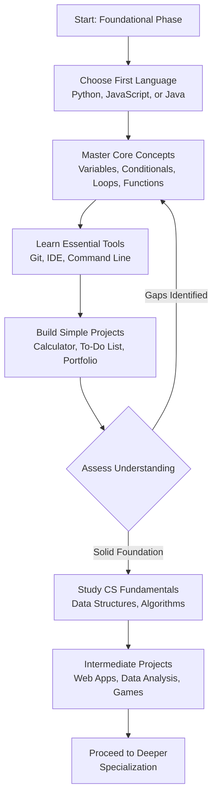

### 3.5 Finding Reliable Learning Resources

The abundance of learning resources available online is both a blessing and a challenge. Self-taught engineers must develop the skill of identifying high-quality, reliable resources that match their learning style and goals.

Official documentation should be a primary resource. While often technical, documentation is authoritative and comprehensive. Learning to read and understand documentation is a skill that becomes increasingly valuable as you progress.

Online platforms like Coursera, edX, and Udemy offer structured courses on a wide range of topics. Free resources like freeCodeCamp, The Odin Project, and Codecademy provide interactive learning experiences. YouTube tutorials can be excellent for visual learners, though quality varies significantly.

Books remain valuable resources for deep learning. Classics like "Clean Code," "The Pragmatic Programmer," and "You Don't Know JS" provide lasting insights that are not dependent on current trends. Many excellent books are available online for free or at low cost.

<br>

## 4.0 ESCAPING TUTORIAL HELL: THE PROJECT-DRIVEN MINDSET

### 4.1 Understanding Tutorial Hell

"Tutorial hell" is a common trap for self-taught learners. It occurs when individuals consume an endless stream of tutorials without applying the knowledge to independent projects. While tutorials are valuable learning tools, they become problematic when they replace active creation.

The challenge of tutorial hell is that it creates an illusion of progress. Watching someone solve a problem or build an application can feel productive, but true learning occurs through the struggle of solving problems independently. The gap between understanding a concept and being able to apply it is significant.

Escaping tutorial hell requires a deliberate shift in learning strategy. The focus must move from passive consumption to active creation. This does not mean abandoning tutorials entirely, but rather using them as references and starting points for independent work.

### 4.2 The Project-Based Learning Approach

Project-based learning is the most effective method for developing practical software engineering skills. Building complete applications integrates multiple concepts, forces problem-solving, and produces tangible evidence of capability.

Starting with small projects is important. A calculator application, a to-do list manager, or a personal portfolio website are excellent first projects. These are achievable within a reasonable timeframe and provide opportunities to practice core concepts.

As skills develop, projects should become more ambitious. Building a full-stack web application, a game, a data analysis tool, or a mobile app pushes learning further. Each project should introduce new challenges and require learning new technologies or concepts.

Documenting and sharing projects is equally important. Writing about the development process, challenges encountered, and solutions discovered reinforces learning and builds a professional portfolio. Hosting code on GitHub and deploying applications to the web demonstrates practical capability.

### 4.3 Developing Problem-Solving Skills

Problem-solving is the core activity of software engineering. Self-taught engineers must consciously develop this skill, as it is not always explicitly taught in tutorials or courses.

Structured problem-solving approaches are valuable. Breaking a large problem into smaller, manageable pieces is a fundamental skill. This process, often called decomposition, makes complex problems approachable and is the foundation of good software design.

Debugging is a critical component of problem-solving. Learning to systematically isolate issues, use debugging tools, and interpret error messages dramatically increases productivity. Each debugging experience builds intuition that prevents future problems.

Research skills are essential for problem-solving. Knowing how to search effectively, evaluate Stack Overflow answers, read documentation, and understand GitHub issues enables engineers to find solutions to almost any problem. Over time, the ability to solve problems without external help increases significantly.

### 4.4 Learning Through Projects

The following table illustrates how different types of projects support learning at various stages:

| Project Type | Skills Developed | Recommended Experience Level |
|--------------|------------------|------------------------------|
| **Calculator App** | Basic syntax, user input, conditionals, functions | Beginner |
| **To-Do List** | Data persistence, CRUD operations, user interface | Beginner |
| **Portfolio Website** | HTML/CSS, JavaScript, deployment, responsive design | Beginner-Intermediate |
| **Weather Application** | API integration, asynchronous programming, data parsing | Intermediate |
| **Blog Platform** | Full-stack development, authentication, databases | Intermediate |
| **E-Commerce Site** | Payment integration, state management, security | Advanced |
| **Data Visualization Dashboard** | Data processing, charting libraries, performance | Advanced |
| **Mobile Application** | Mobile development, device APIs, app store deployment | Advanced |
| **Open Source Contribution** | Collaboration, code review, large codebases | All levels |

<br>

## 5.0 DEEPENING TECHNICAL MASTERY

### 5.1 Advanced Programming Concepts

As foundational skills solidify, attention must turn to more advanced programming concepts. These topics distinguish junior engineers from more experienced practitioners and are essential for building robust, maintainable software.

Design patterns provide proven solutions to common software design problems. Patterns like Singleton, Factory, Observer, and Strategy have been refined over decades of software development. Understanding patterns enables engineers to communicate design decisions clearly and avoid reinventing solutions.

Object-oriented programming principles, including encapsulation, inheritance, polymorphism, and abstraction, are fundamental to many modern languages. Understanding these principles and knowing when to apply them is essential for creating maintainable code.

Functional programming concepts, including pure functions, immutability, and higher-order functions, are increasingly important. Many modern languages incorporate functional features, and understanding these concepts enables more elegant solutions to certain problems.

### 5.2 Software Engineering Best Practices

Professional software engineering involves practices that extend beyond writing code. Understanding and applying these practices distinguishes professional work from hobby projects.

Clean code principles, articulated by Robert C. Martin, emphasize readability, maintainability, and simplicity. Naming conventions, function length, and modular design all contribute to code quality. The investment in writing clean code pays off in reduced debugging time and easier maintenance.

Code reviews are a critical practice in professional environments. Learning to both receive and provide feedback on code improves quality and spreads knowledge within teams. Self-taught engineers can practice code review by participating in open-source projects.

Testing is essential for reliable software. Unit testing, integration testing, and end-to-end testing each serve different purposes. Understanding testing frameworks and writing tests as part of development prevents regressions and documents expected behavior.

### 5.3 The Software Development Life Cycle

Understanding the Software Development Life Cycle (SDLC) is essential for working effectively in professional environments. The SDLC describes the phases of software development from conception to deployment and maintenance.

The phases typically include requirements gathering, design, implementation, testing, deployment, and maintenance. While the specifics vary between methodologies, understanding this lifecycle helps engineers understand their role in the broader development process.

Agile methodologies have become standard in modern software development. Scrum and Kanban are the most widely adopted agile frameworks. Understanding the ceremonies, artifacts, and roles in agile development is essential for working effectively on professional teams.

DevOps practices focus on the integration of development and operations. Continuous Integration and Continuous Deployment (CI/CD) pipelines automate building, testing, and deploying software. Understanding these practices enables engineers to work effectively in modern development environments.

### 5.4 Deepening Technical Skills

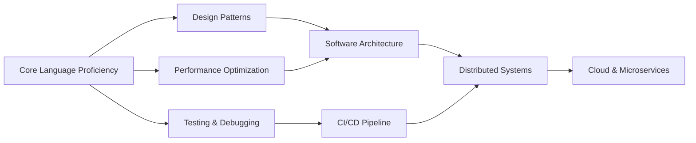

### 5.5 Specializing in Technology Domains

As technical skills mature, many engineers choose to specialize in particular domains. Specialization allows for deeper expertise and can lead to higher compensation and more interesting work.

Front-end development focuses on user interfaces and client-side applications. This domain requires expertise in HTML, CSS, and JavaScript, along with frameworks like React, Vue, or Angular. Front-end engineers must also understand user experience, accessibility, and performance.

Back-end development involves server-side logic, databases, and APIs. This domain requires expertise in languages like Python, Java, Node.js, or C#, along with database technologies and API design. Back-end engineers must understand security, scalability, and system architecture.

Data engineering and data science are growing domains that require expertise in data processing, analysis, and machine learning. These roles typically require understanding of statistics, data pipelines, and specialized tools like Apache Spark, TensorFlow, or PyTorch.

DevOps and cloud engineering focus on infrastructure, automation, and deployment. These roles require expertise in cloud platforms like AWS, Azure, or GCP, along with containerization tools like Docker and orchestration systems like Kubernetes.

<br>

## 6.0 THE PROFESSIONAL ECOSYSTEM: NETWORKING AND COMMUNITY

### 6.1 Building a Professional Network

Networking is essential for career development, particularly for self-taught engineers who may lack the alumni networks of traditional graduates. Building genuine professional relationships provides access to opportunities, mentorship, and support.

Online networking through platforms like LinkedIn is important for maintaining professional connections and discovering opportunities. Engaging with content, sharing insights, and connecting with others in the industry builds visibility and credibility.

Offline networking through local tech meetups, conferences, and hackathons provides opportunities for deeper connections. In-person interactions often lead to more meaningful relationships and can be particularly valuable for finding local opportunities.

Networking should be approached as a long-term practice rather than a transaction. Building genuine relationships based on shared interests and mutual support yields the greatest benefits over time.

### 6.2 Open Source Contribution

Contributing to open-source projects is one of the most effective ways for self-taught engineers to build skills and credibility. Open-source work provides real-world experience, demonstrates capability, and expands professional networks.

Getting started with open source can be intimidating, but many projects welcome newcomers. Starting with documentation improvements, bug fixes, or small feature additions allows contributors to learn the codebase and contribution workflow gradually.

Open-source contributions demonstrate technical ability, collaboration skills, and community engagement. The public record of contributions on GitHub provides concrete evidence of capability to potential employers.

Open-source work also builds a professional reputation and network. Contributions connect engineers with project maintainers and other contributors who often work at companies hiring developers.

### 6.3 Tech Communities and Events

Participating in technology communities provides learning opportunities, support, and professional connections. Many self-taught engineers find community support essential to their development.

Online communities through Discord, Slack, and forums provide spaces for asking questions, sharing knowledge, and connecting with other developers. Communities like freeCodeCamp, Dev.to, and various subreddits offer support and resources.

Local tech meetups and user groups provide opportunities for in-person learning and networking. Many cities have regular meetups focused on specific technologies, offering talks, workshops, and social events.

Conferences, both local and international, are valuable for learning about emerging trends and connecting with the broader community. Many conferences offer scholarships or discounts for unemployed or self-funded attendees.

### 6.4 Building Professional Connections

| Activity | Primary Benefit | Ideal Frequency |
|----------|-----------------|-----------------|
| **LinkedIn Engagement** | Visibility, professional connections | Weekly |
| **Local Meetups** | In-person networking, local opportunities | Monthly |
| **Open Source Contributions** | Skill development, portfolio building | Ongoing |
| **Hackathons** | Team collaboration, project experience | Quarterly |
| **Conferences** | Learning, broader network | Annually |
| **Mentorship Relationships** | Guidance, career development | Ongoing |
| **Community Participation** | Support, learning | Ongoing |

<br>

## 7.0 CRAFTING YOUR CAREER: PORTFOLIO, RESUME, AND INTERVIEWS

### 7.1 Building a Compelling Portfolio

A strong portfolio is perhaps the most important tool for a self-taught engineer seeking employment. While a resume lists skills and experience, a portfolio demonstrates actual capability through tangible projects.

The portfolio should include 3-5 projects that showcase different skills and technologies. Each project should include a clear description, a link to the live application or demo, and the source code. Project write-ups should explain the problem solved, technologies used, challenges overcome, and lessons learned.

Quality matters more than quantity. A few well-documented, polished projects are more impressive than many incomplete or poorly presented ones. Projects should be complete applications that demonstrate the ability to ship software.

The portfolio itself should be presented professionally. A personal website that showcases projects, provides contact information, and links to professional profiles presents a positive impression to potential employers.

### 7.2 Writing Effective Resumes

The resume must present the self-taught journey as a strength rather than a weakness. The narrative should emphasize skills, projects, and achievements rather than educational credentials.

Projects should be listed prominently, with descriptions that highlight technologies used and outcomes achieved. Contributions to open-source projects should be included. Any freelance or contract work should be detailed.

The skills section should be honest and specific. Listing broad categories like "programming languages" and "frameworks" is useful, but adding specific proficiency levels or years of experience provides useful context.

The resume must be tailored to each application. Highlighting skills and experiences most relevant to the specific role increases the chances of being selected for interviews.

### 7.3 Preparing for Technical Interviews

Technical interviews are often the most challenging aspect of the job search for self-taught engineers. Preparation is essential for success.

Data structures and algorithms form the core of most technical interviews. Practicing problems on platforms like LeetCode, HackerRank, or Codewars builds skills and familiarizes candidates with common interview formats.

Communicating problem-solving approach is as important as arriving at the correct solution. Practicing verbal explanations of thought processes, trade-offs, and assumptions prepares candidates for the interactive nature of technical interviews.

Mock interviews with peers or through platforms like Pramp provide realistic practice and feedback. The experience of solving problems under time pressure in a simulated interview environment reduces anxiety in actual interviews.

### 7.4 The Job Application Process

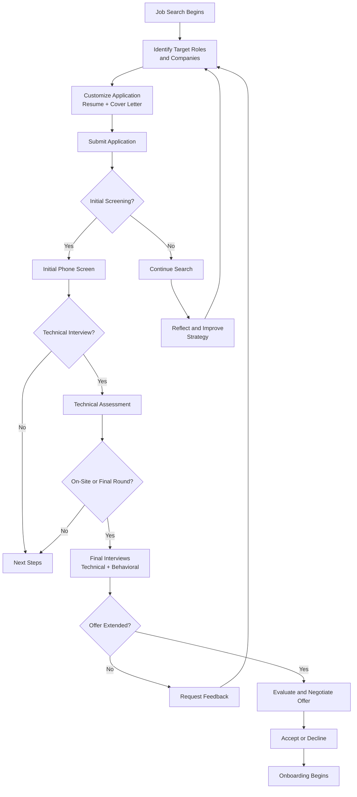

<br>

## 8.0 ESSENTIAL SOFT SKILLS FOR ENGINEERING SUCCESS

### 8.1 Communication in a Technical Environment

Communication skills are essential for software engineers at all levels. The ability to explain technical concepts clearly, write documentation, and collaborate effectively is as important as coding ability.

Verbal communication includes participating in meetings, presenting technical concepts, and explaining design decisions. Engineers must be able to communicate with technical and non-technical audiences, adjusting their language appropriately.

Written communication includes documentation, code comments, emails, and technical specifications. Clear, concise writing reduces misunderstandings and helps teams work efficiently.

Active listening is a critical but often overlooked communication skill. Understanding others' perspectives, asking clarifying questions, and synthesizing information are essential for effective collaboration.

### 8.2 Teamwork and Collaboration

Software development is rarely a solitary activity. Understanding how to work effectively in teams is essential for professional success.

Collaboration involves sharing work, giving and receiving feedback, and contributing to team goals. Engineers must be able to integrate their work with others, resolve conflicts constructively, and support team members.

Agile methodologies emphasize team collaboration. Understanding the roles and responsibilities in agile teams, participating in ceremonies like standups and retrospectives, and contributing to team processes are all important.

Remote collaboration has become increasingly important. Understanding how to use communication tools, collaborate effectively in distributed teams, and maintain visibility in remote environments is now essential.

### 8.3 Conflict Resolution and Negotiation

Conflict is inevitable in professional environments. Developing skills in conflict resolution and negotiation is important for maintaining positive working relationships and advancing career goals.

Constructive conflict resolution involves identifying issues, communicating concerns respectfully, and working toward mutually acceptable solutions. Avoiding conflict often leads to escalation, while resolving it promptly maintains team cohesion.

Negotiation skills are important for salary discussions, project deadlines, and resource allocation. Understanding your value, preparing arguments, and being willing to compromise are key aspects of successful negotiation.

Emotional intelligence, including self-awareness, empathy, and self-regulation, supports effective conflict resolution. Understanding your own emotions and those of others enables more constructive interactions.

### 8.4 Essential Soft Skills

| Skill | Importance | Development Approach |
|-------|------------|----------------------|
| **Communication** | Critical for all roles | Practice explaining concepts, seek feedback |
| **Collaboration** | Team effectiveness | Participate in group projects, open source |
| **Problem Solving** | Core engineering skill | Practice systematic approaches, learn from others |
| **Adaptability** | Responding to change | Embrace new technologies, seek varied experiences |
| **Emotional Intelligence** | Working with others | Reflect on interactions, seek feedback |
| **Time Management** | Productivity | Set priorities, use productivity techniques |
| **Leadership** | Career advancement | Take initiative, mentor others |

<br>

## 9.0 NAVIGATING THE JOB MARKET

### 9.1 Understanding the Current Job Market

The technology job market remains strong, with software engineering positions in high demand across industries. Understanding market conditions, trends, and employer expectations is important for strategic job seeking.

Specialization can provide advantages in the job market. Deep expertise in specific technologies or domains often commands higher compensation and provides more interesting opportunities. However, generalists also find many opportunities, particularly in smaller organizations.

Geographic considerations affect job opportunities and compensation. Major tech hubs offer more positions but higher competition and cost of living. Remote work has expanded opportunities for those in less traditional locations.

Company culture, mission, and work environment are important considerations. A role that aligns with personal values and working style is more likely to lead to satisfaction and longevity.

### 9.2 Job Search Strategies

Effective job search requires a systematic approach. Combining multiple strategies increases the chances of finding suitable opportunities.

Online job boards are a primary resource. Platforms like LinkedIn, Indeed, and specialized tech boards like Stack Overflow Jobs and AngelList offer many positions. Setting up alerts for specific types of roles streamlines the search.

Networking is often the most effective way to find opportunities. Many positions are filled through referrals before they are advertised publicly. Building professional relationships and expressing interest in opportunities can lead to unadvertised openings.

Direct outreach to companies of interest can be effective. Researching organizations, identifying roles that match skills, and submitting applications directly demonstrates initiative.

### 9.3 Understanding Job Offers

Evaluating a job offer requires consideration of multiple factors beyond salary. Understanding the full compensation package and career implications is important.

Base salary is the largest component of compensation for most roles. Understanding market rates for the role, location, and experience level helps in evaluating offers.

Equity compensation, including stock options or restricted stock units, can be significant, particularly at startups and public companies. Understanding vesting schedules, grant values, and potential upside is important.

Benefits including health insurance, retirement plans, paid time off, and professional development support should be evaluated. The total value of benefits can be substantial.

Career development opportunities, including mentorship, training, and advancement paths, should be considered. A role that provides growth opportunities may be worth more than one with higher initial compensation.

### 9.4 Interview Preparation

| Topic | Preparation Method | Key Focus Areas |
|-------|-------------------|-----------------|
| **Technical Skills** | LeetCode, HackerRank | Data structures, algorithms, problem-solving |
| **System Design** | Reading, practice | Scalability, trade-offs, architecture |
| **Behavioral Questions** | STAR method | Teamwork, challenges, achievements |
| **Company Research** | Website, news, reviews | Mission, culture, technology |
| **Questions for Interviewers** | Preparation | Role, team, challenges |

<br>

## 10.0 SUSTAINING A LONG-TERM CAREER

### 10.1 Continuous Professional Development

The technology field evolves rapidly, making continuous learning essential for long-term career success. Engineers who invest in ongoing development remain valuable and find new opportunities.

Dedicated learning time should be built into regular routines. Reading technical books, taking courses, and experimenting with new technologies maintains and expands skills.

Learning should be both broad and deep. Following industry trends, understanding emerging technologies, and maintaining awareness of the broader technology landscape is important. Equally important is deepening expertise in chosen specializations.

Certifications can be valuable for demonstrating expertise, particularly in specialized domains like cloud computing or security. However, practical skills and project experience generally hold more weight with employers.

### 10.2 Work-Life Balance

Sustainable career success requires attention to work-life balance. Burnout is a significant risk in the technology industry, particularly for self-taught engineers who may feel pressure to continuously prove themselves.

Setting clear boundaries between work and personal time is essential. This includes limiting work hours, avoiding work-related communication outside of working hours, and taking regular breaks.

Physical health, including exercise, nutrition, and sleep, is the foundation of sustained productivity. Neglecting physical health often leads to decreased performance and increased stress.

Hobbies and activities outside of technology provide mental refreshment and perspective. Engaging in non-technical interests helps prevent burnout and often contributes to creativity in professional work.

### 10.3 Career Growth and Advancement

Career advancement requires intentional effort beyond day-to-day work. Understanding advancement paths and taking steps to progress is important for long-term satisfaction.

Technical career paths often include progression from junior to senior engineer, staff engineer, and beyond. Each level involves increasing scope, responsibility, and impact on the organization.

Management paths are also available for those interested in leading teams. Transitioning to management requires developing different skills, including delegation, coaching, and strategic planning.

Seeking feedback, identifying growth opportunities, and expressing interest in advancement are important. Many organizations expect employees to take initiative in their career development.

### 10.4 Strategies for Career Sustainability

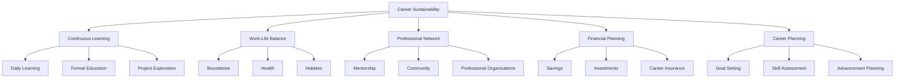

<br>

## 11.0 ETHICS, RESPONSIBILITY, AND PROFESSIONAL STANDARDS

### 11.1 Understanding the Impact of Software

Software has enormous impact on individuals, organizations, and society. Engineers must understand and take responsibility for the consequences of the systems they build.

Privacy and data protection are critical concerns. Engineers must understand how personal data is collected, stored, and used, and ensure that systems respect user privacy and comply with regulations.

Security is an essential responsibility. Vulnerabilities in software can lead to data breaches, financial loss, and harm to users. Understanding security principles and practices is essential for all engineers.

Accessibility ensures that software can be used by people with disabilities. Understanding accessibility guidelines and designing inclusive software is both an ethical responsibility and often a legal requirement.

### 11.2 Ethical Guidelines and Best Practices

Professional ethics in software engineering includes considering the broader implications of technological choices and acting with integrity.

The ACM Code of Ethics provides guidance for computing professionals. Principles include contributing to society, avoiding harm, being honest and trustworthy, and respecting privacy.

Ethical considerations in design include considering how software might be misused, understanding who might be affected by decisions, and advocating for ethical approaches.

Bias in algorithms is a significant concern, particularly in machine learning and AI. Engineers must understand how data and algorithms can perpetuate or amplify bias and take steps to mitigate these effects.

### 11.3 Inclusivity and Accessibility

Creating software that is inclusive and accessible is both an ethical imperative and good business practice. Software that excludes users is incomplete and potentially harmful.

Accessibility guidelines, such as the Web Content Accessibility Guidelines (WCAG), provide standards for making digital content accessible to people with disabilities. Understanding and applying these guidelines is essential.

Inclusive design considers diverse users, including those with different abilities, backgrounds, and contexts. Designing with inclusivity in mind from the start reduces the need for later adaptations.

Diversity in development teams supports more inclusive software. Diverse perspectives help identify potential issues and improve the quality of software for all users.

<br>

## 12.0 FINANCIAL MANAGEMENT FOR SELF-TAUGHT ENGINEERS

### 12.1 Understanding Compensation and Benefits

Software engineering offers competitive compensation, but understanding the components of compensation is important for making informed career decisions.

Base salary is the predictable, recurring income component. Market rates vary by location, experience, specialization, and company type. Researching compensation through sites like Levels.fyi, Glassdoor, and Blind provides benchmarks.

Equity compensation can be significant but is less predictable. Understanding different equity types (stock options, RSUs, grants) and their implications is important. The value of equity depends on the company's performance and liquidity events.

Benefits including health insurance, retirement contributions, and other perks add significant value. Evaluating these components alongside salary provides a complete picture of compensation.

### 12.2 Managing Taxes and Finances

Self-taught engineers, particularly those who work as freelancers or contractors, must manage their own taxes and financial planning. Understanding these obligations is important for financial health.

Tax obligations vary by jurisdiction and employment status. Understanding applicable tax rates, deductions, and filing requirements is essential. Working with a tax professional can help navigate these complexities.

Retirement planning should start early. Taking advantage of employer-sponsored retirement plans, individual retirement accounts, and other savings vehicles builds long-term financial security.

Financial planning includes budgeting, saving, investing, and managing debt. Developing good financial habits early supports long-term financial health and reduces stress.

### 12.3 Freelancing and Contract Work

Freelancing offers flexibility and variety but requires business management skills. Understanding the freelance market and business operations is important for successful freelancing.

Finding freelance clients requires marketing skills. Building a portfolio, networking, using freelance platforms, and maintaining professional reputation all support client acquisition.

Contract negotiation includes scope, timeline, payment terms, and intellectual property. Clear contracts prevent misunderstandings and protect both parties.

Business operations include invoicing, expense tracking, and administrative tasks. Establishing systems for these activities supports smooth operations.

### 12.4 Financial Management Overview

| Financial Area | Key Considerations | Best Practices |
|----------------|-------------------|----------------|
| **Compensation** | Salary, equity, benefits | Research market rates, evaluate total package |
| **Taxes** | Income tax, self-employment tax | Understand obligations, plan for payments |
| **Retirement** | 401(k), IRA, investments | Start early, maximize contributions |
| **Budgeting** | Income, expenses, savings | Track spending, maintain emergency fund |
| **Freelancing** | Rates, contracts, invoicing | Clear agreements, professional systems |
| **Career Investment** | Education, tools, networking | Allocate budget to professional development |

<br>

## 13.0 MENTORSHIP AND COMMUNITY CONTRIBUTION

### 13.1 Finding and Becoming a Mentor

Mentorship is valuable at all career stages. Finding mentors who can provide guidance and becoming a mentor to others supports professional development and community growth.

Finding a mentor involves identifying individuals with relevant experience and establishing a productive relationship. Approaching potential mentors respectfully, being clear about what you seek, and being reliable in the relationship are important.

Different types of mentors serve different needs. Technical mentors provide guidance on specific skills, while career mentors offer broader career development advice. Multiple mentors can address different aspects of professional development.

Being a mentor benefits both the mentor and mentee. Teaching reinforces learning, provides fresh perspectives, and builds leadership skills. Mentorship also contributes to the profession and community.

### 13.2 Volunteering and Community Service

Volunteering in the technology community provides learning opportunities, builds networks, and contributes to the profession.

Teaching and workshops share knowledge with others while reinforcing personal learning. Teaching coding to beginners, leading workshops, or presenting at meetups develops communication and leadership skills.

Non-profit organizations often need technical assistance. Volunteering technical skills for causes that matter contributes to the community while building experience and networks.

Organizing events, contributing to open source, and participating in diversity and inclusion initiatives all contribute to a healthy technology community.

### 13.3 The Impact of Teaching and Sharing

Teaching is one of the most effective ways to deepen understanding. The process of explaining concepts to others clarifies personal understanding and identifies gaps in knowledge.

Sharing knowledge through blogging, speaking, or mentoring builds reputation and professional standing. Visible contributions demonstrate expertise and commitment to the profession.

The technology community thrives on knowledge sharing. Contributions from many individuals, from foundational research to everyday tips, collectively advance the field.

<br>

## 14.0 REMOTE WORK AND GLOBAL OPPORTUNITIES

### 14.1 The Rise of Remote Work

Remote work has become a permanent feature of the software engineering landscape. Understanding remote work dynamics is important for accessing global opportunities.

Remote work offers flexibility and access to positions regardless of location. Engineers can work for companies anywhere in the world, expanding opportunities beyond local markets.

Remote work also presents challenges including isolation, communication, and work-life boundaries. Developing skills for successful remote work is important for both individual and team effectiveness.

Remote work success requires self-discipline, effective communication, and the ability to work independently. Proactive engagement with teammates and maintaining visibility of work are important.

### 14.2 Finding Remote Work Opportunities

Remote opportunities are available through job boards, company career pages, and professional networks. Some companies are fully remote, while others offer hybrid arrangements.

Global companies often have distributed teams. Working with colleagues across time zones requires coordination and flexibility. Understanding time zone differences and scheduling accordingly is important.

International opportunities may involve different compensation structures and tax implications. Understanding these factors is important when considering roles in other countries.

### 14.3 Balancing Different Time Zones and Cultures

Working in global teams requires sensitivity to cultural differences and practical coordination across time zones.

Time zone differences require thoughtful scheduling of meetings and collaboration. Recording meetings, using asynchronous communication, and maintaining clear documentation support distributed collaboration.

Cultural differences in communication styles, working norms, and holidays should be understood and respected. Building cross-cultural awareness supports effective global collaboration.

### 14.4 Remote Work Competencies

| Competency | Importance | Development Approach |
|------------|------------|---------------------|
| **Self-Discipline** | Productivity without supervision | Set routines, minimize distractions |
| **Communication** | Visibility and collaboration | Regular updates, clear documentation |
| **Time Management** | Deliverables and deadlines | Planning, prioritization |
| **Technical Skills** | Independent problem-solving | Continuous learning |
| **Cultural Awareness** | Global collaboration | Research, open-mindedness |
| **Work-Life Balance** | Sustainability | Boundaries, routines |

<br>

## 15.0 PERSONAL DEVELOPMENT AND WELL-BEING

### 15.1 The Importance of Non-Tech Hobbies

Hobbies and interests outside of technology are essential for cognitive balance, creativity, and well-being. Engaging in diverse activities supports professional performance and prevents burnout.

Non-technical hobbies provide mental refreshment. Activities like sports, music, art, reading, or outdoor activities offer breaks that allow the mind to rest and recover.

Cross-disciplinary learning enhances creativity. Exposure to different fields of knowledge can inspire new approaches to technical problems and expand thinking beyond conventional solutions.

Social connections outside of work support well-being. Maintaining relationships beyond professional contexts provides support and perspective.

### 15.2 Enhancing Creativity Through Diversity

Diverse experiences and perspectives enhance creativity and problem-solving. Actively seeking exposure to different disciplines, cultures, and viewpoints supports professional growth.

Learning about other fields can spark innovation in software engineering. Concepts from architecture, biology, psychology, and other disciplines can inspire new approaches to software design.

Travel, reading widely, and engaging with diverse communities expand perspectives. These experiences develop empathy and understanding that are valuable in professional contexts.

### 15.3 Physical and Mental Health

Physical health is the foundation of sustained professional performance. Regular exercise, adequate sleep, and proper nutrition support cognitive function and energy levels.

Mental health deserves attention equal to physical health. Managing stress, seeking support when needed, and maintaining perspective support long-term well-being.

Professional therapy or counseling can be valuable for managing stress, anxiety, or depression. Seeking professional help is a sign of strength, not weakness.

### 15.4 Work-Life Integration

| Area | Recommendations | Benefits |
|------|-----------------|----------|
| **Physical Health** | Regular exercise, adequate sleep, good nutrition | Energy, focus, longevity |
| **Mental Health** | Stress management, mindfulness, professional support | Resilience, clarity |
| **Social Connections** | Friends, family, community | Support, perspective |
| **Hobbies** | Diverse interests, regular engagement | Creativity, refreshment |
| **Professional Boundaries** | Set limits, separate work and personal time | Balance, sustainability |

<br>

## 16.0 CONCLUSION: THE CONTINUOUS JOURNEY

### 16.1 Embracing the Journey

The path of the self-taught software engineer is a continuous journey of learning, building, and growing. This path offers unique opportunities for independence, creativity, and impact.

The challenges of self-directed learning build resilience and resourcefulness. Each obstacle overcome is a step toward greater capability and confidence. The skills developed through independent learning are valuable throughout a career.

The software engineering field offers remarkable opportunities for those willing to invest in themselves. Self-taught engineers have the freedom to shape their own careers, exploring the technologies and domains that interest them most.

### 16.2 Key Principles for Success

Success as a self-taught software engineer requires dedication to several key principles:

**Continuous learning** is essential in a field that evolves constantly. Investing in learning new skills, tools, and paradigms keeps capabilities current and relevant.

**Project-based development** builds practical skills and demonstrates capability. Building real applications, not just following tutorials, develops the ability to create working software.

**Community engagement** provides support, opportunities, and perspective. Contributing to the community through open source, mentoring, and knowledge sharing benefits both the individual and the profession.

**Professional development** beyond coding skills is essential. Communication, teamwork, and business acumen support career advancement and effectiveness.

**Well-being and balance** enable sustainable careers. Attending to physical and mental health, maintaining work-life boundaries, and engaging in diverse interests supports long-term success.

### 16.3 A Final Encouragement

The self-taught journey is challenging but deeply rewarding. Every person who has successfully navigated this path began with the same uncertainty, curiosity, and determination that you bring today.

Trust in your ability to learn and grow. The skills you develop through this journey will serve you not only in the next job but throughout your career. The independence you cultivate is your greatest professional advantage.

Continue to build, share, and connect. Each project you complete, each person you help, and each skill you develop is a step toward your goals.

The technology field needs diverse perspectives, creative problem-solvers, and individuals who are willing to challenge conventional paths. Your unique journey is a contribution to the richness and innovation of the profession.

<br>

## 17.0 RESOURCES AND FURTHER LEARNING

### 17.1 Online Learning Platforms

| Platform | Focus | Cost |
|----------|-------|------|
| **Coursera** | University courses, specializations | Free and paid |
| **edX** | University courses, professional certificates | Free and paid |
| **Udemy** | Wide variety of courses | Paid |
| **freeCodeCamp** | Web development, certifications | Free |
| **Codecademy** | Interactive coding lessons | Free and paid |
| **The Odin Project** | Full-stack curriculum | Free |
| **Pluralsight** | Technology courses | Paid |
| **YouTube** | Tutorials, explanations | Free |

### 17.2 Books for Technical Development

| Book | Author | Focus |
|------|--------|-------|
| **Clean Code** | Robert C. Martin | Code quality, professionalism |
| **The Pragmatic Programmer** | Andrew Hunt, David Thomas | Software craftsmanship |
| **You Don't Know JS** | Kyle Simpson | JavaScript depth |
| **Introduction to Algorithms** | Cormen, Leiserson, Rivest, Stein | Algorithm fundamentals |
| **Design Patterns** | Gamma, Helm, Johnson, Vlissides | Software design patterns |
| **The Mythical Man-Month** | Frederick Brooks | Software project management |
| **Code Complete** | Steve McConnell | Software construction |

### 17.3 Practice Platforms

| Platform | Focus | Notes |
|----------|-------|-------|
| **LeetCode** | Technical interview practice | Data structures, algorithms |
| **HackerRank** | Coding challenges | Multiple domains |
| **Codewars** | Programming problems | Gamified learning |
| **Exercism** | Language proficiency | Mentor feedback |
| **Project Euler** | Mathematical problems | Computational thinking |

### 17.4 Professional Networking

| Platform | Purpose | Notes |
|----------|---------|-------|
| **LinkedIn** | Professional networking | Essential for all professionals |
| **GitHub** | Code hosting, contributions | Portfolio, community |
| **Dev.to** | Developer community | Articles, discussion |
| **Stack Overflow** | Q&A, problem solving | Technical community |
| **Reddit (r/learnprogramming)** | Beginner support | Questions, resources |

### 17.5 Development Tools

| Tool | Purpose | Notes |
|------|---------|-------|
| **VS Code** | Code editor | Free, extensible |
| **Git** | Version control | Essential |
| **Docker** | Containerization | Deployment |
| **Postman** | API testing | Development, testing |
| **Jupyter** | Data exploration | Data science, Python |

### 17.6 Community Organizations

| Organization | Focus | Notes |
|--------------|-------|-------|
| **ACM** | Computing professionals | Ethics, resources |
| **IEEE Computer Society** | Professional development | Standards, publications |
| **Girl Develop It** | Women in tech | Workshops, community |
| **Black Girls Code** | Diversity in tech | Education, mentorship |
| **Code.org** | Computer science education | Advocacy, resources |

<br>

## ACKNOWLEDGMENTS

This documentation was developed based on extensive research into software engineering education, professional development practices, and the experiences of self-taught practitioners. The content reflects current industry best practices and the collective wisdom of the technology community.

<br>
 
> This documentation is provided for informational purposes. Specific practices should be adapted to individual circumstances and organizational requirements.


<br><br><br><br>

<h1 align="center">Architectural Polyglot: Why Modern Software Projects Embrace Multiple Programming Languages.</h1>

<br><br>

## Executive Summary

A common question from new developers and even some experienced engineers is: why do so many large software projects use more than one programming language? At first glance, it might seem chaotic or inefficient. Why not pick a single language and use it for everything?

The answer lies in a fundamental truth of software engineering: no single programming language is best at every task. Real-world systems face a variety of problems—user interfaces, high-performance calculations, data analysis, network communication, and more—each with its own set of constraints. Using multiple languages is not a sign of poor planning; it is a deliberate architectural strategy known as polyglot programming.

This document explains the reasons behind this approach, how different languages work together inside a single project, the technical foundations that enable multi-language systems, and the trade-offs that teams must consider. It serves as a definitive reference for architects, engineers, and technical leaders seeking to understand and implement polyglot architectures.

<br>

## Table of Contents

1. [Introduction: The Reality of Modern Software Development](#1-introduction-the-reality-of-modern-software-development)
2. [The Case for Polyglot Architecture](#2-the-case-for-polyglot-architecture)
3. [Problem Domains and Language Selection](#3-problem-domains-and-language-selection)
4. [How Different Languages Coexist: Two Primary Models](#4-how-different-languages-coexist-two-primary-models)
5. [The Technical Foundation: Compilation and Linking](#5-the-technical-foundation-compilation-and-linking)
6. [The Critical Role of the Application Binary Interface](#6-the-critical-role-of-the-application-binary-interface)
7. [Embedding Interpreters and Foreign Function Interfaces](#7-embedding-interpreters-and-foreign-function-interfaces)
8. [Real-World Examples of Multi-Language Projects](#8-real-world-examples-of-multi-language-projects)
9. [Strategic Reasons for Multiple Languages](#9-strategic-reasons-for-multiple-languages)
10. [Trade-offs and Challenges of Multi-Language Projects](#10-trade-offs-and-challenges-of-multi-language-projects)
11. [Build Systems and Dependency Management](#11-build-systems-and-dependency-management)
12. [Testing Strategies for Multi-Language Systems](#12-testing-strategies-for-multi-language-systems)
13. [Security Considerations in Polyglot Architectures](#13-security-considerations-in-polyglot-architectures)
14. [Debugging and Observability Across Language Stacks](#14-debugging-and-observability-across-language-stacks)
15. [When NOT to Use Multiple Languages](#15-when-not-to-use-multiple-languages)
16. [Migration Patterns: Introducing a Second Language Safely](#16-migration-patterns-introducing-a-second-language-safely)
17. [Conclusion: The Path Forward](#17-conclusion-the-path-forward)

<br>

## 1. Introduction: The Reality of Modern Software Development

The landscape of contemporary software engineering is shifting beneath our feet. Walking through any significant codebase today reveals something that still surprises newcomers: modern applications are not monolithic creations in a single language. They are living systems, breathing through the integration of multiple programming languages, each serving a specific purpose with surgical precision.

This is not chaos manifesting as poor planning. This is deliberate architectural specialization operating at scale.

### 1.1 The Death of the "One True Language"

For decades, the software industry was often caught in "religious wars" over which programming language was superior. This question is now obsolete. The modern, pertinent question is: "What combination of languages will allow us to solve our unique set of problems most effectively?"

A single language, no matter how versatile, represents a compromise. It may be good for many things but rarely the best for everything. The industry is moving past the religious wars over which programming language reigns supreme. The question is no longer "what language should we use?" but rather "what languages should we use, and how do we make them work together?"

### 1.2 The Kitchen Analogy

Think of a software project as a professional kitchen. A chef does not use a single knife to chop onions, blend soup, and whisk eggs. Each task requires a specialized tool.

- An immersion blender is the optimal tool for pureeing soup
- A sharp chef's knife is essential for precisely chopping vegetables
- A whisk is perfectly designed for aerating eggs

Similarly, software problems demand specific language features. A language that excels at manipulating a web browser's user interface may be terrible at performing millions of mathematical calculations per second. Another language that shines in data science may lack the concurrency primitives needed for a high-traffic web server.

The browser runs JavaScript and TypeScript natively, making them the obvious choice for UI interactivity, DOM manipulation, and client-side logic. Backend services face completely different constraints: CPU-bound tasks, heavy I/O operations, strict latency requirements, and transactional integrity.

Node.js thrives at event-driven I/O. Go delivers exceptional performance for low-latency network services. Java provides mature enterprise ecosystems with decades of battle-testing. Python dominates data science and machine learning workflows. C++ and Rust excel at performance-critical systems programming.

Each language occupies its optimal position in the stack.

<br>

## 2. The Case for Polyglot Architecture

### 2.1 Why Single-Language Dogmas Are Failing

Consider the modern application stack through the lens of real-world constraints. A language that makes a developer highly productive for building user interfaces may not provide the performance needed for real-time data processing. A language that excels at mathematical computations may lack the ecosystem for web development.

When teams insist on using a single language for everything, they inevitably make compromises that lead to suboptimal outcomes:
- Performance bottlenecks in components that need speed
- Reduced developer productivity in areas where the language doesn't shine
- Difficulty integrating with existing systems or specialized libraries
- Higher maintenance costs due to awkward workarounds

### 2.2 The Strategic Value of Diversity

Polyglot programming is not about using many languages for the sake of novelty. It is about:
- **Optimizing each component**: Using the language that best fits each component's requirements
- **Leveraging existing expertise**: Allowing team members to work in languages they know well
- **Accessing the best libraries**: Using libraries and frameworks regardless of their language
- **Managing risk**: Incrementally modernizing legacy systems without complete rewrites
- **Future-proofing**: Being able to adopt new technologies as they emerge

<br>

## 3. Problem Domains and Language Selection

### 3.1 Domain-Specific Language Strengths

Different programming languages are optimized for different problem domains. Understanding these strengths is essential for making informed architectural decisions.

| Problem Domain | Commonly Used Languages | Key Strengths |
|----------------|------------------------|----------------|
| Web front-end (browser) | JavaScript, TypeScript, WebAssembly (Rust/C++) | Runs natively in browsers; event-driven UI; rich ecosystem |
| Web back-end services | Go, Java, Python, Node.js, C# | Scalable concurrency; mature frameworks; high throughput |
| Systems programming (OS, kernels, embedded) | C, C++, Rust | Low-level memory control; no runtime overhead; hardware access |
| Game engines and real-time graphics | C++, C# (Unity) | Maximum performance; deterministic frame rates; object-oriented design |
| Data science and machine learning | Python, R, Julia | Extensive libraries (NumPy, Pandas, TensorFlow); rapid prototyping |
| Mobile applications (iOS) | Swift, Objective-C | Native platform integration; performance; safety features |
| Mobile applications (Android) | Kotlin, Java, C++ (via JNI) | Official platform support; UI tooling; performance-critical native code |
| Enterprise backend (legacy) | Java, COBOL, C# | Stability; decades of proven code; large ecosystem |

### 3.2 Language Categories by Domain

**Systems and Low-Level Programming:**
- C: Operating systems, embedded systems, system drivers. Provides precise control over memory and hardware resources.
- C++: Systems software, game engines, real-time applications. Combines performance with object-oriented design.
- Rust: Safe systems programming, memory safety, concurrency. Guarantees memory safety without garbage collection.
- Ada: Safety-critical, real-time embedded systems. Enforces strong typing and extensive runtime checking.
- Zig: Robust optimal-performance systems language. Offers explicit control with modern safety features.

**Web and Backend Development:**
- JavaScript: Frontend interactivity, full-stack with Node.js. Runs natively in all browsers.
- TypeScript: Large-scale JavaScript development with static typing. Catches errors before runtime.
- Python: Web backends (Django, Flask), scripting, APIs. Maximizes developer productivity.
- Go: Microservices, server backends, cloud infrastructure. Provides simple concurrency and fast execution.
- Java: Enterprise backends, web servers, cross-platform services. Offers mature ecosystems and tooling.
- Ruby: Web frameworks (Ruby on Rails), web services. Emphasizes developer happiness and convention over configuration.
- PHP: Server-side web scripting, CMS, web backends. Powers a large portion of the web.

**Data Science and Scientific Computing:**
- Python: Data science, machine learning, scientific computing. Has the richest ecosystem of data libraries.
- R: Statistics, data analysis, visualization, research. Specialized for statistical computing.
- Julia: High-performance computing, technical computing. Combines ease of use with near-C performance.
- Fortran: High-performance scientific computing, simulations. Optimized for numerical computation.

**Mobile and Desktop Development:**
- Swift: iOS/macOS application development. Modern, safe, and performant for Apple platforms.
- Kotlin: Android apps, JVM/Android development. Modern alternative to Java with null safety.
- Dart: Cross-platform mobile and desktop (Flutter). Optimized for UI development.
- C#: Windows applications, game development (Unity). Mature ecosystem for Microsoft platforms.

<br>

## 4. How Different Languages Coexist: Two Primary Models

When a project uses multiple programming languages, those languages interact with each other in one of two fundamental ways. Understanding these models is essential to appreciating the architecture.

### 4.1 Model 1: Separate Processes – Communication Over a Network or IPC

In this model, each language component runs as an independent process. These processes communicate through well-defined contracts such as HTTP APIs, gRPC, message queues (like Kafka), or inter-process communication (IPC).

**Common Architecture:** This approach is common in microservices architectures. A team might write an authentication service in Node.js, a recommendation engine in Python, and a payment processor in Go. These services talk to each other over the network.

**Advantages:**
- Each team chooses the best language for its domain
- Services can be deployed, scaled, and updated independently
- Clear boundaries between components
- Teams can work autonomously
- Language choices are completely decoupled

**Challenges:**
- Managing distributed system complexity
- Network latency and partial failures
- Need for robust observability and monitoring
- Data consistency across service boundaries
- Serialization and deserialization overhead

**Visualizing the Microservices Model:**

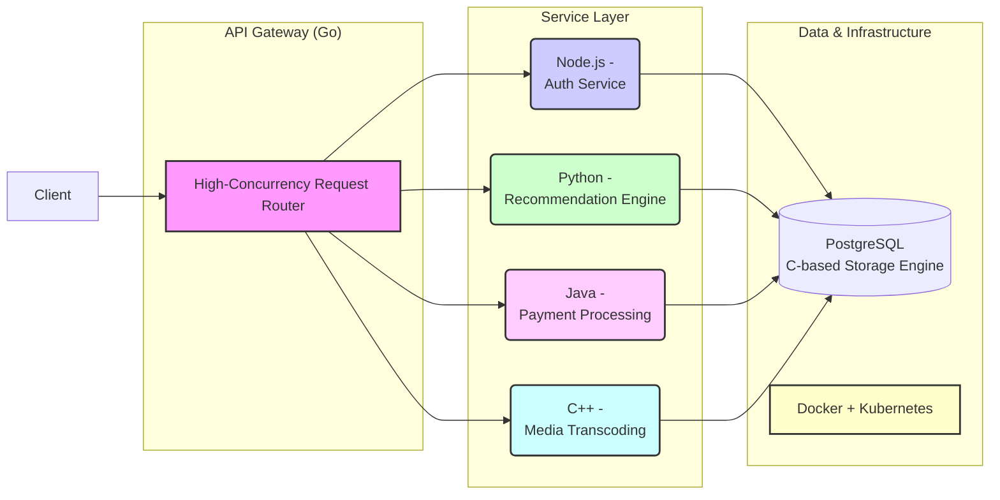

### 4.2 Model 2: Same Process – Multiple Languages Inside a Single Executable

More surprising to many developers is the fact that multiple languages can be compiled into the same binary and run within a single operating system process. This happens when a high-level language (like Python or Java) calls into a low-level language (like C, C++, or Rust) for performance-critical operations.

**Mechanism:** The mechanism relies on the compiler toolchain and the linker, which combine object files from different languages into one executable.

**Examples:**
- Machine learning libraries (Python APIs calling C++/CUDA kernels)
- Android apps (Kotlin UI calling C++ audio engines via JNI)
- Game engines (C++ core with Lua scripting)

**Advantages:**
- Maximum performance with minimal overhead
- Direct access to data structures without serialization
- Fine-grained control over system resources
- Eliminates network-related latency and failures
- Tight integration between components

**Challenges:**
- Requires careful attention to memory management
- Need to understand calling conventions and ABIs
- Potential for memory safety issues
- More complex build and linking processes
- Debugging across language boundaries is harder

### 4.3 Model Comparison Diagram

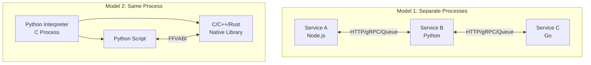

<br>

## 5. The Technical Foundation: Compilation and Linking

Understanding how multiple compiled languages live inside the same executable requires examining what actually happens during compilation. The common mental model—that compilers simply transform source code into executables—is dangerously oversimplified.

### 5.1 The Compilation Pipeline

The compiler processes source code through four distinct phases:

**Stage 1: Preprocessing**
The preprocessor handles directives such as `#include` in C/C++. It expands macros, removes comments, and recursively inserts the content of header files. The output is still source code but with all textual substitutions applied.

**Stage 2: Compilation to Assembly**
The compiler translates the preprocessed source code into human-readable assembly language. This assembly is specific to the target CPU architecture (e.g., x86-64 or ARM). Notably, many compilers can stop after this stage, allowing developers to inspect the generated assembly for performance tuning.

**Stage 3: Assembly to Object Code**
An assembler converts the assembly mnemonics into actual machine code bytes. The result is an object file (typically `.o` or `.obj`). This file contains machine instructions but with unresolved symbols—for example, a call to a `printf` function that lives in a separate library.

**Stage 4: Linking**
The linker is the critical piece that enables multi-language binaries. It takes one or more object files (produced from different languages) and resolves all symbol references. The linker combines code sections, adjusts memory addresses, and produces a final executable or shared library.

**Key Insight:** The linker does not care which language originally produced the object code—it only sees machine code and symbols. This modular pipeline explains everything. We can stop the process at any stage. We can feed in our own files at multiple points. We can write performance-critical sections directly in assembly and pass those files to the assembler stage. We can compile Rust code into static libraries and feed those object files to the C linker.

### 5.2 Visualizing the Compilation Pipeline

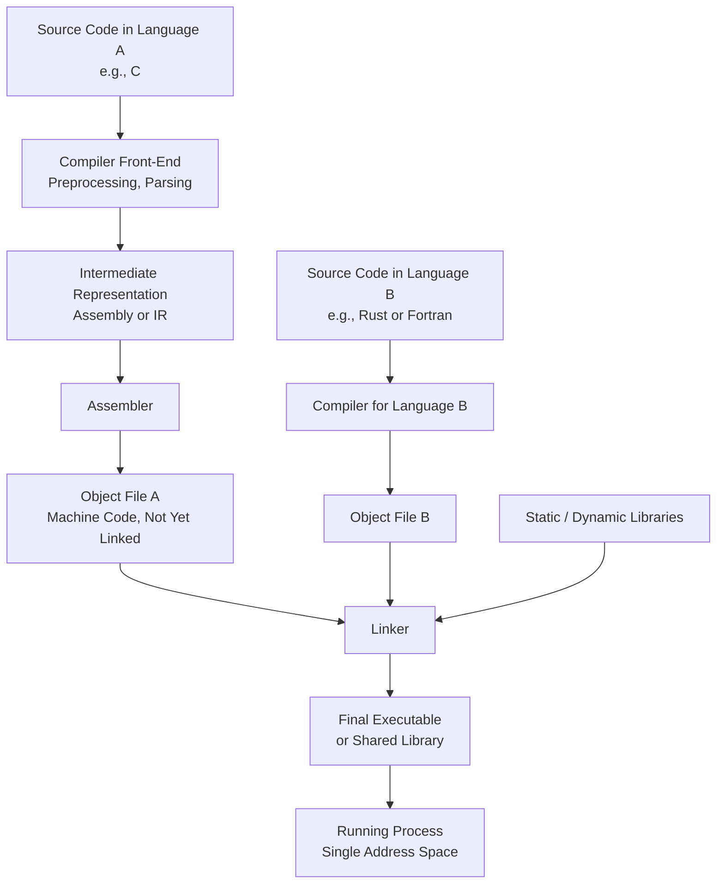

### 5.3 Static Linking vs. Dynamic Linking

| Feature | Static Linking | Dynamic Linking |
|---------|---------------|-----------------|
| How it works | Library code is copied directly into the executable at link time | The executable contains references to shared libraries (`.so` on Linux, `.dll` on Windows). The OS loads the library at runtime |
| Disk and memory usage | Higher – each executable has its own copy of library code | Lower – one copy of the library is shared among many processes |
| Updates | To update a library, you must relink and redeploy the entire executable | You can replace the shared library without recompiling the executable (as long as the ABI remains compatible) |
| Startup time | Faster – no runtime resolution of symbols | Slightly slower due to dynamic symbol resolution |
| Multi-language use | Easier – all code is combined into one file before deployment | Also works – shared libraries written in one language can be called from another, provided they expose a compatible ABI |

### 5.4 The Linker as the Great Unifier

The linker emerges as the great unifier. Different languages, different compilers, different toolchains—they all ultimately produce object files that the linker consumes. When Rust code calls C functions or C code invokes Rust routines, they are not communicating directly. They are both generating object files that the linker combines into a coherent whole.

<br>

## 6. The Critical Role of the Application Binary Interface

Linking object files from different languages is only possible if those languages agree on low-level conventions. These conventions are collectively known as the Application Binary Interface (ABI). While an API defines how functions are called at the source code level, the ABI defines how they are called at the machine code level.

### 6.1 Key Aspects of an ABI

- **Calling conventions**: Which CPU registers are used to pass function arguments? In what order? Where are return values placed? How are large structures passed (by reference or by value)?
- **Name mangling**: How are function names encoded in the object file? C++ mangles names to encode overload information, while C typically does not.
- **Memory layout**: How are structs/classes aligned in memory? What is the size of primitive types?
- **Exception handling**: How are exceptions propagated across function boundaries?

### 6.2 The Danger of ABI Mismatch

Here lies the hidden complexity that separates working code from crashing disasters. Two languages producing object files for the same architecture does not guarantee they can link successfully. The Application Binary Interface defines the low-level rules that must be consistent.

Consider language A passing two parameters in registers R0 and R1 while language B expects them in R1 and R2. Both produce valid machine code. Both assemble correctly. But when linked together, function calls place arguments in wrong locations, and the receiving function operates on garbage data.

### 6.3 Enforcing ABI Compatibility

Modern languages address this through explicit foreign function interfaces. C uses extern declarations. Rust employs the extern keyword with specific ABIs. Python provides the ctypes module and C extension APIs. Go enables C interactions through special import blocks. Each mechanism tells the compiler: "This function follows another language's calling conventions—generate code accordingly."

**General Rule:** When mixing languages, define a clear boundary, use a well-defined foreign function interface (FFI), and ensure both sides adhere to a common ABI—usually the C ABI, which is widely supported.

**Examples:**
- In C, the `extern "C"` directive tells the compiler to use the C calling convention (no name mangling)
- In Rust, `extern "C"` serves a similar purpose
- Many languages also allow you to specify that a function should follow the ABI of another language

### 6.4 Interoperability Mechanisms Beyond the C ABI

| Mechanism | Languages Supported | Description |
|-----------|---------------------|-------------|
| JNI (Java Native Interface) | Java/Kotlin ↔ C/C++ | Allows Java code to call native C/C++ functions |
| COM / WinRT | C++, C#, Visual Basic | Microsoft's component object model for cross-language components |
| WebAssembly (WASM) | Many languages | Portable compilation target that can be called from many languages |
| FFI Libraries (ctypes, cffi) | Python, Ruby, etc. | High-level language libraries for calling C functions |

<br>

## 7. Embedding Interpreters and Foreign Function Interfaces

### 7.1 The "Hidden" Polyglot Nature of Interpreted Languages

The mental model shifts dramatically when examining interpreted languages. Running a Python script does not create a Python process. It creates a C process running the Python interpreter, which reads your script as data.

The Python executable on your disk is a compiled C program. The Node.js runtime is C++ code compiled for your architecture. When you run `main.py`, you are launching a compiled program that opens your file, reads its contents into memory, parses the text into internal data structures, and recursively evaluates those structures using machine instructions compiled from C.

**Key Insight:** Every interpreted language project is already a multi-language project. We simply don't notice the compiled foundation because it ships as a pre-built executable.

### 7.2 Embedding Interpreters: The Game Engine Pattern

Game engines demonstrate this pattern brilliantly. The Godot engine writes performance-critical systems—rendering, physics, audio—in compiled C++. But embedded within the engine lives an interpreter for GDScript. Game developers write gameplay logic in this interpreted language, controlling player positions, gravity strength, enemy behavior, and interaction rules—all without recompiling the engine.

**Key Benefits:**
- The compiled code handles heavy lifting (rendering, physics, I/O)
- The interpreted code enables rapid iteration (change a variable, restart, see results)
- No recompilation for gameplay logic changes
- Clean separation between performance-critical core and flexible application logic

**Other Examples:**
- Neovim: Core editor is compiled C code, embedding a Lua interpreter for configuration
- Redis: Lua scripting for atomic operations
- Web browsers: JavaScript engine embedded in C++ code

### 7.3 How Embedding Works

The interpreter stores everything in data structures accessible to compiled code:
- Variables live in hash maps using names as keys
- Functions exist as structures containing callable fields
- When the interpreter parses your script, it populates these structures

Compiled code can access these same structures directly:
- Reading a variable means looking up its key in the interpreter's hash map
- Writing a variable means inserting or updating an entry
- Registering a new function means creating a function structure and inserting it into the interpreter's function table with your compiled code as the callable target

The interpreted script never knows the difference. It calls functions that execute compiled machine code. It reads variables that compiled code updates. Both worlds operate on identical data structures because the compiled code manipulates the interpreter's internal representation directly.

### 7.4 Foreign Function Interfaces: The Reverse Direction

Calling compiled code from interpreted languages happens through foreign function interfaces. Python's ctypes module loads dynamic libraries and calls functions within them. The C function receives Python value structures and returns Python value structures. The interpreter translates Python objects to C-compatible representations and back.

Data science and machine learning ecosystems depend on this mechanism. Python provides the developer experience—rapid prototyping, interactive exploration, rich visualization. But underneath, NumPy, pandas, and PyTorch call heavily optimized C++ and CUDA code. Python orchestrates; compiled code computes.

```python
# Python Code (High-level, readable)
import numpy as np

# Create two large arrays
a = np.array([1.0, 2.0, 3.0, 4.0])
b = np.array([5.0, 6.0, 7.0, 8.0])

# This simple line executes highly optimized, compiled C/Fortran code
c = a * b
print(c)
```

The `*` operation here is not a simple Python loop. It is a call through NumPy's C-based FFI into a tightly optimized, vectorized routine that performs the multiplication on entire arrays at near-C speed. Python orchestrates; compiled code computes.

<br>

## 8. Real-World Examples of Multi-Language Projects

Large-scale systems rarely rely on a single language. The table below shows how prominent companies combine languages to leverage the strengths of each.

| Project / Company | Languages Used | Why Multiple Languages? |
|------------------|----------------|--------------------------|
| YouTube | JavaScript (front-end UI), C++ (media playback and encoding), Python and Go (back-end services) | JavaScript for browser interactivity; C++ for raw performance in video processing; Python and Go for scalable backend logic |
| Netflix | Java (server-side streaming), Python (data analytics, machine learning) | Java provides high throughput and reliability for millions of concurrent streams; Python accelerates data science and recommendation algorithms |
| Instagram | Python (back-end logic), React (web front-end), Swift and Kotlin (mobile apps) | Python enables rapid development of business logic; React for web; native mobile languages for platform-specific UI and performance |
| TensorFlow / PyTorch | Python (user-facing API), C++ and CUDA (performance kernels) | Python offers ease of use for researchers; C++ and CUDA deliver the necessary speed for training large neural networks on GPUs |
| Android OS | Java/Kotlin (framework and apps), C/C++ (libraries, HAL, performance-critical components) | High-level languages for application development and safety; C++ for low-level hardware abstraction and performance |
| Web Browsers (Chrome, Firefox) | C++ (core rendering engine), JavaScript/TypeScript (developer tools and extensions), Rust (newer components for memory safety) | C++ provides maximum performance; JavaScript for extension ecosystem; Rust for rewriting security-sensitive components |

### 8.1 Lessons from Real-World Polyglot Systems

These examples reveal several patterns:
- **Performance-critical components** are written in C++ or Rust
- **User-facing interfaces** use languages native to their platform (JavaScript for web, Swift/Kotlin for mobile)
- **Backend services** choose languages based on their strengths (Java for robustness, Go for concurrency, Python for data processing)
- **Gradual adoption** of new languages happens where they provide clear benefits (Rust for security, Kotlin for productivity)

<br>

## 9. Strategic Reasons for Multiple Languages

While performance is a common driver, teams adopt polyglot architectures for several other strategic reasons.

### 9.1 Hiring and Team Specialization

Different developers have different skill sets and preferences. A data scientist is highly productive in Python with its NumPy and pandas libraries. A back-end engineer might prefer Go for its simplicity and built-in concurrency. A front-end developer loves TypeScript for its type safety and rich tooling.

Allowing each team to work in its preferred language increases job satisfaction, productivity, and code quality. Rather than forcing every developer to become an expert in a single language, a polyglot organization leverages existing expertise.

**Benefits:**
- Faster onboarding for developers with existing language expertise
- Higher job satisfaction and retention
- Better code quality from developers working in their preferred language
- Access to a wider talent pool

### 9.2 Incremental Adoption and Legacy Modernization

Large enterprises often have millions of lines of legacy code written in older languages like COBOL, Java, or C++. Rewriting everything from scratch in a modern language is prohibitively expensive and risky. Instead, teams introduce new languages incrementally.

**Examples:**
- Kotlin runs on the Java Virtual Machine (JVM) and is fully interoperable with Java. A company can convert one file at a time from Java to Kotlin, gaining null safety and concise syntax without a big-bang rewrite.
- Rust can be called from C/C++ projects via a stable ABI, allowing teams to gradually replace unsafe components with memory-safe Rust code.
- TypeScript can be incrementally adopted in a JavaScript project, file by file, adding type safety without disrupting existing functionality.

### 9.3 Microservices and Team Autonomy

In a microservices architecture, each service is a small, independent team. That team has the freedom to choose the best language for their specific domain, as long as they communicate over standard protocols like HTTP, gRPC, or message queues.

**Example Architecture:**
- Authentication service → Node.js (event-driven I/O)
- Analytics service → Python (data libraries)
- Payment service → Go (concurrency model)

The boundaries are network calls, not language barriers. Container orchestration tools like Docker and Kubernetes have made this even easier by packaging each service with its exact runtime and dependencies.

### 9.4 Ecosystem and Library Availability

Sometimes the best library for a given task exists only in a certain language. For example:
- The fastest linear algebra libraries are written in Fortran or C
- The most advanced machine learning frameworks have Python bindings
- The best web frameworks might be in Ruby or JavaScript

Rather than re-implementing a complex library in another language, it is more efficient to write a small wrapper and call the existing library. This approach respects the principle of code reuse and allows projects to stand on the shoulders of giants.

<br>

## 10. Trade-offs and Challenges of Multi-Language Projects

Polyglot programming is not without costs. Engineering leaders must weigh the benefits against the following challenges.

### 10.1 Operational Complexity

Operations teams must support multiple runtimes, package managers, and monitoring tools. A project using Python, Node.js, and Go requires maintaining three distinct ecosystems—each with its own dependency management, logging frameworks, and performance tuning parameters. This complexity can increase the mean time to resolve production incidents and require broader expertise on call.

**Specific Challenges:**
- Different logging formats require centralized aggregation
- Each runtime has its own performance tuning parameters
- Monitoring dashboards must aggregate metrics from multiple sources
- Deployment pipelines must handle different build processes

### 10.2 Heavier Development Environments

Developers need to install and configure toolchains for every language used in the project. Local builds may take longer because compilers, interpreters, and linkers for multiple languages must run. Continuous integration pipelines become more complex, often requiring separate stages for each language or using multi-stage Docker builds.

**Specific Challenges:**
- Larger Docker images containing multiple runtimes
- Longer build times due to multiple compilation steps
- More complex dependency management
- Increased disk space requirements

### 10.3 Integration Friction

Even with well-defined interfaces, crossing language boundaries introduces overhead:
- In the same-process model (e.g., calling C from Python), data must be marshaled between memory representations. This conversion can be expensive and error-prone.
- In the separate-processes model, network latency and serialization (JSON, Protobuf, etc.) add delays and potential failure modes.

### 10.4 Reduced Code Sharing

Business logic that could be shared across components often ends up being duplicated because it is written in incompatible languages. For example, validation rules written in Go for a backend service cannot be reused directly in a TypeScript front-end. Teams must maintain separate implementations or rely on generating code from a common specification (e.g., OpenAPI or Protocol Buffers).

### 10.5 Hiring Challenges

While specialization is a benefit, finding engineers who are comfortable working across multiple languages and toolchains can be difficult. Many developers prefer to deepen their expertise in one or two languages. A polyglot project may require a longer onboarding process and more cross-training.

### 10.6 Summary of Trade-offs

| Aspect | Advantages | Disadvantages |
|--------|-----------|---------------|
| Performance | Each component uses optimal language | Cross-language calls add overhead |
| Team Productivity | Teams work in preferred languages | Requires expertise in multiple ecosystems |
| System Complexity | Clear boundaries between components | Multiple runtimes, build systems, and tools |
| Hiring | Access to diverse talent pools | Harder to find polyglot engineers |
| Maintenance | Incremental modernization possible | Code duplication across languages |

### 10.7 When the Complexity is Worth It

The decision to use multiple languages should be driven by clear, justified needs—not by fashion or personal preference. A well-architected polyglot system:
- Defines strict boundaries between components
- Uses stable contracts (APIs or ABIs)
- Invests in shared observability (distributed tracing, centralized logging)
- Ensures that every language choice pays for its added complexity

<br>

## 11. Build Systems and Dependency Management

Managing a multi-language codebase requires build tooling that can orchestrate compilers, linkers, and package managers from different ecosystems.

### 11.1 Polyglot Build Systems

Several build systems are designed to handle multi-language projects:

| Build System | Languages Supported | Key Features |
|--------------|---------------------|--------------|
| Bazel | C++, Java, Python, Go, Rust, and many more | Hermetic builds, remote caching, incremental compilation |
| Gradle | Java, Kotlin, C++, Python, and others | Plugin ecosystem, dependency management, incremental builds |
| CMake | C, C++, Fortran, Rust, and others | Cross-platform, supports multiple generators, integrates with package managers |
| Nx | JavaScript, TypeScript, and others | Monorepo support, dependency graph, affected builds |

### 11.2 Handling Language-Specific Package Managers

Different languages have different package managers, each with its own conventions:

| Language | Package Manager | Key Features |
|----------|-----------------|--------------|
| Python | pip / Poetry | Virtual environments, dependency resolution, lock files |
| JavaScript | npm / yarn | Lock files, monorepo support, semantic versioning |
| Rust | Cargo | Built-in dependency management, lock files, workspaces |
| Java | Maven / Gradle | Central repository (Maven Central), transitive dependencies |
| Go | Go Modules | Minimalist versioning, proxy support, vendor support |

### 11.3 Strategies for Unified Dependency Management

**Version pinning:** Pin all dependencies to specific versions using lock files (e.g., `package-lock.json`, `Cargo.lock`, `poetry.lock`). This ensures reproducible builds across environments.

**Reproducible builds:** Use containerization (Docker) to ensure consistent build environments. Each build runs in the same container image with the same tool versions.

**Monorepo patterns:** Store all code in a single repository with unified version control. This simplifies dependency management across projects and enables atomic commits across language boundaries.

**Dependency scanning:** Use tools like Dependabot or Snyk to identify and update vulnerable dependencies across all language ecosystems.

### 11.4 Common Pitfalls

- **Conflicting transitive dependencies:** Different packages may require different versions of the same library, leading to dependency resolution conflicts.
- **Different linker flags:** Languages may require different linker settings when combining object files, potentially causing build failures.
- **Platform-specific binaries:** Some dependencies may not be available for all target platforms, requiring conditional builds.
- **Build order dependencies:** When combining languages, build order can affect success. For example, C libraries must be built before Rust code that links against them.

<br>

## 12. Testing Strategies for Multi-Language Systems

Testing becomes harder when components written in different languages must work together.

### 12.1 Unit Testing Within Each Language

Each language ecosystem has its own testing frameworks:

| Language | Testing Frameworks |
|----------|-------------------|
| Python | unittest, pytest, nose |
| JavaScript/TypeScript | Jest, Mocha, Jasmine, Vitest |
| Java | JUnit, TestNG |
| Go | testing package (built-in) |
| Rust | cargo test (built-in) |
| C++ | GoogleTest, Catch2, doctest |

### 12.2 Integration Testing Across Language Boundaries

When components in different languages need to work together, integration tests become essential:

- **Contract testing:** Consumer-driven contracts (Pact) ensure that services communicate correctly. Each consumer defines what it expects, and the provider tests against those expectations.
- **API testing:** Tools like Postman, Newman, or custom scripts verify API contracts across language boundaries.
- **End-to-end testing:** Test the entire system from the user's perspective using tools like Cypress, Selenium, or Playwright.
- **Consumer-driven contract testing:** Each consumer defines what it expects, and the provider tests against those expectations.

### 12.3 Stubbing and Mocking External Services

- Use service virtualization tools like WireMock, Mountebank, or Hoverfly to simulate external services.
- Create language-specific mocks for dependencies in other languages.
- Use containerization (Docker Compose) to spin up test environments with all services.

### 12.4 Performance and Regression Testing

- **Load testing:** Use tools like JMeter, Locust, or k6 to test system performance across language boundaries.
- **Regression testing:** Maintain a suite of tests that run on every build to catch unintended changes.
- **Chaos engineering:** Use tools like Chaos Monkey to test system resilience when components fail.

### 12.5 Test Automation Across Language Boundaries

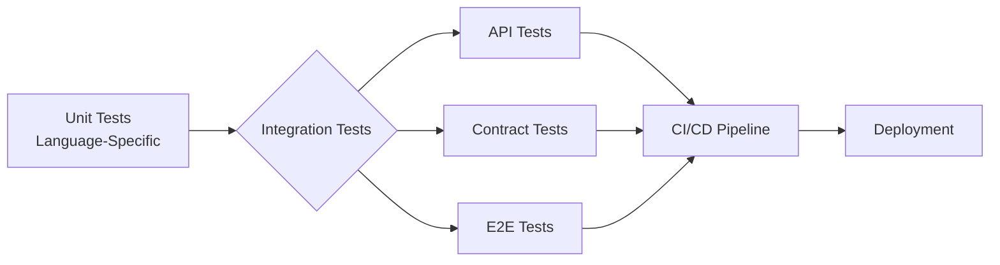

<br>

## 13. Security Considerations in Polyglot Architectures

Cross-language boundaries can introduce unique security vulnerabilities.

### 13.1 Serialization Attacks

When data is passed between different language components, serialization and deserialization can introduce vulnerabilities:

- **Java deserialization:** Can lead to remote code execution if untrusted data is deserialized
- **Python pickle vulnerabilities:** Pickle files from untrusted sources can execute arbitrary code
- **JSON/XML injection:** Improper validation can lead to injection attacks
- **Protobuf/gRPC:** Generally safer but still requires input validation

**Mitigation:**
- Validate all input at the boundary
- Use safer serialization formats (JSON, Protobuf, Avro) when possible
- Avoid deserializing untrusted data in languages with known vulnerabilities
- Implement input validation frameworks

### 13.2 Memory Safety Mismatches

When a memory-safe language (like Rust) calls into a memory-unsafe language (like C++), vulnerabilities can be reintroduced:

- Buffer overflows in the C++ component can affect the entire process
- Use-after-free bugs can corrupt memory used by the safe language
- Data races in unsafe code can lead to undefined behavior

**Mitigation:**
- Isolate unsafe code as much as possible
- Use safe bindings (e.g., Rust's `extern "C"` with defensive checks)
- Run security-critical components in separate processes
- Use AddressSanitizer, Valgrind, and other memory safety tools

### 13.3 Securing FFI Boundaries

Foreign Function Interfaces (FFIs) can introduce vulnerabilities:
- Input validation: Validate all data passed across FFI boundaries
- Sandboxing: Run components in sandboxed environments
- Safer bindings: Use bindings that provide safety layers (e.g., `rust-bindgen`)

### 13.4 Authentication and Authorization

When services are written in different languages:
- Use standard authentication protocols (OAuth 2.0, OpenID Connect)
- Use token-based authentication (JWT) with proper validation
- Implement cross-service authorization using tools like OPA (Open Policy Agent)

### 13.5 Secrets Management

- **Never hard-code secrets:** Use environment variables or secret management tools
- **HashiCorp Vault:** Centralized secret management across languages
- **Cloud-specific solutions:** AWS Secrets Manager, Azure Key Vault, GCP Secret Manager

<br>

## 14. Debugging and Observability Across Language Stacks

When a request crosses three services written in three different languages, how do you trace a failure?

### 14.1 Distributed Tracing

- **OpenTelemetry:** Standardized API for telemetry data (traces, metrics, logs)
- **Jaeger:** Open source distributed tracing system
- **Zipkin:** Another distributed tracing system

### 14.2 Centralized Logging

- **Consistent correlation IDs:** Generate a unique ID at the entry point and propagate it across all services
- **Structured logging:** Use structured formats (JSON) for easier parsing
- **ELK Stack:** Elasticsearch, Logstash, Kibana for log aggregation
- **Loki:** Grafana's log aggregation system

### 14.3 Cross-Language Metrics Collection

- **Prometheus:** Leading tool for collecting and storing metrics
- **Grafana:** Creates dashboards to visualize metrics
- **Client libraries:** Each language has Prometheus client libraries

### 14.4 Debugging FFI Boundaries

- Use `gdb` with mixed language frames
- Language-specific debugger integration
- Memory debugging tools (Valgrind, AddressSanitizer)

### 14.5 Implementing Cross-Cutting Observability

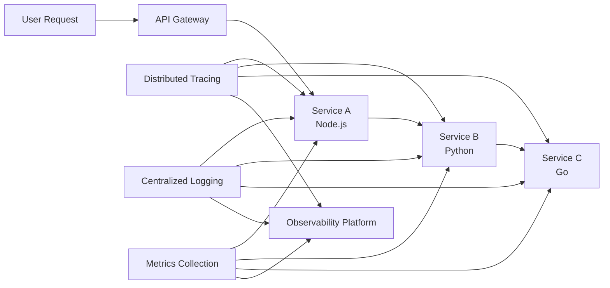

<br>

## 15. When NOT to Use Multiple Languages

It is equally important to recognize situations where adding another language is harmful.

### 15.1 Scenarios Where Single Language is Preferable

- **Startups and small teams:** Limited ops capacity; one language reduces friction
- **Projects with modest performance requirements:** A single language is "good enough"
- **Domains with strong existing conventions:** Embedded Linux (C), scientific computing (FORTRAN)
- **Projects with limited development resources:** Cross-training costs may outweigh benefits
- **Standardized enterprise environments:** Organizational standards may limit language choice

### 15.2 Decision Framework: Trade-off Matrix

| Factor | Single Language | Multiple Languages |
|--------|----------------|-------------------|
| Developer Velocity | High (familiarity) | Variable (specialization) |
| Operational Cost | Low | High |
| Performance | Limited | Optimized |
| Team Autonomy | Low | High |
| Legacy Integration | Difficult | Easier |
| Hiring | Easier | Harder |

### 15.3 The Case for Monolith Simplicity

Some projects benefit from the simplicity of a single-language monolith:
- Smaller teams can focus on one language
- Simpler build and deployment processes
- Easier debugging and observability
- Reduced operational complexity

### 15.4 Questions to Ask Before Adding a New Language

1. Does this component have performance requirements that our current language cannot meet?
2. Is there a compelling ecosystem advantage (libraries, tools) in another language?
3. Does the team have existing expertise in the new language, or can they acquire it quickly?
4. Can we maintain the new language alongside existing ones without operational overhead?
5. Is the complexity worth the benefits we expect to gain?

<br>

## 16. Migration Patterns: Introducing a Second Language Safely

Many real-world projects start monolingual and later adopt a second language incrementally.

### 16.1 The Strangler Fig Pattern

Replace one component at a time while keeping old and new running side by side:

1. **Identify a bounded context:** Choose a specific feature or module to replace
2. **Build new component:** Implement the new component in the new language
3. **Route traffic:** Use a router or API gateway to direct requests to the new component
4. **Verify:** Compare outputs from old and new components
5. **Remove old:** Once confidence is high, remove the old component

### 16.2 Wrapping Legacy Code

- Expose legacy functionality as a service via REST/HTTP
- Use FFI to call legacy code from the new language
- Use message queues for asynchronous communication

### 16.3 ABI Compatibility Shims

- Use C-compatible ABIs to call between languages
- Create adapter layers that translate data formats
- Use tools like `rust-bindgen` to generate FFI bindings

### 16.4 Gradual Typing and Transpilation

- TypeScript in a JavaScript project: Add type annotations gradually
- Kotlin in a Java project: Convert files one by one
- React in a legacy jQuery project: Add React components incrementally

### 16.5 Risk Mitigation

- **Feature flags:** Toggle new code on/off without deployment
- **Canary deployments:** Roll out to a small percentage of users first
- **Rollback plans:** Have a clear path to revert if issues occur
- **Monitoring:** Instrument both old and new components for comparison

<br>

## 17. Conclusion: The Path Forward

### 17.1 The Future of Software Development

The future of software development is polyglot. The question is no longer whether to use multiple languages, but how to integrate them effectively. The journey toward mastering this architecture begins by moving past language dogmatism and embracing a philosophy of deliberate specialization.

Start by identifying the different constraints within your own system:
- The user interface runs in the browser → JavaScript or TypeScript
- The API layer handles thousands of concurrent requests → Go or Node.js
- The data processing pipeline involves complex statistical models → Python with compiled extensions (NumPy, PyTorch)
- The media stack is performance-critical → C++ or Rust

Define clear, contract-based boundaries between these components using APIs and message schemas. Implement shared observability (logging, metrics, tracing) across all services. Give your teams the autonomy to choose the right tool for their job within those boundaries.

### 17.2 Key Takeaways

- **Polyglot programming is a deliberate architectural strategy**, not a sign of poor planning
- **Different languages excel at different tasks**—choose the right tool for each job
- **The compilation pipeline and linker are the great unifiers** that enable multiple languages to coexist in a single binary
- **The ABI is critical** for ensuring different languages can communicate correctly
- **Embedding interpreters** enables rapid iteration while maintaining high performance
- **Microservices extend polyglot principles to the network level**, allowing teams to choose optimal languages for each service
- **Polyglot architecture introduces real complexity** in operations, development environments, and debugging
- **Security, testing, and observability** require cross-language strategies
- **Not every project needs multiple languages**—sometimes simplicity is the better choice

### 17.3 Your Action Plan

1. **Understand your system's constraints:** Identify where performance, safety, or developer productivity are most critical
2. **Evaluate language options:** Consider the strengths and weaknesses of different languages for each component
3. **Define clear boundaries:** Establish contracts between components using APIs or ABIs
4. **Implement shared observability:** Ensure consistent logging, metrics, and tracing across language boundaries
5. **Plan for incremental adoption:** Use patterns like the strangler fig to introduce new languages safely
6. **Invest in tooling:** Build systems, testing, and deployment pipelines should support polyglot development
7. **Train your team:** Ensure developers understand the technical foundations of cross-language integration

### 17.4 Final Thought

Modern systems are not written in a single language. They are composed from multiple languages, each contributing its strengths, unified through careful architecture and deep understanding of how software actually works at every level.

The wise engineer does not ask "Which language is best?" but rather "What problem am I solving, and which combination of tools will solve it most effectively for my team and my users?"

Polyglot architecture is not about creating chaos; it is about managing complexity through deliberate, informed design. By understanding the technical foundations—from the linker's unifying role to the critical importance of ABIs and the power of embedding—you can transform polyglot programming from a source of mystery into a powerful tool for building cutting-edge systems.

<br>

## References and Further Reading

- Compilation pipeline and linking concepts derived from standard systems programming literature
- Real-world examples based on public talks and documentation from YouTube, Netflix, Instagram, TensorFlow, and Android Open Source Project
- ABI and calling convention details from processor architecture manuals (x86-64 System V ABI, ARM AAPCS)
- Polyglot programming patterns from microservices and foreign function interface (FFI) best practices
- ACM History of Programming Languages conferences
- Language specification documents for all mentioned languages
- TIOBE Index, Stack Overflow Developer Survey, GitHub Octoverse

<br>

> This document is intended for a technical audience seeking a clear, practical understanding of multi-language software architecture. For deployment-specific guidelines, consult your team's coding standards and infrastructure documentation.

<br><br><br><br>


<h1 align="center">Understanding Development Stacks & The DevOps Toolchain.</h1>

<br><br>

# Introduction

In today's technology-driven world, understanding how applications are built, deployed, and maintained is essential for anyone pursuing a career in software development or IT operations. This guide provides a clear, structured overview of two interconnected but distinct concepts: Development Stacks and the DevOps Toolchain.

The technology landscape has evolved significantly, and with the rise of Artificial Intelligence (AI), cloud computing, and automated deployment systems, the lines between development and operations have blurred. However, the fundamental principles remain consistent. This document aims to demystify these concepts, explain their relationships, and provide practical guidance for building a successful career in modern technology.

Whether you are just starting your journey, switching careers, or looking to update your skills, this guide will help you navigate the essential technologies that power today's digital world. We will use simple language, practical examples, and clear explanations to ensure that complex ideas become understandable and actionable.

<br>

# Part 1: Clarifying Key Terminology

## Development Stacks vs. DevOps Tools

Before diving into the specifics, it is crucial to understand the distinction between two fundamental concepts in modern technology:

### Development Stacks

Development stacks are curated combinations of technologies used to build an application. These are chosen by developers based on the specific requirements of a project, including factors such as performance needs, team expertise, scalability requirements, and development speed. The stack typically includes a database, a backend framework, a frontend library or framework, and a runtime environment.

### DevOps Toolchain

The DevOps toolchain comprises the set of tools used to deploy, run, monitor, and secure an application, regardless of which development stack was used to build it. This is what professionals typically refer to when discussing "DevOps tools." The toolchain is stack-agnostic, meaning it can support applications built with any development stack.

### A Practical Analogy

To better understand the relationship between these two concepts, consider the following analogy:

A development stack is like the blueprint and materials for building a car. It includes the engine, chassis, interior components, and the specific design choices made by the manufacturer. It defines what the car is and how it is constructed.

The DevOps toolchain is like the factory assembly line, quality control systems, maintenance garage, and GPS tracking that get the car built, ensure it meets quality standards, and keep it running smoothly after it leaves the factory.

| Aspect | Development Stack | DevOps Toolchain |
|--------|-------------------|------------------|
| Purpose | Building the application | Deploying, running, monitoring, and securing the application |
| Chosen By | Developers based on project needs | DevOps/Platform Engineering teams based on operational requirements |
| Stack Agnostic? | No - specific to the application | Yes - supports any development stack |
| Examples | MERN, Django, LAMP, JAMStack | Docker, Kubernetes, Terraform, Prometheus, Jenkins |
| Focus | Application architecture and features | Automation, reliability, scalability, and security |

<br>

# Part 2: Popular Development Stacks

Development stacks are combinations of technologies that work together to build full web applications, from the database to the user interface. The following table summarizes the most common stacks used in the industry:

| Stack Name | Database | Backend Framework | Frontend Framework | Runtime | Key Characteristics |
|------------|----------|-------------------|-------------------|---------|---------------------|
| MERN | MongoDB | Express.js | React | Node.js | All-JavaScript stack, highly popular, great for dynamic applications |
| FERN | Firebase | Express.js | React | Node.js | Backend-as-a-Service approach, faster prototyping, real-time features |
| MEAN | MongoDB | Express.js | Angular | Node.js | Alternative to MERN with Angular instead of React |
| MEVN | MongoDB | Express.js | Vue.js | Node.js | Alternative to MERN with Vue.js instead of React |
| LAMP | MySQL | Apache Web Server | PHP/Python/Perl | Linux OS | Classic stack, still widely used for traditional web applications |
| Python-Django | PostgreSQL (common) | Django | React/Django Templates | Python | Batteries-included approach, structured backend development |
| JAMStack | Various APIs | Various APIs | Next.js/Gatsby | JavaScript | Decoupled architecture, pre-built static sites, CDN delivery |

## Deep Dive into Major Stacks

### The MERN Stack

The MERN stack is a very popular JavaScript-centric stack for building dynamic web applications. It consists of the following components:

- **MongoDB**: A NoSQL document database that stores data in flexible, JSON-like format. It is known for its scalability, ease of use with JavaScript, and ability to handle unstructured data. MongoDB's document model allows developers to store data in a way that closely mirrors how it is used in their application code, reducing the impedance mismatch between the database and the application.

- **Express.js**: A lightweight web application framework for Node.js. It simplifies building the server-side logic and API routes for your application. Express provides a robust set of features for web and mobile applications, including routing, middleware support, and request handling. It is minimalistic and unopinionated, giving developers flexibility in how they structure their applications.

- **React**: A powerful library created by Facebook for building interactive user interfaces. React allows developers to create reusable UI components that update efficiently when data changes. Its component-based architecture, virtual DOM, and rich ecosystem of libraries make it one of the most popular choices for frontend development.

- **Node.js**: A JavaScript runtime environment that allows you to run JavaScript code on the server outside of a browser. Node.js uses an event-driven, non-blocking I/O model that makes it lightweight and efficient, perfect for data-intensive real-time applications that run across distributed devices.

### The FERN Stack

The FERN stack is a modern variation that substitutes Firebase for MongoDB, often used for faster prototyping and real-time features:

- **Firebase**: A comprehensive Backend-as-a-Service (BaaS) platform by Google. It provides a real-time database, authentication, cloud functions, and hosting, significantly reducing backend coding. Firebase is particularly useful for developers who want to focus on frontend development while leveraging managed backend services.

- **Express.js**: The web framework for the backend API. With Firebase handling many backend concerns, this layer can become much thinner, primarily serving as a bridge between frontend code and Firebase services.

- **React**: The frontend library for the user interface, providing the same powerful component-based development experience as in the MERN stack.

- **Node.js**: The server-side JavaScript runtime, which runs the Express server and may handle custom logic not covered by Firebase.

### The Python-Django Stack

The Python-Django stack is a powerful combination for building complex web applications:

- **Python**: A versatile programming language known for its clear syntax and readability. Python's extensive ecosystem of libraries makes it suitable for everything from automation scripts to complex web applications and AI integration.

- **Django**: A "batteries-included" high-level web framework that handles much of the backend complexity. Django provides an ORM (Object-Relational Mapping) layer, authentication system, admin interface, and many other features out of the box, allowing developers to build applications quickly without reinventing the wheel.

- **PostgreSQL**: A robust relational database often paired with Django. PostgreSQL is known for its reliability, feature richness, and compliance with SQL standards.

- **React or Django Templates**: For the frontend, developers can choose either React for a modern single-page application experience or Django's built-in template system for more traditional server-rendered pages.

### The JAMStack Architecture

The JAMStack represents a modern architectural pattern rather than a traditional stack:

- **JavaScript**: Runs in the browser on the client side, handling interactivity and dynamic functionality.
- **APIs**: Server-side functions accessed via HTTP/API calls. These APIs can be built with any backend technology.
- **Markup**: Pre-built, static HTML/CSS that is generated at build time.

The key idea behind JAMStack is decoupling the frontend from the backend completely. The frontend is pre-built and served from a Content Delivery Network (CDN), while dynamic functionality is handled by calling backend services via APIs. This approach offers performance benefits, enhanced security, and improved scalability.

Tools like Next.js, Gatsby, and Vercel are commonly associated with this pattern, providing frameworks and platforms that simplify building and deploying JAMStack applications.

<br>

# Part 3: The Universal DevOps Toolchain

The DevOps toolchain is the essential set of tools that DevOps or Platform Engineering teams use to manage applications built with any development stack. This toolchain is largely stack-agnostic and can support applications built with MERN, Django, LAMP, or any other combination of technologies.

## Toolchain Categories

### 1. Code & Plan

Tools for collaboration and project management:

| Tool | Purpose |
|------|---------|
| GitHub, GitLab, Bitbucket | Platforms for hosting code (Git repositories), reviewing changes, and managing projects |
| Jira, Trello, Linear | Tools for tracking tasks, bugs, and agile development workflows |
| Git | The underlying version control system used by these platforms |

**Detailed Explanation**:
GitHub, GitLab, and Bitbucket are platforms that host Git repositories and provide additional collaboration features such as pull requests, code reviews, issue tracking, and project boards. These platforms serve as the central source of truth for code and facilitate team collaboration. Jira, Trello, and Linear are project management tools that help teams plan sprints, track progress, and manage backlogs.

### 2. Build & Test

Tools that package the application and ensure its quality:

| Tool | Purpose |
|------|---------|
| Docker | Creates a standardized image of your application and its dependencies |
| Jenkins, GitHub Actions, GitLab CI, CircleCI | Automation servers that run the build and test pipeline |

**Detailed Explanation**:
Docker creates standardized containers that package an application with all its dependencies, ensuring consistent behavior across environments. Jenkins is a widely used open-source automation server that can build, test, and deploy applications. GitHub Actions and GitLab CI are integrated CI/CD solutions that run within their respective platforms. CircleCI is a cloud-native CI/CD platform that emphasizes speed and scalability.

### 3. Deploy & Release

Tools for getting the application into a running state:

| Tool | Purpose |
|------|---------|
| Kubernetes | The standard system for orchestrating and managing containerized applications at scale |
| Helm | A package manager for Kubernetes that simplifies defining, installing, and upgrading applications |
| Terraform, Pulumi, AWS CloudFormation | Infrastructure as Code tools to provision cloud servers, networks, and databases |
| ArgoCD, Flux | GitOps tools that automatically sync application deployments with Git repository state |

**Detailed Explanation**:
Kubernetes is the industry standard for container orchestration, providing features for scaling, self-healing, rolling updates, and service discovery. Helm helps manage Kubernetes applications by providing templating and versioning capabilities. Terraform, Pulumi, and AWS CloudFormation are Infrastructure as Code (IaC) tools that allow teams to define cloud infrastructure in configuration files. ArgoCD and Flux enable GitOps practices where the desired state of applications is stored in Git repositories and automatically synchronized with running clusters.

### 4. Operate & Monitor

Tools for ensuring the application is healthy and performing:

| Tool | Purpose |
|------|---------|
| Prometheus | Collects and stores metrics like request counts, error rates, and CPU usage |
| Grafana | Creates dashboards to visualize metrics collected by Prometheus |
| ELK Stack (Elasticsearch, Logstash, Kibana) / Loki | Centralized systems for aggregating, searching, and analyzing application logs |
| Datadog, New Relic | Commercial all-in-one observability platforms combining metrics, logs, and tracing |

**Detailed Explanation**:
Prometheus is the leading open-source monitoring system that collects metrics from applications and infrastructure. It uses a pull-based model with a powerful query language for analysis. Grafana is the visualization layer for Prometheus, providing rich dashboards that can combine data from multiple sources. The ELK Stack (Elasticsearch, Logstash, Kibana) provides log aggregation, processing, and visualization capabilities. Loki is a lightweight alternative to Elasticsearch specifically designed for log aggregation with Prometheus-like labels.

### 5. Security & Governance

Tools integrated throughout the lifecycle to manage risk:

| Tool | Purpose |
|------|---------|
| HashiCorp Vault, AWS Secrets Manager | Securely store and manage sensitive information like API keys and passwords |
| SonarQube, Snyk, Trivy | Scan application code and container images for security vulnerabilities |
| Open Policy Agent (OPA) | Enforces security and compliance rules across the stack |

**Detailed Explanation**:
HashiCorp Vault and AWS Secrets Manager provide secure storage and access control for secrets and sensitive configuration. SonarQube performs static code analysis to identify bugs, code smells, and vulnerabilities. Snyk and Trivy are security tools that scan dependencies and container images for known vulnerabilities. Open Policy Agent (OPA) is a policy-as-code framework that allows organizations to define and enforce security and compliance rules consistently across their infrastructure.

## How It All Fits Together: A Typical Flow

The following flowchart illustrates the journey of an application through the DevOps toolchain:

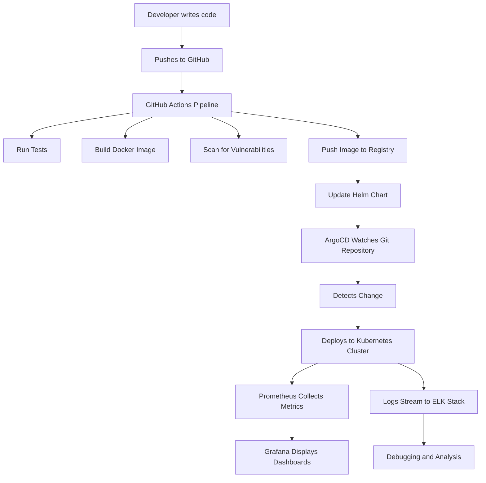

### Step-by-Step Walkthrough

1. **Developer Writes Code**: A developer writes code for a new React feature, updating both the frontend and backend components of a MERN stack application.

2. **Code Pushed to GitHub**: The developer commits their changes and pushes them to the team's GitHub repository, following established branch and merge strategies.

3. **CI/CD Pipeline Triggers**: A GitHub Actions pipeline is automatically triggered by the push, beginning the automated build and test process.

4. **Automated Testing**: The pipeline runs all tests, including unit tests, integration tests, and end-to-end tests, to ensure the new code does not break existing functionality.

5. **Containerization**: The pipeline builds a Docker image of the entire application, packaging Node.js, Express, and all dependencies into a standardized, portable container.

6. **Security Scanning**: The pipeline scans the Docker image for vulnerabilities using Snyk or Trivy, identifying and reporting any known security issues in the application or its dependencies.

7. **Image Storage**: The secure image is pushed to a container registry like Docker Hub, making it available for deployment.

8. **Infrastructure Update**: The developer updates the Helm chart to reference the new image version, ensuring Kubernetes will deploy the updated application.

9. **GitOps Synchronization**: ArgoCD, which continuously watches the Git repository, detects the change and automatically deploys the new version to the Kubernetes cluster running in the cloud environment.

10. **Infrastructure Provisioning**: The Kubernetes cluster and associated cloud resources (networks, storage, databases) were previously provisioned using Terraform, ensuring infrastructure is defined as code and reproducible.

11. **Monitoring and Observability**: Prometheus collects metrics from the running application, while Grafana displays dashboards showing application performance, error rates, and other key indicators.

12. **Log Management**: All application logs are streamed to the ELK Stack (Elasticsearch, Logstash, Kibana) or Loki, providing centralized log aggregation and search capabilities for debugging.

<br>

# Part 4: The Essential Foundation Skills

## Core Skills for Every Technology Professional

Before specializing, there is a common set of skills that form the bedrock of all technology work. Mastering these skills is non-negotiable for a successful career.

### Operating Systems & The Command Line

Most of the internet runs on Linux, a free and open-source operating system. Professionals interact with these systems primarily through text commands in a terminal, not by clicking icons. This involves navigating folders, managing files, setting permissions, and checking system logs. Think of it as learning the basic grammar and vocabulary of computers before you can write complex instructions.

Linux skills include understanding the file system hierarchy, working with processes and signals, managing users and permissions, and using text editors like Vim or Nano. The command line provides powerful tools for system administration, troubleshooting, and automation that graphical interfaces cannot match.

### Version Control with Git

Imagine if every change you made to a document was saved forever, and you could collaborate with dozens of people on the same file without chaos. That is Git. It is the universal system for tracking changes in code, allowing teams to work together, experiment safely without breaking the main project, and maintain a perfect history of who changed what and why.

Key Git concepts include branches for parallel development, commits for saving changes with descriptive messages, merging for combining work from different developers, and resolving conflicts when multiple people edit the same files. Pull requests (or merge requests) facilitate code review and quality control before changes are integrated into the main project.

### Networking Basics

All online services are about computers talking to each other. You need a basic grasp of how this conversation happens. This includes understanding how data is broken into packets and sent (TCP/IP), how friendly website names are translated into numerical addresses (DNS), the crucial difference between secure (https://) and non-secure (http://) connections, and how traffic is spread across multiple servers to prevent overload.

Understanding networking concepts helps in deploying and troubleshooting online services. It allows you to debug connectivity issues, configure firewalls, set up load balancers, and ensure the secure transmission of data. The OSI model and the concept of ports and protocols are fundamental knowledge for any technology professional.

### Scripting & Configuration Files

The true power of computing lies in automation. Learning to write simple scripts in Bash allows you to automate tedious, repetitive tasks on servers. Furthermore, you must understand JSON and YAML. These are not programming languages but standardized formats for writing configuration. They are used to define application settings, communicate between services, and declare cloud infrastructure.

Bash scripting covers variables, loops, conditionals, and functions for automating system administration tasks. JSON (JavaScript Object Notation) is a lightweight data interchange format widely used for APIs and configuration. YAML (YAML Ain't Markup Language) is a human-readable data serialization standard commonly used in configuration files for Docker, Kubernetes, Ansible, and CI/CD pipelines.

### Why These Skills Matter

For hiring managers, these are not "nice-to-have" skills; they are the absolute baseline. An inability to use the command line, collaborate with Git, or grasp basic network principles is often an immediate barrier to employment, as these are daily tools for any technology role.

<br>

# Part 5: Core Programming Languages and Data Management

## Essential Programming Languages

### Python

Known for its clear and readable syntax, Python is a versatile powerhouse. It is the go-to language for automation scripts, building the backend logic of websites and apps, analyzing data, and interacting with AI APIs. Its simplicity makes it an excellent first language, while its vast collection of free libraries makes it indispensable for solving real-world problems efficiently.

Python's ecosystem includes frameworks like Django and Flask for web development, libraries like NumPy and Pandas for data analysis, and tools like TensorFlow and PyTorch for machine learning. Its popularity in both startup and enterprise environments makes Python a highly valuable skill.

### JavaScript & TypeScript

JavaScript is the language that makes websites interactive in your web browser. With Node.js, it also runs on servers, allowing developers to use one language for both front-end and back-end development. TypeScript is a more robust version of JavaScript that helps catch errors before the code even runs by adding type definitions. This makes building large, reliable applications much easier.

Understanding JavaScript involves DOM manipulation, event handling, asynchronous programming (promises and async/await), and working with modern frameworks. TypeScript adds static type checking, which significantly improves code quality and developer productivity in larger projects.

### SQL

Data is the heart of modern applications. SQL is the universal language for talking to relational databases. You must know how to ask precise questions of your data (SELECT), combine information from different tables (JOIN), perform calculations across datasets, and understand how to structure your database and queries for speed.

SQL proficiency includes writing complex queries, understanding normal forms for database design, creating indexes for performance, and using transactions for data integrity. SQL skills are transferable across different database systems like PostgreSQL, MySQL, and SQLite.

## Storing and Managing Information

### Relational Databases (PostgreSQL, MySQL)

These are the classic, highly structured databases. They store data in tables with rows and columns, and they excel at handling complex queries and transactions where data integrity is critical (like banking or inventory systems). Learning to design an efficient database schema is a key skill.

Relational databases enforce data integrity through constraints, support ACID transactions for reliability, and provide powerful query capabilities through SQL. They remain the primary data storage solution for most enterprise applications.

### Specialized Data Stores

Not all information fits neatly into tables. Document databases like MongoDB store flexible, JSON-like documents, which is useful for content with varying structures. Redis is an ultra-fast, in-memory store used for caching (temporarily storing frequent requests to speed up an app), managing user sessions, and handling message queues between services.

Document databases offer schema flexibility and horizontal scalability, making them suitable for applications with rapidly evolving data models. Redis provides sub-millisecond response times and is commonly used for caching, rate limiting, and real-time analytics.

## Containerization with Docker

### Solving the "It Works on My Machine" Problem

A developer's application might rely on a specific version of a library or tool. Docker packages the application code together with all its dependencies into a single, portable unit called a container. This container will run exactly the same way on a developer's laptop, a testing server, or a cloud computer.

Docker simplifies dependency management, ensures consistency across environments, and enables efficient resource utilization through container isolation. Docker images are built from Dockerfiles, which define the application environment and are version-controlled as part of the codebase. Containerization is the foundation of modern deployment practices and microservices architectures.

<br>

# Part 6: Deploying and Operating at Scale

## Cloud Platform Fundamentals

### Choose One, Learn It Deeply

Amazon Web Services (AWS), Microsoft Azure, and Google Cloud Platform (GCP) are the three major public cloud providers. They offer similar core services: virtual computers, storage, databases, and networking tools. Your goal should be to gain deep, hands-on experience with one platform. Understand its core services for compute, storage, security (Identity and Access Management), and networking.

Cloud platforms provide on-demand resources, global reach, and managed services that simplify infrastructure management. AWS is the market leader, Azure is strong in enterprise environments, and GCP is recognized for its data analytics and machine learning capabilities. Choosing one cloud provider and gaining deep knowledge is more valuable than superficial familiarity with all three.

## Infrastructure as Code with Terraform

### Automating Your Cloud Blueprint

Manually creating servers and networks through a web console is slow, error-prone, and impossible to replicate exactly. Terraform allows you to define your entire infrastructure—servers, databases, firewalls—using human-readable configuration files. This "Infrastructure as Code" can be version-controlled, reviewed by teammates, and reused to create identical environments for development, testing, and production.

Terraform uses a declarative approach where you define the desired state of your infrastructure, and it determines how to achieve that state. It supports multiple cloud providers and services through providers, making it a versatile tool for hybrid and multi-cloud strategies. Terraform also manages dependencies between resources, ensuring they are created and destroyed in the correct order.

## Continuous Integration and Delivery (CI/CD)

### The Automated Software Assembly Line

CI/CD is the practice of automating the steps required to get code from a developer's machine into the hands of users. A typical pipeline automatically runs tests every time code is submitted, builds a new Docker image, scans that image for security flaws, and deploys it to a staging or production environment.

Continuous Integration involves automatically building and testing code changes, ensuring that changes are integrated frequently and conflicts are resolved early. Continuous Delivery extends this by automatically deploying tested changes to staging environments, while Continuous Deployment goes further by automatically deploying to production as well. Tools like GitHub Actions, Jenkins, GitLab CI, and CircleCI enable these practices.

<br>

# Part 7: Ensuring Reliability, Security, and Modern AI Integration

## Observability: Seeing Inside Running Systems

### Logs, Metrics, and Traces

When software is running live, you need windows into its behavior. Centralized logging collects all text output from your services into one searchable place for debugging. Metrics are numerical measurements (like requests per second or error rates) collected over time to track health and performance. Distributed tracing follows a single user request as it travels through many different services.

Observability is the modern approach to monitoring complex systems. Logs provide detailed event records for debugging. Metrics allow you to understand trends, detect anomalies, and alert on issues before they impact users. Traces help understand the flow of requests through microservices and identify performance bottlenecks. Tools like Grafana, Prometheus, and the ELK Stack provide a comprehensive observability solution.

## Security Fundamentals

### A Responsibility for Everyone

In modern technology, every engineer plays a role in security. Core principles include using TLS/SSL to encrypt all data in transit, never hard-coding passwords or API keys (using secret management tools instead), applying the "principle of least privilege" (giving users and systems only the access they absolutely need), and thinking about potential threats during the design phase of any new feature.

Security must be integrated throughout the software development lifecycle, not added as an afterthought. This includes secure coding practices, regular vulnerability scanning, dependency management, and security training for all team members. Tools like SonarQube, Snyk, Trivy, and HashiCorp Vault support these practices.

## AI-Aware Engineering

### Integrating AI Responsibly

The post-AI era requires knowing how to work with Large Language Models (LLMs) effectively and safely. This involves calling AI provider APIs with proper error handling and cost monitoring, crafting effective prompts ("prompt engineering") to get useful and consistent outputs, and understanding new architectural patterns, such as using specialized databases (vector databases) to provide long-term memory and context to AI applications.

AI integration requires careful consideration of costs, latency, and quality. Prompt engineering is the skill of designing inputs that elicit useful and reliable responses from AI models. Vector databases enable semantic search and similarity matching for AI applications. Engineers must also consider ethical implications, bias mitigation, and data privacy when integrating AI features.

<br>

# Part 8: A Practical Guide to Modern IT Stacks & Technologies

## Understanding Today's Technology Landscape

Welcome to your comprehensive guide to the essential technology skills needed in today's job market. This section is designed for anyone interested in building a career in technology, whether you are just starting, switching careers, or looking to update your skills. We explore the fundamental building blocks that power modern businesses and explain them in straightforward language.

In the current era where Artificial Intelligence is becoming commonplace, the core principles of building, securing, and maintaining technology systems remain crucial. This guide breaks down what you need to know, why it matters, and how you can demonstrate your skills to potential employers.

## The Core Foundation: Essential Skills Everyone Needs

These fundamental skills form the baseline expectation across all technology roles today.

### Operating Systems & Command Line

Modern technology infrastructure predominantly runs on Linux-based systems. You need to be comfortable navigating these systems using text commands, understanding how processes work, managing files and their permissions, and reading system logs to identify issues. Think of this as learning the basic language of computers before you can ask them to perform complex tasks.

### Version Control with Git

Every software project uses version control systems, with Git being the universal standard. This involves understanding how to track changes to code, collaborate with others through branching strategies, resolve conflicts when multiple people edit the same files, and maintain a clean history of project development. It is the foundational tool for professional teamwork in technology.

### Networking Basics

At its heart, the internet is about computers communicating. You should grasp the basics of how data travels across networks (TCP/IP), how domain names translate to addresses (DNS), the difference between secure and regular web connections (HTTP/HTTPS), and how traffic is distributed across servers (load balancing). This knowledge is key to deploying and troubleshooting any online service.

### Scripting & Configuration Files

Automation begins with scripting. Learning Bash allows you to write simple programs that automate repetitive tasks on servers. Additionally, understanding JSON and YAML is essential because these formats are used everywhere—from application settings and API communication to defining cloud infrastructure. They are the standard languages for configuration.

### Why This Matters to Employers

Hiring managers view these skills as the absolute minimum requirement. Being unable to use basic command line tools, collaborate with Git, or understand network concepts is often an immediate reason for rejection, as these are daily necessities in any tech role.

## Building Your Evidence Portfolio

Theory is important, but employers value proven skills. Build and document these projects:

### End-to-End Microservice

Create a simple API with authentication, containerize it, deploy it to a cloud Kubernetes cluster using Terraform, and set up monitoring and alerts. This demonstrates the full lifecycle of development, deployment, and operations.

### Automated Infrastructure Repository

Build a set of reusable Terraform modules that provision a network, database, and Kubernetes cluster in your chosen cloud. This shows your ability to create reproducible, maintainable infrastructure definitions.

### AI-Enhanced Utility

Develop a small tool that responsibly uses an LLM API (like for summarization or categorization) with proper error handling, rate limiting, and a clean user interface. This demonstrates your ability to integrate modern AI capabilities into practical applications.

<br>

# Part 9: Your Learning Pathway

## From Foundations to Specialization

### The "Golden Stack" Fast Track

If you have limited time, prioritize mastering these ten areas to build a strong, employable foundation:

| # | Area | Description |
|---|------|-------------|
| 1 | Linux Operating System | Command line navigation, process management, file permissions |
| 2 | Git for Version Control | Branching, merging, collaboration workflows |
| 3 | Python Programming | Core language features, automation, API development |
| 4 | SQL for Databases | Query writing, schema design, performance optimization |
| 5 | Docker for Containers | Containerization, Dockerfiles, image management |
| 6 | Kubernetes Basics | Pods, services, deployments, scaling |
| 7 | One Major Cloud Platform | Core compute, storage, networking, IAM services |
| 8 | Terraform for Infrastructure | Infrastructure as Code, resource definition, state management |
| 9 | JSON/YAML for Configuration | Data serialization, configuration files, API communication |
| 10 | CI/CD Pipeline Concepts | Automation, testing, deployment strategies |

## Role-Based Learning Roadmaps

### For Aspiring DevOps & Platform Engineers

**Months 1-3**: Solidify your core foundation in Linux, Git, and Python. Learn to Dockerize applications and understand basic networking. These skills form the foundation for all further learning. Practice automating common tasks and managing systems through the command line.

**Months 4-6**: Dive into Kubernetes for container orchestration. Learn Terraform to provision cloud infrastructure automatically. Build a complete CI/CD pipeline integrating these tools. Focus on understanding how containers are orchestrated and how infrastructure can be defined as code.

**Months 7-12**: Implement full observability with monitoring and logging. Integrate security practices and cost-optimization. Develop skills in troubleshooting complex distributed systems. Learn to use monitoring tools effectively and apply security best practices throughout the development lifecycle.

### For Aspiring Backend Developers

**Months 1-3**: Master your primary language (Python, TypeScript, or Go) and SQL. Learn to build robust, well-tested RESTful APIs. Focus on writing clean, maintainable code and understanding database interactions.

**Months 4-6**: Understand containerization with Docker and basic deployment. Learn about database performance, caching strategies with Redis, and asynchronous programming. Develop skills in building scalable backend systems.

**Months 7-12**: Deepen knowledge of system design, distributed system patterns, advanced cloud services, and implementing comprehensive observability within your code. Learn to design systems that are resilient, scalable, and maintainable.

## Building Your Evidence Portfolio

Concrete projects prove your skills more than any certificate. Build and document these:

### End-to-End Microservice

Create a simple API with user authentication. Containerize it with Docker, deploy it to a managed Kubernetes service in the cloud using Terraform, and set up basic monitoring and logging. This demonstrates the full lifecycle of development, deployment, and operations.

### Automated Infrastructure Project

Build a reusable set of Terraform modules that provision a complete, secure environment in your chosen cloud, including a virtual network, a database, and a Kubernetes cluster. This shows your ability to create production-ready infrastructure definitions.

### AI-Enhanced Utility Tool

Develop a small, practical application that uses an LLM API (like for text summarization or classification). Implement responsible engineering practices like input validation, error handling, rate limiting, and a clean interface. This demonstrates your ability to integrate modern AI capabilities into practical applications.

<br>

# Part 10: Conclusion and Your Action Plan

## The Central Truth

The key to a successful technology career today is demonstrating you can build, automate, deploy, secure, and observe systems. Your journey starts with a single, complete cycle of learning and doing. The central truth in today's job market is this: if you can understand systems, automate processes, deploy to the cloud, implement security, and monitor performance, you are ready for a technology role.

## Your Immediate Action Plan

### 1. Choose a Target Role

Align your learning with a career path that interests you, such as Backend Developer, DevOps Engineer, or Cloud Specialist. This focus will help you prioritize the right skills and build a relevant portfolio.

### 2. Select One Cloud Provider

Begin with one major platform (AWS, Azure, or GCP) to avoid confusion. Gain deep, practical familiarity with its core services rather than shallow knowledge of multiple platforms. This depth of experience is what employers value most.

### 3. Build One Complete Project

Follow through on a project from initial code on your computer to a live, monitored deployment in the cloud. This could be a simple web app or an automation tool. The experience of taking a project through the entire lifecycle is invaluable.

### 4. Document Everything

Create a public portfolio (on GitHub or a personal website) with your code, clear explanations of what you built and why, and diagrams of your system architecture. This documentation demonstrates your understanding and communication skills to potential employers.

This single, documented experience of taking a concept to a functioning, operational system is the most powerful credential you can create. Start building today.

<br>

## Summary Table: Key Concepts at a Glance

| Category | Key Technologies | Primary Purpose |
|----------|-----------------|-----------------|
| Development Stacks | MERN, FERN, MEAN, MEVN, LAMP, Python-Django, JAMStack | Build applications |
| Code & Plan | GitHub, GitLab, Bitbucket, Jira, Trello, Linear | Collaborate and manage projects |
| Build & Test | Docker, Jenkins, GitHub Actions, GitLab CI, CircleCI | Package and verify applications |
| Deploy & Release | Kubernetes, Helm, Terraform, ArgoCD, Flux | Deploy and orchestrate applications |
| Operate & Monitor | Prometheus, Grafana, ELK Stack, Datadog, New Relic | Monitor and maintain applications |
| Security & Governance | Vault, SonarQube, Snyk, Trivy, OPA | Secure and govern applications |
| Core Skills | Linux, Git, Networking, Bash, JSON/YAML | Foundation for all tech roles |
| Languages | Python, JavaScript/TypeScript, SQL | Build applications and automate tasks |


<br><br><br><br>

<h1 align="center">Fundamental Programming Concepts: A Comprehensive Guide.</h1>

<br><br>

## Executive Summary

This documentation provides a thorough examination of programming concepts that transcend individual languages, alongside an analysis of features that distinguish different programming ecosystems. Drawing upon decades of industry experience, this guide serves as both a foundational reference for newcomers and a valuable resource for experienced developers seeking to broaden their understanding of programming paradigms and language design.

The content is structured to progress from universal concepts that every programmer should master, through varying features that differentiate languages, to practical guidance for language selection based on project requirements. Technical accuracy has been prioritised throughout, with complex concepts explained in accessible language suitable for readers at all levels of expertise.

<br>

## Part One: Universal Programming Concepts

### Section 1.1: Data Fundamentals

#### Variables and Identifiers

Variables serve as named containers that reference memory locations where data is stored during program execution. Every programming language provides mechanisms for creating, assigning values to, and retrieving data from these named storage locations. The identifier, or variable name, follows specific rules regarding allowed characters, case sensitivity, and reserved keywords that vary between languages. Understanding variable scope, which determines where in the program a variable is accessible, is crucial for writing maintainable code. Variables can be assigned values directly, through computation, or via input operations, and their values typically change throughout program execution unless explicitly declared as constants.

#### Data Types

Data types define the kind of data a variable can hold and the operations that can be performed on that data. Primitive types, also known as basic or built-in types, form the foundation of most programming languages and typically include integers, floating-point numbers, boolean values, and characters. Composite types, also called structured types, combine multiple primitive types or other composites into more complex data organisations. Common examples include arrays, which store ordered collections of elements, and records or structs, which group related data fields of potentially different types. Modern languages increasingly support user-defined types, allowing developers to create abstractions that match the problem domain being addressed.

#### Data Structures

Data structures are systematic ways of organising and storing data to enable efficient access and modification. Arrays provide contiguous memory storage with constant-time access by index, making them suitable for fixed-size collections where random access is common. Lists or vectors offer dynamic resizing capabilities with efficient appending operations. Dictionaries, maps, or associative arrays store key-value pairs, enabling fast lookups based on arbitrary keys rather than numeric indices. Stacks follow last-in-first-out semantics, while queues operate on first-in-first-out principles, each serving specific algorithmic requirements. Trees and graphs model hierarchical and network relationships, supporting operations like traversal, searching, and pathfinding.

<br>

### Section 1.2: Program Flow Control

#### Operators and Expressions

Operators are symbols that specify operations to be performed on one or more operands, producing a result value. Arithmetic operators handle mathematical calculations including addition, subtraction, multiplication, division, and modulo operations. Comparison operators, also called relational operators, evaluate relationships between values and produce boolean results, enabling decisions in program logic. Logical operators combine boolean expressions using AND, OR, and NOT operations, forming the basis of conditional logic. Assignment operators store values in variables, with many languages supporting compound assignments that combine arithmetic and assignment in a single operation. The order in which operators are evaluated, known as operator precedence, follows rules that vary slightly between languages but generally follow mathematical conventions.

#### Conditional Branching

Conditional statements enable programs to make decisions and execute different code paths based on boolean conditions. The if-else construct evaluates a condition and executes one block of code when true and an optional alternative block when false, supporting simple two-way decisions. For more complex decision trees, if-else if chains allow multiple conditions to be evaluated sequentially until a true condition is found. Switch or case statements provide a more efficient and readable approach for selecting among multiple discrete values, often implementing jump tables for performance optimization. Ternary conditional operators offer compact syntax for simple conditional assignments, though they should be used judiciously to maintain readability.

#### Loops and Iteration

Loops enable repetition of code blocks, forming the foundation of iterative algorithms and processing collections. For loops typically execute a predetermined number of iterations, with control over initialisation, condition evaluation, and increment operations. While loops execute as long as a specified condition remains true, making them suitable for scenarios where the number of iterations is not known in advance. Do-while loops guarantee at least one execution of the loop body before checking the termination condition. For-each or range-based loops provide convenient iteration over collections without explicit index management, reducing common errors associated with manual index tracking.

<br>

### Section 1.3: Modular Programming

#### Functions and Procedures

Functions and procedures represent the primary mechanism for code reuse and modular organisation in virtually all programming languages. Functions typically accept input parameters, perform operations, and return a result value to the calling code. Procedures, also known as subroutines or void functions, perform operations without returning a value, often producing side effects like modifying state or producing output. Parameters can be passed by value, creating a copy of the argument within the function, or by reference, allowing the function to modify the original variable. The distinction between these parameter passing mechanisms significantly affects program behaviour and performance. Functions enable abstraction by hiding implementation details behind well-defined interfaces, promoting code reusability and maintainability.

#### Scope and Lifetime

Scope defines the regions of a program where a variable or identifier is accessible and can be referenced. Local variables are declared within functions or blocks and are only accessible within that specific context. Global variables are accessible throughout the entire program, though their use is often discouraged due to the complexity they introduce. Lifetime describes the duration during which a variable exists in memory, from allocation to deallocation. Stack-allocated variables have lifetimes tied to their containing function's execution, while heap-allocated variables persist until explicitly deallocated or until garbage collection reclaims them. Understanding the relationship between scope and lifetime is essential for writing correct programs and avoiding common bugs like use-after-free errors.

<br>

### Section 1.4: Error Handling and Input/Output

#### Error Handling

Error handling mechanisms enable programs to detect, report, and recover from exceptional conditions that occur during execution. Exceptions provide structured error propagation, allowing errors to be thrown from lower-level code and caught at appropriate levels where recovery or reporting is feasible. Try-catch-finally constructs separate error-handling logic from normal program flow, improving code organisation and maintainability. The choice between using exceptions, returning error codes, or employing result types depends on the programming language, project requirements, and error-handling philosophy. Proper error handling is crucial for producing robust applications that behave predictably under failure conditions and provide meaningful diagnostics to users and developers.

#### Input and Output Operations

Input and output operations connect programs to external systems, users, and storage devices. Console I/O enables interaction through command-line interfaces, providing mechanisms for reading user input and displaying output text. File I/O operations facilitate persistent storage and retrieval of data from files on storage systems. Network I/O enables communication with other systems and services across networks. The complexity of I/O operations ranges from simple text-based interactions to sophisticated binary stream processing. Understanding character encoding, buffering, and error conditions during I/O operations is essential for building reliable applications that handle data correctly across different environments.

<br>

### Section 1.5: Abstraction and Modularity

#### Abstraction

Abstraction is the process of hiding implementation details while exposing only essential features and operations to the user of a component. Interfaces define contracts specifying what operations are available without dictating how those operations are implemented, enabling multiple implementations to satisfy the same interface. Abstract data types encapsulate data structures and the operations that manipulate them, providing clean boundaries between implementation and usage. Abstraction reduces complexity by allowing developers to reason about systems at higher levels, focusing on what components do rather than how they do it. This separation of concerns enables parallel development, easier maintenance, and improved testability.

#### Modularity

Modularity involves dividing programs into discrete, independent modules or components that can be developed, tested, and maintained separately. Modules typically have well-defined interfaces that specify what functionality they provide, and implementation details that remain private to the module. Package management systems provide tools for sharing, versioning, and reusing modules across projects. Dependency management ensures that modules can be configured and updated consistently. Modular architecture enables teams to work on different components simultaneously, reduces the impact of changes by isolating them to specific modules, and facilitates testing through clearly defined component boundaries.

<br>

### Section 1.6: Memory Management

#### Memory Allocation Strategies

Memory management determines how and when memory is allocated for program data and when it is deallocated for reuse. Static allocation occurs at compile time for variables with known, fixed sizes, providing the fastest access but lacking flexibility. Stack allocation follows the call stack, automatically allocating and deallocating memory as functions are called and return, with deterministic lifetime tied to program flow. Heap allocation provides dynamic memory management, allowing allocation of variable-sized data that persists beyond the lifetime of any specific function call. The choice of allocation strategy significantly affects program performance, memory usage, and code complexity.

#### Garbage Collection

Garbage collection automatically manages memory by identifying and reclaiming memory that is no longer reachable from the program's active references. Tracing garbage collectors periodically traverse the object graph from root references, marking reachable objects and collecting unreachable ones. Reference counting maintains counts of references to each object, deallocating objects when their count reaches zero. The Java Virtual Machine employs generational garbage collection that exploits the observation that most objects die young, optimising collection performance by focusing on newly allocated objects. While garbage collection eliminates manual memory management bugs, it introduces overhead and non-deterministic pauses that may affect real-time and performance-critical applications.

#### Manual Memory Management

Manual memory management gives developers complete control over allocation and deallocation, enabling optimised memory usage and predictable performance. Functions like malloc and free in C, or new and delete in C++, allow explicit management of heap memory with precise control over lifetimes. Smart pointers in modern C++ provide automatic management while maintaining performance, implementing RAII (Resource Acquisition Is Initialization) principles. The primary challenge of manual memory management is the risk of memory leaks, where allocated memory is never freed, and use-after-free errors, where memory is accessed after it has been deallocated. Proper discipline and tools like memory sanitizers are essential for robust manual memory management.

<br>

### Section 1.7: Algorithms and Problem Solving

#### Algorithm Fundamentals

Algorithms are step-by-step procedures for solving problems, implementing computations, or performing tasks. Searching algorithms locate specific elements within data structures, with linear search examining each element sequentially and binary search efficiently locating elements in sorted collections by repeatedly dividing the search space. Sorting algorithms organise elements into a specific order, with options ranging from simple but inefficient algorithms like bubble sort to optimal general-purpose algorithms like quicksort and mergesort. Efficient algorithms consider computational complexity, measured in terms of time and space requirements as the input size grows. Algorithm design involves selecting appropriate data structures, considering trade-offs between different approaches, and implementing solutions correctly and efficiently.

#### Recursion and Iteration

Recursion involves functions that call themselves, solving problems by reducing them to simpler instances of the same problem. Recursive solutions often provide elegant, declarative implementations for problems with recursive structure, such as tree traversal, graph exploration, and divide-and-conquer algorithms. Tail recursion, where the recursive call is the last operation performed, can be optimised by compilers to avoid stack overflow in languages that support this optimisation. Iteration achieves repetition through explicit loops, generally providing better performance and avoiding stack-depth limitations. The choice between recursion and iteration depends on the problem nature, language support, and performance requirements.

#### Complexity Analysis

Complexity analysis evaluates algorithm efficiency by expressing resource requirements as functions of input size. Time complexity describes how execution time scales with input size, commonly expressed using Big O notation. Space complexity describes memory requirements, similarly expressed relative to input size. Understanding complexity analysis enables developers to select appropriate algorithms and anticipate performance characteristics for different data sizes. Common complexity classes include O(1) constant time, O(log n) logarithmic, O(n) linear, O(n log n) linearithmic, O(n²) quadratic, and O(2^n) exponential. Developers should be aware of these classifications to avoid performance issues in production systems.

<br>

### Section 1.8: Paradigms and Programming Styles

#### Imperative and Procedural Programming

Imperative programming describes computation as sequences of statements that change program state, focusing on how to perform tasks through explicit step-by-step instructions. Procedural programming extends imperative programming with procedures, grouping related operations into reusable units while maintaining the state-modification approach. Languages like C and Pascal exemplify procedural programming, providing control flow structures and modular function definitions. This paradigm is intuitive for beginners due to its correspondence with step-by-step human instructions and is widely used for performance-critical systems where fine-grained control is required.

#### Object-Oriented Programming

Object-oriented programming organises software around objects that contain data and the operations that act on that data, bundling state and behaviour together. Encapsulation hides internal object details, exposing only necessary interfaces and protecting data integrity through controlled access. Inheritance establishes relationships between classes, allowing derived classes to inherit and extend functionality from base classes, promoting code reuse and hierarchical organisation. Polymorphism enables objects of different classes to respond to the same interface through method overriding and dynamic dispatch, supporting generic programming and runtime flexibility. These three pillars enable the creation of modular, extensible, and maintainable software systems.

#### Functional Programming

Functional programming emphasises immutable data and pure functions that produce outputs solely from inputs without side effects. First-class functions can be stored in variables, passed as arguments, and returned from other functions, enabling higher-order operations. Pure functions maintain referential transparency, where the same input always produces the same output and evaluation has no observable side effects, facilitating reasoning about program behaviour. Immutable data prevents unintended modifications, eliminating entire classes of bugs related to shared mutable state. Functional programming shines in concurrent and parallel contexts, where the absence of shared mutable state eliminates race conditions and simplifies reasoning about program behaviour.

#### Declarative Programming

Declarative programming describes what a program should accomplish without specifying the control flow required to achieve it. Logic programming, exemplified by Prolog, defines relationships and constraints, with the language engine deriving solutions through logical inference. SQL embodies declarative principles for database queries, specifying desired results without detailing retrieval procedures. Declarative programming often leads to more concise and less error-prone code, as the programmer focuses on specifications rather than implementation details. The paradigm is particularly effective in domains where problem statements naturally match declarations, such as constraint satisfaction, database queries, and configuration languages.

<br>

### Section 1.9: Syntax, Semantics, and Documentation

#### Syntax and Semantics

Syntax defines the rules for constructing well-formed programs, specifying which sequences of characters are valid statements and expressions. Each language has unique syntax rules regarding punctuation, keywords, and structure that must be followed for code to compile or interpret correctly. Semantics define the meaning of syntactically valid programs, describing how statements are executed and what results expressions produce. Language specifications, formal or informal, document both syntax and semantics to provide consistent standards for implementation and usage. Understanding syntax and semantics enables developers to reason accurately about program behaviour and to translate algorithms between different languages effectively.

#### Comments and Documentation

Comments provide human-readable explanations within source code, serving as internal documentation for developers reading and maintaining the code. Single-line comments annotate specific statements, while multi-line comments document larger code sections or provide summary explanations for modules and functions. Documentation generators like Javadoc, Doxygen, and Sphinx extract structured comments to produce comprehensive API documentation. Good documentation practices include explaining complex logic, documenting assumptions and edge cases, and providing usage examples. Effective documentation balances completeness with brevity, with inline comments explaining why something is done while code clarity reveals what is being done.

<br>

### Section 1.10: Program Translation

#### Compilation

Compilation translates source code written in high-level languages into machine code executable directly by the computer's processor. Compilers perform lexical analysis, parsing source code into abstract syntax trees, semantic analysis enforcing language rules, and optimisation generating efficient machine code. The compilation process typically produces object files that are linked together to form executable programs or libraries. Ahead-of-time compilation performs all translation before execution, enabling thorough optimisation and fast startup times. Static type checking catches type errors early in the development process, reducing runtime failures and improving reliability. Compiled languages generally provide higher performance and smaller memory footprints compared to interpreted languages.

#### Interpretation

Interpretation executes source code directly by reading and evaluating statements one at a time through an interpreter program. Interpreted languages typically support dynamic features like runtime type checking and flexible code modification, enabling rapid development and interactive programming. The interpreter processes source code directly or through an intermediate representation, translating each operation to machine instructions as needed. Just-in-time compilation combines interpretation and compilation by compiling frequently executed code paths at runtime, achieving performance approaching that of compiled code while maintaining the flexibility of interpretation. Interpreted languages excel in rapid prototyping, scripting, and environments where dynamic behaviour is valuable.

<br>

## Part Two: Distinctive and Varying Concepts

### Section 2.1: Memory Management Models

#### Garbage Collection Implementations

Languages like Java, C#, Python, and Go implement garbage collection to manage memory automatically, eliminating manual deallocation errors. Java's HotSpot VM uses generational garbage collection, with the young generation collecting recently allocated objects that typically die quickly, and the old generation handling longer-lived objects. C#'s garbage collector provides workstation and server modes optimised for different deployment scenarios. Python's reference counting with cycle detection provides immediate reclamation of objects when references are removed. Go's concurrent garbage collector minimises pause times through incremental collection. While garbage collection improves developer productivity and eliminates memory leaks, it introduces performance overhead that may be unsuitable for real-time or resource-constrained environments.

#### Ownership and Borrowing

Rust's ownership system represents a unique approach to memory safety without garbage collection. Ownership tracks which variable controls each value, with strict rules governing how ownership can be transferred or borrowed. Each value has exactly one owner at any time, with ownership transferred through moves and borrowed through references. The borrow checker ensures that references are valid and prevents data races by enforcing exclusive or shared references with appropriate lifetime constraints. This system enables memory safety and thread safety without garbage collection overhead, making Rust suitable for systems programming while preventing common bugs like dangling pointers and use-after-free errors.

<br>

### Section 2.2: Type Systems

#### Static vs Dynamic Typing

Static typing checks type correctness at compile time, requiring type annotations or inference that enable early error detection. The compiler verifies that operations are valid for the operand types, reducing runtime type errors and enabling better IDE support and performance optimisation. Dynamic typing checks types at runtime, providing flexibility for rapid prototyping and polymorphic behaviour where types need not be known before runtime. Dynamic languages typically support duck typing, where objects are used based on their capabilities rather than declared types. Gradual typing allows static and dynamic typing to coexist, with type hints providing optional static checking while preserving dynamic flexibility.

#### Type Inference

Type inference enables compilers to determine types automatically from context, reducing the need for explicit type annotations while maintaining static type safety. Hindley-Milner type inference, used in languages like ML and Haskell, infers the most general type for expressions in a polymorphic type system. Languages like Rust and C++ provide limited type inference for local variables, requiring explicit annotations at module boundaries. Swift and Kotlin implement sophisticated inference that determines types from assignments and context. Type inference improves code readability and reduces boilerplate while maintaining the safety and performance benefits of static typing.

#### Algebraic Data Types and Pattern Matching

Algebraic data types combine product types, where values contain multiple components, and sum types, where values have one variant from a set of alternatives. Sum types, often implemented as tagged unions or enums, enable precise modelling of choices in problem domains. Pattern matching provides powerful destructuring of these types, enabling concise and safe extraction of values based on their structure. The compiler can verify pattern coverage, ensuring all possible cases are handled and eliminating whole classes of bugs. This combination is central to functional languages like Haskell, Scala, and Rust, and increasingly appears in mainstream languages through enhancements like C# records and Java's pattern matching.

<br>

### Section 2.3: Object-Oriented Features

#### Inheritance Models

Single inheritance restricts a class to inheriting from exactly one parent class, simplifying the inheritance hierarchy and avoiding ambiguity associated with multiple inheritance. Java and C# implement single inheritance with interfaces providing alternative mechanisms for code reuse and polymorphism. Multiple inheritance allows a class to inherit from multiple parent classes, providing greater flexibility but introducing complexity with diamond inheritance issues. C++ supports multiple inheritance with virtual inheritance addressing the diamond problem. Mixins and traits provide alternative composition mechanisms, allowing code reuse without the complexities of multiple inheritance, as seen in Ruby, Scala, and PHP.

#### Operator Overloading

Operator overloading enables user-defined types to customise the behaviour of operators like +, -, *, and ==. C++ provides comprehensive operator overloading capabilities, allowing classes to define natural arithmetic operations and create intuitive APIs. Python supports operator overloading through special methods, enabling user-defined classes to respond to language operators in customised ways. Kotlin provides operator overloading with a set of predefined functions, balancing flexibility and clarity. Languages like Java, Go, and C deliberately omit operator overloading, prioritising simplicity and transparency at the cost of some expressiveness for user-defined numeric types.

<br>

### Section 2.4: Functional Programming Features

#### First-Class Functions

First-class functions treat functions as values that can be assigned to variables, passed as arguments to other functions, and returned from functions. This enables higher-order functions that abstract over computational patterns, such as map, filter, and reduce operations on collections. Languages from JavaScript to Haskell support first-class functions, enabling functional programming styles across the spectrum. Closure capture allows inner functions to access variables from their enclosing scope, maintaining references to the captured environment. First-class functions enable composable code where complex operations are built from simpler functions through composition.

#### Lambda Expressions

Lambda expressions provide concise syntax for creating function literals, allowing anonymous functions to be defined inline where they are used. Modern languages increasingly support lambda syntax, simplifying operations on collections and callback-based programming. Lambdas capture variables from the enclosing scope, enabling flexible closures that maintain context. Java introduced lambdas in version 8, bringing functional programming capabilities to the JVM. C#'s lambda syntax enables LINQ queries and functional operations on sequences. Python's lambda expressions provide simple function literals, while JavaScript's arrow functions offer concise lambda syntax with lexical this binding.

#### Lazy Evaluation

Lazy evaluation delays computation until the result is needed, enabling potentially infinite data structures and avoiding unnecessary calculations. Languages like Haskell evaluate expressions lazily by default, treating every expression as a promise to compute a value. Strict evaluation, used in most imperative languages, computes values immediately, providing predictable performance and easier reasoning about side effects. Lazy evaluation enables elegant separation of generation and consumption of data, with streams and infinite sequences generating values on demand. The approach can improve performance by avoiding unnecessary computation, though it complicates reasoning about time and space complexity.

<br>

### Section 2.5: Concurrency Models

#### Threads and Processes

Threads provide lightweight units of execution within a single process, sharing memory and resources, enabling concurrent execution on multi-core systems. Operating system threads are scheduled by the kernel, with context switching overhead and potential for race conditions when multiple threads access shared state. Processes are heavier isolation units with separate memory spaces, communicating through inter-process communication mechanisms. Languages provide varying abstractions for threading, from C's pthreads library to Java's built-in threading support and the .NET Task Parallel Library. Proper synchronisation using locks, semaphores, and atomic operations is essential for thread safety.

#### Async/Await

Async/await provides a structured approach to asynchronous programming, enabling non-blocking operations that improve responsiveness and throughput. Asynchronous functions perform operations without blocking the calling thread, returning control to the caller while waiting for I/O or other operations to complete. Await expressions suspend the function, allowing other work to proceed, and resume when the awaited operation completes. Languages like Python, JavaScript, C#, and Rust implement async/await patterns, each with specific runtime requirements and performance characteristics. This model simplifies asynchronous code compared to callback-based approaches, reducing nesting and improving error handling.

#### Actor Model

The actor model provides a high-level concurrency abstraction where actors are independent entities communicating through messages. Each actor has its own mailbox, processing messages sequentially and maintaining isolated state. Erlang pioneered the actor model for telecom systems, enabling highly concurrent, fault-tolerant applications. The actor model eliminates shared mutable state, preventing race conditions and simplifying reasoning about concurrent systems. Elixir, built on the Erlang VM, extends this model for modern web applications. Akka brings actor-based concurrency to Java and Scala, demonstrating the model's applicability beyond functional languages.

<br>

### Section 2.6: Language-Specific Features

#### Macros and Metaprogramming

Macros enable code generation and transformation at compile time, allowing language extensions and domain-specific language development. Lisp macros treat code as data through homoiconicity, enabling powerful transformations that extend the language syntax. Rust's procedural macros enable code generation through TokenStream manipulation, allowing libraries to generate boilerplate and derive implementations. C++ templates provide compile-time code generation for generic programming, with template metaprogramming enabling sophisticated compile-time computation. These capabilities enable developers to create expressive APIs and reduce boilerplate while maintaining compile-time safety.

#### Reflection

Reflection enables programs to inspect and modify their own structure at runtime, providing powerful introspection and dynamic behaviour. Java's reflection API allows inspecting classes, methods, and fields, enabling frameworks to discover and invoke code dynamically. Python's dynamic nature provides comprehensive introspection, supporting metaprogramming patterns and runtime code modification. C#'s reflection capabilities support late binding and dynamic invocation, with expression trees enabling code generation at runtime. While reflection enables powerful frameworks and dynamic behaviour, it introduces performance overhead and can compromise type safety.

#### Pointer Arithmetic

Pointer arithmetic allows direct manipulation of memory addresses through pointer addition and subtraction, characteristic of low-level languages like C and C++. The ability to increment pointers and access memory relative to addresses enables efficient array traversal and memory manipulation. This capability is essential for implementing low-level data structures, interfacing with hardware, and optimising performance-critical code. Modern languages with memory safety guarantees restrict pointer arithmetic to unsafe blocks, acknowledging its power while managing the associated risks. The availability of pointer arithmetic distinguishes systems programming languages from higher-level languages that provide abstractions over memory access.

<br>

### Section 2.7: Exceptions and Error Models

#### Checked vs Unchecked Exceptions

Checked exceptions require explicit handling or declaration at compile time, forcing developers to acknowledge and address exceptional conditions. Java implements checked exceptions for recoverable errors, though the requirement often leads to boilerplate code and exception swallowing. Unchecked exceptions do not require explicit handling, representing programming errors or unrecoverable conditions that typically terminate the program. This model, used by languages like C#, Python, and Kotlin, reduces boilerplate but may leave errors unhandled. The design trade-off reflects differing philosophies about safety versus developer productivity in exception handling.

#### Result Types

Result types represent operations that may fail without using exceptions, providing a type-safe approach to error handling. Rust's `Result<T, E>` type represents success containing a value or failure containing an error, with operations to safely handle both cases. The `?` operator enables short-circuiting error propagation, making error handling concise while maintaining type safety. Haskell's `Either` provides similar functionality for error handling in a functional context. This approach separates success and error paths clearly, making error propagation explicit in the type system and encouraging systematic error handling.

<br>

### Section 2.8: Language Interoperability

#### Foreign Function Interfaces

Foreign function interfaces enable programs written in one language to call functions written in another language, accessing existing libraries and system APIs. C libraries provide a common interoperability layer, with most languages supporting C FFI through mechanisms like Java's JNI, Python's ctypes, and Rust's extern blocks. Language-specific interoperability often uses intermediate representations, like JVM bytecode for Java and Kotlin, enabling seamless integration within the same runtime. Effective FFI requires understanding of memory management, data representation, and calling conventions across language boundaries.

#### Calling Conventions and Name Mangling

Calling conventions define how functions are called across language boundaries, specifying argument passing order, stack management, and register usage. The C calling convention is the de facto standard for system interfaces, used by most languages when exposing functions for interoperability. Name mangling encodes additional information in symbol names, enabling function overloading and distinguishing functions with different signatures. C++ name mangling supports its rich type system, while C uses unmangled names for simple symbol resolution. Understanding calling conventions is essential for low-level programming and compiler development.

<br>

## Part Three: Language Comparison

### Section 3.1: Feature Comparison Table

The following table compares five representative languages across the varying features discussed in this documentation. Understanding these differences helps developers select appropriate languages for specific projects and appreciate the design trade-offs in language evolution.

| Feature | C | Java | Python | Haskell | Rust |
|---------|--|------|--------|---------|------|
| Memory Management | Manual | Garbage Collected | Garbage Collected | Garbage Collected | Ownership/Borrowing |
| Pointer Arithmetic | Yes | No | No | No | Unsafe Only |
| Multiple Inheritance | No | No (Interfaces) | Yes (Mixins) | N/A | No (Traits) |
| Operator Overloading | No | No | Yes | Yes | Yes |
| First-Class Functions | Limited | Java 8+ | Yes | Yes | Yes |
| Lazy Evaluation | No | No | Optional | Yes | Optional |
| Pattern Matching | No | Limited | Limited | Yes | Yes |
| Type Inference | Minimal | Moderate | Dynamic | Strong | Strong |
| Concurrency Model | OS Threads | Threads | Threads/Async | Concurrent | Async/Threads |
| Macros | Preprocessor | No | Decorators | Yes | Yes |
| Reflection | Minimal | Yes | Yes | Limited | Limited |
| Checked Exceptions | No | Yes | No | No | No |
| Type System | Static, Weak | Static, Strong | Dynamic, Strong | Static, Strong | Static, Strong |

### Section 3.2: Language Selection Guide

#### Systems Programming and Performance

For operating systems, device drivers, and performance-critical applications, C remains the foundational choice, providing complete control over memory layout and minimal runtime overhead. C++ adds object-oriented features and generic programming capabilities while maintaining C's performance characteristics. Rust offers memory safety without garbage collection, making it increasingly attractive for new systems projects requiring both performance and security. Zig provides a modern alternative with explicit memory management and improved safety features while maintaining C compatibility.

#### Enterprise Applications and Web Services

Java's robust ecosystem, JVM performance, and extensive libraries make it a proven choice for large-scale enterprise systems and web backends. C# provides similar capabilities within the .NET ecosystem, with excellent integration with Microsoft technologies and strong cross-platform support through .NET Core. Go offers simplicity, fast compilation, and excellent concurrency support, making it ideal for microservices and cloud-native applications. Python and Node.js enable rapid development of web services and APIs, with extensive frameworks and libraries supporting various application domains.

#### Data Science and Machine Learning

Python dominates data science and machine learning, with libraries like NumPy, Pandas, TensorFlow, and PyTorch providing comprehensive capabilities. R remains the language of choice for statistical analysis and academic research, with unmatched capabilities for data visualization and statistical modelling. Julia offers high performance for numerical computing with a syntax similar to Python, addressing the need for speed without sacrificing developer productivity. SQL remains essential for data manipulation and extraction from relational databases, complementing statistical and machine learning workflows.

#### Mobile and Cross-Platform Development

Kotlin and Swift are the preferred languages for Android and iOS development respectively, providing modern language features and excellent integration with their platforms. React Native and Flutter enable cross-platform mobile development with a single codebase, using JavaScript or Dart and providing native-like performance. C# through Xamarin and .NET MAUI offers another cross-platform option, leveraging the .NET ecosystem for mobile application development.

#### Web Development

JavaScript dominates front-end web development, with frameworks like React, Angular, and Vue providing modern user interface development. TypeScript adds static typing to JavaScript, improving developer experience and code quality for large-scale applications. PHP continues to power a significant portion of the web through content management systems and frameworks like Laravel. Python's Django and Flask frameworks, Ruby on Rails, and Go provide strong back-end development capabilities.

<br>

## Section 4: Conceptual Diagrams

### Diagram 1: Programming Language Feature Comparison Radar Chart

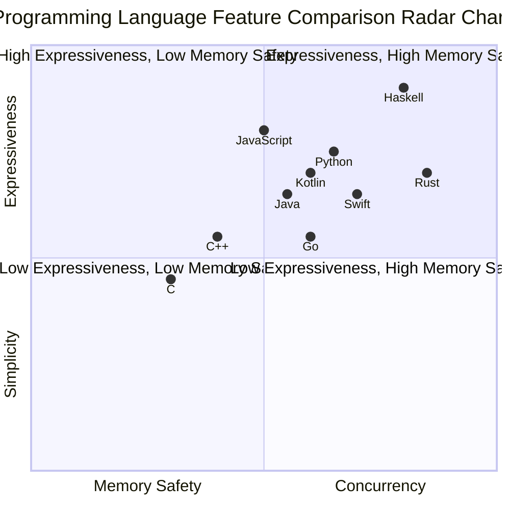

**Explanation:** This quadrant chart illustrates the trade-off between memory safety and expressiveness in various programming languages. Memory safety reflects how well a language prevents common memory-related errors like buffer overflows and use-after-free bugs. Expressiveness measures the language's ability to concisely express complex ideas. The chart groups languages by their position across these two critical dimensions, helping developers select languages aligned with their project priorities.

<br>

### Diagram 2: Evolution of Programming Languages (1940s-2020s)

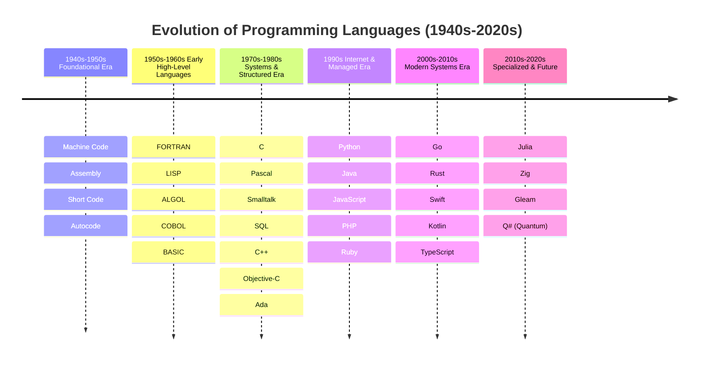

**Explanation:** This timeline traces the major milestones in programming language history, organised by era and highlighting the dominant languages that emerged during each period. The diagram shows how language design evolved from low-level machine code to modern high-level, type-safe, and specialised languages. Each era reflects the computing challenges and priorities of its time, from hardware limitations to internet connectivity and now to quantum computing and systems security.

<br>

### Diagram 3: Programming Paradigm Relationships

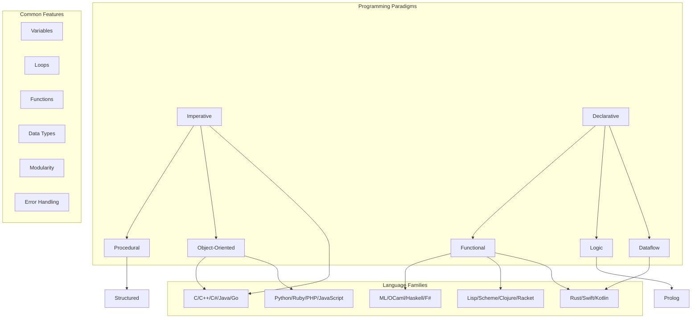

**Explanation:** This flowchart illustrates the hierarchical relationships between programming paradigms and major language families. Starting from the fundamental paradigm categories of imperative and declarative programming, the diagram shows how specific paradigms like procedural, object-oriented, functional, and logic programming relate to each other and to the languages that implement them. The visual representation helps developers understand how different programming approaches are connected and how languages incorporate multiple paradigms.

<br>

### Diagram 4: Programming Language Feature Distribution

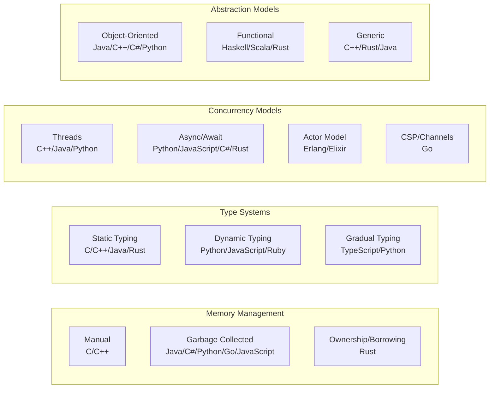

**Explanation:** This diagram organises programming language features across four fundamental dimensions: memory management models, type systems, concurrency models, and abstraction approaches. Each branch shows the major variants and provides example languages for each approach, helping developers understand the design space and identify languages that align with their specific requirements. The diagram demonstrates how languages make different choices across these dimensions, resulting in diverse programming experiences.

<br>

## Part Five: Conclusion

The landscape of programming languages presents a rich diversity of approaches, each embodying different trade-offs in terms of performance, safety, expressiveness, and developer productivity. Understanding the concepts common to most languages provides a solid foundation that transfers across language boundaries, enabling developers to learn new languages more quickly and appreciate the design decisions behind each language's unique features.

The varying concepts discussed in this documentation illustrate how different design priorities lead to distinct language capabilities. Some languages prioritise performance and low-level control, others emphasise safety and correctness, while still others focus on developer productivity and expressiveness. The choice of programming language should consider project requirements, team expertise, ecosystem support, and long-term maintenance considerations.

As the field of software engineering continues to evolve, new languages emerge to address emerging challenges, while established languages adapt through version updates and feature additions. The fundamental concepts documented here remain relevant across these changes, providing a stable foundation for understanding programming languages as tools for expressing algorithms and building software systems.

<br>

## References and Further Reading

1. Aho, A.V., Lam, M.S., Sethi, R., & Ullman, J.D. (2006). *Compilers: Principles, Techniques, and Tools*. Addison-Wesley.

2. Bloch, J. (2018). *Effective Java* (3rd ed.). Addison-Wesley.

3. Cormen, T.H., Leiserson, C.E., Rivest, R.L., & Stein, C. (2009). *Introduction to Algorithms* (3rd ed.). MIT Press.

4. Gamma, E., Helm, R., Johnson, R., & Vlissides, J. (1994). *Design Patterns: Elements of Reusable Object-Oriented Software*. Addison-Wesley.

5. Goetz, B., Peierls, T., Bloch, J., Bowbeer, J., Holmes, D., & Lea, D. (2006). *Java Concurrency in Practice*. Addison-Wesley.

6. Klabnik, S., & Nichols, C. (2019). *The Rust Programming Language*. No Starch Press.

7. Lipovača, M. (2011). *Learn You a Haskell for Great Good!*. No Starch Press.

8. Liskov, B., & Guttag, J. (2000). *Program Development in Java: Abstraction, Specification, and Object-Oriented Design*. Addison-Wesley.

9. Meyer, B. (1997). *Object-Oriented Software Construction* (2nd ed.). Prentice Hall.

10. Milner, R., Tofte, M., & Harper, R. (1990). *The Definition of Standard ML*. MIT Press.

11. Pierce, B.C. (2002). *Types and Programming Languages*. MIT Press.

12. Sedgewick, R., & Wayne, K. (2011). *Algorithms* (4th ed.). Addison-Wesley.

13. Stroustrup, B. (2013). *The C++ Programming Language* (4th ed.). Addison-Wesley.

14. Van Rossum, G., & Drake, F.L. (2009). *The Python Language Reference Manual*. Network Theory Ltd.

15. Wirth, N. (1976). *Algorithms + Data Structures = Programs*. Prentice Hall.


<br><br><br><br>


<h1 align="center">Comprehensive IT Resource Guide for Aspiring Professionals - A FOSS-Centric Approach to Technology Learning and Development.</h1>

<br><br>

## Table of Contents

1. [Introduction: The FOSS Philosophy](#introduction-the-foss-philosophy)
2. [Understanding Free and Open Source Software](#understanding-free-and-open-source-software)
3. [FOSS Hubs and Repositories: Where to Find Quality Software](#foss-hubs-and-repositories-where-to-find-quality-software)
4. [Free Learning Resources Catalog](#free-learning-resources-catalog)
5. [Domain-Specific Learning Pathways](#domain-specific-learning-pathways)
6. [Practical Guidance for FOSS Adoption](#practical-guidance-for-foss-adoption)
7. [The Future of FOSS and Career Opportunities](#the-future-of-foss-and-career-opportunities)
8. [Conclusion: Your Journey Forward](#conclusion-your-journey-forward)

<br>

# 1. Introduction: The FOSS Philosophy

## 1.1 What is FOSS and Why Does It Matter?

Free and Open Source Software (FOSS) represents a fundamental shift in how technology is created, shared, and utilized across the globe. Unlike proprietary software that restricts access to source code and limits user freedoms, FOSS embodies principles of openness, collaboration, and community-driven innovation. For aspiring IT professionals, understanding and embracing FOSS is not merely an option but a strategic advantage that opens doors to endless learning opportunities and career growth.

The philosophy behind FOSS extends far beyond cost savings. It represents a movement that democratizes technology, ensuring that anyone with curiosity and determination can access, study, and contribute to world-class software projects. This accessibility is particularly crucial for aspiring professionals who may lack the financial resources to purchase expensive proprietary tools or enroll in costly training programs. With FOSS, the barriers to entry are significantly lowered, allowing talent and dedication to shine regardless of economic background.

## 1.2 The Four Essential Freedoms

The foundation of FOSS rests upon four essential freedoms that define what it means for software to be truly free:

**Freedom 0: The Freedom to Run the Program**
Users can execute the software for any purpose without restrictions. This freedom ensures that software serves its users rather than the other way around, enabling individuals and organizations to use tools in ways that best suit their needs.

**Freedom 1: The Freedom to Study and Modify the Source Code**
Access to source code allows users to understand how the software works and adapt it to their requirements. This transparency is fundamental to learning, security auditing, and innovation.

**Freedom 2: The Freedom to Redistribute Copies**
Users can share software with others, fostering community growth and knowledge dissemination. This freedom ensures that beneficial software can reach those who need it most.

**Freedom 3: The Freedom to Distribute Modified Versions**
Users can share their improvements, allowing the entire community to benefit from collective innovation. This creates a virtuous cycle of continuous improvement.

## 1.3 FOSS vs. Proprietary Software: A Comparison

| Aspect | FOSS | Proprietary Software |
|--------|------|---------------------|
| **Source Code Access** | Freely available for study and modification | Restricted, typically a trade secret |
| **Cost** | Generally free of charge | Licensing fees and subscription costs |
| **Community Support** | Global community of developers and users | Vendor-controlled support channels |
| **Customization** | Unlimited, user-driven modifications | Limited to vendor-approved features |
| **Security Transparency** | Open auditing by global security experts | Limited external verification |
| **Vendor Lock-in** | None - freedom to switch or modify | High - dependent on vendor for updates |
| **Learning Opportunities** | Study real-world production code | Limited to public documentation |
| **Innovation Pace** | Rapid, community-driven | Controlled by vendor release cycles |

<br>

# 2. Understanding Free and Open Source Software

## 2.1 The Current Impact of FOSS on Technology

FOSS has fundamentally reshaped the technological landscape, driving innovation across industries and empowering individuals worldwide. The collaborative nature of FOSS development fosters rapid innovation cycles, as developers from diverse backgrounds contribute their expertise to shared projects. This global collaboration has produced some of the most significant technological achievements of our time, including the Linux kernel, Apache Web Server, Python programming language, Mozilla Firefox, and WordPress.

Major technology companies, including Google, Facebook, Microsoft, and IBM, actively contribute to and rely on open-source projects. This corporate participation validates the practical value of FOSS and creates numerous career opportunities for professionals with open-source expertise. For aspiring IT professionals, involvement in FOSS projects provides exposure to industry-standard practices and technologies that are widely used in enterprise environments.

## 2.2 Security and Transparency in FOSS

Security through transparency is one of the most compelling advantages of FOSS. When source code is open for public scrutiny, security vulnerabilities can be identified and addressed more quickly than in proprietary systems where only the vendor can examine the code. This collective security model has proven effective in protecting critical infrastructure and sensitive data.

Projects like OpenSSL, Kali Linux, and Signal demonstrate how FOSS contributes to global security and privacy. These tools are essential for maintaining secure communications, conducting security assessments, and protecting user privacy in an era of increasing cyber threats. For aspiring security professionals, studying these projects provides invaluable insights into real-world security implementations.

## 2.3 Cost Reduction and Accessibility

FOSS dramatically reduces the financial barriers to technology adoption and learning. For individuals and organizations with limited budgets, FOSS provides professional-grade tools without the burden of licensing fees. Startups, small businesses, and educational institutions particularly benefit from access to comprehensive software suites that would otherwise be cost-prohibitive.

This cost reduction extends to training and education, as many FOSS projects include extensive documentation, tutorials, and community support. Aspiring professionals can learn using the same tools used in industry, building practical skills without incurring significant expenses.

## 2.4 FOSS and Digital Inclusion

FOSS plays a vital role in bridging the digital divide, providing access to technology and education in developing regions. By offering affordable software alternatives, FOSS enables communities to build digital infrastructure and participate in the global digital economy. Initiatives like Mozilla's Web Literacy and the Raspberry Pi Foundation's educational programs demonstrate how FOSS can empower communities and create opportunities for learning and growth.

<br>

# 3. FOSS Hubs and Repositories: Where to Find Quality Software

## 3.1 Source Code Forges

### GitHub
**URL:** [https://github.com/](https://github.com/)

GitHub has become the world's largest host of public source code, supporting Git repositories, pull requests, issue tracking, project wikis, and continuous integration pipelines. While the platform itself is proprietary, it hosts millions of open-source projects and offers free accounts for public repositories. For aspiring professionals, GitHub serves as both a learning resource and a portfolio platform where contributions to open-source projects can demonstrate skills to potential employers.

The platform's social coding features enable collaboration across geographical boundaries, making it possible for beginners to learn from experienced developers through code reviews, issue discussions, and project participation. The extensive use of GitHub in industry ensures that familiarity with its workflow is a valuable professional skill.

### GitLab
**URL:** [https://gitlab.com/](https://gitlab.com/)

GitLab offers a complete open-core platform with the Community Edition available under the MIT license. The platform provides Git hosting, continuous integration and delivery, issue tracking, and project wikis. Users can choose between the software-as-a-service offering at gitlab.com or self-hosted deployments, providing flexibility for different use cases.

The integrated DevOps approach of GitLab makes it particularly valuable for professionals interested in the full software development lifecycle. Its comprehensive feature set reduces the need for multiple tools, making it ideal for both individual developers and teams.

### SourceForge
**URL:** [https://sourceforge.net/](https://sourceforge.net/)

Founded in 1999, SourceForge is one of the oldest open-source project hosting platforms. It provides free hosting with support for Git, Subversion, CVS, and Mercurial version control systems, along with download mirrors, bug trackers, and project pages. Many established open-source projects maintain their presence on SourceForge due to its reliable infrastructure and file hosting capabilities.

For aspiring professionals, SourceForge offers insights into the history and evolution of open-source development practices. The platform's longevity demonstrates the sustainability of FOSS projects and provides examples of how projects grow and maintain their communities over time.

### GNU Savannah
**URL:** [https://savannah.gnu.org/](https://savannah.gnu.org/)

Hosted by the Free Software Foundation, GNU Savannah strictly requires projects to use FOSS-compatible licenses, making it a bastion of free software principles. The platform powers both savannah.gnu.org for GNU projects and savannah.nongnu.org for other FOSS projects. This strict adherence to free software philosophy ensures that all projects hosted on Savannah align with the core principles of FOSS.

For learners interested in understanding the philosophical foundations of free software, Savannah provides access to projects that embody the principles advocated by the Free Software Foundation. Studying these projects can provide insights into how free software ideals translate into practical development.

### Codeberg
**URL:** [https://codeberg.org/](https://codeberg.org/)

Codeberg is a non-profit, community-run forge based on Forgejo, a Gitea fork. The platform provides Git hosting, wikis, issue tracking, and continuous integration through Woodpecker. Funded entirely by donations, Codeberg focuses on privacy, simplicity, and community governance, making it an ideal choice for developers who value independence from corporate platforms.

The community-focused model of Codeberg provides an alternative to commercially-owned platforms, demonstrating how open-source principles can extend to the infrastructure that supports development. This model is particularly relevant for understanding sustainable community governance.

### OSDN
**URL:** [https://osdn.net/](https://osdn.net/)

Originally SourceForge.JP, OSDN provides Git, Subversion, and CVS hosting along with bug tracking and project wikis. While the site has experienced intermittent availability, it remains an important historical resource for understanding FOSS development in the Japanese and Asian contexts.

## 3.2 Package and Application Distribution Hubs

### Flathub
**URL:** [https://flathub.org/](https://flathub.org/)

Flathub serves as the central repository for Flatpak-packaged Linux desktop applications. With hundreds of applications available, including GIMP, VLC, and many others, Flathub enables these applications to run on any Linux distribution that supports Flatpak. The platform has significantly simplified application distribution for Linux, addressing historical challenges with fragmentation across distributions.

For Linux users and developers, understanding Flatpak and Flathub is increasingly important as the ecosystem moves toward standardized application packaging and distribution. The ability to package applications for multiple distributions simultaneously represents a significant advancement in Linux desktop usability.

### Snapcraft
**URL:** [https://snapcraft.io/](https://snapcraft.io/)

Canonical's Snapcraft provides a universal Linux package format and the Snap Store, where developers publish sandboxed applications that auto-update across distributions. Snaps offer automatic updates, rollback capabilities, and confinement for security, making them suitable for both desktop and server applications.

The Snap Store provides an alternative to traditional package management, offering benefits like consistent dependency handling and simplified installation. For developers, understanding snap packaging can be valuable for distributing applications to a wide Linux audience.

### Open Hub
**URL:** [https://www.openhub.net/](https://www.openhub.net/)

Formerly known as Ohloh, Open Hub aggregates metadata on FOSS projects, allowing users to search by language, license, activity levels, and contributor counts across more than 600,000 projects. The platform provides code metrics and insights into project health, making it valuable for evaluating potential dependencies or identifying active projects for contribution.

For aspiring professionals, Open Hub offers data-driven insights into the open-source ecosystem, helping identify trends, active projects, and areas of opportunity for contribution. Understanding these metrics can inform decisions about which technologies to learn and where to invest development effort.

### AlternativeTo
**URL:** [https://alternativeto.net/](https://alternativeto.net/)

AlternativeTo provides crowdsourced directories of software alternatives, including a significant focus on open-source alternatives to popular proprietary software. Users can filter by license type, platform, and other criteria to find suitable replacements for commercial applications.

This resource is invaluable for individuals and organizations transitioning to FOSS solutions, providing practical guidance on available alternatives for specific use cases. The community voting and review system helps ensure recommendations are current and reliable.

## 3.3 Mobile-Focused FOSS Repositories

### F-Droid
**URL:** [https://f-droid.org/](https://f-droid.org/)

F-Droid is an installable catalog of FOSS Android applications. Clients can browse, install, and auto-update applications without proprietary dependencies. The repository includes thousands of applications across all categories, from productivity tools to games and utilities.

For Android users seeking privacy and freedom, F-Droid represents an essential resource. The platform's commitment to free software principles ensures that all applications in its repository respect user freedoms. Developers can learn from the source code of these applications and understand mobile development practices within a free software context.

<br>

# 4. Free Learning Resources Catalog

## 4.1 Comprehensive Programming and Computer Science Resources

### Free Programming Books
**URL:** [https://github.com/EbookFoundation/free-programming-books](https://github.com/EbookFoundation/free-programming-books)

This extensive collection represents one of the most comprehensive curated lists of freely available programming and computer science books, courses, and tutorials available anywhere. With thousands of resources spanning virtually every programming language, framework, and domain, this repository serves as a gateway to high-quality learning materials that would otherwise cost significant amounts of money.

The repository is organized by language and topic, making it easy to find resources for specific learning goals. Each entry typically includes a description, format information, and direct access to the material. For aspiring professionals, this repository eliminates the excuse that quality learning materials are too expensive.

### Project-Based Learning
**URL:** [https://github.com/practical-tutorials/project-based-learning](https://github.com/practical-tutorials/project-based-learning)

This repository provides tutorials and projects where you build real applications from scratch, representing one of the most effective approaches to learning programming and software development. The project-based methodology ensures that learners acquire practical skills through hands-on experience rather than passive consumption of theoretical content.

The repository covers web development, backend systems, mobile applications, and many other domains. Each tutorial provides step-by-step instructions while encouraging understanding of the underlying concepts. Completing projects from this collection builds a portfolio of work that demonstrates practical capabilities to potential employers.

### Build Your Own X
**URL:** [https://github.com/codecrafters-io/build-your-own-x](https://github.com/codecrafters-io/build-your-own-x)

This exceptional resource provides guide-style tutorials to build foundational technologies from scratch, including your own shell, HTTP server, database, and many other systems. The hands-on approach provides deep understanding of how technologies work under the hood, going far beyond surface-level usage.

For aspiring engineers, building these foundational technologies develops the problem-solving skills and systems thinking essential for advanced software development. Understanding the internals of these tools provides insights that make you a more effective developer and troubleshooter.

### The Algorithms
**URL:** [https://github.com/TheAlgorithms](https://github.com/TheAlgorithms)

This repository provides implementations of algorithms and data structures in multiple programming languages. Organized by language, the repository serves as a reference and learning tool for understanding fundamental computer science concepts. Each implementation includes explanations and examples.

The comprehensive coverage of algorithms makes this repository valuable for interview preparation, understanding algorithmic thinking, and learning how to implement efficient solutions. The multi-language approach allows comparison of implementations across different programming paradigms.

### Coding Interview University
**URL:** [https://github.com/jwasham/coding-interview-university](https://github.com/jwasham/coding-interview-university)

Created by a software engineer who dedicated significant time to preparing for technical interviews, this repository provides a complete computer science study plan. The curriculum covers data structures, algorithms, operating systems, networking, databases, and more, all organized into a manageable study schedule.

The personal nature of this resource makes it particularly relatable for aspiring professionals. The author's journey from non-engineer to successful software engineer demonstrates what is possible with dedication and the right resources. The repository includes detailed notes, reading lists, and practice recommendations.

### System Design Primer
**URL:** [https://github.com/donnemartin/system-design-primer](https://github.com/donnemartin/system-design-primer)

This comprehensive resource covers how to design large-scale systems and prepare for system design interviews. It provides frameworks, case studies, and practice problems for designing distributed systems, databases, and other complex architectures. The material is organized progressively, building from fundamental concepts to advanced topics.

System design is often the most challenging aspect of technical interviews, and this resource demystifies the process through clear explanations and practical examples. The repository includes solutions to common design problems, making it invaluable for interview preparation and practical system design.

### Awesome Lists
**URL:** [https://github.com/sindresorhus/awesome](https://github.com/sindresorhus/awesome)

This meta-list contains curated lists about nearly every topic imaginable, from programming languages to web development, machine learning, security, and beyond. The "awesome" format has become a standard for community-curated resources, with each list maintained by domain experts.

For aspiring professionals, these lists serve as starting points for exploring new topics. Rather than searching blindly for resources, you can rely on the collective wisdom of communities to identify the most valuable materials. The breadth of topics covered ensures that you can find resources for virtually any interest.

### Developer Roadmap
**URL:** [https://github.com/kamranahmedse/developer-roadmap](https://github.com/kamranahmedse/developer-roadmap)

This repository provides visual roadmaps for various career paths in software development, including frontend, backend, DevOps, and others. The interactive guides help aspiring professionals understand the skills and technologies needed for different roles and progression paths.

The roadmaps are particularly valuable for beginners who are unsure where to start or how to structure their learning. By providing clear milestones and recommended technologies, they eliminate the uncertainty of self-directed learning and help focus efforts on the most impactful skills.

### Tech Interview Handbook
**URL:** [https://github.com/yangshun/tech-interview-handbook](https://github.com/yangshun/tech-interview-handbook)

This comprehensive resource provides curated coding interview preparation materials for software engineers. It covers everything from studying strategies to specific algorithms and data structures commonly tested in interviews, along with behavioral interview guidance.

The handbook's practical focus on real interview processes makes it particularly valuable. It includes tips from successful candidates and hiring managers, providing insights into what companies actually look for during the hiring process.

### FreeCodeCamp
**URL:** [https://www.freecodecamp.org/](https://www.freecodecamp.org/)

FreeCodeCamp offers free coding tutorials and complete tracks covering web development, algorithms, data structures, full-stack development, responsive design, and more. The platform's project-based approach ensures that learning is practical and portfolio-building.

The curriculum is structured to take learners from absolute beginner to job-ready in a systematic way. Each certification track requires completion of multiple projects that can be included in a professional portfolio. The strong community support provides help when challenges arise.

### The Odin Project
**URL:** [https://www.theodinproject.com/](https://www.theodinproject.com/)

This community-maintained free full-stack web development curriculum covers frontend and backend technologies in depth. The project-based curriculum emphasizes practical skills and includes a strong community component for support and collaboration.

The comprehensive nature of the curriculum makes it suitable for learners who want a structured approach to becoming a web developer. The focus on modern technologies and industry best practices ensures that graduates are prepared for professional work.

### Codecademy (Free Level)
**URL:** [https://www.codecademy.com/](https://www.codecademy.com/)

Codecademy provides interactive coding courses in many languages, including Python, JavaScript, Java, and Go, along with web development and data science tracks. The free level includes access to many courses and interactive lessons.

The interactive nature of Codecademy's platform is particularly beneficial for beginners who learn best through immediate practice. The in-browser coding environment eliminates setup barriers, allowing learners to focus on concepts rather than configuration.

### Exercism
**URL:** [https://exercism.org/](https://exercism.org/)

Exercism offers free practice and mentorship for over 70 programming languages. The platform provides coding challenges and opportunities to receive feedback from mentors, making it valuable for developing coding skills and improving code quality.

The mentorship component sets Exercism apart from other practice platforms. Receiving personalized feedback on solutions helps learners develop better coding habits and understand different approaches to problems. The community aspect also provides motivation and support.

### CS50 by Harvard University
**URL:** [https://cs50.harvard.edu](https://cs50.harvard.edu)

This introductory computer science course from Harvard University is available online for free through Harvard's OpenCourseWare and edX. The course covers programming fundamentals, algorithms, data structures, and computer science concepts through engaging lectures and challenging problem sets.

The quality of instruction and course materials makes CS50 one of the most respected introductory courses available. The problem sets are designed to challenge learners while building practical skills. Completing CS50 provides a strong foundation for further study.

## 4.2 DevOps, Cloud, and Systems Administration Resources

### DevOps Exercises
**URL:** [https://github.com/bregman-arie/devops-exercises](https://github.com/bregman-arie/devops-exercises)

This repository provides exercises covering various DevOps topics, including Linux, networking, containers, cloud platforms, configuration management, and CI/CD pipelines. The exercises are structured to build practical skills through hands-on practice.

For aspiring DevOps professionals, this repository offers a structured way to develop the diverse skills required in this role. The breadth of topics ensures comprehensive coverage of the DevOps landscape, while the exercise format makes learning active and engaging.

### The Book of Secret Knowledge
**URL:** [https://github.com/trimstray/the-book-of-secret-knowledge](https://github.com/trimstray/the-book-of-secret-knowledge)

This repository provides a collection of inspiring lists, manuals, cheatsheets, blogs, hacks, one-liners, CLI and web tools, and more. It serves as a knowledge base for system administrators, developers, and IT professionals seeking practical information.

The curated nature of this resource ensures that the included tools and techniques are battle-tested and useful. For professionals working with Linux systems, this repository can significantly improve productivity by providing quick access to essential information.

### Awesome Cloud-Native Trainings
**URL:** [https://github.com/joseadanof/awesome-cloudnative-trainings](https://github.com/joseadanof/awesome-cloudnative-trainings)

This repository provides curated training materials for cloud-native technologies, including Kubernetes, containers, microservices, and related tools. The resources include courses, workshops, books, and interactive learning materials.

As cloud-native approaches become increasingly prevalent, this repository helps professionals stay current with evolving technologies. The curation ensures that recommended materials are high-quality and effective for learning.

### FreeDevResources
**URL:** [https://github.com/leogopal/free-dev-resources](https://github.com/leogopal/free-dev-resources)

This repository provides a curated list of free services, development tools, and software-as-a-service, platform-as-a-service, and infrastructure-as-a-service offerings with free tiers. The resources cover cloud computing, infrastructure, and development tools.

For learners and professionals on a budget, this repository identifies opportunities to work with industry-standard tools without incurring costs. The free tiers allow experimentation and learning with real services, building practical experience that is valuable for career advancement.

### Free Certifications
**URL:** [https://github.com/cloudcommunity/Free-Certifications](https://github.com/cloudcommunity/Free-Certifications)

This repository provides a curated list of free courses with certifications, including cloud computing, development, security, and other IT domains. The certifications can be included in professional profiles to demonstrate skills.

For aspiring professionals, certification can provide validation of skills that is recognized by employers. The free nature of these certifications removes financial barriers to obtaining credentials that can enhance career prospects.

## 4.3 Linux and Open Source Learning

### Linux Journey
**URL:** [https://linuxjourney.com/](https://linuxjourney.com/)

Linux Journey provides free, interactive Linux learning materials organized as a curriculum. The content covers everything from basic Linux commands to system administration, networking, and security topics. The modular approach allows learners to focus on areas of interest.

For professionals working with Linux systems, the structured curriculum provides a comprehensive foundation. The interactive nature of the materials makes learning engaging, while the practical focus ensures that skills are immediately applicable.

### The Art of Command Line
**URL:** [https://github.com/jlevy/the-art-of-command-line](https://github.com/jlevy/the-art-of-command-line)

This repository provides a curated guide to using the command line effectively, covering common commands, scripting, and productivity tips. The content is designed to be used as a reference rather than a comprehensive tutorial, making it valuable for quick learning.

For Linux users, mastering the command line is essential for productivity and system management. This resource provides the most important information in a concise format, making it ideal for beginners seeking to build confidence with the command line.

### Linux Upskill Challenge
**URL:** [https://github.com/snori74/linuxupskillchallenge](https://github.com/snori74/linuxupskillchallenge)

This repository provides a 20-day challenge to build Linux system administration skills through daily exercises. Each day introduces new concepts and tasks, progressively building a comprehensive skill set. The challenge format provides structure and accountability.

For aspiring system administrators, the challenge offers a practical introduction to the role's responsibilities. Completing the challenge provides hands-on experience with real system administration tasks, building confidence and practical skills.

## 4.4 Specialized and Supplementary Resources

### Public APIs
**URL:** [https://github.com/public-apis/public-apis](https://github.com/public-apis/public-apis)

This repository provides a comprehensive list of free application programming interfaces for use in software and web development. The APIs cover categories including data, entertainment, finance, weather, and many others, making it an invaluable resource for building projects.

For developers building applications, access to APIs can dramatically expand the possibilities of what can be created. This repository eliminates the need to search for suitable APIs, providing a curated list of reliable options. Building projects that consume these APIs provides experience with integration and data handling.

### Real World
**URL:** [https://github.com/gothinkster/realworld](https://github.com/gothinkster/realworld)

This repository explores how an identical Medium clone is constructed using various frontend and backend implementations. The project demonstrates how the same application can be built with different technologies, allowing comparison of approaches and frameworks.

For developers learning new technologies, seeing how the same application is implemented in different stacks provides insights into the strengths and weaknesses of each approach. The project also serves as a reference for best practices in application architecture.

### Awesome for Beginners
**URL:** [https://github.com/MunGell/awesome-for-beginners](https://github.com/MunGell/awesome-for-beginners)

This repository provides a curated list of beginner-friendly open-source projects. The projects are tagged with labels indicating issues suitable for first-time contributors, making it easier to find opportunities for meaningful participation.

For those new to open-source contribution, finding appropriate projects can be challenging. This repository solves that problem by curating projects that actively welcome beginners. Contributing to these projects provides experience with real software development workflows and community participation.

### 30 Seconds of Code
**URL:** [https://github.com/30-seconds/30-seconds-of-code](https://github.com/30-seconds/30-seconds-of-code)

This repository provides short JavaScript code snippets for common programming tasks. Each snippet is independently useful and includes explanations of how it works. The format makes learning efficient and practical.

For developers, having a collection of commonly used code patterns saves time and improves productivity. The snippets also serve as learning tools, demonstrating elegant solutions to common problems. The wide coverage ensures that developers of all levels can find useful content.

### Node Best Practices
**URL:** [https://github.com/goldbergyoni/nodebestpractices](https://github.com/goldbergyoni/nodebestpractices)

This repository provides a comprehensive list of best practices for Node.js development, covering project structure, error handling, testing, security, and performance. Each practice includes rationale and examples, making the guidance practical and actionable.

For Node.js developers, following established best practices improves code quality and reduces technical debt. This repository serves as a reference for the evolving consensus on how to build robust Node.js applications. The community-maintained nature ensures that practices remain current.

### Awesome Cheatsheets
**URL:** [https://github.com/LeCoupa/awesome-cheatsheets](https://github.com/LeCoupa/awesome-cheatsheets)

This repository provides a collection of cheatsheets for various programming languages, frameworks, and tools. The cheatsheets are designed for quick reference, providing essential information in a compact format.

For developers, having quick access to syntax and common patterns reduces context switching and improves productivity. The curated nature ensures that the information is accurate and useful, while the breadth of coverage makes it a comprehensive reference.

### Build Your Own X
**URL:** [https://github.com/codecrafters-io/build-your-own-x](https://github.com/codecrafters-io/build-your-own-x)

This repository provides guide-style tutorials to build foundational technologies from scratch, including your own shell, HTTP server, database, and many other systems. The hands-on approach provides deep understanding of how technologies work under the hood, going far beyond surface-level usage.

For aspiring engineers, building these foundational technologies develops the problem-solving skills and systems thinking essential for advanced software development. Understanding the internals of these tools provides insights that make you a more effective developer and troubleshooter.

### App Ideas
**URL:** [https://github.com/florinpop17/app-ideas](https://github.com/florinpop17/app-ideas)

This repository provides a collection of application ideas that can be used to improve coding skills. The ideas are organized by difficulty level, from beginner to advanced, with each idea including user stories, features, and suggested technologies.

For developers looking to build their portfolio, this repository eliminates the challenge of finding project ideas. The structured approach ensures that projects are appropriately challenging and provide learning opportunities. Building these applications develops practical skills and produces portfolio pieces.

### Free for Developers
**URL:** [https://github.com/ripienaar/free-for-dev](https://github.com/ripienaar/free-for-dev)

This repository provides a list of software-as-a-service, platform-as-a-service, and infrastructure-as-a-service offerings that have free tiers for developers. The resources cover a wide range of categories, including hosting, databases, monitoring, and development tools.

For developers building applications on a budget, this repository identifies services that can be used without incurring costs. The free tiers allow experimentation and development without financial risk, while providing access to professional-grade services.

<br>

# 5. Domain-Specific Learning Pathways

## 5.1 Computer Science Fundamentals

For those seeking to build a strong foundation in computer science, the following resources provide comprehensive coverage of core concepts:

**Core Topics:** Algorithms, data structures, programming languages, operating systems, networking, databases, and software engineering principles.

**Recommended Starting Points:**
- CS50 by Harvard University provides an engaging introduction to computer science concepts
- Coding Interview University offers a complete study plan covering essential topics
- Free Programming Books includes materials for in-depth study of specific areas

**Progression Path:**
1. Begin with introductory programming and computer science concepts
2. Deepen understanding of algorithms and data structures
3. Study operating systems and networking principles
4. Explore databases and software engineering practices
5. Apply knowledge through projects and contributions

## 5.2 Web Development

The web development pathway offers opportunities for both frontend and backend specialization, with full-stack development combining both areas.

**Frontend Development:**
- HTML, CSS, and JavaScript fundamentals
- Modern frameworks like React, Vue.js, or Angular
- Responsive design and user experience considerations
- State management and component architecture
- Performance optimization and accessibility

**Backend Development:**
- Server-side programming languages (Node.js, Python, Java, PHP)
- Application programming interface design
- Database management and query optimization
- Authentication and authorization
- Server deployment and scaling

**Recommended Starting Points:**
- The Odin Project provides comprehensive full-stack curriculum
- FreeCodeCamp offers project-based learning across web technologies
- Project-Based Learning includes practical tutorials for building applications

## 5.3 DevOps and Cloud Engineering

DevOps and cloud engineering represent growing career opportunities, requiring a diverse skill set spanning development and operations.

**Core Skills:**
- Linux system administration
- Scripting and automation
- Containerization (Docker) and orchestration (Kubernetes)
- Continuous integration and continuous delivery
- Infrastructure as code
- Monitoring and observability
- Cloud platforms (AWS, Azure, Google Cloud)

**Recommended Starting Points:**
- DevOps Exercises provides structured practice
- Awesome Cloud-Native Trainings offers curated learning materials
- The Book of Secret Knowledge contains practical reference materials

## 5.4 Security and Cybersecurity

Security professionals protect systems, networks, and data from threats and vulnerabilities.

**Core Areas:**
- Network security and protocols
- Cryptography and encryption
- Web application security
- Operating system security
- Penetration testing and vulnerability assessment
- Security monitoring and incident response

**Recommended Starting Points:**
- Free Programming Books includes security-related materials
- Security-focused FOSS projects provide practical learning
- Linux Upskill Challenge covers system security fundamentals

## 5.5 Data Science and Machine Learning

Data science and machine learning represent rapidly growing fields with applications across industries.

**Core Areas:**
- Statistics and probability
- Programming for data analysis (Python/R)
- Data visualization
- Machine learning algorithms
- Deep learning and neural networks
- Natural language processing
- Data engineering

**Recommended Starting Points:**
- Free Programming Books includes data science materials
- Project-Based Learning includes data science projects
- Public APIs provide data sources for projects

## 5.6 Mobile Development

Mobile development offers opportunities for creating applications for Android and iOS platforms.

**Core Areas:**
- Mobile programming languages (Java/Kotlin for Android, Swift for iOS)
- Mobile framework (React Native, Flutter)
- Application lifecycle management
- User interface design for mobile
- Performance optimization for mobile devices

**Recommended Starting Points:**
- F-Droid provides access to FOSS Android applications for study
- Free Programming Books includes mobile development materials
- Project-Based Learning includes mobile application tutorials

<br>

# 6. Practical Guidance for FOSS Adoption

## 6.1 Getting Started with FOSS

Transitioning to FOSS can seem daunting, but a systematic approach makes the process manageable and rewarding:

**Step 1: Identify Your Needs**
Begin by understanding what you need software to do. Whether it's word processing, graphic design, video editing, web development, or system administration, there are FOSS alternatives for almost every use case. Making this initial assessment helps focus your efforts on finding appropriate software.

**Step 2: Research FOSS Alternatives**
Use resources like AlternativeTo to discover FOSS alternatives to proprietary software you currently use. This approach allows for a transition that maintains functionality while adopting new tools. The community reviews and ratings help identify the best options for your specific requirements.

**Step 3: Install and Experiment**
Install identified FOSS alternatives and experiment with them. Many FOSS applications can be installed alongside proprietary counterparts, allowing a gradual transition. Take time to learn the new workflows and features. The online communities associated with these projects are valuable resources for help.

**Step 4: Contribute to the Community**
As you become comfortable with FOSS tools, consider contributing to the community. This can begin with reporting bugs, suggesting features, creating documentation, or helping other users. As your skills grow, you may progress to contributing code or maintaining projects.

**Step 5: Share Your Experience**
Share your FOSS journey with others, particularly those who may benefit from adopting free software. This helps grow the community and supports the principles that make FOSS valuable. Your experiences can help others overcome the initial friction of adopting new tools.

## 6.2 FOSS for Professional Development

FOSS offers numerous opportunities for professional growth and career advancement:

**Building a Portfolio:**
Contributing to FOSS projects provides concrete evidence of your skills. Potential employers can review your contributions, seeing your code, documentation, and community engagement. This portfolio is often more valuable than a list of course completions.

**Learning Industry Standards:**
Many FOSS projects are maintained by professionals using industry-standard practices. Contributing to these projects exposes you to code reviews, issue tracking, continuous integration, and other professional development workflows. This experience is directly transferable to paid positions.

**Networking:**
The FOSS community includes professionals from around the world, many of whom work at technology companies. Participating in projects allows you to build relationships that can lead to job opportunities. The visibility of contributions also serves as a form of professional reputation.

**Earning Certifications:**
Free Certification resources allow you to obtain credentials that validate your skills. While not as recognized as some commercial certifications, they demonstrate commitment to learning and provide measurable achievements to include in your professional profile.

**Maintaining Skills:**
Even after achieving professional status, contributing to FOSS projects helps maintain and expand your skills. Working with others exposes you to different approaches and technologies, keeping your knowledge current. The collaborative nature of FOSS projects also hones teamwork and communication skills.

## 6.3 Common FOSS Tools for Daily Use

| Category | FOSS Option | Commercial Alternative |
|----------|-------------|----------------------|
| **Office Suite** | LibreOffice | Microsoft Office |
| **Image Editing** | GIMP | Adobe Photoshop |
| **Vector Graphics** | Inkscape | Adobe Illustrator |
| **Web Browser** | Firefox | Google Chrome |
| **Email Client** | Thunderbird | Microsoft Outlook |
| **Video Editing** | Shotcut, Kdenlive | Adobe Premiere |
| **3D Modeling** | Blender | Autodesk Maya |
| **Audio Editing** | Audacity | Adobe Audition |
| **PDF Editor** | PDFsam, LibreOffice Draw | Adobe Acrobat |
| **Communication** | Element, Jitsi | Slack, Zoom |
| **Cloud Storage** | Nextcloud | Dropbox |
| **Content Management** | WordPress | Adobe Experience Manager |

## 6.4 Overcoming FOSS Adoption Challenges

**Challenge: Learning Curve**
New software tools require time to learn. The transition from familiar proprietary applications to FOSS alternatives may initially feel slower or more difficult.

**Solution:**
Approach learning as an investment. The time spent mastering FOSS tools pays dividends through reduced costs, greater flexibility, and the benefits of community support. Most FOSS applications have comprehensive documentation and active community forums. Start with the most critical functions and gradually expand your knowledge.

**Challenge: Compatibility**
FOSS tools may not be compatible with proprietary file formats, creating issues when sharing files with others.

**Solution:**
Many FOSS applications can read and write proprietary formats with varying degrees of fidelity. When compatibility issues arise, consider whether you truly need to share in proprietary formats or whether alternatives like PDF or open formats would suffice. For critical compatibility needs, maintain access to the proprietary software or find workarounds.

**Challenge: Support**
Without a commercial vendor providing support, finding help for FOSS tools may feel challenging.

**Solution:**
The FOSS community provides support through forums, mailing lists, and chat platforms. Many projects have dedicated support channels where experienced users and developers help with issues. The quality of community support often exceeds commercial support in terms of responsiveness and depth of expertise. For enterprise needs, commercial support options exist for many FOSS projects.

**Challenge: Perceived Lack of Features**
Some FOSS tools are compared unfavorably to commercial alternatives in terms of features.

**Solution:**
Focus on your actual needs rather than feature checklists. Many FOSS tools provide sufficient functionality for most use cases, with continuous improvement through community contributions. The feature gap often exists primarily in niche areas or professional creative fields where commercial software has long-established dominance. For most users, FOSS tools provide more than adequate functionality.

<br>

# 7. The Future of FOSS and Career Opportunities

## 7.1 Emerging Trends in FOSS

**Artificial Intelligence and Machine Learning:**
FOSS is at the forefront of AI and ML development, with frameworks like TensorFlow, PyTorch, and Hugging Face driving innovation. The open nature of these tools ensures transparency and accountability in AI development, addressing ethical concerns around bias and fairness. For professionals, expertise in these tools provides access to one of the fastest-growing areas of technology.

**Cloud-Native Computing:**
The shift to cloud-native architectures has been driven significantly by FOSS projects like Kubernetes, Prometheus, and Envoy. These tools have become industry standards, creating demand for professionals with cloud-native expertise. The open nature of these projects ensures that the community collectively owns and evolves the platforms.

**Edge Computing:**
As computing moves to the edge, FOSS projects are enabling devices to process and analyze data locally. This trend creates opportunities for professionals interested in embedded systems, IoT, and distributed computing. The open nature of these projects allows for customization to specific hardware and use cases.

**Digital Sovereignty:**
Governments are increasingly concerned with digital sovereignty, reducing reliance on foreign proprietary software. FOSS enables countries to protect their digital infrastructure and data, creating opportunities for professionals working with public sector organizations.

**Sustainability:**
FOSS is recognized as more sustainable than proprietary software because the community collectively maintains projects, reducing duplication of effort. This sustainability extends to environmental benefits, as FOSS can extend the life of hardware through lightweight distributions and reduced resource requirements.

## 7.2 Career Opportunities in FOSS

**Open Source Developer:**
Developers who contribute to FOSS projects are in high demand, with many companies actively seeking candidates with open-source experience. The visibility of contributions and demonstrated technical skills make these candidates stand out.

**DevOps Engineer:**
FOSS tools dominate the DevOps landscape, with Linux, Docker, Kubernetes, and Jenkins being essential components. Professionals with expertise in these tools are essential for organizations adopting modern development practices.

**Cloud Architect:**
Cloud platforms rely heavily on FOSS technologies, creating demand for architects who understand how to design and implement cloud-native solutions. Knowledge of the underlying FOSS components is valuable for optimizing performance and managing costs.

**Security Specialist:**
FOSS projects like Let's Encrypt have transformed cybersecurity by providing free encryption. The open nature of FOSS enables professionals to audit code for vulnerabilities and contribute to security improvements.

**Educator and Trainer:**
As FOSS adoption grows, the need for educators and trainers to help others learn these technologies increases. Professionals who can effectively teach FOSS tools and principles are valuable in academic, corporate, and community settings.

**Technical Writer:**
FOSS projects require documentation, and skilled technical writers are essential for making these tools accessible. This role combines technical knowledge with communication skills, providing opportunities for diverse backgrounds.

**Community Manager:**
FOSS projects are powered by communities, and effective community management is crucial for project health. Community managers facilitate communication, organize events, and support contributors, playing a key role in project success.

## 7.3 Building a FOSS Career

**Start Early:**
Begin contributing to FOSS projects as early as possible. Even small contributions build skills and demonstrate commitment. The visibility of early contributions can lead to opportunities as your expertise grows.

**Build a Public Profile:**
Maintain a public profile through your GitHub contributions, technical blog posts, and participation in community forums. A visible track record of contributions serves as a portfolio that demonstrates skills and commitment.

**Specialize and Generalize:**
Develop deep expertise in specific areas while maintaining broad understanding of the technology landscape. The combination of specialization and breadth makes you valuable for both focused roles and leadership positions.

**Network Actively:**
Participate in FOSS communities through conferences, meetups, and online forums. Building relationships with other professionals creates opportunities for collaboration and career advancement.

**Stay Current:**
Technology evolves rapidly, and continuous learning is essential. FOSS communities provide opportunities to stay current with emerging trends and technologies. Regular contributions keep your skills sharp and your knowledge current.

<br>

# 8. Conclusion: Your Journey Forward

## 8.1 The FOSS Advantage

Free and Open Source Software represents more than a development model; it embodies principles of freedom, transparency, and collaboration that empower individuals and communities. For aspiring IT professionals, embracing FOSS provides:

**Access to Learning:**
FOSS removes financial barriers to learning, providing access to world-class tools and educational resources. The open nature of these resources allows for deep study and understanding.

**Portfolio Building:**
Contributing to FOSS projects provides concrete evidence of your skills that potential employers can review. Your contributions demonstrate technical ability, collaboration skills, and commitment to quality.

**Community Support:**
The FOSS community provides support, guidance, and networking opportunities. Participation in these communities accelerates learning and creates professional connections.

**Career Opportunities:**
FOSS skills are increasingly in demand across industries. Professionals with FOSS expertise are well-positioned for diverse career opportunities.

**Ethical Alignment:**
FOSS aligns with values of openness, fairness, and transparency. For professionals who value these principles, working with FOSS provides both professional and personal fulfillment.

## 8.2 Your First Steps

**Explore FOSS Resources:**
Begin by exploring the FOSS hubs and learning resources cataloged in this document. Identify areas of interest and start with the resources recommended for beginners.

**Install and Use FOSS Tools:**
Replace proprietary software with FOSS alternatives where possible. The practical experience of using FOSS tools builds confidence and skills.

**Join the Community:**
Participate in FOSS communities through forums, mailing lists, and chat platforms. Ask questions, help others, and build relationships with community members.

**Contribute to Projects:**
Begin contributing to FOSS projects, starting with small contributions like documentation improvements or bug reports. As your confidence grows, progress to code contributions.

**Share Your Experience:**
Share your FOSS journey with others, particularly those who may benefit from adopting free software. Your experience can help others overcome initial barriers and find success.

## 8.3 A Final Word

The journey into FOSS is a journey of continuous learning and growth. The resources cataloged in this document provide a starting point for exploring the vast landscape of free and open-source software. Whether you are a complete beginner or an experienced professional seeking new opportunities, FOSS offers tools, communities, and resources that can support your goals.

As technology continues to evolve, FOSS will remain at the forefront of innovation, driving advances in artificial intelligence, cloud computing, security, and many other domains. By embracing FOSS principles and contributing to the community, you become part of a global movement that is shaping the future of technology and society.

The path ahead is rich with opportunity. Start your journey today, and discover the power and potential of Free and Open Source Software.

<br>

## Appendix: Quick Reference

### Essential FOSS Hubs and Forges

| Platform | URL | Purpose |
|----------|-----|---------|
| **GitHub** | https://github.com/ | Code hosting and collaboration |
| **GitLab** | https://gitlab.com/ | Code hosting and DevOps |
| **SourceForge** | https://sourceforge.net/ | Project hosting |
| **GNU Savannah** | https://savannah.gnu.org/ | Free software hosting |
| **Codeberg** | https://codeberg.org/ | Community-run forge |
| **Flathub** | https://flathub.org/ | Linux application distribution |
| **Snapcraft** | https://snapcraft.io/ | Linux application distribution |
| **F-Droid** | https://f-droid.org/ | Android FOSS applications |
| **Open Hub** | https://www.openhub.net/ | FOSS project metrics |
| **AlternativeTo** | https://alternativeto.net/ | Software alternatives |

### Top Learning Resources Summary

| Resource | URL | Focus |
|----------|-----|-------|
| **Free Programming Books** | https://github.com/EbookFoundation/free-programming-books | Comprehensive book collection |
| **Project-Based Learning** | https://github.com/practical-tutorials/project-based-learning | Hands-on tutorials |
| **Build Your Own X** | https://github.com/codecrafters-io/build-your-own-x | Build systems from scratch |
| **Developer Roadmap** | https://github.com/kamranahmedse/developer-roadmap | Career guidance |
| **Coding Interview University** | https://github.com/jwasham/coding-interview-university | Complete study plan |
| **System Design Primer** | https://github.com/donnemartin/system-design-primer | System design learning |
| **The Odin Project** | https://www.theodinproject.com/ | Full-stack web development |
| **FreeCodeCamp** | https://www.freecodecamp.org/ | Interactive coding curriculum |
| **CS50** | https://cs50.harvard.edu | Computer science fundamentals |
| **Exercism** | https://exercism.org/ | Coding practice with mentorship |


<br><br><br><br>


