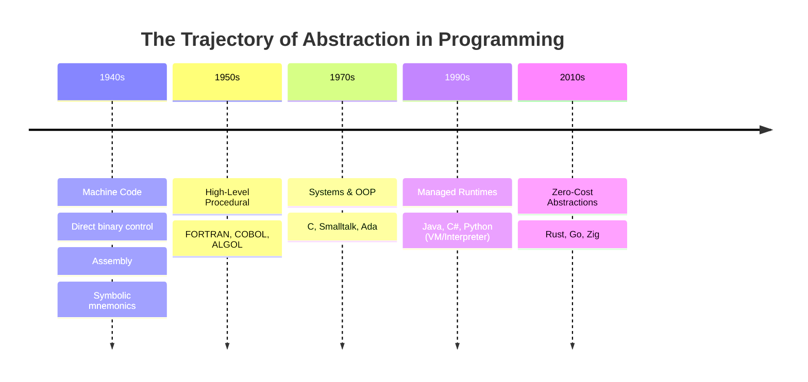

    
 

<h1 align="center">THE HISTORY AND TAXONOMY OF PROGRAMMING LANGUAGES.</h1>

    

    

  

 

 

  

### Executive Summary

Programming languages constitute the fundamental interface between human cognitive intent and computational execution. Their evolution mirrors the profound transformation of computing from specialized laboratory apparatus into ubiquitous global infrastructure. This document presents a comprehensive historical analysis, a structured technical taxonomy, and a practical reference framework for understanding programming languages from their binary origins through contemporary multi-paradigm developments. It serves as a definitive resource for researchers, software engineers, educators, and technology strategists seeking to contextualize current technical landscapes within the broader arc of computing history.

 

## 1. The Dawn of Programming: The Foundational Era (1940s–1950s)

The earliest period of computing was defined by a direct, unmediated relationship between the programmer and the hardware. This era established the fundamental principles of instruction execution and the first tentative steps toward symbolic abstraction.

### 1.1 Machine Code and Assembly: The Hardware Interface
The initial method of programming involved the direct input of **Machine Code**, which consists of binary patterns corresponding directly to specific processor operations. This practice required the programmer to possess exhaustive knowledge of the hardware architecture, including precise memory addressing schemes and instruction set layouts. Such programs were inherently non-portable; code written for one machine architecture could not function on another without complete rewriting.

The development of **Assembly Language** provided the first layer of abstraction. It replaced raw binary sequences with human-readable mnemonic instructions such as `ADD`, `MOV`, and `JMP`, alongside symbolic labels for memory locations. While this innovation improved development speed and reduced error rates compared to machine code, it remained a one-to-one mapping to hardware instructions. Assembly programming still demanded manual register allocation and explicit management of the call stack, tying the programmer closely to the underlying silicon.

### 1.2 Pioneering High-Level Conceptualizations
Even before high-level languages became practical, visionary computer scientists were designing theoretical frameworks for more expressive programming.

- **Plankalkül (Plan Calculus, 1945):** Conceived by Konrad Zuse for his Z4 computer, Plankalkül represents the first documented high-level programming language design in history. Although it was not implemented during Zuse's lifetime due to wartime and post-war constraints, the design was remarkably prescient. It introduced sophisticated concepts including structured data types, conditional execution branches, iterative loops, and operations on multidimensional arrays. Its theoretical significance lies in its demonstration that programming could transcend raw binary manipulation decades before this became standard industry practice.
- **Short Code (1949):** Developed by John Mauchly for the UNIVAC I, Short Code introduced the revolutionary concept of an interpreter. Rather than writing machine instructions, programmers could write mathematical expressions in a notation resembling algebra. The interpreter would translate these expressions line-by-line into machine code during execution. This approach drastically reduced the cognitive load on the user, shifting focus from hardware specifics to problem-solving logic, albeit at the cost of slower execution speed compared to compiled or hand-written assembly code.
- **The A-0 System and Autocode (1950s):** The A-0 System, created by Grace Hopper, is recognized as the world's first compiler. It allowed programmers to call pre-written mathematical subroutines using a higher-level notation, which the system would then "compile" into a complete machine code program. Its successors, **A-1, A-2, and A-3**, refined this process. Concurrently, **Autocode** (1954) developed by Alick Glennie for the Manchester Mark 1, became the first language to be fully compiled directly from a high-level specification to executable machine instructions, marking a pivotal shift away from interpretive overhead for performance-critical tasks.

 

## 2. The First Generation of High-Level Languages (Late 1950s–1960s)

This period witnessed the emergence of the first widely adopted high-level languages, each designed to dominate a specific computational domain and establish a distinct philosophical approach that continues to influence modern design.

### 2.1 FORTRAN: The Scientific Workhorse
**FORTRAN** (FORmula TRANslation), released by IBM in 1957 under the leadership of John Backus, was engineered specifically for high-performance scientific and engineering computation. Its primary innovation was the generation of machine code that was nearly as efficient as that produced by skilled assembly language programmers. This efficiency was critical for persuading a skeptical engineering community to abandon low-level coding. FORTRAN provided native support for complex numbers, arrays, and mathematical functions, which are essential for numerical modeling. Its continued evolution—through standards like Fortran 90, 2003, and 2018 incorporating object-oriented and concurrent features—cements its ongoing relevance in high-performance computing (HPC) fields such as computational fluid dynamics, climate simulation, and nuclear physics research.

### 2.2 LISP: Symbolic Computation and Artificial Intelligence
**LISP** (LISt Processor), conceived by John McCarthy at MIT in 1958, introduced a fundamentally different model of computation based on symbolic expressions rather than numbers. It pioneered several concepts now considered essential in modern programming, including recursive function calls, dynamic memory allocation with automatic garbage collection, and the property of homoiconicity—where the structure of code is identical to the structure of data (both are lists). This enabled powerful metaprogramming capabilities, allowing LISP programs to analyze, generate, and modify other LISP programs with ease. For decades, LISP and its dialects (**Common Lisp**, **Scheme**) served as the primary vehicles for artificial intelligence research, expert systems, and the exploration of functional programming paradigms.

### 2.3 COBOL: The Language of Business
**COBOL** (COmmon Business-Oriented Language), standardized in 1959 with significant influence from Grace Hopper, was designed to address the data processing needs of large enterprises and government agencies. Its syntax deliberately mimics English prose to enhance readability for non-programmer managers and auditors. COBOL excels at processing large sequential files and performing decimal arithmetic required for accurate financial calculations—capabilities that distinguish it from scientific languages like FORTRAN. Despite frequent predictions of its demise, the immense volume of business logic encoded in COBOL ensures its persistence; it is estimated that hundreds of billions of lines of COBOL code remain in active use within global banking, insurance, and mainframe infrastructure, representing a significant long-term maintenance and modernization challenge.

### 2.4 ALGOL: The Theoretical Foundation
The **ALGOL** (ALGOrithmic Language) family, particularly **ALGOL 58** and **ALGOL 60**, contributed more to the theory of programming languages than to practical application. ALGOL 60 introduced the concept of **block structure** (code delimited by `begin` and `end`), **lexical scoping** (controlling variable visibility), and the formal definition of syntax using **Backus-Naur Form (BNF)**. These innovations provided the essential scaffolding for structured programming. While ALGOL 60 saw limited commercial adoption in the United States, its design profoundly shaped the next generation of influential languages, most notably Pascal and C. **ALGOL 68** expanded upon this foundation with a highly orthogonal design, though its complexity hindered widespread acceptance.

### 2.5 BASIC: Democratizing Access
**BASIC** (Beginner's All-purpose Symbolic Instruction Code), created in 1964 by John Kemeny and Thomas Kurtz at Dartmouth College, was designed with a clear pedagogical mission: to bring programming to students in the humanities and sciences who lacked a technical background. It achieved this through an extremely simple syntax and an interactive interpreter that provided immediate feedback. The microcomputer revolution of the late 1970s and early 1980s propelled BASIC to massive popularity, as variants like Microsoft BASIC became the standard interface for millions of personal computer users. Although largely superseded in professional development, the philosophy of an approachable, immediate programming environment lives on in modern educational tools like Scratch and the interactive REPLs (Read-Eval-Print Loops) of Python and JavaScript.

 

## 3. Systems Programming and Paradigm Diversification (1970s–1980s)

The maturation of operating systems and the growth of software complexity demanded languages that offered both high-level structure and low-level control. This era produced the bedrock of modern infrastructure and saw the proliferation of diverse programming models.

### 3.1 C: The Portable Systems Language
**C**, developed by Dennis Ritchie at Bell Laboratories in 1972, emerged from the necessity to rewrite the UNIX operating system in a language more maintainable than assembly yet capable of precise hardware manipulation. Its design philosophy emphasizes minimalism, efficiency, and a close mapping between language constructs and underlying machine instructions. Key features include pointer arithmetic for direct memory access, a concise and expressive syntax, and a small, portable standard library. The combination of high-level flow control with low-level memory access made C uniquely suited for building operating system kernels, embedded firmware, and performance-critical application engines. It remains the lingua franca of systems programming, forming the implementation foundation for languages like C++, Java, Python, and Rust.

### 3.2 The Rise of Object Orientation: Simula and Smalltalk
The object-oriented paradigm, now a cornerstone of software engineering, was established through two seminal languages. **Simula** (1964) introduced the concepts of classes, objects, inheritance, and virtual methods to facilitate discrete-event simulation. **Smalltalk**, developed at Xerox PARC in the 1970s, refined these ideas into a "pure" object-oriented environment where every entity—from an integer to a window—is an object communicating via message passing. Smalltalk was not merely a language but an entire graphical development ecosystem, directly inspiring the design of modern window-based user interfaces (GUIs) and iterative development environments.

### 3.3 Declarative and Specialized Languages
The systems programming era also fostered the exploration of radically different problem-solving approaches beyond imperative step-by-step instructions.

- **SQL (Structured Query Language, 1974):** SQL exemplifies the declarative programming paradigm. Instead of specifying *how* to retrieve data (loop through records, compare values), the programmer declares *what* data is required. The relational database management system (RDBMS) then optimizes and executes the query plan. This separation of specification from implementation has made SQL the universal standard for interacting with structured data.
- **Prolog (Programming in Logic, 1972):** Prolog introduced logic programming, wherein programs consist of a set of facts and inference rules. The runtime system performs automated reasoning and backtracking to find solutions that satisfy the stated logical constraints. This model proved highly effective for expert systems, natural language processing, and computational linguistics.
- **Ada (1980):** Commissioned by the United States Department of Defense, Ada was designed for large-scale, long-lived, safety-critical systems. It emphasizes strong typing, modularity, and built-in support for real-time concurrency and exception handling. These features make Ada suitable for avionics, air traffic control, and military hardware where software failure carries catastrophic risk.

 

## 4. The Internet and Managed Code Era (1990s–2000s)

The proliferation of the World Wide Web and the shift toward networked computing demanded languages that prioritized portability, security, and developer productivity over raw execution speed.

### 4.1 Java: The Virtual Machine Promise
**Java**, launched by Sun Microsystems in 1995, popularized the paradigm of compiling source code to an intermediate bytecode format executed on a virtual machine (the JVM). This architecture enabled the "write once, run anywhere" (WORA) promise, allowing the same Java program to run unchanged on any platform with a compatible JVM. Combined with automatic memory management (garbage collection) and a vast standard library, Java reduced entire classes of bugs related to memory leaks and platform-specific dependencies. While initial adoption was fueled by browser applets, Java's true dominance materialized in enterprise server-side computing, where its stability, scalability, and mature ecosystem power countless financial and logistical backend systems.

### 4.2 JavaScript: The Accidental Ubiquity of the Web
**JavaScript** was created by Brendan Eich in 1995 as a lightweight scripting language to add interactivity to the Netscape Navigator browser. Despite design compromises made under extreme time pressure, its monopoly position as the only language natively understood by web browsers propelled it to unparalleled global deployment. The 2000s saw the maturation of the platform through standards like ES6, which added modern syntax and module support. The release of **Node.js** in 2009 extended JavaScript's reach to server-side development, enabling full-stack development in a single language. Today, **TypeScript**—a typed superset of JavaScript—addresses the maintainability challenges of large-scale JavaScript applications.

### 4.3 Python: The Rise of Readability and Community
**Python**, conceived by Guido van Rossum in 1991, was designed with a counter-cultural emphasis on code readability and developer happiness. Its use of significant whitespace and an expressive, English-like syntax lowers the barrier to entry. Python's "batteries included" philosophy ensures a rich standard library is available out of the box. More importantly, its open and welcoming community cultivated an ecosystem of third-party libraries that has proven transformative. Libraries like NumPy and Pandas established Python as the dominant force in data science and analytics, while frameworks like Django and Flask made it a go-to choice for web development. Python's design trade-off—sacrificing raw execution speed for developer velocity—has been decisively validated by modern software economics.

### 4.4 Web Specialists: PHP and Ruby
- **PHP** evolved from a set of personal home page tools into a ubiquitous server-side language. Its primary advantage was its seamless embedding within HTML, enabling rapid dynamic web page creation. It powered the LAMP stack (Linux, Apache, MySQL, PHP) that defined the first generation of web application hosting. Modern PHP versions have significantly improved performance and type safety.
- **Ruby**, guided by Yukihiro Matsumoto's principle of "optimizing for programmer happiness," achieved breakout success with the **Ruby on Rails** web framework. Rails introduced "convention over configuration," a philosophy that drastically reduces the amount of boilerplate code required to build a database-backed web application. This focus on developer ergonomics influenced countless subsequent frameworks across other languages.

### 4.5 C#: Managed Code in the Microsoft Ecosystem
**C#**, created by Anders Hejlsberg at Microsoft, is a multi-paradigm language that integrates deeply with the .NET Framework. It combines the performance and control of C++ with the safety and productivity of Java. The language has continuously evolved, introducing innovative features like **LINQ** (Language Integrated Query) for declarative data manipulation and the `async`/`await` pattern for simplified asynchronous programming. With the open-sourcing of .NET Core, C# has transitioned into a truly cross-platform language suitable for cloud services, mobile development via Xamarin/MAUI, and game development via the Unity engine.

 

## 5. Modern Systems and Domain-Specific Languages (2010s–Present)

The current decade is characterized by a return to systems-level concerns—concurrency, memory safety, and performance—but with the benefit of decades of language design research.

### 5.1 Go: Simplicity for the Cloud
**Go**, designed at Google in 2009, addresses the complexities of building software at internet scale. It rejects much of the feature accretion seen in older languages in favor of a deliberately small and orthogonal specification. Its most celebrated features are **goroutines** (lightweight concurrent threads) and **channels** (a built-in mechanism for safe communication between them). Combined with static linking that produces single, dependency-free binaries, Go has become the language of choice for cloud infrastructure, microservices, and DevOps tooling, exemplified by projects like Docker and Kubernetes.

### 5.2 Rust: Memory Safety Without Garbage Collection
**Rust**, sponsored by Mozilla Research and stable since 2015, solves a fundamental tension in systems programming: achieving C++-level performance while guaranteeing memory safety. It accomplishes this through a novel **ownership model** and a **borrow checker**, which statically analyze the code at compile time to prevent use-after-free errors, data races, and buffer overflows. This allows Rust to eliminate the need for a garbage collector entirely. As a result, Rust is uniquely suited for the most demanding software foundations: operating system kernels, browser engines, and secure cryptographic libraries. Its emphasis on reliability has earned it adoption in critical infrastructure from Microsoft Windows to the Linux kernel.

### 5.3 A Spectrum of Modern Specialization
The contemporary landscape is increasingly characterized by languages optimized for specific ecosystems or computational models.

- **Swift (2014):** Apple's successor to Objective-C, featuring a focus on safety and expressive syntax through features like optionals and protocol-oriented programming. It is the standard for development across iOS, macOS, watchOS, and visionOS.
- **Kotlin (2011):** A modern, concise language that runs on the JVM and interoperates seamlessly with Java. Google's endorsement of Kotlin as the preferred language for Android development has driven its rapid ascent.
- **Julia (2012):** A dynamic language designed for high-performance scientific and numerical computing. Its just-in-time (JIT) compilation using LLVM allows it to approach the speed of C and Fortran while retaining the interactive ease of Python or R.
- **Elixir (2011):** A functional language built on the battle-tested Erlang VM (BEAM). It excels at building distributed, fault-tolerant, and highly concurrent systems, such as messaging platforms and real-time services, leveraging the Actor model for concurrency management.

 

## 6. Evolutionary Patterns and Technical Trade-offs

Analyzing the historical progression of programming languages reveals recurring patterns and inherent tensions that shape design decisions.

### 6.1 The Abstraction Trajectory

The consistent direction of language evolution is toward higher levels of abstraction, which allow developers to express complex ideas more succinctly and safely. The cost of this abstraction, however, has historically been a reduction in runtime performance or an increase in memory overhead. Modern languages like Rust and modern C++ idioms attempt to achieve **"zero-cost abstractions"**—providing high-level expressive power that compiles away to the same efficient machine code as a hand-written low-level implementation.

### 6.2 The Safety Versus Control Continuum
There exists a perpetual tension between the programmer's need for fine-grained control and the system's need for safety and reliability.

- **C and C++** offer maximum control and performance but place the entire burden of memory safety on the developer.
- **Java and C#** offer strong safety guarantees through managed runtimes and garbage collection but abstract away direct memory management.
- **Rust** represents a third path: it provides **compile-time safety** equivalent to managed languages but with **runtime performance** equivalent to systems languages. This is achieved by shifting the cost of verification from runtime to compile time.

### 6.3 Paradigm Synthesis: The Multi-Paradigm Reality
The historical boundaries between programming paradigms have become porous. Modern, pragmatic language design increasingly adopts a multi-paradigm approach.

- **C# and Scala** seamlessly blend object-oriented design with functional programming concepts like lambda expressions, higher-order functions, and immutable data structures.
- **Python** supports procedural scripts, object-oriented class hierarchies, and functional list comprehensions equally well.
- **JavaScript** has evolved from a simple prototype-based object model to include robust functional programming utilities.

This synthesis reflects the practical reality that different sub-problems within a single software project are best solved using different mental models and language features.

 

## 7. Practical Guidance for Language Selection and Learning

For engineering leaders and developers, language selection is a strategic architectural decision with long-term implications.

### 7.1 Selection Criteria for Projects
When evaluating a language for a new project, the following weighted factors should be considered:

| Criterion | Weight | Considerations |
| :--- | :--- | :--- |
| **Performance & Scale** | High | Does the application require low latency (C++, Rust, Go) or is it throughput-bound (Java, C#)? |
| **Ecosystem & Libraries** | High | Does the language have mature, secure libraries for the specific domain (e.g., data science, web servers)? |
| **Team Expertise** | Medium | What is the existing skill set of the development team? The cost of context switching is non-trivial. |
| **Platform Target** | Medium | Is the target mobile (Swift/Kotlin), embedded (C/Rust/Zig), or browser-based (TypeScript/Elm)? |
| **Concurrency Model** | Medium | Does the application require heavy parallel processing? Languages with robust concurrency primitives (Go, Elixir) may simplify architecture. |
| **Long-term Maintainability** | High | Strong, static typing (Rust, TypeScript, C#) tends to reduce bug density and improve refactoring safety over large codebases. |

### 7.2 A Recommended Learning Trajectory
For individuals seeking a robust foundation in computer science and software engineering:

- **Phase 1: Fundamentals.** Begin with a language that emphasizes explicit memory and data structures, such as **C** or **Go**. This provides an essential mental model of how computers actually operate beneath layers of abstraction.
- **Phase 2: Systems Thinking.** Study **Rust** or advanced **C++** to understand the modern approaches to memory safety, ownership, and low-level optimization.
- **Phase 3: Productivity and Ecosystems.** Master a high-productivity language like **Python** or **TypeScript**. This unlocks the vast ecosystems for web development, data analysis, and automation.
- **Phase 4: Paradigm Expansion.** Learn a purely functional language like **Haskell** or **Elm**. Even if never used professionally, this experience will profoundly change how you approach state management and side effects in imperative code.

### 7.3 Managing Legacy Systems
The prevalence of COBOL, FORTRAN, and older C++ dialects requires specific strategies:
- **Interoperability over Rewrite:** Instead of a costly and risky full rewrite, modern languages can interface with legacy libraries using **Foreign Function Interfaces (FFI)** . A Rust or Python service can call into a validated, high-performance FORTRAN numerical library.
- **Incremental Migration:** Gradually replace critical paths or security-sensitive components with memory-safe alternatives (e.g., rewriting a network-facing C module in Rust) while keeping the core business logic intact.
- **Strategic Assessment:** Evaluate the total cost of ownership. If the system is stable and secure, maintenance may be preferable to modernization. If security patches or new features are impossible to implement, a phased modernization plan is required.

 

## 8. Future Directions and Emerging Frontiers

The evolution of programming languages is poised to accelerate in response to new hardware capabilities and new classes of computational problems.

### 8.1 Language-Level Innovations
- **Formal Verification and Dependent Types:** Languages like **Idris**, **Lean**, and **F*** are pushing the boundaries of type systems to prove mathematical properties about program behavior at compile time. This is critical for smart contracts and high-assurance cryptography.
- **Heterogeneous Computing:** As hardware becomes more diverse (CPUs, GPUs, TPUs, FPGAs), languages and compilers like **Mojo** and frameworks like **MLIR** aim to provide a unified programming model that can efficiently target multiple accelerators without requiring separate codebases.
- **AI-Augmented Development:** The rise of Large Language Models (LLMs) for code generation (e.g., GitHub Copilot) is changing how developers interact with syntax. Future language design may optimize for machine readability and generation as much as human readability.

### 8.2 The WebAssembly (WASM) Frontier
 
**WebAssembly** is emerging as a portable compilation target for high-performance code on the web and beyond. It allows languages like C++, Rust, and Go to run securely in the browser at near-native speeds, enabling complex applications like video editing and CAD software. The **WebAssembly System Interface (WASI)** extends this capability to server-side and edge computing, promising a future where language choice is decoupled from the deployment environment.

### 8.3 Quantum Computing Languages
As quantum hardware progresses, so do the domain-specific languages for it. **Q#** (Microsoft) and **Quipper** provide high-level constructs for expressing quantum algorithms, which are fundamentally different from classical sequential logic. They allow researchers to describe quantum circuits and oracles while abstracting away the complex mathematics of state vectors and unitary transformations.

 

## 9. Conclusion: The Continuing Dialogue

The history of programming languages is a continuous dialogue between the rigid physics of hardware and the boundless flexibility of human thought. It is a story of accumulating wisdom and addressing the shortcomings of the past. From the binary switches of the 1940s to the zero-cost abstractions of the 2020s, each generation of language has expanded the frontier of what is possible to build.

For the modern engineer and researcher, fluency in this history is not merely academic curiosity; it is a strategic asset. Understanding *why* Rust's ownership model exists or *why* Python's dynamic typing suits rapid prototyping allows for more nuanced, effective technology decisions. As we stand at the cusp of new paradigms in AI and quantum computing, the one constant remains: the need for precise, efficient, and expressive tools to translate human intention into digital reality.

    

<h1 align="center">Programming Language Taxonomy with Pronunciation (IPA)</h1>

 

| Programming Language | Year | Timeline & Generation | Primary Purpose & Paradigm/Domain | Pronunciation (IPA) |
| :--- | :--- | :--- | :--- | :--- |
| **Machine Code** | 1940s | Foundational Era | Direct binary hardware control (Low-Level) | /məˈʃiːn ˌkoʊd/ |
| **Assembly** | 1940s | Foundational Era | Symbolic hardware-specific programming (Low-Level) | /əˈsɛmbli/ |
| **Plankalkül** | 1945 | Foundational Era | Early conceptual high-level language (Historical) | /ˈplɑːnˌkɑːlkuːl/ |
| **Short Code** | 1949 | Foundational Era | Early mathematical expression interpreter (Historical) | /ʃɔːrt ˌkoʊd/ |
| **A-0 System** | 1950s | Foundational Era | Early compiler for mathematical notation (Compiler Tech) | /ˌeɪ ˈzɪəroʊ ˌsɪstəm/ |
| **A-1, A-2, A-3** | 1950s | Foundational Era | Evolutionary versions of A-0 compiler (Compiler Tech) | /ˌeɪ ˈwʌn, ˌeɪ ˈtuː, ˌeɪ ˈθriː/ |
| **Autocode** | 1954 | Foundational Era | First compiled programming language (Historical) | /ˈɔːtoʊˌkoʊd/ |
| **FORTRAN** | 1957 | 1st Gen High-Level | High-performance scientific computing (Scientific) | /ˈfɔːrtræn/ |
| **LISP** | 1958 | 1st Gen High-Level | Symbolic computation & AI (AI/Functional) | /lɪsp/ |
| **ALGOL 58** | 1958 | 1st Gen High-Level | Algorithmic foundation (Theoretical) | /ˈælɡɒl ˌfɪftiˈeɪt/ |
| **COBOL** | 1959 | 1st Gen High-Level | Business data processing (Business/Enterprise) | /ˈkoʊbɒl/ |
| **ALGOL 60** | 1960 | 1st Gen High-Level | Structured programming formalization (Theoretical) | /ˈælɡɒl ˌsɪksti/ |
| **APL** | 1962 | 1st Gen High-Level | Concise array/mathematical notation (Mathematical) | /ˌeɪ ˌpiː ˈel/ |
| **SIMULA** | 1964 | 1st Gen High-Level | First object-oriented language for simulations (OOP) | /ˈsɪmjələ/ |
| **BASIC** | 1964 | 1st Gen High-Level | Beginner-friendly education (Educational) | /ˈbeɪsɪk/ |
| **PL/I** | 1964 | 1st Gen High-Level | General-purpose for scientific/business (Multi-Paradigm) | /ˌpiː ˌel ˈaɪ/ |
| **ISWIM** | 1966 | 1st Gen High-Level | Influential abstract functional language (Functional/Research) | /ˈɪzwɪm/ |
| **COMIT** | 1960s | 1st Gen High-Level | String/text processing for linguistics (Text Processing) | /ˈkɒmɪt/ |
| **Logo** | 1967 | 1st Gen High-Level | Educational programming with turtle graphics (Educational) | /ˈloʊɡoʊ/ |
| **ALGOL 68** | 1968 | 1st Gen High-Level | Complex successor to ALGOL 60 (Theoretical) | /ˈælɡɒl ˌsɪkstiˈeɪt/ |
| **Pascal** | 1970 | Systems Programming Era | Teaching structured programming (Educational) | /pæˈskæl/ |
| **C** | 1972 | Systems Programming Era | Portable systems programming (Systems) | /siː/ |
| **Smalltalk** | 1972 | Systems Programming Era | Pure object-oriented programming with GUI (OOP) | /ˈsmɔːltɔːk/ |
| **Prolog** | 1972 | Systems Programming Era | Logic/rule-based programming (AI/Logic) | /ˈproʊlɒɡ/ |
| **SASL** | 1972 | Systems Programming Era | Non-strict functional teaching language (Educational/Functional) | /ˈsæzəl/ or /ˌes ˌeɪ ˌes ˈel/ |
| **ML** | 1973 | Systems Programming Era | Functional programming with strong typing (Functional) | /ˌem ˈel/ |
| **SQL** | 1974 | Systems Programming Era | Declarative relational database querying (Database) | /ˌes ˌkjuː ˈel/ or /ˈsiːkwəl/ |
| **Scheme** | 1975 | Systems Programming Era | Minimalist Lisp dialect (Functional) | /skiːm/ |
| **Cangjie** | 1976 | Systems Programming Era | Chinese character input method *(Not a PL)* | /tsɑːŋˈdʒjeɪ/ |
| **Modula-2** | 1978 | Systems Programming Era | Modular programming for systems (Systems) | /ˈmɒdjʊlə ˌtuː/ |
| **Ada** | 1980 | Systems Programming Era | Reliable real-time safety-critical systems (Safety-Critical) | /ˈeɪdə/ |
| **Forth** | 1970s | Systems Programming Era | Stack-based embedded programming (Embedded) | /fɔːrθ/ |
| **Miranda** | 1980s | Systems Programming Era | Lazy functional programming (Functional) | /mɪˈrændə/ |
| **C++** | 1983 | Systems Programming Era | Object-oriented systems/application programming (OOP/Systems) | /ˌsiː ˌplʌs ˈplʌs/ |
| **Objective-C** | 1984 | Systems Programming Era | OOP for Apple platforms (OOP/Mobile) | /əbˈdʒektɪv ˌsiː/ |
| **MATLAB** | 1984 | Systems Programming Era | Numerical computing for engineering/science (Scientific) | /ˈmætlæb/ |
| **Common Lisp** | 1984 | Systems Programming Era | Standardized industrial Lisp dialect (AI/Functional) | /ˈkɒmən ˌlɪsp/ |
| **Erlang** | 1986 | Systems Programming Era | Concurrent fault-tolerant distributed systems (Distributed) | /ˈɜːrlæŋ/ |
| **Perl** | 1987 | Systems Programming Era | Versatile text processing & scripting (Scripting) | /pɜːrl/ |
| **Bash** | 1989 | Systems Programming Era | Unix/Linux command-line scripting (Scripting/Shell) | /bæʃ/ |
| **Haskell** | 1990 | Systems Programming Era | Advanced pure functional programming (Functional) | /ˈhæskəl/ |
| **Python** | 1991 | Internet/Managed Era | General-purpose high-productivity programming (Multi-Paradigm) | /ˈpaɪθɑːn/ |
| **Visual Basic** | 1991 | Internet/Managed Era | Rapid Windows application development (Desktop) | /ˈvɪʒuəl ˈbeɪsɪk/ |
| **R** | 1993 | Internet/Managed Era | Statistical computing & data analysis (Data Science) | /ɑːr/ |
| **Lua** | 1993 | Internet/Managed Era | Lightweight embeddable scripting (Embedded Scripting) | /ˈluːə/ |
| **Java** | 1995 | Internet/Managed Era | Platform-independent enterprise programming (OOP/Enterprise) | /ˈdʒɑːvə/ |
| **JavaScript** | 1995 | Internet/Managed Era | Client/server-side web scripting (Web) | /ˈdʒɑːvəskrɪpt/ |
| **PHP** | 1995 | Internet/Managed Era | Server-side web development (Web) | /ˌpiː ˌeɪtʃ ˈpiː/ |
| **Ruby** | 1995 | Internet/Managed Era | Programmer-friendly general-purpose programming (OOP/Web) | /ˈruːbi/ |
| **Racket** | 1995 | Internet/Managed Era | Language creation platform (Language-Oriented) | /ˈrækɪt/ |
| **OCaml** | 1996 | Internet/Managed Era | Functional language with OO features (Functional/OOP) | /oʊˈkæməl/ |
| **C#** | 2000 | Internet/Managed Era | Microsoft .NET ecosystem programming (OOP/Enterprise) | /ˌsiː ˈʃɑːrp/ |
| **D** | 2001 | Internet/Managed Era | Systems programming with modern features (Systems) | /diː/ |
| **Scratch** | 2002 | Internet/Managed Era | Visual block-based educational programming (Educational) | /skrætʃ/ |
| **Groovy** | 2003 | Internet/Managed Era | Dynamic JVM language for scripting (JVM/Scripting) | /ˈɡruːvi/ |
| **Scala** | 2004 | Internet/Managed Era | Object-oriented/functional JVM programming (Multi-Paradigm/JVM) | /ˈskɑːlə/ |
| **F#** | 2005 | Internet/Managed Era | Functional-first .NET programming (Functional/.NET) | /ˌef ˈʃɑːrp/ |
| **PowerShell** | 2006 | Internet/Managed Era | Windows task automation & configuration (Scripting/Shell) | /ˈpaʊərʃɛl/ |
| **Clojure** | 2007 | Modern Systems Era | Modern Lisp for JVM concurrency (Functional/JVM) | /ˈkloʊʒər/ |
| **Idris** | 2007 | Research/Future Directions | General-purpose with dependent types (Formal Verification) | /ˈɪdrɪs/ |
| **Nim** | 2008 | Modern Systems Era | Performance-focused compiled language (Systems) | /nɪm/ |
| **Go** | 2009 | Modern Systems Era | Simple concurrent systems programming (Systems/Cloud) | /ɡoʊ/ |
| **Rust** | 2010 | Modern Systems Era | Memory-safe systems programming (Systems/Safe) | /rʌst/ |
| **Elixir** | 2011 | Modern Systems Era | Distributed systems on BEAM VM (Distributed) | /ɪˈlɪksər/ |
| **Dart** | 2011 | Modern Systems Era | Client-optimized cross-platform development (Mobile/Web) | /dɑːrt/ |
| **Kotlin** | 2011 | Modern Systems Era | Concise JVM/Android development (Mobile/JVM) | /ˈkɒtlɪn/ |
| **Crystal** | 2011 | Modern Systems Era | Ruby-like performance language (Web/Systems) | /ˈkrɪstəl/ |
| **F*** | 2011 | Research/Future Directions | Program verification with dependent types (Formal Verification) | /ˌef ˈstɑːr/ |
| **Julia** | 2012 | Modern Systems Era | High-performance technical computing (Scientific) | /ˈdʒuːliə/ |
| **TypeScript** | 2012 | Modern Systems Era | Typed superset of JavaScript (Web/Typed) | /ˈtaɪpskript/ |
| **Elm** | 2012 | Modern Systems Era | Reliable web front-end development (Web/Functional) | /ɛlm/ |
| **Quipper** | 2012 | Research/Future Directions | Domain-specific quantum programming (Quantum Computing) | /ˈkwɪpər/ |
| **Lean** | 2013 | Research/Future Directions | Functional language & theorem prover (Formal Verification) | /liːn/ |
| **Swift** | 2014 | Modern Systems Era | Modern iOS/macOS app development (Mobile) | /swɪft/ |
| **Raku** | 2015 | Modern Systems Era | Modern Perl successor (Scripting) | /ˈrɑːkuː/ |
| **Gleam** | 2016 | Modern Systems Era | Type-safe functional language for BEAM VM (Functional) | /ɡliːm/ |
| **Zig** | 2016 | Modern Systems Era | Robust optimal-performance systems language (Systems) | /zɪɡ/ |
| **Q#** | 2017 | Research/Future Directions | Quantum algorithm development (Quantum Computing) | /ˌkjuː ˈʃɑːrp/ |
| **V (Vlang)** | 2019 | Modern Systems Era | Maintainable efficient software building (Systems) | /viː/ |
| **VHDL** | 1980s | Hardware Description | Modeling/simulating digital circuits (Hardware) | /ˌviː ˌeɪtʃ ˌdiː ˈel/ |
| **Verilog** | 1984 | Hardware Description | Modeling electronic systems (Hardware) | /ˈverɪlɒɡ/ |

  

### **Machine Code**
Have you ever wondered how the very first computers were instructed? **Machine Code** emerged in the **1940s** as the foundational language of all computing. It consists of raw **binary instructions (1s and 0s)** that the computer's central processing unit (CPU) executes directly. Each unique pattern corresponds to a basic hardware operation, like adding or moving data. Writing programs this way is extremely tedious and error-prone for humans because it requires managing every low-level detail. All other programming languages are ultimately translated into machine code for the computer to run. It represents the most basic, hardware-native interface for software.

 

### **Assembly**
Have you asked what made programming easier after raw binary? **Assembly** language also appeared in the **1940s** as the first major abstraction. It uses simple, memorable **mnemonics** (like `MOV` to move data or `ADD` to add) to represent individual machine code instructions. A special program called an **assembler** converts these human-readable symbols into binary. This made programming more manageable but still required detailed knowledge of the specific computer's architecture. Today, it is used for critical performance tweaks, device drivers, and low-level system programming. Assembly was a vital bridge toward higher-level languages.

 

### **Plankalkül**
Have you wondered about the first conceptual high-level programming language? **Plankalkül** was designed by **Konrad Zuse between 1942 and 1945**. It was a theoretical blueprint for a language that could express complex algorithms using mathematical notation, introducing ideas like variables, assignments, and loops. Unlike direct hardware control, it aimed to describe computations abstractly. Although it was **never implemented on contemporary computers**, its forward-thinking concepts were rediscovered decades later. It holds immense historical significance as the first known attempt to design a high-level programming language.

 

### **Short Code**
Have you thought about the first step toward automatically executing math formulas? **Short Code**, created in **1949**, was one of the earliest implemented high-level languages. It allowed programmers to write mathematical expressions using symbolic notation (like 'x + y') instead of machine code. A special **interpreter** would translate these expressions into machine instructions at runtime. This made programming far easier but resulted in slower execution compared to hand-written code. Short Code demonstrated the practical value of abstraction, directly paving the way for modern compiled languages.

 

### **A-0 System**
Have you ever asked how automated code translation began? The **A-0 System**, developed by **Grace Hopper in the early 1950s**, was a pioneering **compiler**. It translated mathematical notation and symbolic instructions into machine code automatically. This innovation freed programmers from the tedious and error-prone task of writing binary or assembly by hand. While primitive, it established the revolutionary concept that a program could be used to write another program. The A-0 system is a foundational cornerstone in the history of compiler technology.

 

### **Autocode**
Have you wondered about the first working compiled language? **Autocode**, developed in **1954** for the Manchester Mark 1 computer, is recognized as the first **compiled** programming language. It automatically translated high-level code into efficient machine code. This process produced programs that ran significantly faster than those from earlier interpreted systems. By automating translation, it made scientific programming more accessible and reliable. Autocode's practical success proved that high-level, compiled languages were viable for real-world computing tasks.

 

### **FORTRAN**
Have you wondered what language enabled complex scientific calculations? **FORTRAN** (FORmula TRANslation), created in **1957**, was the first widely adopted high-level language. Designed specifically for **scientific and engineering computations**, it allowed programmers to write complex mathematical formulas in a natural style. Its advanced compiler produced highly optimized machine code, rivaling the efficiency of hand-written assembly. FORTRAN's enormous success proved that high-level languages could be both practical and incredibly fast, dominating technical computing for decades and influencing countless successors.

 

### **LISP**
Have you asked what language powered early artificial intelligence research? **LISP** (LISt Processor), invented in **1958**, was designed for **symbolic computation** rather than numeric calculations. It treated code and data uniformly as linked lists, enabling powerful metaprogramming and flexibility. LISP pioneered fundamental computer science concepts like tree data structures, recursion, automatic memory management, and dynamic typing. It became the language of choice for AI research for decades. Its profound influence established the foundation for the entire functional programming paradigm.

 

### **ALGOL 58**
Have you thought about which language first formally described algorithms? **ALGOL 58** (ALGOrithmic Language), introduced in **1958**, was created by an international committee to provide a clear, standard way to express algorithms. While not widely used in commercial programming, its precise, machine-independent syntax and structure became immensely influential in academic circles. It established critical ideas like code blocks and compound statements. ALGOL 58 directly shaped the design of later major languages like Pascal and C, serving as a theoretical milestone in language design.

 

### **COBOL**
Have you pondered what language ran the business world for decades? **COBOL** (COmmon Business-Oriented Language), created in **1959**, was designed explicitly for **business data processing**. Its verbose, English-like syntax (e.g., `ADD TOTAL TO PAYROLL`) made it accessible for managers and programmers alike to understand financial, administrative, and inventory systems. A key goal was **portability** across different manufacturers' mainframe computers. COBOL became the indispensable backbone of countless corporate and government systems. Its legacy code still powers critical financial infrastructure worldwide.

 

### **ALGOL 60**
Have you wondered which language refined the blueprint for modern programming? **ALGOL 60**, the 1960 successor to ALGOL 58, formally introduced **block structure**, **lexical (static) scoping**, and **recursion**. This meant code could be organized into distinct, nested units with controlled variable access, promoting better structure. Its rigorously defined report became the gold standard for language description. Although not a commercial hit itself, its concepts of structured programming are embedded in the DNA of virtually all subsequent imperative languages, from Pascal to C.

 

### **APL**
Have you ever seen a language designed for incredibly concise mathematical notation? **APL** (A Programming Language), created in **1962**, uses a unique, dense set of symbols to perform powerful array and matrix operations with very short code. A single APL symbol can replace an entire loop in another language, making it highly expressive for mathematical modeling and data analysis. This compact "notation as a tool of thought" typically requires a special keyboard or input method. APL remains a niche but highly productive tool in specific mathematical, financial, and analytical domains.

 

### **SIMULA**
Have you asked where object-oriented programming truly began? **SIMULA**, developed in **1964**, is recognized as the first language to introduce the core concepts of **objects, classes, and inheritance**. It was created to run complex simulations (like airport traffic) where modeling real-world entities as interacting objects was natural. While its syntax resembled ALGOL, its revolutionary paradigm bundled data and the procedures that operate on it into discrete "classes." Every modern object-oriented language, from Java to Python, traces its conceptual roots directly back to SIMULA.

 

### **BASIC**
Have you wondered how programming became accessible to students and hobbyists? **BASIC** (Beginner's All-purpose Symbolic Instruction Code) was created in **1964** at Dartmouth College. Its goal was to provide a simple, forgiving language for non-science students to learn programming fundamentals. With clear commands like `PRINT` and `GOTO`, it removed the intimidating complexity of languages like FORTRAN. BASIC became wildly popular on early personal computers like the Apple II and Commodore 64, introducing a generation to the joy and logic of coding.

 

### **PL/I**
Have you thought about an early attempt to create a "universal" language? **PL/I** (Programming Language One), announced in **1964**, was designed to combine the strengths of FORTRAN (scientific math), COBOL (business data), and ALGOL (structure). It aimed to be a single, general-purpose language for all domains. Its vast and complex feature set made it powerful but also difficult to implement, compile efficiently, and master. PL/I found significant use in some enterprise, academic, and IBM mainframe settings, though it never achieved the universal dominance its creators envisioned.

 

### **ISWIM**
Have you ever heard of a language that existed mainly as an influential idea? **ISWIM** (If You See What I Mean), described in **1966**, was a theoretical language that never had a full implementation. Its elegant design introduced foundational concepts for **functional programming**, like lazy evaluation and list comprehensions. ISWIM's abstract framework heavily influenced the development of real-world languages like SASL, Miranda, and eventually Haskell. It stands as a classic example of how pure research concepts can shape practical programming tools decades later.

 

### **COMIT**
Have you wondered about the first languages designed for text manipulation? **COMIT**, developed at MIT in the **early 1960s**, was one of the first programming languages created specifically for **string and text processing**. It was built for linguists to analyze natural language, allowing powerful pattern-matching and substitution rules on character strings. While obscure today, COMIT's focus on text as a primary data type directly influenced the development of later and more famous pattern-matching and scripting languages, notably SNOBOL and Perl.

 

### **Logo**
Have you asked how children were first taught to think like programmers? **Logo**, created in **1967**, is an educational language famous for its **"turtle graphics."** Children write commands to control an on-screen or robotic "turtle," drawing shapes while intuitively learning concepts of procedures, loops, and recursion. Designed by Seymour Papert to be accessible and engaging, Logo embodies the philosophy of **constructionist learning**—learning by doing and discovery. It introduced countless young students to foundational computational thinking.

 

### **ALGOL 68**
Have you pondered a language so ambitious it was difficult to use? **ALGOL 68**, finalized in **1968**, was a powerful and complex successor to ALGOL 60. It introduced advanced features like user-defined types, parallel processing, and operator overloading. Its formal, highly comprehensive definition made it a marvel of theoretical language design but also challenging to implement fully and for programmers to learn. While it saw some academic and European use, its complexity limited widespread adoption. It remains a notable, if niche, milestone in the evolution of algorithmic languages.

 

### **Pascal**
Have you wondered what language taught a generation structured programming? **Pascal**, released in **1970**, was designed by Niklaus Wirth primarily as a teaching tool to enforce good **structured programming** practices. With its clear syntax, strong typing, and emphasis on readable program structure, it became the standard introductory language in universities for decades. While also used for some commercial software (like early versions of Apple's Macintosh), its lasting legacy is educational. It directly influenced later languages like Modula-2, Ada, and Delphi.

 

### **C**
Have you asked what language built the digital world's foundation? **C**, created at Bell Labs in **1972**, was designed for implementing the UNIX operating system. It provides high-level control structures (like loops) while allowing precise low-level memory access, making it ideal for **systems programming**. Its philosophy is to trust the programmer with power and efficiency. C's portability and performance made it the language of choice for operating systems, embedded systems, and foundational application software. It is arguably the most influential programming language in history.

 

### **Smalltalk**
Have you ever explored a purely object-oriented world? **Smalltalk**, developed in the **early 1970s**, took the object-oriented concepts of SIMULA and made them the **absolute core** of the language. *Everything* in Smalltalk is an object—even integers and classes—which communicate exclusively by sending messages. It was bundled with a revolutionary graphical, integrated development environment, pioneering modern IDE concepts. While not widely used for production software, its ideas profoundly influenced later OO languages (like Objective-C and Java) and user interface design.

 

### **Prolog**
Have you thought about programming with logic and rules instead of step-by-step instructions? **Prolog** (PROgramming in LOGic), created in **1972**, is a **declarative language** based on formal logic. The programmer defines a set of facts and logical rules, and the Prolog engine answers queries by automatically deducing consequences. This paradigm is exceptionally well-suited for symbolic reasoning, natural language processing, and problem-solving, making Prolog a primary language for early **artificial intelligence**. It operates on a fundamentally different principle than imperative or object-oriented languages.

 

### **SASL**
Have you wondered about early teaching languages for functional programming? **SASL** (St Andrews Static Language), created in **1972**, was a purely **functional programming** language designed for teaching. It emphasized **non-strict (lazy) evaluation**, where expressions are only computed when their results are needed. This elegant approach allows for working with potentially infinite data structures conceptually. SASL helped demonstrate the practicality and mathematical beauty of lazy functional programming, directly influencing the later development of Miranda and Haskell.

 

### **ML**
Have you asked where strong, static type inference began? **ML** (Meta Language), created in **1973**, was originally a language for writing theorem provers. It pioneered **Hindley-Milner type inference**, allowing the compiler to deduce data types automatically without requiring verbose annotations from the programmer. ML combined functional programming with an advanced, flexible type system and some imperative features. It spawned a family of important languages, including Standard ML, OCaml, and F#, and deeply influenced modern type theory in language design.

 

### **SQL**
Have you ever considered how we ask databases questions in a human-like way? **SQL** (Structured Query Language), developed in the **1970s** and standardized by 1986, is a **declarative language** for managing and querying relational databases. Instead of writing *how* to get data, you describe *what* data you want (e.g., "find all customers in London"). The database engine's optimizer figures out the most efficient way to retrieve it. SQL's power and relative simplicity made it the universal standard for interacting with structured data in countless applications worldwide.

 

### **Scheme**
Have you thought about a minimalist, elegant version of Lisp? **Scheme**, created in **1975**, is a dialect of Lisp that emphasizes conceptual simplicity and elegance. It features a very small core syntax but powerful capabilities like **first-class functions**, **lexical scoping**, and **tail-call optimization**. Scheme became a favorite in computer science education for teaching programming language concepts, functional programming, and abstraction principles. Its clean, minimalist design has influenced many modern languages and remains a touchstone for language theorists.

 

### **Cangjie**
*Note: Cangjie is not a programming language. It is a Chinese character input method invented in 1976, which allows users to type complex characters using a standard keyboard by decomposing them into basic shapes.*

 

### **Modula-2**
Have you wondered what came after Pascal for building large, reliable systems? **Modula-2**, released in **1978** by Niklaus Wirth, was designed to address Pascal's limitations for systems programming. Its key innovation was the **module**, a construct for packaging data and procedures together and controlling their visibility (import/export). This supported the development of large, well-organized, and maintainable software systems. While it saw significant academic and some commercial use, it was eventually overshadowed by the rising popularity of languages like C and C++.

 

### **Ada**
Have you asked what language runs safety-critical systems like avionics? **Ada**, developed in the **late 1970s/early 1980s** for the US Department of Defense, is designed for **large-scale, real-time, and safety-critical systems**. It enforces strong typing, modularity, and extensive runtime checking to produce extremely reliable and maintainable code. Built-in features for concurrent programming (tasks) make it ideal for complex embedded systems (e.g., aircraft, transportation). Ada's rigorous design ensures that errors are caught early, which is paramount in systems where failure is catastrophic.

 

### **Forth**
Have you ever seen a language based entirely on a stack? **Forth**, developed in the **1970s**, is a unique **stack-based, concatenative language**. Programs are built by defining new words (functions) that manipulate values on an operand stack, leading to very compact code. It is typically implemented as a small, fast interpreter or compiler, making it ideal for **embedded systems** with limited memory and processing power, such as scientific instruments, spacecraft, and industrial controllers. Forth provides unparalleled low-level control and efficiency.

 

### **Miranda**
Have you pondered the bridge between early functional languages and Haskell? **Miranda**, developed in the **mid-1980s**, was a purely functional, **lazy** language that strongly influenced the design of Haskell. It featured list comprehensions, pattern matching, and strong static typing without side effects. Miranda was commercially used for a time and demonstrated that non-strict functional programming could be practical for applications beyond academia. Its clean, mathematical syntax and semantics made it a direct and important precursor to the Haskell standard.

 

### **C++**
Have you wondered how C evolved to support large-scale software engineering? **C++**, created in **1983** by Bjarne Stroustrup, started as "C with Classes." It adds **object-oriented** features (classes, inheritance) and later generic programming (templates) to the C foundation, while retaining C's efficiency and low-level capabilities. This made it possible to build large, complex systems (like game engines, databases, and browsers) with reusable, abstract code without sacrificing performance. C++ became one of the world's most widely used languages for systems and performance-critical application software.

 

### **Objective-C**
Have you asked what language powered Apple's ecosystem for decades? **Objective-C**, created in **1984**, is a superset of C that adds **object-oriented** messaging based on Smalltalk. Its syntax blends C with distinctive square brackets for message passing (`[object message]`). Adopted by NeXT and then Apple, it became the primary language for developing macOS and iOS applications for many years. While largely superseded by Swift for new development, its influence is permanently woven into Apple's frameworks and development culture.

 

### **MATLAB**
Have you thought about a language built for engineers and scientists? **MATLAB** (MATrix LABoratory), commercialized in **1984**, is an interactive environment and language designed specifically for **numerical computation**. It makes matrix operations, data plotting, and algorithm implementation exceptionally straightforward, using a syntax close to mathematical notation. With extensive toolboxes for signal processing, control systems, and more, it became an indispensable tool in engineering, physics, and finance. MATLAB prioritizes ease of use and rapid prototyping for mathematical problem-solving.

 

### **Common Lisp**
Have you wondered how the many Lisp dialects were unified for industry? **Common Lisp**, standardized in **1984**, was created to consolidate the fragmented Lisp landscape into a single, powerful, industrial-strength language. It includes a vast standard library, a powerful object system (CLOS), and features for both rapid prototyping and delivering high-performance applications. Common Lisp brought Lisp's legendary flexibility, expressiveness, and interactive development to large-scale projects, finding niches in areas like complex scheduling, AI, and rapid software iteration.

 

### **Erlang**
Have you asked what language keeps telephone exchanges and chat apps running? **Erlang**, developed at Ericsson in the **1980s**, is designed for building **highly concurrent, distributed, and fault-tolerant systems**. Its "let it crash" philosophy relies on lightweight processes that can fail and be seamlessly restarted by supervisor hierarchies. Originally for telecom switches, its strengths are perfectly suited for modern web backends, messaging platforms, and any system that must stay running 24/7 under heavy load. It runs on the BEAM virtual machine, which provides the concurrency foundation.

 

### **Perl**
Have you ever needed a Swiss Army knife for text processing? **Perl**, created in **1987**, was designed to make report processing and text manipulation easy on Unix systems. Its motto is "There's More Than One Way To Do It" (TMTOWTDI), offering extreme flexibility and incredibly powerful built-in regular expressions. Perl became the "duct tape of the internet," gluing systems together and writing dynamic CGI scripts for the early web. While its dense syntax can be cryptic, its capability for rapid, practical scripting made it immensely popular in system administration and early web development.

 

### **Bash**
Have you wondered how Linux and macOS users automate tasks? **Bash** (Bourne-Again SHell), released in **1989**, is a **command-line shell and scripting language** for Unix-like systems. It allows users to combine system commands, control job execution, and write scripts to automate complex workflows. As the default shell on most Linux distributions and macOS, it is the primary interface for system administrators and developers to interact deeply with the operating system. Mastering Bash scripting is a fundamental skill for working efficiently in command-line environments.

 

### **Haskell**
Have you explored a language built purely on mathematical functions? **Haskell**, first standardized in **1990**, is a purely **functional language** that emphasizes purity (avoiding side effects), lazy evaluation, and a very strong static type system. It allows programmers to write concise, correct, and elegant code by expressing solutions as compositions of functions. While it has a reputation for a steep learning curve, its advanced type features (like type classes and monads) have influenced many modern languages. Haskell is used in academia, finance, and by companies that value high assurance and correctness.

 

### **Python**
Have you asked what language prioritizes readability and developer productivity? **Python**, created in **1991** by Guido van Rossum, is a **general-purpose, high-level language** famous for its clean, readable syntax that emphasizes code clarity. Its design philosophy values simplicity and a "batteries-included" approach with a vast standard library. Python supports multiple programming styles (object-oriented, functional, procedural) and has become the leading language in data science, machine learning, web development, automation, and education due to its versatility, ease of learning, and huge ecosystem.

 

### **Visual Basic**
Have you wondered how millions built Windows apps quickly? **Visual Basic** (VB), introduced in **1991**, revolutionized Windows programming with its **visual, drag-and-drop form designer** and easy-to-learn BASIC syntax. Programmers could draw a user interface, double-click to write event-handling code, and rapidly create functional desktop applications. It made Windows programming accessible to hobbyists, business developers, and enterprise teams alike. While its classic form is now legacy, VB's spirit of rapid application development (RAD) lives on in the .NET ecosystem's Visual Basic .NET.

 

### **R**
Have you thought about the language of statisticians and data analysts? **R**, created in **1993**, is a language and environment specifically for **statistical computing and graphics**. It provides a wide variety of statistical techniques and is highly extensible through thousands of user-contributed packages. R excels at data manipulation, statistical modeling, and creating publication-quality plots and visualizations. It became a cornerstone of the data science revolution, favored by academics, statisticians, and analysts for its powerful, specialized capabilities and active community.

 

### **Lua**
Have you ever needed a tiny, fast language to embed inside another application? **Lua**, created in **1993** in Brazil, is a lightweight, high-level, embeddable scripting language. Designed for simplicity, speed, and a small footprint, it is often integrated into larger systems (like video games—World of Warcraft—or network devices) to provide a configuration and extension interface. Its clean C API makes it easy to connect Lua code to host applications. Lua proves that a powerful, dynamic language can be both simple, portable, and extremely efficient.

 

### **Java**
Have you asked what language promised "write once, run anywhere"? **Java**, released in **1995** by Sun Microsystems, was designed for **portable, networked, and robust applications**. Its key innovation was compiling code to **bytecode** that runs on a **Java Virtual Machine (JVM)**, making it largely platform-independent. With its robust **object-oriented** design, automatic memory management (garbage collection), and strong emphasis on security, Java became the dominant language for large-scale enterprise systems, Android app development, and backend web services for decades.

 

### **JavaScript**
Have you wondered what makes web pages interactive? **JavaScript**, created in **1995** at Netscape, is a scripting language that runs in web browsers. Initially for adding simple interactivity to web pages, it has evolved into a powerful, versatile, and ubiquitous language that now also runs on servers (Node.js). Despite its name, it is a distinct language from Java. JavaScript's central role in web browsers and its constant evolution (through ECMAScript standards) have made it one of the world's most widely used and influential programming languages.

 

### **PHP**
Have you thought about the language that powered the early dynamic web? **PHP**, created in **1995**, was designed for **server-side web development**. Code written in PHP is embedded within HTML and executed on the web server to generate dynamic page content. Its low barrier to entry and tight integration with the Apache web server and MySQL database made it the engine behind early websites like WordPress, Wikipedia, and Facebook. PHP remains a massive force in web development due to its ease of use, vast ecosystem, and continuous modernization.

 

### **Ruby**
Have you sought a language optimized for programmer happiness? **Ruby**, created in **1995** by Yukihiro "Matz" Matsumoto, is a dynamic, **object-oriented language** that prioritizes developer productivity and joy. Its elegant, readable syntax follows the **Principle of Least Surprise**. Ruby gained massive popularity with the **Ruby on Rails** web framework in the 2000s, which emphasized convention over configuration and enabled rapid development of database-backed web applications. It remains a favorite for its expressive power, flexibility, and supportive community.

 

### **Racket**
Have you ever wanted a language for creating new languages? **Racket**, originating in the **mid-1990s**, is more than a language—it's a **language-oriented programming** platform. A descendant of Scheme, it is designed to make it easy to create new programming languages (domain-specific or general-purpose) and to support advanced programming language research and education. Racket includes powerful tools for building everything from simple scripting languages to complex type systems, making it a favorite in academic circles for exploring language design and implementation.

 

### **OCaml**
Have you wondered about a practical language blending functional and object-oriented styles? **OCaml**, released in **1996**, is a member of the ML family that combines a powerful **functional core** with an optional **object system** and sophisticated type inference. It compiles to efficient native code and is used in industries where correctness and performance are critical, such as in financial trading, static analysis tools (e.g., the Frama-C analyzer), and compiler development. OCaml's blend of paradigms makes it uniquely suited for complex, reliable software systems.

 

### **C#**
Have you asked what language drives the Microsoft .NET ecosystem? **C#** (pronounced "C Sharp"), introduced by Microsoft in **2000**, is a modern, **object-oriented language** designed for the **.NET Framework**. It combines the syntactic familiarity of C++ with the simplicity of Java and adds innovative features like properties, events, and later, functional programming constructs (LINQ, async/await). C# is a primary language for building Windows desktop applications, web services with ASP.NET, and, more recently, cross-platform mobile and game development (via Unity).

 

### **D**
Have you thought about a modern successor to C++? The **D** language, first released in **2001**, was designed to learn from C++'s successes and complexities. It offers similar high performance and low-level control but with improved productivity features like built-in memory safety (via optional garbage collection), modern convenience syntax, and powerful compile-time function execution (CTFE). D aims to be a practical language for systems programming, game development, and large-scale numeric computation, providing both raw power and programmer comfort.

 

### **Scratch**
Have you wondered how children learn to code without typing syntax? **Scratch**, launched in **2002** by the MIT Media Lab, is a **visual, block-based programming language**. Users snap together graphical command blocks like puzzle pieces to create animations, games, and interactive stories. This removes the frustration of syntax errors and allows learners to focus immediately on core concepts like sequencing, loops, conditionals, and events. Scratch has introduced millions of young people worldwide to computational thinking and creative expression through code.

 

### **Groovy**
Have you needed a dynamic, friendly language for the Java platform? **Groovy**, created in **2003**, is a dynamic language for the **Java Virtual Machine (JVM)**. Its syntax is similar to Java but more concise and flexible, with features like optional typing, closures, and builders for XML/JSON. Groovy seamlessly interoperates with all Java libraries, making it an excellent choice for scripting, testing (as in the Spock framework), rapid prototyping, and building domain-specific languages within existing Java ecosystems.

 

### **Scala**
Have you asked how to blend object-oriented and functional programming on the JVM? **Scala**, released in **2004**, is a statically typed language that runs on the JVM and seamlessly integrates **object-oriented and functional programming** styles. It allows developers to write concise, expressive, and type-safe code. Scala's powerful features, like pattern matching, immutable data structures, and a sophisticated type system, make it a popular choice for building scalable, high-performance backend systems, notably in big data frameworks like Apache Spark.

 

### **F#**
Have you explored functional-first programming on .NET? **F#**, first released in **2005**, is a **functional-first** language for the .NET platform. It combines the succinct, expressive power of ML-style functional programming (like OCaml) with seamless access to the entire .NET library ecosystem. F# excels at data-rich, parallel, and analytical programming, making it popular in financial modeling, data science, and cloud services. It allows developers to write robust, concise, and performant code while supporting multiple paradigms.

 

### **PowerShell**
Have you wondered how Windows system administration was modernized? **PowerShell**, released in **2006**, is a **task automation framework and shell** for Windows. Unlike traditional shells that output text, PowerShell works with **.NET objects**, allowing powerful manipulation and piping of structured system components (like processes, registry entries, and files). Its consistent verb-noun command structure and powerful scripting capabilities transformed Windows system management, making complex automation and configuration tasks far more manageable and reliable.

 

### **Clojure**
Have you thought about a modern Lisp for concurrent programming? **Clojure**, created in **2007**, is a **modern dialect of Lisp** that runs primarily on the JVM. It is a functional language that emphasizes **immutable data structures** and sophisticated tools for managing state and concurrency in a multi-core world. By leveraging the vast Java ecosystem, Clojure provides Lisp's legendary expressive power, macro system, and interactive development for building robust, scalable applications, particularly in data processing and web services.

 

### **Idris**
Have you ever wanted a language where types can express precise program specifications? **Idris**, first presented in **2007**, is a general-purpose functional programming language with **dependent types**. This means types can depend on values, allowing you to state and prove complex properties about your program (e.g., "this function returns a sorted list") directly within the type system. Idris is a research language pushing the boundaries of **formal verification** and certified programming, where correctness is mathematically guaranteed.

 

### **Nim**
Have you sought a language that is both expressive and extremely efficient? **Nim**, first released in **2008**, is a statically typed, compiled language with a clean, Python-like syntax. It compiles to efficient C, C++, or JavaScript, offering high performance with low memory usage. Nim features powerful metaprogramming capabilities (templates, macros) that allow developers to extend the language itself and generate boilerplate code at compile time. It is designed for applications where performance, readability, and flexibility are all critical.

 

### **Go**
Have you asked what language Google created for the cloud era? **Go**, released in **2009**, is designed for building simple, reliable, and efficient **concurrent software at scale**. It has a minimalist, C-like syntax, compiles quickly to fast native code, and includes built-in concurrency primitives ("goroutines" and "channels"). Go's focus on simplicity, a comprehensive standard library, excellent tooling, and straightforward concurrency has made it a top choice for cloud infrastructure, microservices, networked servers, and DevOps tools.

 

### **Rust**
Have you wondered how to achieve C++-level performance without memory bugs? **Rust**, first released in **2010**, is a systems programming language that guarantees **memory safety** without using a garbage collector. It achieves this through its innovative **ownership system** with borrow checking, enforced at compile time, which also enables fearless concurrency. Rust gives developers low-level control and high performance while preventing entire classes of common errors (like buffer overflows and data races). It has become essential for critical software where safety and performance are paramount.

 

### **Elixir**
Have you thought about a friendly, productive language for scalable web services? **Elixir**, created in **2011**, is a functional language that runs on the BEAM VM (the same as Erlang). It combines Erlang's legendary support for **concurrent, distributed, and fault-tolerant systems** with a modern, Ruby-like syntax and powerful tooling. Elixir, and its Phoenix web framework, are famous for building low-latency, real-time applications (like chat apps and live dashboards) that can handle millions of simultaneous connections reliably on a single server.

 

### **Dart**
Have you asked what language Flutter uses for beautiful, fast apps? **Dart**, unveiled by Google in **2011**, is a client-optimized language for building fast mobile, web, and desktop applications. It can be compiled to native machine code for mobile (via the Flutter framework) or to JavaScript for the web. Dart is object-oriented, features a familiar C-style syntax, and has a sound static type system. It supports both just-in-time (JIT) compilation for fast development and ahead-of-time (AOT) compilation for smooth, performant production deployment.

 

### **Kotlin**
Have you needed a modern, concise language for Android development? **Kotlin**, first released in **2011** by JetBrains, is a statically typed language that runs on the JVM (and other platforms). It is fully interoperable with Java but addresses many of its verbosity and null-safety pitfalls with a cleaner, more expressive syntax. Google's official endorsement of Kotlin for Android development in 2017 led to its rapid adoption. Kotlin's safety features, multi-paradigm nature, and conciseness make it a popular choice for server-side and cross-platform development as well.

 

### **Crystal**
Have you wanted a language with Ruby's elegance and C's speed? **Crystal**, introduced in **2011**, is a statically typed, compiled language with a syntax heavily inspired by Ruby, making it very readable and familiar. Its key innovation is a powerful global type inference system that frees the programmer from writing explicit types while catching errors at compile time. Crystal aims to provide the performance of C/C++ with the development experience of a modern dynamic language, ideal for web services, APIs, and system tools.

 

### **F***
*Note: To avoid search engine confusion with the musical note F#, the asterisk is often included. This language is distinct from F#.*
Have you explored a language designed for verifying critical software? **F***, created around **2011**, is a functional programming language aimed at **program verification**. It allows developers to write specifications (what the code should do) and proofs (that the code meets the specification) alongside the program itself. Using dependent types and an automated theorem prover, F* can verify that code is free of bugs like buffer overflows. It is used in research and industry to create ultra-secure components, such as in Microsoft's Project Everest for verified HTTPS.

 

### **Julia**
Have you needed one language for both prototyping and high-performance computing? **Julia**, launched in **2012**, is designed from the ground up for **high-performance numerical and scientific computing**. Its slogan is "Walks like Python, runs like C." Julia uses a just-in-time (JIT) compiler to achieve speeds approaching C/FORTRAN while having a dynamic, expressive syntax. It is particularly adept at linear algebra, machine learning, data science, and parallel computing, aiming to eliminate the "two-language problem" where prototypes and production code are written in different languages.

 

### **TypeScript**
Have you wanted to write large-scale JavaScript applications with fewer errors? **TypeScript**, released by Microsoft in **2012**, is a **strict syntactical superset of JavaScript** that adds **optional static typing**. This means you can describe the shape of your data (types, interfaces), and the TypeScript compiler will catch type-related errors during development. It compiles down to plain JavaScript, making it compatible with any browser or Node.js runtime. TypeScript has become essential for managing, scaling, and maintaining complex front-end and back-end JavaScript projects.

 

### **Elm**
Have you dreamed of web development without runtime exceptions? **Elm**, launched in **2012**, is a purely functional language that compiles to JavaScript for building reliable web front-ends. It enforces a friendly but strict **Model-View-Update** architecture and guarantees no runtime exceptions in practice, thanks to its strong type system and design. Elm's compiler provides exceptionally clear error messages, making it easy to build complex, maintainable single-page applications (SPAs) with a strong emphasis on developer productivity and application robustness.

 

### **Quipper**
Have you ever wondered how we program quantum computers? **Quipper**, introduced in **2012**, is a **domain-specific language** embedded in Haskell, designed for **quantum computing**. It allows researchers to describe, simulate, and analyze quantum algorithms (like Shor's factoring algorithm) in a high-level, circuit-based model. As quantum computing moves from theory to practice, languages like Quipper provide the essential tools for exploring, verifying, and optimizing quantum programs before they run on physical quantum hardware or simulators.

 

### **Lean**
Have you asked how mathematicians verify proofs with computers? **Lean**, first released in **2013**, is both a **functional programming language** and an **interactive theorem prover**. It allows users to define mathematical constructs and write machine-checkable proofs of theorems using dependent type theory. Lean's powerful type system is designed to express complex mathematical statements with precision. It is used in mathematics research (like the Liquid Tensor Experiment) and in the formal verification of software and hardware correctness.

 

### **Swift**
Have you wondered what modern language Apple created for its platforms? **Swift**, announced by Apple in **2014**, is designed to be a safe, fast, and expressive replacement for Objective-C for building iOS, macOS, watchOS, and tvOS applications. Its clean, approachable syntax combines ideas from multiple languages, includes modern safety features like optionals (to prevent null pointer errors), and is highly performant. Swift's goal is to make programming more accessible and enjoyable while providing the power and control needed for system-level and app development.

 

### **Raku**
Have you thought about the evolutionary successor to Perl? **Raku** (formerly known as Perl 6), a language specification finalized around **2015**, is a sister language to Perl 5 with a redesigned, modern foundation. It embraces multiple paradigms and offers advanced features like powerful grammars for parsing, gradual typing, built-in concurrency primitives, and a rich set of operators. While distinct from Perl 5, Raku carries forward Perl's philosophy of expressiveness and "There Is More Than One Way To Do It" into a new, highly capable language for modern tasks.

 

### **Gleam**
Have you wanted a type-safe language for the Erlang ecosystem? **Gleam**, first released in **2016**, is a statically typed, functional language that compiles to Erlang bytecode and runs on the BEAM virtual machine. It aims to bring the safety, performance, and developer experience of modern typed languages (like Rust or Elm) to the world of distributed, fault-tolerant systems. Gleam provides the legendary concurrency and reliability of the BEAM with the added confidence, tooling, and clarity of a strong, expressive type system.

 

### **Zig**
Have you sought a simple, predictable alternative to C with modern safety features? **Zig**, first appearing in **2016**, is a general-purpose systems programming language that aims to be a simpler, more explicit successor to C. It provides manual memory management but with built-in safety mechanisms (like bounds checking) that can be enabled for debugging or disabled for maximum performance. Zig focuses on excellent integration with C libraries, providing no hidden control flow, and offering powerful compile-time code execution. It is designed for building robust, optimal-performance software.

 

### **Q#**
Have you asked how Microsoft's quantum developers write algorithms? **Q#**, released by Microsoft in **2017**, is a **domain-specific language** for expressing quantum algorithms. It is integrated with the Quantum Development Kit and is used to write programs that run on quantum simulators or, in the future, real quantum hardware. Q# provides high-level constructs for quantum operations like superposition, entanglement, and measurement, allowing researchers and developers to explore quantum computing without dealing directly with the extreme low-level fragility of quantum bits.

 

### **V (Vlang)**
Have you wanted a language for building maintainable software quickly? **V**, also known as Vlang, first released in **2019**, is a statically typed, compiled language designed for simplicity, safety, and incredibly fast compilation. It takes inspiration from Go and Rust, offering a small, easy-to-learn language with built-in safety features (like immutable variables by default) and C-level performance. V aims to enable developers to build reliable, efficient software with a strong focus on developer experience, minimalism, and straightforward tooling.

 

### **VHDL**
*Note: VHDL is a Hardware Description Language (HDL), not a general-purpose programming language.*
Have you wondered how engineers design computer chips? **VHDL** (VHSIC Hardware Description Language), developed in the **1980s**, is a language for describing the structure and behavior of digital electronic systems, like microprocessors or FPGA configurations. Engineers write VHDL code to model circuits, simulate their behavior, and ultimately synthesize them into physical hardware. It is a parallel language where statements often represent concurrent processes, which is fundamentally different from sequential software programming.

 

### **Verilog**
*Note: Verilog is a Hardware Description Language (HDL), not a general-purpose programming language.*
Have you asked what language is used for electronic design automation? **Verilog**, created in **1984**, is a Hardware Description Language (HDL) used to model and simulate electronic systems, from simple logic gates to complex integrated circuits. It allows engineers to describe a system at various levels of abstraction and test it thoroughly before expensive physical fabrication. Alongside VHDL, Verilog is a cornerstone of modern digital circuit design and verification, widely used in the semiconductor industry.

