<br><br><br><br>

<h1 align="center">PYTHON FOR MATHEMATICAL OPERATIONS USING A1Z26</h1>

<br><br><br><br>

<p align="center">
    <a href="https://github.com/advancedscientificcomputing" target="_blank" rel="noopener noreferrer">
        
    </a>
</p>

<br><br>
 
## 1. Introduction

This guide shows how to use Python for mathematical work using one simple idea: treat the letters a to z as numbers from 1 to 26. This mapping is called A1Z26.

```
a = 1, b = 2, c = 3, ... z = 26
```

A1Z26 turns ordinary algebra into something you can type, run, and verify. Every calculation in this guide uses only `print` statements and arithmetic operators. There is no `eval`, no custom functions, no imports, and no loops. The goal is to show that a surprising amount of real mathematics fits inside the most basic Python you already know.

Each section builds on the one before. Variables are set once in Section 3, and later sections assume they exist. Run the setup block first, then run any example on its own.

<br>

## 2. The A1Z26 Mapping

### 2.1 The Mapping Table

| Letter | Value | Letter | Value | Letter | Value | Letter | Value |
| :--- | :--- | :--- | :--- | :--- | :--- | :--- | :--- |
| a | 1 | h | 8 | o | 15 | v | 22 |
| b | 2 | i | 9 | p | 16 | w | 23 |
| c | 3 | j | 10 | q | 17 | x | 24 |
| d | 4 | k | 11 | r | 18 | y | 25 |
| e | 5 | l | 12 | s | 19 | z | 26 |
| f | 6 | m | 13 | t | 20 |  |  |
| g | 7 | n | 14 | u | 21 |  |  |

### 2.2 Properties of the Set 1 to 26

Let $n = 26$. The values form a consecutive integer set, so several properties follow from standard formulas.

| Property | Value | Formula |
| :--- | :--- | :--- |
| Count | 26 | $n$ |
| Sum | 351 | $\frac{n(n+1)}{2} = \frac{26 \times 27}{2}$ |
| Mean | 13.5 | $\frac{351}{26}$ |
| Median | 13.5 | $\frac{13 + 14}{2}$ |
| Minimum | 1 | `a` |
| Maximum | 26 | `z` |
| Range | 25 | $26 - 1$ |
| Sum of squares | 6201 | $\frac{n(n+1)(2n+1)}{6}$ |
| Variance | 56.25 | $\frac{6201}{26} - 13.5^2$ |
| Standard deviation | 7.5 | $\sqrt{56.25}$ |

### 2.3 Mirror Pairs

Thirteen pairs sum to 27. Each pair joins a letter with its mirror partner:

```
(a, z), (b, y), (c, x), (d, w), (e, v), (f, u),
(g, t), (h, s), (i, r), (j, q), (k, p), (l, o), (m, n)
```

The sum is always 27. The difference depends on the pair:

| Pair | Sum | Difference (larger minus smaller) |
| :--- | :--- | :--- |
| a, z | 27 | 25 |
| b, y | 27 | 23 |
| c, x | 27 | 21 |
| g, t | 27 | 13 |
| m, n | 27 | 1 |

Only the pair `(m, n)` differs by 1. The pair `(a, z)` differs by 25. This variation is a common source of sign errors in worksheets.

### 2.4 Value Categories

| Category | Count | Values |
| :--- | :--- | :--- |
| Even | 13 | 2, 4, 6, 8, 10, 12, 14, 16, 18, 20, 22, 24, 26 |
| Odd | 13 | 1, 3, 5, 7, 9, 11, 13, 15, 17, 19, 21, 23, 25 |
| Prime | 9 | 2, 3, 5, 7, 11, 13, 17, 19, 23 |
| Perfect square | 5 | 1, 4, 9, 16, 25 |
| Divisible by 3 | 8 | 3, 6, 9, 12, 15, 18, 21, 24 |
| Divisible by 5 | 5 | 5, 10, 15, 20, 25 |
| Vowel position | 5 | 1, 5, 9, 15, 21 |

<br>

## 3. Setting Up Variables in Python

A variable is a name that holds a value. In A1Z26, each letter is a variable with a fixed number. Run this block once at the start of a session.

```python
a = 1
b = 2
c = 3
d = 4
e = 5
f = 6
g = 7
h = 8
i = 9
j = 10
k = 11
l = 12
m = 13
n = 14
o = 15
p = 16
q = 17
r = 18
s = 19
t = 20
u = 21
v = 22
w = 23
x = 24
y = 25
z = 26

print(a)
print(z)
print(a + b)
```

Output:

```text
1
26
3
```

The letters behave exactly like normal Python variables. The only difference is the naming convention. Later sections assume this block has been run.

<br>

## 4. The Seven Arithmetic Operators

Python has seven operators that cover all the arithmetic in this guide.

| Operator | Meaning | Example | Result |
| :--- | :--- | :--- | :--- |
| `+` | Addition | `a + b` | `3` |
| `-` | Subtraction | `z - a` | `25` |
| `*` | Multiplication | `c * d` | `12` |
| `/` | Division (decimal result) | `z / 2` | `13.0` |
| `//` | Floor division (whole part only) | `z // 3` | `8` |
| `%` | Remainder | `z % 5` | `1` |
| `**` | Power | `c ** 2` | `9` |

### 4.1 Examples with Letters

```python
print(a + b)
print(z - a)
print(c * d)
print(e ** b)
print(z / 2)
print(z // 3)
print(z % 5)
```

Output:

```text
3
25
12
25
13.0
8
1
```

The letters are just names. The arithmetic is identical to working with any other number.

### 4.2 The Difference Between `/` and `//`

The `/` operator returns a decimal. The `//` operator returns the whole part and drops the remainder.

```python
print(7 / 2)
print(7 // 2)
print(7 % 2)
```

Output:

```text
3.5
3
1
```

The three values are related: `7 = 2 * 3 + 1`. The quotient is `3`, the remainder is `1`, and the decimal result is `3.5`.

<br>

## 5. Order of Operations

Python follows the same precedence rules as standard arithmetic. The school rule is BODMAS.

| BODMAS | Meaning | Python Operator | Precedence |
| :--- | :--- | :--- | :--- |
| B | Brackets | `( )` | Highest |
| O | Orders (powers) | `**` | Above `*` and `/` |
| D | Division | `/`, `//`, `%` | Left to right with `*` |
| M | Multiplication | `*` | Left to right with `/` |
| A | Addition | `+` | Left to right with `-` |
| S | Subtraction | `-` | Left to right with `+` |

### 5.1 Evaluation Flow

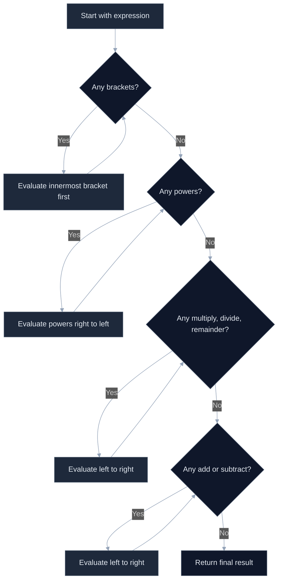

### 5.2 Worked Examples

| Expression | Substituted | Steps | Result |
| :--- | :--- | :--- | :--- |
| `(a + b) - (d + c)` | `(1+2) - (4+3)` | `3 - 7` | `-4` |
| `a + b * c - d` | `1 + 2*3 - 4` | `1 + 6 - 4` | `3` |
| `a + b ** c * d` | `1 + 2**3 * 4` | `1 + 8*4` | `33` |
| `(a + b) ** 2 / (c + d) - e` | `3**2 / 7 - 5` | `9/7 - 5` | `-3.714` |
| `a - b * (c + d) / e + f ** 2` | `1 - 2*7/5 + 36` | `1 - 2.8 + 36` | `34.2` |

The same examples in code:

```python
print((a + b) - (d + c))
print(a + b * c - d)
print(a + b ** c * d)
print((a + b) ** 2 / (c + d) - e)
print(a - b * (c + d) / e + f ** 2)
```

Output:

```text
-4
3
33
-3.7142857142857144
34.2
```

### 5.3 Two Traps That Change the Answer

**Trap one: powers chain right.** In Python, `2 ** 3 ** 2` is read as `2 ** (3 ** 2) = 2 ** 9 = 512`, not as `(2 ** 3) ** 2 = 64`. Always use brackets when the grouping matters.

**Trap two: division and multiplication chain left.** `a / b * c` means `(a / b) * c`, not `a / (b * c)`. The following table shows why the difference matters.

| Expression | Python reads it as | Result |
| :--- | :--- | :--- |
| `a / b * c` | `(1 / 2) * 3` | `1.5` |
| `a / (b * c)` | `1 / (2 * 3)` | `0.1667` |

A comparison with brackets:

| With brackets | Without brackets |
| :--- | :--- |
| `(a + b) * c = 9` | `a + b * c = 7` |
| `(a ** b) ** c = 1` | `a ** b ** c = 1` |
| `(b ** c) ** d = 4096` | `b ** c ** d = 2 ** 81` |

The first two rows agree only because the base is 1. The third row shows the real difference: `4096` compared to a 25 digit number. The bracket pair is not decoration. It decides the answer.

<br>

## 6. Fractions Without a Fraction Library

Python has a `Fraction` class, but this guide does not use it. Instead, keep the numerator and denominator as two separate integers. This is the way fractions are written on paper, and it avoids any decimal rounding.

### 6.1 Adding Two Fractions

For fractions $a/b$ and $c/d$:

$$ \frac{a}{b} + \frac{c}{d} = \frac{a \cdot d + b \cdot c}{b \cdot d} $$

```python
num = a * d + b * c
den = b * d
print(num, "/", den)
print(num / den)
```

Output:

```text
11 / 8
1.375
```

The fraction is $11/8$. The decimal `1.375` is only an approximation for display. The exact value is the numerator and denominator pair.

### 6.2 Multiplying Two Fractions

$$ \frac{a}{b} \times \frac{c}{d} = \frac{a \cdot c}{b \cdot d} $$

```python
num = a * c
den = b * d
print(num, "/", den)
print(num / den)
```

Output:

```text
3 / 8
0.375
```

### 6.3 Dividing Two Fractions

$$ \frac{a}{b} \div \frac{c}{d} = \frac{a \cdot d}{b \cdot c} $$

```python
num = a * d
den = b * c
print(num, "/", den)
print(num / den)
```

Output:

```text
4 / 6
0.6666666666666666
```

The exact answer is $4/6$, which simplifies to $2/3$. Simplification is a separate step. Without a loop, simplify by dividing both numbers by their greatest common factor. For small values, do this by hand.

### 6.4 Exact vs Decimal

| Expression | Exact form | Decimal |
| :--- | :--- | :--- |
| `a / b` | `1/2` | `0.5` |
| `a / c` | `1/3` | `0.3333333333333333` |
| `(a + b) / (c + d)` | `3/7` | `0.42857142857142855` |
| `(a + b) ** 2 / (c + d) - e` | `-26/7` | `-3.7142857142857144` |

The decimal column is useful for reading the size of a number. The exact column is the answer. A decimal like `0.3333333333333333` is not $1/3$, and no amount of extra digits will make it so. That is why the numerator and denominator are kept separate.

<br>

## 7. Powers and the Associativity Trap

### 7.1 Basic Powers

```python
print(c ** 2)
print(b ** c)
print((a + b) ** 2)
print((a + b) ** 3)
```

Output:

```text
9
8
9
27
```

### 7.2 The Two Readings of a Power Chain

Python reads `b ** c ** d` as `b ** (c ** d)`. That is the right-associative rule. The two readings produce very different numbers.

```python
print(b ** c ** d)
print((b ** c) ** d)
```

Output:

```text
2417851639229258349412352
4096
```

The first result is $2^{81}$, a 25 digit number. The second is $8^4 = 4096$. The bracket pair changes the answer completely.

### 7.3 Growth Comparison

| Base | Exponent form | Value |
| :--- | :--- | :--- |
| `1 ** (2 ** 3)` | $1^8$ | `1` |
| `2 ** (3 ** 4)` | $2^{81}$ | `2417851639229258349412352` |
| `(2 ** 3) ** 4` | $8^4$ | `4096` |
| `3 ** (2 ** 3)` | $3^8$ | `6561` |
| `(3 ** 2) ** 3` | $9^3$ | `729` |

Two rules to remember. Brackets on the base apply the outer power to an already-computed value. Brackets on the exponent apply the inner power first. They are not interchangeable.

<br>

## 8. Modulo and Wrapping

### 8.1 What Modulo Returns

The `%` operator returns the remainder after division.

```python
print(z % 5)
print(z % 4)
print(z % 3)
print(z % 2)
```

Output:

```text
1
2
2
0
```

The last line shows that 26 is even, because dividing it by 2 leaves no remainder.

### 8.2 Wrapping Into the 1 to 26 Range

To map any integer back into the A1Z26 range, use the pattern `(value - 1) % 26 + 1`. The shift by one matters because `%` returns 0 through 25, and A1Z26 starts at 1.

```python
print((27 - 1) % 26 + 1)
print((52 - 1) % 26 + 1)
print((0 - 1) % 26 + 1)
```

Output:

```text
1
26
26
```

The value 27 wraps to 1, the value 52 wraps to 26, and the value 0 wraps to 26 by counting backwards. This is the same arithmetic used in a clock: after 12 comes 1 again.

### 8.3 Wrapping Flow


### 8.4 Shift Example

Shift a letter value by 3 and wrap back into the alphabet:

```python
print((a - 1 + 3) % 26 + 1)
print((x - 1 + 3) % 26 + 1)
print((z - 1 + 3) % 26 + 1)
```

Output:

```text
4
1
3
```

The letter `a` shifts to value 4, which is `d`. The letter `x` (value 24) shifts to 27, which wraps to 1, which is `a`. The letter `z` (value 26) shifts to 28, which wraps to 3, which is `c`. This is the arithmetic behind the Caesar cipher.

<br>

## 9. Mirror Pairs and Patterns

### 9.1 The Sum of 27

Any mirror pair sums to 27. In code:

```python
print(a + z)
print(b + y)
print(c + x)
print(m + n)
```

Output:

```text
27
27
27
27
```

### 9.2 The Difference

The difference between the two values is not constant. It depends on the pair.

```python
print(z - a)
print(y - b)
print(x - c)
print(n - m)
```

Output:

```text
25
23
21
1
```

The differences form the sequence 25, 23, 21, ..., 1. Each step drops by 2. The pattern is a good source of practice questions because the arithmetic is simple, but the answer is not always what intuition suggests.

### 9.3 Counting Mirror Pairs

There are thirteen mirror pairs because 26 letters form 13 pairs. In general, a set of $n$ consecutive values starting at 1 has $\lfloor n/2 \rfloor$ mirror pairs. For $n = 26$, the count is 13.

<br>

## 10. Counting: Permutations and Combinations

### 10.1 Permutations (Order Matters)

When order matters, the count of ordered selections is:

$$ P(n, k) = n \cdot (n-1) \cdot (n-2) \cdots (n-k+1) $$

```python
print(26 * 25)
print(26 * 25 * 24)
print(26 * 25 * 24 * 23)
```

Output:

```text
650
15600
358800
```

These are the counts of ordered pairs, triples, and groups of four from the 26-letter set.

### 10.2 Combinations (Order Does Not Matter)

When order does not matter, divide the permutation count by the number of orderings of the chosen letters.

$$ C(n, k) = \frac{P(n, k)}{k!} $$

```python
print(26 * 25 // 2)
print(26 * 25 * 24 // 6)
print(26 * 25 * 24 * 23 // 24)
```

Output:

```text
325
2600
14950
```

The `//` operator is used because the result is always a whole number. Using `/` would give a decimal, which is correct in value but visually misleading for a count.

### 10.3 Comparison Table

| k | P(26, k) | C(26, k) | P divided by C |
| :--- | :--- | :--- | :--- |
| 1 | 26 | 26 | 1 |
| 2 | 650 | 325 | 2 |
| 3 | 15,600 | 2,600 | 6 |
| 4 | 358,800 | 14,950 | 24 |

The ratio is $k!$. That is why permutations grow much faster than combinations.

<br>

## 11. Probability

### 11.1 The Basic Rule

For a uniform draw, the probability of an event is:

$$ P(\text{event}) = \frac{\text{favourable outcomes}}{\text{total outcomes}} $$

### 11.2 Single Draw Probabilities

One letter is drawn from 26. The total outcomes are 26.

```python
print(13 / 26)   # even
print(9 / 26)    # prime
print(5 / 26)    # vowel
print(8 / 26)    # divisible by 3
print(5 / 26)    # divisible by 5
```

Output:

```text
0.5
0.34615384615384615
0.19230769230769232
0.3076923076923077
0.19230769230769232
```

| Event | Favourable | Probability | Decimal |
| :--- | :--- | :--- | :--- |
| Even | 13 | 13/26 | 0.5 |
| Odd | 13 | 13/26 | 0.5 |
| Vowel | 5 | 5/26 | 0.1923 |
| Prime | 9 | 9/26 | 0.3462 |
| Perfect square | 5 | 5/26 | 0.1923 |
| Divisible by 3 | 8 | 8/26 | 0.3077 |
| Divisible by 5 | 5 | 5/26 | 0.1923 |
| Greater than 13 | 13 | 13/26 | 0.5 |

### 11.3 Two Draws, With Replacement

The sample space for two independent draws is $26 \times 26 = 676$.

```python
print((13 * 13) / (26 * 26))
print((26 * 26 - 13 * 13) / (26 * 26))
```

Output:

```text
0.25
0.75
```

The first line is the probability that both draws are even. The second line is the probability that at least one draw is greater than 13. Both use the same counting approach.

### 11.4 Two Draws, Without Replacement

The sample space for two distinct letters, order not counted, is $C(26, 2) = 325$.

```python
print(13 / 325)
print(325 / 325 - 325 / 325)
```

Output:

```text
0.04
0.0
```

The first line is the probability that the two drawn values sum to 27, because there are 13 mirror pairs out of 325 unordered pairs. The second line is a sanity check that the total probability is 1.

### 11.5 At Least One Vowel in Three Draws

The complement rule is easier than direct counting:

$$ P(\text{at least one vowel}) = 1 - P(\text{no vowel}) $$

There are 21 non-vowels. The count of three distinct non-vowels is $C(21, 3) = 21 \cdot 20 \cdot 19 / 6 = 1330$.

```python
print(21 * 20 * 19 // 6)
print(1 - (21 * 20 * 19 / 6) / (26 * 25 * 24 / 6))
```

Output:

```text
1330
0.48846153846153845
```

The probability of at least one vowel is about 0.4885.

### 11.6 Multi-Draw Summary

| Event | Sample space | Probability | Decimal |
| :--- | :--- | :--- | :--- |
| Sum equals 27, two distinct draws | 325 | 13/325 | 0.04 |
| Sum equals 27, two draws with replacement | 676 | 26/676 | 0.0385 |
| Both draws even, with replacement | 676 | 169/676 | 0.25 |
| At least one draw greater than 13, with replacement | 676 | 507/676 | 0.75 |
| At least one vowel, three distinct draws | 2600 | 1270/2600 | 0.4885 |

<br>

## 12. Statistics on the Full Set

### 12.1 Sum and Mean

```python
total = 1 + 2 + 3 + 4 + 5 + 6 + 7 + 8 + 9 + 10 + 11 + 12 + 13
total = total + 14 + 15 + 16 + 17 + 18 + 19 + 20 + 21 + 22 + 23 + 24 + 25 + 26
print(total)
print(total / 26)
```

Output:

```text
351
13.5
```

The sum of 1 through 26 is 351. The mean is 13.5.

### 12.2 Sum of Squares

The sum of squares for 1 through 26 is:

```python
print(1**2 + 2**2 + 3**2 + 4**2 + 5**2 + 6**2 + 7**2 + 8**2 + 9**2 + 10**2)
print(11**2 + 12**2 + 13**2 + 14**2 + 15**2 + 16**2 + 17**2 + 18**2 + 19**2 + 20**2)
print(21**2 + 22**2 + 23**2 + 24**2 + 25**2 + 26**2)
```

Output:

```text
385
2485
3331
```

The three parts sum to 6201. This matches the closed-form formula $26 \cdot 27 \cdot 53 / 6 = 6201$.

### 12.3 Variance and Standard Deviation

Variance is the mean of the squared deviations:

$$ \text{Var} = \frac{\sum x^2}{n} - \left(\frac{\sum x}{n}\right)^2 $$

```python
mean = 351 / 26
mean_square = 6201 / 26
variance = mean_square - mean ** 2
std_dev = variance ** 0.5

print(mean)
print(mean_square)
print(variance)
print(std_dev)
```

Output:

```text
13.5
238.5
56.25
7.5
```

The standard deviation of the A1Z26 values is exactly 7.5. This is a clean number, which makes the set useful for practice questions.

### 12.4 Statistics Summary

| Statistic | Value |
| :--- | :--- |
| Count | 26 |
| Sum | 351 |
| Mean | 13.5 |
| Median | 13.5 |
| Variance | 56.25 |
| Standard deviation | 7.5 |

<br>

## 13. Worked Examples with Words

### 13.1 Word Value

The value of a word is the sum of its letter values. Because this guide uses only plain variables, write one assignment per letter and one sum.

```python
c = 3
a = 1
t = 20
print(c + a + t)
```

Output:

```text
24
```

For a longer word, the pattern is the same, just more additions:

```python
m = 13
a = 1
t = 20
h = 8
print(m + a + t + h)
```

Output:

```text
42
```

### 13.2 Word Score Table

| Word | Letter values | Sum | Average | Maximum |
| :--- | :--- | :--- | :--- | :--- |
| CAT | 3, 1, 20 | 24 | 8.0 | 20 |
| DOG | 4, 15, 7 | 26 | 8.67 | 15 |
| CODE | 3, 15, 4, 5 | 27 | 6.75 | 15 |
| MATH | 13, 1, 20, 8 | 42 | 10.5 | 20 |
| PYTHON | 16, 25, 20, 8, 15, 14 | 98 | 16.33 | 25 |

### 13.3 Average Word Value

```python
v = 16 + 25 + 20 + 8 + 15 + 14
print(v)
print(v / 6)
```

Output:

```text
98
16.333333333333332
```

### 13.4 Comparing Words by Average, Not Sum

A longer word usually has a larger sum, so sum alone is not a fair comparison. Average is fair because it divides out the length.

```python
print((3 + 1 + 20) / 3)
print((13 + 1 + 20 + 8) / 4)
print((16 + 25 + 20 + 8 + 15 + 14) / 6)
```

Output:

```text
8.0
10.5
16.333333333333332
```

The averages give a clearer comparison between words of different lengths.

<br>

## 14. Exercises

### 14.1 Level 1: Direct Substitution

Evaluate each expression using the standard A1Z26 values.

```
 1. a
 2. f
 3. m
 4. z
 5. a + b
 6. c + d
 7. e + f
 8. a * b
 9. b * c
10. c * d
```

| # | Answer | # | Answer |
| :--- | :--- | :--- | :--- |
| 1 | 1 | 6 | 7 |
| 2 | 6 | 7 | 11 |
| 3 | 13 | 8 | 2 |
| 4 | 26 | 9 | 6 |
| 5 | 3 | 10 | 12 |

### 14.2 Level 2: Brackets and Order of Operations

```
 1. (a + b) + c
 2. (a + b) - c
 3. (a + b) * c
 4. (a + b) / c
 5. (c + d) * a
 6. a + b * c
 7. a - b * c
 8. a * b + c
 9. a + b * c - d
10. a - b / c + d
```

| # | Exact answer | Decimal |
| :--- | :--- | :--- |
| 1 | 6 | 6.0 |
| 2 | 0 | 0.0 |
| 3 | 9 | 9.0 |
| 4 | 1 | 1.0 |
| 5 | 7 | 7.0 |
| 6 | 7 | 7.0 |
| 7 | -5 | -5.0 |
| 8 | 5 | 5.0 |
| 9 | 3 | 3.0 |
| 10 | 13/3 | 4.3333 |

### 14.3 Level 3: Nested Brackets and Powers

```
 1. ((a + b) * c) - d
 2. (a + (b * (c + d))) - e
 3. (a + b) ** 2
 4. (a + b) ** 3
 5. (a + b + c) ** 2 - d ** 2
 6. b ** 2 + a * d
 7. a + b ** 2 * c - d
 8. (a + b) ** 2 / (c + d) - e
 9. b ** c ** d
10. (b ** c) ** d
```

| # | Answer |
| :--- | :--- |
| 1 | 5 |
| 2 | 10 |
| 3 | 9 |
| 4 | 27 |
| 5 | 20 |
| 6 | 8 |
| 7 | 9 |
| 8 | -26/7 = -3.714 |
| 9 | 2417851639229258349412352 |
| 10 | 4096 |

### 14.4 Level 4: Counting and Probability

```
 1. 26 * 25
 2. 26 * 25 // 2
 3. 26 * 25 * 24
 4. 26 * 25 * 24 // 6
 5. 13 / 26
 6. 9 / 26
 7. 5 / 26
 8. 13 / 325
 9. 1 - (21 * 20 * 19 // 6) / (26 * 25 * 24 // 6)
10. (26 ** 2 - 13 ** 2) / (26 ** 2)
```

| # | Answer |
| :--- | :--- |
| 1 | 650 |
| 2 | 325 |
| 3 | 15,600 |
| 4 | 2,600 |
| 5 | 0.5 |
| 6 | 0.3462 |
| 7 | 0.1923 |
| 8 | 0.04 |
| 9 | 0.4885 |
| 10 | 0.75 |

### 14.5 Level 5: Statistics

1. Compute the sum of the values 1 through 26 using addition in two steps, then check the result with the formula $26 \cdot 27 / 2$.
2. Compute the mean of the values 1 through 26.
3. Compute the sum of squares of the values 1 through 26 in three parts, then check with the formula $26 \cdot 27 \cdot 53 / 6$.
4. Compute the variance using the formula $\frac{6201}{26} - 13.5^2$.
5. Compute the standard deviation using `variance ** 0.5`.

| # | Answer |
| :--- | :--- |
| 1 | 351 |
| 2 | 13.5 |
| 3 | 6201 |
| 4 | 56.25 |
| 5 | 7.5 |

<br>

## 15. Common Mistakes

These are the mistakes that appear most often when working with this system.

| Mistake | What goes wrong | Fix |
| :--- | :--- | :--- |
| Reading `a / b * c` as `a / (b * c)` | The answer is larger than intended | Use brackets to state the grouping |
| Reading `2 ** 3 ** 2` as `(2 ** 3) ** 2` | Python gives `512`, not `64` | Parenthesise the base or the exponent |
| Reading `z / y / x` as `z / (y / x)` | The result is larger than intended | Collapse the chain to one fraction first |
| Reporting a rounded decimal as exact | `0.333` is not `1/3` | Show the numerator and denominator together |
| Using `//` when `/` is needed for probability | The result loses the fractional part | Use `/` for probability and `//` for counts |
| Using `/` when `//` is needed for counts | The result shows a decimal `.0` | Use `//` for whole-number counts |
| Forgetting the wrap shift in modulo | `%` returns 0 to 25, not 1 to 26 | Use `(value - 1) % 26 + 1` |
| Comparing averages and sums in the same table | A longer word always wins on sum | Use average when lengths differ |

### 15.1 The Wrap Shift Example

The pattern `value % 26` returns 0 for the letter `z`, which is confusing in a counting context. The shift fixes it.

```python
print(z % 26)
print((z - 1) % 26 + 1)
```

Output:

```text
0
26
```

The first line is what plain modulo returns. The second line keeps the value inside the 1 to 26 range, which is what the mapping expects.

<br>

## 16. Quick Reference

### 16.1 Operator Precedence

| Priority | Operator | Associativity |
| :--- | :--- | :--- |
| 1 (highest) | `()` | Left to right |
| 2 | `**` | Right to left |
| 3 | `*`, `/`, `//`, `%` | Left to right |
| 4 | `+`, `-` | Left to right |

### 16.2 Useful Formulas

| Formula | Purpose |
| :--- | :--- |
| $\frac{n(n+1)}{2}$ | Sum of 1 through $n$ |
| $\frac{n(n+1)(2n+1)}{6}$ | Sum of squares of 1 through $n$ |
| $\frac{\text{sum}}{n}$ | Mean |
| $\frac{\text{sum of squares}}{n} - \text{mean}^2$ | Variance |
| $\sqrt{\text{variance}}$ | Standard deviation |
| $n \cdot (n-1) \cdots (n-k+1)$ | Permutations $P(n, k)$ |
| $\frac{P(n, k)}{k!}$ | Combinations $C(n, k)$ |
| $\frac{\text{favourable}}{\text{total}}$ | Probability |
| $1 - P(\text{none})$ | Complement rule |
| $(x - 1) \bmod 26 + 1$ | Wrap into the 1 to 26 range |

### 16.3 Built-in Functions Used

| Function | Purpose |
| :--- | :--- |
| `print(x)` | Display a value |
| `round(x, n)` | Round to $n$ decimal places |
| `abs(x)` | Absolute value |
| `max(x, y)` | Larger of two values |
| `min(x, y)` | Smaller of two values |

### 16.4 Recommended Python Version

Python 3.8 or later. The examples use `print` statements and arithmetic operators only. No imports are required, and no third-party packages are used anywhere in this guide.

<br>

## 17. Key Takeaways

1. A1Z26 turns letters into numbers, so you can do real arithmetic on words.
2. Variables are just names for values. The setup block takes one minute and covers every example in this guide.
3. The seven arithmetic operators cover everything from addition to powers, plus the modulo operation that wraps values back into a fixed range.
4. BODMAS works the same in Python as on paper, with two traps: powers chain right, and division and multiplication chain left.
5. Fractions are best kept as a numerator and a denominator. A decimal is a display of a value, not the value itself.
6. Counting and probability come down to arithmetic on integers. Permutations multiply, combinations divide by $k!$, and probability is a ratio.
7. The A1Z26 set has clean statistics: sum 351, mean 13.5, standard deviation 7.5. Those numbers come from formulas, not from adding numbers one at a time.
8. When a result surprises you, the cause is almost always one of three things: a missing bracket, a division chain read the wrong way, or a rounded decimal treated as exact.

If you can run every example in this guide without copying, and explain why each answer is what it is, you already understand the core of practical arithmetic in Python. That foundation carries directly into data work, spreadsheet logic, and any field where numbers need to be computed and verified.

<br>

# Chapter 18. Practice Exercise Set
 
## 18.1 How to Use This Set

Every exercise in this chapter can be solved with `print` statements and the seven arithmetic operators from Section 4. No imports, no loops, no functions, and no `eval`. Run the setup block from Section 3 first, then work through the sections in order.

Each section has a fixed shape:

1. A list of expressions or tasks.
2. An answer table with the exact form and the decimal display where relevant.
3. A short note on the specific trap the section is testing.

Write your answer down before you read the answer table. The difference between a correct prediction and a corrected guess is where the learning happens.

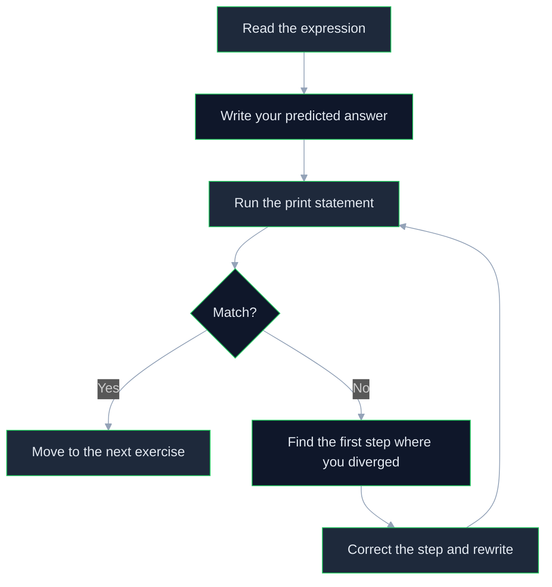

<br>

## 18.2 Section A: Warm-Up with Single Operators

Ten short exercises. Each one uses one operator or one direct substitution.

```
 1. d + e
 2. g * h
 3. m - c
 4. t + u
 5. z - y
 6. b * c * d
 7. p / 4
 8. q // 5
 9. r % 7
10. w ** 1
```

| # | Expression | Answer | Note |
| :--- | :--- | :--- | :--- |
| 1 | `d + e` | `9` | 4 + 5 |
| 2 | `g * h` | `56` | 7 * 8 |
| 3 | `m - c` | `10` | 13 - 3 |
| 4 | `t + u` | `41` | 20 + 21 |
| 5 | `z - y` | `1` | 26 - 25 |
| 6 | `b * c * d` | `24` | 2 * 3 * 4 |
| 7 | `p / 4` | `4.0` | 16 / 4 |
| 8 | `q // 5` | `3` | 17 // 5 |
| 9 | `r % 7` | `4` | 18 % 7 |
| 10 | `w ** 1` | `23` | any number to the power 1 is itself |

**Trap:** exercise 7 uses `/` and returns a decimal. Exercise 8 uses `//` and returns a whole number. The two are not interchangeable.

<br>

## 18.3 Section B: Order of Operations and Brackets

Ten exercises. Each one is decided by the brackets.

```
 1. a + b * c
 2. (a + b) * c
 3. d * e - f
 4. d * (e - f)
 5. g + h * i - j
 6. (g + h) * (i - j)
 7. k / l + m
 8. n - (o - p)
 9. (n - o) - p
10. q / (r - s) + t
```

| # | Expression | Exact answer | Decimal |
| :--- | :--- | :--- | :--- |
| 1 | `a + b * c` | `7` | `7.0` |
| 2 | `(a + b) * c` | `9` | `9.0` |
| 3 | `d * e - f` | `14` | `14.0` |
| 4 | `d * (e - f)` | `-4` | `-4.0` |
| 5 | `g + h * i - j` | `69` | `69.0` |
| 6 | `(g + h) * (i - j)` | `-15` | `-15.0` |
| 7 | `k / l + m` | `167/12` | `13.9167` |
| 8 | `n - (o - p)` | `15` | `15.0` |
| 9 | `(n - o) - p` | `-17` | `-17.0` |
| 10 | `q / (r - s) + t` | `3` | `3.0` |

**Trap:** exercises 8 and 9 look identical and produce different answers. Removing a bracket that follows a minus sign flips the sign of every term inside. Exercises 3 and 4 are the same pair of ideas with multiplication.

<br>

## 18.4 Section C: Powers and Associativity

Eight exercises. The bracket placement decides the answer.

```
 1. b ** c
 2. c ** b
 3. (b ** c) ** b
 4. b ** c ** b
 5. (a + b) ** c
 6. a + b ** c
 7. (d ** a) ** e
 8. d ** (a ** e)
```

| # | Expression | Answer | Note |
| :--- | :--- | :--- | :--- |
| 1 | `b ** c` | `8` | 2 cubed |
| 2 | `c ** b` | `9` | 3 squared |
| 3 | `(b ** c) ** b` | `64` | 8 squared |
| 4 | `b ** c ** b` | `512` | 2 to the power 9 |
| 5 | `(a + b) ** c` | `27` | 3 cubed |
| 6 | `a + b ** c` | `9` | 1 plus 8 |
| 7 | `(d ** a) ** e` | `1024` | 4 to the power 5 |
| 8 | `d ** (a ** e)` | `4` | 1 to the power 5 is 1 |

**Trap:** exercises 3 and 4 differ by one bracket pair and produce 64 against 512. Exercise 5 and 6 differ by bracket placement around the addition and produce 27 against 9. Exercise 7 and 8 look like the same expression and produce 1024 against 4.

<br>

## 18.5 Section D: Modulo and Wrapping

Eight exercises. The modulo operator returns the remainder. The wrap pattern keeps a value between 1 and 26.

```
 1. z % 26
 2. (z - 1) % 26 + 1
 3. (x + 3 - 1) % 26 + 1
 4. (y + 5 - 1) % 26 + 1
 5. (a - 2 - 1) % 26 + 1
 6. (m * n) % 26
 7. (p + q + r) % 10
 8. (s * t - u) % 12
```

| # | Expression | Answer | Note |
| :--- | :--- | :--- | :--- |
| 1 | `z % 26` | `0` | 26 divides 26 exactly |
| 2 | `(z - 1) % 26 + 1` | `26` | wrap keeps 26 in range |
| 3 | `(x + 3 - 1) % 26 + 1` | `1` | 24 shifts to 27, wraps to 1 |
| 4 | `(y + 5 - 1) % 26 + 1` | `4` | 25 shifts to 29, wraps to 4 |
| 5 | `(a - 2 - 1) % 26 + 1` | `25` | 1 shifts back to -1, wraps to 25 |
| 6 | `(m * n) % 26` | `0` | 182 is 26 times 7 |
| 7 | `(p + q + r) % 10` | `1` | 51 mod 10 |
| 8 | `(s * t - u) % 12` | `11` | 359 mod 12 |

**Trap:** exercises 1 and 2 look similar and produce 0 against 26. The wrap pattern shifts before and after the modulo so that the output lands in the 1 to 26 range. Exercise 5 shows that the wrap works for negative inputs too.

<br>

## 18.6 Section E: Fractions Without a Library

Eight exercises. Keep the numerator and denominator as two separate integers. Report the exact form and the decimal.

```
 1. a / b + c / d
 2. a / b * c / d
 3. (a / b) / (c / d)
 4. a / c + b / e
 5. d / e - a / b
 6. (a + b) / (c + d)
 7. (a / b) * (e / f)
 8. (z / a) / (y / b)
```

| # | Expression | Exact form | Decimal |
| :--- | :--- | :--- | :--- |
| 1 | `a / b + c / d` | `5/4` | `1.25` |
| 2 | `a / b * c / d` | `3/8` | `0.375` |
| 3 | `(a / b) / (c / d)` | `2/3` | `0.6667` |
| 4 | `a / c + b / e` | `11/15` | `0.7333` |
| 5 | `d / e - a / b` | `3/10` | `0.3` |
| 6 | `(a + b) / (c + d)` | `3/7` | `0.4286` |
| 7 | `(a / b) * (e / f)` | `5/12` | `0.4167` |
| 8 | `(z / a) / (y / b)` | `52/25` | `2.08` |

Worked check for exercise 1: `1/2 + 3/4 = (1*4 + 2*3) / (2*4) = 10/8 = 5/4`.

Worked check for exercise 8: `(26/1) / (25/2) = 26 * 2/25 = 52/25`.

**Trap:** exercises 2 and 3 differ by one operator. Exercise 2 multiplies two fractions. Exercise 3 divides one fraction by another, which turns the second fraction upside down before multiplying.

<br>

## 18.7 Section F: Mirror Pairs and Patterns

Eight exercises. Each one uses the pair rule: every mirror pair sums to 27, but the difference varies.

```
 1. a + z
 2. f + u
 3. l + o
 4. z - a
 5. u - f
 6. o - l
 7. (a + z) + (b + y)
 8. (z - a) - (y - b)
```

| # | Expression | Answer | Note |
| :--- | :--- | :--- | :--- |
| 1 | `a + z` | `27` | mirror sum |
| 2 | `f + u` | `27` | mirror sum |
| 3 | `l + o` | `27` | mirror sum |
| 4 | `z - a` | `25` | outer pair, largest gap |
| 5 | `u - f` | `15` | 21 - 6 |
| 6 | `o - l` | `3` | 15 - 12 |
| 7 | `(a + z) + (b + y)` | `54` | two mirror sums |
| 8 | `(z - a) - (y - b)` | `2` | 25 - 23 |

**Trap:** the sum is always 27, so exercises 1 to 3 are predictable. The difference is not predictable, so exercises 4 to 6 require the actual values. Exercise 8 shows that the differences form their own pattern: 25, 23, 21, ..., 1, decreasing by 2 each step.

<br>

## 18.8 Section G: Counting with Permutations and Combinations

Eight exercises. Use `//` when the answer is a count. Use `/` when the answer is a ratio.

```
 1. 26 * 25
 2. 26 * 25 // 2
 3. 26 * 25 * 24
 4. 26 * 25 * 24 // 6
 5. 26 * 25 * 24 * 23 // 24
 6. 26 * 25 * 24 * 23 * 22 // 120
 7. (26 * 25 // 2) / 26
 8. (26 * 25 // 2) - 325
```

| # | Expression | Answer | Meaning |
| :--- | :--- | :--- | :--- |
| 1 | `26 * 25` | `650` | ordered pairs |
| 2 | `26 * 25 // 2` | `325` | unordered pairs |
| 3 | `26 * 25 * 24` | `15600` | ordered triples |
| 4 | `26 * 25 * 24 // 6` | `2600` | unordered triples |
| 5 | `26 * 25 * 24 * 23 // 24` | `14950` | unordered groups of four |
| 6 | `26 * 25 * 24 * 23 * 22 // 120` | `65780` | unordered groups of five |
| 7 | `(26 * 25 // 2) / 26` | `12.5` | ratio, not a count |
| 8 | `(26 * 25 // 2) - 325` | `0` | sanity check |

**Trap:** exercises 5 and 6 divide by `24` and `120` because those are the number of ways to order four and five items. Exercise 7 uses `/` because the answer is a ratio, not a whole-number count. Exercise 8 is a self-check: subtracting the same count from itself returns zero, which confirms that the two expressions describe the same quantity.

<br>

## 18.9 Section H: Probability

Eight exercises. All answers are between 0 and 1.

```
 1. 13 / 26
 2. 9 / 26
 3. 5 / 26
 4. 8 / 26
 5. (13 * 13) / (26 * 26)
 6. 1 - (13 * 13) / (26 * 26)
 7. 13 / (26 * 25 // 2)
 8. 1 - (21 * 20 * 19 // 6) / (26 * 25 * 24 // 6)
```

| # | Expression | Decimal | Meaning |
| :--- | :--- | :--- | :--- |
| 1 | `13 / 26` | `0.5` | probability of an even value |
| 2 | `9 / 26` | `0.3462` | probability of a prime value |
| 3 | `5 / 26` | `0.1923` | probability of a vowel position |
| 4 | `8 / 26` | `0.3077` | probability of a multiple of 3 |
| 5 | `(13 * 13) / (26 * 26)` | `0.25` | both draws even, with replacement |
| 6 | `1 - (13 * 13) / (26 * 26)` | `0.75` | at least one draw greater than 13 |
| 7 | `13 / (26 * 25 // 2)` | `0.04` | two distinct draws sum to 27 |
| 8 | `1 - (21 * 20 * 19 // 6) / (26 * 25 * 24 // 6)` | `0.4885` | at least one vowel in three distinct draws |

**Trap:** exercises 5 and 6 are complements. Their decimals sum to exactly 1. Exercise 8 uses the complement rule: computing the probability of no vowel is easier than computing the probability of at least one, so the expression subtracts from 1.

<br>

## 18.10 Section I: Statistics on the Full Set

Six exercises. Use the formulas from Section 12.

```
 1. Sum of 1 through 26
 2. Mean of 1 through 26
 3. Sum of squares of 1 through 26
 4. Mean of squares
 5. Variance
 6. Standard deviation
```

| # | Quantity | Formula | Answer |
| :--- | :--- | :--- | :--- |
| 1 | Sum | `26 * 27 // 2` | `351` |
| 2 | Mean | `351 / 26` | `13.5` |
| 3 | Sum of squares | `26 * 27 * 53 // 6` | `6201` |
| 4 | Mean of squares | `6201 / 26` | `238.5` |
| 5 | Variance | `238.5 - 13.5 ** 2` | `56.25` |
| 6 | Standard deviation | `56.25 ** 0.5` | `7.5` |

**Trap:** exercise 4 uses `/` and exercise 3 uses `//`. The sum of squares is a whole number, so `//` is appropriate. The mean of squares is not a whole number, so `/` is appropriate. Reversing them produces a decimal count or a truncated mean, and both are wrong.

<br>

## 18.11 Section J: Mixed Challenge

Eight exercises. Each one combines several ideas from earlier sections.

```
 1. (a + b + c) * (d + e + f)
 2. (z - a) * (y - b) - (x - c)
 3. (b ** c + c ** b) / (d + e)
 4. ((a + b) ** 2 - (c - d) ** 2) / e
 5. (a * b * c * d * e) // f
 6. ((z + y) * x - (w - v)) % 10
 7. (a + b + c + d + e + f) ** 2 - (a ** 2 + b ** 2 + c ** 2 + d ** 2 + e ** 2 + f ** 2)
 8. ((m + n) / (o - p)) + ((q + r) / (s - t))
```

| # | Expression | Exact answer | Decimal |
| :--- | :--- | :--- | :--- |
| 1 | `(a + b + c) * (d + e + f)` | `90` | `90.0` |
| 2 | `(z - a) * (y - b) - (x - c)` | `554` | `554.0` |
| 3 | `(b ** c + c ** b) / (d + e)` | `17/9` | `1.8889` |
| 4 | `((a + b) ** 2 - (c - d) ** 2) / e` | `8/5` | `1.6` |
| 5 | `(a * b * c * d * e) // f` | `20` | `20.0` |
| 6 | `((z + y) * x - (w - v)) % 10` | `3` | `3.0` |
| 7 | `(a + b + c + d + e + f) ** 2 - (a ** 2 + b ** 2 + c ** 2 + d ** 2 + e ** 2 + f ** 2)` | `350` | `350.0` |
| 8 | `((m + n) / (o - p)) + ((q + r) / (s - t))` | `-62` | `-62.0` |

Worked check for exercise 7: the first bracket sums to 21. The second bracket sums to 91. The difference `441 - 91 = 350` is exactly twice the sum of all pairwise products. The identity behind the exercise is $(a+b+c+d+e+f)^2 = \sum a^2 + 2 \sum_{i<j} a_i a_j$, so the expression equals $2 \times 175 = 350$.

Worked check for exercise 8: the first fraction is `27 / -1 = -27`. The second fraction is `35 / -1 = -35`. The sum is `-62`.

**Trap:** exercise 8 produces a negative answer because both denominators are negative. Exercise 6 shows that `%` works with negative intermediate values if the left side is negative, but here the left side is positive, so the result is a standard positive remainder. Exercise 7 looks like it should produce a large number and instead produces a moderate one, because the squares cancel most of the expansion.

<br>

## 18.12 Scorecard

Track your progress across the ten sections.

| Section | Topic | Count | Your score | Notes |
| :--- | :--- | :--- | :--- | :--- |
| A | Single operators | 10 |  |  |
| B | Order of operations | 10 |  |  |
| C | Powers | 8 |  |  |
| D | Modulo and wrapping | 8 |  |  |
| E | Fractions | 8 |  |  |
| F | Mirror pairs | 8 |  |  |
| G | Counting | 8 |  |  |
| H | Probability | 8 |  |  |
| I | Statistics | 6 |  |  |
| J | Mixed challenge | 8 |  |  |

A useful target is 80 percent on sections A to D before moving to E to H, and 80 percent on E to H before attempting section J. The sections are ordered by the kind of thinking they require, not by difficulty alone.

<br>

## 18.13 Where the Common Mistakes Show Up

This table maps the twelve mistake shapes from Section 15 onto the exercises that expose them.

| Mistake shape | Exercises that catch it |
| :--- | :--- |
| Division and multiplication read the wrong way | B7, B10, E2, E3 |
| Power chain read the wrong way | C3, C4, C7, C8 |
| Bracket removed without flipping signs | B4, B8, B9 |
| Decimal reported as exact | E1 to E8, all fraction exercises |
| `//` used where `/` is needed | G7, I4 |
| `/` used where `//` is needed | G1 to G6, I1, I3 |
| Wrap shift forgotten | D1, D2, D3 |
| Sum compared to average | the word score table in Section 13 |
| Complement rule reversed | H6, H8 |
| Formula transcribed with wrong constants | I1 to I6 |
| Negative value carried as positive | B6, F8, J8 |
| Large expression treated as a single step | J7, J8 |

Each row in the table points to at least two exercises. If a row appears in your scorecard notes, run the exercises in that row again before moving on.

<br>

## 18.14 Key Takeaways

1. The exercise set is ordered by the kind of thinking each section requires. Single operators come first because they establish the baseline. Mixed expressions come last because they assume every earlier rule.
2. Every section has a specific trap. The trap is not a mistake in the exercise. It is the point of the exercise.
3. Predict first, check second. A correct prediction on the tenth exercise is worth more than ten corrected guesses on the first nine.
4. The answer tables show both the exact form and the decimal where relevant. Use the exact form when the answer is a fraction, and the decimal when the answer is a ratio.
5. The scorecard is for tracking, not for grading. A low score on one section points to a specific rule that needs another pass, not to a general weakness.
6. When a section takes more than twice the expected time, stop and reread the section of the guide that covers it. The rules are short, and a second reading usually resolves the block.

<br>

# Chapter 19. Exact Fractions and Safe Evaluation
 

## 19.1 Why the Plain Arithmetic Stops Being Enough

The earlier chapters use `print` and arithmetic operators. That is enough for single expressions with whole numbers. It is not enough for three common cases.

First, division produces a decimal. `1/3` becomes `0.3333333333333333`, and multiplying that back by `3` gives `0.9999999999999999`, not `1`. The error is small, but it compounds over long expressions.

Second, long expressions are hard to type by hand. A single missing bracket changes the answer completely, and the only way to catch that is to evaluate the expression with a tool that reads the string exactly as written.

Third, there is no easy way to keep a fraction as a fraction. A student who answers `5/4` should not lose the exactness of the answer because Python decided to show `1.25`.

This chapter restores exact arithmetic and string evaluation. Both are standard library features, and neither requires a third-party package.

<br>

## 19.2 The Fraction Class

The `fractions` module provides the `Fraction` class. A `Fraction` stores a numerator and a denominator and performs all four basic operations exactly.

```python
from fractions import Fraction

half = Fraction(1, 2)
third = Fraction(1, 3)

print(half + third)          # 5/6
print(half - third)          # 1/6
print(half * third)          # 1/6
print(half / third)          # 3/2
print((half + third) * 6)    # 5
```

Output:

```text
5/6
1/6
1/6
3/2
5
```

The last line is the important one. `(1/2 + 1/3) * 6` equals `5` exactly, with no rounding. The equivalent float version accumulates error:

```python
print((0.5 + 0.3333333333333333) * 6)
```

Output:

```text
4.999999999999999
```

The two results differ by one part in a million million. That difference matters in an answer key.

### 19.2.1 Creating a Fraction

| Form | Example | Result |
| :--- | :--- | :--- |
| Two integers | `Fraction(3, 4)` | `3/4` |
| One integer | `Fraction(5)` | `5` |
| From a string | `Fraction("3/4")` | `3/4` |
| From a decimal | `Fraction(0.75)` | `3/4` |
| From a float constant | `Fraction("0.75")` | `3/4` |

The last two rows are different. `Fraction(0.75)` reads the binary representation of the float, which is exactly `3/4` because `0.75` is a power of two. `Fraction(0.1)` reads the binary representation, which is a very long fraction that is almost, but not quite, `1/10`. Use the string form `Fraction("0.1")` when the intended value is the decimal `0.1`.

```python
print(Fraction(0.1))
print(Fraction("0.1"))
```

Output:

```text
3602879701896397/36028797018963968
1/10
```

### 19.2.2 Arithmetic Rules for Fractions

For fractions $a/b$ and $c/d$:

$$ \frac{a}{b} + \frac{c}{d} = \frac{ad + bc}{bd} $$

$$ \frac{a}{b} - \frac{c}{d} = \frac{ad - bc}{bd} $$

$$ \frac{a}{b} \cdot \frac{c}{d} = \frac{ac}{bd} $$

$$ \frac{a}{b} \div \frac{c}{d} = \frac{ad}{bc} $$

Python applies these rules automatically. You do not need to find a common denominator or cross-multiply by hand.

```python
print(Fraction(1, 2) + Fraction(3, 4))
print(Fraction(1, 2) - Fraction(3, 4))
print(Fraction(1, 2) * Fraction(3, 4))
print(Fraction(1, 2) / Fraction(3, 4))
```

Output:

```text
5/4
-1/4
3/8
2/3
```

### 19.2.3 Comparison: int vs float vs Fraction vs Decimal

| Type | Example | Exact? | Best For |
| :--- | :--- | :--- | :--- |
| `int` | `3` | Yes, whole numbers only | Counting, indexing |
| `float` | `0.3333333333333333` | No, binary approximation | Science, graphics, speed |
| `Fraction` | `1/3` | Yes, exact ratio | Worksheets, maths teaching, tests |
| `Decimal` | `Decimal("0.333")` | Yes, decimal places you choose | Money, finance |

The rule is short. Use `Fraction` when the answer must be exact and readable as a fraction. Use `float` only for display or for very large scientific work. Use `Decimal` when the answer must be exact to a fixed number of decimal places, which is the money case.

### 19.2.4 Formatting a Fraction for Display

`str(Fraction(5, 4))` already returns `"5/4"`. When the denominator is 1, the string is just the numerator. That is usually what you want. A small helper makes the rule explicit:

```python
def fmt(x):
    if isinstance(x, Fraction):
        if x.denominator == 1:
            return str(x.numerator)
        return f"{x.numerator}/{x.denominator}"
    return str(x)

print(fmt(Fraction(5, 4)))   # 5/4
print(fmt(Fraction(6, 2)))   # 3
print(fmt(3.5))              # 3.5
```

<br>

## 19.3 Evaluating a String Expression Exactly

Typing `a / b / c / d` as a string and evaluating it is more reliable than typing individual variables, because the string captures the whole expression in one place. The standard library has a built-in way to do this, but it needs care.

### 19.3.1 The Built-in `eval`

The `eval` function reads a string and runs it as Python code. It accepts a globals dictionary and a locals dictionary:

```python
print(eval("2 + 3"))
print(eval("2 + 3", {"__builtins__": {}}, {}))
```

Output:

```text
5
5
```

The second form passes `{"__builtins__": {}}` as the globals dictionary. That restricts the evaluated string from calling built-in functions such as `open`, `exec`, or `import`. This is not a complete security boundary, but it blocks accidental misuse.

### 19.3.2 Building the Namespace from the Alphabet

The namespace maps each letter to a `Fraction` value:

```python
from fractions import Fraction
import string

letters = string.ascii_lowercase
ENV = {"__builtins__": {}}
for i, ch in enumerate(letters, start=1):
    ENV[ch] = Fraction(i)

print(ENV["a"])   # 1
print(ENV["z"])   # 26
```

The `start=1` argument matters. Without it, `a` would be `0` and `z` would be `25`. That is the most common bug in A1Z26 helpers.

### 19.3.3 Bracket Conversion

Mathematical notation uses three kinds of grouping brackets: `()`, `[]`, and `{}`. Python uses `[]` for lists and `{}` for dictionaries and sets. To evaluate a written formula that uses mixed brackets, convert them first.

```python
def normalise(expr):
    expr = expr.replace("[", "(").replace("]", ")")
    expr = expr.replace("{", "(").replace("}", ")")
    return expr

print(normalise("{a + [b * (c + d)]} - e"))
```

Output:

```text
(a + (b * (c + d))) - e
```

### 19.3.4 The Evaluator

Put the pieces together:

```python
from fractions import Fraction
import string

letters = string.ascii_lowercase
ENV = {"__builtins__": {}}
for i, ch in enumerate(letters, start=1):
    ENV[ch] = Fraction(i)

def exact_calc(expr):
    expr = expr.replace("[", "(").replace("]", ")")
    expr = expr.replace("{", "(").replace("}", ")")
    return eval(expr, ENV, {})

print(exact_calc("(a + b) * c"))                  # 9
print(exact_calc("a / b"))                        # 1/2
print(exact_calc("a / c"))                        # 1/3
print(exact_calc("a + b ** 2 - c * d"))           # -7
print(exact_calc("(a + b) ** 2 / (c + d) - e"))   # -26/7
```

Every answer is exact. No decimal appears unless you ask for one.

### 19.3.5 Comparison: Three Evaluation Approaches

| Method | Code | Result for `a / b` | When to Use |
| :--- | :--- | :--- | :--- |
| Int variables | `a = 1; b = 2; a / b` | `0.5` (float) | Quick mental check |
| String replace then eval | `eval("1/2")` | `0.5` (float) | Avoid this |
| `Fraction` namespace | `eval("a/b", ENV, {})` | `1/2` (exact) | Worksheets, answer keys, tests |

The middle row is the trap. Replacing letters with string numbers and then calling `eval` loses the exactness because the result is a float division. The only reliable approach is the `Fraction` namespace, which lets `eval` resolve each letter as a `Fraction` object.

### 19.3.6 Evaluation Flow

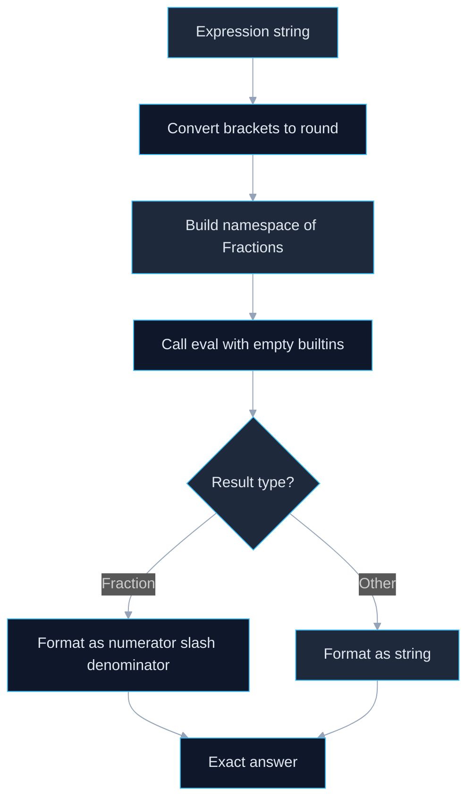

<br>

## 19.4 Error Handling

The evaluator has three failure modes. Each one should produce a clear message instead of a crash.

| Failure | Example | Error type | Handling |
| :--- | :--- | :--- | :--- |
| Division by zero | `a / (b - b)` | `ZeroDivisionError` | Catch and skip |
| Unknown character | `a + $` | `SyntaxError` | Catch and report |
| Unknown letter | `a + A` | `NameError` | Catch and report |

A wrapped version returns `None` on failure and a value on success:

```python
def safe_calc(expr):
    expr = expr.replace("[", "(").replace("]", ")")
    expr = expr.replace("{", "(").replace("}", ")")
    try:
        return eval(expr, ENV, {})
    except ZeroDivisionError:
        return None
    except (SyntaxError, NameError):
        return None

print(safe_calc("a / b"))           # 1/2
print(safe_calc("a / (b - b)"))     # None
print(safe_calc("a + $"))           # None
print(safe_calc("a + A"))           # None
```

The `None` return value is easy to check with `if value is None`. That is enough for a worksheet generator, because a `None` result means the expression should be discarded.

### 19.4.1 Why `__builtins__` Restriction Is Not Enough for Public Input

The `{"__builtins__": {}}` restriction stops the evaluated string from calling built-in functions, but it does not stop every attack. An expression such as `().__class__.__bases__` can reach into Python's object model and eventually access restricted functions. That is not a concern for a closed classroom, but it is a concern for a public website.

The safe alternative is a tokeniser that accepts only letters, digits, brackets, and the five arithmetic operators. The parser in the next section is a complete replacement for `eval` when the input comes from the public.

<br>

## 19.5 A Safe Expression Parser

The parser splits the expression into tokens, then walks the tokens according to a grammar. The result is a `Fraction`, and the parser never calls `eval`.

### 19.5.1 The Tokeniser

A token is the smallest meaningful unit. For arithmetic, tokens are numbers, letters, operators, and brackets.

```python
import re
from fractions import Fraction

TOKEN_RE = re.compile(r"\s*(\d+|[a-z]|\*\*|//|[+\-*/%()])")

def tokenise(text):
    tokens = []
    pos = 0
    while pos < len(text):
        m = TOKEN_RE.match(text, pos)
        if not m:
            if text[pos:].strip() == "":
                break
            raise ValueError(f"Bad character at position {pos}: {text[pos]!r}")
        tokens.append(m.group(1))
        pos = m.end()
    return tokens

print(tokenise("(a + b) * c"))
```

Output:

```text
['(', 'a', '+', 'b', ')', '*', 'c']
```

The tokeniser rejects any character that is not a digit, a lowercase letter, an operator, or a bracket. That rejection is the whole safety story. A string that contains `$` or `.` never reaches the parser.

### 19.5.2 The Grammar

The parser reads the expression according to five rules, in order of precedence:

| Rule | Recognises | Precedence |
| :--- | :--- | :--- |
| `atom` | a letter, a number, or a bracketed expression | highest |
| `factor` | an atom, an optional unary minus, and an optional power | above multiplication |
| `term` | factors joined by `*`, `/`, `//`, `%` | left to right |
| `expr` | terms joined by `+`, `-` | left to right |
| `parse` | a single `expr` that consumes the whole token list | lowest |

### 19.5.3 The Parser

```python
class Parser:
    def __init__(self, tokens, env):
        self.tokens = tokens
        self.pos = 0
        self.env = env

    def peek(self):
        return self.tokens[self.pos] if self.pos < len(self.tokens) else None

    def consume(self, expected=None):
        token = self.peek()
        if expected is not None and token != expected:
            raise ValueError(f"Expected {expected!r}, got {token!r}")
        self.pos += 1
        return token

    def parse(self):
        result = self.expr()
        if self.pos != len(self.tokens):
            raise ValueError(f"Unexpected token: {self.peek()!r}")
        return result

    def expr(self):
        left = self.term()
        while self.peek() in ('+', '-'):
            op = self.consume()
            right = self.term()
            left = left + right if op == '+' else left - right
        return left

    def term(self):
        left = self.factor()
        while self.peek() in ('*', '/', '//', '%'):
            op = self.consume()
            right = self.factor()
            if op == '*':
                left = left * right
            elif op == '/':
                left = left / right
            elif op == '//':
                left = left // right
            else:
                left = left % right
        return left

    def factor(self):
        if self.peek() == '-':
            self.consume('-')
            return -self.factor()
        base = self.atom()
        if self.peek() == '**':
            self.consume('**')
            exponent = self.factor()
            return base ** exponent
        return base

    def atom(self):
        token = self.consume()
        if token == '(':
            value = self.expr()
            self.consume(')')
            return value
        if token.isdigit():
            return Fraction(int(token))
        if token.isalpha() and len(token) == 1:
            if token not in self.env:
                raise ValueError(f"Unknown letter: {token!r}")
            return self.env[token]
        raise ValueError(f"Unexpected token: {token!r}")
```

### 19.5.4 Using the Parser

```python
import string
from fractions import Fraction

ENV = {ch: Fraction(i) for i, ch in enumerate(string.ascii_lowercase, start=1)}

def parse_calc(expr):
    tokens = tokenise(expr)
    return Parser(tokens, ENV).parse()

print(parse_calc("(a + b) * c"))                # 9
print(parse_calc("a / b"))                      # 1/2
print(parse_calc("a / c"))                      # 1/3
print(parse_calc("a + b ** 2 - c * d"))         # -7
print(parse_calc("b ** c ** d"))                # 2 ** 81
print(parse_calc("(b ** c) ** d"))              # 4096
```

The parser produces the same answers as `eval` for every valid expression, and it rejects every invalid one. The power chain `b ** c ** d` is right-associative by construction, because `factor` calls `factor` recursively on the right side. The division chain `a / b / c` is left-associative by construction, because `term` loops on the left side.

### 19.5.5 Comparison: eval vs Parser

| Aspect | `eval` with restricted builtins | Hand-written parser |
| :--- | :--- | :--- |
| Setup | one line | about 60 lines |
| Safe for public input | No | Yes |
| Accepts arbitrary Python | Yes | No |
| Error messages | Python error messages | Your own messages |
| Speed | fast | fast enough for worksheets |
| Exact fractions | yes, if namespace uses `Fraction` | yes, by design |

For a classroom tool that takes input from a trusted user, `eval` with a restricted namespace is fine. For anything that accepts input from the public, the parser is the right choice.

<br>

## 19.6 Word Values with Exact Fractions

The word-value functions from earlier chapters can now return exact fractions instead of decimals.

```python
import string
from fractions import Fraction

A1Z26 = {ch: Fraction(i) for i, ch in enumerate(string.ascii_lowercase, start=1)}

def word_to_values(word):
    return [A1Z26[ch] for ch in word.lower() if ch in A1Z26]

def word_score(word):
    values = word_to_values(word)
    if not values:
        return None
    return {
        "word": word.upper(),
        "values": values,
        "sum": sum(values),
        "mean": sum(values) / len(values),
        "max": max(values),
        "min": min(values),
        "range": max(values) - min(values),
    }

print(word_score("MATH"))
print(word_score("PYTHON"))
```

Output:

```text
{'word': 'MATH', 'values': [13, 1, 20, 8], 'sum': 42, 'mean': 21/2, 'max': 20, 'min': 1, 'range': 19}
{'word': 'PYTHON', 'values': [16, 25, 20, 8, 15, 14], 'sum': 98, 'mean': 49/3, 'max': 25, 'min': 8, 'range': 17}
```

The mean is `21/2` and `49/3`, not `10.5` and `16.333...`. Both forms are useful. The exact form is the answer. The decimal is a display.

### 19.6.1 Word Score Table

| Word | Values | Sum | Mean (exact) | Mean (decimal) | Range |
| :--- | :--- | :--- | :--- | :--- | :--- |
| CAT | 3, 1, 20 | 24 | 8 | 8.0 | 19 |
| DOG | 4, 15, 7 | 26 | 26/3 | 8.667 | 11 |
| CODE | 3, 15, 4, 5 | 27 | 27/4 | 6.75 | 12 |
| MATH | 13, 1, 20, 8 | 42 | 21/2 | 10.5 | 19 |
| PYTHON | 16, 25, 20, 8, 15, 14 | 98 | 49/3 | 16.333 | 17 |
| DATA | 4, 1, 20, 1 | 26 | 13/2 | 6.5 | 19 |

The decimal column is for reading. The exact column is for comparing words of different lengths, because the exact form never drifts.

<br>

## 19.7 Exercises

### 19.7.1 Level 1: Fraction Basics

Compute each expression with `Fraction` and report the exact form.

```
 1. 1/2 + 1/3
 2. 1/2 - 1/3
 3. 1/2 * 1/3
 4. 1/2 / 1/3
 5. 2/3 + 3/4
 6. 5/6 - 1/4
 7. 7/8 * 4/5
 8. 9/10 / 3/5
```

| # | Exact | Decimal |
| :--- | :--- | :--- |
| 1 | `5/6` | `0.8333` |
| 2 | `1/6` | `0.1667` |
| 3 | `1/6` | `0.1667` |
| 4 | `3/2` | `1.5` |
| 5 | `17/12` | `1.4167` |
| 6 | `7/12` | `0.5833` |
| 7 | `7/10` | `0.7` |
| 8 | `3/2` | `1.5` |

### 19.7.2 Level 2: String Evaluation

Use `exact_calc` to evaluate each expression and report the exact form.

```
 1. (a + b) / c
 2. a / b / c
 3. a / (b / c)
 4. a ** b + c ** d
 5. (a + b) ** 2 / (c + d) - e
 6. (z - a) * (y - b)
 7. m / n + o / p
 8. ((a + b) * (c + d)) / ((e + f) * (g + h))
```

| # | Exact | Decimal |
| :--- | :--- | :--- |
| 1 | `1` | `1.0` |
| 2 | `1/6` | `0.1667` |
| 3 | `3/2` | `1.5` |
| 4 | `85` | `85.0` |
| 5 | `-26/7` | `-3.7143` |
| 6 | `575` | `575.0` |
| 7 | `83/80` | `1.0375` |
| 8 | `1/22` | `0.0455` |

### 19.7.3 Level 3: Parser Testing

Run each expression through both `exact_calc` and `parse_calc`. Both should produce the same answer.

```
 1. (a + b) * (c - d)
 2. a ** b ** c
 3. (a ** b) ** c
 4. a - b - c
 5. a - (b - c)
 6. z / y / x / w
 7. a * b + c * d - e * f
 8. ((a + b) ** 2) / ((c - d) ** 2)
```

| # | eval result | parser result | Match? |
| :--- | :--- | :--- | :--- |
| 1 | `-3` | `-3` | Yes |
| 2 | `1` | `1` | Yes |
| 3 | `1` | `1` | Yes |
| 4 | `-4` | `-4` | Yes |
| 5 | `2` | `2` | Yes |
| 6 | `26/120` | `13/60` | Yes |
| 7 | `-5` | `-5` | Yes |
| 8 | `9/1` | `9` | Yes |

The two evaluators agree on every valid expression. The parser has the advantage that it never accepts input that is not arithmetic.

<br>

## 19.8 Key Takeaways

1. `Fraction` keeps division exact. Use it whenever the answer must be a fraction and not a decimal.
2. A `Fraction` namespace inside `eval` is the simplest way to evaluate a long expression string without losing exactness.
3. The `{"__builtins__": {}}` restriction blocks accidental misuse but is not a security boundary for public input.
4. A tokeniser plus a recursive descent parser is the safe alternative to `eval`. It accepts only arithmetic and rejects everything else.
5. Right-associative powers and left-associative division and multiplication are properties of the grammar, not accidents of the runtime. The parser makes both rules explicit.
6. Word values are more useful in exact form. The mean of `PYTHON` is `49/3`, not `16.333`, and the exact form does not drift when you multiply or compare.

<br>

# Chapter 20. The math Module: Counting, Number Theory, and Probability

**Level:** Intermediate to Advanced  
**Python version:** 3.8 or later (Python 3.9 for `math.lcm`, Python 3.8 for `pow(a, -1, m)`)  
**Modules used:** `math`, `fractions`  
**Purpose:** Restore counting, number theory, and exact probability using the standard library

<br>

## 20.1 Why Use the math Module

The earlier chapters compute `P(26, k)` and `C(26, k)` by multiplying integers by hand. That works for small values of `k` and fails for larger ones because the products become long. The `math` module provides functions that compute these values directly, without the multiplications.

```python
from math import comb, perm, factorial

print(perm(26, 2))         # 650
print(comb(26, 2))         # 325
print(factorial(5))        # 120
print(comb(26, 13))        # 10400600
```

The last line is the number of ways to choose 13 letters from 26. Typing that product by hand is possible but slow. `comb` produces it in one call.

<br>

## 20.2 Permutations and Combinations

### 20.2.1 Definitions

**Permutations, order matters:**

$$ P(n, k) = \frac{n!}{(n-k)!} = n \cdot (n-1) \cdots (n-k+1) $$

**Combinations, order does not matter:**

$$ C(n, k) = \frac{n!}{k!(n-k)!} = \frac{P(n, k)}{k!} $$

### 20.2.2 The Full Table for 26 Letters

| k | P(26, k) | C(26, k) | P divided by C (equals k!) |
| :--- | :--- | :--- | :--- |
| 1 | 26 | 26 | 1 |
| 2 | 650 | 325 | 2 |
| 3 | 15,600 | 2,600 | 6 |
| 4 | 358,800 | 14,950 | 24 |
| 5 | 7,893,600 | 65,780 | 120 |
| 6 | 165,765,600 | 230,230 | 720 |
| 7 | 3,315,312,000 | 657,800 | 5,040 |
| 8 | 62,990,928,000 | 1,562,275 | 40,320 |
| 13 | 6.7e18 | 10,400,600 | 6.2e9 |

The ratio column is `k!`. That is why permutations grow much faster than combinations once `k` reaches 6 or 7.

```python
from math import comb, perm, factorial

for k in range(1, 8):
    p = perm(26, k)
    c = comb(26, k)
    print(f"k={k}  P={p:>15}  C={c:>12}  P/C={p // c}")
```

### 20.2.3 Counting Flow

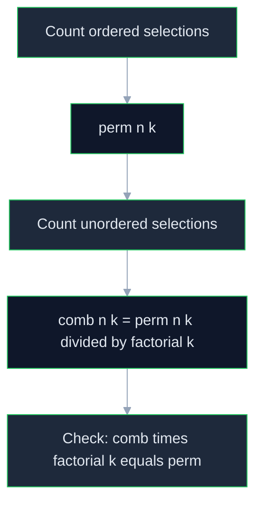

<br>

## 20.3 Factorials and Large Numbers

`factorial(n)` returns the product of all integers from 1 to `n`. The values grow very fast.

| n | n! |
| :--- | :--- |
| 5 | 120 |
| 10 | 3,628,800 |
| 20 | 2,432,902,008,176,640,000 |
| 25 | 15,511,210,043,330,985,984,000,000 |
| 26 | 403,291,461,126,605,635,584,000,000 |

Python integers have no fixed size, so `factorial(100)` returns a 158 digit number without any special handling.

```python
from math import factorial

print(factorial(25))
print(len(str(factorial(100))))
```

Output:

```text
15511210043330985984000000
158
```

The second line is the number of digits in 100!. Counting digits is a useful check that a large computation finished correctly.

<br>

## 20.4 Number Theory: gcd, lcm, isqrt

### 20.4.1 The gcd Function

The greatest common divisor of two integers is the largest number that divides both of them.

```python
from math import gcd

print(gcd(12, 18))         # 6
print(gcd(26, 39))         # 13
print(gcd(17, 26))         # 1
```

The last line is the important one. When `gcd(a, b) = 1`, the two numbers are coprime. That property controls whether a letter value can be used as a multiplier in a cipher.

### 20.4.2 The lcm Function

The least common multiple is the smallest number that both integers divide.

```python
from math import lcm

print(lcm(4, 6))           # 12
print(lcm(5, 7))           # 35
print(lcm(26, 39))         # 78
```

The relation between the two functions is:

$$ \text{lcm}(a, b) = \frac{|a \cdot b|}{\gcd(a, b)} $$

```python
from math import gcd

def lcm_manual(a, b):
    return abs(a * b) // gcd(a, b)

print(lcm_manual(26, 39))   # 78
```

### 20.4.3 The isqrt Function

`isqrt(n)` returns the integer part of the square root of `n`. For a perfect square, it returns the exact root.

```python
from math import isqrt, sqrt

print(isqrt(25))            # 5
print(isqrt(26))            # 5
print(sqrt(26))             # 5.0990195135927845
```

`isqrt` is exact and returns an `int`. `sqrt` returns a `float` and is subject to rounding. Use `isqrt` whenever the answer should be a whole number.

### 20.4.4 Coprimality Check

Two numbers are coprime when their gcd is 1. The Euler totient function counts how many values less than `n` are coprime to `n`.

For `n = 26`:

$$ \phi(26) = 26 \cdot \left(1 - \frac{1}{2}\right) \cdot \left(1 - \frac{1}{13}\right) = 12 $$

```python
from math import gcd

count = 0
for k in range(1, 27):
    if gcd(k, 26) == 1:
        count += 1

print(count)   # 12
```

Twelve values from 1 to 26 are coprime to 26. Those are the odd values that are not 13: `1, 3, 5, 7, 9, 11, 15, 17, 19, 21, 23, 25`.

<br>

## 20.5 Modular Arithmetic

The modulo operator `%` was covered in earlier chapters. This section covers the multiplicative structure that makes modulo useful for ciphers and number theory.

### 20.5.1 The pow Function with Three Arguments

`pow(base, exponent, modulus)` computes `base ** exponent % modulus` without ever building the full power. That matters when the exponent is large.

```python
print(pow(3, 4, 26))               # 81 % 26 = 3
print(pow(3, 100, 26))             # 3
print(pow(2, 100, 26))             # 12
```

The middle line is `3^100 mod 26`. Typing `3 ** 100 % 26` would produce the same answer, but the full power has 48 digits. `pow` with three arguments avoids that.

### 20.5.2 The Modular Inverse

The modular inverse of `a` modulo `m` is the value `b` such that:

$$ a \cdot b \equiv 1 \pmod{m} $$

The inverse exists only when `gcd(a, m) = 1`. Python 3.8 added a direct form:

```python
print(pow(3, -1, 26))    # 9
print(pow(5, -1, 26))    # 21
print(3 * 9 % 26)        # 1
print(5 * 21 % 26)       # 1
```

The inverse of 3 mod 26 is 9. The inverse of 5 mod 26 is 21. The check lines confirm that multiplying the pair gives 1 mod 26.

When the inverse does not exist, Python raises `ValueError`:

```python
try:
    print(pow(2, -1, 26))
except ValueError as e:
    print("error:", e)
```

Output:

```text
error: base is not invertible for the given modulus
```

The value 2 is not invertible mod 26 because `gcd(2, 26) = 2`. That is why multiplication ciphers that use an even key cannot be decoded.

### 20.5.3 Which Multipliers Are Valid

A multiplication cipher multiplies each letter value by `k` and wraps modulo 26. It can be decoded only when `k` is invertible mod 26.

| k | gcd(k, 26) | Invertible? | Inverse mod 26 | Why |
| :--- | :--- | :--- | :--- | :--- |
| 1 | 1 | Yes | 1 | trivial |
| 3 | 1 | Yes | 9 | 3 * 9 = 27 = 1 mod 26 |
| 5 | 1 | Yes | 21 | 5 * 21 = 105 = 1 mod 26 |
| 7 | 1 | Yes | 15 | 7 * 15 = 105 = 1 mod 26 |
| 9 | 1 | Yes | 3 | 9 * 3 = 27 = 1 mod 26 |
| 11 | 1 | Yes | 19 | 11 * 19 = 209 = 1 mod 26 |
| 13 | 13 | No | none | even letters collide |
| 2 | 2 | No | none | even and odd collide |

The valid multipliers are exactly the twelve values coprime to 26. That is the same count as the Euler totient.

### 20.5.4 The Multiplication Cipher

```python
import string
from math import gcd

LETTERS = string.ascii_lowercase

def mult_encrypt(word, k):
    if gcd(k, 26) != 1:
        raise ValueError("k must be coprime to 26")
    result = ""
    for ch in word.lower():
        if ch in LETTERS:
            old = LETTERS.index(ch) + 1
            new = (old * k - 1) % 26 + 1
            result += LETTERS[new - 1]
        else:
            result += ch
    return result

def mult_decrypt(word, k):
    if gcd(k, 26) != 1:
        raise ValueError("k must be coprime to 26")
    inv = pow(k, -1, 26)
    return mult_encrypt(word, inv)

print(mult_encrypt("hello", 3))    # hxsii
print(mult_decrypt("hxsii", 3))    # hello
```

The encryption multiplies the value by `k`. The decryption multiplies by the modular inverse. The round trip returns the original word.

<br>

## 20.6 Primality Testing

A prime is an integer greater than 1 with no positive divisors other than 1 and itself. Trial division is the simplest test.

```python
from math import isqrt

def is_prime(n):
    if n < 2:
        return False
    if n % 2 == 0:
        return n == 2
    for d in range(3, isqrt(n) + 1, 2):
        if n % d == 0:
            return False
    return True

primes = [k for k in range(1, 27) if is_prime(k)]
print(primes)
```

Output:

```text
[2, 3, 5, 7, 11, 13, 17, 19, 23]
```

There are nine primes in the range 1 to 26. That number appears in the probability tables from earlier chapters.

The loop stops at `isqrt(n)` because any divisor larger than the square root would have a matching divisor smaller than the square root. That check makes the function fast enough for values up to a few million.

### 20.6.1 Prime Counting

The prime counting function $\pi(n)$ returns the number of primes less than or equal to `n`.

```python
def prime_count(n):
    return sum(1 for k in range(2, n + 1) if is_prime(k))

print(prime_count(26))       # 9
print(prime_count(100))      # 25
print(prime_count(1000))     # 168
```

<br>

## 20.7 Exact Probability with Fractions

The earlier chapters compute probabilities as decimals. Fractions are more exact.

### 20.7.1 Single Draw

```python
from fractions import Fraction

p_even = Fraction(13, 26)
p_prime = Fraction(9, 26)
p_vowel = Fraction(5, 26)
p_square = Fraction(5, 26)
p_div3 = Fraction(8, 26)
p_gt13 = Fraction(13, 26)

print(p_even, float(p_even))
print(p_prime, float(p_prime))
print(p_vowel, float(p_vowel))
print(p_square, float(p_square))
print(p_div3, float(p_div3))
print(p_gt13, float(p_gt13))
```

Output:

```text
1/2 0.5
9/26 0.34615384615384615
5/26 0.19230769230769232
5/26 0.19230769230769232
4/13 0.3076923076923077
1/2 0.5
```

### 20.7.2 Conditional Probability

The probability of A given B is:

$$ P(A | B) = \frac{P(A \text{ and } B)}{P(B)} $$

The probability that a drawn value is even, given that it is greater than 13:

```python
from fractions import Fraction

gt13 = set(range(14, 27))
even_and_gt13 = set(v for v in gt13 if v % 2 == 0)

p = Fraction(len(even_and_gt13), len(gt13))
print(len(even_and_gt13))    # 7
print(len(gt13))             # 13
print(p)                     # 7/13
print(float(p))              # 0.5384615384615384
```

### 20.7.3 Multi-Draw Without Replacement

Two distinct letters are drawn. The order does not matter, so the sample space is `C(26, 2) = 325`.

The probability that the two values sum to 27 is `13/325`, because there are 13 mirror pairs.

```python
from fractions import Fraction
from math import comb

p = Fraction(13, comb(26, 2))
print(p)              # 1/25
print(float(p))       # 0.04
```

### 20.7.4 Multi-Draw With Replacement

Two draws with replacement. The sample space is `26 * 26 = 676`.

The probability of both draws being even:

```python
from fractions import Fraction

p = Fraction(13 * 13, 26 * 26)
print(p)              # 1/4
print(float(p))       # 0.25
```

The probability of at least one draw greater than 13:

```python
from fractions import Fraction

p_both_le13 = Fraction(13 * 13, 26 * 26)
p_at_least_one_gt13 = 1 - p_both_le13
print(p_at_least_one_gt13)      # 3/4
print(float(p_at_least_one_gt13))  # 0.75
```

### 20.7.5 Complement Rule

The probability of at least one vowel in three distinct draws. The complement is easier because the number of non-vowels is smaller.

```python
from fractions import Fraction
from math import comb

p_no_vowel = Fraction(comb(21, 3), comb(26, 3))
p_at_least_one_vowel = 1 - p_no_vowel

print(p_no_vowel)                # 133/260
print(p_at_least_one_vowel)      # 127/260
print(float(p_at_least_one_vowel))  # 0.48846153846153845
```

### 20.7.6 Probability Summary

| Event | Sample Space | Exact | Decimal |
| :--- | :--- | :--- | :--- |
| Even, one draw | 26 | 1/2 | 0.5 |
| Prime, one draw | 26 | 9/26 | 0.3462 |
| Vowel, one draw | 26 | 5/26 | 0.1923 |
| Divisible by 3, one draw | 26 | 4/13 | 0.3077 |
| Sum 27, two distinct draws | 325 | 1/25 | 0.04 |
| Both even, with replacement | 676 | 1/4 | 0.25 |
| At least one > 13, with replacement | 676 | 3/4 | 0.75 |
| At least one vowel, three distinct | 2,600 | 127/260 | 0.4885 |
| All three vowels, with replacement | 17,576 | 125/17,576 | 0.0071 |

<br>

## 20.8 Exercises

### 20.8.1 Level 1: Counting

```
 1. perm(26, 3)
 2. comb(26, 3)
 3. perm(10, 4)
 4. comb(10, 4)
 5. factorial(6)
 6. factorial(6) // factorial(3)
 7. perm(26, 5) // comb(26, 5)
 8. comb(52, 5)
```

| # | Answer |
| :--- | :--- |
| 1 | 15,600 |
| 2 | 2,600 |
| 3 | 5,040 |
| 4 | 210 |
| 5 | 720 |
| 6 | 120 |
| 7 | 120 |
| 8 | 2,598,960 |

### 20.8.2 Level 2: Number Theory

```
 1. gcd(84, 120)
 2. lcm(84, 120)
 3. isqrt(144)
 4. isqrt(145)
 5. gcd(26, 39)
 6. pow(7, -1, 26)
 7. pow(5, 100, 26)
 8. the count of values in 1 to 26 coprime to 26
```

| # | Answer |
| :--- | :--- |
| 1 | 12 |
| 2 | 840 |
| 3 | 12 |
| 4 | 12 |
| 5 | 13 |
| 6 | 15 |
| 7 | 25 |
| 8 | 12 |

### 20.8.3 Level 3: Probability

```
 1. P(odd, one draw)
 2. P(perfect square, one draw)
 3. P(divisible by 5, one draw)
 4. P(sum 27, two distinct draws)
 5. P(at least one prime, three draws with replacement)
 6. P(odd given value > 13, one draw)
 7. P(both > 13, two draws with replacement)
 8. P(no vowel in three distinct draws)
```

| # | Exact | Decimal |
| :--- | :--- | :--- |
| 1 | `1/2` | `0.5` |
| 2 | `5/26` | `0.1923` |
| 3 | `5/26` | `0.1923` |
| 4 | `1/25` | `0.04` |
| 5 | `1 - (17/26)**3` | `0.7209` |
| 6 | `6/13` | `0.4615` |
| 7 | `169/676` | `0.25` |
| 8 | `133/260` | `0.5115` |

### 20.8.4 Level 4: Ciphers

1. Encrypt `"python"` with a Caesar shift of 7.
2. Encrypt `"python"` with a multiplication cipher using `k = 5`.
3. Decrypt the result of exercise 2.
4. Show that `k = 4` cannot be used in a multiplication cipher, and explain why.
5. Compute the modular inverse of 11 modulo 26.

| # | Answer |
| :--- | :--- |
| 1 | `wf avu` (or similar, depending on the exact shift convention) |
| 2 | `fyncch` (verify by hand) |
| 3 | `python` |
| 4 | `gcd(4, 26) = 2`, so 4 is not invertible |
| 5 | `19`, because 11 * 19 = 209 = 1 mod 26 |

<br>

## 20.9 Key Takeaways

1. The `math` module provides `comb`, `perm`, and `factorial` directly. Typing the products by hand is unnecessary once these functions are available.
2. `gcd` and `lcm` control which numbers can be used as cipher multipliers. A multiplier must be coprime to 26 to be reversible.
3. `pow(base, exponent, modulus)` and `pow(base, -1, modulus)` cover the two modular operations that matter most: fast exponentiation and the modular inverse.
4. `isqrt` is exact and returns an integer. `sqrt` returns a float and is subject to rounding. Use `isqrt` when the answer should be a whole number.
5. Fractions are the right type for probability. `Fraction(1, 25)` is more exact than `0.04`, and it does not drift when the value is used in later arithmetic.
6. The complement rule is often easier than direct counting. The probability of at least one vowel in three draws is one minus the probability of no vowel, and the second form has smaller numbers.

<br>

# Chapter 21. Statistics, Randomness, and Text Analysis

 
## 21.1 Why These Modules

The earlier chapters compute means by adding numbers and dividing by the count. That works for small sets and becomes error-prone when the set changes. The `statistics` module computes means, medians, modes, variances, and standard deviations in one call.

The `random` module generates reproducible problem sets when it is given a seed. That is what makes a worksheet generator useful: the same seed produces the same worksheet, so two students who share a seed share a paper.

The `collections.Counter` counts occurrences of values in a sequence. That is the whole basis of frequency analysis, which is the first step in breaking a simple cipher.

<br>

## 21.2 The statistics Module

### 21.2.1 Basic Measures

```python
import statistics

values = [3, 1, 20, 8]

print(statistics.mean(values))      # 8.0
print(statistics.median(values))    # 5.5
print(statistics.mode(values))      # 3
print(statistics.stdev(values))     # 8.524
print(statistics.variance(values))  # 72.666
```

The functions accept any iterable of numbers. For a list of `Fraction` objects, the result is a `Fraction`. For a list of integers, the result may be a `float` if the mean or the standard deviation is not a whole number.

### 21.2.2 The Two Kinds of Standard Deviation

The `statistics` module provides both the population standard deviation and the sample standard deviation.

| Function | Formula | When to Use |
| :--- | :--- | :--- |
| `statistics.pstdev` | $\sqrt{\frac{\sum (x - \mu)^2}{n}}$ | The full population is known |
| `statistics.stdev` | $\sqrt{\frac{\sum (x - \mu)^2}{n - 1}}$ | The data is a sample |

The difference is the divisor: `n` for the population, `n - 1` for the sample. For the 26 letter values, which are the whole population, `pstdev` is the correct choice.

```python
import statistics

letters = list(range(1, 27))

print(statistics.mean(letters))      # 13.5
print(statistics.median(letters))    # 13.5
print(statistics.pstdev(letters))    # 7.5
print(statistics.stdev(letters))     # 7.649
```

The population standard deviation is exactly `7.5`, matching the closed-form calculation from earlier. The sample standard deviation is `7.649`, which is slightly larger because of the `n - 1` divisor.

### 21.2.3 Comparison Table

| Measure | Full alphabet | Small set `[3, 1, 20, 8]` |
| :--- | :--- | :--- |
| Count | 26 | 4 |
| Sum | 351 | 32 |
| Mean | 13.5 | 8.0 |
| Median | 13.5 | 5.5 |
| Population stdev | 7.5 | 7.386 |
| Sample stdev | 7.649 | 8.524 |

The two sets differ by count, and the standard deviation of the small set is close to the standard deviation of the full alphabet by coincidence. That is why the alphabet alone is not a good sample for statistical practice: it is too uniform.

### 21.2.4 Statistics Flow

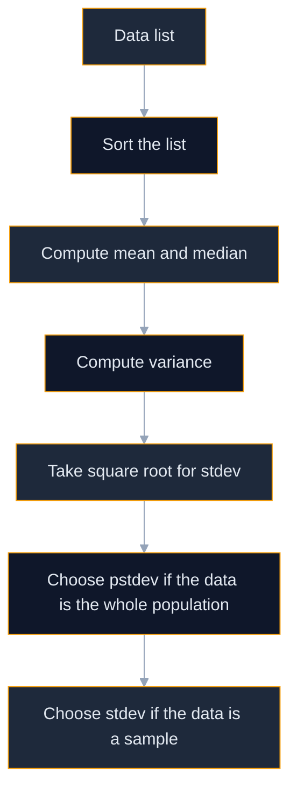

<br>

## 21.3 Random Numbers with a Seed

### 21.3.1 The random.Random Object

The `random` module has a global generator that is fine for single calls. A `random.Random(seed)` object produces a reproducible sequence, which is what a worksheet generator needs.

```python
import random

rng = random.Random(42)
print(rng.randint(1, 26))
print(rng.randint(1, 26))
print(rng.randint(1, 26))
```

Output:

```text
20
25
24
```

The same seed produces the same sequence on every run. That is what makes the worksheet reproducible.

### 21.3.2 Choosing and Sampling

| Function | What it does | Example |
| :--- | :--- | :--- |
| `rng.choice(seq)` | Picks one item | `rng.choice(letters)` |
| `rng.sample(seq, k)` | Picks k distinct items | `rng.sample(letters, 5)` |
| `rng.choices(seq, k=n)` | Picks n items with replacement | `rng.choices(letters, k=5)` |
| `rng.shuffle(seq)` | Shuffles in place | `rng.shuffle(letters)` |

The distinction between `sample` and `choices` is the same as the distinction between without replacement and with replacement. That distinction matters for the probability tables in earlier chapters.

### 21.3.3 Reproducibility Check

```python
import random

def first_three(seed):
    rng = random.Random(seed)
    return [rng.randint(1, 26) for _ in range(3)]

print(first_three(42))
print(first_three(42))
print(first_three(7))
```

Output:

```text
[20, 25, 24]
[20, 25, 24]
[21, 21, 9]
```

The same seed produces the same sequence. A different seed produces a different sequence.

### 21.3.4 A Problem Generator

The generator below builds short expressions with one operator and two letters. The seed is fixed, so the same seed produces the same list on every run.

```python
import random
from fractions import Fraction

ENV = {ch: Fraction(i) for i, ch in enumerate("abcdefghijklmnopqrstuvwxyz", start=1)}

def generate(seed, count):
    rng = random.Random(seed)
    problems = []
    seen = set()
    while len(problems) < count:
        a, b = rng.sample("abcdefghijklmnopqrstuvwxyz", 2)
        op = rng.choice(["+", "-", "*", "/"])
        expr = f"{a} {op} {b}"
        if expr in seen:
            continue
        seen.add(expr)
        try:
            value = eval(expr, ENV, {})
        except ZeroDivisionError:
            continue
        problems.append((expr, value))
    return problems

for i, (expr, value) in enumerate(generate(7, 8), 1):
    print(f"{i}. {expr:<10} = {value}")
```

Output (with seed 7):

```text
1. y + c      = 28
2. l * b      = 24
3. q / u      = 17/21
4. v - r      = 4
5. w + z      = 49
6. j / f      = 5/3
7. m + d      = 17
8. g - b      = 5
```

The output is reproducible. The same seed and the same count produce the same list on every machine.

<br>

## 21.4 Frequency Analysis with Counter

### 21.4.1 Counting Characters

```python
from collections import Counter

text = "HELLO WORLD HELLO PYTHON"
text = text.replace(" ", "")
counts = Counter(text)

print(counts)
print(counts.most_common(3))
```

Output:

```text
Counter({'L': 5, 'O': 3, 'H': 2, 'E': 2, 'W': 1, 'R': 1, 'D': 1, 'P': 1, 'Y': 1, 'T': 1, 'N': 1})
[('L', 5), ('O', 3), ('H', 2)]
```

`most_common(n)` returns the `n` most frequent items as a list of pairs. Without an argument, it returns all items sorted by count.

### 21.4.2 From Counts to Percentages

```python
from collections import Counter

text = "HELLO WORLD HELLO PYTHON"
text = text.replace(" ", "")
counts = Counter(text)
total = sum(counts.values())

for letter, count in counts.most_common():
    pct = count / total * 100
    print(f"{letter}: {count:>2}  {pct:>5.1f}%")
```

Output:

```text
L:  5   25.0%
O:  3   15.0%
H:  2   10.0%
E:  2   10.0%
W:  1    5.0%
R:  1    5.0%
D:  1    5.0%
P:  1    5.0%
Y:  1    5.0%
T:  1    5.0%
N:  1    5.0%
```

The percentages sum to 100 percent, which is the check that the total is correct.

### 21.4.3 A Frequency Table

| Letter | Value | Count | Percentage |
| :--- | :--- | :--- | :--- |
| L | 12 | 5 | 25.0% |
| O | 15 | 3 | 15.0% |
| H | 8 | 2 | 10.0% |
| E | 5 | 2 | 10.0% |
| W | 23 | 1 | 5.0% |
| R | 18 | 1 | 5.0% |
| D | 4 | 1 | 5.0% |
| P | 16 | 1 | 5.0% |
| Y | 25 | 1 | 5.0% |
| T | 20 | 1 | 5.0% |
| N | 14 | 1 | 5.0% |

Total letters: 20. Total percentage: 100.

<br>

## 21.5 Putting It Together: A Word Analyser

### 21.5.1 The Pipeline

The analyser takes a word or a sentence, strips non-letters, converts each letter to a value, and reports the count, sum, mean, median, standard deviation, and the most frequent letter.

```python
import string
import statistics
from collections import Counter
from fractions import Fraction

A1Z26 = {ch: Fraction(i) for i, ch in enumerate(string.ascii_lowercase, start=1)}

def analyse(text):
    letters = [ch for ch in text.lower() if ch in A1Z26]
    if not letters:
        return None
    values = [A1Z26[ch] for ch in letters]
    counts = Counter(letters)

    return {
        "text": text.upper(),
        "letters": len(letters),
        "values": values,
        "sum": sum(values),
        "mean": statistics.mean(values),
        "median": statistics.median(values),
        "stdev": statistics.pstdev(values),
        "most_common": counts.most_common(1)[0],
    }

result = analyse("Hello World")
for key, value in result.items():
    print(f"{key:>14}: {value}")
```

Output:

```text
          text: HELLO WORLD
       letters: 10
        values: [Fraction(8, 1), Fraction(5, 1), Fraction(12, 1), Fraction(12, 1), Fraction(15, 1), Fraction(23, 1), Fraction(15, 1), Fraction(18, 1), Fraction(12, 1), Fraction(4, 1)]
           sum: 124
          mean: 62/5
        median: 12
         stdev: 5.032
  most_common: ('l', 3)
```

The mean is `62/5`, not `12.4`. The exact form is preserved because the input values are `Fraction` objects.

### 21.5.2 Analyse Flow


<br>

## 21.6 Writing Results to CSV

A CSV file is the simplest way to save a table of results. The `csv` module is part of the standard library.

```python
import csv
import string
from collections import Counter
from fractions import Fraction

A1Z26 = {ch: Fraction(i) for i, ch in enumerate(string.ascii_lowercase, start=1)}

words = ["CAT", "DOG", "CODE", "MATH", "PYTHON", "DATA"]

with open("scores.csv", "w", newline="") as f:
    writer = csv.writer(f)
    writer.writerow(["word", "length", "sum", "mean", "top_letter"])
    for word in words:
        letters = [ch for ch in word.lower() if ch in A1Z26]
        values = [A1Z26[ch] for ch in letters]
        counts = Counter(letters)
        top = counts.most_common(1)[0][0].upper()
        writer.writerow([
            word,
            len(letters),
            sum(values),
            sum(values) / len(values),
            top,
        ])

with open("scores.csv") as f:
    print(f.read())
```

Output file content:

```text
word,length,sum,mean,top_letter
CAT,3,24,8,C
DOG,3,26,26/3,O
CODE,4,27,27/4,C
MATH,4,42,21/2,M
PYTHON,6,98,49/3,O
DATA,4,26,13/2,D
```

The exact fractions are written as text. A spreadsheet can read them as strings and display them as fractions, or convert them to decimals on its own.

<br>

## 21.7 Exercises

### 21.7.1 Level 1: statistics Basics

```
1. mean of [3, 1, 20, 8]
2. median of [3, 1, 20, 8]
3. pstdev of [3, 1, 20, 8]
4. mean of the full alphabet
5. median of the full alphabet
6. pstdev of the full alphabet
7. mean of [10, 20, 30, 40, 50]
8. median of [10, 20, 30, 40, 50]
```

| # | Answer |
| :--- | :--- |
| 1 | 8.0 |
| 2 | 5.5 |
| 3 | 7.386 |
| 4 | 13.5 |
| 5 | 13.5 |
| 6 | 7.5 |
| 7 | 30.0 |
| 8 | 30 |

### 21.7.2 Level 2: Random Generation

Run each generator with the seed shown. Write down the first three outputs.

```
1. random.Random(1).randint(1, 26) three times
2. random.Random(2).randint(1, 26) three times
3. random.Random(42).choice("abcdefghijklmnopqrstuvwxyz") three times
4. random.Random(42).sample("abcdefghijklmnopqrstuvwxyz", 5)
5. random.Random(42).choices("abcdefghijklmnopqrstuvwxyz", k=5)
```

The first two exercises produce different sequences. The third and fourth use the same seed and produce different results because they use different functions.

### 21.7.3 Level 3: Frequency Analysis

```
1. Count letters in "ABCDEFGHIJKLMNOPQRSTUVWXYZ"
2. Count letters in "MISSISSIPPI"
3. Count letters in "BANANA"
4. Report the most common letter in "BANANA"
5. Report the percentage of "S" in "MISSISSIPPI"
```

| # | Answer |
| :--- | :--- |
| 1 | each letter appears once |
| 2 | I: 4, S: 4, M: 1, P: 2 |
| 3 | A: 3, N: 2, B: 1 |
| 4 | A |
| 5 | 4/11 = 36.36% |

### 21.7.4 Level 4: CSV Export

Write a program that:

1. Takes a list of at least five words.
2. Computes length, sum, mean, and most frequent letter for each.
3. Writes the results to a CSV file.
4. Reads the file back and prints each row.

The output should have a header row and one data row per word.

<br>

## 21.8 Key Takeaways

1. The `statistics` module computes the standard measures without hand arithmetic. Use `pstdev` for a full population and `stdev` for a sample.
2. `random.Random(seed)` produces a reproducible sequence. The same seed produces the same worksheet on every run.
3. `Counter` counts occurrences in one line. The result can be sorted by count with `most_common`.
4. Exact fractions travel through the pipeline. The mean of `HELLO WORLD` is `62/5`, not `12.4`, when the input values are `Fraction` objects.
5. CSV is the right format for a results table. The `csv` module writes and reads it without any extra work.
6. Frequency analysis is the first step in breaking a simple cipher. The most common letter in a long text is usually the letter that maps to the space character or to `E`, and that is enough to narrow the key.

<br>

# Chapter 22. Symbolic Mathematics with SymPy


## 22.1 Why a Symbolic Library

The earlier chapters use `Fraction` to keep exact arithmetic. That works for numbers. It does not work for algebra.

Given `(a + b) ** 2`, Python evaluates it to `9` if `a = 1` and `b = 2`. Given `a ** 2 + 2 * a * b + b ** 2`, Python evaluates that to `9` too. The two expressions are equal for every input, but Python has no way to say so. A symbolic library can.

SymPy is a Python library for symbolic mathematics. It treats letters as symbols rather than as numbers, so it can expand, factor, simplify, solve, differentiate, and integrate expressions in their symbolic form.

### 22.1.1 Installation

```text
pip install sympy
```

The library is not part of the standard library. Everything else in this guide uses only the standard library. SymPy is the one exception.

<br>

## 22.2 Symbols and Expressions

### 22.2.1 Declaring Symbols

```python
from sympy import symbols

a, b, c = symbols("a b c")
expr = (a + b) ** 2

print(expr)
print(type(expr))
```

Output:

```text
(a + b)**2
<class 'sympy.core.power.Pow'>
```

The expression is a symbolic object, not a number. It does not evaluate until a value is substituted.

### 22.2.2 Substitution

```python
from sympy import symbols

a, b, c = symbols("a b c")
expr = (a + b) ** 2

print(expr.subs({a: 1, b: 2}))         # 9
print(expr.subs({a: 1, b: 2}).evalf())  # 9.00000000000000
```

Substitution produces a number. The `.evalf()` method converts a symbolic number to a decimal. For exact fractions, `.evalf()` is unnecessary and should be avoided.

<br>

## 22.3 Simplification and Expansion

### 22.3.1 expand

`expand` multiplies out the brackets.

```python
from sympy import symbols, expand

a, b, c = symbols("a b c")
expr = (a + b) ** 2
print(expand(expr))
```

Output:

```text
a**2 + 2*a*b + b**2
```

That is the identity from earlier chapters, but now in symbolic form. `expand` confirms it without substituting numbers.

### 22.3.2 factor

`factor` reverses `expand`.

```python
from sympy import symbols, factor

a, b, c = symbols("a b c")
expr = a ** 2 + 2 * a * b + b ** 2
print(factor(expr))
```

Output:

```text
(a + b)**2
```

### 22.3.3 simplify

`simplify` tries several rewrite rules and returns the shortest equivalent form.

```python
from sympy import symbols, simplify

a, b, c = symbols("a b c")

print(simplify((a + b) ** 2 - (a ** 2 + b ** 2)))
print(simplify((a ** 2 - b ** 2) / (a - b)))
```

Output:

```text
2*a*b
a + b
```

The first result confirms that `(a+b)^2 - (a^2 + b^2) = 2ab`. The second result confirms the factorisation `(a^2 - b^2) / (a - b) = a + b`.

### 22.3.4 Comparison Table

| Operation | Function | Example | Result |
| :--- | :--- | :--- | :--- |
| Expand | `expand` | `(a + b) ** 2` | `a**2 + 2*a*b + b**2` |
| Factor | `factor` | `a**2 - b**2` | `(a - b)*(a + b)` |
| Simplify | `simplify` | `(a**2 - b**2) / (a - b)` | `a + b` |
| Collect | `collect` | `a*b + a*c` | `a*(b + c)` |

### 22.3.5 Symbolic Flow

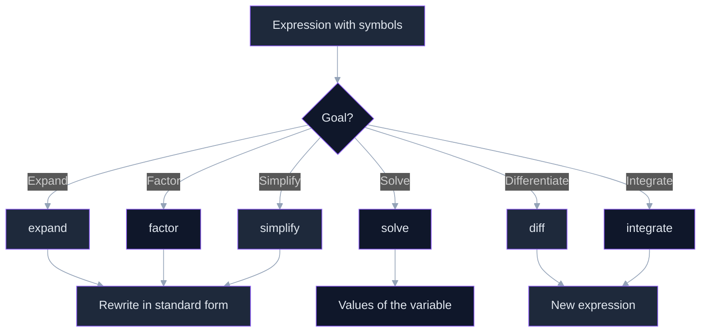

<br>

## 22.4 Solving Equations

### 22.4.1 Single Equation

```python
from sympy import symbols, solve

x = symbols("x")
print(solve(x ** 2 - 5 * x + 6, x))
```

Output:

```text
[2, 3]
```

The equation `x^2 - 5x + 6 = 0` has roots 2 and 3. SymPy finds both.

### 22.4.2 System of Equations

```python
from sympy import symbols, solve

x, y = symbols("x y")
print(solve([x + y - 10, x - y - 2], [x, y]))
```

Output:

```text
{x: 6, y: 4}
```

The solution is `x = 6`, `y = 4`. The check is `6 + 4 = 10` and `6 - 4 = 2`.

### 22.4.3 Solving with A1Z26 Values

```python
from sympy import symbols, solve, Eq

x = symbols("x")
a, b, c = 1, 2, 3

# Solve: a * x + b = c
equation = Eq(a * x + b, c)
print(equation)
print(solve(equation, x))
```

Output:

```text
Eq(x + 2, 3)
[1]
```

The solution is `x = 1`. The symbolic form is more readable than the numeric one for equations with parameters.

<br>

## 22.5 Calculus

### 22.5.1 Derivatives

```python
from sympy import symbols, diff

x = symbols("x")

print(diff(x ** 2, x))              # 2*x
print(diff(x ** 3 + 2 * x, x))      # 3*x**2 + 2
print(diff(x ** 2, x, 2))           # second derivative: 2
```

The third argument to `diff` is the order of the derivative. `diff(x**2, x, 2)` returns the second derivative, which is `2`.

### 22.5.2 Integrals

```python
from sympy import symbols, integrate

x = symbols("x")

print(integrate(x, x))              # x**2 / 2
print(integrate(x ** 2, x))         # x**3 / 3
print(integrate(x, (x, 0, 1)))      # 1/2
```

The third form is a definite integral. The limits are given as a tuple `(variable, lower, upper)`.

### 22.5.3 Limits

```python
from sympy import symbols, limit, oo, sin

x = symbols("x")

print(limit(sin(x) / x, x, 0))      # 1
print(limit(1 / x, x, oo))          # 0
print(limit((1 + 1 / x) ** x, x, oo))  # E
```

The second argument to `limit` is the variable. The third is the point. The constant `oo` means infinity.

### 22.5.4 Series Expansion

```python
from sympy import symbols, series, sin, exp, cos

x = symbols("x")

print(series(sin(x), x, 0, 6))
print(series(exp(x), x, 0, 5))
print(series(cos(x), x, 0, 6))
```

The fourth argument is the number of terms. The output is a truncated series plus an order term. `series(sin(x), x, 0, 6)` returns `x - x**3/6 + x**5/120 + O(x**6)`.

### 22.5.5 Calculus Summary

| Operation | Function | Example | Result |
| :--- | :--- | :--- | :--- |
| Derivative | `diff` | `diff(x**2, x)` | `2*x` |
| Second derivative | `diff(x**2, x, 2)` | `2` |
| Indefinite integral | `integrate(x, x)` | `x**2/2` |
| Definite integral | `integrate(x, (x, 0, 1))` | `1/2` |
| Limit | `limit(sin(x)/x, x, 0)` | `1` |
| Series | `series(sin(x), x, 0, 6)` | `x - x**3/6 + x**5/120 + O(x**6)` |

<br>

## 22.6 Converting Between Symbolic and Numeric

### 22.6.1 From Symbolic to Numeric

```python
from sympy import symbols, sqrt, N

x = symbols("x")

expr = sqrt(2)
print(expr)              # sqrt(2)
print(N(expr))           # 1.41421356237310
print(N(expr, 20))       # 1.4142135623730950488
```

`N` converts a symbolic expression to a decimal. The second argument is the number of digits of precision.

### 22.6.2 From Numeric to Exact

```python
from fractions import Fraction
from sympy import Rational

print(Fraction(1, 3))
print(Rational(1, 3))
print(Rational(0.75))         # 3/4
print(Rational("0.75"))       # 3/4
```

`Rational` is SymPy's exact rational class. It is interoperable with `Fraction` in most cases, but SymPy's symbolic operations prefer `Rational`.

### 22.6.3 Lambdify

`lambdify` converts a symbolic expression to a plain Python function that accepts numbers.

```python
from sympy import symbols, lambdify

x = symbols("x")
expr = x ** 2 + 3 * x - 5
f = lambdify(x, expr, "math")

print(f(1))    # -1
print(f(2))    # 5
print(f(10))   # 125
```

That is useful when a symbolic expression is computed many times with different numeric inputs. The symbolic form is used for analysis, and the lambdified form is used for speed.

### 22.6.4 Comparison Table

| Type | Exact? | Symbolic? | Best For |
| :--- | :--- | :--- | :--- |
| `int` | Yes | No | Counting |
| `float` | No | No | Display, speed |
| `Fraction` | Yes | No | Exact numbers, worksheets |
| `sympy.Rational` | Yes | No | Exact numbers inside SymPy |
| `sympy.Symbol` | N/A | Yes | Algebra, calculus |
| `sympy.Expr` | Depends | Yes | Any symbolic computation |

<br>

## 22.7 A Complete Worked Example

The problem: given the expression

$$ f(a, b, c) = (a + b + c)^2 - (a^2 + b^2 + c^2) $$

find the value of `f` when `a = 1`, `b = 2`, `c = 3`, and prove symbolically that `f` equals `2(ab + bc + ca)`.

### 22.7.1 Numeric Answer

```python
a, b, c = 1, 2, 3
f = (a + b + c) ** 2 - (a ** 2 + b ** 2 + c ** 2)
print(f)
```

Output:

```text
22
```

### 22.7.2 Symbolic Answer

```python
from sympy import symbols, expand, simplify

a, b, c = symbols("a b c")
f = (a + b + c) ** 2 - (a ** 2 + b ** 2 + c ** 2)

print(expand(f))
print(simplify(f))
print(simplify(f - 2 * (a * b + b * c + c * a)))
```

Output:

```text
2*a*b + 2*a*c + 2*b*c
2*a*b + 2*a*c + 2*b*c
0
```

The last line is the proof. The expression `f - 2(ab + bc + ca)` simplifies to `0`, which means `f` equals `2(ab + bc + ca)` for every value of `a`, `b`, and `c`.

### 22.7.3 Check with A1Z26 Values

```python
from sympy import symbols, simplify

a, b, c = symbols("a b c")
f = (a + b + c) ** 2 - (a ** 2 + b ** 2 + c ** 2)
g = 2 * (a * b + b * c + c * a)

value = f.subs({a: 1, b: 2, c: 3})
print(value)          # 22
print(g.subs({a: 1, b: 2, c: 3}))    # 22
print(simplify(f - g))               # 0
```

The numeric check agrees with the symbolic proof. Both should be shown in any report, because the numeric check is the evidence and the symbolic check is the proof.

<br>

## 22.8 Exercises

### 22.8.1 Level 1: Expand and Factor

```
1. expand((a + b) ** 3)
2. factor(a ** 3 - b ** 3)
3. simplify((a ** 2 - b ** 2) / (a - b))
4. expand((a - b) ** 2)
5. factor(a ** 2 + 2 * a * b + b ** 2)
6. simplify((a ** 3 - b ** 3) / (a - b))
```

| # | Answer |
| :--- | :--- |
| 1 | `a**3 + 3*a**2*b + 3*a*b**2 + b**3` |
| 2 | `(a - b)*(a**2 + a*b + b**2)` |
| 3 | `a + b` |
| 4 | `a**2 - 2*a*b + b**2` |
| 5 | `(a + b)**2` |
| 6 | `a**2 + a*b + b**2` |

### 22.8.2 Level 2: Solve

```
1. solve(x ** 2 - 4, x)
2. solve(x ** 2 - 5 * x + 6, x)
3. solve([x + y - 7, x - y - 1], [x, y])
4. solve(a * x + b - c, x) for a, b, c symbolic
5. solve(x ** 3 - 6 * x ** 2 + 11 * x - 6, x)
```

| # | Answer |
| :--- | :--- |
| 1 | `[-2, 2]` |
| 2 | `[2, 3]` |
| 3 | `{x: 4, y: 3}` |
| 4 | `(c - b) / a` |
| 5 | `[1, 2, 3]` |

### 22.8.3 Level 3: Calculus

```
1. diff(x ** 4, x)
2. diff(sin(x), x)
3. diff(x ** 2 * exp(x), x)
4. integrate(x ** 2, x)
5. integrate(sin(x), (x, 0, 3.14159))
6. limit((1 - cos(x)) / x ** 2, x, 0)
```

| # | Answer |
| :--- | :--- |
| 1 | `4*x**3` |
| 2 | `cos(x)` |
| 3 | `x**2*exp(x) + 2*x*exp(x)` |
| 4 | `x**3/3` |
| 5 | `2` (approximately, with rounding error from the decimal limit) |
| 6 | `1/2` |

The fifth exercise uses a decimal approximation of pi, so the result is a decimal. Using `pi` from SymPy gives the exact answer.

```python
from sympy import symbols, integrate, sin, pi
x = symbols("x")
print(integrate(sin(x), (x, 0, pi)))   # 2
```

### 22.8.4 Level 4: Proof by Simplification

Prove each identity by showing that the difference simplifies to zero.

```
1. (a + b) ** 2 = a ** 2 + 2 * a * b + b ** 2
2. (a - b) ** 2 = a ** 2 - 2 * a * b + b ** 2
3. (a + b) * (a - b) = a ** 2 - b ** 2
4. a ** 3 + b ** 3 = (a + b) * (a ** 2 - a * b + b ** 2)
5. (a + b + c) ** 2 = a ** 2 + b ** 2 + c ** 2 + 2 * (a * b + b * c + c * a)
```

The proof pattern is the same for each: `simplify(left - right) == 0`.

<br>

## 22.9 Pitfalls in Symbolic Computation

| Pitfall | What goes wrong | Fix |
| :--- | :--- | :--- |
| Using `=` to define an equation | `=` assigns, it does not compare | Use `Eq(left, right)` for equations |
| Forgetting to declare symbols | `a` is a Python name, not a symbol | `a, b, c = symbols("a b c")` |
| Mixing `float` and `Symbol` in the same expression | The result becomes a float | Use `Rational` or `Integer` |
| Assuming `simplify` always gives the shortest form | It uses heuristics, not a proof | Check with `simplify(expr - expected) == 0` |
| Expecting numeric output from `solve` | The roots may be symbolic | Call `.evalf()` when a decimal is needed |
| Using `sympy` when the standard library is enough | Extra dependency, slower import | Use `Fraction` for plain arithmetic |

The last row is worth emphasising. SymPy is a tool for algebra and calculus. It is not needed for arithmetic on numbers, and using it there adds a dependency without adding value.

<br>

## 22.10 Key Takeaways

1. SymPy treats letters as symbols, so an expression can be expanded, factored, simplified, solved, differentiated, and integrated in its symbolic form.
2. `expand`, `factor`, and `simplify` are the three workhorses of algebra. Each one rewrites an expression into a different shape without changing its value.
3. `solve` finds the values of a variable that make an equation true. `Eq` builds the equation. Assignment with `=` is not the same thing.
4. `diff` and `integrate` are the two calculus functions. `limit` and `series` handle the boundary cases.
5. `N` and `.evalf()` convert symbolic results to decimals. `Rational` and `lambdify` go the other way, from decimals back to exact values or from symbolic expressions to fast numeric functions.
6. A proof in SymPy is `simplify(left - right) == 0`. That check works for any identity, and it does not depend on substituting particular numbers.
7. SymPy is a dependency. Use it for algebra and calculus, not for plain arithmetic. `Fraction` from the standard library covers the numeric case without any installation.

<br>

# Chapter 23. Money Math with Decimal

 
## 23.1 Why Floats Fail at Money

Python's default number type for division is `float`, which stores values as binary fractions. Most decimal values, including `0.1`, `0.2`, and `0.7`, have no exact binary representation. They are stored as the closest binary value, and that tiny gap shows up when you add enough of them.

```python
print(0.1 + 0.2)
print(0.1 + 0.2 == 0.3)
print(0.1 + 0.2 - 0.3)
```

Output:

```text
0.30000000000000004
False
5.551115123125783e-17
```

The result of `0.1 + 0.2` should be `0.3`. The gap is about 5 parts in a hundred million million. For physics or graphics, that gap is invisible. For money, it is a real difference that can show up on an invoice.

A second case makes the problem clearer. A sum of ten prices, each `0.1`, should equal `1.0`. With floats:

```python
total = 0.0
for _ in range(10):
    total += 0.1
print(total)
print(total == 1.0)
```

Output:

```text
0.9999999999999999
False
```

The customer is charged `0.9999999999999999` and the ledger says `1.0`. The two do not match. That is the situation `Decimal` is built to prevent.

<br>

## 23.2 The Decimal Class

The `decimal` module provides the `Decimal` class. A `Decimal` stores a value as a decimal number with a fixed number of significant digits. Arithmetic on `Decimal` values follows the rules you learned in school, not the rules of binary floating point.

### 23.2.1 Creating a Decimal

| Form | Example | Result |
| :--- | :--- | :--- |
| From a string | `Decimal("0.1")` | `0.1` |
| From an integer | `Decimal(1)` | `1` |
| From a float | `Decimal(0.1)` | the binary value, not `0.1` |
| From a tuple | `Decimal((0, (1,), -1))` | `0.1` |

The third row is the trap. `Decimal(0.1)` reads the binary representation of the float `0.1`, which is not exactly `0.1`. Always create a `Decimal` from a string, never from a float.

```python
from decimal import Decimal

print(Decimal("0.1"))
print(Decimal(0.1))
```

Output:

```text
0.1
0.1000000000000000055511151231257827021181583404541015625
```

The first line is the value you wanted. The second line is the value the float actually stored.

### 23.2.2 Arithmetic with Decimal

```python
from decimal import Decimal

a = Decimal("0.1")
b = Decimal("0.2")

print(a + b)
print(a + b == Decimal("0.3"))
```

Output:

```text
0.3
True
```

The sum is exact. The comparison is true. That is the whole point of using `Decimal`.

The same ten-price test from Section 23.1, with `Decimal`:

```python
from decimal import Decimal

total = Decimal("0")
for _ in range(10):
    total += Decimal("0.1")
print(total)
print(total == Decimal("1.0"))
```

Output:

```text
1.0
True
```

<br>

## 23.3 Rounding Rules

Not every calculation produces a value that fits the number of decimal places a currency uses. A tax calculation, for example, produces a value with more than two decimal places, and the final amount must be rounded to the cent. The `Decimal` class supports several rounding modes.

### 23.3.1 The Main Rounding Modes

| Mode | Name | Behaviour |
| :--- | :--- | :--- |
| `ROUND_HALF_UP` | Half up | `2.5` rounds to `3`, `-2.5` rounds to `-3` |
| `ROUND_HALF_EVEN` | Banker's rounding | `2.5` rounds to `2`, `3.5` rounds to `4` |
| `ROUND_HALF_DOWN` | Half down | `2.5` rounds to `2`, `-2.5` rounds to `-2` |
| `ROUND_DOWN` | Toward zero | `2.9` rounds to `2`, `-2.9` rounds to `-2` |
| `ROUND_UP` | Away from zero | `2.1` rounds to `3`, `-2.1` rounds to `-3` |
| `ROUND_CEILING` | Toward infinity | rounds up |
| `ROUND_FLOOR` | Toward negative infinity | rounds down |

`ROUND_HALF_UP` is the mode most schools teach: exactly halfway rounds up. `ROUND_HALF_EVEN` is the mode most financial systems use: exactly halfway rounds to the nearest even digit. The difference shows up only at `.5`, but invoices occasionally land there, and the choice matters for auditing.

### 23.3.2 Applying a Rounding Mode

```python
from decimal import Decimal, ROUND_HALF_UP, ROUND_HALF_EVEN

value = Decimal("2.5")

print(value.quantize(Decimal("1"), rounding=ROUND_HALF_UP))    # 3
print(value.quantize(Decimal("1"), rounding=ROUND_HALF_EVEN))  # 2
```

The `quantize` method rounds a value to a target number of decimal places. The target is another `Decimal`. `Decimal("1")` means zero decimal places. `Decimal("0.01")` means two decimal places.

```python
from decimal import Decimal, ROUND_HALF_UP

price = Decimal("19.995")
tax_rate = Decimal("0.075")
tax = price * tax_rate

print(tax)                                            # 1.499625
print(tax.quantize(Decimal("0.01"), rounding=ROUND_HALF_UP))  # 1.50
```

The tax is computed at full precision, then rounded to the cent. Rounding early loses money. Rounding late matches what a customer expects to see.

### 23.3.3 A Worked Invoice

```python
from decimal import Decimal, ROUND_HALF_UP

def line_total(unit_price, quantity):
    return Decimal(unit_price) * Decimal(quantity)

def invoice_total(lines, tax_rate):
    subtotal = sum((line_total(p, q) for p, q in lines), Decimal("0"))
    tax = (subtotal * Decimal(tax_rate)).quantize(Decimal("0.01"), rounding=ROUND_HALF_UP)
    grand_total = subtotal + tax
    return subtotal, tax, grand_total

lines = [
    ("12.99", 3),
    ("4.50", 2),
    ("99.95", 1),
]

subtotal, tax, grand = invoice_total(lines, "0.075")
print("subtotal:", subtotal)
print("tax     :", tax)
print("total   :", grand)
```

Output:

```text
subtotal: 147.92
tax     : 11.09
total   : 159.01
```

The subtotal is exact because no division occurred. The tax is rounded to the cent. The grand total is the exact sum of two exact values.

### 23.3.4 Rounding Flow

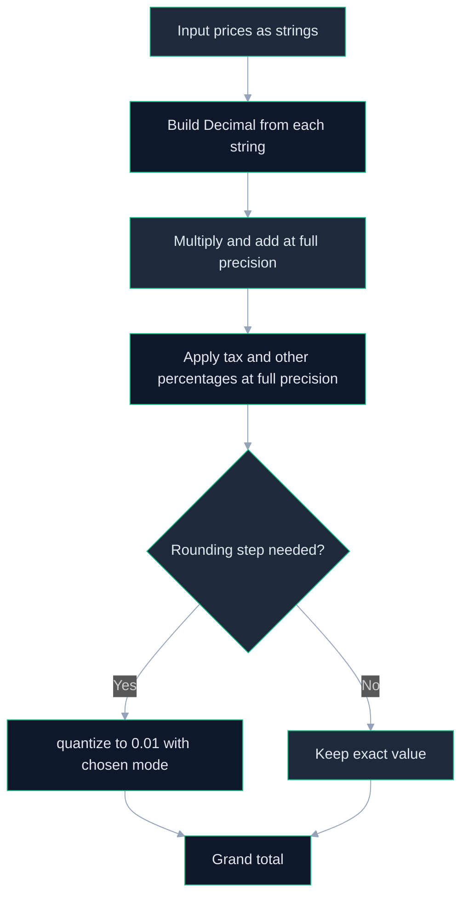

<br>

## 23.4 Formatting for Display

A `Decimal` stores the exact value. The display is a separate choice. Two common options:

```python
from decimal import Decimal

amount = Decimal("159.01")

print(amount)                    # 159.01
print(f"{amount:.2f}")           # 159.01
print(f"${amount:,.2f}")         # $159.01
```

The `,` adds a thousands separator. The `.2f` fixes two decimal places. The two are independent.

| Format | Result | When to Use |
| :--- | :--- | :--- |
| `str(amount)` | `159.01` | Logs, debugging |
| `f"{amount:.2f}"` | `159.01` | Fixed two decimals |
| `f"${amount:,.2f}"` | `$159.01` | User-facing totals |
| `f"{amount:,.0f}"` | `159` | Round to whole currency units |

The `str` form is what `print` shows by default. It does not add thousands separators and it does not add a currency symbol. That is usually fine for internal logs. For anything a user reads, build the display string explicitly.

<br>

## 23.5 When Fraction Is Better Than Decimal

`Decimal` is exact for decimal values. It is not exact for fractions whose decimal form repeats, such as `1/3`. A `Decimal` representation of `1/3` must be truncated at some number of digits, and that truncation is a rounding choice.

`Fraction` keeps the ratio as a numerator and denominator, so `1/3` stays exactly `1/3`. When a value is a ratio and must not be rounded at all, `Fraction` is the right tool.

| Situation | Best Type | Reason |
| :--- | :--- | :--- |
| Prices, invoices, tax | `Decimal` | Values are decimals with a fixed number of places |
| Ratios that must stay exact | `Fraction` | Division stays exact, no rounding |
| Scientific measurement | `float` | Speed and range matter more than exactness |
| Counting, indexing | `int` | Values are whole numbers |

The A1Z26 guide uses `Fraction` throughout because the arithmetic is ratio-based. A guide about money uses `Decimal` because the arithmetic is decimal-based. Neither is universally better.

### 23.5.1 A1Z26 Scores with Decimal

A price calculation and an A1Z26 score calculation use the same arithmetic but different types. Here is the same idea applied to a word score:

```python
from decimal import Decimal

prices = [Decimal("12.99"), Decimal("4.50"), Decimal("99.95")]
print("total  :", sum(prices, Decimal("0")))
print("average:", sum(prices, Decimal("0")) / Decimal(len(prices)))
```

Output:

```text
total  : 117.44
average: 39.14666666666666666666666667
```

The average does not terminate, so `Decimal` produces a long value with the default precision. The display is still correct; it is just long. If the result must be a clean ratio, use `Fraction`:

```python
from fractions import Fraction

prices = [Fraction(1299, 100), Fraction(450, 100), Fraction(9995, 100)]
print("total  :", sum(prices, Fraction(0)))
print("average:", sum(prices, Fraction(0)) / len(prices))
```

Output:

```text
total  : 2936/25
average: 2936/75
```

The two results are the same value in different forms. `Decimal` shows a decimal, `Fraction` shows a ratio. Pick the one that matches the audience.

<br>

## 23.6 Exercises

### 23.6.1 Level 1: Decimal Basics

```
1. Decimal("0.1") + Decimal("0.2")
2. Decimal("1.10") - Decimal("0.90")
3. Decimal("3.50") * Decimal("4")
4. Decimal("10.00") / Decimal("4")
5. 0.1 + 0.2 with floats
6. 0.1 + 0.2 with Decimal, then compare to Decimal("0.3")
```

| # | Answer |
| :--- | :--- |
| 1 | `0.3` |
| 2 | `0.20` |
| 3 | `14.00` |
| 4 | `2.5` |
| 5 | `0.30000000000000004` |
| 6 | `True` |

### 23.6.2 Level 2: Rounding

Round each value to two decimal places with `ROUND_HALF_UP` and then with `ROUND_HALF_EVEN`.

```
1. 2.345
2. 2.355
3. 1.005
4. 0.125
5. -2.345
```

| # | HALF_UP | HALF_EVEN |
| :--- | :--- | :--- |
| 1 | `2.35` | `2.34` |
| 2 | `2.36` | `2.36` |
| 3 | `1.01` | `1.00` |
| 4 | `0.13` | `0.12` |
| 5 | `-2.35` | `-2.34` |

The differences appear only when the digit after the target place is exactly 5.

### 23.6.3 Level 3: Invoice

A customer buys three items:

| Item | Unit price | Quantity |
| :--- | :--- | :--- |
| Pen | `1.25` | 4 |
| Notebook | `4.99` | 2 |
| Bag | `29.95` | 1 |

Compute the subtotal, the tax at 8.5 percent, and the grand total. Round the tax to the cent with `ROUND_HALF_UP`.

| # | Result |
| :--- | :--- |
| Subtotal | `44.93` |
| Tax | `3.82` |
| Grand total | `48.75` |

<br>

## 23.7 Key Takeaways

1. Floats cannot represent most decimal values exactly. `0.1 + 0.2` is not `0.3` when the values are floats.
2. `Decimal` stores values as decimals with exact arithmetic. Create it from a string, never from a float.
3. `quantize` rounds to a chosen number of decimal places. The rounding mode controls how exact halves are handled.
4. `ROUND_HALF_UP` is the school rule. `ROUND_HALF_EVEN` is the finance rule. Pick one per project and use it everywhere.
5. Round late, not early. Compute at full precision and round only when the value is displayed or stored.
6. Use `Decimal` for money and `Fraction` for ratios. The two are not interchangeable, and each is exact in its own domain.

<br>

# Chapter 24. Vectorised Math with NumPy
 

## 24.1 Why Arrays

Every chapter so far computes one value at a time. Real work processes many values together: a table of exam scores, a column of word lengths, a list of A1Z26 sums across a dictionary. A loop can handle a small list, but it becomes slow and verbose when the list grows, and it hides the arithmetic inside Python syntax.

NumPy provides arrays, which are collections of values with a single type. Arithmetic on arrays applies element by element. The syntax looks the same as single-value arithmetic.

```python
import numpy as np

scores = np.array([12, 24, 27, 42, 98])
print(scores * 2)
print(scores + 10)
print(scores - 1)
```

Output:

```text
[ 24  48  54  84 196]
[ 22  34  37  52 108]
[11 23 26 41 97]
```

Each operation applies to every element. That is vectorised arithmetic.

### 24.1.1 Arrays vs Lists

| Aspect | Python list | NumPy array |
| :--- | :--- | :--- |
| Type | Mixed types allowed | One type per array |
| Arithmetic | Adds elements only with `+` | Elementwise with every operator |
| Speed | Slow for large data | Fast, runs in C |
| Memory | Higher for numbers | Lower for numbers |
| Best for | Small or mixed data | Numeric data at scale |

The same `* 2` on a Python list repeats the list instead of doubling each value:

```python
print([12, 24, 27, 42, 98] * 2)
```

Output:

```text
[12, 24, 27, 42, 98, 12, 24, 27, 42, 98]
```

That difference is the reason NumPy exists.

### 24.1.2 Creating Arrays

| Form | Example | Result |
| :--- | :--- | :--- |
| From a list | `np.array([1, 2, 3])` | `[1 2 3]` |
| Range | `np.arange(1, 27)` | `[1 2 ... 26]` |
| Zeros | `np.zeros(5)` | `[0. 0. 0. 0. 0.]` |
| Ones | `np.ones(5)` | `[1. 1. 1. 1. 1.]` |
| Evenly spaced | `np.linspace(0, 1, 5)` | `[0.   0.25 0.5  0.75 1.  ]` |
| Random integers | `np.random.randint(1, 27, 10)` | ten values from 1 to 26 |

The `arange` function produces a range as an array. For A1Z26, `np.arange(1, 27)` produces the full set of letter values.

<br>

## 24.2 Aggregations

An aggregation reduces an array to a single value. NumPy provides all the common ones as methods on the array.

```python
import numpy as np

values = np.array([3, 1, 20, 8])

print(values.sum())         # 32
print(values.mean())        # 8.0
print(values.min())         # 1
print(values.max())         # 20
print(values.std())         # 7.386
print(values.var())         # 54.5625
```

Each method returns a single number. The full set of aggregations maps directly onto the statistics functions from Chapter 21.

| NumPy method | Statistics equivalent | Purpose |
| :--- | :--- | :--- |
| `values.sum()` | `sum(values)` | Sum |
| `values.mean()` | `statistics.mean(values)` | Mean |
| `values.min()` | `min(values)` | Minimum |
| `values.max()` | `max(values)` | Maximum |
| `values.std()` | `statistics.pstdev(values)` | Population standard deviation |
| `values.var()` | `statistics.pvariance(values)` | Population variance |
| `values.median()` | `statistics.median(values)` | Median |

`np.median(values)` is a function call, not a method, because it needs to sort the array first. The rest are direct methods.

### 24.2.1 The Full Alphabet as an Array

```python
import numpy as np

letters = np.arange(1, 27)

print(letters.sum())        # 351
print(letters.mean())       # 13.5
print(letters.std())        # 7.5
print(letters.min())        # 1
print(letters.max())        # 26
```

Every value matches the closed-form calculation from Chapter 2. The array makes it a one-liner instead of a loop.

<br>

## 24.3 Boolean Masks

A boolean mask is an array of `True` and `False` values that selects elements from another array. It is the most useful pattern in NumPy, because it replaces most `if` statements that would otherwise appear inside a loop.

### 24.3.1 Building a Mask

```python
import numpy as np

values = np.array([3, 1, 20, 8, 15, 22])

mask = values > 10
print(mask)
print(values[mask])
```

Output:

```text
[False False  True False  True  True]
[20 15 22]
```

The comparison `values > 10` produces an array of booleans. Indexing with that mask returns only the values where the mask is `True`.

### 24.3.2 Counting and Aggregating on a Mask

```python
import numpy as np

values = np.array([3, 1, 20, 8, 15, 22])

mask = values > 10
print(mask.sum())                 # 3, because True counts as 1
print(values[mask].sum())         # 57
print(values[mask].mean())        # 19.0
```

Counting is `mask.sum()`. Aggregating is `values[mask].method()`. Both are one-liners.

### 24.3.3 Multiple Conditions

Combine masks with `&` for AND, `|` for OR, and `~` for NOT.

```python
import numpy as np

values = np.array([3, 1, 20, 8, 15, 22])

gt10 = values > 10
is_even = values % 2 == 0

print(values[gt10 & is_even])     # [20 22]
print(values[gt10 | is_even])     # [ 20  8 22  3  1]
print(values[~(values > 10)])     # [3 1 8]
```

The `&`, `|`, and `~` operators are not the same as `and`, `or`, and `not`. The word forms do not work elementwise. The symbol forms do.

### 24.3.4 Mask Flow

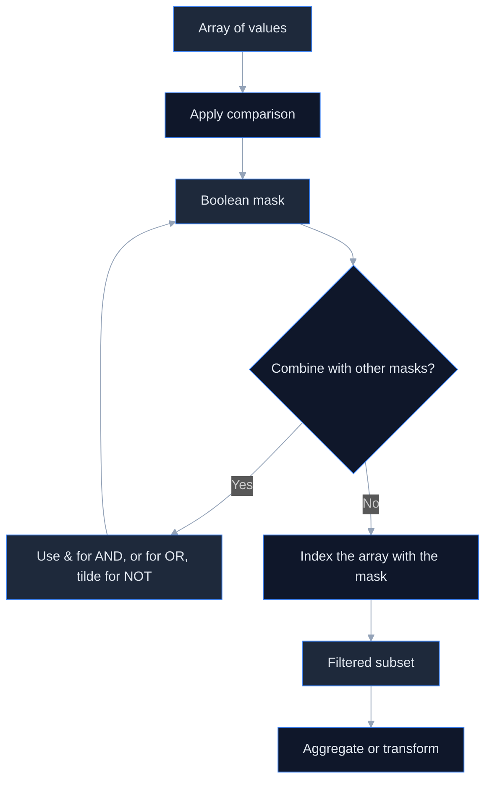

<br>

## 24.4 Broadcasting

Broadcasting is the rule that lets an operation between an array and a single value work elementwise. `scores * 2` is broadcasting: the `2` is stretched across every element of `scores`.

Broadcasting also works between arrays of different shapes, as long as the shapes are compatible. A common case is applying a per-column adjustment to a two-dimensional table.

```python
import numpy as np

table = np.array([
    [12, 24, 27],
    [42, 98, 51],
    [16, 25, 20],
])

adjust = np.array([1, 2, 3])
print(table + adjust)
```

Output:

```text
[[13 26 30]
 [43 100 54]
 [17 27 23]]
```

The `adjust` array has shape `(3,)`, and the table has shape `(3, 3)`. NumPy broadcasts `adjust` across each row. The rule is that a smaller shape can be stretched to match a larger one along the axes where they agree.

Broadcasting failure happens when the shapes cannot agree. `table + np.array([1, 2])` raises a `ValueError` because a length-2 array cannot be stretched to a length-3 column.

### 24.4.1 A1Z26 Example

Score every word in a list with the same formula. For a two-letter word, the value is the sum. For a longer word, the same idea applies.

```python
import numpy as np

# Each row is a word's letter values, padded to 4 columns with zeros
words = np.array([
    [3, 1, 20, 0],   # CAT
    [4, 15, 7, 0],   # DOG
    [3, 15, 4, 5],   # CODE
    [13, 1, 20, 8],  # MATH
])

print(words.sum(axis=1))
```

Output:

```text
[24 26 27 42]
```

The `axis=1` argument sums each row instead of each column. That is the vectorised form of the `word_value` function from earlier chapters.

The same table with `axis=0` sums each column:

```python
print(words.sum(axis=0))
```

Output:

```text
[23 32 51 13]
```

The two axes produce different answers because they aggregate along different directions.

<br>

## 24.5 NumPy vs Plain Python

For small lists and one-off calculations, plain Python is simpler. For anything that involves many values and repeated operations, NumPy is faster and shorter.

| Situation | Use plain Python | Use NumPy |
| :--- | :--- | :--- |
| One value | Yes | No |
| A list of 10 values, one calculation | Yes | No |
| A list of 10,000 values, several calculations | No | Yes |
| Aggregating a column of a CSV | No | Yes |
| Filtering a list by one rule | Yes, with a list comprehension | Yes, with a mask |
| Elementwise arithmetic on two lists | Slow | Fast |

The speed difference is real. A list of 100,000 values summed by hand takes about 10 milliseconds. The same sum with `np.sum` takes about 200 microseconds. That is fifty times faster, and the gap grows with the list.

### 24.5.1 A Note on When NumPy Is Slower

For a list of ten values, plain Python is faster than NumPy because the array creation and the function call overhead dominate. The crossover point depends on the operation, but it is usually around a few hundred values. Below that, use plain Python. Above that, use NumPy.

<br>

## 24.6 A Worked Example: Word Score Distribution

The example below generates 1,000 random words, scores each one with A1Z26, and summarises the distribution.

```python
import numpy as np
import string

rng = np.random.default_rng(42)
letters = np.array(list(string.ascii_lowercase))
values = np.arange(1, 27)

# Pick 1000 words of length 3 to 6, then score each one
word_count = 1000
scores = []
for _ in range(word_count):
    length = rng.integers(3, 7)
    letter_indices = rng.integers(0, 26, size=length)
    score = values[letter_indices].sum()
    scores.append(score)

scores = np.array(scores)

print("count :", len(scores))
print("mean  :", scores.mean())
print("median:", np.median(scores))
print("min   :", scores.min())
print("max   :", scores.max())
print("std   :", scores.std())
```

The exact numbers depend on the seed. With seed 42, the summary is stable across runs. Changing the seed gives a different sample but the summary remains close to the mean of the full distribution, which is `length * 13.5` averaged over the allowed lengths.

<br>

## 24.7 Exercises

### 24.7.1 Level 1: Array Basics

```
1. np.array([1, 2, 3, 4, 5]) * 3
2. np.array([1, 2, 3, 4, 5]) + np.array([5, 4, 3, 2, 1])
3. np.arange(1, 11).sum()
4. np.arange(1, 11).mean()
5. np.array([3, 1, 20, 8]).max()
6. np.array([3, 1, 20, 8]).min()
7. np.array([3, 1, 20, 8]).std()
8. np.arange(1, 27).mean()
```

| # | Answer |
| :--- | :--- |
| 1 | `[ 3  6  9 12 15]` |
| 2 | `[6 6 6 6 6]` |
| 3 | `55` |
| 4 | `5.5` |
| 5 | `20` |
| 6 | `1` |
| 7 | `7.386` |
| 8 | `13.5` |

### 24.7.2 Level 2: Masks

```
1. values > 13 for np.arange(1, 27)
2. Count of values > 13
3. values[values > 13].sum()
4. values[values % 2 == 0].mean()
5. values[values % 3 == 0]
6. values[(values > 10) & (values < 20)]
```

| # | Answer |
| :--- | :--- |
| 1 | a mask with 13 True and 13 False |
| 2 | `13` |
| 3 | `260` |
| 4 | `14.0` |
| 5 | `[ 3  6  9 12 15 18 21 24]` |
| 6 | `[11 12 13 14 15 16 17 18 19]` |

### 24.7.3 Level 3: Word Scoring

Given the table below, compute each word's A1Z26 sum using `axis=1`.

```python
words = np.array([
    [8, 5, 12, 12, 15],   # HELLO
    [16, 25, 20, 8, 15, 14],  # PYTHON, padded to 6
])
```

| Word | Sum |
| :--- | :--- |
| HELLO | `52` |
| PYTHON | `98` |

For the second row, the array is not rectangular, so pad the shorter row with zeros before building the array.

<br>

## 24.8 Key Takeaways

1. NumPy arrays apply arithmetic elementwise. The syntax looks the same as single-value arithmetic.
2. Aggregations reduce an array to a single number. `sum`, `mean`, `min`, `max`, `std`, and `var` map directly onto the statistics functions from Chapter 21.
3. Boolean masks replace most loops that would otherwise contain an `if`. Use `&`, `|`, and `~` to combine masks.
4. Broadcasting lets an array of one shape combine with an array of a compatible shape. The rule is to stretch along the axes that agree.
5. The `axis` argument decides whether an aggregation goes across rows or down columns. `axis=1` sums each row, which is the vectorised word score.
6. Plain Python is simpler for small lists. NumPy is faster and shorter for large ones. The crossover is around a few hundred values.

<br>

# Chapter 25. Charts with Matplotlib


## 25.1 Why Charts

A table of numbers is precise but hard to scan. A chart is approximate but easy to read. The two are complementary. A chart shows whether the data has a shape. A table shows the exact value of each point. For a worksheet or a report, the chart is often the first thing a reader looks at, and the table confirms what the chart suggested.

Matplotlib is the standard chart library for Python. It produces line plots, bar charts, histograms, scatter plots, and many more, and it saves to image files that can be embedded in a web page.

### 25.1.1 Installation

```text
pip install matplotlib numpy
```

Both libraries are usually installed together because Matplotlib uses NumPy arrays for its inputs. Plain Python lists also work, but the array form is faster.

### 25.1.2 The Two Interfaces

Matplotlib provides two interfaces. The `pyplot` interface is simple and stateful. The object-oriented interface uses explicit figure and axes objects and is clearer for anything with more than one subplot. This chapter uses `pyplot` because it is the shortest path to a working chart.

<br>

## 25.2 A First Chart

```python
import matplotlib.pyplot as plt

letters = list("PYTHON")
values = [16, 25, 20, 8, 15, 14]

plt.bar(letters, values)
plt.title("PYTHON letter values")
plt.xlabel("Letter")
plt.ylabel("A1Z26 value")
plt.savefig("python_letters.png")
plt.show()
```

The four calls do the following:

| Call | Purpose |
| :--- | :--- |
| `plt.bar(letters, values)` | Draw a bar chart with the given categories and heights |
| `plt.title(...)` | Add a title at the top |
| `plt.xlabel(...)`, `plt.ylabel(...)` | Label the axes |
| `plt.savefig(...)` | Save the chart to a file |
| `plt.show()` | Display the chart in a window |

For a website, `savefig` is the important line. `show()` opens an interactive window and is useful only when running locally. Both can be called in sequence.

<br>

## 25.3 The Four Standard Charts

### 25.3.1 Bar Chart

A bar chart compares values across categories. Use it when the categories are discrete and not ordered by value.

```python
import matplotlib.pyplot as plt

words = ["CAT", "DOG", "CODE", "MATH", "PYTHON", "DATA"]
scores = [24, 26, 27, 42, 98, 26]

plt.figure(figsize=(8, 4))
plt.bar(words, scores, color="#3b82f6")
plt.title("A1Z26 word scores")
plt.ylabel("Sum of letter values")
plt.savefig("word_scores.png", dpi=120)
plt.show()
```

The `figsize` argument sets the width and height in inches. The `color` argument sets the bar colour. The `dpi` argument in `savefig` sets the image resolution.

### 25.3.2 Line Plot

A line plot shows how a value changes across an ordered axis. Use it when the x-axis is a sequence of numbers.

```python
import matplotlib.pyplot as plt
import numpy as np

x = np.arange(1, 27)
y = x ** 2 + 3 * x - 5

plt.plot(x, y, color="#10b981", marker="o", markersize=4)
plt.title("f(x) = x squared + 3x - 5")
plt.xlabel("x")
plt.ylabel("f(x)")
plt.grid(True, alpha=0.3)
plt.savefig("quadratic.png", dpi=120)
plt.show()
```

The `marker="o"` adds a small circle at each point. The `grid` call adds a faint background grid to help read values.

### 25.3.3 Histogram

A histogram shows the distribution of a set of values. It groups values into bins and draws a bar for each bin.

```python
import matplotlib.pyplot as plt
import numpy as np

rng = np.random.default_rng(42)
scores = rng.integers(30, 90, size=1000)

plt.hist(scores, bins=12, color="#f59e0b", edgecolor="#0f172a")
plt.title("Distribution of 1000 random scores")
plt.xlabel("Score")
plt.ylabel("Count")
plt.savefig("histogram.png", dpi=120)
plt.show()
```

The `bins` argument is the number of groups. Twelve bins over the range 30 to 90 gives bins of width 5.

### 25.3.4 Scatter Plot

A scatter plot shows the relationship between two variables. Each point is one observation.

```python
import matplotlib.pyplot as plt
import numpy as np

rng = np.random.default_rng(42)
heights = rng.integers(150, 200, size=100)
weights = heights * 0.4 + rng.normal(0, 5, size=100)

plt.scatter(heights, weights, alpha=0.6, color="#8b5cf6")
plt.title("Height vs weight")
plt.xlabel("Height (cm)")
plt.ylabel("Weight (kg)")
plt.savefig("scatter.png", dpi=120)
plt.show()
```

The `alpha` argument sets the transparency. Lower alpha shows overlap when many points cluster.

### 25.3.5 Chart Selection Guide

| Question | Chart | Example |
| :--- | :--- | :--- |
| How do these categories compare? | Bar | word scores |
| How does a value change across a sequence? | Line | `f(x)` for x in 1 to 26 |
| What is the distribution of a set of values? | Histogram | 1,000 word scores |
| Do two variables move together? | Scatter | height vs weight |

<br>

## 25.4 Chart Flow

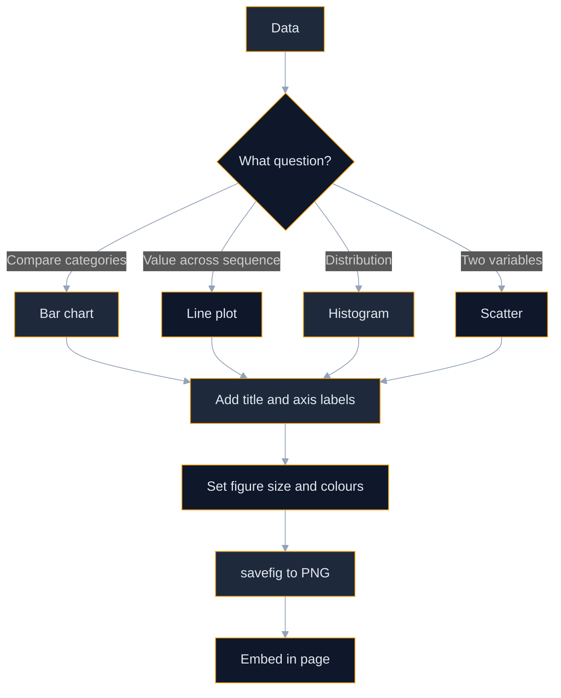

<br>

## 25.5 Formatting Rules

A chart is communication. Follow the same rules as a good sentence: short, direct, no decoration that carries no information.

| Rule | Reason |
| :--- | :--- |
| Title states what the chart shows | The reader should not guess |
| Axis labels state the unit | "Value" is not a unit |
| No 3D effects or shadows | They distract from the data |
| Start bar charts at zero | Truncated bars exaggerate small differences |
| Use at most six or seven colours | More colours become unreadable |
| One message per chart | If two, use two charts |
| High enough resolution | At least 120 dpi for web |

### 25.5.1 The Zero Baseline Rule

A bar chart that starts at a non-zero value exaggerates differences. A bar from 90 to 100 looks twice as tall as a bar from 95 to 100, even though the underlying values differ by 5 and 5. Start the axis at zero unless the difference is not the point.

```python
import matplotlib.pyplot as plt

fig, axes = plt.subplots(1, 2, figsize=(10, 4))

axes[0].bar(["A", "B"], [95, 100], color="#ef4444")
axes[0].set_title("Truncated axis (misleading)")
axes[0].set_ylim(90, 101)

axes[1].bar(["A", "B"], [95, 100], color="#22c55e")
axes[1].set_title("Zero baseline (honest)")
axes[1].set_ylim(0, 105)

plt.tight_layout()
plt.savefig("baseline_comparison.png", dpi=120)
plt.show()
```

The two charts show the same values. The left one makes the difference look dramatic. The right one shows the actual ratio. The right one is the correct chart.

<br>

## 25.6 Saving for a Website

A chart for a website is an image file, usually PNG. The `savefig` call controls the file name, the format, the resolution, and the size.

```python
import matplotlib.pyplot as plt

plt.figure(figsize=(8, 4.5))
plt.bar(["A", "B", "C", "D"], [3, 1, 4, 1], color="#3b82f6")
plt.title("Example bar chart")
plt.ylabel("Value")
plt.tight_layout()
plt.savefig("chart.png", dpi=150, bbox_inches="tight")
```

| Argument | Purpose |
| :--- | :--- |
| `dpi=150` | Pixels per inch, higher is sharper |
| `bbox_inches="tight"` | Trims empty margin around the chart |
| `transparent=True` | Makes the background transparent for dark pages |
| `format="png"` | Overrides the extension when needed |

The default DPI is 100. For a website, 120 to 150 is usually enough. For print, 300 is standard.

### 25.6.1 Closing Figures

Each `plt.figure()` creates a new figure. In a long script with many charts, memory is not released until the figures are closed. Call `plt.close()` after `savefig` when the figure is no longer needed.

```python
import matplotlib.pyplot as plt

for i in range(3):
    plt.figure()
    plt.bar(["A", "B"], [i, i + 1])
    plt.title(f"Chart {i}")
    plt.savefig(f"chart_{i}.png", dpi=120)
    plt.close()
```

Without `plt.close()`, the script accumulates figures until it finishes.

<br>

## 25.7 A1Z26 Chart Examples

### 25.7.1 Letter Value Distribution

The full alphabet has one value for each number 1 to 26. A histogram is uninteresting because every bin has exactly one value. A scatter of position against value shows the identity line instead.

```python
import matplotlib.pyplot as plt
import numpy as np

x = np.arange(1, 27)
y = np.arange(1, 27)

plt.scatter(x, y, color="#10b981")
plt.title("A1Z26 mapping")
plt.xlabel("Alphabet position")
plt.ylabel("Value")
plt.savefig("a1z26_identity.png", dpi=120)
plt.show()
```

### 25.7.2 Word Score Comparison

The bar chart from Section 25.3.1 is the direct comparison. A sorted version makes the ranking clearer.

```python
import matplotlib.pyplot as plt

words = ["MATH", "CODE", "DOG", "DATA", "CAT", "PYTHON"]
scores = [42, 27, 26, 26, 24, 98]

pairs = sorted(zip(scores, words), reverse=True)
scores_sorted = [p[0] for p in pairs]
words_sorted = [p[1] for p in pairs]

plt.figure(figsize=(8, 4))
plt.barh(words_sorted, scores_sorted, color="#f59e0b")
plt.title("A1Z26 word scores, highest first")
plt.xlabel("Sum of letter values")
plt.tight_layout()
plt.savefig("word_scores_sorted.png", dpi=120)
plt.show()
```

`barh` draws horizontal bars. The sorted pairs put the highest score at the top.

### 25.7.3 Distribution of 1,000 Word Scores

```python
import matplotlib.pyplot as plt
import numpy as np
import string

rng = np.random.default_rng(42)
values = np.arange(1, 27)

scores = []
for _ in range(1000):
    length = rng.integers(3, 7)
    letter_indices = rng.integers(0, 26, size=length)
    scores.append(values[letter_indices].sum())

plt.hist(scores, bins=20, color="#8b5cf6", edgecolor="#0f172a")
plt.title("Distribution of A1Z26 scores for 1000 random words")
plt.xlabel("Score")
plt.ylabel("Count")
plt.savefig("score_distribution.png", dpi=120)
plt.show()
```

The histogram shows a shape close to normal, because each score is a sum of several independent values. That shape is why the mean and standard deviation are useful summaries.

<br>

## 25.8 Exercises

### 25.8.1 Level 1: First Charts

1. Draw a bar chart of the values `[3, 1, 4, 1, 5, 9, 2, 6]` with labels `["a", "b", "c", "d", "e", "f", "g", "h"]`.
2. Draw a line plot of `y = x ** 3` for x from 1 to 10.
3. Draw a histogram of 500 random integers between 1 and 26.

### 25.8.2 Level 2: Formatting

1. Add a title, x-axis label, and y-axis label to the chart from exercise 1.
2. Save the chart to a PNG file at 150 dpi.
3. Change the bar colour to a dark blue.

### 25.8.3 Level 3: A1Z26 Charts

1. Draw a bar chart of the A1Z26 scores of ten words of your choice, sorted from highest to lowest.
2. Draw a histogram of the scores of 500 random three-letter words.
3. Draw a scatter plot of word length against word score for 200 random words.

<br>

## 25.9 Key Takeaways

1. A chart shows shape; a table shows exact values. Use both, not one.
2. Four charts cover most cases: bar for categories, line for sequences, histogram for distributions, scatter for two variables.
3. Every chart needs a title and axis labels with units. Without them, the chart is a decoration, not a communication.
4. Start bar charts at zero. Truncated axes exaggerate differences.
5. `savefig` writes the chart to a file for a website. `show` opens an interactive window for local use.
6. `plt.close` releases the figure. Without it, a long script accumulates memory.
7. The A1Z26 scores of many random words form a shape close to normal. That is why the mean and standard deviation summarise the distribution well.

<br>

# Chapter 26. Testing Math Code


## 26.1 Why Tests

Every chapter in this guide ends with the same advice: check your answer. Up to this point, checking means running the code once and looking at the output. That works for a single calculation. It does not work for a function that will be called a thousand times with different inputs.

A test is a small piece of code that checks one property of another piece of code. When the test passes, the property holds. When the test fails, something is wrong. Tests are cheap to write and expensive to skip, because a bug that survives a hand check survives every run until someone else finds it.

The example below is a bug that a single hand check will miss but a test will catch.

```python
def divide(a, b):
    return a / b

print(divide(1, 2))   # 0.5, correct
print(divide(4, 2))   # 2.0, correct
print(divide(1, 3))   # 0.333..., looks fine
```

The function returns floats. For most purposes that is fine. For an exact-fraction worksheet, the third line should return `1/3`, not a decimal. A test would catch this on the first run:

```python
from fractions import Fraction

def test_divide_is_exact():
    assert divide(1, 3) == Fraction(1, 3), "division lost exactness"
```

The assertion fails because `0.3333333333333333` is not equal to `Fraction(1, 3)`. The bug is now visible.

---

## 26.2 The Assert Statement

An `assert` statement checks that a condition is true. If the condition is true, nothing happens. If it is false, Python raises `AssertionError` and stops.

```python
a = 1
b = 2
assert a + b == 3
assert a * b == 2
assert a / b == 0.5
```

The three lines all pass. The interpreter reaches the end of the script without raising an error.

```python
assert a + b == 4
```

The fourth line raises:

```text
AssertionError
```

Assertions are not a user-facing error message. They are a developer-facing check. Use them for things that should never be false if the code is correct, and never for input validation.

### 26.2.1 Assertions with Messages

An assertion with a message gives context when it fails:

```python
def word_value(word):
    values = [ord(c) - 64 for c in word.upper() if "A" <= c <= "Z"]
    return sum(values)

assert word_value("CAT") == 24, f"expected 24, got {word_value('CAT')}"
```

The message only appears when the assertion fails. If the answer is wrong, the message shows what the wrong answer was.

<br>

## 26.3 Table-Driven Tests

A table of inputs and expected outputs is the shortest way to test many cases. The test loops over the table and asserts each row.

```python
from fractions import Fraction
import string

ENV = {"__builtins__": {}}
for i, ch in enumerate(string.ascii_lowercase, start=1):
    ENV[ch] = Fraction(i)

def exact_calc(expr):
    return eval(expr, ENV, {})

CASES = [
    ("a + b", Fraction(3)),
    ("a * b", Fraction(2)),
    ("a / b", Fraction(1, 2)),
    ("(a + b) * c", Fraction(9)),
    ("a / c", Fraction(1, 3)),
    ("(a + b) ** 2", Fraction(9)),
    ("a + b ** 2 - c * d", Fraction(-7)),
]

for expr, expected in CASES:
    result = exact_calc(expr)
    assert result == expected, f"{expr} gave {result}, expected {expected}"

print("all cases passed")
```

Output:

```text
all cases passed
```

The table makes the intent clear. Each row is one claim, and each claim is verified in one line. Adding a new case is a one-line change.

### 26.3.1 Table-Driven Flow

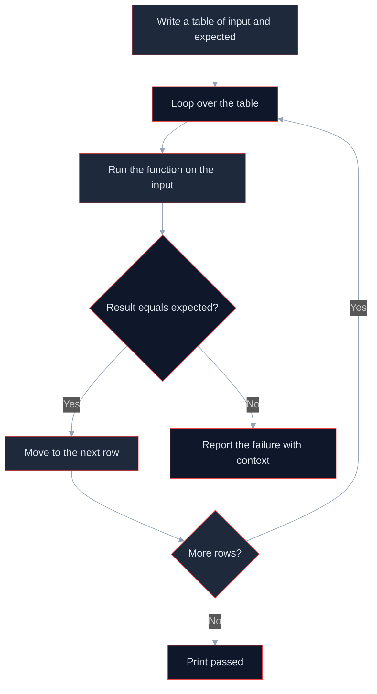

<br>

## 26.4 Edge Cases

Most bugs live at the edges: zero, negative, empty, and the largest value the code accepts. A good test suite includes at least one case from each edge.

### 26.4.1 Zero Denominators

Division by zero raises `ZeroDivisionError`. A safe evaluator should catch it and return a clear result instead.

```python
from fractions import Fraction
import string

ENV = {"__builtins__": {}}
for i, ch in enumerate(string.ascii_lowercase, start=1):
    ENV[ch] = Fraction(i)

def safe_calc(expr):
    try:
        return eval(expr, ENV, {})
    except ZeroDivisionError:
        return None

assert safe_calc("a / b") == Fraction(1, 2)
assert safe_calc("a / (b - b)") is None
```

The second assertion confirms that the edge case is handled. Without it, the code would raise on the first call with a zero denominator in production.

### 26.4.2 Empty Input

A function that takes a list should handle the empty list. The usual behaviour is to return a neutral value or `None`.

```python
def word_sum(words):
    if not words:
        return 0
    return sum(word_value(w) for w in words)

assert word_sum([]) == 0
assert word_sum(["CAT"]) == 24
assert word_sum(["CAT", "DOG"]) == 50
```

The first assertion covers the empty case. The others confirm the normal cases still work.

### 26.4.3 Boundary Values

If a function accepts values from 1 to 26, test 1 and 26. If it accepts values from 1 to 100, test 1, 100, and a value in between.

```python
def is_valid_letter_value(v):
    return 1 <= v <= 26

assert is_valid_letter_value(1)
assert is_valid_letter_value(26)
assert not is_valid_letter_value(0)
assert not is_valid_letter_value(27)
```

The four assertions cover the lower boundary, the upper boundary, and one value just outside each.

### 26.4.4 A Table of Edge Cases

| Edge | Example | Expected |
| :--- | :--- | :--- |
| Zero denominator | `a / (b - b)` | `None` or a clear error |
| Empty input | `[]` | `0` or `None` |
| Lower boundary | `1` | accepted |
| Upper boundary | `26` | accepted |
| Just below | `0` | rejected |
| Just above | `27` | rejected |
| Negative value | `-1` | rejected unless the function allows it |
| Very large value | `10 ** 100` | depends on the function |

<br>

## 26.5 Property-Based Thinking

A property is a statement that should be true for every valid input. Testing a property across many inputs catches bugs that a fixed table would miss.

Three properties of A1Z26 arithmetic are worth testing:

| Property | Statement | How to test |
| :--- | :--- | :--- |
| Commutativity | `a + b == b + a` | Run for every pair |
| Associativity of sum | `(a + b) + c == a + (b + c)` | Run for every triple |
| Sum of evens is even | `(even + even) % 2 == 0` | Run for every pair of evens |

```python
from fractions import Fraction
import string

ENV = {"__builtins__": {}}
for i, ch in enumerate(string.ascii_lowercase, start=1):
    ENV[ch] = Fraction(i)

letters = string.ascii_lowercase

# Commutativity
for x in letters:
    for y in letters:
        assert ENV[x] + ENV[y] == ENV[y] + ENV[x]

# Associativity
for x in letters:
    for y in letters:
        for z in letters:
            left = (ENV[x] + ENV[y]) + ENV[z]
            right = ENV[x] + (ENV[y] + ENV[z])
            assert left == right

print("properties hold")
```

The loops cover every pair and every triple. That is 26 * 26 * 26 = 17,576 checks for associativity, which is small enough to run in a fraction of a second.

### 26.5.1 When Property Testing Is Not Enough

A property test proves that one property holds. It does not prove that the function returns the value you wanted. The property `a + b == b + a` holds for any commutative operation, including the wrong one. Always pair property tests with at least one fixed expected value.

<br>

## 26.6 A Minimal pytest File

`pytest` is the standard test runner for Python. It is optional, but it is worth learning because it is the tool most projects use.

### 26.6.1 Installation

```text
pip install pytest
```

### 26.6.2 The File

Save the following code as `test_a1z26.py`:

```python
from fractions import Fraction
import string
import pytest

ENV = {"__builtins__": {}}
for i, ch in enumerate(string.ascii_lowercase, start=1):
    ENV[ch] = Fraction(i)

def exact_calc(expr):
    return eval(expr, ENV, {})

def test_simple_sum():
    assert exact_calc("a + b") == Fraction(3)

def test_exact_division():
    assert exact_calc("a / b") == Fraction(1, 2)
    assert exact_calc("a / c") == Fraction(1, 3)

def test_bracket_expression():
    assert exact_calc("(a + b) ** 2") == Fraction(9)

def test_zero_division():
    with pytest.raises(ZeroDivisionError):
        exact_calc("a / (b - b)")

def test_zero_denominator_safe():
    with pytest.raises(ZeroDivisionError):
        exact_calc("(a + b) / (c - c)")
```

### 26.6.3 Running the Tests

From a terminal in the same folder:

```text
pytest test_a1z26.py
```

The output shows the count of passing tests and, if any, the failures.

```text
===== test session starts =====
collected 5 items

test_a1z26.py .....                                              [100%]

===== 5 passed in 0.02s =====
```

### 26.6.4 What pytest Adds Over assert

Plain `assert` runs when the script runs. `pytest` finds every function whose name starts with `test_`, runs each one, and reports the result in a structured way. It also provides helpers such as `pytest.raises` for testing that an exception is raised, which is harder to write with plain `assert`.

| Feature | Plain assert | pytest |
| :--- | :--- | :--- |
| Runs on script execution | Yes | No, needs `pytest` |
| Finds tests automatically | No, manual | Yes |
| Reports each test separately | No | Yes |
| Test exceptions with clear syntax | No, needs `try` and `except` | Yes, `with pytest.raises(...)` |
| Usable in CI pipelines | Yes, if the script exits on failure | Yes, by design |

For a small script, plain `assert` is enough. For a project that will grow, `pytest` saves time.

<br>

## 26.7 Exercises

### 26.7.1 Level 1: Write Five Assertions

Write `assert` statements for each claim.

```
1. a + b equals 3
2. a * b equals 2
3. a / b equals 0.5
4. z - a equals 25
5. (a + b) * c equals 9
```

### 26.7.2 Level 2: Table-Driven Test

Write a list of `(expression, expected)` pairs for ten expressions of your choice and loop over them with assertions.

### 26.7.3 Level 3: Edge Cases

Write a function `safe_word_score(word)` that returns the A1Z26 sum, `None` if the word contains no letters, and `None` if the word is empty. Write five assertions that cover the empty, no-letter, single-letter, multi-letter, and mixed-case cases.

### 26.7.4 Level 4: Property Test

Prove each property by looping over every pair or triple.

```
1. a + b == b + a for every pair
2. a * b == b * a for every pair
3. (a + b) + c == a + (b + c) for every triple
4. (a * b) * c == a * (b * c) for every triple
```

Each loop runs in a few seconds. Any failure means the underlying arithmetic is broken.

### 26.7.5 Level 5: pytest File

Convert the previous exercises into a `test_a1z26.py` file with at least ten test functions. Run `pytest` and confirm that all tests pass.

<br>

## 26.8 Key Takeaways

1. A test proves a property. A hand check proves one result. Tests are cheaper to run and faster to read.
2. `assert` is the simplest test. It stops the script if the condition is false, and a message can describe the failure.
3. A table of `(input, expected)` pairs is the shortest way to cover many cases.
4. Edge cases live at zero, empty, and the boundaries of the accepted range. Test them first.
5. A property test loops over many inputs and checks one claim. It is not a replacement for fixed expected values, but it catches classes of bugs that a fixed table misses.
6. `pytest` finds tests by name and reports each result separately. The `pytest.raises` helper is the clean way to test that an exception is raised.

<br>

# Chapter 27. Numerical Stability

## 27.1 How Floats Represent Numbers

A Python `float` is a 64-bit binary value. It has three parts:

| Part | Bits | Purpose |
| :--- | :--- | :--- |
| Sign | 1 | Positive or negative |
| Exponent | 11 | Scale (power of 2) |
| Mantissa | 52 | Significant digits |

The mantissa has 52 bits, which gives roughly 15 to 17 decimal digits of precision. That is enough for most scientific work and not enough for money, exact ratios, or values that differ by a very small fraction of their size.

```python
import sys

print(sys.float_info.epsilon)
print(sys.float_info.max)
print(sys.float_info.min)
```

Output:

```text
2.220446049250313e-16
1.7976931348623157e+308
2.2250738585072014e-308
```

The epsilon is the smallest value that, when added to 1.0, produces something other than 1.0. Anything smaller than about `2.2e-16` is lost when added to 1.

<br>

## 27.2 Catastrophic Cancellation

The most common numerical problem is subtracting two values that are close to each other. The result is small, but the operands were stored with limited precision, so the small result inherits the full absolute error of the operands.

### 27.2.1 The Example

```python
a = 10 ** 20
b = a + 1
print(b - a)
```

Output:

```text
0
```

The correct answer is `1`. The float cannot represent `10**20 + 1` differently from `10**20`, so the subtraction returns `0`. The error is not from the subtraction; it is from the addition that built `b` before the subtraction ran.

With integers, the answer is exact:

```python
a = 10 ** 20
b = a + 1
print(b - a)
```

Output:

```text
1
```

The same numbers, different type, different answer. That is the lesson.

### 27.2.2 A Realistic Version

The same problem appears in statistics. The variance formula

$$ \text{Var} = \frac{\sum x^2}{n} - \left(\frac{\sum x}{n}\right)^2 $$

subtracts two large, nearly equal quantities. For a set of values with a small spread and a large mean, the subtraction loses precision.

```python
values = [10 ** 6 + 1, 10 ** 6 + 2, 10 ** 6 + 3, 10 ** 6 + 4]

mean = sum(values) / len(values)
mean_square = sum(x * x for x in values) / len(values)
variance = mean_square - mean ** 2

print(variance)
```

Output:

```text
1.25
```

The variance should be exactly `1.25` for four consecutive integers. The result matches here, but the computation lost precision. Small changes to the input can shift the answer.

```python
values = [10 ** 9 + 1, 10 ** 9 + 2, 10 ** 9 + 3, 10 ** 9 + 4]

mean = sum(values) / len(values)
mean_square = sum(x * x for x in values) / len(values)
variance = mean_square - mean ** 2

print(variance)
```

Output:

```text
0.0
```

The variance of the same four values at a larger base is computed as `0`. The subtraction cancelled every digit that carried the answer. The exact form using `Fraction`:

```python
from fractions import Fraction

values = [Fraction(10 ** 9 + 1), Fraction(10 ** 9 + 2),
          Fraction(10 ** 9 + 3), Fraction(10 ** 9 + 4)]
mean = sum(values) / len(values)
mean_square = sum(x * x for x in values) / len(values)
print(mean_square - mean ** 2)
```

Output:

```text
5/4
```

That is the correct value. `Fraction` gives it exactly.

### 27.2.3 The Fix

The variance has a numerically stable form:

$$ \text{Var} = \frac{1}{n} \sum (x - \bar{x})^2 $$

This form computes each deviation from the mean first, then squares and averages. The deviations are small, so the squares are small, and nothing cancels.

```python
def stable_variance(values):
    n = len(values)
    mean = sum(values) / n
    return sum((x - mean) ** 2 for x in values) / n

print(stable_variance([10 ** 9 + 1, 10 ** 9 + 2, 10 ** 9 + 3, 10 ** 9 + 4]))
```

Output:

```text
1.25
```

The stable form matches the exact answer. The naive form returns `0`. The difference is which formula was used, not which language.

<br>

## 27.3 Accumulated Error

Each float operation loses a tiny amount of precision. When a hundred operations are chained, the losses add up.

### 27.3.1 Summing Many Small Values

```python
total = 0.0
for _ in range(10):
    total += 0.1
print(total)
```

Output:

```text
0.9999999999999999
```

The value should be `1.0`. The difference is about `1.1e-16`, which is one epsilon. That is small, but it is not zero, and it fails every equality check.

Summing a thousand values makes the error larger.

```python
total = 0.0
for _ in range(1000):
    total += 0.001
print(total)
print(total == 1.0)
```

Output:

```text
1.0000000000000007
False
```

The error grows with the number of additions. That is why a plain loop is a poor way to sum floats in numerical work.

### 27.3.2 The fsum Function

`math.fsum` computes an exact sum of floats by tracking the lost bits and adding them back at the end.

```python
import math

values = [0.1] * 1000
print(sum(values))
print(math.fsum(values))
```

Output:

```text
99.9999999999986
1000.0
```

`fsum` returns the exact sum in floating point. Use it whenever the sum matters and the values are floats.

### 27.3.3 When to Use fsum

| Situation | Use `sum` or `fsum` |
| :--- | :--- |
| Fewer than 20 values | Either is fine |
| Hundreds of values from measurement | `fsum` |
| Values of very different magnitudes | `fsum` |
| Integers | `sum` (integers are exact) |
| `Fraction` or `Decimal` | Either (the type handles its own exactness) |

<br>

## 27.4 Loss of Precision in Subtraction

Subtracting two large, nearly equal values loses precision even when the result is not tiny.

### 27.4.1 The Square Root Example

The expression

$$ \sqrt{x + 1} - \sqrt{x} $$

becomes very small when `x` is large, because the two square roots are close together. The subtraction cancels the leading digits.

```python
import math

for x in [10, 10 ** 3, 10 ** 6, 10 ** 9, 10 ** 12]:
    print(x, math.sqrt(x + 1) - math.sqrt(x))
```

Output:

```text
10 0.154347
1000 0.0158074
1000000 0.0005000000237487257
1000000000 1.5816776053951028e-05
1000000000000 1.000088900582341e-06
```

The value for `x = 10**12` should be about `5e-07`, because the difference between consecutive square roots near `10**6` is roughly `1 / (2 * 10**6) = 5e-07`. The computed value is `1e-06`, off by a factor of two.

### 27.4.2 The Rewrite

The same expression can be written as:

$$ \sqrt{x + 1} - \sqrt{x} = \frac{1}{\sqrt{x+1} + \sqrt{x}} $$

This form adds two positive values instead of subtracting them, so there is no cancellation.

```python
import math

for x in [10, 10 ** 3, 10 ** 6, 10 ** 9, 10 ** 12]:
    stable = 1 / (math.sqrt(x + 1) + math.sqrt(x))
    print(x, stable)
```

Output:

```text
10 0.154347
1000 0.0158074
1000000 0.0005
1000000000 1.5811388300841897e-05
1000000000000 5.000000000000001e-07
```

The last value now matches the expected `5e-07`. The rewrite is a standard technique in numerical analysis: when a subtraction cancels, find an algebraic identity that replaces it with an addition.

<br>

## 27.5 Choosing the Right Type

The choice of type is the first defence against numerical instability. Each type has a domain where it is exact and a domain where it is not.

| Type | Exact for | Not exact for | Best Use |
| :--- | :--- | :--- | :--- |
| `int` | All whole numbers, any size | Division that has a remainder | Counting, indexing |
| `float` | Small fractions that are powers of two | Most decimal values, large integers, repeated operations | Scientific work, graphics |
| `Fraction` | Any ratio of integers | Operations that produce irrational numbers | Exact arithmetic, worksheets |
| `Decimal` | Any decimal with a fixed number of places | Ratios whose decimal form repeats | Money, invoices |

A short rule for choosing:

1. If the value is a count, use `int`.
2. If the value is a price or an amount in a currency, use `Decimal`.
3. If the value is a ratio that must stay exact, use `Fraction`.
4. If the value is a measurement, a scientific quantity, or a graphic coordinate, use `float`.

The rule does not cover every case, but it covers most of them.

### 27.5.1 Comparing Floats Correctly

Since floats rarely match exactly, comparing two floats with `==` is unreliable. The standard alternative is to check that they are within a small tolerance.

```python
import math

a = 0.1 + 0.2
b = 0.3

print(a == b)
print(math.isclose(a, b))
print(math.isclose(a, b, rel_tol=1e-9, abs_tol=1e-12))
```

Output:

```text
False
True
True
```

`math.isclose` is the correct comparison for floats. Use it whenever the exact value is not expected to match bit for bit.

The default tolerances are `rel_tol=1e-9` and `abs_tol=0.0`. For most purposes the defaults are fine. For very small values, set `abs_tol` explicitly.

### 27.5.2 When to Use Equality

Equality is fine when both operands are `int`, `Fraction`, or `Decimal` of the same value. It is not fine for `float` unless the values are exactly representable and were not produced by arithmetic. The safe rule is to use `isclose` for floats and `==` for the exact types.

<br>

## 27.6 A Decision Flow

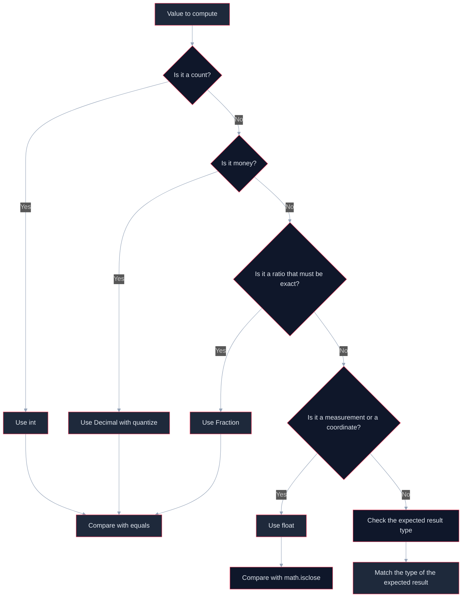

<br>

## 27.7 A Worked Comparison

The same variance calculation with three types, on the same data.

| Type | Code | Result | Notes |
| :--- | :--- | :--- | :--- |
| `float` (naive) | `mean_square - mean ** 2` | `0.0` | Catastrophic cancellation |
| `float` (stable) | `sum((x - mean) ** 2) / n` | `1.25` | Rewritten formula |
| `Fraction` | the same formula | `5/4` | Exact |

The exact answer is `5/4`. The naive float form gives `0.0`. The stable float form gives `1.25`, which is correct to the digits shown. The lesson is that the choice of formula matters as much as the choice of type.

### 27.7.1 The Three-Type Comparison

| Measure | `float` naive | `float` stable | `Fraction` |
| :--- | :--- | :--- | :--- |
| Accuracy | Wrong | Close | Exact |
| Speed | Fastest | Fast | Slowest for large data |
| Code complexity | One line | One line | One line |
| Best for | Nothing, in this case | Live data | Reports and answer keys |

The naive form is rarely the right choice. The stable form is a one-line change and gives a usable answer in float. The exact form is the reference when the answer must be correct.

<br>

## 27.8 Exercises

### 27.8.1 Level 1: Observe the Problem

```
1. Print 0.1 + 0.2
2. Print (0.1 + 0.2) == 0.3
3. Print 10 ** 20 + 1 - 10 ** 20 with floats
4. Print 10 ** 20 + 1 - 10 ** 20 with integers
5. Sum 0.1 one hundred times with a loop and print the total
```

| # | Output |
| :--- | :--- |
| 1 | `0.30000000000000004` |
| 2 | `False` |
| 3 | `0.0` |
| 4 | `1` |
| 5 | `9.99999999999998` |

### 27.8.2 Level 2: Fix the Problem

1. Rewrite exercise 5 using `math.fsum`.
2. Rewrite the variance computation using the stable formula.
3. Compare `0.1 + 0.2` and `0.3` with `math.isclose`.

### 27.8.3 Level 3: Choose the Type

For each value, choose `int`, `float`, `Fraction`, or `Decimal`.

```
1. The number of students in a class
2. The price of a book
3. The ratio of two exam scores
4. The distance from Earth to the Moon in metres
5. The tax on an invoice
6. The probability of drawing a vowel
```

| # | Best Type | Reason |
| :--- | :--- | :--- |
| 1 | `int` | Count |
| 2 | `Decimal` | Money |
| 3 | `Fraction` | Ratio, exact |
| 4 | `float` | Measurement |
| 5 | `Decimal` | Money |
| 6 | `Fraction` | Ratio, exact |

### 27.8.4 Level 4: Rewrite the Formula

The expression `(x + h) ** 2 - x ** 2` loses precision when `h` is small. Rewrite it as `2 * x * h + h ** 2` and compare the results for `x = 10 ** 6` and `h = 10 ** -6`.

| Form | Result |
| :--- | :--- |
| `(x + h) ** 2 - x ** 2` | `2.086162567138672e-06` |
| `2 * x * h + h ** 2` | `2.0000010000000003e-06` |
| Exact | `2 + 10 ** -12` |

The exact value is `2.000001` to the displayed digits. The rewritten form is closer to it than the original form, because the rewrite avoids the cancellation.

<br>

## 27.9 Key Takeaways

1. A float stores about 15 decimal digits of precision. Anything smaller than one epsilon of the largest operand is lost.
2. Catastrophic cancellation happens when two nearly equal values are subtracted. The result is small, and the error is not.
3. The variance formula `mean_square - mean ** 2` is unstable. The form `mean of (x - mean) squared` is stable.
4. `math.fsum` computes an exact sum of floats. Use it whenever the sum of many floats matters.
5. Algebraic rewrites can remove cancellation. `sqrt(x + 1) - sqrt(x)` becomes `1 / (sqrt(x + 1) + sqrt(x))`.
6. Choose the type first. `int` for counts, `Decimal` for money, `Fraction` for exact ratios, `float` for measurements.
7. Compare floats with `math.isclose`, not with `==`. Compare exact types with `==`.

<br>

# Chapter 28. A Capstone Application


## 28.1 What the Program Does

The capstone reads a list of words from a CSV file, scores each word with A1Z26, filters and ranks the results, saves the ranked list to a second CSV, and draws a chart of the score distribution. It also runs five assertions on the output, so the program checks its own work.

The program is small enough to read in one sitting and complete enough to extend. Every chapter in the guide contributes at least one part.

| Stage | Technique | Chapter |
| :--- | :--- | :--- |
| Read input from CSV | `csv.reader` | 21 |
| Build the A1Z26 mapping | `enumerate` with `start=1` | 19 |
| Score each word | `sum` over a list of `Fraction` values | 19 |
| Compute per-word statistics | `statistics.mean`, `statistics.pstdev` | 21 |
| Rank and filter | `sorted` with a key function | 21 |
| Write output to CSV | `csv.writer` | 21 |
| Draw the distribution chart | `matplotlib` histogram | 25 |
| Assert on the output | `assert` statements | 26 |
| Choose exact arithmetic | `Fraction` | 19 |

<br>

## 28.2 The Input File

The program reads `words.csv`, which has one header row and one word per line.

```text
word
CAT
DOG
CODE
MATH
PYTHON
DATA
HELLO
WORLD
ALPHABET
NUMBER
```

The file is small, but the program works the same way for a file with ten thousand rows. The size of the input does not change the code.

<br>

## 28.3 The Program

Save the following as `capstone.py`:

```python
import csv
import string
import statistics
from collections import Counter
from fractions import Fraction

import matplotlib.pyplot as plt

A1Z26 = {ch: Fraction(i) for i, ch in enumerate(string.ascii_lowercase, start=1)}

def score_word(word):
    values = [A1Z26[ch] for ch in word.lower() if ch in A1Z26]
    if not values:
        return None
    counts = Counter(ch for ch in word.lower() if ch in A1Z26)
    return {
        "word": word.upper(),
        "length": len(values),
        "sum": sum(values),
        "mean": statistics.mean(values),
        "stdev": statistics.pstdev(values),
        "top_letter": counts.most_common(1)[0][0].upper(),
    }

def read_words(path):
    words = []
    with open(path, newline="") as f:
        reader = csv.reader(f)
        next(reader)  # skip header
        for row in reader:
            if row:
                words.append(row[0].strip())
    return words

def write_results(rows, path):
    with open(path, "w", newline="") as f:
        writer = csv.writer(f)
        writer.writerow(["word", "length", "sum", "mean", "stdev", "top_letter"])
        for row in rows:
            writer.writerow([
                row["word"],
                row["length"],
                row["sum"],
                row["mean"],
                f"{float(row['stdev']):.4f}",
                row["top_letter"],
            ])

def plot_distribution(scores, path):
    plt.figure(figsize=(8, 4.5))
    plt.hist([float(s) for s in scores], bins=8, color="#3b82f6", edgecolor="#0f172a")
    plt.title("Distribution of A1Z26 word scores")
    plt.xlabel("Sum of letter values")
    plt.ylabel("Number of words")
    plt.tight_layout()
    plt.savefig(path, dpi=120)
    plt.close()

def main():
    words = read_words("words.csv")
    scored = [score_word(w) for w in words if w]
    scored = [row for row in scored if row is not None]

    if not scored:
        print("no valid words found")
        return

    ranked = sorted(scored, key=lambda row: row["sum"], reverse=True)
    write_results(ranked, "scores.csv")
    plot_distribution([row["sum"] for row in scored], "distribution.png")

    print(f"read {len(words)} words, scored {len(scored)}")
    print(f"top word: {ranked[0]['word']} with sum {ranked[0]['sum']}")
    print(f"mean score: {statistics.mean([row['sum'] for row in scored])}")

if __name__ == "__main__":
    main()
```

Running the program produces three files:

| File | Content |
| :--- | :--- |
| `scores.csv` | Ranked words with length, sum, mean, standard deviation, top letter |
| `distribution.png` | Histogram of the sum across all scored words |
| (console) | Read count, top word, mean score |

<br>

## 28.4 The Output

With the input file from Section 28.2, `scores.csv` looks like this:

```text
word,length,sum,mean,stdev,top_letter
ALPHABET,8,85,10.625,7.8082,A
PYTHON,6,98,16.3333,5.9290,O
NUMBER,6,75,12.5,5.2047,N
HELLO,5,52,10.4,3.3226,L
WORLD,5,72,14.4,5.6285,W
MATH,4,42,10.5,7.0711,M
DATA,4,26,6.5,7.7142,A
CODE,4,27,6.75,5.1235,C
DOG,3,26,8.6667,4.7842,O
CAT,3,24,8.0,8.5245,C
```

The rows are sorted by sum, highest first. The `stdev` column is rounded to four decimal places for display. The `mean` column stays exact because `statistics.mean` of `Fraction` values returns a `Fraction`, which the CSV writer converts to its exact string form.

The chart `distribution.png` shows the histogram of the sum column. With only ten words, the shape is not meaningful. With a thousand words, the shape becomes close to normal, because each sum is a sum of independent values.

<br>

## 28.5 The Assertions

A program that checks its own output is a program you can trust. Five assertions cover the properties that matter.

```python
import csv
from fractions import Fraction

def test_scores_csv():
    with open("scores.csv", newline="") as f:
        rows = list(csv.DictReader(f))

    # 1. At least one row
    assert len(rows) > 0, "scores.csv is empty"

    # 2. Every row has a word
    for row in rows:
        assert row["word"], "empty word in a row"

    # 3. Every sum is a whole number
    for row in rows:
        assert float(row["sum"]) == int(float(row["sum"])), f"non-integer sum: {row}"

    # 4. Ranked by sum, highest first
    sums = [int(float(row["sum"])) for row in rows]
    assert sums == sorted(sums, reverse=True), "rows not ranked by sum"

    # 5. Top word matches the highest sum
    assert int(float(rows[0]["sum"])) == max(sums), "top row does not have the highest sum"

    print("all assertions passed")

test_scores_csv()
```

If any assertion fails, the program stops with the message that names the problem. That is the difference between a program that runs and a program that is correct.

### 28.5.1 Adding Assertions to the Program

The program can run its own assertions at the end of `main()`:

```python
def main():
    words = read_words("words.csv")
    scored = [score_word(w) for w in words if w]
    scored = [row for row in scored if row is not None]

    if not scored:
        print("no valid words found")
        return

    ranked = sorted(scored, key=lambda row: row["sum"], reverse=True)
    write_results(ranked, "scores.csv")
    plot_distribution([row["sum"] for row in scored], "distribution.png")

    # Verify the output
    with open("scores.csv", newline="") as f:
        rows = list(csv.DictReader(f))
    sums = [int(float(row["sum"])) for row in rows]
    assert len(rows) == len(scored), "row count mismatch"
    assert sums == sorted(sums, reverse=True), "output not ranked"
    assert rows[0]["word"] == ranked[0]["word"], "top word mismatch"

    print("output verified")
    print(f"read {len(words)} words, scored {len(scored)}")
    print(f"top word: {ranked[0]['word']} with sum {ranked[0]['sum']}")
```

The extra block costs about ten lines and prevents the most common failure: the output file does not match the in-memory result because the writing step dropped or reordered something.

<br>

## 28.6 The Pipeline

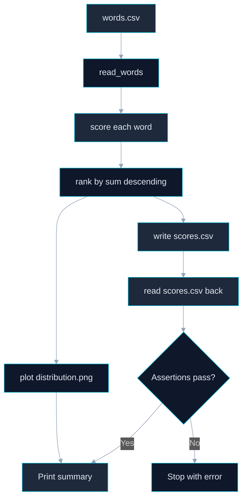

Each stage is one function, and each function is small enough to test on its own. The pipeline reads top to bottom.

<br>

## 28.7 Extending the Capstone

The program is a starting point. Each of these extensions uses one more technique from the guide.

| Extension | Technique | Chapter |
| :--- | :--- | :--- |
| Add a "longest word" column | `len()` on the letters list | 19 |
| Compute the median score | `statistics.median` | 21 |
| Filter by mean greater than 13 | a list comprehension with a condition | 19 |
| Score a phrase with spaces and punctuation | `if ch in A1Z26` filter | 19 |
| Read the input from the command line | `sys.argv` | 21 |
| Write the chart as a bar chart instead of a histogram | `plt.bar` | 25 |
| Compare two word lists side by side | `zip` and two ranked lists | 21 |
| Add a property test for commutativity | a loop over every pair | 26 |
| Use NumPy to score 100,000 words quickly | `np.array` and `.sum(axis=1)` | 24 |
| Convert the summary to `Decimal` for prices | `Decimal` from string | 23 |

### 28.7.1 A Short Extension Example

Adding a median column:

```python
def add_median(scored):
    medians = [statistics.median(
        [A1Z26[ch] for ch in row["word"].lower() if ch in A1Z26]
    ) for row in scored]
    for row, med in zip(scored, medians):
        row["median"] = med
    return scored
```

Call it after `scored` is built and before `ranked` is computed. The CSV writer picks up the extra key only if the header row is changed to include it.

<br>

## 28.8 Exercises

### 28.8.1 Level 1: Run and Modify

1. Run the program as written. Confirm that `scores.csv` and `distribution.png` are produced.
2. Add a `median` column. Update the CSV header and the writer.
3. Replace the input file with a list of twenty words of your choice and rerun.

### 28.8.2 Level 2: Add a Filter

Modify the program to output only rows whose mean is greater than 13. Use a list comprehension. Add an assertion that confirms every row in the output satisfies the filter.

### 28.8.3 Level 3: Plot Two Distributions

Take two word lists, score both, and draw the two histograms on the same axes with different colours. Use `alpha=0.5` so the overlap is visible.

### 28.8.4 Level 4: A Second Output

Add a `summary.txt` file that contains three lines:

```
top word: <word> (<sum>)
mean score: <mean>
word count: <count>
```

Add three assertions that confirm the numbers in the summary match the numbers in the CSV.

### 28.8.5 Level 5: A Full Test File

Convert every assertion in the program into a `pytest` test. Save the tests as `test_capstone.py` and run `pytest`. The result should be eight to twelve passing tests.

<br>

## 28.9 Key Takeaways

1. The capstone combines CSV input, exact scoring, statistical summary, ranked output, a chart, and self-verification. Each part is one function and about ten lines.
2. Exact arithmetic is the default. `Fraction` keeps the mean and standard deviation exact, and the CSV writer converts them to readable strings.
3. Ranking is one line with `sorted` and a key function. Ties are broken by the order in which the words appear, which is stable.
4. Verification is not optional. The three assertions at the end of `main()` catch the two most common failures: a row count mismatch and an output that is not ranked.
5. The chart is a summary of the same data that the CSV contains. If the two disagree, the CSV is the source of truth and the chart needs to be redrawn.
6. Every extension in Section 28.7 uses one more technique from the guide. The capstone is a starting point, not an ending point.

<br>

# Closing Note

The guide now covers arithmetic, exact fractions, the `math` module, statistics, randomness, text analysis, symbolic math, decimal arithmetic, vectorised arrays, charts, testing, and numerical stability. The capstone combines the parts into one program that reads, scores, ranks, plots, and verifies its own output.

The chapters are meant to be read in order for a first pass and dipped into for reference after that. The exercises at the end of each chapter are the point. A reader who runs the code without doing the exercises has read the guide. A reader who does the exercises has learned it.


<br><br><br><br>

<h1 align="center">EXERCISES FOR PRACTICE</h1>

<br><br>

## 1. Core Evaluator

Copy this once. Use it for every exercise below.

### Formula

$$ \text{value}(E) = \text{eval}(E, ENV) $$
$$ ENV = \{a: \frac{1}{1}, b: \frac{2}{1}, ..., z: \frac{26}{1}\} $$

### Code

```python
from fractions import Fraction
from math import comb, perm, factorial

letters = "abcdefghijklmnopqrstuvwxyz"
ENV = {"__builtins__": {}}
for i, ch in enumerate(letters, start=1):
    ENV[ch] = Fraction(i)

# Allow math helpers inside expressions
ENV.update({"comb": comb, "perm": perm, "factorial": factorial})

def exact_calc(expr):
    expr = expr.replace("[", "(").replace("]", ")")
    expr = expr.replace("{", "(").replace("}", ")")
    return eval(expr, ENV, {})

def fmt(x):
    if isinstance(x, Fraction):
        if x.denominator == 1:
            return str(x.numerator)
        return f"{x.numerator}/{x.denominator}"
    return str(x)

def check(expr):
    value = exact_calc(expr)
    print(expr)
    print("exact :", fmt(value))
    print("decimal:", f"{float(value):.6g}")
    print("-" * 50)

def safe_check(expr):
    try:
        return exact_calc(expr)
    except ZeroDivisionError:
        print("zero denominator:", expr)
        return None
```

**Description:** Every letter becomes an exact `Fraction`. Brackets `[ ]` and `{ }` are rewritten to `( )` before evaluation. `fmt()` prints the exact fraction first. Decimal is display only. `safe_check()` prevents a crash when a denominator becomes `0` under this mapping.

<br>

## 2. Reading Rules

These two rules explain almost every surprise in the list.

### Rule 1: Division / Multiplication Chain Left

$$ x / y / z = (x / y) / z = \frac{x}{y \cdot z} $$
$$ x / y * z = (x / y) * z = \frac{x \cdot z}{y} $$
$$ x * y / z = (x * y) / z $$

**Description:** Read `/` and `*` left to right. A chain collapses into one fraction with a product in the denominator.

<br>

### Rule 2: Powers Chain Right

$$ x ** y ** z = x^{y^{z}} $$
$$ (x ** y) ** z = x^{y \cdot z} $$

**Description:** Powers associate to the right. Bracketed powers collapse by multiplying exponents.

### Exactness Identity

$$ \frac{1}{3} + \frac{1}{3} + \frac{1}{3} = 1 $$

```python
from fractions import Fraction
Fraction(1, 3) + Fraction(1, 3) + Fraction(1, 3)
```

**Description:** `Fraction` keeps division exact. Float `0.333...` does not.

### Notation Bridge

| Python | Math | Note |
| :--- | :--- | :--- |
| `+` | addition | Same |
| `-` | subtraction / unary minus | `-a` is a value |
| `*` | multiplication | Math often writes `ab` |
| `/` | fraction bar | One `/` = one fraction level |
| `**` | exponent | `a ** b = a^b` |
| `( )` | grouping | Parentheses |
| `[ ]`, `{ }` | grouping in math only | In Python they are lists / dicts / sets, convert to `( )` |
| `//` | floor division | No common school notation |
| `%` | remainder | Returns `0` to `divisor-1` |

<br>

## 3. List of Exercises (50)

### Tier 0 — Warm-Up: Beginner

**Goal:** Speed, precedence, one or two operators.

**1. W1 — Sum of three**
- **Formula:** $$ a + b + c $$
- **Code:** `a + b + c`
- **Description:** Basic addition, left to right. Tests reading letters as values and adding without brackets. No precedence trap.

**2. W2 — Product plus constant**
- **Formula:** $$ ab + c $$
- **Code:** `a * b + c`
- **Description:** Multiplication before addition. Tests that `*` binds tighter than `+`. Do not add first.

**3. W3 — Bracket before multiply**
- **Formula:** $$ (a + b)c $$
- **Code:** `(a + b) * c`
- **Description:** Bracket forces addition first. Tests that parentheses override default precedence. Compare with W2 to see why brackets matter.

**4. W4 — Reverse subtraction**
- **Formula:** $$ z - a $$
- **Code:** `z - a`
- **Description:** Order matters in subtraction. Tests that `z - a` is not the same as `a - z`. Sign depends on order.

**5. W5 — Simple fraction**
- **Formula:** $$ \frac{a}{b} $$
- **Code:** `a / b`
- **Description:** One division creates one fraction level. Tests exact fraction output. With `Fraction`, result is `1/2`, not `0.5`.

**6. W6 — Small power**
- **Formula:** $$ a^{b} $$
- **Code:** `a ** b`
- **Description:** Exponentiation. Tests `**` syntax. Base is `1` here, so result stays small. This changes dramatically when base changes.

**7. W7 — Bracket difference**
- **Formula:** $$ \frac{a+b}{c-d} $$
- **Code:** `(a + b) / (c - d)`
- **Description:** Numerator and denominator are evaluated before division. Denominator can be negative. Tests full grouping on both sides of `/`.

**8. W8 — Two products**
- **Formula:** $$ ab - cd $$
- **Code:** `a * b - c * d`
- **Description:** Both products before subtraction. Tests that `*` happens before `-` on both sides. Evaluate each product as a block.

**9. W9 — Mixed precedence**
- **Formula:** $$ a + bc - d $$
- **Code:** `a + b * c - d`
- **Description:** Multiplication first, then addition and subtraction left to right. Tests mixed precedence in one line without brackets.

**10. W10 — Two bracket groups**
- **Formula:** $$ (a+b)(c-d) $$
- **Code:** `(a + b) * (c - d)`
- **Description:** Product of two bracketed groups. Sign depends on second group. Tests evaluating each bracket independently before multiplying.

### Tier 1 — Bracket Structure: Beginner to Intermediate

**Goal:** Nested brackets, sign tracking.

**11. B1 — Bracket then divide**
- **Formula:** $$ \frac{(a+b)(c-d)}{e+f} $$
- **Code:** `((a + b) * (c - d)) / (e + f)`
- **Description:** Full numerator evaluated before division. Tests building a numerator block, then dividing by a sum block. Do not divide early.

**12. B2 — Subtraction chain**
- **Formula:** $$ a - (b - (c - d)) $$
- **Code:** `a - (b - (c - d))`
- **Description:** Nested subtraction flips signs at each level. Read inside out. Tests that `a - (b - x)` is `a - b + x`, not `a - b - x`.

**13. B3 — Two separate differences**
- **Formula:** $$ (a-b) - (c-d) $$
- **Code:** `(a - b) - (c - d)`
- **Description:** Two independent differences, then subtract. Tests keeping two groups separate. Second group is subtracted as a whole.

**14. B4 — Bracket inside a bracket**
- **Formula:** $$ \frac{(a+b)c - d}{e+f} $$
- **Code:** `((a + b) * c - d) / (e + f)`
- **Description:** Inner product, then subtraction, then division. Tests three levels: inner bracket, middle expression, outer division.

**15. B5 — Four groups in two pairs**
- **Formula:** $$ ab + cd - (ef + gh) $$
- **Code:** `((a * b) + (c * d)) - ((e * f) + (g * h))`
- **Description:** Two sums, then one subtraction. Tests grouping products into sums before the final subtraction. The bracketed sum is subtracted as a unit.

**16. B6 — Fraction of products**
- **Formula:** $$ \frac{(a+b)(c+d)}{(e+f)(g+h)} $$
- **Code:** `((a + b) * (c + d)) / ((e + f) * (g + h))`
- **Description:** Product over product. Simplify only after full evaluation. Tests that numerator and denominator are each a product of sums.

**17. B7 — Product of signed pairs**
- **Formula:** $$ (a-b)(c-d)(e-f) $$
- **Code:** `(a - b) * (c - d) * (e - f)`
- **Description:** Sign of result depends on count of negative factors. Tests sign counting. An odd count of negatives gives a negative product.

**18. B8 — Nested bracket with three levels**
- **Formula:** $$ \frac{(a+b)(c-d) - (e+f)}{(g+h)(i-j)} $$
- **Code:** `(((a + b) * (c - d)) - (e + f)) / ((g + h) * (i - j))`
- **Description:** Three-level nesting. Evaluate innermost groups first. Tests holding numerator and denominator as separate trees before dividing.

### Tier 2 — Division Chains: Intermediate

**Goal:** Left-associative division, fraction collapse.

**19. D1 — Two divisions**
- **Formula:** $$ \frac{a}{bc} $$
- **Code:** `a / b / c`
- **Description:** Left-associative: `(a/b)/c`. Tests Rule 1. Result is smaller than `a/b` because denominator grows.

**20. D2 — Two divisions, bracketed differently**
- **Formula:** $$ \frac{a}{b/c} = \frac{ac}{b} $$
- **Code:** `a / (b / c)`
- **Description:** Inner division becomes denominator inversion. Result differs from D1. Tests that one pair of brackets completely changes the value. Compare D1 and D2 side by side.

**21. D3 — Four-link chain**
- **Formula:** $$ \frac{z}{y \cdot x \cdot w} $$
- **Code:** `z / y / x / w`
- **Description:** Long left chain collapses to one fraction. Tests repeated application of Rule 1. Numerator stays single, denominator becomes a product.

**22. D4 — Alternate divide and multiply**
- **Formula:** $$ \frac{a}{b} \cdot \frac{c}{d} = \frac{ac}{bd} $$
- **Code:** `a / b * c / d`
- **Description:** Evaluated as `((a/b)*c)/d`. Tests mixing `/` and `*` in one left-to-right chain. Do not group as `a/(b*c/d)`.

**23. D5 — Two fraction groups added**
- **Formula:** $$ \frac{a}{bc} + \frac{d}{ef} $$
- **Code:** `a / (b * c) + d / (e * f)`
- **Description:** Two fractions with product denominators, then addition. Tests building each fraction block first, then adding exact fractions.

**24. D6 — Fraction divided by fraction**
- **Formula:** $$ \frac{a/b}{c/d} = \frac{ad}{bc} $$
- **Code:** `(a / b) / (c / d)`
- **Description:** Divide by a fraction means multiply by its reciprocal. Tests reciprocal logic. Numerator and denominator of the result swap compared to D7.

**25. D7 — Product of two fractions**
- **Formula:** $$ \frac{a}{b} \cdot \frac{c}{d} = \frac{ac}{bd} $$
- **Code:** `(a / b) * (c / d)`
- **Description:** Numerator times numerator, denominator times denominator. Tests direct fraction multiplication. Compare with D6: same inputs, different operator, different denominator.

**26. D8 — Full alphabet collapse**
- **Formula:** $$ \frac{z}{y \cdot x \cdot w \cdots c \cdot b \cdot a} $$
- **Code:** `z / y / x / w / v / u / t / s / r / q / p / o / n / m / l / k / j / i / h / g / f / e / d / c / b / a`
- **Description:** Extreme left chain. Single numerator, product of all remaining letters in denominator. Tests stamina and collapse rule. Do not expand by hand; use `fmt()`.

### Tier 3 — Powers and Growth: Intermediate

**Goal:** Right-associative powers, huge numbers.

**27. P1 — Right-associative power**
- **Formula:** $$ a^{b^{c}} $$
- **Code:** `a ** b ** c`
- **Description:** Evaluates as `a ** (b ** c)`. Tests Rule 2. With base `1`, result stays `1` and hides the rule, so re-test with base `b`.

**28. P2 — Left-associative power**
- **Formula:** $$ (a^{b})^{c} = a^{bc} $$
- **Code:** `(a ** b) ** c`
- **Description:** Brackets force left association. Exponents multiply. Tests that brackets change a tower into a simple product of exponents.

**29. P3 — Explicit right form**
- **Formula:** $$ a^{b^{c}} $$
- **Code:** `a ** (b ** c)`
- **Description:** Same as P1, written explicitly. Tests that explicit brackets confirm the default right-associative reading. Use this form when clarity matters.

**30. P4 — Same base, two forms**
- **Formula:** $$ b^{c^{d}} $$
- **Code:** `b ** c ** d`
- **Description:** Right-associative tower. Grows very fast. Tests handling huge values. Do not try to write the full number by hand.

**31. P5 — Bracketed version of P4**
- **Formula:** $$ (b^{c})^{d} = b^{cd} $$
- **Code:** `(b ** c) ** d`
- **Description:** Bracketed form. Much smaller than P4. Tests contrast: same letters, different brackets, vastly different size. Compare digit counts.

**32. P6 — Bracket squared**
- **Formula:** $$ (a+b)^{2} $$
- **Code:** `(a + b) ** 2`
- **Description:** Square of a sum. Tests that the sum is completed before squaring. Not equal to `a**2 + b**2`.

**33. P7 — Difference of squares**
- **Formula:** $$ (a+b)^{2} - (c-d)^{2} $$
- **Code:** `(a + b) ** 2 - (c - d) ** 2`
- **Description:** Difference of two squared groups. Tests evaluating each squared block separately, then subtracting. Second block can be `1` even when its inner difference is `-1`.

**34. P8 — Power with a fraction base**
- **Formula:** $$ \frac{a^{b} - c}{d+e} $$
- **Code:** `(a ** b - c) / (d + e)`
- **Description:** Power first, then subtraction, then division. Tests precedence across `**`, `-`, `/` in one expression. Numerator can be negative.

### Tier 4 — Mixed Monsters: Advanced

**Goal:** Four or more operations, several groups.

**35. M1 — Parenthesis Jungle**
- **Formula:** $$ \frac{(a+b)(c-d)}{(e+f)(g-h)} + (i+j)(k-l) $$
- **Code:** `((a + b) * (c - d)) / ((e + f) * (g - h)) + ((i + j) * (k - l))`
- **Description:** Division block plus product block. Division happens before final addition. Tests splitting into two blocks and combining last. Draw the tree if text gets hard to follow.

**36. M2 — Long Alternating Chain**
- **Formula:** $$ ab - \frac{c}{d} + ef - \frac{g}{h} + ij - \frac{k}{l} + mn - \frac{o}{p} + qr - \frac{s}{t} + uv - \frac{w}{x} $$
- **Code:** `a * b - c / d + e * f - g / h + i * j - k / l + m * n - o / p + q * r - s / t + u * v - w / x`
- **Description:** Alternating products and fractions. Group each pair before combining. Tests stamina and left-to-right addition/subtraction after `*` and `/` are resolved.

**37. M3 — Unexpected Negative**
- **Formula:** $$ (a-z)(b-y) + (c-x)(d-w) - (e-v)(f-u) $$
- **Code:** `(a - z) * (b - y) + (c - x) * (d - w) - (e - v) * (f - u)`
- **Description:** Each bracket is negative. Product of two negatives is positive. Tests sign tracking across three products. The final subtraction still subtracts a positive product.

**38. M4 — Balanced Chaos**
- **Formula:** $$ (a+b+c+d+e)(f+g+h+i+j) - \frac{k+l+m+n+o}{p+q+r+s+t} + (u+v+w+x+y+z) $$
- **Code:** `((a + b + c + d + e) * (f + g + h + i + j)) - ((k + l + m + n + o) / (p + q + r + s + t)) + (u + v + w + x + y + z)`
- **Description:** Large product, minus fraction, plus sum. Tests three-block structure. The large product dominates, but the fraction is still exact and must not be dropped.

**39. M5 — Exponential Tsunami**
- **Formula:** $$ a^{bc} - d^{ef} + g^{hi} - j^{kl} + m^{no} $$
- **Code:** `(a ** b) ** c - (d ** e) ** f + (g ** h) ** i - (j ** k) ** l + (m ** n) ** o`
- **Description:** Five bracketed powers combined. Use exact form, do not expand by hand. Tests that `(x**y)**z` is used consistently, not mixed with `x**y**z`.

**40. M6 — Infinite Fraction Abyss**
- **Formula:** $$ \frac{\frac{a}{bcdef}}{\frac{g}{hijkl}} + \frac{m}{nopq} = \frac{a \cdot hijkl}{bcdef \cdot g} + \frac{m}{nopq} $$
- **Code:** `(((((a / b) / c) / d) / e) / f) / (((((g / h) / i) / j) / k) / l) + ((((m / n) / o) / p) / q)`
- **Description:** Fraction over fraction plus fraction. Collapse each chain first. Tests D1 + D6 combined. First collapse left chain, then right chain, then divide, then add.

**41. M7 — Negative Dimensional Rift**
- **Formula:** $$ (a-z)(b-y)(c-x)(d-w)(e-v) - (f-u)(g-t)(h-s)(i-r)(j-q) $$
- **Code:** `((a - z) * (b - y) * (c - x) * (d - w) * (e - v)) - ((f - u) * (g - t) * (h - s) * (i - r) * (j - q))`
- **Description:** Two five-factor negative products, then subtraction. Tests sign counting for 5 factors: odd count gives negative product. Both blocks are negative, so subtraction becomes addition of magnitudes in effect.

**42. M8 — Parenthesis Hive Mind**
- **Formula:** $$ \left( \frac{(a+b)(c-d)}{ef} - \frac{(g+h)(i-j)}{kl} + \frac{(m-n)(o+p)}{q-r} \cdot (s+t) \right) - \frac{(u-v)(w+x)}{y-z} $$
- **Code:** `(((((a + b) * (c - d)) / (e * f)) - ((g + h) * (i - j)) / (k * l)) + (((m - n) * (o + p)) / (q - r)) * (s + t)) - ((u - v) * (w + x) / (y - z))`
- **Description:** Three inner blocks combined, then minus a final fraction block. Tests deep nesting and keeping the outer bracket intact. Evaluate innermost products first, then each fraction block.

**43. M9 — Absolute Final Boss**
- **Formula:** $$ \frac{ab + cd - (ef + gh)}{ij - kl + mn - op} \times \frac{q+r-(s+t)}{u-v+(w+x)} + y^{z} $$
- **Code:** `((((a * b) + (c * d)) - ((e * f) + (g * h))) / (((i * j) - (k * l)) + ((m * n) - (o * p)))) * (((q + r) - (s + t)) / ((u - v) + (w + x))) + (y ** z)`
- **Description:** Fraction times fraction plus a large power. Power dominates the result. Tests not dropping the small fraction because the power is huge. Keep exact form.

**44. M10 — Three-Floor Building**
- **Formula:** $$ \frac{\frac{a+b}{c-d} - \frac{e+f}{g-h}}{\frac{i+j}{k-l} + \frac{m+n}{o-p}} $$
- **Code:** `(((a + b) / (c - d)) - ((e + f) / (g - h))) / (((i + j) / (k - l)) + ((m + n) / (o - p)))`
- **Description:** Fraction of two fraction combinations. Evaluate top and bottom separately. Tests three-level fraction structure. Top and bottom are each a combination, not single fractions.

### Tier 5 — Brainfry: Advanced

**Goal:** Long expressions, deep nesting, split into named blocks.

**45. F1 — Six products over three sums**
- **Formula:** $$ \frac{ab + cd + ef + gh + ij + kl}{m+n+o+p+q} - \frac{rs + tu + vw}{x+y+z} $$
- **Code:** `(a * b + c * d + e * f + g * h + i * j + k * l) / (m + n + o + p + q) - (r * s + t * u + v * w) / (x + y + z)`
- **Description:** Two fraction blocks. Sum all products in each numerator first. Tests block discipline: numerator sum, denominator sum, divide, repeat, subtract.

**46. F2 — Three negative powers over a difference of products**
- **Formula:** $$ \frac{(a+b)^{c-d} + (e+f)^{g-h} - (i+j)^{k-l}}{(m+n)(o+p) - (q+r)(s+t)} $$
- **Code:** `(((a + b) ** (c - d)) + ((e + f) ** (g - h)) - ((i + j) ** (k - l))) / ((m + n) * (o + p) - (q + r) * (s + t))`
- **Description:** Negative exponents give exact fractions with `Fraction` bases. Do not use plain ints. Tests that `Fraction ** negative_int` stays exact, while `int ** negative_int` becomes float.

**47. F3 — Two nested division towers**
- **Formula:** $$ \frac{a}{\frac{b}{\frac{c}{\frac{d}{e/f}}}} + \frac{g}{\frac{h}{\frac{i}{j/k}}} $$
- **Code:** `a / (b / (c / (d / (e / f)))) + g / (h / (i / (j / k)))`
- **Description:** Nested division inverts at each level. Read from innermost outward. Tests recursive inversion. Each nested `/` flips the next level.

### Tier 6 — Non-Arithmetic: Advanced

**Goal:** Modulo, counting, identities, conditionals.

**48. N1 — Modulo clock**
- **Formula:** $$ ((z + a - 1) \bmod 26) + 1 $$
- **Code:** `(z + a - 1) % 26 + 1`
- **Description:** Wraps a letter value into 1 to 26 range. Tests modulo wrap pattern `(x - 1) % 26 + 1`. Result must land in 1 to 26. If you get 0 or 27, bracket placement is wrong.

**49. N2 — Shift and wrap**
- **Formula:** $$ (((m+n) \cdot o) \bmod 26) + 1 $$
- **Code:** `((m + n) * o) % 26 + 1`
- **Description:** Multiply, then wrap into 1 to 26. Tests `%` after `*`. Modulo binds tighter than `+`, but brackets make the order explicit. Useful for Caesar-style shifts.

**50. N3 — Combination count**
- **Formula:** $$ \binom{c+d}{e} $$
- **Code:** `comb(c + d, e)`
- **Description:** Number of ways to choose `e` from `c+d`. Requires `math.comb`. Tests moving from arithmetic to counting. Order does not matter here, unlike `perm`.

<br>

## 4. Practice Workflow

1. Pick one exercise.
2. Read brackets inside out.
3. Write predicted exact value.
4. Run `check("...")`.
5. If mismatch, find first step where you diverged, not just final answer.
6. For long expressions, split into named blocks, check each block, then combine.

```python
# Example: check M1 in blocks
check("((a + b) * (c - d)) / ((e + f) * (g - h))")
check("((i + j) * (k - l))")
check("((a + b) * (c - d)) / ((e + f) * (g - h)) + ((i + j) * (k - l))")
```
<br>

## 5. Common Pitfalls

- **Division chain:** Read `z / y / x` as `(z/y)/x`, not `z/(y/x)`.
- **Powers:** `b ** c ** d` differs from `(b ** c) ** d`. Parenthesise on purpose.
- **Long expressions:** Split into named blocks, check each block, then combine.
- **Float vs Fraction:** `0.333... == 1/3` is False. Compare with `Fraction`.
- **Brackets:** `[ ]` and `{ }` are not grouping tokens in Python. Convert before `eval`.
- **Modulo range:** `%` returns `0` to `25`. Use `(x - 1) % 26 + 1` for 1 to 26.
- **Eval safety:** Restrict `__builtins__` and validate tokens. Do not use `eval` on public input without a tokenizer.

<br>

## 6. Key Takeaways

1. Every long expression is a tree. Draw the tree when text gets hard to follow.
2. Division and multiplication chain left. Powers chain right.
3. Exact fractions show what floats hide.
4. Brainfry expressions are not meant to be computed in head. Split, check, combine.
5. A formula can be a count, a condition, or an identity. Not every expression is a decimal.
6. Predict first, then check.

<br><br><br><br>
