<br><br><br><br>

<h1 align="center">THE RESEARCHER'S HANDBOOK</h1>

<br><br><br><br>

<p align="center">
    <a href="https://github.com/advancedscientificcomputing" target="_blank" rel="noopener noreferrer">
        
    </a>
</p>

<br><br>
 
## Table of Contents

**Foreword**

**Part I: Foundations of Research**
- 1.1 The Nature, Definition, and Objectives of Research
- 1.2 The Significance of Research in Knowledge Development
- 1.3 The Scientific Method and Core Research Approaches
- 1.4 Ontology, Epistemology, and Axiology: The Philosophical Underpinnings
- 1.5 Major Types of Research: A Comprehensive Classification
- 1.6 Ethical Principles Governing Research Conduct

**Part II: Research in Library and Information Science**
- 2.1 LIS as an Interdisciplinary Field of Inquiry
- 2.2 The Significance of Research within LIS
- 2.3 Key Research Areas and Emerging Frontiers

**Part III: The Research Lifecycle—From Idea to Publication**
- 3.1 Phase 1: Formulating the Research Problem and Questions
- 3.2 Phase 2: Conducting the Literature Review
- 3.3 Phase 3: Developing and Testing Hypotheses
- 3.4 Phase 4: Crafting the Research Design
- 3.5 Phase 5: Data Collection Methods
- 3.6 Phase 6: Data Analysis and Interpretation
- 3.7 Phase 7: Writing and Dissemination

**Part IV: Comparative Research Methods**
- 4.1 Survey Research: Principles and Applications
- 4.2 The Case Study Method: In-Depth Contextual Analysis
- 4.3 Experimental Research: Establishing Causality
- 4.4 Focus Group Techniques: Capturing Collective Insights
- 4.5 Comparative Analysis of Research Methods

**Part V: Data Collection and Measurement**
- 5.1 Primary versus Secondary Data
- 5.2 Observation Techniques
- 5.3 Interview Methods
- 5.4 Designing Effective Questionnaires
- 5.5 Scaling Techniques
- 5.6 Sampling Strategies

**Part VI: Data Processing and Statistical Analysis**
- 6.1 Data Preparation: Editing, Coding, and Entry
- 6.2 Descriptive Statistics
- 6.3 Inferential Statistics
- 6.4 Introduction to Statistical Software

**Part VII: Mastering Academic Search and Literature Review**
- 7.1 Foundational Search Techniques
- 7.2 Advanced Search Operators
- 7.3 Strategic Search Methodology
- 7.4 Source Evaluation and Verification
- 7.5 Reference Management Tools

**Part VIII: The Standard Research Paper Structure (IMRaD)**
- 8.1 Title Page
- 8.2 Abstract
- 8.3 Keywords
- 8.4 Introduction
- 8.5 Literature Review
- 8.6 Methodology
- 8.7 Results
- 8.8 Discussion
- 8.9 Conclusion
- 8.10 References
- 8.11 Optional Sections

**Part IX: Study Techniques for Research Success**
- 9.1 Cognitive Foundations of Active Learning
- 9.2 Memory Optimization Strategies
- 9.3 Organizational Frameworks
- 9.4 Time Management and Habit Formation
- 9.5 Collaborative Learning Dynamics
- 9.6 Environmental and Physiological Optimizers

**Part X: Writing Style, Common Mistakes, and Quality Assurance**
- 10.1 Writing Style and Language Guidelines
- 10.2 Common Mistakes and How to Avoid Them
- 10.3 Final Submission Checklist

**Part XI: Informetrics and Scholarly Communication**
- 11.1 Bibliometrics: Analyzing Publication and Citation Patterns
- 11.2 Scientometrics: Mapping the Structure of Science
- 11.3 Webometrics: Studying Web-Based Scholarly Communication

**Part XII: Tools and Resources for Researchers**
- 12.1 Free and Open Source Software (FOSS) for Research
- 12.2 Points of Contact for Research Materials
- 12.3 Integrated Research Workflow

**Appendices**
- Appendix A: Glossary of Key Research Terms
- Appendix B: Checklist for Ethical Research Approval
- Appendix C: Sample Research Proposal Outline
- Appendix D: Recommended Readings and Resources

**Conclusion: The Enduring Value of Rigorous Practice**

<br>

## Foreword

Modern research sits at the meeting point of deep philosophical questions and careful practical work. A researcher must understand what counts as knowledge, choose methods that match the question, collect and analyse data honestly, and report findings so others can evaluate and build on them.

The principles here are not fashions. Clear questions, appropriate methods, ethical conduct, transparent reporting, and thoughtful interpretation remain the foundation of credible scholarship even as tools and topics change. Use this handbook as a textbook, a reference, or a step-by-step guide. Read it sequentially or consult individual sections as needed.

This document is written in simple, clear English for independent scholars, graduate students, and professionals who need rigorous yet accessible methods. It addresses quantitative, qualitative, and mixed-methods approaches, recognizing that different research questions demand different strategies of inquiry.

<br>

## Part I: Foundations of Research

### 1.1 The Nature, Definition, and Objectives of Research

Research is the systematic, controlled, empirical, and critical investigation of questions about the world. It differs from casual observation or personal opinion because it follows ordered procedures that make findings credible, verifiable, and useful to others.

**Defining Research**

Research can be defined as a systematic, controlled, empirical, and critical investigation of hypothetical propositions about presumed relationships among phenomena. This definition encompasses several essential characteristics:

| Characteristic | Description |
|----------------|-------------|
| **Systematic** | Research follows an ordered procedure, with each step building logically upon previous steps. |
| **Controlled** | Researchers account for factors that might influence results, distinguishing between phenomena of interest and extraneous variables. |
| **Empirical** | Research is grounded in observation and experience. Conclusions are based on evidence collected through the senses or extensions thereof. |
| **Critical** | Research subjects its own procedures and findings to scrutiny. The researcher maintains a skeptical attitude, recognizing that all knowledge is provisional. |

**Objectives of Research**

The purposes of research extend beyond simple information gathering. The fundamental objectives include:

- **Description:** Research aims to describe phenomena accurately and comprehensively. Descriptive research answers questions about what exists, what is happening, and what characteristics define a situation or population.
- **Explanation:** Beyond description, research seeks to explain why phenomena occur. Explanatory research addresses questions of causality, identifying factors that produce particular outcomes.
- **Prediction:** Based on understanding relationships, research may aim to predict future occurrences or outcomes. Predictive capacity allows for planning and intervention.
- **Control:** In some fields, research aims to provide the knowledge necessary to manipulate conditions and produce desired outcomes.
- **Understanding:** Ultimately, research contributes to human understanding, expanding our comprehension of the world and our place within it.

These objectives are not mutually exclusive. A single research project may address multiple objectives, or different studies may build upon one another.

**What a Research Paper Is**

A research paper is a formal document that:

- Identifies a specific problem or gap in knowledge
- Reviews and synthesizes existing knowledge on the topic
- Applies a rigorous method to study the problem systematically
- Presents measurable, verifiable results
- Interprets findings logically within the context of existing literature
- Contributes new knowledge to the academic community

**What Research Is Not**

- An opinion essay based on personal beliefs
- A blog post or informal commentary
- A mere summary or compilation of existing content
- A platform for unsupported claims or emotional arguments

Research must be evidence-based, structured, reproducible, and transparent in its methods and limitations.

### 1.2 The Significance of Research in Knowledge Development

Research constitutes the engine of knowledge development across all academic disciplines and professional fields. Without systematic inquiry, human understanding would remain trapped at the level of folk wisdom, casual observation, and unexamined tradition.

**For Academic Disciplines:** Research advances the theoretical foundations of fields, testing existing propositions and generating new frameworks for understanding. Each discipline's body of knowledge grows through cumulative research contributions, with new studies building upon and sometimes challenging established findings.

**For Professional Practice:** Research provides the evidence base for professional decision-making. In fields ranging from medicine to education to library science, practitioners rely on research findings to guide their choices, justify their actions, and improve their services. Evidence-based practice has become the gold standard across professions.

**For Policy Development:** Policymakers at institutional, local, national, and international levels depend on research to inform their decisions. Sound policy requires accurate understanding of problems, careful analysis of potential solutions, and evaluation of implemented programs.

**For Societal Progress:** At the broadest level, research contributes to human welfare by addressing pressing problems, from disease and poverty to environmental degradation and social conflict.

**For Individual Development:** Engaging in research develops critical thinking skills, deepens subject matter expertise, and cultivates habits of intellectual discipline. The researcher learns to question assumptions, evaluate evidence, and communicate complex ideas clearly.

### 1.3 The Scientific Method and Core Research Approaches

The scientific method represents humanity's most successful strategy for generating reliable knowledge. While often associated primarily with the natural sciences, its core principles apply across all disciplines that seek to understand phenomena through systematic, empirical investigation.

**Core Principles of the Scientific Method**

| Principle | Description |
|-----------|-------------|
| **Empiricism** | Knowledge claims must be grounded in observable evidence. The researcher collects data through systematic observation or measurement. |
| **Verifiability** | Findings should be capable of verification by other researchers. Procedures are documented clearly enough that others can replicate the investigation. |
| **Falsifiability** | Scientific propositions must be testable in ways that could potentially prove them false. Statements that cannot be tested against evidence lie outside the realm of scientific inquiry. |
| **Self-Correction** | Science is inherently provisional. Findings are always subject to revision based on new evidence or better methods. No conclusion is ever considered final or absolute. |
| **Objectivity** | Procedures aim to minimize the influence of researcher bias. While complete objectivity may be unattainable, the scientific method provides safeguards against systematic distortion. |

**Core Steps of the Scientific Method**

1. **Observation:** Identifying a phenomenon or problem worthy of investigation
2. **Question:** Formulating a specific, answerable question about the observation
3. **Hypothesis:** Proposing a tentative explanation or prediction
4. **Prediction:** Deriving logical consequences from the hypothesis
5. **Testing:** Designing and conducting experiments or studies to test predictions
6. **Analysis:** Interpreting the results to determine if they support the hypothesis

**Three Broad Approaches to Research**

| Approach | Philosophical Basis | Purpose | Typical Methods | Strengths |
|----------|---------------------|---------|-----------------|-----------|
| **Quantitative** | Positivism/post-positivism; reality is objective and measurable | Test hypotheses; establish relationships; generalize findings | Experiments, surveys, statistical analysis | Precision, replicability, generalizability |
| **Qualitative** | Interpretivism/constructivism; reality is socially constructed | Explore meanings; understand context; generate theory | Interviews, observations, case studies | Depth, richness, contextual understanding |
| **Mixed Methods** | Pragmatism; multiple realities and multiple ways of knowing | Integrate quantitative and qualitative perspectives | Sequential or concurrent use of both approaches | Comprehensive insight, triangulation |

The choice among these approaches should be driven by the research question, not by methodological preference or familiarity.

### 1.4 Ontology, Epistemology, and Axiology: The Philosophical Underpinnings

Every research project is undergirded by a philosophical paradigm—a framework of beliefs that guides the entire investigative process. Understanding these foundations is essential for producing coherent, defensible research.

#### Ontology: The Nature of Reality

Ontology addresses the question: What is the nature of reality?

| Ontological Position | Core Belief | Implication for Research |
|----------------------|-------------|--------------------------|
| **Realism** | A single, objective reality exists independently of human perception | Research aims to discover and measure this objective reality |
| **Relativism** | Multiple, socially constructed realities exist based on individual and cultural perspectives | Research seeks to understand how different people construct and experience reality |

#### Epistemology: The Nature of Knowledge

Epistemology addresses the question: What is the nature of knowledge and the relationship between the knower and the known?

| Epistemological Position | Core Belief | Implication for Research |
|--------------------------|-------------|--------------------------|
| **Positivism/Post-Positivism** | Knowledge can be acquired through measurement, observation, and discovery; the researcher remains objective and detached | Quantitative methods, controlled experiments, statistical analysis |
| **Interpretivism/Constructivism** | Knowledge must be interpreted through subjective experience and context; the researcher is part of the research process | Qualitative methods, interviews, ethnography, case studies |

#### Axiology: The Role of Values

Axiology addresses the question: What role do values play in research?

- **Value-Free Research:** The researcher maintains strict neutrality and objectivity
- **Value-Laden Research:** The researcher acknowledges and reflects on how personal values influence the research process
- **Reflexivity:** The practice of critically examining one's own biases, assumptions, and positionality throughout the research process

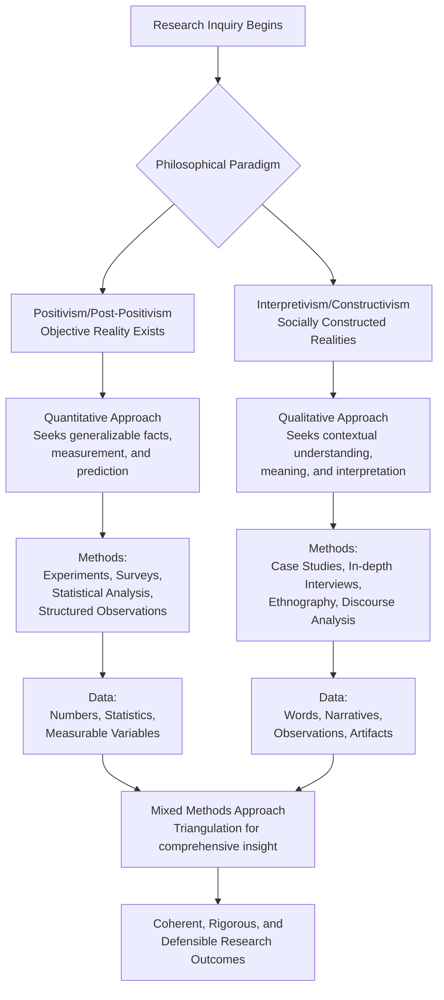

### 1.5 Major Types of Research: A Comprehensive Classification

Research can be categorized along multiple dimensions, including purpose, approach, and outcome.

#### By Purpose

| Research Type | Description | Example |
|---------------|-------------|---------|
| **Basic Research (Pure or Fundamental Research)** | Conducted primarily to advance knowledge without immediate practical application. Seeks to understand fundamental principles, test theoretical propositions, and expand the frontiers of human understanding. | Investigating how people process and retain information about their information-seeking behaviors. |
| **Applied Research** | Conducted to address specific practical problems or inform decision-making. Draws upon the findings of basic research but directs them toward concrete applications. | Evaluating whether a particular information literacy program improves students' research skills. |
| **Evaluation Research** | Assesses the effectiveness of programs, policies, or interventions, often combining multiple methods to provide comprehensive assessment. | Evaluating whether a new teaching method improves student outcomes. |

The distinction between basic and applied research is not absolute; basic research often yields practical applications, and applied research frequently contributes to theoretical understanding.

#### By Methodological Approach

| Research Type | Description | Typical Methods |
|---------------|-------------|-----------------|
| **Quantitative Research** | Focuses on numerical data, measurement, and statistical analysis | Surveys, experiments, structured observations |
| **Qualitative Research** | Focuses on non-numerical data, meaning, and interpretation | Interviews, focus groups, ethnography, content analysis |
| **Mixed Methods Research** | Combines quantitative and qualitative approaches for comprehensive understanding | Sequential or concurrent use of both method types |

#### By Design

| Research Type | Description | Key Characteristics |
|---------------|-------------|---------------------|
| **Experimental Research** | Manipulates variables to establish cause-and-effect relationships | Control groups, random assignment, manipulation of independent variables |
| **Descriptive Research** | Describes characteristics of a population or phenomenon | Surveys, observational studies, no variable manipulation |
| **Correlational Research** | Examines relationships between variables without manipulation | Identifies associations but cannot establish causation |
| **Exploratory Research** | Investigates understudied phenomena to generate hypotheses | Flexible methods, small samples, theory-building orientation |
| **Explanatory Research** | Seeks to explain why phenomena occur, identifying causal mechanisms and relationships | Often builds on exploratory and descriptive work |
| **Action Research** | Conducted by practitioners to address problems in their own settings | Dual goals of solving immediate problems and contributing to knowledge |

### 1.6 Ethical Principles Governing Research Conduct

Ethical considerations permeate every stage of the research process, from initial conception to final dissemination. Ethical research is not merely compliant with regulations; it reflects fundamental respect for the dignity, rights, and welfare of all who are affected by the investigation.

#### Core Ethical Principles

| Principle | Definition | Implications for Practice |
|-----------|------------|--------------------------|
| **Respect for Persons** | Individuals are autonomous agents whose decisions should be respected | Informed consent; protection for those with diminished autonomy |
| **Beneficence** | Researchers maximize benefits and minimize harm | Risk-benefit analysis; protection from harm |
| **Justice** | Burdens and benefits of research are fairly distributed | Fair participant selection; avoidance of exploitation |
| **Integrity** | Research is conducted honestly and transparently | Avoiding fabrication, falsification, plagiarism |
| **Responsibility** | Researchers are accountable for their work | Proper data management; addressing errors |

#### Research with Human Subjects

When research involves human participants, additional safeguards are required:

- **Informed Consent:** Participants must be provided with sufficient information to make voluntary decisions about participation. Essential elements include:
  - Purpose of the research
  - Procedures involved
  - Potential risks and benefits
  - Confidentiality protections
  - Right to withdraw without penalty
  - Contact information for questions

- **Institutional Review Board (IRB) Approval:** Most research involving human participants requires review by an IRB or Research Ethics Committee. This review ensures that studies meet ethical standards before data collection begins.

- **Minimization of Harm:** Research procedures must minimize potential physical or psychological harm.

- **Right to Withdraw:** Participants can leave the study at any time without penalty.

#### Protection of Vulnerable Populations

Special protections apply when research involves populations with diminished autonomy or increased vulnerability, including:

- Children
- Prisoners
- Pregnant women
- Cognitively impaired individuals
- Economically or educationally disadvantaged persons

#### Research Misconduct

The following actions constitute serious ethical violations and can result in severe consequences:

| Misconduct Type | Description |
|-----------------|-------------|
| **Fabrication** | Making up data or results |
| **Falsification** | Manipulating or changing data to achieve desired results |
| **Plagiarism** | Using others' work without proper attribution |
| **Self-Plagiarism** | Reusing substantial portions of one's own previously published work without citation |

<br>

## Part II: Research in Library and Information Science

### 2.1 LIS as an Interdisciplinary Field of Inquiry

Library and Information Science occupies a distinctive position in the academic landscape, drawing upon multiple disciplinary traditions while maintaining its own coherent identity. This interdisciplinary character is not accidental but reflects the nature of the phenomena LIS investigates: information in all its forms, contexts, and uses.

**Disciplinary Foundations of LIS**

| Foundation Discipline | Contribution to LIS | Research Applications |
|----------------------|---------------------|----------------------|
| **Social Sciences** | Understanding human information behavior; social contexts of information | User studies; information needs assessment; community analysis |
| **Computer Science** | Information systems; retrieval algorithms; digital libraries | System design; usability testing; information retrieval |
| **Management Studies** | Organization of information resources; strategic planning | Collection management; library administration; program evaluation |
| **Humanities** | Cultural dimensions of information; historical perspectives | Archival studies; preservation; critical information studies |
| **Communication Studies** | Information transmission; media effects | Information dissemination; scholarly communication |
| **Education** | Learning and information literacy | Information literacy instruction; educational program evaluation |

**The Interdisciplinary Advantage**

LIS's interdisciplinary nature offers significant advantages for research:

- **Methodological Richness:** Scholars can draw upon methods from multiple disciplines, selecting the approach best suited to each research question.
- **Comprehensive Understanding:** By examining information phenomena from multiple perspectives, researchers develop more complete understanding than any single discipline could provide.
- **Real-World Relevance:** Information problems in practice rarely respect disciplinary boundaries. Interdisciplinary research aligns more closely with the complexity of actual information environments.
- **Innovation Potential:** The intersection of disciplines often generates novel insights that would not emerge within traditional disciplinary silos.

**Challenges of Interdisciplinarity**

The interdisciplinary character also presents challenges that researchers must navigate:

- Researchers must achieve competence in multiple methodological traditions
- Scholarly communication may require translation across disciplinary languages
- Evaluation criteria may differ across fields
- Publication outlets may favor single-discipline work

Successful LIS researchers develop strategies for managing these challenges while leveraging the advantages of interdisciplinary inquiry.

### 2.2 The Significance of Research within LIS

Research serves multiple essential functions within the Library and Information Science field, shaping both academic understanding and professional practice.

**Advancing Theoretical Knowledge:** LIS research develops and tests theories about information phenomena. These theories provide frameworks for understanding:

- How people seek, find, and use information
- How information systems should be designed to support human needs
- How information organizations can fulfill their missions
- How scholarly communication evolves and functions

**Informing Professional Practice:** The library and information professions increasingly embrace evidence-based practice, drawing upon research findings to guide decisions about:

- Collection development and management
- Reference and information services
- Information literacy instruction
- Technology implementation
- Facility planning and design
- Program development and evaluation

**Supporting Policy Development:** Research provides the evidence base for policy decisions affecting information access, privacy, intellectual freedom, and related concerns.

**Documenting Professional Impact:** LIS research demonstrates the value and impact of libraries and information services, providing evidence that supports advocacy and resource allocation.

**Addressing Emerging Challenges:** Research equips the field to respond to new developments, from technological change to evolving user expectations.

### 2.3 Key Research Areas and Emerging Frontiers

The scope of LIS research continues to expand as information environments evolve and new questions emerge.

**Traditional Research Areas**

- **Information Seeking and Behavior:** Investigates how people identify, seek, and use information across different contexts and populations.
- **Information Retrieval:** Examines the design and evaluation of systems for storing and finding information.
- **Collection Management:** Studies the development, organization, and preservation of information resources.
- **Scholarly Communication:** Analyzes the production, dissemination, and use of scholarly information.
- **Information Literacy:** Investigates how people develop competencies for finding, evaluating, and using information effectively.
- **Library Services and Programs:** Evaluates the design, delivery, and impact of library services.

**Emerging Research Frontiers**

| Research Area | Focus | Methods Commonly Used |
|---------------|-------|----------------------|
| **Data Science and Data Curation** | Management, preservation, and use of research data; data literacy | Computational methods; case studies; surveys |
| **Digital Humanities** | Integration of computational methods with humanities scholarship | Text mining; digital archives; collaborative research |
| **Social Media and Information** | Information behavior in social media environments; misinformation | Content analysis; network analysis; surveys |
| **Human-Computer Interaction** | Design and evaluation of information systems for human use | Usability testing; ethnographic observation; experiments |
| **Critical Information Studies** | Power, justice, and equity in information systems and practices | Critical discourse analysis; participatory research |
| **Altmetrics and Impact Assessment** | New measures of scholarly and societal impact | Bibliometric analysis; web analytics; mixed methods |

**Methodological Diversity in LIS Research**

The breadth of LIS research questions demands methodological versatility. Familiarity with a range of methods allows researchers to accurately label and situate their work, selecting the optimal approach based on the research question and context, not methodological convenience. This methodological eclecticism is a strength of the field, but it demands disciplined attention to the alignment between philosophical assumptions, research questions, and methods.

The commitment uniting all LIS research is the use of sound, paradigm-aligned methods to answer critical questions about information in society, ensuring findings are both philosophically coherent and actionable for practitioners and policymakers.

<br>

## Part III: The Research Lifecycle—From Idea to Publication

The research process follows a systematic progression from initial conception to final dissemination.


### 3.1 Phase 1: Formulating the Research Problem and Questions

Every research project begins with a problem—a question that has not been adequately answered, a phenomenon that has not been adequately explained, or a situation that requires investigation. A strong research paper begins with one clear, focused question. This question guides every subsequent decision in the research process.

#### Sources of Research Problems

- **Literature Gaps:** Inconsistencies, contradictions, or unanswered questions in published research.
- **Practical Problems:** Challenges or issues encountered in professional practice.
- **Theory Testing:** Propositions derived from theoretical frameworks that require empirical investigation.
- **Personal Experience:** Observations or questions arising from the researcher's own experience.
- **Social or Policy Issues:** Questions arising from contemporary debates or policy concerns.

#### Identifying Genuine Gaps

Not every unanswered question constitutes a worthwhile research problem. Genuine gaps are characterized by:

- **Significance:** Answering the question would matter—it would advance knowledge, improve practice, or inform policy.
- **Feasibility:** The question can be answered given available resources, access, and methods.
- **Originality:** The question has not been adequately addressed in previous research.
- **Interest:** The researcher has genuine curiosity about and commitment to the question.

#### Characteristics of a Strong Research Question

| Characteristic | Weak Example | Strong Example |
|----------------|--------------|----------------|
| **Specific** | "Study of Artificial Intelligence" | "How does Random Forest improve crop yield prediction accuracy compared to Linear Regression?" |
| **Researchable** | "What is the meaning of consciousness?" | "What neural correlates are associated with conscious visual perception?" |
| **Significant** | "How many books are in my university library?" | "How has the university library's collection diversity changed over the past decade?" |
| **Original** | "What is the effect of smoking on health?" | "How does vaping affect adolescent lung development compared to traditional smoking?" |

#### The FINER Criteria for Research Questions

- **F**easible: Can be answered with available time, resources, and expertise
- **I**nteresting: Engages the researcher and the academic community
- **N**ovel: Adds new knowledge to the field
- **E**thical: Can be studied without causing harm
- **R**elevant: Matters to the field and potentially to society

#### Types of Research Questions

| Question Type | Focus | Example |
|---------------|-------|---------|
| **Descriptive** | What is happening? What exists? | What are the information-seeking behaviors of first-generation college students? |
| **Comparative** | How do groups differ? | How do online and in-person information literacy instruction compare in effectiveness? |
| **Relational** | How are variables associated? | What is the relationship between library use and academic achievement? |
| **Causal** | What causes what? | Does participation in summer reading programs improve reading proficiency? |
| **Evaluative** | How well does something work? | How effective is the university's research data management service? |
| **Explanatory** | Why does something happen? | Why do some faculty embrace open access while others resist it? |

#### Establishing Scope and Delimitations

No single study can answer every question about a phenomenon. Researchers must make deliberate choices about what their study will and will not address.

**Scope:** The scope defines what the study covers—its boundaries in terms of population, geographic area, time frame, variables, and phenomena.

**Delimitations:** Delimitations are the boundaries set by the researcher's choices. They explain what the study will not do and why.

**Limitations versus Delimitations:**

- **Delimitations:** Boundaries set by the researcher. Example: "This study is delimited to public libraries in urban areas."
- **Limitations:** Potential weaknesses that may affect interpretation. Example: "The use of self-report measures may introduce social desirability bias."

### 3.2 Phase 2: Conducting the Literature Review

The literature review is not merely a summary of previous work; it is a critical, analytical synthesis that situates the proposed study within the broader scholarly conversation.

#### Purposes of the Literature Review

| Purpose | Description |
|---------|-------------|
| **Mapping the Territory** | Identifies what is known about the topic, providing context for the study |
| **Identifying Gaps** | Reveals what remains unknown, justifying the need for new research |
| **Avoiding Duplication** | Ensures the study is original, not merely repeating previous work |
| **Informing Methods** | Identifies approaches that have and have not worked in previous studies |
| **Developing Theoretical Framework** | Provides concepts and theories that guide the investigation |
| **Refining Questions** | Helps sharpen and focus research questions based on existing knowledge |
| **Supporting Interpretation** | Provides basis for comparing findings with previous research |

#### Types of Literature Reviews

- **Narrative Review:** Provides a comprehensive overview of a topic, synthesizing findings from multiple studies.
- **Systematic Review:** Follows rigorous, pre-specified methods to identify, evaluate, and synthesize all available evidence on a focused question.
- **Meta-Analysis:** Statistically combines results from multiple quantitative studies to produce summary effect estimates.
- **Scoping Review:** Maps the literature on a broad topic, identifying key concepts, sources, and gaps.
- **Critical Review:** Evaluates the quality and contribution of existing work, often advancing a particular argument or perspective.

#### What Literature Review Is Not

- A simple list or summary of papers
- An annotated bibliography
- A collection of quotes

#### What Literature Review Is

- A critical synthesis of existing research
- An analysis of methods, findings, and limitations
- An identification of patterns, debates, and gaps
- A justification for your own research

#### Structure and Approach

| Approach | Description | Example |
|----------|-------------|---------|
| **Thematic** | Organize by themes or topics | Studies on accuracy, studies on scalability, studies on interpretability |
| **Chronological** | Organize by development over time | Early approaches, mid-century developments, contemporary methods |
| **Methodological** | Organize by research methods | Quantitative studies, qualitative studies, mixed methods |
| **Theoretical** | Organize by theoretical frameworks | Cognitive theories, behavioral theories, social constructivist approaches |

#### Writing Style

Do not just summarize papers. Instead:

- Compare and contrast methods across studies
- Evaluate strengths and weaknesses
- Identify patterns in findings
- Highlight contradictions or inconsistencies
- Show how your research addresses identified gaps

**Example:**

> "Study A used method X and achieved 85% accuracy with a small, controlled sample. Study B used method Y and achieved 82% accuracy with a larger, real-world dataset. However, neither study directly compared X and Y using the same large-scale dataset. Furthermore, both studies focused on temperate agricultural zones, leaving tropical agricultural systems unexplored. This gap motivates the present study, which compares X and Y using a large-scale dataset from tropical regions."

### 3.3 Phase 3: Developing and Testing Hypotheses

A hypothesis is a specific, testable prediction about the relationship between variables. Not all research requires hypotheses; exploratory and descriptive studies may be guided by research questions rather than hypotheses.

#### Characteristics of Testable Hypotheses

- **Empirical Referents:** Variables must be observable or measurable.
- **Specific Relationships:** The predicted relationship between variables must be clearly stated.
- **Falsifiability:** It must be possible to demonstrate that the hypothesis is false.
- **Consistency with Theory:** Hypotheses should be grounded in existing theoretical understanding.
- **Precision:** Terms should be defined clearly enough that the hypothesis can be tested unambiguously.

#### From Questions to Hypotheses

| Research Question | Hypothesis |
|-------------------|------------|
| Does library instruction improve student research skills? | Students who receive library instruction will score higher on research skills assessments than students who do not receive instruction. |
| Is there a relationship between library use and academic achievement? | There is a positive correlation between frequency of library use and grade point average among undergraduate students. |
| Do public libraries in urban and rural areas differ in their technology services? | Urban public libraries provide significantly more technology services than rural public libraries. |

#### Understanding Null and Alternative Hypotheses

| Hypothesis Type | Description | Example |
|-----------------|-------------|---------|
| **Null Hypothesis (H₀)** | States no relationship or no difference between variables | "There is no difference in crop yield prediction accuracy between Random Forest and Linear Regression." |
| **Alternative Hypothesis (H₁ or Hₐ)** | States that a relationship or difference exists | "Random Forest achieves higher crop yield prediction accuracy than Linear Regression." |
| **Directional Hypothesis** | Predicts the specific direction of the relationship | "Random Forest achieves at least 10% higher accuracy than Linear Regression." |
| **Non-Directional Hypothesis** | Predicts a difference but not its direction | "Random Forest and Linear Regression differ in crop yield prediction accuracy." |

#### Hypothesis Testing Procedures and Statistical Inference

Hypothesis testing involves using sample data to make inferences about populations. The logic proceeds as follows:

1. **Assume the null hypothesis is true.** Begin by assuming that there is no relationship or difference in the population.
2. **Collect sample data.** Gather data from a sample drawn from the population of interest.
3. **Calculate a test statistic.** Compute a statistic that summarizes the evidence against the null hypothesis.
4. **Determine the probability.** Calculate the probability (p-value) of obtaining a test statistic as extreme as the one observed, assuming the null hypothesis is true.
5. **Make a decision.** If this probability is very small (typically less than 0.05), reject the null hypothesis in favor of the alternative. If the probability is not small, fail to reject the null hypothesis.

**Key Concepts**

| Concept | Definition | Importance |
|---------|------------|------------|
| **p-value** | Probability of obtaining the observed results (or more extreme) if the null hypothesis is true | Smaller p-values provide stronger evidence against the null |
| **Significance Level (α)** | Threshold below which the null hypothesis is rejected (conventionally 0.05) | Sets the standard for evidence |
| **Statistical Significance** | Result is unlikely to have occurred by chance alone | Does not necessarily imply practical importance |
| **Effect Size** | Magnitude of the relationship or difference | Indicates practical significance |
| **Power** | Probability of correctly rejecting a false null hypothesis | Affected by sample size, effect size, and α |

#### Type I and Type II Errors: Avoiding False Conclusions

| Decision | Null Hypothesis Is True | Null Hypothesis Is False |
|----------|------------------------|--------------------------|
| **Reject Null Hypothesis** | Type I Error (False Positive) | Correct Decision (Power) |
| **Fail to Reject Null Hypothesis** | Correct Decision | Type II Error (False Negative) |

- **Type I Error (α):** Rejecting a null hypothesis that is actually true. Probability of Type I error = α (significance level).
- **Type II Error (β):** Failing to reject a null hypothesis that is actually false. Probability of Type II error = β. Power = 1 - β.

**Factors Affecting Error Rates**

- **Sample Size:** Larger samples reduce Type II error (increase power) without increasing Type I error.
- **Effect Size:** Larger effects are easier to detect, reducing Type II error.
- **Variability:** Less variable data makes effects easier to detect.
- **Significance Level:** More stringent α reduces Type I error but increases Type II error.
- **Measurement Precision:** More precise measurement increases power.

### 3.4 Phase 4: Crafting the Research Design

Research design is the strategic blueprint for answering research questions. It encompasses all decisions about how the study will be conducted, from participant selection through data collection to analysis.

#### Core Principles of Sound Research Design

| Principle | Definition | Implications |
|-----------|------------|--------------|
| **Alignment** | Design components are consistent with research questions and philosophical assumptions | Methods must match questions; philosophical stance should inform choices |
| **Validity** | The study measures what it claims to measure and supports its conclusions | Threats to validity must be identified and addressed |
| **Reliability** | Results would be consistent if the study were repeated | Measurement must be consistent; procedures must be replicable |
| **Generalizability** | Findings apply beyond the specific study context | Sampling and design affect external validity |
| **Feasibility** | The study can be completed given available resources | Design must be realistic about time, budget, access |
| **Ethical Soundness** | The study protects participants and maintains integrity | Ethics are integrated throughout, not added at the end |

#### The Design Process

1. **Clarify research questions.** What exactly do you want to know?
2. **Identify key variables.** What concepts must be measured or manipulated?
3. **Determine the approach.** Quantitative, qualitative, or mixed methods?
4. **Select design type.** Exploratory, descriptive, experimental, etc.?
5. **Plan sampling.** Who or what will be studied?
6. **Design data collection.** What instruments or protocols will be used?
7. **Plan analysis.** How will data be processed and interpreted?
8. **Address validity threats.** What could go wrong and how will you prevent it?
9. **Consider ethics.** How will participants be protected?
10. **Write the proposal.** Document all decisions in a coherent plan.

#### Exploratory Research Designs

Exploratory research is conducted when little is known about a phenomenon. Its purpose is to investigate understudied topics, generate hypotheses, and identify variables for future research.

**When to Use Exploratory Designs**

- The topic has received little previous research attention
- The population has not been studied
- Existing theories seem inadequate for the phenomenon
- The researcher is entering a new area of inquiry
- The goal is to generate hypotheses rather than test them

**Characteristics of Exploratory Designs**

| Characteristic | Description |
|----------------|-------------|
| **Flexibility** | Methods may evolve as understanding develops |
| **Open-Ended** | Broad questions rather than narrow hypotheses |
| **Small Samples** | Depth rather than breadth is prioritized |
| **Qualitative Emphasis** | Methods that capture richness and complexity |
| **Emergent Design** | Decisions may be made as the study progresses |
| **Hypothesis-Generating** | Produces propositions for future testing |

#### Descriptive Designs: Cross-Sectional and Longitudinal Studies

Descriptive research aims to describe characteristics of populations or phenomena.

**Cross-Sectional Designs**

Cross-sectional studies collect data at a single point in time. They provide a snapshot of a population or phenomenon.

- **Purpose:** Describe current characteristics, attitudes, or behaviors; examine relationships among variables at one time.
- **Strengths:** Efficient; relatively quick; can study multiple variables; good for describing prevalence.
- **Limitations:** Cannot establish temporal order; cannot study change over time; cohort effects may confound findings.

**Longitudinal Designs**

Longitudinal studies collect data from the same population at multiple points in time. They track change and development.

| Type | Description | Example |
|------|-------------|---------|
| **Trend Studies** | Different samples from the same population at different times | Surveying different cohorts of first-year students each year about information literacy |
| **Cohort Studies** | Following a specific cohort over time | Tracking the 2020 entering class through their four years of college |
| **Panel Studies** | Following the same individuals over time | Surveying the same 100 students annually throughout their academic careers |

#### Experimental and Quasi-Experimental Designs

Experimental designs are the strongest for establishing causal relationships.

**True Experimental Designs**

True experiments require:

- **Manipulation:** Researcher actively introduces or varies the independent variable
- **Random Assignment:** Participants are randomly assigned to conditions
- **Control Group:** A comparison group that does not receive the manipulation

| Design | Structure | Strengths |
|--------|-----------|-----------|
| **Posttest-Only Control Group** | R: X O1 (experimental)<br>R: O1 (control) | Controls for pretest sensitization |
| **Pretest-Posttest Control Group** | R: O1 X O2 (experimental)<br>R: O1 O2 (control) | Checks initial equivalence; measures change |
| **Solomon Four-Group** | Multiple combinations of pretest/posttest with/without treatment | Controls for pretest effects; strongest design |

**Quasi-Experimental Designs**

Quasi-experiments include manipulation but lack random assignment.

| Design | Description | Example |
|--------|-------------|---------|
| **Nonequivalent Groups** | Compare groups that are not randomly assigned | Comparing information literacy scores between two existing classes |
| **Interrupted Time Series** | Multiple observations before and after an intervention | Tracking library usage monthly before and after implementing a new service |
| **Regression Discontinuity** | Assignment based on cutoff score | Students below a test cutoff receive intervention; compare those just above and below |

**Threats to Internal Validity**

| Threat | Description | Control Strategy |
|--------|-------------|------------------|
| **History** | External events affect outcomes | Control group; multiple observations |
| **Maturation** | Natural changes over time affect outcomes | Control group; short time frames |
| **Testing** | Pretest affects posttest performance | Solomon design; control group |
| **Instrumentation** | Changes in measurement affect results | Standardized procedures; calibration |
| **Regression** | Extreme scores move toward mean | Control group; avoid extreme selection |
| **Selection** | Pre-existing differences between groups | Random assignment; statistical control |
| **Attrition** | Differential dropout affects groups | Minimize dropout; analyze dropouts |
| **Diffusion** | Treatment spreads to control group | Separate groups; contamination checks |

#### Writing the Research Proposal: A Blueprint for Inquiry

The research proposal is a comprehensive document that describes the planned study.

**Essential Components of a Research Proposal**

| Section | Purpose | Key Elements |
|---------|---------|--------------|
| **Title** | Conveys the study's focus concisely | Clear; descriptive; includes key variables |
| **Abstract** | Summarizes the entire proposal | Brief overview of problem, methods, significance |
| **Introduction** | Establishes context and importance | Research problem; background; significance |
| **Literature Review** | Situates study in existing knowledge | Synthesis of relevant research; identification of gaps |
| **Research Questions/Hypotheses** | States what the study will address | Clear, focused questions; testable hypotheses |
| **Theoretical Framework** | Identifies guiding theories | Concepts and relationships guiding the study |
| **Methodology** | Describes how the study will be conducted | Design; population/sample; variables; instruments; procedures; analysis plan |
| **Ethical Considerations** | Addresses protection of participants | Informed consent; confidentiality; risks/benefits |
| **Timeline** | Shows project schedule | Major tasks and completion dates |
| **Budget** | Lists required resources (if applicable) | Personnel; equipment; participant payments; travel |
| **References** | Documents all citations | Complete bibliographic information |
| **Appendices** | Provides supplementary materials | Instruments; consent forms; recruitment materials |

### 3.5 Phase 5: Data Collection Methods

Data collection begins with a fundamental decision: whether to gather new data specifically for the study (primary data) or to analyze data already collected by others (secondary data).

#### Primary versus Secondary Data

**Primary Data**

Primary data are collected by the researcher specifically for the purposes of the current study.

- **Advantages:** Tailored to research questions; researcher controls quality; can collect precisely what is needed.
- **Disadvantages:** Time-consuming; expensive; requires access to participants; may be limited by resources.
- **Examples:** Surveys administered for the study; interviews conducted with participants; observations recorded specifically for the research.

**Secondary Data**

Secondary data are data that already exist, having been collected by someone else for another purpose.

- **Advantages:** Often less expensive; may provide larger samples; allows historical analysis; unobtrusive.
- **Disadvantages:** May not perfectly match research questions; quality may be unknown; variables may be defined differently.
- **Examples:** Census data; institutional records; previously collected survey data; administrative databases; archival materials.

#### Primary Data Collection Methods

| Method | Description | Best For | Considerations |
|--------|-------------|----------|----------------|
| **Surveys/Questionnaires** | Standardized questions administered to a sample | Collecting large amounts of data efficiently | Requires careful design to avoid bias |
| **Interviews** | Direct questioning of participants | In-depth exploration of experiences and perspectives | Time-consuming, requires skilled interviewer |
| **Observations** | Systematic watching and recording of behavior | Studying behavior in natural settings | Observer bias, reactivity of participants |
| **Focus Groups** | Group discussions facilitated by a moderator | Exploring group norms, shared experiences | Group dynamics may influence responses |
| **Experiments** | Controlled procedures to test hypotheses | Establishing cause-and-effect | Artificial settings may limit generalizability |
| **Archival Research** | Analysis of existing records or documents | Studying historical trends or hard-to-reach populations | Data may not have been collected for research purposes |

#### Observation Techniques

Observation involves systematically watching and recording behavior, events, or conditions.

**Structured Observation**

Structured observation uses predetermined categories and systematic recording procedures.

- **Characteristics:** Clear coding schemes; predetermined categories; systematic timing; multiple observers for reliability; quantitative data.
- **Applications:** Counting specific behaviors; recording duration of activities; documenting environmental features.
- **Instruments:** Checklists; rating scales; time-sampling protocols; event-sampling forms.

**Unstructured Observation**

Unstructured observation is more open and flexible.

- **Characteristics:** Open-ended recording; holistic focus; emergent categories; rich description; qualitative data.
- **Applications:** Understanding complex social situations; discovering unanticipated phenomena; studying culture and meaning.
- **Recording Methods:** Field notes; audio/video recording; photographs; reflective journals.

**Observer Roles**

| Role | Description | Advantages | Challenges |
|------|-------------|------------|------------|
| **Complete Participant** | Observer participates fully, identity as researcher may be hidden | Insider perspective; natural behavior | Ethical concerns; loss of objectivity |
| **Participant as Observer** | Observer participates, identity known | Insider perspective with ethical transparency | May influence behavior |
| **Observer as Participant** | Observer primarily observes, minimal participation | Maintains some distance; ethical clarity | May miss insider perspectives |
| **Complete Observer** | Observer is hidden or unobtrusive | No influence on behavior | Ethical concerns; limited understanding |

#### Interview Methods

| Type | Structure | Characteristics | Best Used When |
|------|-----------|-----------------|----------------|
| **Structured** | Highly structured; predetermined questions; fixed wording and order | Standardized; efficient; quantitative analysis possible | Measuring specific variables; large samples; comparability needed |
| **Semi-Structured** | Interview guide with key questions; flexibility in wording and order | Balance of structure and flexibility; allows probing | Exploring complex topics; need for comparability with depth |
| **Unstructured/In-Depth** | Open-ended; conversational; no predetermined questions | Maximum flexibility; rich data; emergent topics | Exploring new areas; understanding participant perspectives deeply |

### 3.6 Phase 6: Data Analysis and Interpretation

Data analysis transforms raw information into meaningful findings. The analytical approach must align with the research design and type of data collected.

#### Data Preparation: Editing, Coding, and Entry

**Editing**

Editing involves reviewing data for completeness, legibility, and consistency.

- **Check for completeness:** Are all items completed? If missing, is the pattern random or systematic?
- **Check for legibility:** Can responses be clearly interpreted?
- **Check for consistency:** Are responses logically consistent? (e.g., age and year of birth)
- **Handle problematic responses:** Decide how to treat illegible, inconsistent, or out-of-range responses.

**Coding**

Coding involves assigning numerical values to responses for quantitative analysis.

- **Closed-ended questions:** Codes are predetermined (e.g., 1=Male, 2=Female; 1=Strongly Disagree to 5=Strongly Agree).
- **Open-ended questions:** May require content analysis to develop coding categories, then assign codes.
- **Codebook:** Document all variable names, labels, and codes for reference.

**Data Entry**

Data entry involves transferring data from instruments to electronic format.

- **Manual entry:** Typing data into spreadsheet or statistical software.
- **Optical scanning:** Using scanners to read marked forms.
- **Online surveys:** Data automatically captured in database.
- **Verification:** Double-entry or random checks to ensure accuracy.

**Data Cleaning**

Data cleaning identifies and corrects errors in the dataset.

- **Range checks:** Are values within possible range? (e.g., age 18-100)
- **Logic checks:** Are related values consistent? (e.g., if never used service, satisfaction should be missing)
- **Outlier identification:** Are there extreme values that may be errors?
- **Missing data analysis:** Pattern and extent of missing data; decisions about handling (listwise deletion, imputation, etc.)

#### Descriptive Statistics: Summarizing and Displaying Data

**Measures of Central Tendency**

| Measure | Definition | When to Use |
|---------|------------|-------------|
| **Mean** | Arithmetic average | Interval or ratio data; symmetric distributions |
| **Median** | Middle value when data ordered | Ordinal data; skewed distributions |
| **Mode** | Most frequent value | Nominal data; any distribution |

**Measures of Dispersion (Variability)**

| Measure | Definition | Interpretation |
|---------|------------|----------------|
| **Range** | Maximum minus minimum | Crude measure; sensitive to outliers |
| **Interquartile Range** | 75th percentile minus 25th percentile | Spread of middle 50%; robust to outliers |
| **Variance** | Average squared deviation from mean | Basis for many statistical tests |
| **Standard Deviation** | Square root of variance | Interpretable in original units |
| **Coefficient of Variation** | Standard deviation divided by mean | Relative variability; unitless |

**Data Visualization**

| Visualization | Purpose | Example Use |
|---------------|---------|-------------|
| **Bar Chart** | Compare categories | Library usage by user type |
| **Histogram** | Show distribution of continuous variable | Age distribution of survey respondents |
| **Box Plot** | Display distribution with quartiles | Comparison of satisfaction scores across groups |
| **Scatter Plot** | Show relationship between two continuous variables | Correlation between library visits and GPA |
| **Pie Chart** | Show parts of a whole | Proportion of budget by category |

#### Inferential Statistics: Drawing Conclusions from Samples

Inferential statistics use sample data to draw conclusions about populations.

**Key Concepts**

| Concept | Definition |
|---------|------------|
| **Parameter** | Value in the population (usually unknown) |
| **Statistic** | Value calculated from the sample |
| **Sampling Distribution** | Distribution of a statistic across repeated samples |
| **Standard Error** | Standard deviation of the sampling distribution |
| **Confidence Interval** | Range likely to contain the population parameter |
| **Significance Test** | Procedure for evaluating evidence against null hypothesis |

**Common Inferential Tests**

| Test | Purpose | Level of Measurement | Example |
|------|---------|---------------------|---------|
| **t-test (independent)** | Compare means between two groups | DV: interval/ratio; IV: two categories | Compare information literacy scores between instructed and non-instructed groups |
| **t-test (paired)** | Compare means from same group at two times | DV: interval/ratio; repeated measures | Compare pretest and posttest scores |
| **ANOVA** | Compare means among three or more groups | DV: interval/ratio; IV: categorical with 3+ categories | Compare satisfaction across three types of libraries |
| **Chi-square** | Test association between categorical variables | Both variables categorical | Test relationship between library use (yes/no) and graduation status |
| **Correlation** | Measure strength of linear relationship | Both variables interval/ratio | Measure correlation between library visits and GPA |
| **Regression** | Predict DV from one or more IVs | DV: interval/ratio; IVs: various | Predict information literacy from instruction, prior experience, and demographics |

**Assumptions of Statistical Tests**

Most statistical tests have assumptions that should be met for valid results:

- **Independence:** Observations are independent of each other.
- **Normality:** Variables are normally distributed in the population (for parametric tests).
- **Homogeneity of variance:** Variances are equal across groups.
- **Linearity:** Relationships are linear (for correlation/regression).

When assumptions are violated, alternatives may include data transformation or non-parametric tests.

#### Qualitative Data Analysis

| Analysis Type | Purpose | Process |
|---------------|---------|---------|
| **Thematic Analysis** | Identify patterns and themes in qualitative data | Coding, theme development, interpretation |
| **Content Analysis** | Systematically categorize textual content | Develop coding scheme, quantify categories |
| **Discourse Analysis** | Examine language use and meaning | Analyze linguistic features, context, and power relations |
| **Grounded Theory** | Develop theory from data | Iterative coding, constant comparison, theory building |

#### Triangulation

Triangulation involves using multiple methods, data sources, or researchers to enhance the validity and credibility of findings. Types include:

- **Method Triangulation:** Using multiple methods to study the same phenomenon
- **Data Triangulation:** Using multiple data sources
- **Investigator Triangulation:** Involving multiple researchers
- **Theory Triangulation:** Using multiple theoretical perspectives

### 3.7 Phase 7: Writing and Dissemination

The final phase involves communicating findings to the academic community through publications, presentations, and other venues.

**Dissemination Options**

| Venue | Description | Considerations |
|-------|-------------|----------------|
| **Journal Articles** | Peer-reviewed publications in academic journals | Most prestigious, rigorous review process, lengthy timeline |
| **Conference Presentations** | Oral or poster presentations at academic conferences | Faster dissemination, networking opportunities, feedback |
| **Book Chapters** | Contributions to edited volumes | Comprehensive treatment, less rigorous than journals |
| **Theses/Dissertations** | Comprehensive reports of graduate research | Required for degree completion, detailed documentation |
| **Preprints** | Early sharing of manuscripts before peer review | Rapid dissemination, feedback, may affect journal submission |

<br>

## Part IV: Comparative Research Methods

### 4.1 Survey Research: Principles and Applications

Survey research is one of the most widely used methods in social science and LIS inquiry. It involves collecting standardized information from a sample of individuals to describe characteristics, attitudes, behaviors, or experiences of a population.

**Core Principles**

- **Standardization:** All respondents receive the same questions in the same format, ensuring comparability across responses.
- **Sampling:** Data is collected from a subset of the population, selected using procedures that allow generalization to the larger group.
- **Systematic Measurement:** Variables are measured using carefully designed instruments with demonstrated reliability and validity.
- **Statistical Analysis:** Data is analyzed using statistical techniques appropriate to the research questions and measurement levels.

**Strengths and Limitations**

| Strengths | Limitations |
|-----------|-------------|
| Efficient for collecting data from large samples | Cannot establish causality with certainty |
| Results can be generalized when sampling is sound | May lack depth and contextual richness |
| Standardization ensures comparability | Subject to non-response bias |
| Statistical analysis provides precise estimates | Cannot probe or clarify responses |
| Relatively economical per respondent | Social desirability may affect responses |

### 4.2 The Case Study Method: In-Depth Contextual Analysis

The case study method involves intensive investigation of a single instance, system, or phenomenon within its real-world context.

**Core Principles**

- **Holistic Investigation:** The case is examined as a whole, with attention to the interrelationships among its components.
- **Contextual Understanding:** The case is studied within its natural setting, with careful attention to contextual factors.
- **Multiple Data Sources:** Case studies typically draw upon multiple sources of evidence.
- **Rich Description:** Findings are presented in detailed, narrative form that conveys the complexity and texture of the case.

**Strengths and Limitations**

| Strengths | Limitations |
|-----------|-------------|
| Provides rich, contextual detail | Limited generalizability beyond the case |
| Captures complexity and nuance | Time-intensive to conduct |
| Suitable for contemporary phenomena | Potential for researcher bias in interpretation |
| Can generate hypotheses for further study | Difficult to establish causal relationships |
| Accommodates multiple data sources | May produce overwhelming amounts of data |

### 4.3 Experimental Research: Establishing Causality

Experimental research is the gold standard for establishing cause-and-effect relationships.

**Core Principles**

- **Manipulation:** The researcher deliberately introduces or varies the independent variable.
- **Control:** Extraneous variables that might influence outcomes are controlled through design features.
- **Random Assignment:** In true experiments, participants are randomly assigned to conditions.
- **Measurement:** Outcomes (dependent variables) are measured precisely, often before and after manipulation.

**Strengths and Limitations**

| Strengths | Limitations |
|-----------|-------------|
| Strongest design for establishing causality | May have low ecological validity (artificial settings) |
| Control over extraneous variables | Ethical constraints on manipulation |
| Replicable procedures | May not capture complex, real-world conditions |
| Precise measurement | Some variables cannot be manipulated |
| Clear interpretation of results | Hawthorne effects from participant awareness |

### 4.4 Focus Group Techniques: Capturing Collective Insights

Focus groups bring together small groups of participants to discuss specific topics under the guidance of a moderator.

**Core Principles**

- **Group Interaction:** Participants respond not only to the moderator's questions but also to each other's comments.
- **Moderator Guidance:** A skilled moderator guides the discussion, ensuring coverage of key topics while allowing natural conversation to flow.
- **Homogeneous Groups:** Participants typically share relevant characteristics, facilitating comfortable discussion.
- **Systematic Analysis:** Discussions are recorded, transcribed, and analyzed using qualitative techniques.

**Strengths and Limitations**

| Strengths | Limitations |
|-----------|-------------|
| Generates rich, interactive data | Not generalizable to populations |
| Efficient for gathering multiple perspectives | Dominant participants may influence discussion |
| Group interaction stimulates ideas | Sensitive topics may not be suitable |
| Flexible and adaptable | Requires skilled moderation |
| Participants may feel supported | Analysis is time-intensive |

### 4.5 Comparative Analysis of Research Methods

| Method | Best Used When | Data Type | Sample Size | Time Required | Key Consideration |
|--------|----------------|-----------|-------------|---------------|-------------------|
| **Survey** | Describing population characteristics; testing relationships | Quantitative | Large | Moderate | Sampling quality is critical |
| **Case Study** | Understanding complex phenomena in context | Qualitative | Small (1-5 cases) | Extensive | Generalizability is limited |
| **Experiment** | Testing causal relationships | Quantitative | Moderate | Moderate to extensive | Control vs. realism trade-off |
| **Focus Group** | Exploring shared experiences; generating ideas | Qualitative | Moderate (groups of 6-10) | Moderate | Group dynamics matter |
| **Interview** | Understanding individual experiences in depth | Qualitative | Small to moderate | Extensive | Interviewer skill is crucial |
| **Content Analysis** | Analyzing recorded communication | Quantitative or qualitative | Variable | Variable | Context may be missing |
| **Bibliometrics** | Analyzing publication patterns | Quantitative | Large | Moderate | Data quality affects results |

**Method Selection Criteria**

When selecting methods, researchers should consider:

1. **Research Question:** What kind of answer is sought? Description, explanation, prediction, or understanding?
2. **Philosophical Paradigm:** What assumptions about reality and knowledge guide the inquiry?
3. **Resources Available:** Time, budget, personnel, and access to participants or data.
4. **Audience Expectations:** What methods are valued in the relevant scholarly community?
5. **Researcher Expertise:** What methods can the researcher implement competently?
6. **Ethical Considerations:** What methods respect participants' rights and welfare?

The strongest research designs often combine multiple methods, using each to address different aspects of the research question and triangulating findings across sources.

<br>

## Part V: Data Collection and Measurement

### 5.1 Designing Effective Questionnaires

Questionnaires are among the most common data collection instruments in research. Their quality directly affects the quality of the data obtained.

**Core Principles**

| Principle | Description | Implications |
|-----------|-------------|--------------|
| **Clarity** | Questions are easily understood | Simple language; avoid jargon; be specific |
| **Relevance** | Each question addresses research objectives | Every question should have a purpose |
| **Brevity** | Questionnaire is as short as possible | Respect participants' time; reduce fatigue |
| **Neutrality** | Questions do not lead or bias responses | Avoid loaded language; present balanced options |
| **Completeness** | Response options cover all possibilities | Include "other" with space to specify |
| **Mutual Exclusivity** | Response options do not overlap | Each response should fit only one category |
| **Appropriateness** | Questions are suitable for the population | Consider reading level; cultural appropriateness |

**The Questionnaire Development Process**

1. **Specify information needed.** What constructs must be measured?
2. **Draft questions.** Write items addressing each construct.
3. **Review and revise.** Check for clarity, bias, appropriateness.
4. **Format the questionnaire.** Organize visually; group related items.
5. **Pretest with small sample.** Test with people like the target population.
6. **Revise based on pretest.** Identify and fix problems.
7. **Pilot test (optional).** Test full administration procedures.
8. **Finalize and administer.** Prepare final version for data collection.

### 5.2 Scaling Techniques: Likert, Semantic Differential, and Thurstone

Scales are composite measures that combine multiple items to measure complex constructs.

**Likert Scales**

Likert scales present statements and ask respondents to indicate their level of agreement.

- **Format:** Statement followed by response options (typically 5 or 7 points) ranging from "Strongly Disagree" to "Strongly Agree."
- **Example:** "The library website is easy to navigate." ☐ Strongly Disagree ☐ Disagree ☐ Neutral ☐ Agree ☐ Strongly Agree
- **Analysis:** Responses are summed or averaged across items measuring the same construct.
- **Considerations:** Balance positive and negative statements to reduce response bias; ensure items measure the same underlying construct.

**Semantic Differential Scales**

Semantic differential scales present bipolar adjectives and ask respondents to rate concepts between them.

- **Format:** Concept followed by pairs of opposite adjectives with 5-7 points between.
- **Example:** "The library website is:"
  Difficult ☐ ☐ ☐ ☐ ☐ Easy
  Confusing ☐ ☐ ☐ ☐ ☐ Clear
  Slow ☐ ☐ ☐ ☐ ☐ Fast
- **Analysis:** Responses can be averaged across adjective pairs or analyzed as profiles.

**Thurstone Scales**

Thurstone scales involve more complex development procedures to create equal-appearing intervals.

- **Process:** Large pool of items is developed; judges rate each item's favorability; items with high agreement among judges are selected; final scale includes items spanning the continuum.
- **Limitations:** Labor-intensive development; less common in contemporary research.

**Scale Development Considerations**

- **Reliability:** Does the scale produce consistent results? Test-retest; internal consistency (Cronbach's alpha).
- **Validity:** Does the scale measure what it claims to measure? Content validity; construct validity; criterion validity.
- **Length:** Longer scales tend to be more reliable but increase respondent burden.
- **Response Options:** Odd numbers allow neutral midpoint; even numbers force direction.

### 5.3 Pretesting, Validation, and Reliability Assessment

No questionnaire should be used for data collection without adequate pretesting.

**Pretesting Methods**

| Method | Description | Identifies |
|--------|-------------|------------|
| **Expert Review** | Specialists review questionnaire for content and clarity | Coverage; wording; appropriateness |
| **Cognitive Interviews** | Respondents think aloud while completing questionnaire | Comprehension problems; interpretation issues |
| **Small-Scale Pretest** | Administer to small sample similar to target population | Response patterns; missing data; timing |
| **Pilot Study** | Full-scale test of all procedures | All aspects of administration and analysis |

**Reliability Assessment**

Reliability refers to consistency of measurement. Common reliability measures include:

- **Test-Retest Reliability:** Administer same questionnaire to same respondents at two time points; correlate scores. Indicates stability over time.
- **Internal Consistency:** Do items measuring the same construct correlate with each other? Cronbach's alpha (acceptable > 0.70) indicates average inter-item correlation.
- **Inter-Rater Reliability:** Do different observers or coders produce consistent ratings? Percent agreement; Cohen's kappa.

**Validity Assessment**

Validity refers to whether the questionnaire measures what it claims to measure.

| Type | Description | Assessment |
|------|-------------|------------|
| **Content Validity** | Items adequately cover the construct | Expert judgment; comparison to theory |
| **Face Validity** | Questionnaire appears to measure what it claims | Subjective judgment; less rigorous |
| **Criterion Validity** | Scores correlate with external standard | Concurrent (correlate with existing measure); predictive (predict future outcome) |
| **Construct Validity** | Measure behaves as theory predicts | Convergent (correlates with similar measures); discriminant (does not correlate with dissimilar measures) |

### 5.4 Sampling Strategies

Sampling involves selecting a subset of a population to study, with the goal of drawing conclusions about the population based on the sample.

**Key Concepts**

| Term | Definition | Example |
|------|------------|---------|
| **Population** | The entire group of interest | All public librarians in the United States |
| **Target Population** | The specific population to which findings will be generalized | Public librarians in the United States who work in libraries serving populations over 100,000 |
| **Sampling Frame** | The list or mechanism used to access the population | Membership list of the Public Library Association |
| **Sample** | The subset actually studied | 500 public librarians selected from the membership list |
| **Sampling Unit** | The element selected in each stage of sampling | Individual librarians |
| **Sampling Error** | Difference between sample statistics and population parameters due to chance | The extent to which sample mean differs from population mean |

**The Sampling Process**

1. **Define the population.** Who or what is the focus?
2. **Identify the sampling frame.** How can the population be accessed?
3. **Determine sample size.** How many are needed for adequate precision?
4. **Select sampling method.** Probability or non-probability?
5. **Draw the sample.** Implement selection procedures.
6. **Assess sample representativeness.** Compare to population if possible.

#### Probability Sampling Methods

Probability sampling methods involve random selection, ensuring that every element in the population has a known, non-zero probability of selection.

| Method | Procedure | Advantages | Disadvantages |
|--------|-----------|------------|---------------|
| **Simple Random Sampling** | Every member of the population has an equal chance of selection | Simple; unbiased; basis for statistical inference | Requires complete sampling frame; may be inefficient for dispersed populations |
| **Stratified Random Sampling** | Population divided into strata (subgroups); random samples drawn from each stratum | Ensures representation of subgroups; may increase precision | Requires information for stratification; more complex than simple random |
| **Systematic Sampling** | Select every kth element from the sampling frame after random start | Simple to implement; efficient | Periodicity in list may bias selection |
| **Cluster Sampling** | Population divided into clusters; clusters randomly selected; all elements in selected clusters studied | Efficient when population is geographically dispersed | Larger sampling error than simple random |
| **Multi-Stage Sampling** | Multiple levels of sampling; clusters selected, then subsampled within clusters | Efficient for large, dispersed populations | Complex design; requires careful analysis |

#### Non-Probability Sampling Methods

Non-probability sampling methods do not involve random selection.

| Method | Procedure | Applications | Limitations |
|--------|-----------|--------------|-------------|
| **Purposive Sampling** | Researcher deliberately selects elements based on specific characteristics | Selecting information-rich cases; studying specific subgroups | Subject to researcher bias; not generalizable |
| **Snowball Sampling** | Initial participants refer other participants | Studying hard-to-reach or hidden populations | Initial contacts may not be representative |
| **Convenience Sampling** | Selecting elements that are readily available | Exploratory research; pilot studies | High potential for bias; limited generalizability |
| **Quota Sampling** | Population divided into subgroups; quotas set for each subgroup | Ensuring diversity when probability sampling not possible | Non-random selection within quotas may introduce bias |

**Comparison of Sampling Approaches**

| Criterion | Probability Sampling | Non-Probability Sampling |
|-----------|---------------------|-------------------------|
| **Generalizability** | Statistical generalization to population | Analytic or theoretical generalization |
| **Bias Control** | Random selection minimizes bias | Potential for unknown bias |
| **Sampling Frame** | Complete frame required | Frame may not be needed |
| **Complexity** | More complex | Simpler |
| **Cost** | Generally higher | Generally lower |
| **Appropriate For** | Descriptive research; hypothesis testing | Exploratory research; qualitative studies |

<br>

## Part VI: Data Processing and Statistical Analysis

### 6.1 Introduction to Statistical Software

Statistical software facilitates data management and analysis.

**SPSS (Statistical Package for the Social Sciences)**

SPSS is a point-and-click statistical software widely used in social science research.

- **Advantages:** User-friendly interface; good for beginners; comprehensive output; good documentation.
- **Disadvantages:** Limited flexibility; expensive; less suitable for complex custom analyses.

**Basic SPSS Operations**

| Operation | Procedure |
|-----------|-----------|
| **Data Entry** | Data View tab; enter values in spreadsheet format |
| **Variable Definition** | Variable View tab; define name, type, labels, values |
| **Descriptive Statistics** | Analyze → Descriptive Statistics → Frequencies/Descriptives |
| **t-test** | Analyze → Compare Means → Independent-Samples/Paired-Samples t-test |
| **ANOVA** | Analyze → Compare Means → One-Way ANOVA |
| **Correlation** | Analyze → Correlate → Bivariate |
| **Regression** | Analyze → Regression → Linear |
| **Charts** | Graphs → Chart Builder |

**R**

R is an open-source programming language and environment for statistical computing.

- **Advantages:** Free; extremely flexible; cutting-edge methods; excellent graphics; large user community.
- **Disadvantages:** Steep learning curve; requires programming; less intuitive for beginners.

**Basic R Operations**

| Operation | R Code Example |
|-----------|----------------|
| **Load data** | data <- read.csv("filename.csv") |
| **Descriptive statistics** | summary(data) |
| **t-test** | t.test(dv ~ iv, data = data) |
| **ANOVA** | aov(dv ~ iv, data = data) |
| **Correlation** | cor(data$var1, data$var2) |
| **Regression** | lm(dv ~ iv1 + iv2, data = data) |
| **Scatter plot** | plot(data$var1, data$var2) |

**Choosing Software**

The choice between SPSS, R, and other packages depends on:

- **Research needs:** What analyses are required?
- **User expertise:** What is the learning curve?
- **Institutional resources:** What is available?
- **Collaboration:** What do colleagues use?
- **Reproducibility:** What supports open science practices?

<br>

## Part VII: Mastering Academic Search and Literature Review

In today's information-saturated world, the ability to find precise, relevant, and authoritative information is essential for researchers.

### 7.1 Foundational Search Techniques

**Instant Answers and Quick Lookups**

Modern search engines provide immediate answers for common queries:

- **Calculations and Conversions:** Enter equations like `(5*22)/7` or use natural language for unit conversions (`km to miles`)
- **Definitions:** Use `define [word]` for definitions and etymology
- **Translations:** Enter `[word] in [language]` for instant translation
- **Real-Time Information:** Get stock prices (`AAPL`), weather forecasts, or world times (`time in Tokyo`)

**Intent-Based Discovery**

Structure queries around your research intent:

- **Planning and Comparison:** Search for historical data, trends, or comparisons
- **Media and Documents:** Search for specific document types, datasets, or media
- **People and Institutions:** Search for researchers, universities, or research centers

### 7.2 Advanced Search Operators

Mastering search operators provides precise control over search results.

**Precision Filtering Operators**

| Operator | Function | Example | Use Case |
|----------|----------|---------|----------|
| `site:` | Restricts search to a specific website or domain | `site:github.com transformer architecture` | Find content within a trusted source |
| `site:.edu` | Restricts to educational institutions | `site:.edu deep learning curriculum` | Find academic content |
| `site:.gov` | Restricts to government websites | `site:.gov climate change data` | Find authoritative government data |
| `filetype:` | Searches for specific file formats | `filetype:pdf reinforcement learning` | Find research papers, reports, presentations |
| `intitle:` | Requires term in page title | `intitle:"systematic review"` | Find articles focused on specific topics |
| `inurl:` | Requires term in URL | `inurl:dataset climate change` | Find data repositories |

**Boolean and Contextual Logic Operators**

| Operator | Function | Example | Use Case |
|----------|----------|---------|----------|
| `" "` | Exact phrase matching | `"social cognitive theory"` | Find specific phrases or concepts |
| `-` (minus) | Excludes terms | `python -snake -monty` | Remove irrelevant meanings |
| `OR` | Includes either term (must be capitalized) | `TensorFlow OR PyTorch` | Broaden search to related terms |
| `AND` | Requires both terms (often implicit) | `climate AND adaptation AND policy` | Narrow to specific combinations |
| `AROUND(n)` | Terms within n words of each other | `quantum AROUND(5) computing` | Find conceptually related content |
| `*` (wildcard) | Replaces unknown words | `the * of the story` | Find variations of phrases |
| `..` | Numeric range | `temperature "20..30" celsius` | Find data within specific ranges |

**Advanced Utility Operators**

| Operator | Function | Example | Use Case |
|----------|----------|---------|----------|
| `related:` | Finds sites similar to a known URL | `related:nature.com` | Discover similar journals or sources |
| `cache:` | Retrieves saved version of a page | `cache:example.edu/research.pdf` | Access content if site is down |
| `BEFORE:` | Filters results before a date | `BEFORE:2020-01-01` | Find historical research |
| `AFTER:` | Filters results after a date | `AFTER:2023-01-01` | Find recent publications |

### 7.3 Strategic Search Methodology

Technique must be guided by strategy. A methodological approach transforms random searching into systematic discovery.

**Query Crafting and Iterative Refinement**

1. **Start Broad, Then Narrow:** Begin with a general query to assess the landscape, then iteratively refine using more specific keywords and operators based on what you learn.
2. **Use Professional Terminology:** Incorporate domain-specific jargon and technical terms to bypass generic content and reach expert material.
3. **Prioritize Keywords:** Strip sentences down to essential nouns and concepts, removing superfluous words like "the," "how," or "of."
4. **Document Your Search Strategy:** For systematic reviews, maintain a record of databases searched, dates, search strings, and number of results.

**Example: Systematic Search Workflow**

**Scenario:** Finding recent research on reinforcement learning for robotic manipulation

1. **Exploratory Phase:** Start broad: `reinforcement learning robotic manipulation`. Identify key sub-topics, common authors, and relevant conferences.
2. **Refinement Phase:** Narrow using advanced operators:
   `"reinforcement learning" "robotic manipulation" filetype:pdf AFTER:2023`
3. **Authority Filtering:** Restrict to academic sources:
   `site:.edu "deep reinforcement learning" "robot manipulation"`
4. **Forward and Backward Chaining:**
   - **Backward:** Examine references in promising papers
   - **Forward:** Use "cited by" features to find newer papers citing key works
5. **Ongoing Monitoring:** Set up alerts for refined search strings to receive notifications of new publications.

### 7.4 Source Evaluation and Verification

Not all search results are equally valuable. Critical evaluation is essential.

**Evaluating Sources: The CRAAP Test**

| Criterion | Questions to Ask |
|-----------|------------------|
| **Currency** | When was this published? Has it been updated? Is the field evolving quickly? |
| **Relevance** | Does this directly address my research question? Who is the intended audience? |
| **Authority** | Who are the authors? What are their credentials? Is the publisher reputable? |
| **Accuracy** | Is the information supported by evidence? Can it be verified elsewhere? |
| **Purpose** | Why was this created? Is there bias or hidden agenda? |

**Leveraging Authoritative Domains**

- `.edu` – Educational institutions (generally credible academic content)
- `.gov` – Government agencies (authoritative data and reports)
- `.org` – Organizations (check individual organization reputation)
- Reputable journals and academic publishers

**Cross-Referencing with Multiple Engines**

Different search engines have different indexes and ranking algorithms. Cross-checking can uncover unique sources:

- **Google Scholar:** Broad academic search, citation tracking
- **PubMed:** Biomedical and life sciences
- **IEEE Xplore:** Engineering and computer science
- **Scopus/Web of Science:** Comprehensive, curated databases
- **Semantic Scholar:** AI-powered academic search

### 7.5 Reference Management Tools

Reference managers save time, reduce errors, and maintain consistency in citations.

| Tool | Key Features | Best For |
|------|--------------|----------|
| **Zotero** | Free, open-source, browser integration, collaborative features | Researchers who want free, flexible tool |
| **Mendeley** | Free, PDF management, social networking features | Researchers who work extensively with PDFs |
| **EndNote** | Comprehensive features, integration with Word | Advanced researchers, institutional licenses |
| **Paperpile** | Browser-based, Google Docs integration | Researchers using Google Workspace |

**Benefits of Reference Managers**

- Automatic citation and bibliography generation
- PDF storage and annotation
- Searchable personal database
- Collaboration and sharing
- Integration with word processors
- Reduced risk of citation errors

**Recording Bibliographic Information**

Whatever system is used, complete bibliographic information must be recorded for every source:

- Author(s) (full names as they appear)
- Year of publication
- Title (full title and subtitle)
- Journal title (for articles) or book title (for chapters)
- Volume, issue, and page numbers
- DOI (Digital Object Identifier) if available
- URL and access date for online sources
- Database name (if retrieved from a database)

<br>

## Part VIII: The Standard Research Paper Structure (IMRaD)

Most academic journals and conferences follow the IMRaD structure:

> **I**ntroduction
> **M**ethodology
> **R**esults
> **a**nd
> **D**iscussion

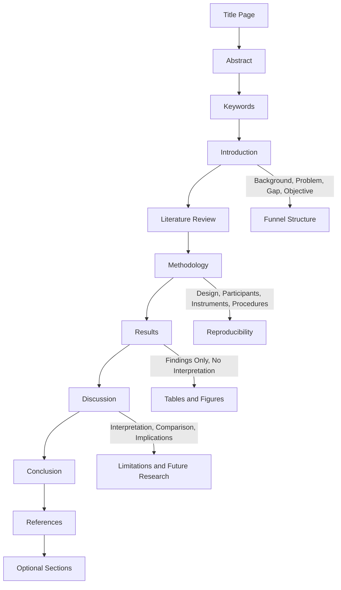

### 8.1 Title Page

**Purpose:** To clearly and concisely describe what the paper studies, enabling readers to quickly understand the focus and decide whether to read further.

**Must Include**

- Clear and specific title
- Author name(s) and institutional affiliation(s)
- Contact information for corresponding author (if required)
- Date of submission or publication
- Journal or conference name (if applicable)

**Title Writing Rules**

| Do | Don't |
|----|-------|
| Use specific, descriptive language | Use vague words like "Study of" or "Investigation into" |
| Include key variables and focus | Include unnecessary words or jargon |
| Keep concise (typically 10-20 words) | Make titles excessively long or short |
| Reflect the content accurately | Mislead or overpromise |

**Example Titles**

- Weak: "Study of Machine Learning in Agriculture"
- Strong: "Comparative Analysis of Random Forest and Linear Regression Models for Crop Yield Prediction Using Satellite Data in Midwest United States"

### 8.2 Abstract (150–250 Words)

**Purpose:** To provide a complete, self-contained summary of the entire paper, allowing readers to quickly understand the research without reading the full document.

**Structure**

| Component | Content | Approximate Length |
|-----------|---------|-------------------|
| **Background** | Context and importance of the problem | 1-2 sentences |
| **Objective** | Research question or purpose | 1 sentence |
| **Method** | Key aspects of methodology | 2-3 sentences |
| **Results** | Most important findings | 2-3 sentences |
| **Conclusion** | Interpretation and implications | 1-2 sentences |

**Key Rules**

- Write the abstract last, after completing the full paper
- Do not include citations or references
- Do not include abbreviations without definition
- Keep it precise and self-contained
- Ensure it accurately represents the paper's content

### 8.3 Keywords

**Purpose:** To facilitate discoverability in academic databases and search engines.

**Guidelines**

- Provide 4-8 keywords
- Reflect core concepts and main topics
- Match common academic search terms in your field
- Avoid overly generic words
- Consider variations and synonyms

**Example:** Machine Learning, Crop Yield Prediction, Random Forest, Agricultural Data Analytics, Satellite Imagery, Precision Agriculture

### 8.4 Introduction

**Purpose:** To explain why the research matters, establish context, and guide readers into the study.

**Structure**

| Component | Description | Key Questions to Answer |
|-----------|-------------|------------------------|
| **Background Context** | Introduce the general topic and its importance | What is the broader field? Why does it matter? |
| **Problem Statement** | Clearly explain the specific issue | What problem needs solving? |
| **Research Gap** | Identify what is missing in current studies | What don't we know? What are limitations of existing work? |
| **Research Objective** | State what the paper aims to achieve | What will this study do? |
| **Contribution** | Mention what the paper adds to the field | How will this advance knowledge? |
| **Roadmap** | Briefly outline the paper's structure | How is the rest of the paper organized? |

**Writing Tips**

- Move from broad context to specific focus (funnel structure)
- Cite relevant literature to establish context
- Clearly articulate the gap your research fills
- End with a clear statement of purpose (e.g., "This paper aims to...")
- Keep it logical and focused

### 8.5 Literature Review

**Purpose:** To analyze and synthesize previous work, demonstrating your understanding of the field and positioning your research within the academic conversation.

**What Literature Review Is Not**

- A simple list or summary of papers
- An annotated bibliography
- A collection of quotes

**What Literature Review Is**

- A critical synthesis of existing research
- An analysis of methods, findings, and limitations
- An identification of patterns, debates, and gaps
- A justification for your own research

**Structure and Approach**

| Approach | Description | Example |
|----------|-------------|---------|
| **Thematic** | Organize by themes or topics | Studies on accuracy, studies on scalability, studies on interpretability |
| **Chronological** | Organize by development over time | Early approaches, mid-century developments, contemporary methods |
| **Methodological** | Organize by research methods | Quantitative studies, qualitative studies, mixed methods |
| **Theoretical** | Organize by theoretical frameworks | Cognitive theories, behavioral theories, social constructivist approaches |

**Writing Style**

Do not just summarize papers. Instead:

- Compare and contrast methods across studies
- Evaluate strengths and weaknesses
- Identify patterns in findings
- Highlight contradictions or inconsistencies
- Show how your research addresses identified gaps

**Example**

> "Study A used method X and achieved 85% accuracy with a small, controlled sample. Study B used method Y and achieved 82% accuracy with a larger, real-world dataset. However, neither study directly compared X and Y using the same large-scale dataset. Furthermore, both studies focused on temperate agricultural zones, leaving tropical agricultural systems unexplored. This gap motivates the present study, which compares X and Y using a large-scale dataset from tropical regions."

### 8.6 Methodology (Materials and Methods)

**Purpose:** To explain exactly how the research was conducted, with sufficient detail that other researchers could reproduce the work.

**Core Requirements**

- **Reproducibility:** Another researcher should be able to replicate your study
- **Transparency:** All decisions and procedures should be clearly explained
- **Appropriateness:** Methods should be justified as appropriate for the research question

**What to Include**

| Component | Description | Examples |
|-----------|-------------|----------|
| **Research Design** | Overall approach and structure | Experimental, quasi-experimental, descriptive, case study |
| **Participants/Subjects** | Who or what was studied | Sample size, characteristics, recruitment methods |
| **Materials/Instruments** | Tools used for data collection | Surveys, equipment, software, tests |
| **Procedures** | Step-by-step description of what was done | Data collection steps, experimental protocols |
| **Variables** | Key variables and how they were measured | Independent, dependent, control variables |
| **Data Analysis** | How data were processed and analyzed | Statistical tests, coding procedures, software used |

**Writing Style**

- Use past tense (you are describing what you did)
- Use passive voice or active first-person plural ("The data were collected..." or "We collected the data...")
- Be precise and detailed
- Avoid emotional or evaluative language

**Example**

> "The dataset was collected from public agricultural records between 2015 and 2022. A total of 10,000 farm observations from five Midwestern states were included. The Random Forest algorithm was implemented using Python's scikit-learn library version 1.2.0 with default parameters except for n_estimators, which was set to 100. Model performance was evaluated using 10-fold cross-validation, with accuracy, precision, and recall as primary metrics."

### 8.7 Results

**Purpose:** To present findings objectively, without interpretation or commentary.

**What to Include**

- Descriptive statistics summarizing the data
- Results of statistical tests
- Tables and figures presenting data visually
- Key findings in narrative form

**Presentation Guidelines**

| Element | Purpose | Guidelines |
|---------|---------|------------|
| **Tables** | Present precise numerical data | Clear labels, proper formatting, referenced in text |
| **Figures** | Show patterns and relationships visually | Appropriate type (bar chart, scatter plot, etc.), clear axes, legends |
| **Text** | Guide readers through the results | Highlight key findings, direct attention to tables/figures, do not interpret |

**What NOT to Include**

- Interpretation or explanation of findings
- Comparison to other studies
- Discussion of implications
- Speculation about causes

**Example**

> "Table 1 presents descriptive statistics for all variables. The Random Forest model achieved 92.3% accuracy (SD = 1.2%), while Linear Regression achieved 78.1% accuracy (SD = 2.4%). This difference was statistically significant (t(18) = 5.67, p < 0.001). Figure 1 displays the distribution of prediction errors for both models."

### 8.8 Discussion

**Purpose:** To interpret results, explain their meaning, and situate them within the broader context of existing research.

**Structure**

| Component | Description | Key Questions to Answer |
|-----------|-------------|------------------------|
| **Summary of Key Findings** | Briefly restate main results | What did we find? |
| **Interpretation** | Explain what the findings mean | Why did this happen? What do these results tell us? |
| **Comparison to Literature** | Relate findings to previous research | How does this compare to what others found? Do findings support or contradict existing work? |
| **Implications** | Discuss practical and theoretical significance | What are the real-world applications? How does this advance theory? |
| **Limitations** | Acknowledge constraints of the study | What could not be addressed? What are potential weaknesses? |
| **Future Research** | Suggest directions for further investigation | What questions remain? What should be studied next? |

**Writing Tips**

- Begin with a clear, brief restatement of main findings
- Explain, don't just repeat—this section is for interpretation
- Be honest about limitations (all studies have them)
- Connect back to the research question and gap identified in the introduction
- Avoid overgeneralizing beyond your data

**Example**

> "The finding that Random Forest outperformed Linear Regression by approximately 14% in accuracy aligns with previous research suggesting that ensemble methods capture non-linear relationships more effectively than linear models (Smith et al., 2020; Jones & Lee, 2021). However, our observed accuracy gap is larger than the 5-8% range reported in temperate agricultural studies. This may reflect the greater complexity of tropical agricultural systems, where non-linear interactions between multiple variables are more pronounced. These findings suggest that machine learning approaches may be particularly valuable for complex, real-world agricultural settings, though further research is needed to test this hypothesis across diverse geographic regions."

### 8.9 Conclusion

**Purpose:** To summarize the paper and provide closure, emphasizing the main contributions and takeaway messages.

**What to Include**

- Brief recap of the research objective
- Summary of key findings
- Main contributions of the study
- Practical and theoretical implications
- Limitations (briefly)
- Future research directions

**What NOT to Include**

- New data or findings not presented in results
- New citations not previously discussed
- Extensive new discussion or interpretation
- Unsupported speculation

**Example**

> "This study investigated the comparative accuracy of Random Forest and Linear Regression for crop yield prediction using satellite data from tropical agricultural regions. Results demonstrated that Random Forest significantly outperformed Linear Regression, achieving 92% accuracy compared to 78%. These findings contribute to the growing literature on machine learning applications in agriculture and suggest that ensemble methods may be particularly valuable in complex tropical systems. The primary limitation is the geographic focus on three Southeast Asian countries; future research should examine whether these findings generalize to other tropical regions. Additionally, future work might explore hybrid approaches combining multiple machine learning methods or incorporating additional data sources such as soil sensors."

### 8.10 References

**Purpose:** To credit all sources used in the paper and enable readers to locate them.

**Key Rules**

- Every in-text citation must appear in the reference list
- Every reference list entry must be cited in the text
- Formatting must be consistent with the required style
- Accuracy is essential—errors undermine credibility

**Common Citation Styles**

| Style | Commonly Used In | Key Features |
|-------|------------------|--------------|
| **APA (7th ed.)** | Social sciences, education, psychology | Author-date in-text citations, reference list alphabetized |
| **MLA (9th ed.)** | Humanities, literature, arts | Author-page in-text citations, Works Cited page |
| **Chicago/Turabian** | History, humanities, some social sciences | Notes-bibliography or author-date options |
| **IEEE** | Engineering, computer science | Numeric citations in brackets, numbered reference list |
| **Vancouver** | Medicine, health sciences | Numeric citations in text, numbered reference list |

### 8.11 Optional Sections

Depending on journal requirements or the nature of your research, additional sections may be included:

| Section | Purpose | When to Include |
|---------|---------|-----------------|
| **Acknowledgements** | Thank individuals and organizations who contributed but are not authors | Always appropriate when others helped |
| **Funding Disclosure** | Declare sources of financial support | Required by many journals and funders |
| **Conflict of Interest** | Declare any potential conflicts | Required by most journals |
| **Ethical Approval** | Document ethics committee approval | Required for research with humans or animals |
| **Appendices** | Provide supplementary material | When detailed information would disrupt flow |
| **Supplementary Materials** | Online-only additional content | When journals offer this option |

<br>

## Part IX: Study Techniques for Research Success

Effective learning and productivity are essential for successful research. This section synthesizes empirically validated techniques from cognitive psychology and educational research.

### 9.1 Cognitive Foundations of Active Learning

Deep, durable learning requires active mental construction. Passive methods like re-reading and highlighting are significantly less effective than active engagement strategies.

**Active Recall (Retrieval Practice)**

| Aspect | Description |
|--------|-------------|
| **Core Concept** | Actively stimulating memory recall without reference materials—generating answers from memory rather than recognizing them |
| **Psychological Rationale** | Leverages the "testing effect": the act of retrieval strengthens memory traces and slows forgetting |
| **Implementation** | Close materials and write or verbalize what you remember; use flashcards; complete practice problems without solutions |
| **Key Insight** | The effort and occasional failure in active recall are not signs of poor learning but are critical to long-term consolidation |

**The Feynman Technique**

| Aspect | Description |
|--------|-------------|
| **Core Concept** | Mastering a concept by explaining it in simple, plain language as if teaching a novice |
| **Psychological Rationale** | Teaching forces explanatory depth; to simplify, you must identify core principles and confront gaps in understanding |
| **Implementation Steps** | 1. Choose a concept 2. Teach it in simple terms 3. Identify gaps in your explanation 4. Review and simplify iteratively |

**Self-Explanation and Elaborative Interrogation**

| Aspect | Description |
|--------|-------------|
| **Self-Explanation** | Verbally narrating your reasoning process as you work through problems or texts |
| **Elaborative Interrogation** | Proactively asking "Why is this true?" or "How does this connect to X?" |
| **Psychological Rationale** | Promotes relational and causal encoding, embedding facts within rich meaning networks |
| **Implementation** | Pause while reading to ask and answer "why" questions; talk through problem-solving steps |

### 9.2 Memory Optimization Strategies

Human memory follows predictable patterns of encoding, storage, and decay. These strategies work with the brain's architecture to build durable knowledge.

**Spaced Repetition**

| Aspect | Description |
|--------|-------------|
| **Core Concept** | Reviewing information at systematically increasing intervals over time |
| **Psychological Rationale** | Counters Ebbinghaus's forgetting curve; reviewing as information begins to fade signals long-term value |
| **Implementation** | Use algorithm-driven software (Anki, SuperMemo) or manual systems (Leitner System with flashcards) |

**The Leitner System**

- Box 1: Review daily
- Box 2: Review every 3 days
- Box 3: Review weekly
- Correct answers move to higher box; incorrect answers return to Box 1

**Interleaved Practice**

| Aspect | Description |
|--------|-------------|
| **Core Concept** | Mixing different topics or problem types within a single study session |
| **Psychological Rationale** | Prevents contextual overfitting; forces discriminative contrast and conscious strategy selection |
| **Implementation** | In math sessions, mix algebra, geometry, and calculus; in language study, alternate vocabulary, grammar, and reading |

**Dual Coding**

| Aspect | Description |
|--------|-------------|
| **Core Concept** | Combining verbal information (words, explanations) with visual information (diagrams, charts, sketches) |
| **Psychological Rationale** | Creates two linked memory representations, providing multiple retrieval routes |
| **Implementation** | Supplement text notes with diagrams, flowcharts, timelines; annotate images with written summaries |

**Mnemonics and the Method of Loci**

| Technique | Description | Example |
|-----------|-------------|---------|
| **Acronyms** | Using first letters to form memorable words | "HOMES" for the Great Lakes (Huron, Ontario, Michigan, Erie, Superior) |
| **Method of Loci** | Visualizing items along a familiar route | Place information at locations in your house; mentally walk to retrieve |
| **Chunking** | Grouping information into meaningful units | Memorizing 5550198 as "555-0198" |

### 9.3 Organizational Frameworks

Effective learning requires structured processes for capturing, connecting, and reviewing information.

**The Cornell Note-Taking System**

| Component | Description | Purpose |
|-----------|-------------|---------|
| **Notes Column (Right)** | Record lecture or reading content during class/reading | Capture information |
| **Cues Column (Left)** | Afterward, write key questions or prompts | Facilitate active recall during review |
| **Summary (Bottom)** | Brief synthesis of the entire page's content | Consolidate understanding |

**Review Method:** Cover the Notes column and use the Cues column to quiz yourself.

**Mind Mapping and Concept Mapping**

| Aspect | Description |
|--------|-------------|
| **Core Concept** | Visual, non-linear organization of ideas around a central concept using branches, keywords, colors, and images |
| **Psychological Rationale** | Mirrors the brain's associative, networked thinking; facilitates holistic understanding |
| **Implementation** | Start with central topic, draw branches for subtopics, add sub-branches for details; use keywords and images |

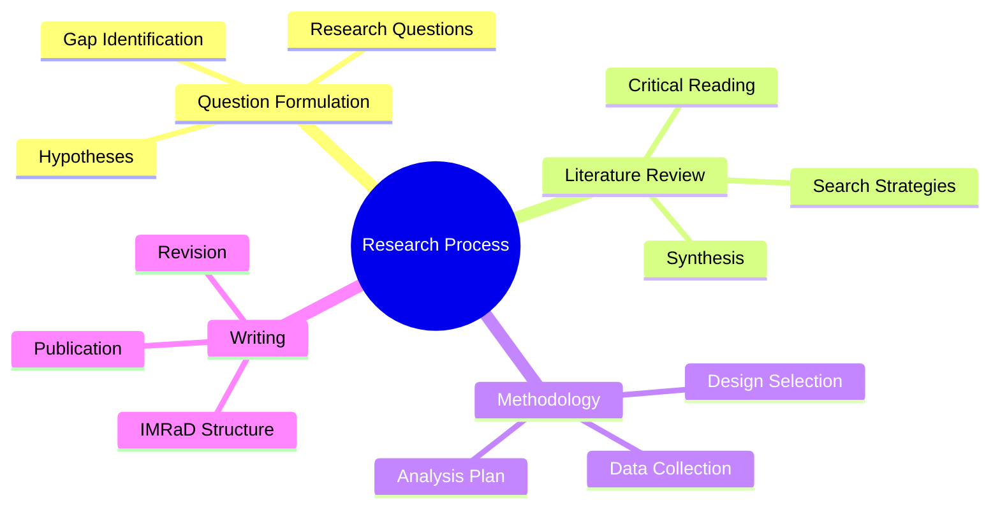

**The SQ3R Reading Method**

| Step | Description | Action |
|------|-------------|--------|
| **Survey** | Skim headings, subheadings, figures, abstract | Get the big picture before deep reading |
| **Question** | Turn headings into questions | Set purpose for reading |
| **Read** | Actively read to answer your questions | Engage with text purposefully |
| **Recite/Recall** | After sections, recite answers from memory | Immediate retrieval practice |
| **Review** | After finishing, review questions and answers | Consolidate learning |

### 9.4 Time Management and Habit Formation

Sustaining cognitive effort requires strategic management of attention, time, and behavior.

**The Pomodoro Technique**

| Aspect | Description |
|--------|-------------|
| **Core Concept** | Working in focused, timed intervals (traditionally 25 minutes) separated by short breaks |
| **Psychological Rationale** | Matches natural attention rhythms, prevents fatigue, makes tasks manageable |
| **Implementation** | 1. Set timer for 25 minutes 2. Work with zero distractions 3. Take 5-minute break 4. After four intervals, take 15-30 minute break |

**Parkinson's Law and Timeboxing**

| Aspect | Description |
|--------|-------------|
| **Core Concept** | Work expands to fill available time; timeboxing assigns fixed time periods to tasks |
| **Psychological Rationale** | Creates beneficial temporal urgency, reducing procrastination and perfectionism |
| **Implementation** | Instead of "study Chapter 5," set "Outline Chapter 5 in 30 minutes" |

**Habit Stacking**

| Aspect | Description |
|--------|-------------|
| **Core Concept** | Stacking a new habit onto an existing, well-established habit |
| **Psychological Rationale** | Leverages existing neural pathways; the established habit acts as a reliable trigger |
| **Implementation** | 1. Identify reliable current habit 2. Define new desired habit 3. Stack them: "After [current habit], I will [new habit]" |

### 9.5 Collaborative Learning Dynamics

Learning is inherently social. Interaction with others provides accountability, exposes blind spots, and creates opportunities for cognitive restructuring.

**The Protégé Effect**

| Aspect | Description |
|--------|-------------|
| **Core Concept** | Those who teach a topic develop deeper, more durable understanding |
| **Psychological Rationale** | Preparing to teach triggers metacognitive and generative processes; social responsibility increases motivation |
| **Implementation** | Peer tutoring; "rubber duck" method (explain to inanimate object); create study guides |

**Structured Group Discussion**

| Aspect | Description |
|--------|-------------|
| **Core Concept** | Purposeful, role-driven collaborative learning |
| **Psychological Rationale** | Exposes learners to multiple perspectives; defending understanding fosters critical thinking |
| **Implementation** | Assign roles (Discussion Leader, Skeptic, Synthesizer); use think-pair-share; debate opposing viewpoints |

### 9.6 Environmental and Physiological Optimizers

Cognitive performance does not occur in a vacuum. Physical state and environment significantly impact learning.

**Environmental Design**

- Designate a dedicated study space used only for focused work
- Ensure good lighting, organization, and minimal distractions
- Use website blockers during focus sessions

**Sleep and Memory Consolidation**

| Aspect | Description |
|--------|-------------|
| **Core Concept** | The "sleep sandwich": study before sleep, sleep, brief review upon waking |
| **Psychological Rationale** | During deep sleep, the brain reactivates and reorganizes memories, strengthening neural connections |
| **Implementation** | Review difficult material before sleeping; ensure full night's sleep; brief morning review |

**Physiological Supports**

| Factor | Impact | Action |
|--------|--------|--------|
| **Hydration** | Mild dehydration impairs attention and memory | Keep water at desk; drink regularly |
| **Nutrition** | Brain requires steady glucose for sustained effort | Complex carbohydrates, healthy snacks |
| **Movement** | Increases blood flow and neurotrophic factors | 5-minute movement breaks during long sessions |

<br>

## Part X: Writing Style, Common Mistakes, and Quality Assurance

### 10.1 Writing Style and Language Guidelines

Clear, precise writing is essential for effective research communication. Follow these guidelines to enhance readability and impact.

**General Principles**

| Do | Don't |
|----|-------|
| Use clear, simple English | Use unnecessarily complex language |
| Write concise sentences | Write long, convoluted sentences |
| Be precise and specific | Be vague or ambiguous |
| Use active voice when appropriate (first-person plural acceptable) | Overuse passive voice excessively |
| Define technical terms | Assume readers know all jargon |
| Use headings and subheadings for organization | Present undifferentiated blocks of text |
| Use figures and tables to present data visually | Rely solely on text for complex information |
| Maintain logical flow between sections | Jump between unrelated topics |

**Voice and Tone**

- **Objective:** Present information neutrally, without emotional language
- **Precise:** Choose words that accurately convey meaning
- **Formal but accessible:** Maintain academic standards without unnecessary complexity
- **Confident but measured:** Make claims supported by evidence; avoid overstatement

**Common Language Pitfalls to Avoid**

| Pitfall | Example | Better |
|---------|---------|--------|
| Informal language | "A bunch of studies looked at this thing" | "Numerous studies have examined this phenomenon" |
| Emotional expressions | "Amazingly, the results were perfect" | "The results demonstrated strong support for the hypothesis" |
| Unsupported claims | "Everyone knows this is true" | "Substantial evidence supports this conclusion" |
| Vague language | "Some researchers did some work" | "Smith et al. (2020) conducted a meta-analysis" |
| Overgeneralization | "This proves that..." | "These findings suggest that..." |

**Tense Usage**

| Section | Typical Tense | Example |
|---------|---------------|---------|
| Introduction | Present | "Climate change represents a significant challenge..." |
| Literature Review | Present perfect or past | "Previous research has examined... Smith (2019) found..." |
| Methodology | Past | "Data were collected from..." |
| Results | Past | "The model achieved 92% accuracy..." |
| Discussion | Present | "These findings suggest that..." |
| Conclusion | Present | "This study contributes to..." |

### 10.2 Common Mistakes and How to Avoid Them

**Pre-Writing and Planning Mistakes**

| Mistake | Consequence | Prevention |
|---------|-------------|------------|
| Writing without a clear research question | Unfocused paper, unclear contribution | Use the FINER criteria; complete the sentence: "This paper investigates ______ to solve ______ using ______ and demonstrates that ______." |
| Weak literature review | Missed context, unclear gap, reinventing wheel | Conduct systematic search; read critically; synthesize, don't just summarize |
| No clear research gap | Unclear contribution, "so what?" problem | Explicitly identify what's missing in existing research |
| Poor research design | Invalid or unreliable findings | Align design with question; consult methods literature; seek feedback |

**Writing Mistakes**

| Mistake | Consequence | Prevention |
|---------|-------------|------------|
| Poor data explanation | Reader cannot understand methods or findings | Be explicit and detailed; include all steps |
| Mixing results and discussion | Confusing, poorly organized paper | Keep Results for facts, Discussion for interpretation |
| Inadequate citation | Plagiarism, lack of credibility | Cite all sources; use reference manager |
| Overly complex language | Reduced readability, reader confusion | Write clearly and simply; have others read your work |
| Lack of logical flow | Reader gets lost | Use headings; outline before writing; check transitions |

**Ethical Mistakes**

| Mistake | Consequence | Prevention |
|---------|-------------|------------|
| Plagiarism | Serious ethical violation, career damage | Always cite sources; use quotation marks for direct quotes; paraphrase appropriately |
| Data fabrication or falsification | Worst ethical violation, retraction, career ending | Maintain honest, transparent practices; keep detailed records |
| Self-plagiarism | Ethical violation, copyright issues | Cite your own previous work; seek permission for reuse |
| Inadequate informed consent | Ethical violation, harm to participants | Follow IRB requirements; ensure participants understand |

### 10.3 Final Submission Checklist

**Content and Structure**

- [ ] Title is clear, specific, and accurately reflects content
- [ ] Abstract summarizes all key sections (background, objective, method, results, conclusion)
- [ ] Research gap is clearly defined in introduction
- [ ] Research question or hypothesis is explicitly stated
- [ ] Literature review synthesizes, not just summarizes
- [ ] Methodology is detailed enough for reproducibility
- [ ] Results present findings objectively, without interpretation
- [ ] Discussion interprets findings and relates to literature
- [ ] Conclusion summarizes key points and suggests future research
- [ ] All sections follow logical flow

**Citations and References**

- [ ] Every in-text citation appears in reference list
- [ ] Every reference list entry is cited in text
- [ ] Citation style is consistent throughout
- [ ] References are formatted correctly per required style
- [ ] No citation errors (correct authors, years, titles)

**Language and Formatting**

- [ ] Grammar and spelling checked
- [ ] Clear, concise language throughout
- [ ] No emotional or informal language
- [ ] All figures and tables have clear titles and are referenced in text
- [ ] Consistent formatting (headings, fonts, spacing)
- [ ] Page numbers included
- [ ] Acknowledgments and disclosures included if applicable

**Ethics and Integrity**

- [ ] Plagiarism checked (using software if available)
- [ ] All sources properly credited
- [ ] Ethical approval documented if required
- [ ] Funding sources disclosed
- [ ] Conflicts of interest declared

<br>

## Part XI: Informetrics and Scholarly Communication

### 11.1 Bibliometrics: Analyzing Publication and Citation Patterns

Bibliometrics applies quantitative methods to the study of publications and their characteristics. It provides tools for understanding scholarly communication, research impact, and the structure of scientific fields.

**Core Concepts**

| Concept | Definition | Applications |
|---------|------------|--------------|
| **Publication Count** | Number of publications by author, institution, country, etc. | Research productivity assessment |
| **Citation Count** | Number of times a publication is cited | Research impact measurement |
| **Impact Factor** | Average citations per article in a journal | Journal prestige assessment |
| **h-index** | Author-level metric: h papers with at least h citations each | Individual research impact |
| **Citation Networks** | Patterns of citing relationships among publications | Mapping intellectual structure of fields |
| **Co-authorship Analysis** | Patterns of collaboration among researchers | Understanding research collaboration |

**Bibliometric Laws**

| Law | Description | Implication |
|-----|-------------|-------------|
| **Bradford's Law** | Small core of journals account for most articles in a field | Core journals exist; literature scatters |
| **Lotka's Law** | Few authors produce most publications | Scientific productivity is highly skewed |
| **Zipf's Law** | Few words account for most occurrences in text | Word frequency follows predictable pattern |

**Bibliometric Methods**

- **Citation Analysis:** Studying patterns of citations among publications.
- **Co-citation Analysis:** Publications cited together reveal intellectual connections.
- **Bibliographic Coupling:** Publications sharing references reveal relatedness.
- **Author Co-citation Analysis:** Authors cited together reveal scholarly communities.

### 11.2 Scientometrics: Mapping the Structure of Science

Scientometrics extends bibliometric methods to study the structure and dynamics of science as a whole.

**Key Focus Areas**

| Area | Description | Methods |
|------|-------------|---------|
| **Science Mapping** | Visualizing the structure of scientific fields | Co-citation analysis; co-word analysis; network visualization |
| **Research Evaluation** | Assessing scientific productivity and impact | Citation analysis; indicator development; peer review comparison |
| **Science Policy** | Informing decisions about research funding and direction | Indicator development; trend analysis; forecasting |
| **Collaboration Patterns** | Studying scientific teamwork | Co-authorship analysis; international collaboration measurement |
| **Knowledge Diffusion** | Tracking how ideas spread across fields | Citation analysis; interdisciplinary indicators |

**Key Indicators**

| Indicator | What It Measures | Limitations |
|-----------|------------------|-------------|
| **Field-Weighted Citation Impact** | Citation performance relative to field average | Field classification issues |
| **Output in Top Percentiles** | Proportion of publications in highly cited group | Threshold choices affect results |
| **Collaboration Indicators** | Extent of national, international, or sectoral collaboration | Collaboration definitions vary |
| **Interdisciplinary Indicators** | Extent of engagement across fields | Field classification challenges |

**Data Sources for Scientometrics**

- Web of Science (Clarivate Analytics)
- Scopus (Elsevier)
- Google Scholar
- Dimensions (Digital Science)
- Microsoft Academic Graph (historical)
- OpenAlex (open source)

### 11.3 Webometrics: Studying Web-Based Scholarly Communication

Webometrics applies informetric methods to the World Wide Web, studying the structure, use, and impact of web-based information.

**Key Dimensions**

| Dimension | Focus | Methods |
|-----------|-------|---------|
| **Webometrics (narrow sense)** | Quantitative study of web phenomena | Link analysis; web citation analysis |
| **Web Impact Measurement** | Assessing impact of web-based content | Link counts; mentions; altmetrics |
| **Web Structure Analysis** | Mapping connections among websites | Network analysis; hyperlink analysis |
| **Social Media Metrics** | Studying scholarly communication on social platforms | Altmetrics; social media analytics |

**Altmetrics**

Altmetrics (alternative metrics) measure attention to scholarly outputs through online platforms and social media.

| Source Type | Examples | What They Measure |
|-------------|----------|-------------------|
| **Social Media** | Twitter, Facebook, LinkedIn | Public engagement; discussion |
| **News Media** | Mainstream news; blogs | Media attention; public visibility |
| **Online Reference Managers** | Mendeley; Zotero | Readership; scholarly use |
| **Policy Documents** | Government reports; NGO documents | Policy impact |
| **Wikipedia** | Citations in Wikipedia articles | Public information use |

**Relationship Between Metrics**

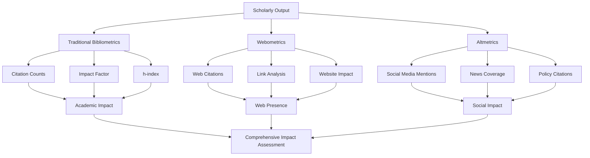

**Limitations and Considerations**

- Metrics can be manipulated
- Coverage varies across platforms and disciplines
- Meaning of metrics requires contextual interpretation
- Should complement, not replace, qualitative assessment
- Ethical considerations in data collection and use

<br>

## Part XII: Tools and Resources for Researchers

### 12.1 Free and Open Source Software (FOSS) for Research

The following tools are free, open-source, and actively maintained. They cover the full research lifecycle, from literature discovery to publication.

#### Reference Management and Bibliography

| Tool | Key Features | Best For | Platform |
|------|--------------|----------|----------|
| **JabRef** | Open-source, cross-platform BibTeX/BibLaTeX manager; searches CrossRef, PubMed, arXiv, Google Scholar; browser extension for one-click import; cite-as-you-write in external apps. | LaTeX users and those who prefer a lightweight, BibTeX-native workflow | Windows, macOS, Linux |
| **Zotero** | Free, open-source, browser integration, PDF annotation, group libraries, thousands of citation styles | Most researchers; the de facto standard for FOSS reference management | Windows, macOS, Linux, browser |
| **Docear** | Integrates reference management with mind mapping and PDF management; works with Mendeley and Word. | Researchers who want to visually map literature relationships | Windows, macOS, Linux |

#### Qualitative Data Analysis (QDA)

| Tool | Key Features | Best For | Platform |
|------|--------------|----------|----------|
| **OpenQDA** | Free, web-based alternative to MAXQDA; collaborative coding, REFI standard compatibility, versioning, shared codebook library; GDPR-compliant. | Collaborative qualitative research; teams needing transparency and reflexivity | Web-based (self-hostable) |
| **RQDA** | R package for qualitative data analysis; leverages R's statistical and visualization power; constructivist methodology support. | Researchers already using R who want to integrate QDA into a computational workflow | R environment |
| **Requal** | Lightweight, easy-to-use coding for interview transcripts, field notes, and text documents; filtering and export of annotated segments. | Simple, focused coding tasks without the overhead of full CAQDAS suites | Desktop |

#### Quantitative and Statistical Analysis

| Tool | Key Features | Best For | Platform |
|------|--------------|----------|----------|
| **Jamovi** | Free, open-source, based on R; menu-driven interface; real-time feedback; modular; no programming required for basic analyses. | Researchers and students who want SPSS-like usability without the cost | Windows, macOS, Linux, cloud |
| **PSPP** | Free replacement for SPSS; supports t-tests, ANOVA, GLM, factor analysis, non-parametric tests; outputs to PDF, CSV, HTML, SVG. | Those who need SPSS compatibility and a familiar interface | Windows, macOS, Linux |
| **JASP** | Free, open-source; Bayesian and frequentist analyses; intuitive interface; integrates with R. | Researchers interested in Bayesian methods or a modern alternative to SPSS | Windows, macOS, Linux |
| **R** | The gold standard for statistical computing; thousands of packages; unparalleled flexibility and reproducibility. | Advanced users, complex modeling, reproducible research | Windows, macOS, Linux |
| **Python** (with pandas, statsmodels, scikit-learn) | General-purpose programming with powerful statistical and machine learning libraries. | Researchers needing custom analyses, automation, or ML integration | Windows, macOS, Linux |

#### Academic Writing and Typesetting

| Tool | Key Features | Best For | Platform |
|------|--------------|----------|----------|
| **LyX** | Graphical front-end for LaTeX; WYSIWYM (what you see is what you mean); handles mathematical formulas and bibliographies; bundles LaTeX and bibliography management. | Researchers who want LaTeX quality without learning LaTeX code | Windows, macOS, Linux |
| **Overleaf Community Edition** | Self-hosted version of Overleaf; real-time collaborative LaTeX editing; track changes; Git integration. | Teams needing collaborative LaTeX writing with institutional control | Self-hosted (web) |
| **OpenPrism** | Local-first LaTeX + AI workspace; AI-assisted writing, compile and preview, template system (ACL, CVPR, NeurIPS, ICML), real-time collaboration. | Researchers who want AI assistance within a privacy-respecting LaTeX environment | Desktop (local-first) |
| **Fidus Writer** | Semantic word processor for academics; supports citations, LaTeX, DOCX, and JATS XML export. | Researchers who need a more academic-oriented word processor | Web-based |
| **Typst** | Modern typesetting system; simpler syntax than LaTeX; fast compilation; growing ecosystem. | New projects that want a modern alternative to LaTeX | Windows, macOS, Linux, web |

#### Note-Taking and Knowledge Management (PKM)

| Tool | Key Features | Best For | Platform |
|------|--------------|----------|----------|
| **Zettlr** | Open-source, Markdown-based, Zettelkasten method; backlinks, tags, plain text; minimalistic yet powerful. | Researchers building interconnected knowledge systems | Windows, macOS, Linux |
| **Logseq** | Open-source, local-first, Markdown/Org-mode; daily journals, block references, graph view. | Outliner-style thinkers who want a privacy-focused Roam alternative | Windows, macOS, Linux, mobile |
| **Joplin** | Open-source, Markdown-based, end-to-end encryption; web clipper; sync via multiple services. | Researchers who need secure, cross-platform note-taking with sync | Windows, macOS, Linux, mobile |
| **Trilium Notes** | Open-source, hierarchical note-taking; scripting support; relation maps. | Researchers managing large, structured knowledge bases | Windows, macOS, Linux |
| **KnowNote** | Local-first AI knowledge base; RAG (retrieval-augmented generation) over your documents; traceable answers; bring-your-own-model. | Researchers who want AI-assisted document interrogation without cloud dependency | Desktop (local-first) |

#### Data Visualization

| Tool | Key Features | Best For | Platform |
|------|--------------|----------|----------|
| **LabPlot** | Free, open-source, cross-platform data visualization and analysis; no coding required for many tasks. | Researchers who want a GUI-driven plotting and analysis tool | Windows, macOS, Linux |
| **Datavzrd** | Creates portable, interactive HTML reports from tabular data; no programming required; scales to millions of rows; shareable via email. | Communicating tabular results in a reproducible, interactive format | Windows, macOS, Linux |
| **FigStat** | Python-based interactive tool for automated figure making and statistical visualization; supports bar charts, scatter plots, heatmaps. | Researchers needing quick, publication-ready statistical figures | Python environment |
| **grafify** | R package and web app for graphing and statistical analysis; guided interface for non-coders. | Researchers who want ggplot2-quality graphics with a user-friendly interface | R / web |
| **Orange** | Open-source, visual programming for data mining and visualization; drag-and-drop workflow. | Exploratory data analysis without coding | Windows, macOS, Linux |

#### Reproducibility and Open Science

| Tool | Key Features | Best For | Platform |
|------|--------------|----------|----------|
| **Git** | Distributed version control; branching, merging, history. | Tracking changes in code, manuscripts, and data analysis scripts | All platforms |
| **GitHub / GitLab / Codeberg** | Remote Git hosting; collaboration, issue tracking, CI/CD. | Sharing code, collaborating, and publishing research artifacts | Web |
| **Zenodo** | Open-access repository for research data, software, and publications; DOI assignment. | Archiving and citing research outputs | Web |
| **Open Science Framework (OSF)** | Project management and collaboration platform for open science; preregistration, data sharing. | Managing the entire research lifecycle transparently | Web |
| **Jupyter Notebooks / JupyterLab** | Interactive computational notebooks; combine code, equations, visualizations, and narrative. | Reproducible data analysis and computational research | Web, desktop |
| **Docker** | Containerization for reproducible computational environments. | Ensuring analyses run identically across machines | All platforms |
| **Taguette** | Open-source qualitative data analysis tool for tagging and highlighting text. | Simple, web-based qualitative coding without installation | Web, self-hosted |

### 12.2 Points of Contact for Research Materials

Access to scholarly literature is no longer limited to expensive journal subscriptions. A robust ecosystem of open access repositories, preprint servers, digital libraries, and academic databases now exists. The most effective search strategy draws from four major categories of sources: scientific publishers, citation databases, academic search engines, and AI-powered research tools.

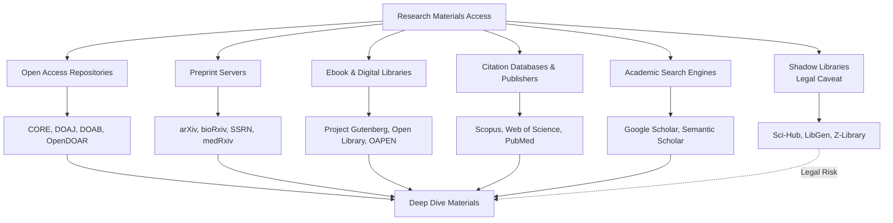

#### Open Access Repositories

Open access repositories are the first and most ethical point of contact for free, legal access to scholarly literature.

| Repository | What It Contains | Scale | Access URL |
|------------|------------------|-------|------------|
| **CORE** | The world's largest collection of open access research papers | Aggregates from thousands of repositories | core.ac.uk |
| **DOAJ** (Directory of Open Access Journals) | Peer-reviewed open access journals | Over 7,000 OA titles | doaj.org |
| **DOAB** (Directory of Open Access Books) | Academic peer-reviewed books | Over 36,000 books from 600+ publishers | doabooks.org |
| **OpenDOAR** | Global directory of academic open access repositories | Authoritative directory | jisc.ac.uk/opendoar |
| **Open Access Library** | Free academic articles | Over 5 million articles | oalib.com |
| **Zenodo** | General-purpose open repository | Papers, datasets, software | zenodo.org |

#### Preprint Servers

Preprints are complete drafts of scientific documents that have not yet been certified by peer review. They enable rapid dissemination and are increasingly indexed by major databases.

| Server | Discipline | Notable Features |
|--------|------------|------------------|
| **arXiv** | Physics, Mathematics, Computer Science, Quantitative Biology, Statistics, Economics | The original preprint server; over 1.5 million preprints |
| **bioRxiv** | Biological Sciences | Launched 2013; widely used in life sciences |
| **medRxiv** | Health Sciences | Launched 2019; clinical research preprints |
| **SSRN** | Social Sciences, Economics, Law, Humanities | Multidisciplinary; owned by Elsevier |
| **ChemRxiv** | Chemistry | Free online archive for chemistry preprints |
| **PsyArXiv** | Psychological Sciences | Psychology-focused preprints |
| **SocArXiv** | Social Sciences | Open archive for social science research |
| **OSF Preprints** | Multidisciplinary aggregator | Includes preprints from 30+ servers |

**How to search preprints in PubMed:** Follow your search terms with `AND preprint[pt]`. Example: `herceptin AND preprint[pt]`.

**How to search preprints in Scopus:** Conduct a topic search, then select the **Preprints tab** from the results page.

#### Ebook and Digital Libraries

| Platform | What It Offers | Scale | Access URL |
|----------|----------------|-------|------------|
| **Project Gutenberg** | Free ebooks of world literature; focus on works with expired U.S. copyright | Over 60,000–75,000 ebooks | gutenberg.org |
| **Open Library** (Internet Archive) | Borrowable ebooks; aggregates bibliographic metadata from world's leading libraries | Millions of records | openlibrary.org |
| **OAPEN Library** | Freely accessible academic books, mainly in Humanities and Social Sciences | Growing collection | oapen.org |
| **National Academies Press (NAP)** | Reports and ebooks from the US National Academies of Sciences, Engineering, and Medicine | Thousands of titles | nap.edu |
| **Google Books** | Fully searchable digitized books | World's most comprehensive index | books.google.com |
| **Online Books Page** (UPenn) | Listing of free books on the Web | Over 3 million books | onlinebooks.library.upenn.edu |
| **Digital Book Index** | Free downloadable and web-based ebooks | Large index | digitalbookindex.org |

#### Citation Databases and Scientific Publishers

| Database | Coverage | Key Features |
|----------|----------|--------------|
| **Scopus** (Elsevier) | Multidisciplinary; 20,000+ journals from 5,000+ publishers | Largest abstract and citation database; daily updates |
| **Web of Science** (Clarivate) | Multidisciplinary; 9,000+ international journals | Curated; weekly updates; citation analysis |
| **PubMed** | Biomedical literature | 40+ million citations from MEDLINE, life science journals, online books |
| **JSTOR** | Humanities, social sciences, natural sciences | Full-text articles from 2,800+ academic journals |
| **ScienceDirect** (Elsevier) | Scientific, technical, medical | Full-text access to Elsevier journals |
| **SpringerLink** | Multidisciplinary | Books, journals, protocols |
| **IEEE Xplore** | Engineering, computer science | Conference proceedings, standards, journals |
| **Dimensions** | Multidisciplinary | Linked research data, publications, grants, patents |
| **Embase** | Biomedical and pharmacological | Strong European and drug-related coverage |

**Access note:** Most of these require institutional subscriptions. Use your university library portal to access them.

#### Academic Search Engines and AI-Powered Tools

| Tool | Type | Best For |
|------|------|----------|
| **Google Scholar** | Academic search engine | Broad interdisciplinary discovery; citation tracking; "cited by" features |
| **Semantic Scholar** | AI-powered academic search | Understanding paper context; citation intent; influential citations |
| **OpenAlex** | Open catalog of scholarly works | Free, open metadata for 250M+ works |
| **ResearchGate** | Academic social network | 130+ million publications; author Q&A; direct requests to authors |
| **Academia.edu** | Academic sharing platform | Sharing papers; accessing uploaded works |
| **ScienceOpen** | Open access discovery | 69,000+ publications; post-publication review |
| **Elicit** | AI research assistant | Literature review automation; extracting findings from papers |
| **Consensus** | AI search engine | Evidence-based answers to research questions |
| **SciSpace** | AI research tool | Understanding papers; extracting insights |
| **ResearchRabbit** | AI discovery tool | Visualizing paper networks; finding related work |
| **Scite.ai** | Citation analysis | Smart citations; understanding how papers are cited |

**Caution:** General-purpose LLMs like ChatGPT, Gemini, and Claude are unsuitable for systematic searching because they do not provide reproducible, comprehensive, or verifiable search results. Use them for brainstorming, not for literature discovery.

#### Shadow Libraries (Legal Caveat)

Shadow libraries are large, often anonymous databases offering free access to books and academic papers. They operate in a legal grey zone and are subject to ongoing litigation and takedowns.

| Platform | Contents | Status (2026) |
|----------|----------|---------------|
| **Sci-Hub** | Academic papers (by DOI) | Has stopped taking new works due to legal pressure |
| **Library Genesis (LibGen)** | 15M+ books; academic paper search (scimag) | Active; mirrors proliferate |
| **Z-Library** | Books and papers | Active; mirrors and community migration |
| **Anna's Archive** | Aggregates LibGen, Sci-Hub, Z-Library | Domain taken down in early 2026; alternative addresses also removed |

**Important legal and ethical considerations:**

- These platforms host copyrighted materials without authorization.
- Major publishers have filed lawsuits against Anna's Archive and other platforms.
- Courts have ordered service providers to disable access.
- Authors have alleged that shadow library content has been used to train AI models without permission.

**Recommendation:** Prioritize legal open access sources first. If you cannot find a paper through legal means, use interlibrary loan through your university library, or email the author directly—most researchers are happy to share their work.

#### Theses and Dissertations

| Source | Coverage | Access |
|--------|----------|--------|
| **ProQuest Dissertations & Theses (PQDT)** | Graduate dissertations from 1,000+ North American and selected European institutions | Subscription; often available through university libraries |
| **OATD** (Open Access Theses and Dissertations) | Open access theses worldwide | oatd.org |
| **Theses Canada Portal** | 200,000+ full-text Canadian theses and dissertations | Free access |
| **HKU Scholars Hub** | University of Hong Kong electronic theses and dissertations | Open access |
| **EThOS** (British Library) | UK doctoral theses | Some free; some via institutional access |

#### Practical Workflow for Finding Materials

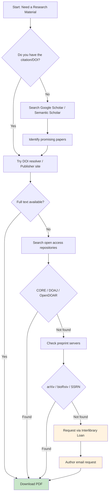

**Step-by-step protocol:**

1. **Start with the DOI.** If you have a DOI (Digital Object Identifier), paste it into a DOI resolver or search for it directly on the publisher's site.

2. **Check open access repositories.** Search **CORE**, **DOAJ**, and **OpenDOAR** for a legal, free version.

3. **Check preprint servers.** Many papers are available as preprints on **arXiv**, **bioRxiv**, **SSRN**, or their disciplinary equivalents.

4. **Use Google Scholar.** Search the title. Look for a **[PDF]** link on the right side of the results. These often point to institutional repositories or author copies.

5. **Use browser extensions.** Install **Unpaywall** (browser extension) to automatically find legal free versions of paywalled papers. **Open Access Button** and **Kopernio** are similar tools.

6. **Request through Interlibrary Loan (ILL).** Your university library can obtain almost any paper through ILL, usually within a few days.

7. **Email the author.** Most corresponding authors are willing to share their work. Look for the corresponding author's email on the paper's abstract page.

8. **Use social media.** The hashtag **#ICanHazPDF** on Twitter/X is a community-driven way to request papers from fellow researchers.

#### Summary: The Best Starting Points

| Need | Best First POC | Second POC |
|------|----------------|------------|
| **Recent journal articles** | CORE (core.ac.uk) | Google Scholar + Unpaywall |
| **Preprints** | arXiv / bioRxiv / SSRN | OSF Preprints |
| **Academic ebooks** | DOAB / OAPEN | Project Gutenberg |
| **Theses/Dissertations** | OATD / ProQuest | Institutional repositories |
| **Biomedical literature** | PubMed | bioRxiv / medRxiv |
| **Systematic review** | Scopus / Web of Science | CORE + DOAJ + preprint servers |
| **Historical texts** | Project Gutenberg | Internet Archive / Open Library |
| **Hard-to-find papers** | Interlibrary Loan | Author email / #ICanHazPDF |

<br>

### 12.3 Integrated Research Workflow

The following diagram illustrates how FOSS tools and research materials can be integrated into a seamless workflow.

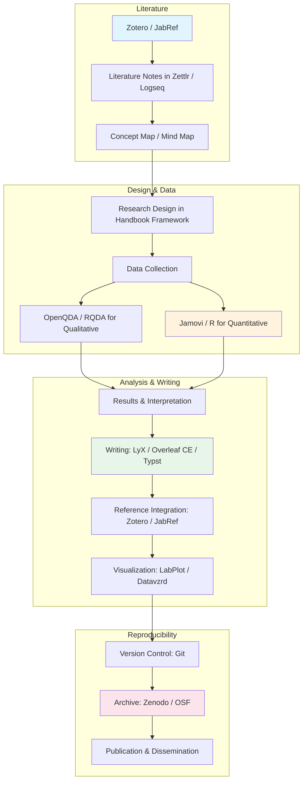

<br>

## Appendices

### Appendix A: Glossary of Key Research Terms

| Term | Definition |
|------|------------|
| **Alternative Hypothesis** | The hypothesis that there is a relationship or difference in the population |
| **Applied Research** | Research conducted to address specific practical problems |
| **Basic Research** | Research conducted to advance knowledge without immediate practical application |
| **Bibliometrics** | Quantitative analysis of publications and citations |
| **Case Study** | In-depth investigation of a single instance or phenomenon in context |
| **Causality** | Relationship where one variable produces an effect on another |
| **Confidence Interval** | Range of values likely to contain the population parameter |
| **Confidentiality** | Protecting participant identity by not disclosing identifying information |
| **Construct Validity** | Extent to which a measure accurately represents the theoretical concept |
| **Content Analysis** | Systematic analysis of textual or visual content |
| **Control Group** | Group that does not receive treatment in an experiment |
| **Convenience Sampling** | Selecting readily available participants |
| **Correlation** | Statistical relationship between variables |
| **Cross-Sectional Design** | Data collected at a single point in time |
| **Data Saturation** | Point in qualitative research where no new themes emerge |
| **Dependent Variable** | Outcome variable; what is measured or observed |
| **Descriptive Statistics** | Statistics that summarize and describe data |
| **Effect Size** | Magnitude of a relationship or difference |
| **Empirical** | Based on observation or experience |
| **Epistemology** | Theory of knowledge; assumptions about how knowledge is acquired |
| **Ethnography** | In-depth study of culture through prolonged engagement |
| **Experimental Research** | Research involving manipulation to establish causality |
| **External Validity** | Extent to which findings generalize to other populations or settings |
| **Focus Group** | Group discussion guided by a moderator |
| **Grounded Theory** | Qualitative approach developing theory from data |
| **Hypothesis** | Testable prediction about relationships between variables |
| **Independent Variable** | Variable that is manipulated or presumed to cause change |
| **Inferential Statistics** | Statistics used to draw conclusions about populations from samples |
| **Informed Consent** | Voluntary agreement to participate after understanding the research |
| **Internal Validity** | Extent to which causal conclusions are warranted |
| **Interview** | Verbal interaction to gather information |
| **Literature Review** | Critical synthesis of existing research |
| **Longitudinal Design** | Data collected at multiple points over time |
| **Mean** | Arithmetic average |
| **Median** | Middle value in a distribution |
| **Mixed Methods** | Combining quantitative and qualitative approaches |
| **Null Hypothesis** | Hypothesis of no relationship or difference |
| **Observation** | Systematically watching and recording behavior |
| **Ontology** | Assumptions about the nature of reality |
| **p-value** | Probability of obtaining results if null hypothesis is true |
| **Paradigm** | Framework of beliefs guiding inquiry |
| **Population** | Entire group of interest |
| **Positivism** | Paradigm assuming objective reality and value-free inquiry |
| **Power** | Probability of correctly rejecting a false null hypothesis |
| **Qualitative Research** | Research focused on meaning, context, and understanding |
| **Quantitative Research** | Research focused on measurement, numbers, and statistics |
| **Quasi-Experiment** | Experiment without random assignment |
| **Questionnaire** | Written instrument for data collection |
| **Random Assignment** | Assigning participants to conditions by chance |
| **Random Sampling** | Selecting sample elements by chance |
| **Reliability** | Consistency of measurement |
| **Research Design** | Overall plan for conducting research |
| **Sample** | Subset of population studied |
| **Sampling Frame** | List or mechanism for accessing population |
| **Scientometrics** | Quantitative study of science as a system |
| **Secondary Data** | Data collected by others for different purposes |
| **Significance Level (α)** | Threshold for rejecting null hypothesis |
| **Survey** | Systematic collection of standardized data |
| **Theory** | Systematic explanation of phenomena |
| **Triangulation** | Using multiple methods or sources to enhance validity |
| **Type I Error** | Rejecting a true null hypothesis (false positive) |
| **Type II Error** | Failing to reject a false null hypothesis (false negative) |
| **Validity** | Extent to which a study measures what it claims |
| **Variable** | Characteristic that can vary across cases |
| **Webometrics** | Quantitative study of web-based phenomena |

<br>

### Appendix B: Checklist for Ethical Research Approval

**Before Submitting for Ethics Review:**

**Research Design:**
- [ ] Research questions are clearly stated
- [ ] Design is appropriate for questions
- [ ] Risks have been identified and minimized
- [ ] Benefits justify any risks
- [ ] Vulnerable populations are appropriately protected

**Participant Recruitment:**
- [ ] Recruitment materials are prepared and approved
- [ ] Inclusion/exclusion criteria are clear and justified
- [ ] Recruitment procedures are respectful and non-coercive
- [ ] Sample size is justified

**Informed Consent:**
- [ ] Consent form includes all required elements
  - [ ] Purpose of research
  - [ ] Procedures involved
  - [ ] Potential risks and benefits
  - [ ] Confidentiality protections
  - [ ] Voluntary participation and right to withdraw
  - [ ] Contact information
- [ ] Language is appropriate for population
- [ ] Process for obtaining consent is described
- [ ] Special procedures for vulnerable populations

**Confidentiality and Privacy:**
- [ ] Data collection minimizes identifying information
- [ ] Data storage procedures are secure
- [ ] Access to data is limited to research team
- [ ] Plans for data sharing or destruction are specified
- [ ] Limits to confidentiality are disclosed

**Data Collection:**
- [ ] Instruments are finalized
- [ ] Procedures minimize participant burden
- [ ] Sensitive topics are handled appropriately
- [ ] Debriefing procedures are planned

**Researcher Qualifications:**
- [ ] Research team has appropriate training
- [ ] Supervision is arranged for student research
- [ ] Cultural competence is addressed

**Institutional Requirements:**
- [ ] Required training is complete (e.g., CITI certification)
- [ ] All required forms are completed
- [ ] Departmental approvals are obtained
- [ ] Funding sources are disclosed

### Appendix C: Sample Research Proposal Outline

**Title Page**
- Title of proposed research
- Researcher name and affiliation
- Date
- For whom proposal is prepared

**Abstract**
- Brief overview (150-250 words)
- Research problem, methods, significance

**Introduction**
- Background and context
- Research problem
- Significance of the study
- Research questions or hypotheses
- Definition of key terms

**Literature Review**
- Review of relevant theoretical and empirical literature
- Identification of gaps this study addresses
- Conceptual or theoretical framework

**Methodology**
- Research design and rationale
- Population and sample
- Sampling procedures
- Data collection methods and instruments
- Procedures for data collection
- Data analysis plan
- Strategies for ensuring quality (validity, reliability, trustworthiness)

**Ethical Considerations**
- Potential risks and benefits
- Informed consent procedures
- Confidentiality protections
- Data security
- Institutional approvals

**Timeline**
- Major activities and completion dates
- Gantt chart or table format

**Budget** (if applicable)
- Personnel costs
- Equipment and supplies
- Participant payments
- Travel
- Other expenses
- Total requested

**References**
- Complete citations for all sources cited

**Appendices**
- Instruments (questionnaires, interview guides)
- Consent forms
- Recruitment materials
- Approval letters (if any)

<br>

### Appendix D: Recommended Readings and Resources

**Research Fundamentals**

Booth, A., Sutton, A., & Papaioannou, D. (2016). *Systematic approaches to a successful literature review* (2nd ed.). Sage.

Creswell, J. W., & Creswell, J. D. (2018). *Research design: Qualitative, quantitative, and mixed methods approaches* (5th ed.). Sage.

Kumar, R. (2019). *Research methodology: A step-by-step guide for beginners* (5th ed.). Sage.

**Philosophical Foundations**

Crotty, M. (1998). *The foundations of social research: Meaning and perspective in the research process*. Sage.

Guba, E. G., & Lincoln, Y. S. (1994). Competing paradigms in qualitative research. In N. K. Denzin & Y. S. Lincoln (Eds.), *Handbook of qualitative research* (pp. 105-117). Sage.

**LIS Research Methods**

Connaway, L. S., & Radford, M. L. (2021). *Research methods in library and information science* (7th ed.). Libraries Unlimited.

Pickard, A. J. (2013). *Research methods in information* (2nd ed.). Facet Publishing.

Wildemuth, B. M. (2017). *Applications of social research methods to questions in information and library science* (2nd ed.). Libraries Unlimited.

**Qualitative Methods**

Merriam, S. B., & Tisdell, E. J. (2016). *Qualitative research: A guide to design and implementation* (4th ed.). Jossey-Bass.

Saldana, J. (2021). *The coding manual for qualitative researchers* (4th ed.). Sage.

**Quantitative Methods and Statistics**

Field, A. (2018). *Discovering statistics using IBM SPSS Statistics* (5th ed.). Sage.

Pallant, J. (2020). *SPSS survival manual* (7th ed.). Open University Press.

**Informetrics**

De Bellis, N. (2009). *Bibliometrics and citation analysis: From the Science Citation Index to cybermetrics*. Scarecrow Press.

Mingers, J., & Leydesdorff, L. (2015). A review of theory and practice in scientometrics. *European Journal of Operational Research*, 246(1), 1-19.

**Academic Writing**

Swales, J. M., & Feak, C. B. (2012). *Academic writing for graduate students: Essential tasks and skills* (3rd ed.). University of Michigan Press.

**Ethics**

Israel, M., & Hay, I. (2006). *Research ethics for social scientists*. Sage.

Resnik, D. B. (2020). What is ethics in research and why is it important? National Institute of Environmental Health Sciences.

**Key Journals**

- Journal of the Association for Information Science and Technology (JASIST)
- Library and Information Science Research
- Journal of Documentation
- Scientometrics
- College and Research Libraries
- Information Research
- Journal of Academic Librarianship

**Professional Organizations**

- Association for Information Science and Technology (ASIS&T)
- American Library Association (ALA) Library Research Round Table
- Association of College and Research Libraries (ACRL)
- International Society for Scientometrics and Informetrics (ISSI)

<br>

## Conclusion: The Enduring Value of Rigorous Practice

Credible research rests on clear questions, methods aligned with philosophical assumptions, ethical conduct, transparent reporting, and honest interpretation. Technologies and topics will continue to change; these fundamentals do not.

This handbook has articulated a framework for next-generation scholarship that is both timeless and urgently relevant. By championing a research process consciously grounded in philosophical clarity and methodological rigor, we empower scholars to produce work that is reliable, reproducible, and profoundly meaningful.

The principles articulated across these pages represent the accumulated wisdom of generations of researchers who have refined the craft of systematic inquiry. While technologies evolve and research contexts shift, the fundamental requirements of credible scholarship remain constant.

Apply the principles in this handbook deliberately. Begin with one or two techniques, reflect on what works, and gradually build a personal system. The goal is not complexity for its own sake but clarity, accuracy, and genuine contribution to knowledge—work that others can understand, evaluate, and extend.

<br>

**Final Thought**

A strong research paper is:

- Focused on a clear problem
- Grounded in existing knowledge
- Rigorous in its methods
- Transparent in its reporting
- Honest about its limitations
- Clear in its contribution

Good research writing is not about demonstrating how much you know. It is about communicating what you have discovered in a way that others can understand, evaluate, and build upon. Clarity, accuracy, and contribution—these are the hallmarks of research excellence.

<br>

**Remember the core formula:**

> "This paper investigates ______ to solve ______ using ______ and demonstrates that ______."

If you cannot complete this sentence clearly and confidently, refine your focus before proceeding further.

The path to research mastery is iterative and personal. Begin by integrating one or two new techniques from this guide into your current workflow. Reflect on what works for you, adapt accordingly, and gradually build your personalized system for scholarly excellence. In doing so, you will not only produce better research but also cultivate the most valuable meta-skill of all: learning how to learn, investigate, and contribute effectively—a capability that will serve you throughout your academic and professional career.


<br><br><br><br>

<br><br><br><br>

<h1 align="center">DEMOCRATIZING INNOVATION</h1>
 
<br><br>
 

### Table of Contents

1.  **Introduction:** The Convergence of Two Transformative Forces
2.  **Part I: The Foundational Framework - Principles Beyond Code**
    - From Software to Society: The Core Tenets of Open Source
    - The Ethical and Legal Scaffold: OSI Criteria and Open Science
3.  **Part II: The Transformative Impact Across Domains**
    - **A. Scientific Research:** Open Science and the Empowerment of Global Citizens
    - **B. Engineering Innovation:** Open Hardware and the Rise of Participatory Co-Design
    - **C. Technological Advancement:** Open-Source AI and the Governance of Digital Futures
    - **D. The Digital Backbone:** FOSS as the Engine of Secure Infrastructure and Societal Resilience
4.  **Part III: Navigating the Challenges - A Strategic Framework for Sustainability**
    - The Sustainability Paradox: Funding and Maintaining the Digital Commons
    - Governance and Compliance: Ensuring Integrity in an Open World
    - Ethical Boundaries: Mitigating Risks in Democratized Technology
5.  **Conclusion:** The Open Imperative - Forging a Collaborative and Secure Future
6.  **A Roadmap for Action:** Strategic Imperatives for Stakeholders

<br>

### 1. Introduction: The Convergence of Two Transformative Forces

The open-source philosophy has evolved from a niche software development methodology into one of the most powerful and transformative paradigms of the 21st century. Initially rooted in the collaborative creation of code, its core tenets—radical transparency, collaborative ownership, and universal accessibility—have proven to be universally applicable. Today, this philosophy is fundamentally reshaping the processes of knowledge creation and dissemination across scientific discovery, engineering design, and technological advancement. This document serves as a comprehensive analysis of this paradigm shift, integrating two critical dimensions of the open-source movement.

First, we explore how the **democratization of innovation** is dismantling traditional barriers to entry, such as proprietary monopolies and expensive paywalls, empowering a global community of contributors to participate in research and development. Second, we examine the indispensable role of **Free and Open Source Software (FOSS)** as the bedrock of secure digital infrastructure and a catalyst for democratic societal transformation. By weaving these two concepts together, we reveal a unified truth: open-source is not merely a technical methodology but a foundational principle for building a more resilient, equitable, and innovative future. It is a practical imperative for navigating the complex challenges of the modern era, from cybersecurity threats to the ethical governance of artificial intelligence.

<br>

### 2. Part I: The Foundational Framework - Principles Beyond Code

#### From Software to Society: The Core Tenets of Open Source

At its heart, the open-source philosophy is a fundamental reorientation of how we perceive knowledge and creation. It challenges the long-held notion that innovation is a commodity to be owned, siloed, and sold. Instead, it posits that knowledge is a shared human commons, and that collective, transparent collaboration can yield results superior to those achieved in isolation. This ethos is built on a foundation of key principles that have proven their value far beyond the realm of software.

| **Principle** | **Description** | **Societal Impact** |
| :--- | :--- | :--- |
| **Radical Transparency** | The full "source code"—whether for software, a scientific method, or a hardware design—is openly available for inspection. | Builds trust, enables independent verification, and allows for the identification and correction of errors or biases by a global community. |
| **Collaborative Ownership** | No single entity holds exclusive control. The work is a shared asset, developed and stewarded by a community of contributors. | Distributes power away from traditional gatekeepers, fosters a sense of shared responsibility, and accelerates iteration through diverse input. |
| **Universal Accessibility** | The work is freely available for anyone to use, study, modify, and share for any purpose. | Dismantles economic and geographic barriers to participation, empowers marginalized communities, and ensures that critical tools remain public goods. |
| **Iterative Improvement** | Progress is achieved through continuous cycles of feedback, modification, and enhancement by a distributed network of peers. | Creates a powerful engine for rapid evolution, resilience, and adaptation, often outpacing the linear development models of proprietary systems. |

#### The Ethical and Legal Scaffold: OSI Criteria and Open Science

These abstract principles are operationalized through a robust ethical and legal framework. The Open Source Initiative's (OSI) ten criteria provide the definitive standard for open-source licenses, mandating free redistribution, unfettered access to source code, and non-discriminatory practices. This ensures that collaborative efforts remain true to the core ethos. Iconic projects like the Linux kernel and the Apache HTTP Server are living proof that this model can produce technology of unparalleled scalability, security, and reliability.

Crucially, this framework has inspired similar movements across disciplines. UNESCO's 2023 Recommendation on Open Science is a landmark global policy that applies these same principles to the entire research lifecycle. It mandates open access to publications and data, advocates for open research infrastructure, and importantly, recognizes the value of integrating diverse knowledge systems, including indigenous and local knowledge. This demonstrates a global consensus that the future of research—and by extension, the future of societal progress—must be built on a foundation of openness and collaboration.

<br>

### 3. Part II: The Transformative Impact Across Domains

#### A. Scientific Research: Open Science and the Empowerment of Global Citizens

Scientific inquiry, once largely confined to well-funded institutions and hidden behind expensive journal paywalls, is undergoing a profound transformation. Open Science is democratizing the entire research process, from data collection to peer review.

- **Open Access and Open Data as Public Goods:** The shift towards open access is no longer just an academic preference but an essential public good. During the COVID-19 pandemic, for instance, the rapid sharing of the viral genome on open platforms like **GenBank** and the proliferation of preprints on servers like **arXiv** and **bioRxiv** accelerated vaccine development at an unprecedented pace. This model empowers researchers in under-resourced institutions and developing nations to not only access the latest findings but also to actively contribute data, analyses, and critiques, enriching the global scientific discourse.
- **Citizen Science and Public Engagement:** Large-scale citizen science projects like **Zooniverse** exemplify the power of radical inclusivity. By engaging millions of volunteers worldwide in tasks like classifying galaxies or transcribing historical documents, these initiatives merge broad public participation with rigorous academic methodology. This not only scales research capacity but also enhances public trust in science by making the process more transparent and accessible.
- **Enhancing Reproducibility and Reducing Bias:** The inherent transparency of open science is a powerful antidote to the reproducibility crisis that has plagued several scientific fields. When data and methodologies are openly available, they can be independently scrutinized and validated. As emphasized by institutions like the World Bank, this collective scrutiny helps identify and mitigate methodological biases and systemic errors, leading to more robust and trustworthy research outcomes. The challenge remains to develop robust validation protocols for non-expert contributions and to bridge the digital divide, ensuring equitable access to the necessary cyberinfrastructure for all.

#### B. Engineering Innovation: Open Hardware and the Rise of Participatory Co-Design

The democratizing wave has also swept through engineering, where the open-hardware movement is revolutionizing prototyping, manufacturing, and problem-solving by treating physical designs as shareable code.

- **Democratizing Design and Manufacturing:** Open-source process design kits (PDKs), pioneered by institutions like the University of Michigan, are a prime example. They empower startups and academic labs to design sophisticated integrated circuits without the multi-million-dollar investments required for proprietary Electronic Design Automation (EDA) tools. This lowers the barrier to entry for hardware innovation, fostering a new wave of entrepreneurship and research.
- **Community-Driven Solutions for Local Challenges:** Collaborative platforms and communities are now tackling diverse engineering challenges through open sharing. Projects range from developing low-cost, 3D-printed prosthetics like the **Open Bionics** initiative to creating open-source, solar-powered environmental sensors for community-led pollution monitoring. The **OpenFlexure Microscope**, a 3D-printed, high-resolution microscope, demonstrates how open designs can reduce costs by orders of magnitude and accelerate lab innovation, especially in low-resource settings.
- **The Power and Complexity of Co-Design:** This participatory approach, often called co-design, involves end-user communities directly in the engineering process. While it yields solutions of unparalleled local relevance—such as water purification systems tailored for a specific rural environment—it also requires careful navigation. Engineers must balance technical feasibility and cost constraints with diverse stakeholder input. This process, while resource-intensive, ensures that the resulting technology is not only functional but also adopted and sustained by the community it was designed to serve.

#### C. Technological Advancement: Open-Source AI and the Governance of Digital Futures

In the rapidly evolving field of artificial intelligence, the open-source philosophy presents both a powerful accelerator of innovation and a source of significant ethical and security challenges.

- **Accelerating Innovation and Challenging Monopolies:** The release of powerful open-source AI models like Meta's **Llama 2** and **DeepSeek's R1** has democratized access to cutting-edge AI. Startups and researchers in places like Tulsa, Oklahoma, can now build novel, affordable applications, such as AI-driven job-matching platforms, without relying on expensive proprietary APIs from a few dominant tech giants. Frameworks like **TensorFlow** and **PyTorch** have become the ubiquitous building blocks of the AI world, fostering a global community of developers and researchers.
- **The Dual-Use Dilemma and the Need for Safeguards:** However, as highlighted by policy institutes like Chatham House, the accessibility of powerful AI models raises legitimate concerns. The same technology that can be used to accelerate drug discovery can also be misused to generate sophisticated disinformation, develop autonomous weapons, or power unethical surveillance systems. This dual-use dilemma necessitates proactive, community-driven safeguards.
- **Community-Driven Governance and Ethical Frameworks:** The open-source community is actively developing these safeguards. Initiatives include:
    - **Federated Learning:** Architectures that allow models to be trained on decentralized data without compromising privacy.
    - **Ethical-Use Licenses:** Licenses like the Responsible AI License (RAIL) that explicitly prohibit specific harmful use cases.
    - **Robust Provenance Tracking:** Tools and standards to track the lineage and modifications of AI models, ensuring transparency and accountability.
- **Decentralized Governance of Technology:** Beyond AI, decentralized governance platforms like Barcelona's **Decidim** demonstrate how open-source principles can reshape civic participation. By using blockchain-backed transparency, these platforms allow citizens to propose, debate, and vote on urban policies, redistributing authority from centralized bodies to the community. This represents a powerful application of technological democracy, though it underscores the critical need for interoperable standards to prevent ecosystem fragmentation and ensure accountability.

#### D. The Digital Backbone: FOSS as the Engine of Secure Infrastructure and Societal Resilience

Free and Open Source Software (FOSS) is not just a development model; it is the indispensable engine powering the modern digital world and a cornerstone of democratic societal transformation. Its principles of transparency and collaborative security provide the only scalable framework for addressing today's escalating cyber threats.

- **Security Through Collective Vigilance:** The security model of FOSS is fundamentally different from that of proprietary software.
    - **Auditable Code:** The global community of expert developers can scrutinize the source code of a critical library like **OpenSSL**, leading to the rapid identification and patching of vulnerabilities like the infamous **Heartbleed bug**. In a proprietary model, such flaws could remain hidden and exploitable for years.
    - **Trust Minimization:** Transparency eliminates hidden attack surfaces and potential backdoors. Privacy-critical tools like the **Signal** messaging protocol and **VeraCrypt** encryption software leverage this transparency to provide users with verifiable security guarantees, not just corporate promises.
    - **Supply Chain Integrity:** The ability to generate and verify a Software Bill of Materials (SBOM) is inherent in the FOSS model. This is a critical factor in securing complex software supply chains, allowing organizations to know exactly what components are in their software and to quickly assess their vulnerability to newly discovered threats.
- **Economic and Societal Empowerment:**
    - **Cost Efficiency and Access:** FOSS eliminates prohibitive license fees, saving governments, businesses, and individuals billions of dollars annually. **LibreOffice**, **WordPress** (powering over 40% of the web), and the professional-grade VFX tool **Blender** are prime examples of how FOSS removes financial barriers and levels the playing field.
    - **Digital Sovereignty:** Nations are increasingly turning to FOSS to reduce dependence on foreign technology vendors and secure their critical infrastructure. France's migration to LibreOffice, saving an estimated €400 million annually, and India's use of FOSS in its massive **Aadhaar** digital identity system are powerful examples of this trend.
    - **Guardian of Digital Rights:** FOSS tools are essential for protecting fundamental freedoms in the digital age. The **Tor Project** enables private communication and circumvention of censorship for users under repressive regimes. Federated social media platforms like **Mastodon** offer a viable, user-centric alternative to corporate-controlled networks, giving control back to the users and communities.
- **Localized Impact and Glocalization:** FOSS enables the creation of context-specific solutions that address unique local challenges. The **Raspberry Pi**, combined with FOSS educational tools, has democratized STEM education in tens of thousands of schools worldwide. **OpenMRS**, an open-source medical records system, is tailored for and successfully deployed in over 80% of low-infrastructure clinics globally, proving that globally developed software can be locally adapted to meet critical needs.

<br>

### 4. Part III: Navigating the Challenges - A Strategic Framework for Sustainability

The immense promise of the open-source ecosystem is not without its challenges. Addressing these requires a concerted, strategic effort from all stakeholders.

#### The Sustainability Paradox: Funding and Maintaining the Digital Commons

The very foundation of the internet and modern computing rests on a vast pyramid of FOSS projects, many of which are maintained by a small group of overworked, underfunded volunteers. This is a critical vulnerability.

| **Challenge** | **Mitigation Framework** |
| :--- | :--- |
| **Critical Project Underfunding:** Projects like OpenSSL and Log4j, which are single points of failure for the entire internet, often lack sustainable funding. | **Tiered Funding Models:** Implement structured funding initiatives like the OpenSSF's **Alpha-Omega** project, which prioritizes funding for projects with the highest dependency impact. |
| **Burnout and Unreliable Maintenance:** Reliance on volunteer labor creates risks of project abandonment and slow response to critical security flaws. | **Corporate and Government Allocation Mandates:** Enterprises and governments should allocate a minimum percentage (e.g., 5%) of their IT/security budgets to directly fund the maintenance and security of the critical FOSS projects they depend on. |
| **Inadequate Resource Allocation:** Funding is often concentrated on popular, user-facing projects, while the underlying infrastructure libraries remain neglected. | **SBOM-Driven Risk Prioritization:** Use dependency mapping tools to identify critical but often-overlooked underlying components and direct funding to them. |

#### Governance and Compliance: Ensuring Integrity in an Open World

The openness that makes FOSS so powerful also creates challenges related to legal compliance and project integrity.

- **License Complexity and Compliance:** The proliferation of different open-source licenses (GPL, MIT, Apache, etc.) can create complex compliance challenges, especially for commercial entities integrating FOSS into their products.
    - **Mitigation:** Employ automated license management tools like **FOSSA** and **Snyk** to proactively track dependencies, ensure compliance, and resolve license conflicts.
- **Malicious Contributions and Supply Chain Attacks:** The collaborative nature of FOSS makes it a potential target for bad actors attempting to inject malicious code into widely used projects.
    - **Mitigation:** Enforce robust contribution integrity measures, including the **Developer Certificate of Origin (DCO)** , mandatory code reviews, and clear `SECURITY.md` policies. Adopting governance frameworks like the **OpenChain ISO/IEC 5230** standard can help organizations establish mature and secure FOSS management practices.
- **Ethical Commercialization and Community Trust:** The "open-core" business model, where a company offers a FOSS core with proprietary extensions, can sometimes lead to conflict if the core is neglected or its features are intentionally degraded to push users toward paid versions—a phenomenon sometimes called "enshittification."
    - **Mitigation:** Maintain community trust by ensuring feature parity between the open-core and proprietary versions. Support patent risk mitigation initiatives like the **Open Invention Network (OIN)** and foster inclusive communities by upholding strict codes of conduct to prevent toxicity and encourage diverse participation.

<br>

### 5. Conclusion: The Open Imperative - Forging a Collaborative and Secure Future

The open-source philosophy has irrevocably transitioned from an ideological movement to an operational and societal necessity. Its core principles of transparency, collaboration, and user freedom provide the only scalable framework capable of addressing the dual challenges of securing an exponentially expanding digital world and ensuring equitable access to transformative technology. By systematically eroding traditional barriers to participation, it amplifies marginalized voices, dramatically accelerates the pace of discovery, and fosters essential trust through uncompromising openness.

The path forward requires deliberate and sustained nurturing of this open ecosystem. The democratization of innovation, championed by the open-source ethos, powerfully affirms that collaboration, not isolationist competition, is the true cornerstone of enduring human advancement. By empowering every potential contributor—irrespective of geography, institutional affiliation, or economic resources—to enrich the collective tapestry of knowledge, we collectively forge a more resilient, equitable, and innovative future. This collaborative stewardship is not merely an ideal; it is the practical imperative for navigating the complex challenges and opportunities of the 21st century.

### 6. A Roadmap for Action: Strategic Imperatives for Stakeholders

To secure this indispensable engine of progress, concerted action is required from all stakeholders.

- **For Governments and Policymakers:**
    - **Mandate FOSS in Critical Systems:** Prioritize FOSS in public procurement for national infrastructure, healthcare, and public services to ensure security, transparency, and digital sovereignty.
    - **Integrate SBOMs into Regulation:** Mandate the use and verification of Software Bills of Materials (SBOMs) across the software supply chain.
    - **Fund the Digital Commons:** Establish grant programs and public-private partnerships to provide sustainable funding for critical FOSS infrastructure projects.

- **For Enterprises and Corporations:**
    - **Invest Strategically in FOSS:** Allocate a percentage of IT and security budgets to directly fund the projects you depend on, through foundations like the Linux Foundation or platforms like Open Collective.
    - **Engage as Ethical Stewards:** Contribute code, participate in security initiatives (e.g., OSS-Fuzz), and ensure your use of FOSS is compliant with its licenses.
    - **Adopt Standardized Security Practices:** Implement frameworks like OpenChain to mature your internal FOSS governance and compliance processes.

- **For Researchers and Academics:**
    - **Embed Open Science Principles:** Make publications, data, and methodologies openly accessible by default.
    - **Engage with Citizen Science:** Develop projects that leverage public participation while maintaining rigorous scientific integrity.
    - **Contribute to Open Frameworks:** Actively contribute to open-source tools, datasets, and models in your field to accelerate collective progress.

- **For Individual Developers and Users:**
    - **Contribute and Give Back:** Report bugs, contribute code, improve documentation, or financially support the FOSS projects you use and love.
    - **Advocate for Openness:** Choose FOSS alternatives when possible, and champion the principles of transparency and digital rights in your community.

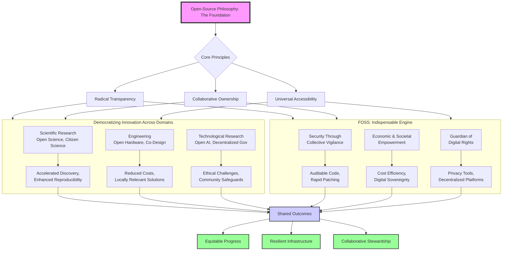
 
<br><br><br><br>

<h1 align="center">RESEARCH & EDUCATION RESOURCE ATLAS</h1>

 
<br><br>
 
 
> **Scope:** Research materials access; educational streams; engineering education pathways; engineering R&D; open-access R&D; India-specific infrastructure; registry schema; recommended starting collection.   

> **note:** This atlas is a curated starting catalog, not a guarantee that every link, dataset, credential, or resource is currently available, free, accredited, or suitable for every learner. Verify current availability, licensing, recognition, and regulatory status at the official source before operational use.

<br>

## 1. Research Materials Access

### 1.1 Open Access Repositories

| Resource | Type | Best For | URL | Access/License Note |
|---|---|---|---|---|
| CORE | Aggregator | World’s largest collection of open access research papers | https://core.ac.uk/ | Open access; check individual item licenses |
| DOAJ | Directory | Peer-reviewed open access journals | https://doaj.org/ | Open access journals; verify journal status |
| DOAB | Directory | Academic peer-reviewed open access books | https://www.doabooks.org/ | Open access books; item-level licenses vary |
| OpenDOAR | Directory | Global directory of academic open access repositories | https://opendoar.ac.uk/ | Directory only; repository policies vary |
| Open Access Library | Repository | Free academic articles | https://www.oalib.com/ | Open access; verify quality and license |
| Zenodo | General repository | Papers, datasets, software | https://zenodo.org/ | Open repository; DOI assignment; licenses vary |

### 1.2 Preprint Servers

| Server | Discipline | Notable Features | URL |
|---|---|---|---|
| arXiv | Physics, Mathematics, Computer Science, Quantitative Biology, Statistics, Economics | Original preprint server; over 1.5 million preprints | https://arxiv.org/ |
| bioRxiv | Biological Sciences | Life sciences preprints | https://www.biorxiv.org/ |
| medRxiv | Health Sciences | Clinical research preprints | https://www.medrxiv.org/ |
| SSRN | Social Sciences, Economics, Law, Humanities | Multidisciplinary; owned by Elsevier | https://www.ssrn.com/ |
| ChemRxiv | Chemistry | Chemistry preprints | https://chemrxiv.org/ |
| PsyArXiv | Psychological Sciences | Psychology-focused preprints | https://osf.io/preprints/psyarxiv |
| SocArXiv | Social Sciences | Open archive for social science research | https://osf.io/preprints/socarxiv |
| OSF Preprints | Multidisciplinary aggregator | Includes preprints from 30+ servers | https://osf.io/preprints/ |

**Search notes:**

| Database | Preprint Search Method |
|---|---|
| PubMed | Add `AND preprint[pt]` to search terms. Example: `herceptin AND preprint[pt]` |
| Scopus | Topic search → select **Preprints** tab. Covers arXiv, ChemRxiv, bioRxiv, medRxiv, SSRN, TechRxiv, Research Square (2017–present) |

### 1.3 Ebooks and Digital Libraries

| Platform | Offers | Scale/Notes | URL |
|---|---|---|---|
| Project Gutenberg | Free ebooks of world literature; expired U.S. copyright works | 60,000–75,000 ebooks | https://www.gutenberg.org/ |
| Open Library | Borrowable ebooks; bibliographic metadata | Millions of records | https://openlibrary.org/ |
| OAPEN Library | Freely accessible academic books; Humanities and Social Sciences | Growing collection | https://www.oapen.org/ |
| National Academies Press | Reports and ebooks from U.S. National Academies | Thousands of titles | https://nap.edu/ |
| Google Books | Fully searchable digitized books | Comprehensive index | https://books.google.com/ |
| Online Books Page | Listing of free books on the Web | Over 3 million books | https://onlinebooks.library.upenn.edu/ |
| Digital Book Index | Free downloadable and web-based ebooks | Large index | http://www.digitalbookindex.org/ |

### 1.4 Citation Databases and Scientific Publishers

| Database | Coverage | Key Features | Access |
|---|---|---|---|
| Scopus | Multidisciplinary; 20,000+ journals | Largest abstract and citation database; daily updates | Subscription |
| Web of Science | Multidisciplinary; 9,000+ journals | Curated; weekly updates; citation analysis | Subscription |
| PubMed | Biomedical literature | 40+ million citations from MEDLINE, life science journals, online books | Free search; full text varies |
| JSTOR | Humanities, social sciences, natural sciences | Full-text articles from 2,800+ journals | Subscription |
| ScienceDirect | Scientific, technical, medical | Elsevier journals | Subscription |
| SpringerLink | Multidisciplinary | Books, journals, protocols | Subscription |
| IEEE Xplore | Engineering, computer science | Conference proceedings, standards, journals | Subscription/mixed |
| Dimensions | Multidisciplinary | Linked research data, publications, grants, patents | Mixed |
| Embase | Biomedical and pharmacological | Strong European and drug-related coverage | Subscription |

### 1.5 Academic Search Engines and AI-Powered Tools

| Tool | Type | Best For | URL | Caution |
|---|---|---|---|---|
| Google Scholar | Academic search engine | Broad interdisciplinary discovery; citation tracking | https://scholar.google.com/ | Includes non-peer-reviewed content |
| Semantic Scholar | AI-powered search | Paper context; citation intent; influential citations | https://www.semanticscholar.org/ | Verify results |
| OpenAlex | Open catalog | Free metadata for 250M+ works | https://openalex.org/ | Metadata may be incomplete |
| ResearchGate | Academic social network | 130+ million publications; author Q&A | https://www.researchgate.net/ | Not a primary database |
| Academia.edu | Academic sharing platform | Sharing papers; uploaded works | https://www.academia.edu/ | Not a systematic search tool |
| ScienceOpen | Open access discovery | 69,000+ publications; post-publication review | https://www.scienceopen.com/ | Verify coverage |
| Elicit | AI research assistant | Literature review automation | https://elicit.com/ | Not reproducible for systematic reviews |
| Consensus | AI search engine | Evidence-based answers | https://consensus.app/ | Not a substitute for database search |
| SciSpace | AI research tool | Understanding papers; extracting insights | https://scispace.com/ | Verify extracted content |
| ResearchRabbit | AI discovery tool | Visualizing paper networks | https://www.researchrabbit.ai/ | Discovery aid only |
| Scite.ai | Citation analysis | Smart citations; how papers are cited | https://scite.ai/ | Subscription/mixed |

**Caution:** General-purpose LLMs such as ChatGPT, Gemini, and Claude are unsuitable for systematic searching because they do not provide reproducible, comprehensive, or verifiable search results. Use them for brainstorming, not literature discovery.

### 1.6 Shadow Libraries — Legal Caveat

| Platform | Contents | Status (2026) | Legal Note |
|---|---|---|---|
| Sci-Hub | Academic papers by DOI | Has stopped taking new works due to legal pressure | Hosts copyrighted materials without authorization |
| Library Genesis (LibGen) | 15M+ books; academic paper search | Active; mirrors proliferate | Legal grey zone |
| Z-Library | Books and papers | Active; mirrors and community migration | Legal grey zone |
| Anna’s Archive | Aggregates LibGen, Sci-Hub, Z-Library | Domain taken down in early 2026; alternative addresses also removed | Major publisher lawsuits |

**Recommendation:** Prioritize legal open access sources. If unavailable, use interlibrary loan, author email, or `#ICanHazPDF`.

### 1.7 Theses and Dissertations

| Source | Coverage | Access | URL |
|---|---|---|---|
| ProQuest Dissertations & Theses | Graduate dissertations from 1,000+ institutions | Subscription; often via university library | https://www.proquest.com/pqdtglobal |
| OATD | Open access theses worldwide | Free | https://oatd.org/ |
| Theses Canada Portal | 200,000+ Canadian theses | Free | https://library-archives.canada.ca/eng/services/services-libraries/theses/Pages/theses-canada.aspx |
| HKU Scholars Hub | University of Hong Kong theses | Open access | https://hub.hku.hk/ |
| EThOS | UK doctoral theses | Some free; some institutional access | https://ethos.bl.uk/ |

### 1.8 Practical Workflow for Finding Materials

| Step | Action | Tool/Check |
|---|---|---|
| 1 | Start with DOI | DOI resolver / publisher site |
| 2 | Check open access repositories | CORE, DOAJ, OpenDOAR |
| 3 | Check preprint servers | arXiv, bioRxiv, SSRN, disciplinary equivalents |
| 4 | Use Google Scholar | Look for `[PDF]` link |
| 5 | Use browser extensions | Unpaywall, Open Access Button, Kopernio |
| 6 | Request through Interlibrary Loan | University library |
| 7 | Email the author | Corresponding author email |
| 8 | Use social media | `#ICanHazPDF` on Twitter/X |

<br>

## 2. Educational Streams and Core Specializations

| Educational Stream | Key Specializations and Courses | Primary Resource Anchors |
|---|---|---|
| Science | PCM, PCB, PCMB; Computer Science; Biotechnology; Environmental Science; Data Science & AI; Nanotechnology; Oceanography; Forensic Science | NCERT, NPTEL, MIT OCW, NCBI, NASA Earthdata, Kaggle |
| Commerce | Accountancy & Business Studies; Economics; Mathematics; Informatics Practices; Banking & Finance; E-Commerce; Entrepreneurship; Marketing; Taxation & Auditing | AccountingCoach, IFRS, CORE Econ, RBI, SEBI, ICAI |
| Arts & Humanities | History; Political Science; Sociology; Psychology; Economics; Anthropology; Philosophy; Mass Communication & Journalism; International Relations; Cultural & Gender Studies | Library of Congress, JSTOR, APA, Stanford Encyclopedia of Philosophy, UN Women |
| Vocational & Technical | Engineering Drawing; Web & Multimedia Design; Fashion & Interior Designing; Hotel & Event Management; Automotive Engineering; Renewable Energy Tech; Cybersecurity & Ethical Hacking | FreeCAD, MDN Web Docs, Blender, DGT, NCVET, OWASP |
| Diploma | Polytechnic Engineering; Hotel Management; Fashion Designing; Animation & Multimedia; Digital Marketing; Culinary & Hospitality; Graphic Design; Early Childhood Education | AICTE, NCHMCT, NIFT, Google Skillshop, UNICEF |
| Agriculture & Allied | Agricultural Engineering; Horticulture; Forestry; Animal Husbandry; Dairy Tech; Agronomy; Aquaculture; Organic Farming | ICAR, FAO, CGIAR, NDRI, IFOAM |
| Fine Arts & Design | Applied & Visual Arts; Performing Arts; Photography & Videography; Graphic & Industrial Design; Animation & Game Design | NGMA, Sangeet Natak Akademi, IGNCA, Blender, Godot |
| Home Science | Nutrition & Dietetics; Food Technology; Textile & Apparel Design; Human Development; Resource Management | ICMR, WHO Nutrition, USDA FoodData Central, FSSAI, NIFT |
| ITI (Skilled Trades) | Electrician; Fitter; Welder; Plumber; Machinist; Carpenter; Refrigeration & A/C Tech; Draughtsman | DGT, NCVET, NPTEL, TWI, ASHRAE |
| Law & Governance | Integrated 5-Year Law; Criminology; Corporate & International Law; Public Administration; Human Rights Law | Bar Council of India, MCA, UN Treaty Collection, NHRC, OHCHR |
| Paramedical & Health | Medical Laboratory Tech; Nursing; Radiography; Physiotherapy; Optometry; Emergency Medical Services; Dialysis & Cardiac Care Tech | WHO, Indian Nursing Council, IAEA, World Physiotherapy, NCAHP |
| Physical Education & Sport | Sports Science; Kinesiology; Sports Psychology & Management; Fitness & Wellness; Outdoor Adventure Training | IOC, PubMed, OpenSim, ACSM, SAI |

<br>

## 3. Engineering Education Pathways — Corrected Mapping

**Correction principle:** Do not assume every engineering field has a standalone Bachelor’s and Master’s degree with the same name. Use related master’s/specialist pathways and verify against university catalogs and accreditation directories.

| Engineering Field | Typical Bachelor’s Nomenclature | Related Master’s/Specialist Pathways | Status/Note |
|---|---|---|---|
| Acoustical Engineering | Bachelor of Acoustical Engineering | Acoustics; Architectural Acoustics; Noise and Vibration Engineering | Established in some institutions |
| Actuarial Engineering | Bachelor of Actuarial Engineering | Actuarial Science; Financial Engineering; Risk Engineering | Often interdisciplinary |
| Aerospace Engineering | Bachelor of Aerospace Engineering | Aerospace Engineering; Aeronautical Engineering; Astronautical Engineering | Established |
| Agricultural Engineering | Bachelor of Agricultural Engineering | Agricultural and Biosystems Engineering; Biological Systems Engineering | Established |
| Aeronautical Engineering | Bachelor of Aeronautical Engineering | Aeronautical Engineering; Aerospace Engineering | Established |
| Applied Engineering | Bachelor of Applied Engineering | Applied Engineering; Engineering Management; Interdisciplinary Engineering | Institution-specific |
| Architectural Engineering | Bachelor of Architectural Engineering | Architectural Engineering; Building Engineering; Architectural Sciences | Established |
| Audio Engineering | Bachelor of Audio Engineering | Audio Engineering; Acoustics; Audio Technology | Specialized |
| Automotive Engineering | Bachelor of Automotive Engineering | Automotive Engineering; Vehicle Engineering; Mobility Systems | Established |
| Biological Engineering | Bachelor of Biological Engineering | Biological Engineering; Bioengineering; Bioprocess Engineering | Established |
| Biomedical Engineering | Bachelor of Biomedical Engineering | Biomedical Engineering; Clinical Engineering; Medical Engineering | Established |
| Biotechnology Engineering | Bachelor of Biotechnology Engineering | Biotechnology; Biochemical Engineering; Bioprocess Engineering | Established |
| Biosystems Engineering | Bachelor of Biosystems Engineering | Biosystems Engineering; Biological Systems Engineering | Established |
| Building Engineering | Bachelor of Building Engineering | Building Services Engineering; Building Science; Construction Engineering and Management | Established |
| Ceramic Engineering | Bachelor of Ceramic Engineering | Ceramic Engineering; Materials Engineering; Glass Science | Established |
| Chemical Engineering | Bachelor of Chemical Engineering | Chemical Engineering; Process Engineering; Molecular Engineering | Established |
| Civil Engineering | Bachelor of Civil Engineering | Civil Engineering; Structural Engineering; Geotechnical Engineering | Established |
| Clinical Engineering | Bachelor of Clinical Engineering | Clinical Engineering; Biomedical Engineering; Healthcare Technology Management | Specialized |
| Cognitive Engineering | Bachelor of Cognitive Engineering | Human Factors Engineering; Cognitive Systems Engineering; HCI | Interdisciplinary |
| Communication Engineering | Bachelor of Communication Engineering | Communication Systems Engineering; Telecommunications Engineering | Established |
| Computer Engineering | Bachelor of Computer Engineering | Computer Engineering; Software Engineering; Computer Science | Established |
| Computer Science Engineering | Bachelor of Computer Science Engineering | Computer Science and Engineering; Computer Engineering; Software Engineering | Established |
| Construction Engineering | Bachelor of Construction Engineering | Construction Engineering; Construction Management; Civil Engineering | Established |
| Corrosion Engineering | Bachelor of Corrosion Engineering | Corrosion Engineering; Materials Engineering; Electrochemical Engineering | Specialized |
| Cybersecurity Engineering | Bachelor of Cybersecurity Engineering | Cybersecurity; Information Security; Computer Engineering | Established/emerging |
| Data Engineering | Bachelor of Data Engineering | Data Engineering; Data Science; Computer Science | Emerging |
| Design Engineering | Bachelor of Design Engineering | Design Engineering; Engineering Design; Product Design | Institution-specific |
| Disaster Engineering | Bachelor of Disaster Engineering | Disaster Risk Engineering; Civil Engineering; Resilience Engineering | Often specialization |
| Drafting Engineering | Bachelor of Drafting Engineering | CAD/CAM; Engineering Design; Drafting Technology | Often diploma/track |
| Electrical Engineering | Bachelor of Electrical Engineering | Electrical Engineering; Power Engineering; Energy Systems | Established |
| Electronics Engineering | Bachelor of Electronics Engineering | Electronics Engineering; Electrical Engineering; Communication Engineering | Established |
| Energy Engineering | Bachelor of Energy Engineering | Energy Engineering; Renewable Energy; Power Systems | Established |
| Environmental Engineering | Bachelor of Environmental Engineering | Environmental Engineering; Water Resources; Sustainability Engineering | Established |
| Evolutionary Engineering | Bachelor of Evolutionary Engineering | Evolutionary Systems; Complex Systems; Biological Engineering | Emerging/niche |
| Explosives Engineering | Bachelor of Explosives Engineering | Explosives Engineering; Mining Engineering; Blasting Engineering | Specialized; regulated |
| Facilities Engineering | Bachelor of Facilities Engineering | Facilities Engineering; Building Services; Industrial Engineering | Specialized |
| Fire Protection Engineering | Bachelor of Fire Protection Engineering | Fire Protection Engineering; Fire Safety Engineering | Established |
| Food Engineering | Bachelor of Food Engineering | Food Engineering; Food Process Engineering; Bioprocess Engineering | Established |
| Forensic Engineering | Bachelor of Forensic Engineering | Forensic Engineering; Structural Engineering; Materials Failure Analysis | Specialized |
| Forest Engineering | Bachelor of Forest Engineering | Forest Engineering; Forestry; Environmental Engineering | Specialized |
| Genetic Engineering | Bachelor of Genetic Engineering | Genetic Engineering; Molecular Biology; Biotechnology | Specialized |
| Geological Engineering | Bachelor of Geological Engineering | Geological Engineering; Geotechnical Engineering; Mining Engineering | Established |
| Geomatics Engineering | Bachelor of Geomatics Engineering | Geomatics; Geospatial Engineering; Geographic Information Science | Established |
| Geospatial Engineering | Bachelor of Geospatial Engineering | Geospatial Engineering; Geomatics; GIScience | Established |
| Geotechnical Engineering | Bachelor of Geotechnical Engineering | Geotechnical Engineering; Civil Engineering; Geological Engineering | Established |
| Healthcare Engineering | Bachelor of Healthcare Engineering | Healthcare Engineering; Biomedical Engineering; Clinical Engineering | Specialized |
| Highway Engineering | Bachelor of Highway Engineering | Transportation Engineering; Highway Engineering; Pavement Engineering | Specialized |
| Human-Computer Interaction Engineering | Bachelor of HCI Engineering | HCI; Human Factors; Interaction Design | Interdisciplinary |
| Hydraulic Engineering | Bachelor of Hydraulic Engineering | Hydraulic Engineering; Water Resources Engineering | Specialized |
| Industrial Engineering | Bachelor of Industrial Engineering | Industrial Engineering; Systems Engineering; Operations Research | Established |
| Information Engineering | Bachelor of Information Engineering | Information Engineering; Computer Engineering; Data Engineering | Established |
| Instrumentation Engineering | Bachelor of Instrumentation Engineering | Instrumentation Engineering; Control Systems; Electrical Engineering | Established |
| Irrigation Engineering | Bachelor of Irrigation Engineering | Irrigation Engineering; Water Resources Engineering | Specialized |
| Laser Engineering | Bachelor of Laser Engineering | Laser Engineering; Photonics; Optical Engineering | Specialized |
| Manufacturing Engineering | Bachelor of Manufacturing Engineering | Manufacturing Engineering; Industrial Engineering; Mechanical Engineering | Established |
| Marine Engineering | Bachelor of Marine Engineering | Marine Engineering; Naval Architecture; Ocean Engineering | Established |
| Materials Engineering | Bachelor of Materials Engineering | Materials Engineering; Metallurgical Engineering; Polymer Engineering | Established |
| Mechanical Engineering | Bachelor of Mechanical Engineering | Mechanical Engineering; Thermal Engineering; Manufacturing Engineering | Established |
| Mechatronics Engineering | Bachelor of Mechatronics Engineering | Mechatronics; Robotics; Control Systems | Established |
| Medical Engineering | Bachelor of Medical Engineering | Medical Engineering; Biomedical Engineering; Clinical Engineering | Specialized |
| Metallurgical Engineering | Bachelor of Metallurgical Engineering | Metallurgical Engineering; Materials Engineering | Established |
| Military Engineering | Bachelor of Military Engineering | Military Engineering; Defence Technology; Civil Engineering | Specialized |
| Mining Engineering | Bachelor of Mining Engineering | Mining Engineering; Geological Engineering; Mineral Processing | Established |
| Molecular Engineering | Bachelor of Molecular Engineering | Molecular Engineering; Chemical Engineering; Materials Science | Emerging |
| Municipal Engineering | Bachelor of Municipal Engineering | Municipal Engineering; Environmental Engineering; Civil Engineering | Specialized |
| Nanotechnology Engineering | Bachelor of Nanotechnology Engineering | Nanotechnology; Materials Engineering; Nanoscience | Emerging |
| Naval Engineering | Bachelor of Naval Engineering | Naval Architecture; Marine Engineering; Ocean Engineering | Established |
| Network Engineering | Bachelor of Network Engineering | Network Engineering; Cybersecurity; Telecommunications | Established |
| Nuclear Engineering | Bachelor of Nuclear Engineering | Nuclear Engineering; Energy Engineering; Radiological Sciences | Established |
| Ocean Engineering | Bachelor of Ocean Engineering | Ocean Engineering; Marine Engineering; Naval Architecture | Established |
| Optical Engineering | Bachelor of Optical Engineering | Optical Engineering; Photonics; Laser Engineering | Established |
| Packaging Engineering | Bachelor of Packaging Engineering | Packaging Engineering; Materials Engineering; Food Engineering | Specialized |
| Paper Engineering | Bachelor of Paper Engineering | Paper Engineering; Chemical Engineering; Materials Engineering | Specialized |
| Petroleum Engineering | Bachelor of Petroleum Engineering | Petroleum Engineering; Reservoir Engineering; Energy Engineering | Established |
| Photonics Engineering | Bachelor of Photonics Engineering | Photonics; Optical Engineering; Laser Engineering | Established |
| Photovoltaic Engineering | Bachelor of Photovoltaic Engineering | Photovoltaics; Solar Energy Engineering; Renewable Energy | Specialized |
| Plastics Engineering | Bachelor of Plastics Engineering | Plastics Engineering; Polymer Engineering; Materials Engineering | Established |
| Polymer Engineering | Bachelor of Polymer Engineering | Polymer Engineering; Materials Engineering; Chemical Engineering | Established |
| Power Engineering | Bachelor of Power Engineering | Power Engineering; Electrical Engineering; Energy Systems | Established |
| Process Engineering | Bachelor of Process Engineering | Process Engineering; Chemical Engineering; Systems Engineering | Established |
| Product Engineering | Bachelor of Product Engineering | Product Engineering; Design Engineering; Industrial Engineering | Institution-specific |
| Production Engineering | Bachelor of Production Engineering | Production Engineering; Manufacturing Engineering; Industrial Engineering | Established |
| Quality Engineering | Bachelor of Quality Engineering | Quality Engineering; Industrial Engineering; Systems Engineering | Specialized |
| Railway Engineering | Bachelor of Railway Engineering | Railway Engineering; Transportation Systems; Railway Systems Engineering | Specialized |
| Renewable Energy Engineering | Bachelor of Renewable Energy Engineering | Renewable Energy; Solar Energy; Wind Energy | Established/emerging |
| Reservoir Engineering | Bachelor of Reservoir Engineering | Petroleum Engineering; Reservoir Engineering; Energy Engineering | Specialized |
| Robotics Engineering | Bachelor of Robotics Engineering | Robotics; Mechatronics; Control Systems | Established/emerging |
| Safety Engineering | Bachelor of Safety Engineering | Safety Engineering; Industrial Safety; Systems Safety | Specialized |
| Sanitary Engineering | Bachelor of Sanitary Engineering | Sanitary Engineering; Environmental Engineering; Public Health Engineering | Specialized |
| Security Engineering | Bachelor of Security Engineering | Security Engineering; Cybersecurity; Systems Engineering | Established/emerging |
| Software Engineering | Bachelor of Software Engineering | Software Engineering; Computer Science; Systems Engineering | Established |
| Sound Engineering | Bachelor of Sound Engineering | Acoustics; Audio Engineering; Sound and Vibration | Specialized |
| Sports Engineering | Bachelor of Sports Engineering | Sports Engineering; Biomechanics; Mechanical Engineering | Emerging |
| Structural Engineering | Bachelor of Structural Engineering | Structural Engineering; Civil Engineering; Earthquake Engineering | Established |
| Sustainability Engineering | Bachelor of Sustainability Engineering | Sustainability Engineering; Environmental Engineering; Energy Engineering | Emerging |
| Systems Engineering | Bachelor of Systems Engineering | Systems Engineering; Industrial Engineering; Engineering Management | Established |
| Telecommunications Engineering | Bachelor of Telecommunications Engineering | Telecommunications Engineering; Communication Systems; Network Engineering | Established |
| Textile Engineering | Bachelor of Textile Engineering | Textile Engineering; Materials Engineering; Fashion Engineering | Established |
| Thermal Engineering | Bachelor of Thermal Engineering | Thermal Engineering; Mechanical Engineering; Energy Engineering | Established |
| Transportation Engineering | Bachelor of Transportation Engineering | Transportation Engineering; Highway Engineering; Traffic Engineering | Established |
| Traffic Engineering | Bachelor of Traffic Engineering | Traffic Engineering; Transportation Engineering; Intelligent Transportation Systems | Specialized |
| Urban Engineering | Bachelor of Urban Engineering | Urban Engineering; Civil Engineering; Urban Planning | Specialized |
| Validation Engineering | Bachelor of Validation Engineering | Systems Engineering; Quality Engineering; Verification and Validation | Often specialization |
| Vehicle Engineering | Bachelor of Vehicle Engineering | Vehicle Engineering; Automotive Engineering; Mobility Systems | Established |
| Water Resources Engineering | Bachelor of Water Resources Engineering | Water Resources Engineering; Hydraulic Engineering; Environmental Engineering | Established |
| Welding Engineering | Bachelor of Welding Engineering | Welding Engineering; Materials Engineering; Manufacturing Engineering | Specialized |
| Wind Engineering | Bachelor of Wind Engineering | Wind Engineering; Structural Engineering; Aerodynamics | Specialized |

<br>

## 4. Engineering R&D Resource Atlas

| Domain | Key Resources | What to Gather |
|---|---|---|
| Core hubs | OpenAlex, Google Scholar, CORE, arXiv, IEEE Xplore, ScienceDirect, Google Patents, Espacenet, NASA NTRS | Papers, patents, reports, citation trails |
| Aerospace/Marine | NASA NTRS, NASA Open Data, ESA, FAA, EASA, OpenFOAM, SU2, OpenFAST, NOAA Ocean Data, GEBCO | Aerodynamic coefficients, wind-tunnel data, propulsion models, hydrodynamic data |
| Civil/Structural | USGS, FEMA, NIST, WBDG, BuildingSMART, OpenStreetMap, OpenTopography, OpenSees, FreeCAD | Load datasets, seismic models, BIM models, terrain files |
| Mechanical/Automotive | NIST, MatWeb, Materials Project, OpenModelica, CalculiX, FreeCAD, SAE, NHTSA, EPA | CAD assemblies, stress-strain curves, fatigue data, vehicle performance |
| Electrical/Electronics | IEEE Xplore, All About Circuits, KiCad, Qucs-S, ngspice, GNU Radio, SigMF, OpenEMS, NREL, OpenDSS, IETF | Circuit simulations, PCB layouts, signal datasets, energy models |
| Chemical/Process | NIST Chemistry WebBook, PubChem, EPA CompTox, ChemRxiv, Open Reaction Database, DWSIM, Cantera | Thermochemical data, reaction data, process simulations |
| Materials/Metallurgical | Materials Project, AFLOW, NOMAD, MatWeb, ASM International, TWI, NIST | Material properties, test methods, failure analysis |
| Biomedical/Clinical | PubMed, PMC, NCBI, Europe PMC, UniProt, RCSB PDB, OpenNeuro, GEO, ClinicalTrials.gov, WHO, FDA | Biomedical literature, sequences, structures, clinical studies |
| Computer/Software/Cybersecurity | GitHub, GitLab, Hugging Face, Papers with Code, UCI ML, OpenML, OWASP, NIST CSF, MITRE ATT&CK, IETF, W3C | Code, datasets, models, security frameworks |
| Industrial/Systems/Quality | NIST Manufacturing, INCOSE, NASA Systems Engineering Handbook, ASQ, NIOSH, OSHA, HSE UK | Systems engineering, quality, safety, validation |
| Energy/Environmental/Nuclear | NREL, Open Energy Platform, EIA, IEA, Global Solar Atlas, Global Wind Atlas, NASA Earthdata, USGS Water, EPA, IAEA, PRIS | Energy data, solar/wind maps, water data, nuclear safety |
| Standards/Patents | ISO, IEC, IEEE Standards, ASTM, ASME, SAE, BIS, WIPO PATENTSCOPE, Google Patents, Espacenet | Standards, specifications, patent disclosures |
| Education/Accreditation | ABET, AICTE, NBA, Shodhganga, NDLI, MIT OCW, TU Delft OCW, NPTEL | Program verification, accreditation, course materials |

<br>

## 5. Open-Access R&D Resource Atlas

| Category | Resource | Best Use | URL |
|---|---|---|---|
| Discovery | CORE | Open access research papers | https://core.ac.uk/ |
| Discovery | OpenAlex | Scholarly works, authors, institutions | https://openalex.org/ |
| Discovery | DOAJ | Open access journals | https://doaj.org/ |
| Discovery | DOAB | Open access books | https://www.doabooks.org/ |
| Discovery | Zenodo | Papers, datasets, software | https://zenodo.org/ |
| Discovery | OpenDOAR | Repository directory | https://opendoar.ac.uk/ |
| Discovery | Google Scholar | Broad academic search | https://scholar.google.com/ |
| Discovery | Semantic Scholar | Related papers and citations | https://www.semanticscholar.org/ |
| Discovery | OpenAIRE | European open science | https://explore.openaire.eu/ |
| Discovery | Unpaywall | Legal open access copies | https://unpaywall.org/ |
| Discovery | Crossref | DOI metadata | https://www.crossref.org/ |
| Discovery | WorldCat | Library holdings worldwide | https://search.worldcat.org/ |
| Preprints | arXiv | Physics, math, CS, statistics | https://arxiv.org/ |
| Preprints | bioRxiv | Biological sciences | https://www.biorxiv.org/ |
| Preprints | medRxiv | Health sciences | https://www.medrxiv.org/ |
| Preprints | ChemRxiv | Chemistry | https://chemrxiv.org/ |
| Preprints | SSRN | Social sciences, law, economics | https://www.ssrn.com/ |
| Preprints | OSF | Research projects and preprints | https://osf.io/ |
| Preprints | TechRxiv | Electrical engineering and computing | https://www.techrxiv.org/ |
| Preprints | NASA NTRS | Aerospace and engineering reports | https://ntrs.nasa.gov/ |
| Preprints | OSTI.GOV | U.S. DOE research | https://www.osti.gov/ |
| Books/Courses | Project Gutenberg | Public domain ebooks | https://www.gutenberg.org/ |
| Books/Courses | Internet Archive | Digitized books and media | https://archive.org/ |
| Books/Courses | MIT OpenCourseWare | Free course materials | https://ocw.mit.edu/ |
| Books/Courses | OpenStax | Free textbooks | https://openstax.org/ |
| Books/Courses | OAPEN | Open scholarly books | https://www.oapen.org/ |
| Books/Courses | LibreTexts | Open educational textbooks | https://libretexts.org/ |
| Books/Courses | HathiTrust | Digitized books | https://www.hathitrust.org/ |
| Books/Courses | Library of Congress | Manuscripts, maps, photographs | https://www.loc.gov/ |
| Books/Courses | Wikimedia Commons | Images, audio, video | https://commons.wikimedia.org/ |
| Datasets/Code | GitHub | Source code and collaboration | https://github.com/ |
| Datasets/Code | GitLab | Source code and CI/CD | https://gitlab.com/ |
| Datasets/Code | Hugging Face | ML models and datasets | https://huggingface.co/ |
| Datasets/Code | Software Heritage | Source code preservation | https://www.softwareheritage.org/ |
| Datasets/Code | Kaggle | Datasets and notebooks | https://www.kaggle.com/ |
| Datasets/Code | Google Dataset Search | Dataset discovery | https://datasetsearch.research.google.com/ |
| Datasets/Code | Dryad | Research datasets | https://datadryad.org/ |
| Datasets/Code | Figshare | Research data and figures | https://figshare.com/ |
| Datasets/Code | OpenML | ML datasets and benchmarks | https://www.openml.org/ |
| Datasets/Code | Papers with Code | Papers and implementations | https://paperswithcode.com/ |
| Medicine | PubMed | Biomedical literature | https://pubmed.ncbi.nlm.nih.gov/ |
| Medicine | PubMed Central | Full-text biomedical articles | https://pmc.ncbi.nlm.nih.gov/ |
| Medicine | WHO | Health statistics and guidance | https://www.who.int/data |
| Medicine | Cochrane | Systematic reviews | https://www.cochrane.org/ |
| Medicine | Europe PMC | Life-science literature | https://europepmc.org/ |
| Medicine | ClinicalTrials.gov | Clinical study registrations | https://clinicaltrials.gov/ |
| Medicine | CDC | Epidemiology and public health | https://www.cdc.gov/ |
| Medicine | WHO GHO | Global health indicators | https://www.who.int/data/gho |
| Medicine | APA | Psychological science | https://www.apa.org/ |
| Medicine | PsyArXiv | Psychology preprints | https://osf.io/preprints/psyarxiv |
| Medicine | OpenNeuro | Neuroimaging datasets | https://openneuro.org/ |
| Medicine | Human Connectome Project | Brain connectivity datasets | https://www.humanconnectome.org/ |
| Biotech | NCBI | Molecular biology databases | https://www.ncbi.nlm.nih.gov/ |
| Biotech | NCBI GEO | Gene expression datasets | https://www.ncbi.nlm.nih.gov/geo/ |
| Biotech | European Nucleotide Archive | Nucleotide sequence data | https://www.ebi.ac.uk/ena |
| Biotech | UniProt | Protein sequences | https://www.uniprot.org/ |
| Biotech | RCSB PDB | Macromolecular structures | https://www.rcsb.org/ |
| Biotech | EMBL-EBI | Bioinformatics tools | https://www.ebi.ac.uk/ |
| Biotech | Ensembl | Genome browsers | https://www.ensembl.org/ |
| Biotech | Reactome | Biological pathways | https://reactome.org/ |
| Biotech | ChEMBL | Bioactive molecules | https://www.ebi.ac.uk/chembl/ |
| Biotech | PubChem | Chemical structures | https://pubchem.ncbi.nlm.nih.gov/ |
| Physics/Chem/Math | arXiv | Theoretical physics, math | https://arxiv.org/ |
| Physics/Chem/Math | NIST | Measurement science | https://www.nist.gov/ |
| Physics/Chem/Math | NIST Chemistry WebBook | Thermochemical data | https://webbook.nist.gov/chemistry/ |
| Physics/Chem/Math | Materials Project | Computational materials | https://materialsproject.org/ |
| Physics/Chem/Math | AFLOW | Materials property calculations | https://aflow.org/ |
| Physics/Chem/Math | NOMAD | Materials-science data | https://nomad-lab.eu/ |
| Physics/Chem/Math | CODATA | Scientific data coordination | https://codata.org/ |
| Physics/Chem/Math | OEIS | Integer sequences | https://oeis.org/ |
| Physics/Chem/Math | Wolfram MathWorld | Mathematical references | https://mathworld.wolfram.com/ |
| Engineering/Electronics | NIST Publications | Technical reports | https://www.nist.gov/nist-research-library/nist-publications |
| Engineering/Electronics | NASA NTRS | Aerospace engineering | https://ntrs.nasa.gov/ |
| Engineering/Electronics | IEEE Xplore | Electrical engineering | https://ieeexplore.ieee.org/ |
| Engineering/Electronics | FreeCAD | Parametric CAD | https://www.freecad.org/ |
| Engineering/Electronics | KiCad | PCB design | https://www.kicad.org/ |
| Engineering/Electronics | All About Circuits | Electronics textbooks | https://www.allaboutcircuits.com/ |
| Engineering/Electronics | W3C | Web standards | https://www.w3.org/ |
| Engineering/Electronics | IETF | Internet protocols | https://www.ietf.org/ |
| Engineering/Electronics | ASHRAE | HVAC standards | https://www.ashrae.org/ |
| Engineering/Electronics | NIBS | Building science | https://www.nibs.org/ |
| Engineering/Electronics | WBDG | Building design guidance | https://www.wbdg.org/ |
| Engineering/Electronics | BuildingSMART | OpenBIM and IFC | https://www.buildingsmart.org/ |
| Engineering/Electronics | OpenStreetMap | Geographic data | https://www.openstreetmap.org/ |
| Astronomy/Earth | NASA Earthdata | Satellite and climate data | https://www.earthdata.nasa.gov/ |
| Astronomy/Earth | NASA Open Data | NASA datasets | https://data.nasa.gov/ |
| Astronomy/Earth | ESA | Space mission data | https://www.esa.int/ |
| Astronomy/Earth | NASA ADS | Astronomy literature | https://ui.adsabs.harvard.edu/ |
| Astronomy/Earth | MAST | Space telescope archives | https://archive.stsci.edu/ |
| Astronomy/Earth | ESA Gaia Archive | Astrometry | https://gea.esac.esa.int/archive/ |
| Astronomy/Earth | SIMBAD | Astronomical objects | https://simbad.cds.unistra.fr/ |
| Astronomy/Earth | NOAA NCEI | Climate and ocean archives | https://www.ncei.noaa.gov/ |
| Astronomy/Earth | USGS | Geology and hazards | https://www.usgs.gov/ |
| Astronomy/Earth | Copernicus Data Space | Earth observation | https://dataspace.copernicus.eu/ |
| Astronomy/Earth | OpenTopography | Terrain and LiDAR | https://opentopography.org/ |
| Astronomy/Earth | GEBCO | Bathymetry | https://www.gebco.net/ |
| Astronomy/Earth | WorldClim | Climate surfaces | https://www.worldclim.org/ |
| Ocean/Biodiversity | OBIS | Marine biodiversity | https://obis.org/ |
| Ocean/Biodiversity | GBIF | Species occurrence | https://www.gbif.org/ |
| Ocean/Biodiversity | NOAA World Ocean Database | Ocean profiles | https://www.ncei.noaa.gov/products/world-ocean-database |
| Ocean/Biodiversity | FishBase | Fish biology | https://www.fishbase.se/ |
| Ocean/Biodiversity | SeaLifeBase | Marine organisms | https://www.sealifebase.se/ |
| Ocean/Biodiversity | Animal Diversity Web | Animal natural history | https://animaldiversity.org/ |
| Ocean/Biodiversity | IUCN Red List | Conservation status | https://www.iucnredlist.org/ |
| Ocean/Biodiversity | eBird | Bird observations | https://ebird.org/ |
| Ocean/Biodiversity | Movebank | Animal movement data | https://www.movebank.org/ |
| Food/Agri | FAOSTAT | Food and agriculture statistics | https://www.fao.org/faostat/ |
| Food/Agri | FAO | Agricultural reports | https://www.fao.org/ |
| Food/Agri | USDA FoodData Central | Food composition | https://fdc.nal.usda.gov/ |
| Food/Agri | ICAR | Indian agricultural research | https://icar.org.in/ |
| Food/Agri | CGIAR | Agricultural innovation | https://www.cgiar.org/ |
| Food/Agri | World Vegetable Center | Vegetable crops | https://worldveg.org/ |
| Food/Agri | Open Food Facts | Food product data | https://world.openfoodfacts.org/ |
| Food/Agri | PubChem | Food-related compounds | https://pubchem.ncbi.nlm.nih.gov/ |
| Food/Agri | Wikimedia Commons | Textile and craft images | https://commons.wikimedia.org/ |
| Food/Agri | The Metropolitan Museum of Art | Costume and textile collections | https://www.metmuseum.org/art/collection |
| Food/Agri | Fashion and Textile Museum | Fashion and textile research | https://fashiontextilemuseum.org/ |
| History/Arts | Europeana | European cultural heritage | https://www.europeana.eu/ |
| History/Arts | Smithsonian Open Access | Cultural and scientific assets | https://www.si.edu/openaccess |
| History/Arts | Digital Public Library of America | Historical collections | https://dp.la/ |
| History/Arts | UNESCO | Heritage and culture | https://www.unesco.org/ |
| History/Arts | Library of Congress | Primary sources | https://www.loc.gov/ |
| History/Arts | tDAR | Archaeological records | https://www.tdar.org/ |
| History/Arts | Open Context | Archaeological data | https://opencontext.org/ |
| History/Arts | Archaeology Data Service | Archaeological archives | https://archaeologydataservice.ac.uk/ |
| History/Arts | Getty Research Portal | Art-history texts | https://portal.getty.edu/ |
| History/Arts | Art Institute of Chicago | Art collections | https://www.artic.edu/collection |
| History/Arts | David Rumsey Map Collection | Historical maps | https://www.davidrumsey.com/ |
| History/Arts | Wikidata | Structured cultural data | https://www.wikidata.org/ |
| Economics/Geopolitics | World Bank Open Data | Development indicators | https://data.worldbank.org/ |
| Economics/Geopolitics | IMF | Macroeconomic data | https://www.imf.org/en/Data |
| Economics/Geopolitics | OECD Data Explorer | International statistics | https://www.oecd.org/en/data.html |
| Economics/Geopolitics | UN Data | International statistics | https://data.un.org/ |
| Economics/Geopolitics | Our World in Data | Global development | https://ourworldindata.org/ |
| Economics/Geopolitics | UNHCR Refugee Data Finder | Displacement statistics | https://www.unhcr.org/refugee-statistics/ |
| Economics/Geopolitics | Uppsala Conflict Data Program | Conflict data | https://ucdp.uu.se/ |
| Economics/Geopolitics | SIPRI | Arms and conflict research | https://www.sipri.org/ |
| Economics/Geopolitics | International IDEA | Elections and democracy | https://www.idea.int/ |
| Economics/Geopolitics | Pew Research Center | Public opinion research | https://www.pewresearch.org/ |
| Economics/Geopolitics | IPUMS | Census and social-science data | https://www.ipums.org/ |
| Economics/Geopolitics | World Inequality Database | Income and wealth data | https://wid.world/ |
| Geography/Culture | OpenStreetMap | Geographic features | https://www.openstreetmap.org/ |
| Geography/Culture | Natural Earth | Public-domain map data | https://www.naturalearthdata.com/ |
| Geography/Culture | GeoNames | Geographic names | https://www.geonames.org/ |
| Geography/Culture | Wikidata | Structured facts | https://www.wikidata.org/ |
| Geography/Culture | Ethnologue | Language demographics | https://www.ethnologue.com/ |
| Geography/Culture | Glottolog | Linguistic classification | https://glottolog.org/ |
| Geography/Culture | UN Tourism | Tourism statistics | https://www.unwto.org/ |
| Geography/Culture | UNESCO Intangible Cultural Heritage | Traditional knowledge | https://ich.unesco.org/ |
| Geography/Culture | Library of Congress Country Studies | Country reference | https://www.loc.gov/collections/country-studies/ |
| Geography/Culture | Wikivoyage | Travel guides | https://www.wikivoyage.org/ |
| Geography/Culture | UNESCO World Heritage Centre | World heritage sites | https://whc.unesco.org/ |

<br>

## 6. India-Specific Research Infrastructure

| Institution | Research Domain | URL |
|---|---|---|
| Shodhganga | Indian theses and dissertations | https://shodhganga.inflibnet.ac.in/ |
| Open Government Data Platform India | Government datasets and APIs | https://www.data.gov.in/ |
| ISRO Bhuvan | Indian geospatial and Earth observation | https://bhuvan.nrsc.gov.in/ |
| INFLIBNET | Academic information networks | https://www.inflibnet.ac.in/ |
| Indian Council of Medical Research | Biomedical and public-health research | https://www.icmr.gov.in/ |
| Indian Council of Agricultural Research | Agriculture, crops, livestock | https://icar.org.in/ |
| Council of Scientific and Industrial Research | Industrial research and laboratories | https://www.csir.res.in/ |
| Indian Space Research Organisation | Space science and remote sensing | https://www.isro.gov.in/ |
| Bureau of Indian Standards | Indian standards and conformity | https://www.bis.gov.in/ |
| Ministry of Statistics and Programme Implementation | Official statistical publications | https://mospi.gov.in/ |
| Indian National Science Academy | Scientific publications and policy | https://www.insaindia.res.in/ |
| National Digital Library of India | Educational resource discovery | https://ndl.iitkgp.ac.in/ |
| National Mission on Monuments and Antiquities | Monuments and cultural heritage | https://nmma.nic.in/ |

<br>

## 7. Resource Registry Schema and Workflow

### 7.1 Registry Fields

| Field | Purpose/Example |
|---|---|
| Resource name and URL | Identification and access |
| Discipline and subdiscipline | Subject classification |
| Material types | Papers, data, code, images, standards, reports |
| Access model | Open access, registration, subscription, restricted |
| License and reuse conditions | Copying, modification, redistribution permissions |
| Contact channel | Helpdesk, author email, repository support |
| Data format and API | Automated collection and analysis |
| Last verified | Detect broken links and outdated information |
| Provenance and limitations | Origin, uncertainty, known gaps |
| Credential status | Informal learning, recognized qualification, regulated pathway |
| Practical component | Lab, project, simulation, internship, clinical placement |

### 7.2 Practical R&D Workflow

| Step | Action | Output |
|---|---|---|
| 1 | Define research question | Decision, evidence required, geography, time period |
| 2 | Search discovery hubs | OpenAlex, Google Scholar, CORE, specialist databases |
| 3 | Retrieve underlying material | Repositories, preprints, government portals, lawful full text |
| 4 | Find raw data and implementation details | Zenodo, Dryad, Figshare, GitHub, supplementary files |
| 5 | Verify evidence | Publication status, methods, sample sizes, conflicts, corrections |
| 6 | Check permissions and safety | Licenses, privacy, ethics, standards, commercial restrictions |
| 7 | Document and reproduce | URLs, DOIs, access dates, versions, licenses, reproduction steps |
| 8 | Contact responsible expert | Author, repository maintainer, librarian, laboratory |

<br>

## 8. Recommended Starting Collection

| Area | Resources | URLs |
|---|---|---|
| Literature | CORE, OpenAlex | https://core.ac.uk/ ; https://openalex.org/ |
| Books | DOAB, MIT OpenCourseWare | https://www.doabooks.org/ ; https://ocw.mit.edu/ |
| Research outputs | Zenodo, Dryad | https://zenodo.org/ ; https://datadryad.org/ |
| Medicine | PubMed, PubMed Central | https://pubmed.ncbi.nlm.nih.gov/ ; https://pmc.ncbi.nlm.nih.gov/ |
| Software | GitHub, Software Heritage | https://github.com/ ; https://www.softwareheritage.org/ |
| Global data | World Bank Open Data, NASA Earthdata | https://data.worldbank.org/ ; https://www.earthdata.nasa.gov/ |

<br><br><br><br>

<br><br><br><br>

<h1 align="center">STUDY TECHNIQUES AND METHODOLOGIES</h1> 

<br><br>
 
## Table of Contents

1.  **Introduction:** The Science of Effective Learning
2.  **Section I:** Cognitive Foundations of Active Engagement
    - Active Recall (Retrieval Practice)
    - The Feynman Technique (Teaching for Understanding)
    - Self-Explanation and Elaborative Interrogation
3.  **Section II:** Memory Architecture and Optimization Strategies
    - Spaced Repetition and the Leitner System
    - Interleaved Practice
    - Dual Coding
    - Mnemonics and the Method of Loci (Memory Palace)
    - Chunking
4.  **Section III:** Organizational Frameworks for Comprehension
    - The Cornell Note-Taking System
    - Mind Mapping and Concept Mapping
    - The SQ3R Reading Method
5.  **Section IV:** Metacognitive Strategies, Time Management, and Habit Formation
    - The Pomodoro Technique
    - Parkinson's Law and Timeboxing
    - Habit Stacking for Sustainable Learning
    - Desirable Difficulties
6.  **Section V:** Collaborative and Social Learning Dynamics
    - The Protégé Effect: Learning by Teaching
    - Structured Group Discussion and Peer Tutoring
7.  **Section VI:** Contextual and Environmental Optimizers
    - Environmental Design for Focused Work
    - The "Sleep Sandwich" and Sleep-Based Consolidation
    - Physiological Supports: Hydration, Nutrition, and Movement
8.  **Section VII:** Implementation Framework and Synergistic Integration
9.  **Conclusion:** Cultivating Mastery Through Strategic Learning
10. **Appendix:** Quick-Reference Guide for Technique Selection

<br>

## 1. Introduction: The Science of Effective Learning

Effective learning is not a passive process of consumption but an active, strategic endeavor grounded in the principles of cognitive psychology, educational neuroscience, and behavioral science. After two decades of observing learners at the university level, one truth stands clear: students who succeed are not necessarily those who study the longest hours, but those who study smartest by using techniques aligned with how the brain naturally learns.

This compendium moves beyond anecdotal study tips to present a synthesis of empirically validated methodologies. It is authored from the dual perspective of a senior clinical psychologist and an educationalist, designed to translate complex research into actionable strategies for learners at all stages—from students navigating academic curricula to professionals pursuing lifelong mastery.

The human brain is not designed for the endless rehearsal of information but for its meaningful integration, application, and retrieval. When we simply reread textbooks or highlight passages, we create an illusion of familiarity without building durable memory traces. Techniques that leverage the brain's natural architecture—such as forcing recall, building explanatory frameworks, and strategically spacing exposure—consistently outperform these traditional, passive methods by significant margins.

This document is organized thematically, progressing from the core cognitive processes of learning to the practical frameworks and environmental factors that support them. Each technique is presented with a clear operational definition, an evidence-based rationale drawn from peer-reviewed research, and a deployment-ready implementation protocol. The goal is not merely to inform but to transform how readers approach the lifelong journey of learning.

<br>

## 2. Section I: Cognitive Foundations of Active Engagement

Cognitive science unequivocally demonstrates that deep, durable learning requires active mental construction. When learners passively receive information, the brain remains in a state of shallow processing. The following techniques replace passive review with generative processing, forcing the brain to engage with material in ways that solidify understanding and create robust memory networks.

### Active Recall (Retrieval Practice)

**Core Concept:** Active recall is the practice of actively stimulating memory retrieval without the aid of reference materials. It is fundamentally the act of generating an answer from memory rather than recognizing it from a list or textbook. This seemingly simple shift in behavior has profound implications for learning effectiveness.

**Psychological Rationale:** This technique leverages what cognitive psychologists call the "testing effect," a robust phenomenon documented in over a century of research. When you successfully retrieve information from memory, you do more than merely check whether you know it. The act of retrieval itself strengthens the neural pathway that leads to that memory, making future access easier and faster. Each successful recall builds a more accessible neural trace, while the effort expended during difficult retrievals signals to the brain that this information carries importance worth preserving. Failure during retrieval, contrary to student intuition, is not a waste of time but a critical component of the learning process that primes the brain for better encoding during subsequent exposure.

**Implementation Protocol:**
- After reviewing a chapter or attending a lecture, close all books and notes, then write down or verbally articulate everything you can remember without any prompts.
- Create flashcards, either physical cards or digital decks using applications like Anki or Quizlet, where the prompt appears on one side and you must actively produce the answer before checking.
- When preparing for examinations, complete practice problems without first reviewing solved examples or solution guides.
- Before rereading any material, pause and attempt to recall the main points you learned in your previous study session.

**Key Insight for Learners:** Many students abandon active recall because it feels difficult and exposes gaps in knowledge. This discomfort, however, is precisely the signal that learning is occurring. The effort and occasional failure inherent in active recall are not signs of poor learning but are critical to the process of long-term consolidation. Embrace the struggle as evidence that your brain is doing the work of building durable memories.

<br>

### The Feynman Technique (Teaching for Understanding)

**Core Concept:** Named after the Nobel Prize-winning physicist Richard Feynman, this technique involves mastering a concept by explaining it in simple, plain language as if teaching it to someone with no background in the subject. The constraint of using everyday vocabulary forces the learner to strip away jargon and identify the essential core of an idea.

**Psychological Rationale:** Teaching another person requires what psychologists call explanatory depth. When you attempt to simplify a concept for a novice, you must identify its core principles, recognize how different elements relate to one another, and confront any gaps or contradictions lurking in your own understanding. This process moves knowledge from superficial familiarity—where you can recognize the concept when you see it—to true conceptual mastery where you can reconstruct the idea from first principles. The technique leverages the cognitive dissonance created when you realize you cannot explain something simply, motivating deeper investigation of the underlying material.

**Implementation Steps:**

1.  **Choose Your Target:** Select a specific concept you wish to learn or understand more deeply. Write its name at the top of a blank page.

2.  **Teach It to a Child:** Below the concept, write an explanation using only simple language and avoiding all technical terms. Imagine you are teaching someone young enough that they lack your specialized vocabulary. If you find yourself using jargon or writing complicated sentences, you have identified a gap in your understanding.

3.  **Identify Knowledge Gaps:** Review your explanation and mark every place where you struggled to be clear, resorted to vague language, or relied on undefined terms. Each of these marks represents a gap in your comprehension that requires attention.

4.  **Review and Refine:** Return to your source materials—textbooks, lecture notes, research papers—to clarify the identified gaps. Then rewrite your explanation, incorporating this new understanding while maintaining simplicity. Repeat this cycle until your explanation flows clearly and completely.

<br>

### Self-Explanation and Elaborative Interrogation

**Core Concept:** This family of techniques focuses on the fundamental questions of "how" and "why" in learning. Self-explanation involves verbally narrating your reasoning process as you work through a problem or read a text. Elaborative interrogation takes this further by proactively questioning the material, asking "Why is this true?" or "How does this connect to what I already know?" throughout the learning process.

**Psychological Rationale:** These strategies promote what memory researchers call relational and causal encoding. By connecting new information to existing knowledge structures and explaining the underlying mechanisms that make facts true, learners embed individual pieces of information within a rich network of meaning. This network serves multiple functions: it provides multiple pathways for retrieval, it makes the information more resistant to forgetting, and it enables flexible application to novel situations. When you understand why something works, you can reconstruct the details even if your memory of the exact facts fades.

**Implementation Guidelines:**
- While reading textbook chapters, pause at the end of each paragraph or section and ask yourself genuine "why" questions about the content. Why did this event occur? Why is this formula structured this way? Why does this concept matter?
- When solving practice problems, talk through each step aloud, explaining to yourself why you are taking that particular action and how it connects to the principles you have learned.
- Create "why chains" for complex systems by repeatedly asking why each component exists, tracing the logic back to foundational principles.
- After learning a new fact, actively search for connections to material you already know, asking yourself how this new piece fits with or challenges your existing understanding.

<br>

## 3. Section II: Memory Architecture and Optimization Strategies

Human memory operates according to predictable patterns of encoding, storage, and decay that have been studied systematically since the pioneering work of Hermann Ebbinghaus in the 1880s. These strategies work with the brain's architecture rather than against it, combating the natural forgetting curve and building robust, long-term knowledge structures that remain accessible when needed.

### Spaced Repetition and the Leitner System

**Core Concept:** Spaced repetition involves reviewing information at systematically increasing intervals over time. Rather than massing all practice into a single session, learners distribute their encounters with material across days, weeks, and months. The intervals are calibrated to be long enough that retrieval requires effort but short enough that the information has not been completely forgotten.

**Psychological Rationale:** This approach directly counters Ebbinghaus's forgetting curve, which demonstrates that memory decay is steepest immediately after learning and gradually levels off. When you review information just as it begins to fade from memory, you powerfully reinforce the neural trace and signal to your brain that this content deserves long-term storage. Each successful retrieval at increasing intervals strengthens the memory further, and the spacing effect—one of the most robust findings in all of cognitive psychology—ensures that spaced practice produces dramatically better long-term retention than massed practice of equal total duration.

**Implementation Methods:**

**Digital Approach:** Use algorithm-driven software such as Anki, SuperMemo, or Quizlet. These applications track your performance on each piece of information and schedule reviews at optimal intervals based on your recall history. The algorithms are designed to present material for review just before you would likely forget it, maximizing efficiency.

**Manual Approach - The Leitner System:** Create a set of physical flashcards and obtain five small boxes or envelopes. Label them with increasing review intervals:

| Box Number | Review Frequency | Card Movement Rule |
|------------|------------------|---------------------|
| Box 1 | Daily | Correct answers move to Box 2; incorrect answers stay in Box 1 |
| Box 2 | Every 3 days | Correct answers move to Box 3; incorrect answers return to Box 1 |
| Box 3 | Weekly | Correct answers move to Box 4; incorrect answers return to Box 1 |
| Box 4 | Every 2 weeks | Correct answers move to Box 5; incorrect answers return to Box 1 |
| Box 5 | Monthly | Correct answers stay in Box 5; incorrect answers return to Box 1 |

Each study session consists of reviewing the cards due in each box according to their schedule. Cards answered correctly advance to the next box with its longer interval, while cards answered incorrectly return to Box 1 for more frequent practice. This system automatically allocates more study time to difficult material while efficiently maintaining easy material with minimal effort.

<br>

### Interleaved Practice

**Core Concept:** Interleaved practice involves mixing different topics or types of problems within a single study session, rather than blocking practice on one skill at a time before moving to the next. In blocked practice, you might complete twenty algebra problems followed by twenty geometry problems. In interleaved practice, you would mix algebra, geometry, and calculus problems in a random or varied sequence.

**Psychological Rationale:** Blocked practice creates a dangerous illusion of mastery. When you solve twenty consecutive problems requiring the same procedure, you can complete each one by rote application without thinking deeply about the underlying principles. This leads to what researchers call contextual overfitting—you learn to execute the procedure without understanding when and why to apply it. Interleaving forces constant retrieval practice and discriminative contrast. With each problem, you must pause, analyze the situation, and consciously select the appropriate strategy from your growing repertoire. This effortful selection process builds the mental flexibility needed for real-world application, where problems do not arrive conveniently labeled with their solution method.

**Implementation Examples:**
- During mathematics study sessions, create problem sets that randomly mix algebra equations, geometry proofs, and calculus derivatives rather than practicing each type separately.
- When learning a foreign language, alternate between vocabulary memorization, grammar exercises, translation practice, and listening comprehension within a single study period.
- For history courses, mix questions about different time periods and geographical regions rather than studying each unit in isolation.
- In preparation for comprehensive examinations, design practice sessions that draw randomly from all course material covered to date.

<br>

### Dual Coding

**Core Concept:** Dual coding is the practice of combining verbal information—words, explanations, written notes—with visual information such as diagrams, charts, sketches, timelines, or concept maps. The two representations are created together and linked in the learner's mind, providing complementary channels for encoding and retrieval.

**Psychological Rationale:** The brain processes visual and verbal information through partially distinct channels, often described by cognitive psychologists as the visuospatial sketchpad and the phonological loop within working memory. When you create both a verbal and a visual representation of the same information, you build two separate but linked memory traces. This dual encoding provides two potential pathways for later retrieval. If one pathway becomes temporarily inaccessible, the other may still lead to the information. Moreover, the process of translating information from one format to another requires deep processing that itself strengthens memory, regardless of which format you ultimately use for recall.

**Implementation Guidelines:**
- When taking notes during lectures or while reading, always supplement your written text with simple diagrams, flowcharts, or timelines that illustrate the relationships you are describing.
- For processes or sequences, draw step-by-step visual representations that capture the flow of events or operations.
- When learning anatomical structures, mechanical systems, or organizational hierarchies, create labeled diagrams rather than relying solely on lists of components.
- Annotate diagrams and images provided in textbooks with your own written summaries, connecting the visual representation to your verbal understanding.
- Use color coding systematically to represent categories, relationships, or levels of importance across your visual materials.

<br>

### Mnemonics and the Method of Loci (Memory Palace)

**Core Concept:** Mnemonics are systematic techniques for making abstract or list-based information more memorable by imposing meaningful structure. They transform arbitrary sequences into organized patterns that leverage the brain's natural strengths in processing narratives, spatial relationships, rhythms, and vivid imagery. The Method of Loci, also known as the Memory Palace technique, represents one of the most powerful and historically validated mnemonic systems.

**Psychological Rationale:** Human memory evolved primarily to navigate physical environments and track socially relevant information, not to remember random lists of facts. Mnemonics exploit this evolutionary heritage by converting abstract information into formats the brain handles naturally. When you create a vivid mental image and place it in a familiar spatial location, you engage neural systems specialized for visual processing and spatial navigation, dramatically increasing the probability of later recall. The effort invested in constructing these mental representations also promotes deeper processing, further strengthening memory traces.

**Implementation Methods:**

**Acronyms and Acrostics:**
- Create a word where each letter stands for an item you need to remember. For example, "HOMES" helps recall the Great Lakes: Huron, Ontario, Michigan, Erie, Superior.
- Construct a sentence where the first letter of each word represents a term in sequence. Medical students often use "On Old Olympus Towering Tops" to remember cranial nerves.

**Method of Loci (Memory Palace):**

1.  **Select Your Palace:** Choose a familiar location you can visualize in rich detail. Your current home, your childhood home, your daily commute route, or your workplace all work well. The key requirement is that you can mentally walk through this space and identify distinct locations along the way.

2.  **Define Your Loci:** Identify specific stopping points or loci along a mental journey through your chosen space. For a house, these might include the front door, the coat rack in the entryway, the kitchen sink, the refrigerator, the dining table, and so on. You need one locus for each item you plan to remember.

3.  **Create Vivid Images:** For each item you need to remember, construct a mental image that is as bizarre, exaggerated, and emotionally charged as possible. The human brain remembers unusual and striking images far better than ordinary ones. If you need to remember to buy milk, imagine a cow sitting in your living room wearing a hat and drinking tea.

4.  **Place the Images:** Mentally place each vivid image at one of your loci along the journey. Associate the first item with the first locus, the second with the second locus, and continue through your sequence.

5.  **Retrieve Through Mental Walking:** When you need to recall the information, mentally walk through your palace, visiting each locus in order. At each stop, observe the image you placed there and translate it back into the information it represents.

**Research Evidence:** A 2014 study conducted with medical students demonstrated the power of this technique. Students who learned to use the Method of Loci for studying insulin and diabetes showed significantly improved performance on subsequent assessments compared to a control group using their preferred self-directed study methods. The improvement was not marginal but substantial, suggesting that even experienced learners benefit from structured mnemonic approaches.

<br>

### Chunking

**Core Concept:** Chunking involves grouping individual pieces of information into larger, meaningful units or "chunks." Rather than treating each discrete element separately, the learner organizes related elements into coherent clusters that function as single units in working memory.

**Psychological Rationale:** Working memory, the mental workspace where conscious processing occurs, has a severe capacity limitation. Classic research by George Miller in 1956 suggested that most adults can hold only about seven items in working memory simultaneously, and more recent work suggests the limit may be as low as four items for complex information. Chunking allows learners to overcome this fundamental constraint by treating a cluster of related information as a single item. Instead of holding seven individual digits in mind, you might hold one seven-digit phone number as a single chunk, dramatically increasing your functional memory capacity. The process of creating chunks also promotes meaningful organization of knowledge, as the chunks themselves reflect your understanding of how pieces fit together.

**Implementation Examples:**
- Memorize telephone numbers as "555-0198" rather than as a sequence of seven individual digits.
- When learning vocabulary in a new language, group words by thematic categories such as all kitchen items, all emotion words, or all business terms, rather than learning them in random order.
- For complex procedures with many steps, identify natural break points and organize the steps into three or four larger phases, then practice executing each phase as a unit.
- In programming, learn to recognize common patterns and structures rather than memorizing individual lines of code. Experienced programmers "chunk" code into functional blocks.
- When studying anatomy, learn the bones of the hand as a group organized by their natural categories (carpals, metacarpals, phalanges) rather than as a list of twenty-seven individual names.

<br>

## 4. Section III: Organizational Frameworks for Comprehension

Effective learning requires not just intake of information but its systematic organization. Raw data, whether from lectures or texts, must be transformed into coherent knowledge structures that support understanding, retention, and application. These frameworks provide structured processes for capturing, connecting, and reviewing information.

### The Cornell Note-Taking System

**Core Concept:** Developed in the 1950s by Walter Pauk at Cornell University, this system divides the note-taking page into three functionally distinct sections: a main notes column, a cue column, and a summary area at the bottom. The physical layout of the page guides the learner through a process of active engagement with the material before, during, and after the initial note-taking.

**Psychological Rationale:** The Cornell System integrates multiple learning principles into a single framework. The initial note-taking during lectures or reading provides encoding benefits. The cue column, completed afterward, supports retrieval practice by prompting self-testing. The summary section requires synthesis and consolidation. This combination of encoding, retrieval, and consolidation addresses all phases of the learning cycle within a single, elegantly simple format.

**Implementation Steps:**

1.  **Prepare Your Page:** Before the lecture or reading session, draw a vertical line about two and a half inches from the left edge of your paper. Leave a horizontal section of about two inches at the bottom. You now have three areas: a narrow left column (the cue column), a wide right column (the notes column), and a bottom section (the summary area).

2.  **Record Notes During Learning:** During the lecture or while reading, write your main notes in the wide right column. Use sentences, bullet points, or short paragraphs. Focus on capturing main ideas, key facts, and important details. Write legibly but do not worry about perfect organization at this stage.

3.  **Create Cues After Learning:** Within 24 hours of taking the notes, review the right column and distill the content into key questions, main ideas, or prompts. Write these in the left cue column. These cues should be designed to trigger recall of the corresponding notes when you cover the right column.

4.  **Write a Summary:** At the bottom of the page, write a brief synthesis of the entire page's content in two to four sentences. This forces you to identify the most important concepts and articulate how they connect.

5.  **Review Using the Cues:** For ongoing review, fold the page or cover the right column so only the cue column is visible. Use each cue as a test question, attempting to recall the related notes fully before checking your answer. This transforms passive rereading into active retrieval practice.

<br>

### Mind Mapping and Concept Mapping

**Core Concept:** Mind mapping is a visual, non-linear method of organizing ideas around a central concept. From this central topic, branches radiate outward representing major subtopics, with further sub-branches for finer details. Keywords, colors, symbols, and images enrich the map, creating a rich visual representation of interconnected knowledge. Concept mapping is a related but more structured technique that explicitly labels the relationships between concepts.

**Psychological Rationale:** These visual approaches mirror the brain's associative, networked structure. Unlike linear outlines, which impose a hierarchical order that may not reflect how ideas actually connect, mind maps externalize the relational structure of knowledge. This format facilitates holistic understanding by showing how pieces fit together, and it leverages visual-spatial memory by associating information with its position, color, and imagery within the map. The act of constructing a map also requires active decision-making about relationships and categories, deepening processing.

**Implementation Guidelines for Mind Mapping:**

- Begin with a blank page oriented horizontally to provide maximum space for branching.
- Write the central topic in the middle of the page and draw a circle or image around it.
- For each major subtopic, draw a thick branch radiating outward from the center. Label each branch with a single keyword representing that subtopic.
- From these main branches, draw thinner sub-branches for supporting details, examples, and finer points. Use single words or very short phrases on each branch.
- Use colors systematically: assign different colors to different major branches, use color to indicate relationships, or employ color coding for categories of information.
- Incorporate simple drawings, symbols, or icons wherever possible to create visual hooks for memory.
- Connect related ideas across different branches with arrows or lines to show cross-connections.

The following mind map visualizes the relationships among the major learning strategies discussed in this compendium, illustrating how different techniques serve complementary functions in an integrated learning system:

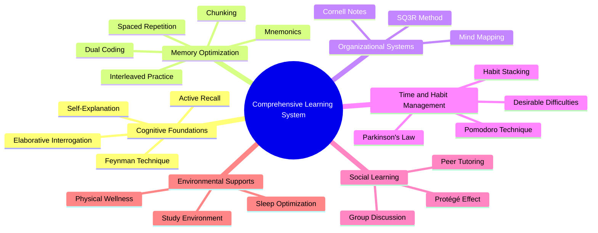

<br>

### The SQ3R Reading Method

**Core Concept:** SQ3R is a five-step method for engaged, strategic reading of textbooks and academic papers. The acronym stands for Survey, Question, Read, Recite, and Review. This structured approach transforms reading from passive consumption of text into an active, goal-directed inquiry.

**Psychological Rationale:** Most students approach textbook reading as they would a novel: they begin at page one and read straight through, hoping that meaning will emerge. This passive approach leads to poor comprehension and rapid forgetting. SQ3R addresses this by establishing a purpose for reading before any detailed engagement begins. By surveying the structure and formulating questions, the learner activates relevant prior knowledge and creates mental frameworks that organize incoming information. The reading phase becomes a search for answers rather than aimless consumption, and the recite and review phases provide essential retrieval practice.

**Implementation Steps:**

1.  **Survey (5-10 minutes):** Before reading in detail, skim the entire chapter or section. Read headings, subheadings, and highlighted terms. Examine figures, charts, and diagrams. Read the introductory paragraphs and the chapter summary or conclusion. This survey provides a mental map of the territory you are about to explore.

2.  **Question (2-3 minutes):** Convert each major heading into a question. If a heading reads "The Causes of the French Revolution," your question becomes "What were the causes of the French Revolution?" These questions establish a purpose for reading and activate curiosity.

3.  **Read (Variable time):** Read the section actively, searching for answers to your questions. Pay attention to emphasized terms, topic sentences, and concluding paragraphs. Read with your questions in mind, marking or noting information that addresses them.

4.  **Recite/Recall (5 minutes per section):** After completing each section, close the book and attempt to recite the answers to your questions from memory. Use your own words rather than trying to reproduce the text verbatim. If you cannot recall the main points, return to the section and review before continuing.

5.  **Review (10-15 minutes):** After completing all sections, review your questions and answers to consolidate the material. Create brief notes or a summary if helpful. This final review strengthens retention and identifies any remaining gaps in understanding.

<br>

## 5. Section IV: Metacognitive Strategies, Time Management, and Habit Formation

Sustaining the cognitive effort required for deep learning demands more than knowledge of effective techniques. Learners must also manage their attention, time, and behavior strategically. These metacognitive and behavioral techniques provide the scaffolding for consistent, focused effort over the long term.

### The Pomodoro Technique

**Core Concept:** Developed by Francesco Cirillo in the late 1980s, the Pomodoro Technique involves working in focused, timed intervals traditionally set at 25 minutes, separated by short breaks of 5 minutes. After completing four such intervals, the learner takes a longer break of 15 to 30 minutes. The name derives from the tomato-shaped kitchen timer Cirillo used as a university student.

**Psychological Rationale:** This technique aligns with the brain's natural attention rhythms. Sustaining intense focus for hours without breaks leads to diminishing returns as mental fatigue accumulates. The structured intervals of the Pomodoro Technique prevent this fatigue by building in regular opportunities for recovery. Additionally, the technique balances what cognitive scientists call focused mode thinking—intense concentration on a specific problem—with diffuse mode thinking, the relaxed mental state during breaks that allows for background processing and creative connections. Breaking daunting tasks into 25-minute chunks also reduces the psychological barrier to starting, combating procrastination effectively.

**Implementation Guidelines:**

- Select a single task to accomplish during your Pomodoro session. Commit to working on only that task until the timer rings.
- Set a timer for 25 minutes. During this interval, eliminate all distractions. Close unnecessary browser tabs, put your phone out of sight, and resist any impulse to switch tasks.
- Work with full focus until the timer rings. If a distracting thought arises, write it down quickly to address later and return immediately to your work.
- When the timer rings, take a strict 5-minute break. Step away from your workspace, stretch, walk around, or rest your eyes. Avoid starting any new work during this break.
- After four Pomodoros, take a longer break of 15 to 30 minutes to allow more substantial recovery.
- Track your completed Pomodoros to maintain awareness of your actual focused work time and to identify patterns in your productivity.

<br>

### Parkinson's Law and Timeboxing

**Core Concept:** Parkinson's Law states that "work expands to fill the time available for its completion." This observation, first articulated by Cyril Northcote Parkinson in a humorous 1955 essay, captures a fundamental truth about human behavior: when given unlimited time, we tend to use it inefficiently, allowing tasks to grow in complexity and duration. Timeboxing is the practical application of this insight—assigning fixed, limited time periods to complete specific tasks and adhering strictly to those boundaries.

**Psychological Rationale:** Open-ended tasks invite procrastination, perfectionism, and inefficient work patterns. When no deadline looms, the mind wanders, and the task expands to consume whatever time is available. Timeboxing creates beneficial temporal urgency that focuses attention, reduces the temptation to perfect minor details unnecessarily, and provides clear termination points that make starting easier. The constraint of limited time forces prioritization and efficient work habits.

**Implementation Methods:**

- Transform open-ended goals into timeboxed commitments. Instead of "study Chapter 5," set the goal "outline the key points of Chapter 5 in 30 minutes."
- When beginning a work session, decide in advance how much time you will allocate to each task and set timers accordingly.
- When the timebox expires, stop work on that task even if it feels incomplete. Move to your next scheduled activity. This discipline trains you to work efficiently within constraints.
- For larger projects, break them into smaller components and assign each component its own timebox across multiple sessions.
- Use timeboxing proactively for tasks you tend to avoid. Knowing that you only need to work on an unpleasant task for a fixed, limited period makes starting easier.

<br>

### Habit Stacking for Sustainable Learning

**Core Concept:** Habit stacking is the practice of attaching a new, desired habit to an existing, well-established habit by using the existing behavior as a trigger. The formula is simple: "After I [existing habit], I will [new habit]." This approach leverages the power of existing neural pathways to support the development of new routines.

**Psychological Rationale:** Willpower and motivation are limited resources that fluctuate daily. Relying on them to initiate new behaviors is unreliable. Habit stacking bypasses this problem by using an existing automatic behavior as a reliable cue. The established habit, deeply encoded in neural circuits, acts as a trigger that reduces the cognitive load and decision-making required to start the new behavior. Over time, the new behavior becomes similarly automatic, requiring minimal conscious effort to maintain.

**Implementation Steps:**

1.  **Identify a Reliable Current Habit:** Choose a habit you perform consistently without fail each day. Examples include pouring your morning coffee, brushing your teeth, sitting down at your desk, finishing lunch, or changing into comfortable clothes after work.

2.  **Define Your New Learning Habit:** Specify the new behavior you wish to establish. Make it small and achievable at first to ensure success. Rather than "study for two hours," start with "review one flashcard deck" or "read one page of my textbook."

3.  **Create the Stack Statement:** Combine the cue and the new habit into a clear implementation intention: "After I pour my morning coffee, I will complete one round of flashcards." "After I brush my teeth at night, I will spend five minutes reviewing today's notes."

4.  **Start Small and Build Consistency:** Focus on performing the stack consistently every day, even if the new habit feels trivial. Consistency builds the automaticity you need. Once the stack feels natural, gradually increase the duration or complexity of the new habit.

5.  **Design Your Environment to Support the Stack:** Place your flashcards next to the coffee maker. Keep your notes on your nightstand. Remove barriers that might interrupt the automatic flow from cue to behavior.

**Expert Consideration:** Psychologist Dr. Lauren Alexander, drawing on extensive clinical experience with behavior change, offers important nuance to the habit stacking approach. While habit stacking can be effective, it is not a universal solution. Success depends critically on the difficulty of the new habit and the individual's intrinsic motivation for the learning goal. For complex habits requiring significant time or cognitive effort, pairing the stack with an immediate reward can strengthen the association, a principle known as the Premack Principle where a more probable behavior reinforces a less probable one. Alternatively, using an approach called shaping—gradually building up to the target behavior through a series of successively closer approximations—can be more effective than attempting to establish the full habit immediately. The key insight is that habit formation is a skill that can be developed, and different challenges may require different behavioral strategies.

<br>

### Desirable Difficulties

**Core Concept:** Introduced by cognitive psychologists Robert and Elizabeth Bjork, the concept of desirable difficulties refers to the counterintuitive principle that introducing certain obstacles or challenges during learning creates more effortful processing, which leads to superior long-term retention and transfer compared to easier, more fluent learning experiences. These difficulties are "desirable" because, although they slow apparent progress in the short term, they produce dramatically better outcomes over time.

**Psychological Rationale:** When learning feels easy, the brain often engages in shallow processing that creates an illusion of mastery without building durable memory. Students who highlight text or reread passages experience fluency—the material feels familiar—and mistakenly conclude they have learned it. In contrast, when learning requires effortful retrieval, problem-solving, or generation, the brain engages in deeper processing that strengthens memory traces and creates multiple retrieval pathways. The effort itself signals to the brain that the information is important and worth preserving. Bjork's Richness of Encoding Principle explains that the more elaborate and effortful the encoding process, the more robust the resulting memory.

**Implementation Examples:**

- **Generate Before Receiving:** Before reading an explanation or being shown a solution, attempt to solve the problem or generate the answer yourself, even if you are unsure. The attempt, even if incorrect, primes your brain to learn more effectively from the subsequent feedback.
- **Space Practice:** Distribute learning across multiple sessions rather than cramming. The forgetting that occurs between sessions creates desirable difficulty during review.
- **Interleave Topics:** Mix different types of problems rather than blocking practice on a single type. The need to select the correct approach for each problem adds desirable difficulty.
- **Vary Practice Conditions:** Study in different locations, at different times, or using different modalities. Contextual variation makes retrieval more challenging but also more robust.
- **Use Testing as Learning:** Regularly test yourself on material rather than simply rereading. Retrieval effort strengthens memory even when you fail to recall correctly.
- **Handwrite Notes:** Writing by hand is slower and less fluent than typing, but the effort of paraphrasing and organizing information during writing leads to better encoding than verbatim typing.

<br>

## 6. Section V: Collaborative and Social Learning Dynamics

Learning, while often pursued individually, is fundamentally a social endeavor. Interaction with others provides accountability, exposes blind spots in understanding, and creates opportunities for the powerful cognitive restructuring that occurs when we teach and explain to others. These collaborative approaches leverage social dynamics to enhance individual learning outcomes.

### The Protégé Effect: Learning by Teaching

**Core Concept:** The protégé effect describes the phenomenon whereby individuals who teach a topic to others develop a deeper and more durable understanding of the material themselves. The act of preparing to teach transforms how learners engage with content, leading to superior learning outcomes compared to studying solely for personal mastery.

**Psychological Rationale:** Preparing to teach triggers multiple cognitive processes that enhance learning. First, it requires metacognitive organization: you must structure knowledge logically, identify core concepts, and understand relationships between ideas to present them coherently. Second, it generates anticipatory thinking: you consider what questions your audience might ask and what points might be confusing, which deepens your own analysis. Third, the social responsibility of teaching increases motivation and leads to more thorough preparation. Finally, the act of explaining forces you to translate information into your own words, promoting deeper encoding than passive review.

**Implementation Methods:**

- **Peer Tutoring Partnerships:** Form a study partnership with a classmate and take turns teaching each other different concepts. After one person teaches, the other asks questions and seeks clarification, further deepening both participants' understanding.

- **Study Group Teaching Rotations:** Within a small study group, assign different topics to different members who then prepare mini-lessons to present to the group. Rotate responsibilities so everyone experiences teaching and being taught.

- **The Rubber Duck Method:** When stuck on a difficult problem or concept, explain it aloud to an inanimate object—a rubber duck on your desk, a stuffed animal, or even an empty chair. The act of verbalizing forces you to organize your thoughts and often reveals gaps or solutions that were not apparent during silent contemplation.

- **Create Teaching Materials:** Develop study guides, explanatory videos, or practice problems as if you were preparing them for other students. Even if no one else uses these materials, the act of creating them forces you into the teacher's mindset and deepens your understanding.

**Research Insight:** A 2019 meta-analytic review of learning-by-teaching studies revealed an important nuance: the benefits of teaching are maximized when the teaching involves direct, interactive engagement with learners. Preparing for face-to-face teaching, with its expectation of questions and dialogue, produces greater learning gains than preparing indirect teaching materials like videos or written guides. The anticipation of live interaction, with its demands for flexible explanation and immediate response, creates richer cognitive engagement than preparing one-way communication.

<br>

### Structured Group Discussion and Peer Tutoring

**Core Concept:** Moving beyond casual study groups, structured collaborative learning implements purposeful, role-driven interactions designed to maximize cognitive benefits. Rather than simply gathering to review material together, participants adopt specific roles and follow structured protocols that ensure active engagement from all members.

**Psychological Rationale:** Well-structured group discussion exposes learners to multiple perspectives and alternative explanations, challenging them to examine their own understanding critically. Defending your interpretation against questions from peers forces you to articulate reasoning and evidence, consolidating knowledge. Hearing others' explanations provides alternative mental models that may clarify concepts you find difficult. The social accountability of group commitment also motivates preparation and sustained engagement.

**Implementation Framework for Study Groups:**

**Assign Rotating Roles:** Each group meeting should assign specific responsibilities to ensure balanced participation and productive discussion:

| Role | Responsibilities |
|------|-------------------|
| Discussion Leader | Prepares key questions in advance, facilitates discussion, ensures all voices are heard, keeps group on topic |
| Skeptic | Questions assumptions, asks for evidence, challenges superficial explanations, plays devil's advocate |
| Synthesizer | Summarizes main points at intervals, identifies emerging themes, connects different contributions |
| Connector | Relates discussion to previous material, identifies real-world applications, links to other courses or contexts |
| Recorder | Takes notes on key insights, questions raised, and conclusions reached; distributes summary after meeting |

**Structured Discussion Protocols:**

- **Think-Pair-Share:** Individuals think silently about a question for several minutes, then discuss their thoughts with a partner, and finally share insights with the full group. This ensures everyone processes the question individually before hearing others' ideas.

- **Round Robin:** Each person in turn shares one insight or question without interruption. This prevents domination by vocal members and ensures all perspectives are heard.

- **Debate Format:** Assign opposing viewpoints on a controversial topic and require each side to prepare arguments and evidence. The process of constructing and defending a position deepens understanding even if you personally hold the opposing view.

- **Peer Tutoring Rotations:** Pair group members and assign each pair responsibility for teaching a specific concept to the others. After preparation time, each pair presents their concept and fields questions.

<br>

## 7. Section VI: Contextual and Environmental Optimizers

Cognitive performance does not occur in a vacuum. The physical state of the learner and the characteristics of the learning environment significantly influence the effectiveness of any study technique. These contextual factors, often overlooked in discussions of learning strategies, can be harnessed to enhance efficiency and outcomes substantially.

### Environmental Design for Focused Work

**Core Concept:** Environmental design involves intentionally shaping your physical study surroundings to minimize distractions, cue focused behavior, and support sustained concentration. Rather than fighting against a distracting environment through sheer willpower, you modify the environment itself to make desired behaviors easier and undesired behaviors harder.

**Psychological Rationale:** The physical environment constantly influences attention and behavior, often below conscious awareness. Clutter competes for neural resources, increasing cognitive load and reducing the capacity available for learning. Digital notifications create interruptions that fragment attention and require time to recover from after each disruption. Conversely, a well-designed environment can automatically cue focused behavior: entering a dedicated study space triggers a mental shift into work mode. By reducing friction for desired behaviors and increasing friction for distractions, environmental design conserves limited willpower for actual learning rather than for resisting temptation.

**Implementation Guidelines:**

- **Designate a Dedicated Study Space:** Choose a specific location used only for focused academic work. Avoid using this space for entertainment, social media, or relaxation. Over time, your brain will associate this location with concentration, making it easier to enter a focused state when you arrive.

- **Eliminate Visual Clutter:** Keep your study surface clear of everything except materials needed for your current task. Store unrelated items out of sight. A clean visual field reduces competing stimuli and supports sustained attention.

- **Control Digital Distractions:** Use website blockers during focused sessions to prevent access to social media and entertainment sites. Put your phone in another room or in a drawer where you cannot see it. Turn off all notifications except those from essential communication channels.

- **Optimize Lighting:** Ensure your study space has adequate, preferably natural, lighting. Dim lighting can induce drowsiness, while harsh fluorescent lighting may cause eye strain. Position your desk to minimize glare on screens and materials.

- **Manage Noise:** If you require silence, use noise-canceling headphones or earplugs. If ambient noise helps you focus, curate it deliberately using instrumental music, nature sounds, or white noise. Avoid music with lyrics when processing verbal information, as lyrics compete for language-processing resources.

- **Personalize Strategically:** Add a few meaningful items to your space—a plant, a inspiring image, a comfortable chair—but avoid clutter. Personal touches can increase your willingness to spend time in the space without creating distraction.

<br>

### The "Sleep Sandwich" and Sleep-Based Consolidation

**Core Concept:** The sleep sandwich is a strategic approach to scheduling study sessions around sleep to leverage the brain's natural memory consolidation processes. The technique involves reviewing difficult material shortly before sleeping, allowing a full night's sleep for consolidation, and then conducting a brief review upon waking. This "sandwiches" the consolidation period between two active learning sessions.

**Psychological Rationale:** During sleep, particularly during deep slow-wave sleep and REM sleep, the brain does not simply rest. It actively processes and consolidates memories from the preceding day. Neural patterns activated during learning are reactivated during sleep, strengthening the synaptic connections that underlie those memories. This process, known as synaptic consolidation, integrates new information with existing knowledge networks and transfers memories from temporary storage in the hippocampus to more permanent storage in the neocortex. By reviewing material immediately before sleep, you ensure that the targeted information is among the memories selected for this overnight processing. Morning review then reinforces the consolidated traces and identifies any gaps that remain.

**Implementation Protocol:**

- **Evening Review Session:** In the hour before going to sleep, spend 15 to 30 minutes reviewing the most challenging material you need to learn. Use active recall methods rather than passive rereading. This primes the neural circuits that will be strengthened during sleep.

- **Prioritize Sleep Quality:** Ensure you obtain a full night of uninterrupted sleep. Seven to nine hours is typical for adults, though individual needs vary. Maintain consistent sleep and wake times to support natural sleep architecture.

- **Morning Reinforcement:** Within an hour of waking, spend 5 to 10 minutes briefly reviewing the same material. This quick review capitalizes on the strengthened memory traces and reinforces any elements that may not have been fully consolidated.

- **Extend the Principle:** Beyond the sandwich technique, recognize that consistent, high-quality sleep is itself one of the most powerful learning strategies available. Sleep deprivation impairs attention, working memory, and the consolidation processes essential for learning. Prioritizing sleep is not time lost from study but an investment in the effectiveness of all waking study time.

<br>

### Physiological Supports: Hydration, Nutrition, and Movement

**Core Concept:** The brain, like every other organ, depends on physiological support systems for optimal function. Hydration status, nutrient availability, and physical activity all influence cognitive performance in measurable ways. Attending to these basic biological needs is not separate from learning but integral to it.

**Psychological Rationale:** The brain consumes approximately 20% of the body's energy despite representing only about 2% of its mass. This energy-intensive organ requires a steady supply of glucose, oxygen, and nutrients to function optimally. Even mild dehydration, as little as 2% loss of body fluid, impairs attention, executive function, and short-term memory. Glucose from complex carbohydrates provides sustained mental energy, while the spike-and-crash pattern from simple sugars disrupts consistent performance. Physical activity increases blood flow to the brain, stimulates release of neurotrophic factors that support neuron health, and reduces stress hormones that impair cognition.

**Implementation Guidelines:**

**Hydration:**
- Keep a water bottle at your study desk and drink regularly throughout sessions rather than waiting until you feel thirsty. Thirst already indicates mild dehydration.
- Monitor urine color as a rough indicator: pale yellow suggests adequate hydration; dark yellow signals need for more fluids.
- Limit caffeine and alcohol, both of which have diuretic effects that can contribute to dehydration.

**Nutrition:**
- Choose brain-healthy snacks that provide steady energy: nuts, seeds, fresh fruit, yogurt, vegetables with hummus.
- For longer study sessions, consume meals that combine complex carbohydrates (whole grains, vegetables) with protein to provide sustained glucose release.
- Avoid high-sugar snacks and beverages that produce energy spikes followed by crashes that impair concentration.
- Consider the timing of meals: heavy meals can induce drowsiness, while studying on empty stomach can be distracting. Moderate meals at regular intervals support consistent performance.

**Movement:**
- Incorporate brief movement breaks during longer study sessions. Even 5 minutes of walking, stretching, or simple exercises can restore attention and reduce physical tension.
- Use the Pomodoro Technique's breaks as opportunities for movement rather than remaining seated.
- Consider standing or using a treadmill desk for some study activities, particularly those involving listening or review rather than intensive writing.
- Regular aerobic exercise, separate from study sessions, supports overall brain health, neuroplasticity, and stress management.

<br>

## 8. Section VII: Implementation Framework and Synergistic Integration

The preceding sections have presented numerous techniques, each validated by cognitive research and each valuable in its own right. However, the true power of this compendium lies not in using any single technique in isolation but in strategically combining multiple approaches into a personalized, synergistic learning system. This section provides a framework for integrating these techniques into coherent workflows that address different learning goals and contexts.

### Diagnose and Align: Matching Techniques to Goals

Different learning objectives require different cognitive processes and therefore benefit from different technique combinations. Before selecting techniques, clarify your primary learning goal for the material at hand.

| Primary Learning Goal | Cognitive Demands | Highly Recommended Techniques |
|----------------------|-------------------|------------------------------|
| Memorizing facts, terms, lists | Accurate retention, rapid retrieval | Spaced Repetition, Mnemonics (Method of Loci), Active Recall, Chunking |
| Understanding complex concepts | Relational understanding, explanatory depth | Feynman Technique, Self-Explanation, Elaborative Interrogation, Mind Mapping |
| Problem-solving and skill application | Strategy selection, procedural fluency | Interleaved Practice, Active Recall (on problems), Desirable Difficulties |
| Comprehending and retaining texts | Information extraction, organization | SQ3R Method, Cornell Notes, Dual Coding |
| Managing time and building consistency | Behavioral regulation, habit formation | Pomodoro Technique, Timeboxing, Habit Stacking |
| Preparing for comprehensive exams | Integration across topics, fluent retrieval | Protégé Effect, Practice Testing, Spaced Repetition, Interleaving |

### Personalize Based on Learning Preferences

While all learners can benefit from all techniques, individual differences in cognitive style, sensory preferences, and personality suggest that some techniques may feel more natural and be easier to sustain. Adapt frameworks to your preferences without abandoning core principles.

- **Visual learners** may emphasize Dual Coding and Mind Mapping, creating rich visual representations of material.
- **Verbal learners** may lean on Self-Explanation and the Feynman Technique, talking through concepts aloud.
- **Kinesthetic learners** may benefit from hands-on activities, movement during review, and teaching others.
- **Social learners** may thrive in study groups and peer tutoring arrangements.
- **Independent learners** may prefer individual techniques but can still benefit from occasional collaborative work.

The key is to maintain the underlying cognitive principles—active engagement, retrieval practice, spaced review—while adapting the surface form to your preferences.

### Integrate Synergistically: Creating Learning Workflows

The most powerful applications emerge when techniques are chained together into coherent workflows that address the entire learning cycle from initial exposure to long-term mastery.

**Example Workflow A: For Lecture-Based Courses**

1.  **Before Lecture:** Briefly survey the assigned reading or previous notes to activate prior knowledge (SQ3R Survey phase).

2.  **During Lecture:** Take notes using the Cornell format, focusing on capturing main ideas and key details in the notes column.

3.  **Within 24 Hours:** Review your notes and create cue column questions. Write a summary at the bottom of each page. Transfer key facts and concepts to a spaced repetition system like Anki.

4.  **Weekly Review:** Create a mind map synthesizing the week's lectures, showing connections between topics. Use this map for holistic review.

5.  **Ongoing Practice:** Use your spaced repetition system daily for 10-15 minutes to maintain factual knowledge. When exams approach, the material will already be well learned.

6.  **Before Exams:** Form a study group and teach each other major concepts (Protégé Effect). Create and take practice tests under timed conditions.

**Example Workflow B: For Textbook Reading and Concept Mastery**

1.  **Survey:** Before detailed reading, survey the chapter using SQ3R to understand its structure and main arguments.

2.  **Question:** Convert headings to questions that will guide your reading.

3.  **Read and Dual Code:** Read actively, searching for answers to your questions. Create simple diagrams or sketches that illustrate key relationships.

4.  **Recite and Self-Explain:** After each section, close the book and recite answers to your questions. Explain the concepts to yourself in simple language, noting any gaps.

5.  **Feynman Technique for Difficult Concepts:** For any concept that remains unclear, apply the Feynman Technique: explain it simply, identify gaps, review source material, and refine your explanation.

6.  **Review and Connect:** After completing the chapter, create a concept map showing relationships among the main ideas. Add the key facts to your spaced repetition system.

**Example Workflow C: For Problem-Solving Skills**

1.  **Study Worked Examples:** Before attempting problems, study solved examples to understand the reasoning process. Use self-explanation to verbalize why each step was taken.

2.  **Attempt Before Solution:** For new problem types, attempt to solve before looking at the solution. The effort, even if unsuccessful, primes learning.

3.  **Interleaved Practice:** Create mixed problem sets that require you to select the appropriate strategy for each problem. Complete these under timed conditions.

4.  **Review with Feynman:** For problems you missed, explain the correct approach aloud as if teaching someone. Identify where your reasoning went wrong.

5.  **Spaced Review:** Return to challenging problem types at increasing intervals to maintain proficiency.

### Iterate with Metacognition

No single combination of techniques works optimally for every learner or every subject. The final and most important component of any implementation framework is ongoing reflection and adjustment based on personal experience.

- **Maintain a Simple Learning Journal:** After major exams, projects, or study blocks, spend 10 minutes reflecting on your process. What techniques did you use? Which felt most effective? Where did you struggle? What would you do differently next time?

- **Collect Data:** Track objective outcomes when possible. Compare your performance on material learned with different techniques. Notice patterns in what works for different types of content.

- **Experiment Systematically:** When you encounter a learning challenge, consciously select techniques based on your goals and your reflection on past experience. Treat each learning cycle as an experiment from which you can gather data.

- **Adjust Quarterly:** Every few months, review your learning journal and make intentional adjustments to your approach. Drop techniques that consistently underperform for you. Experiment with new combinations. Your learning system should evolve as you gain experience and as your learning contexts change.

<br>

## 9. Conclusion: Cultivating Mastery Through Strategic Learning

This compendium has synthesized centuries of pedagogical wisdom and decades of cognitive science research into a unified framework for intellectual growth. The techniques presented here are not merely study tips or academic tricks; they represent fundamental principles of how the human brain learns, remembers, and understands. By understanding the why behind these techniques—the principles of active retrieval, spaced reinforcement, desirable difficulty, and explanatory depth—you move beyond collecting random tips to developing a principled approach to mastery.

Effective learning is itself a skill that can be systematically developed. The students and lifelong learners who succeed are not those blessed with superior memories or innate intelligence, but those who have learned how to learn. They understand that discomfort during learning is not a sign of failure but evidence that their brains are doing the work of building durable knowledge. They recognize that rereading and highlighting create illusions of mastery, while testing and explaining build genuine understanding. They design their environments, manage their time, and attend to their physical states to support rather than fight their cognitive processes.

The journey toward mastery is iterative and deeply personal. Begin by selecting one or two techniques from different sections that address your most pressing current challenge. Implement them consistently for several weeks, reflect on their impact, and gradually build your integrated system. As you gain experience, you will develop an intuitive sense for which combinations work best for different subjects and situations.

In doing so, you will not only learn your subject matter more deeply but also cultivate the far more valuable meta-skill of learning how to learn. This capability will propel academic achievement, professional development, and personal growth for a lifetime. The techniques in this compendium are tools; the skill of strategic learning is the craft that uses them. Master the craft, and no subject will remain beyond your reach.

<br>

## 10. Appendix: Quick-Reference Guide for Technique Selection

| **Primary Learning Goal** | **Highly Recommended Techniques** | **Synergistic Combinations** |
|---------------------------|-----------------------------------|------------------------------|
| **Memorizing Facts, Terms, Lists** | Spaced Repetition, Mnemonics (Method of Loci), Active Recall, Chunking | Create vivid mnemonic images for key terms, then drill them using spaced repetition flashcards in Anki. Use chunking to organize lists into meaningful groups before memorizing. |
| **Understanding Complex Concepts** | Feynman Technique, Self-Explanation, Elaborative Interrogation, Mind Mapping | Use mind mapping to visualize relationships among concepts, then explain the entire map aloud using the Feynman Technique. Ask "why" questions about each connection. |
| **Problem-Solving and Skill Application** | Interleaved Practice, Active Recall (on problems), Desirable Difficulties | Create mixed problem sets that draw from all topics studied. Attempt problems before reviewing solutions. After completing, explain your reasoning process aloud. |
| **Comprehending and Retaining Texts** | SQ3R Method, Cornell Notes, Dual Coding | Use SQ3R to structure your reading. Take Cornell notes during the process, adding simple diagrams in the notes column. Review using the cue column for active recall. |
| **Managing Time and Building Consistency** | Pomodoro Technique, Timeboxing, Habit Stacking | Use habit stacking to trigger a daily Pomodoro session. Within each Pomodoro, timebox specific tasks. Track completed Pomodoros to maintain awareness. |
| **Preparing for Exams Holistically** | Protégé Effect (teach others), Practice Testing, Spaced Repetition, Interleaving | Form a study group where each member teaches different topics. Create practice exams for each other. Review using spaced repetition in the weeks before the exam. |
| **Mastering Procedural Skills** | Deliberate Practice, Self-Explanation, Immediate Feedback | Break the skill into components. Practice each component with full attention, explaining your actions. Seek immediate feedback and adjust accordingly. |
| **Learning from Lectures** | Cornell Notes, Spaced Repetition, Elaborative Interrogation | Take Cornell notes during lecture. Within 24 hours, create cue questions and transfer key points to spaced repetition. Ask elaboration questions about connections to prior material. |
| **Learning from Videos or Online Content** | Active Recall, Dual Coding, Pomodoro Technique | Watch in focused Pomodoro intervals. Pause frequently to summarize and sketch. After viewing, write a brief summary without rewatching. |

<br><br><br><br>

<h1 align="center">MASTERING SEARCH ENGINE TECHNIQUES</h1>

 
<br><br>

## Table of Contents

1. [Introduction](#introduction)
2. [Part 1: Foundational Search Techniques](#part-1-foundational-search-techniques)
   - [1.1 Instant Answers and Quick Lookups](#11-instant-answers-and-quick-lookups)
   - [1.2 Intent-Based Discovery](#12-intent-based-discovery)
3. [Part 2: Advanced Filtering and Search Operators](#part-2-advanced-filtering-and-search-operators)
   - [2.1 Precision Filtering Operators](#21-precision-filtering-operators)
   - [2.2 Boolean and Contextual Logic Operators](#22-boolean-and-contextual-logic-operators)
   - [2.3 Advanced Utility Operators](#23-advanced-utility-operators)
4. [Part 3: Strategic Search Methodology](#part-3-strategic-search-methodology)
   - [3.1 The Iterative Refinement Process](#31-the-iterative-refinement-process)
   - [3.2 Source Evaluation and Verification](#32-source-evaluation-and-verification)
5. [Part 4: Integrated Workflow and Practical Application](#part-4-integrated-workflow-and-practical-application)
6. [Conclusion: The Path to Search Mastery](#conclusion-the-path-to-search-mastery)
7. [Appendix: Quick Reference Guide](#appendix-quick-reference-guide)

<br>

## Introduction

In an era defined by information abundance, the ability to efficiently locate precise, credible, and actionable knowledge has become a critical professional skill. Moving beyond basic keyword searches transforms the internet from a chaotic repository into a powerful, queryable extension of your own expertise.

This guide serves as a comprehensive manual for anyone seeking to upgrade their search capabilities—from students and researchers to developers, analysts, and business professionals. By consolidating foundational techniques with advanced strategies, we provide a structured pathway to search mastery.

Modern search engines have evolved significantly from simple document locators. They now function as sophisticated answer engines designed for rapid problem-solving, equipped with artificial intelligence, natural language processing, and real-time data integration. Understanding how to leverage these capabilities effectively is essential for professional success in the digital age.

<br>

## Part 1: Foundational Search Techniques

Before wielding complex operators, one must understand the core capabilities of modern search engines. These platforms are no longer simple document locators but sophisticated answer engines designed for rapid problem-solving.

### 1.1 Instant Answers and Quick Lookups

Modern search engines can function as a calculator, converter, and information desk simultaneously, often delivering results directly on the results page. This eliminates the need to navigate to external websites for simple, factual queries.

#### Mathematical Calculations and Unit Conversions

You can use the search bar as a primary calculator for everything from basic arithmetic to complex equations. For instance, entering `(15 * 3.14) / 2` will return the calculated result. This functionality extends to conversions; queries like `150 pounds in kilograms`, `1000 yen to usd`, or `miles to kilometers` provide instant, accurate conversions without needing a separate tool. This is particularly useful for professionals working with international standards or students solving quantitative problems.

#### Real-Time Data Access

Search engines have become dashboards for live information. By entering a stock ticker symbol such as `GOOGL` or `TSLA`, you receive an immediate snapshot of the current stock price, market cap, and daily fluctuations. Similarly, querying `time in London`, `weather in Tokyo`, or `sunset in New York` delivers precise, up-to-date information. This turns the search engine into a rapid information retrieval system for time-sensitive data.

#### Lexical and Linguistic Tools

For writers, students, or the simply curious, the search engine acts as an instantaneous dictionary and thesaurus. Using the `define` command, such as `define ubiquitous`, returns the definition, etymology, and often synonyms. Furthermore, translation is seamlessly integrated; a query like `book in spanish` immediately provides the translation *libro*, facilitating quick cross-linguistic reference.

#### Practical Utilities

The search bar can also act as a launchpad for everyday tools. Simple commands like `set a timer for 10 minutes`, `start stopwatch`, `track flight AA123`, or even `find my phone` (for logged-in users) demonstrate the engine's evolution into a personal utility belt, streamlining tasks that once required dedicated applications.

### 1.2 Intent-Based Discovery

When your goal shifts from a simple lookup to exploration, planning, or comparison, structuring your query around your specific intent yields far more useful and organized results.

#### Travel and Event Planning

For logistical queries, treat the search bar as a travel agent. A search for `flights NYC to London May 2025` surfaces aggregate price comparisons and scheduling options. Looking for `hotels Paris near Eiffel Tower` will prioritize accommodation listings based on location and user reviews. For entertainment, searching `concerts in Austin October` or `events near me` curates a list of local happenings, demonstrating the engine's ability to understand geographic and temporal context.

#### Media and Package Tracking

Search engines have streamlined the process of tracking physical and digital assets. Simply entering a package tracking number will often directly display its shipping status from the carrier. For media, searching for a movie title, such as `Dune Part Two`, will now commonly show which streaming platforms it is currently available on, saving users from searching through multiple services.

<br>

## Part 2: Advanced Filtering and Search Operators

To truly cut through the noise and access the deep web of specialized information, one must master search operators. These are specific commands and symbols that act as precise instructions, telling the search engine exactly what to look for and where.

### 2.1 Precision Filtering Operators

These operators are the scalpels of search, allowing you to carve out results from very specific corners of the internet. They are indispensable for academic research, technical troubleshooting, and competitive analysis.

#### Site-Specific Searching

The `site:` operator is arguably the most powerful tool for targeted research. It restricts your search to a single domain.

- **Syntax:** `site:example.com your search terms`
- **Application:** Searching `site:github.com kubernetes deployment` will only yield results from GitHub related to Kubernetes. This is invaluable for finding code repositories, documentation, or specific issues within a known platform. You can also target top-level domains (TLDs) like `site:.gov` for US government documents or `site:.ac.uk` for UK academic institutions, ensuring a high degree of authority.

#### File Type Targeting

For finding specific types of documents, the `filetype:` operator is essential.

- **Syntax:** `your search terms filetype:extension`
- **Application:** A query like `artificial intelligence ethics filetype:pdf` will return only PDF documents, which are often white papers, academic papers, or official reports. This can be extended to other formats, such as `filetype:pptx` for PowerPoint presentations or `filetype:xlsx` for Excel datasets, making it a powerful tool for gathering structured data or ready-made presentations.

#### Content Location Filters

These operators force your terms to appear in specific parts of a webpage, ensuring the page is truly about your topic.

- **`intitle:` and `allintitle:`:** `intitle:quantum` finds pages with "quantum" in the title, while `allintitle:quantum computing` finds pages with both words in the title. This is useful for finding authoritative overviews or articles where your topic is the central theme.
- **`inurl:` and `allinurl:`:** `inurl:login` finds pages with "login" in the URL, helpful for finding login portals. Similarly, `inurl:wp-content` can reveal WordPress sites, which might be useful for security research or competitive analysis.
- **`intext:`:** This ensures your search terms appear within the main body text of the page, filtering out results where the term might only be in the navigation or metadata.

### 2.2 Boolean and Contextual Logic Operators

This set of operators defines the logical relationships between the words in your query, moving beyond simple keyword matching to conceptual search.

| Operator | Syntax | Function | Example |
| :--- | :--- | :--- | :--- |
| **Exact Phrase** | `" "` | Finds pages containing the exact words in the exact order. | `"to be or not to be"` |
| **Exclusion** | `-` | Excludes pages containing the specified term. | `jaguar -car` |
| **Boolean OR** | `OR` | Finds pages containing at least one of the terms. Must be capitalized. | `renewable energy OR solar power` |
| **Proximity** | `AROUND(n)` | Finds pages where terms appear within `n` words of each other. | `climate AROUND(3) crisis` |
| **Wildcard** | `*` | Acts as a placeholder for any unknown word or words. | `a * saved is a * earned` |
| **Numeric Range** | `..` | Searches for results within a specific numeric range. | `laptop $500..$800` |

#### Boolean Logic for Complex Queries

Using `OR` allows you to search for synonymous or related concepts simultaneously. For example, `adolescent OR teenager mental health` broadens your search to capture articles using either term. While `AND` is usually implicit between words (searching for `red dress` is the same as `red AND dress`), using it explicitly can sometimes clarify complex queries in certain search engines.

#### Proximity and Context

The `AROUND(n)` operator is a sophisticated tool for finding conceptual relationships. A search for `quantum AROUND(5) computing` ensures that "quantum" and "computing" are contextually linked within a few words of each other, rather than appearing in completely separate parts of a long document. This yields results where the two concepts are discussed in direct connection, making it superior to a simple AND search for certain analytical tasks.

### 2.3 Advanced Utility Operators

These operators serve specialized purposes for investigative research, web development, and historical analysis.

#### Finding Connections and Alternatives

The `related:` operator is excellent for discovering competitors or similar resources. `related:nytimes.com` will suggest other major news outlets. Conversely, `link:` (though less reliable in modern search engines) was originally designed to show pages that link to a given URL, offering insight into a site's influence and backlink profile.

#### Accessing Historical Data with Cache

The `cache:` operator retrieves the most recent snapshot of a webpage stored by the search engine. For example, `cache:example.com` shows the page as it was when last indexed. This is a critical tool for journalists and researchers when the live site is down, has been changed, or if you need to see the version of a page that existed at a specific point in the past.

#### Temporal Filtering

Using `BEFORE:` and `AFTER:` allows for precise chronological control. A search like `COVID-19 vaccine efficacy AFTER:2021-01-01 BEFORE:2022-01-01` will strictly limit results to that specific year, which is far more precise than the standard date filter tools and essential for longitudinal studies or trend analysis.

<br>

## Part 3: Strategic Search Methodology

Mastering the tools is only half the battle. A strategic mindset transforms a series of searches into a coherent research methodology. This involves planning, iterative refinement, and critical evaluation.

### 3.1 The Iterative Refinement Process

Effective searching is rarely a one-shot endeavor. It is a cyclical process of querying, learning, and re-querying based on the insights gained.

#### Start Broad, Then Narrow

Begin with a wide, exploratory query to map the territory. For a topic like "sustainable urban farming," an initial search will reveal key themes (vertical farming, hydroponics, policy), key authors, and relevant organizations. This initial scan provides the vocabulary needed for more precise future searches. It is about understanding the landscape before focusing on a specific plot of land.

#### Adopt Professional Terminology

As you review results from your broad search, pay attention to the language used in authoritative sources. Incorporate this jargon into your subsequent queries. For instance, if you start with "brain scan" but find that experts use "functional magnetic resonance imaging (fMRI)," using the latter term will dramatically improve the quality and relevance of your results, bypassing generic or layperson-focused content.

#### Prioritize Core Concepts

Search engines work best with nouns and unique identifiers. Strip your questions down to their essential components. Instead of asking, "How can I learn to code in Python for data science?", the optimized query is `"learn Python" "data science" tutorial`. By removing stop words ("how," "can," "I," "for"), you focus the engine's attention on the core concepts you want to find.

### 3.2 Source Evaluation and Verification

Finding information is only as valuable as your ability to judge its quality. This step separates simple data gathering from true research.

#### Leverage Authoritative Domains

Consciously use the `site:` operator to filter for institutional credibility. For academic papers, restrict to `.edu` domains. For statistical data and policy, use `.gov`. For think tanks and non-profits, use `.org`, but be aware that this TLD is not regulated and requires additional scrutiny of the specific organization. This deliberate filtering is a proactive step in quality control.

#### Cross-Reference Across Platforms

Relying on a single search engine's index and algorithm can create a filter bubble. Different engines (like Bing, DuckDuckGo, or specialized academic engines like Semantic Scholar or PubMed) have different crawling priorities and ranking logics. Cross-referencing your findings across these platforms can reveal sources that were not indexed or were de-prioritized by Google, providing a more comprehensive and balanced view of your topic.

#### Utilize Citation Chaining

This is the gold standard of academic research. When you find a highly relevant paper, use its bibliography to find older, foundational works (backward chaining). Then, use tools like Google Scholar's "Cited by" feature to find newer papers that have referenced your original source (forward chaining). This method builds a complete intellectual history of a concept, from its origins to its most current applications.

<br>

## Part 4: Integrated Workflow and Practical Application

To consolidate these concepts, let us walk through a practical scenario that demonstrates a complete, strategic search workflow.

### Scenario

You are a graduate student beginning a literature review on the use of reinforcement learning for dexterous robotic hand manipulation.

#### Phase 1: Exploratory Phase

- **Query:** `reinforcement learning robotic hand manipulation`
- **Action:** Review the first few pages of results. Note recurring terms like "deep Q-learning," "policy gradients," "grasping," and "in-hand manipulation." Identify key authors (e.g., Levine, Abbeel) and major conferences (e.g., CoRL, ICRA). This builds your initial lexicon.

#### Phase 2: Refinement Phase

- **Query:** `"deep reinforcement learning" "dexterous manipulation" filetype:pdf`
- **Action:** Use the exact phrase operator to lock in core concepts and the `filetype` operator to find full papers, often PDFs. This filters out blog posts and news articles, focusing on primary research.

#### Phase 3: Authority and Temporal Filtering

- **Query:** `site:arxiv.org "deep Q-learning" "robotic hand" AFTER:2020`
- **Action:** Restrict to arXiv, a reputable preprint server for cutting-edge research, and use the `AFTER:` filter to ensure you are looking at the most recent developments from the last few years. This yields a set of very recent, high-probability sources.

#### Phase 4: Investigation and Expansion

- **Action:** Download and read the most promising paper from Phase 3. Examine its **References** section to find seminal older papers on deep Q-learning (backward chaining). Then, go to Google Scholar, search for this seminal paper, and click on the **"Cited by"** link to find all the newer papers that have referenced it (forward chaining). This rapidly expands your literature map from a single seed document.

#### Phase 5: Ongoing Monitoring

- **Action:** Go to Google Alerts. Create an alert with your most effective query string, such as `"deep reinforcement learning" "in-hand manipulation"`. You will now receive periodic emails with new results as they are indexed, keeping you up-to-date on your topic without needing to re-run manual searches constantly.

### Search Mastery Workflow

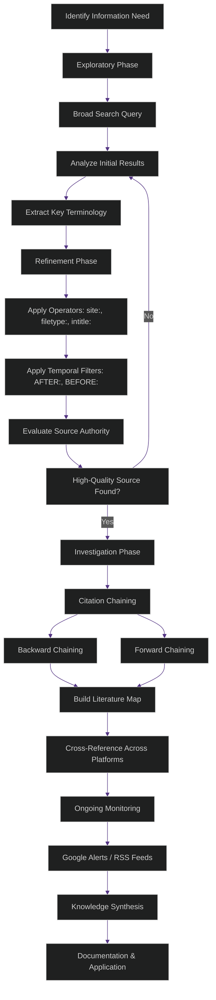

<br>

## Conclusion: The Path to Search Mastery

Mastering the art of search is not about memorizing an exhaustive list of operators. It is about cultivating a mindset that blends the curiosity of an explorer with the rigor of a detective. It requires understanding how information is structured online, formulating precise hypotheses through queries, and using technical syntax to test them against the vast corpus of the internet.

The techniques outlined in this guide—from instant lookups and Boolean logic to strategic citation chaining—form a comprehensive toolkit for the digital age. The journey to mastery begins with a single step: consciously integrate just one or two new operators into your daily searches. When you find an exceptionally high-quality result, reverse-engineer the process that might have led to it. Over time, this deliberate practice will transform sophisticated, multi-layered searching from a conscious effort into a seamless, intuitive skill, turning the boundless information of the internet into a structured, accessible, and powerful extension of your own knowledge.

<br>

## Appendix: Quick Reference Guide

### Essential Search Operators Summary

| Operator Category | Operator | Purpose | Example |
| :--- | :--- | :--- | :--- |
| **Filtering** | `site:` | Restrict to domain | `site:edu climate change` |
| **Filtering** | `filetype:` | Specific file format | `report filetype:pdf` |
| **Filtering** | `intitle:` | Term in page title | `intitle:quantum computing` |
| **Filtering** | `inurl:` | Term in URL | `inurl:login` |
| **Filtering** | `intext:` | Term in body text | `intext:methodology` |
| **Logic** | `" "` | Exact phrase | `"artificial intelligence"` |
| **Logic** | `-` | Exclude term | `apple -fruit` |
| **Logic** | `OR` | Either term | `cats OR dogs` |
| **Logic** | `*` | Wildcard placeholder | `best * for money` |
| **Logic** | `..` | Numeric range | `$100..$200` |
| **Context** | `AROUND(n)` | Proximity search | `cyber AROUND(5) security` |
| **Temporal** | `AFTER:` | Date range start | `AFTER:2023-01-01` |
| **Temporal** | `BEFORE:` | Date range end | `BEFORE:2024-01-01` |
| **Utility** | `related:` | Similar sites | `related:example.com` |
| **Utility** | `cache:` | Cached version | `cache:example.com` |

### Common Use Cases and Recommended Queries

| Use Case | Recommended Query Structure | Example |
| :--- | :--- | :--- |
| Academic Research | `"topic" site:.edu filetype:pdf` | `"neural networks" site:.edu filetype:pdf` |
| Technical Documentation | `"topic" site:docs.example.com` | `"deployment" site:kubernetes.io` |
| Source Code Search | `"topic" site:github.com` | `"authentication" site:github.com` |
| Government Statistics | `"topic" site:.gov filetype:pdf` | `"unemployment" site:.gov filetype:pdf` |
| News and Current Events | `"topic" AFTER:YYYY-MM-DD` | `"election" AFTER:2024-11-01` |
| Product Reviews | `"product name" review` | `"iPhone 15" review` |
| Competitive Analysis | `site:competitor.com "topic"` | `site:acme.com "pricing"` |

### Troubleshooting Common Search Issues

| Issue | Possible Cause | Solution |
| :--- | :--- | :--- |
| Too many irrelevant results | Query too broad | Use `site:`, `-`, or `AROUND()` |
| Too few results | Query too specific | Broaden with `OR`, remove filters |
| Results are too old | Temporal filter missing | Add `AFTER:` with recent date |
| Results lack authority | Domain filter missing | Add `site:.edu` or `site:.gov` |
| Missing key sources | Single engine bias | Cross-reference with other engines |
| Results lack depth | No citation chaining | Use backward and forward chaining |

<br><br><br><br>

<h1 align="center">THE GOOGLE SEARCH POWER-USER HANDBOOK FOR ADVANCED R&D</h1>

<br><br>

## 1. The Core Search Stack

The daily R&D search stack combines four layers. Use them together, not in isolation.

| Layer | Component | Purpose |
|---|---|---|
| 1 | **UDM14** (`&udm=14`) | Force classic Web mode; remove AI Overviews, shopping panels, short-video carousels, and blended SERP clutter |
| 2 | **Query operators** | Precision filtering: `site:`, `filetype:`, `intitle:`, `inurl:`, `intext:`, `"..."`, `-`, `OR`, `AROUND(n)`, `before:`, `after:` |
| 3 | **URL parameters** | Mode, region, language, date, clustering, verbatim control |
| 4 | **Workflow discipline** | Broad → refine → verify → citation chain → monitor → document |

**Default technical research pattern:**

```
https://www.google.com/search?q=QUERY&udm=14&gl=in&hl=en
```

<br>

## 2. UDM14 and Web-Only Search

| Item | Detail |
|---|---|
| Core technique | Append `&udm=14` to a Google search URL to force **Web mode** |
| Example | `https://www.google.com/search?q=linux+docker&udm=14` |
| Removes/reduces | AI Overviews, shopping panels, short-video carousels, many “People also ask” sections, general SERP clutter |
| Result | Cleaner, classic-style “10 blue links” web results |
| Implementation options | UDM14.com redirect; manual append; custom browser search engine; Chrome extension that adds `&udm=14` locally |
| Privacy note | UDM14 acts as a redirect service. No public evidence of query misuse; local/manual methods avoid an intermediary |
| Important distinction | Not a true AI blocker; requests Google’s **Web filter**, which happens to remove AI Overviews and blended features |

### 2.1 Observed `udm=` Modes

| Parameter | Observed mode | Confidence |
|---|---|---|
| `udm=14` | Web | High |
| `udm=2` | Images | High |
| `udm=7` | Videos | High |
| `udm=12` | News | High |
| `udm=18` | Forums / discussions | Observed |
| `udm=28` | Shopping | Observed |
| `udm=36` | Books | Observed |
| `udm=39` | Short videos | Observed |
| `udm=50` | AI Mode | Observed |
| `udm=56` | Stripped / minimal result presentation | Observed, reported by some sources |

**Notes:** Treat numeric `udm` mappings as observed implementation details, not official permanent API specs. Best for classic web research: `udm=14`. Best for forum/community research: `udm=18`.

<br>

## 3. URL Parameters Reference

### 3.1 Core URL Parameters

| Parameter | Meaning | Values / Examples | Notes |
|---|---|---|---|
| `q=` | Query | `q=EPYC+server` | Main search query |
| `udm=` | Search result mode | `14`, `2`, `7`, `12`, `18`, `28`, `36`, `39`, `50`, `56` | Observed mappings |
| `tbm=` | Older vertical selector | `isch`, `nws`, `shop`, `bks`, `vid` | Predecessor/companion to `udm` |
| `tbs=` | Filter block | See 3.2 | Combine multiple values with commas |
| `gl=` | Country/geographic context | `us`, `in`, `uk` | Regional search context |
| `hl=` | Interface language | `en`, `de`, `fr` | Google UI language |
| `lr=` | Document language | `lang_en`, `lang_de`, `lang_fr` | Filters/prefers document language |
| `safe=` | SafeSearch | `active`, `off` | `active` enables filtering |
| `filter=` | Duplicate/result clustering | `0` reduces clustering | Useful for similar-page research |
| `start=` | Pagination | `0`, `10`, `20` | First, next, third page |
| `uule=` | Specialized geographic encoding | Encoded location | More specific than `gl`; specialized use |
| `num=` | Historically more results | `100` | No longer reliable |

### 3.2 `tbs=` Filter Values

| `tbs` value | Meaning |
|---|---|
| `qdr:h` | Past hour |
| `qdr:d` | Past day |
| `qdr:w` | Past week |
| `qdr:m` | Past month |
| `qdr:y` | Past year |
| `qdr:h12` | Past 12 hours |
| `qdr:d3` | Past 3 days |
| `qdr:w2` | Past 2 weeks |
| `qdr:m6` | Past 6 months |
| `cdr:1,cd_min:MM/DD/YYYY,cd_max:MM/DD/YYYY` | Custom date range |
| `sbd:1` | Sort by date |
| `li:1` | Verbatim-style search |

<br>

## 4. Query Operators Reference

### 4.1 Precision Filtering Operators

| Operator | Function | Example |
|---|---|---|
| `"..."` | Exact phrase | `"Linux server"` |
| `-` | Exclude term/site | `linux -windows`, `-site:pinterest.com` |
| `site:` | Restrict to domain, URL, or URL prefix | `site:github.com docker` |
| `filetype:` | Restrict file type | `filetype:pdf` |
| `before:` / `after:` | Date filtering | `linux after:2026-01-01 before:2026-09-30` |
| `OR` | Either term | `AMD OR Intel` |
| `intitle:` / `allintitle:` | Term(s) in page title | `intitle:"server build" EPYC` |
| `inurl:` / `allinurl:` | Term(s) in URL | `inurl:docs docker networking` |
| `intext:` | Term in body text | `intext:methodology` |
| `AROUND(n)` | Proximity search | `cyber AROUND(5) security` |
| `*` | Wildcard placeholder | `best * for money` |
| `..` | Numeric range | `laptop $500..$800` |
| `imagesize:` | Image dimensions | `imagesize:1920x1080 server rack` |
| `src:` | Pages referencing a specific image URL | `src:https://example.com/image.jpg` |

### 4.2 `filetype:` Supported Values

| Value | Value | Value | Value |
|---|---|---|---|
| `pdf` | `doc` | `docx` | `ppt` |
| `pptx` | `xls` | `xlsx` | `csv` |
| `txt` | `rtf` | `xml` | `json` |
| `sql` | — | — | — |

### 4.3 Boolean and Contextual Logic

| Operator | Syntax | Function | Example |
|---|---|---|---|
| Exact Phrase | `" "` | Exact words in exact order | `"to be or not to be"` |
| Exclusion | `-` | Exclude term | `jaguar -car` |
| Boolean OR | `OR` | Either term (capitalized) | `renewable energy OR solar power` |
| Proximity | `AROUND(n)` | Terms within `n` words | `climate AROUND(3) crisis` |
| Wildcard | `*` | Placeholder for unknown word(s) | `a * saved is a * earned` |
| Numeric Range | `..` | Numeric range | `laptop $500..$800` |

<br>

## 5. Reusable Search Profiles

Bookmark these as browser search engines. Replace `%s` with the query.

| Profile | Suffix / Pattern | Use Case |
|---|---|---|
| `WEB-CLEAN` | `&udm=14` | Classic web research |
| `WEB-RECENT` | `&udm=14&tbs=qdr:w` | Web + last week |
| `WEB-RECENT-NEWEST` | `&udm=14&tbs=qdr:w,sbd:1` | Web + last week + newest first |
| `WEB-RAW` | `&udm=14&filter=0` | Web + reduced clustering |
| `WEB-EXACT` | `&udm=14&tbs=li:1` | Web + verbatim-style search |
| `INDIA-TECH` | `&udm=14&gl=in&hl=en` | India-context English research |
| `INDIA-RECENT` | `&udm=14&gl=in&hl=en&tbs=qdr:m` | India + English + last month |
| `PDF-RESEARCH` | Query: `filetype:pdf`; URL: `&udm=14` | Example: `filetype:pdf EPYC server architecture` |
| `GITHUB-RESEARCH` | `site:github.com` + `&udm=14` | Example: `site:github.com "PC builder" compatibility` |

### 5.1 Browser Search Shortcuts

| Shortcut | URL Template | Mode |
|---|---|---|
| `GW` | `https://www.google.com/search?q=%s&udm=14` | Web |
| `GI` | `https://www.google.com/search?q=%s&udm=2` | Images |
| `GV` | `https://www.google.com/search?q=%s&udm=7` | Videos |
| `GN` | `https://www.google.com/search?q=%s&udm=12` | News |
| `GF` | `https://www.google.com/search?q=%s&udm=18` | Forums |
| `GS` | `https://www.google.com/search?q=%s&udm=28` | Shopping |
| `GB` | `https://www.google.com/search?q=%s&udm=36` | Books |

<br>

## 6. Domain-Specific Search Recipes for R&D

Each recipe maps to a catalog in the Refined Resource Atlas. Use with `&udm=14` by default.

### 6.1 Open Access Literature Discovery

| Target | Query Pattern | Example |
|---|---|---|
| Open access repositories | `site:core.ac.uk "topic"` | `site:core.ac.uk "solid-state battery"` |
| Open access journals | `site:doaj.org "topic"` | `site:doaj.org "reinforcement learning"` |
| Open access books | `site:doabooks.org "topic"` | `site:doabooks.org "sustainable engineering"` |
| Repository directory | `site:opendoar.ac.uk "institution"` | `site:opendoar.ac.uk "India"` |
| General repository | `site:zenodo.org "topic" filetype:pdf` | `site:zenodo.org "lithium" filetype:pdf` |
| OpenAlex metadata | `site:openalex.org "topic"` | `site:openalex.org "perovskite"` |

### 6.2 Preprint Discovery

| Target | Query Pattern | Example |
|---|---|---|
| arXiv | `site:arxiv.org "topic" after:2025-01-01` | `site:arxiv.org "dexterous manipulation" after:2025-01-01` |
| bioRxiv | `site:biorxiv.org "topic"` | `site:biorxiv.org "CRISPR"` |
| medRxiv | `site:medrxiv.org "topic"` | `site:medrxiv.org "vaccine efficacy"` |
| ChemRxiv | `site:chemrxiv.org "topic"` | `site:chemrxiv.org "electrocatalyst"` |
| SSRN | `site:ssrn.com "topic" filetype:pdf` | `site:ssrn.com "corporate governance" filetype:pdf` |
| OSF Preprints | `site:osf.io "topic"` | `site:osf.io "reproducibility"` |
| TechRxiv | `site:techrxiv.org "topic"` | `site:techrxiv.org "MIMO"` |
| NASA NTRS | `site:ntrs.nasa.gov "topic" filetype:pdf` | `site:ntrs.nasa.gov "aerodynamic" filetype:pdf` |

### 6.3 Ebooks and Digital Libraries

| Target | Query Pattern | Example |
|---|---|---|
| Project Gutenberg | `site:gutenberg.org "topic"` | `site:gutenberg.org "thermodynamics"` |
| Internet Archive | `site:archive.org "topic"` | `site:archive.org "engineering mechanics"` |
| OAPEN | `site:oapen.org "topic"` | `site:oapen.org "public administration"` |
| National Academies Press | `site:nap.edu "topic" filetype:pdf` | `site:nap.edu "quantum" filetype:pdf` |
| Google Books | `site:books.google.com "topic"` | `site:books.google.com "control systems"` |
| Online Books Page | `site:onlinebooks.library.upenn.edu "topic"` | `site:onlinebooks.library.upenn.edu "mathematics"` |

### 6.4 Citation Databases and Publishers

| Target | Query Pattern | Example |
|---|---|---|
| PubMed | `site:pubmed.ncbi.nlm.nih.gov "topic"` | `site:pubmed.ncbi.nlm.nih.gov "oncology"` |
| PubMed Central | `site:pmc.ncbi.nlm.nih.gov "topic"` | `site:pmc.ncbi.nlm.nih.gov "cardiology"` |
| Europe PMC | `site:europepmc.org "topic"` | `site:europepmc.org "immunology"` |
| IEEE Xplore | `site:ieeexplore.ieee.org "topic"` | `site:ieeexplore.ieee.org "edge computing"` |
| ScienceDirect | `site:sciencedirect.com "topic" filetype:pdf` | `site:sciencedirect.com "catalysis" filetype:pdf` |
| SpringerLink | `site:link.springer.com "topic"` | `site:link.springer.com "robotics"` |
| JSTOR | `site:jstor.org "topic"` | `site:jstor.org "political theory"` |
| Dimensions | `site:app.dimensions.ai "topic"` | `site:app.dimensions.ai "graphene"` |

### 6.5 Datasets, Code, and Reproducible Research

| Target | Query Pattern | Example |
|---|---|---|
| GitHub | `site:github.com "topic"` | `site:github.com "PC builder" compatibility` |
| GitLab | `site:gitlab.com "topic"` | `site:gitlab.com "simulation"` |
| Hugging Face | `site:huggingface.co "topic"` | `site:huggingface.co "vision transformer"` |
| Kaggle | `site:kaggle.com "topic"` | `site:kaggle.com "tabular"` |
| Papers with Code | `site:paperswithcode.com "topic"` | `site:paperswithcode.com "object detection"` |
| Zenodo datasets | `site:zenodo.org "topic" filetype:csv` | `site:zenodo.org "climate" filetype:csv` |
| Dryad | `site:datadryad.org "topic"` | `site:datadryad.org "ecology"` |
| Figshare | `site:figshare.com "topic"` | `site:figshare.com "neuroscience"` |
| OpenML | `site:openml.org "topic"` | `site:openml.org "classification"` |

### 6.6 Standards, Patents, and Regulations

| Target | Query Pattern | Example |
|---|---|---|
| ISO standards | `site:iso.org "topic"` | `site:iso.org "ISO 9001"` |
| IEC standards | `site:iec.ch "topic"` | `site:iec.ch "IEC 61850"` |
| IEEE Standards | `site:standards.ieee.org "topic"` | `site:standards.ieee.org "802.11"` |
| ASTM | `site:astm.org "topic"` | `site:astm.org "tensile"` |
| ASME | `site:asme.org "topic"` | `site:asme.org "pressure vessel"` |
| Bureau of Indian Standards | `site:bis.gov.in "topic"` | `site:bis.gov.in "IS 456"` |
| Google Patents | `site:patents.google.com "topic"` | `site:patents.google.com "solid electrolyte"` |
| Espacenet | `site:worldwide.espacenet.com "topic"` | `site:worldwide.espacenet.com "battery"` |
| WIPO PATENTSCOPE | `site:patentscope.wipo.int "topic"` | `site:patentscope.wipo.int "quantum"` |

### 6.7 Engineering R&D Domains

| Domain | Query Pattern | Example |
|---|---|---|
| Aerospace | `site:ntrs.nasa.gov "topic" filetype:pdf after:2020-01-01` | `site:ntrs.nasa.gov "hypersonic" filetype:pdf after:2020-01-01` |
| Civil/Structural | `site:usgs.gov "topic" filetype:pdf` | `site:usgs.gov "seismic" filetype:pdf` |
| Mechanical | `site:nist.gov "topic" filetype:pdf` | `site:nist.gov "fatigue" filetype:pdf` |
| Electrical | `site:ieeexplore.ieee.org "topic" after:2024-01-01` | `site:ieeexplore.ieee.org "wide bandgap" after:2024-01-01` |
| Chemical | `site:nist.gov "topic" OR site:pubchem.ncbi.nlm.nih.gov "topic"` | `site:nist.gov "thermochemistry" OR site:pubchem.ncbi.nlm.nih.gov "thermochemistry"` |
| Materials | `site:materialsproject.org "topic"` | `site:materialsproject.org "perovskite"` |
| Biomedical | `site:pubmed.ncbi.nlm.nih.gov "topic" after:2024-01-01` | `site:pubmed.ncbi.nlm.nih.gov "CRISPR" after:2024-01-01` |
| Computer/Cybersecurity | `site:github.com "topic" OR site:owasp.org "topic"` | `site:github.com "zero trust" OR site:owasp.org "zero trust"` |
| Energy | `site:nrel.gov "topic" filetype:pdf` | `site:nrel.gov "solar" filetype:pdf` |
| Nuclear | `site:iaea.org "topic" filetype:pdf` | `site:iaea.org "reactor safety" filetype:pdf` |

### 6.8 India-Specific R&D

| Target | Query Pattern | Example |
|---|---|---|
| Shodhganga | `site:shodhganga.inflibnet.ac.in "topic"` | `site:shodhganga.inflibnet.ac.in "machine learning"` |
| Data.gov.in | `site:data.gov.in "topic" filetype:csv` | `site:data.gov.in "agriculture" filetype:csv` |
| ISRO Bhuvan | `site:bhuvan.nrsc.gov.in "topic"` | `site:bhuvan.nrsc.gov.in "land use"` |
| ICMR | `site:icmr.gov.in "topic" filetype:pdf` | `site:icmr.gov.in "nutrition" filetype:pdf` |
| ICAR | `site:icar.org.in "topic" filetype:pdf` | `site:icar.org.in "horticulture" filetype:pdf` |
| CSIR | `site:csir.res.in "topic"` | `site:csir.res.in "materials"` |
| BIS | `site:bis.gov.in "topic"` | `site:bis.gov.in "concrete"` |
| MoSPI | `site:mospi.gov.in "topic" filetype:pdf` | `site:mospi.gov.in "labour" filetype:pdf` |
| NDLI | `site:ndl.iitkgp.ac.in "topic"` | `site:ndl.iitkgp.ac.in "physics"` |

### 6.9 Theses and Dissertations

| Target | Query Pattern | Example |
|---|---|---|
| OATD | `site:oatd.org "topic"` | `site:oatd.org "reinforcement learning"` |
| ProQuest | `site:proquest.com "topic"` | `site:proquest.com "supply chain"` |
| HKU Scholars Hub | `site:hub.hku.hk "topic"` | `site:hub.hku.hk "biomedical"` |
| EThOS | `site:ethos.bl.uk "topic"` | `site:ethos.bl.uk "aerospace"` |
| Shodhganga | `site:shodhganga.inflibnet.ac.in "topic"` | `site:shodhganga.inflibnet.ac.in "data science"` |

### 6.10 Education, Accreditation, and Career Verification

| Target | Query Pattern | Example |
|---|---|---|
| ABET | `site:amspub.abet.org "program"` | `site:amspub.abet.org "mechanical engineering"` |
| AICTE | `site:aicte-india.org "course"` | `site:aicte-india.org "approval"` |
| NBA | `site:nbaind.org "program"` | `site:nbaind.org "accreditation"` |
| UGC | `site:ugc.gov.in "university"` | `site:ugc.gov.in "recognition"` |
| NIRF | `site:nirfindia.org "institution"` | `site:nirfindia.org "engineering"` |
| DGT | `site:dgt.gov.in "trade"` | `site:dgt.gov.in "electrician"` |
| NCVET | `site:ncvet.gov.in "qualification"` | `site:ncvet.gov.in "ITI"` |
| NSP | `site:scholarships.gov.in "scheme"` | `site:scholarships.gov.in "post-matric"` |
| NCS | `site:ncs.gov.in "occupation"` | `site:ncs.gov.in "technician"` |

<br>

## Catalog 7. Stability and Reliability Matrix

| Status | Features | Guidance |
|---|---|---|
| Documented / stable | `"phrase"`, `site:`, `filetype:`, `-term`, `before:`, `after:`, `OR`, `imagesize:`, `src:` | Safe for long-term workflows |
| Currently observed / use with caution | `udm=14`, `tbs=qdr:*`, `gl=`, `hl=`, `lr=`, `filter=0`, `safe=`, `start=`, `uule=`, `intitle:`, `inurl:` | Useful but may change |
| Unreliable / legacy / broken | `related:`, `cache:`, `link:`, `inanchor:`, `allinanchor:`, `info:`, `num=100` | Avoid or verify |
| Key takeaway | Google has no single public, versioned catalog of all consumer-search URL parameters | Separate tools into Documented, Observed, and Legacy/Deprecated |

<br>

## 8. Strategic Power-User Workflow

### 8.1 Nine-Phase R&D Search Workflow

| Phase | Action | Output |
|---|---|---|
| 1 | Start broad | Map the territory |
| 2 | Analyze results | Note themes, authors, organizations, terminology |
| 3 | Extract terminology | Adopt professional jargon |
| 4 | Refine | Use `site:`, `filetype:`, `intitle:`, `inurl:`, `after:`, `before:` |
| 5 | Evaluate authority | Prefer `.edu`, `.gov`, `.org`, known domains |
| 6 | Cross-reference | Use multiple engines and specialized databases |
| 7 | Citation chaining | Backward: bibliography; Forward: “Cited by” |
| 8 | Ongoing monitoring | Google Alerts or RSS feeds |
| 9 | Documentation | Save repeatable search profiles |

### 8.2 Integrated R&D Search Workflow

```
Identify Information Need
        ↓
Exploratory Phase → Broad Search Query → Analyze Initial Results
        ↓
Extract Key Terminology
        ↓
Refinement Phase → Apply Operators (site:, filetype:, intitle:)
        ↓
Apply Temporal Filters (after:, before:, tbs=qdr:*)
        ↓
Evaluate Source Authority
        ↓
High-Quality Source Found? ── No → Return to Analysis
        ↓ Yes
Investigation Phase → Citation Chaining
        ↓
Backward Chaining (bibliography) + Forward Chaining (“Cited by”)
        ↓
Build Literature Map
        ↓
Cross-Reference Across Platforms
        ↓
Ongoing Monitoring (Google Alerts / RSS)
        ↓
Knowledge Synthesis → Documentation & Application
```

<br>

## 9. Daily R&D Search Routine

A repeatable daily protocol for maintaining research velocity.

| Time Block | Action | Profile |
|---|---|---|
| Morning (15 min) | Scan new preprints and papers in your core domains | `WEB-RECENT` + `site:arxiv.org`, `site:biorxiv.org`, etc. |
| Morning (10 min) | Check Google Alerts for saved queries | Alert inbox |
| Midday (30 min) | Deep-dive one open question using refinement operators | `PDF-RESEARCH`, `GITHUB-RESEARCH` |
| Midday (20 min) | Citation chain from one high-value paper | Backward + forward chaining |
| Afternoon (20 min) | Verify standards, patents, or regulatory updates | `site:iso.org`, `site:bis.gov.in`, `site:patents.google.com` |
| Afternoon (15 min) | Check India-specific sources for regional relevance | `INDIA-RECENT` |
| End of day (10 min) | Log new sources, DOIs, and queries into the R&D registry | Registry schema (Catalog 11) |

### 9.1 High-Value Power Combos

| Query / Pattern | Purpose |
|---|---|
| `site:github.com docker compose` | GitHub code/repos |
| `site:kernel.org "Intel GPU"` | Linux Kernel sources |
| `filetype:pdf Xeon server` | PDF research |
| `intitle:"server build" EPYC` | Title-focused server builds |
| `inurl:docs docker networking` | Documentation URLs |
| `linux docker -youtube` | Exclude YouTube |
| `python tutorial -pinterest -quora` | Exclude low-value domains |
| `site:pcpartpicker.com server motherboard` | PC part data |
| `site:servethehome.com EPYC NAS` | Server hardware reviews |
| `site:techpowerup.com GPU specifications` | GPU specs |
| `site:github.com "PC builder" compatibility` | Builder compatibility projects |
| Append `&udm=14` to any of these | Cleaner web results |

<br>

## 10. Troubleshooting

| Issue | Possible Cause | Solution |
|---|---|---|
| Too many irrelevant results | Query too broad | Use `site:`, `-`, or `AROUND()` |
| Too few results | Query too specific | Broaden with `OR`, remove filters |
| Results are too old | Temporal filter missing | Add `after:` with recent date |
| Results lack authority | Domain filter missing | Add `site:.edu` or `site:.gov` |
| Missing key sources | Single-engine bias | Cross-reference with other engines |
| Results lack depth | No citation chaining | Use backward and forward chaining |
| AI Overviews cluttering results | Blended SERP | Append `&udm=14` |
| Paywalled results | Access restriction | Use Unpaywall, CORE, interlibrary loan, or author email |

<br>

## 11. R&D Search Registry Schema

Log every high-value search into a reusable registry. This makes research reproducible and prevents rediscovery.

| Field | Purpose/Example |
|---|---|
| Query string | Full Google URL or operator pattern |
| Profile used | `WEB-CLEAN`, `PDF-RESEARCH`, etc. |
| Target domain | `arxiv.org`, `github.com`, `icar.org.in` |
| Date executed | `YYYY-MM-DD` |
| Results found | Count and quality rating |
| Key sources | DOIs, URLs, titles |
| Follow-up queries | Derived from terminology extraction |
| Citation chains | Backward/forward links |
| Notes | Gaps, biases, unresolved questions |

<br>

## 12. Quick Reference Card

### 12.1 Essential Operators

| Operator Category | Operator | Purpose | Example |
|---|---|---|---|
| Filtering | `site:` | Restrict to domain | `site:edu climate change` |
| Filtering | `filetype:` | Specific file format | `report filetype:pdf` |
| Filtering | `intitle:` | Term in page title | `intitle:quantum computing` |
| Filtering | `inurl:` | Term in URL | `inurl:login` |
| Filtering | `intext:` | Term in body text | `intext:methodology` |
| Logic | `" "` | Exact phrase | `"artificial intelligence"` |
| Logic | `-` | Exclude term | `apple -fruit` |
| Logic | `OR` | Either term | `cats OR dogs` |
| Logic | `*` | Wildcard placeholder | `best * for money` |
| Logic | `..` | Numeric range | `$100..$200` |
| Context | `AROUND(n)` | Proximity search | `cyber AROUND(5) security` |
| Temporal | `after:` | Date range start | `after:2023-01-01` |
| Temporal | `before:` | Date range end | `before:2024-01-01` |
| Utility | `related:` | Similar sites | `related:example.com` |
| Utility | `cache:` | Cached version | `cache:example.com` |

### 12.2 Common Use Cases and Recommended Queries

| Use Case | Recommended Query Structure | Example |
|---|---|---|
| Academic Research | `"topic" site:.edu filetype:pdf` | `"neural networks" site:.edu filetype:pdf` |
| Technical Documentation | `"topic" site:docs.example.com` | `"deployment" site:kubernetes.io` |
| Source Code Search | `"topic" site:github.com` | `"authentication" site:github.com` |
| Government Statistics | `"topic" site:.gov filetype:pdf` | `"unemployment" site:.gov filetype:pdf` |
| News and Current Events | `"topic" after:YYYY-MM-DD` | `"election" after:2024-11-01` |
| Product Reviews | `"product name" review` | `"iPhone 15" review` |
| Competitive Analysis | `site:competitor.com "topic"` | `site:acme.com "pricing"` |

### 12.3 Bottom Line

| Concept | Takeaway |
|---|---|
| `udm=14` | “Give me the raw web, not Google’s blended search experience.” |
| Power research | Combine `udm=14` with query operators and URL filters |
| Default technical research pattern | `https://www.google.com/search?q=QUERY&udm=14&gl=in&hl=en` |
| Add as needed | `&tbs=qdr:m`, `&filter=0`, `&safe=active`, or query operators |

<br>

## 13. Foundational Techniques (Quick Reference)

### 13.1 Instant Answers and Quick Lookups

| Category | Example Query | Result |
|---|---|---|
| Calculation | `(15 * 3.14) / 2` | Instant calculation |
| Unit conversion | `150 pounds in kilograms` | Instant conversion |
| Currency | `1000 yen to usd` | Live conversion |
| Stock ticker | `GOOGL` or `TSLA` | Live stock snapshot |
| Time | `time in London` | Current time |
| Weather | `weather in Tokyo` | Current weather |
| Sunset | `sunset in New York` | Sunset time |
| Definition | `define ubiquitous` | Definition, etymology, synonyms |
| Translation | `book in spanish` | Translation |
| Timer | `set a timer for 10 minutes` | Timer |
| Flight tracking | `track flight AA123` | Flight status |

### 13.2 Intent-Based Discovery

| Intent | Example Query | Result |
|---|---|---|
| Flights | `flights NYC to London May 2025` | Price comparisons |
| Hotels | `hotels Paris near Eiffel Tower` | Accommodation listings |
| Events | `concerts in Austin October` | Local events |
| Package tracking | Enter tracking number | Shipping status |
| Streaming availability | `Dune Part Two` | Streaming platforms |

<br>

## 14. Final Notes

| Note | Detail |
|---|---|
| Verification | UDM mappings are observed, not official API specs. Verify periodically |
| Legal | Do not use search techniques to bypass paywalls, licenses, or access controls |
| License | Open access ≠ public domain or unrestricted reuse. Check each resource license |
| Reproducibility | Log all high-value queries in the R&D Search Registry |
| Daily use | Follow the Daily R&D Search Routine (Catalog 9) |
| Cross-reference | Use multiple engines and specialized databases; Google alone introduces bias |
| Citation chaining | Backward and forward chaining builds complete intellectual histories |
| Monitoring | Use Google Alerts or RSS feeds for ongoing topic tracking |
| Shadow libraries | Prefer legal open access, interlibrary loan, or author email |
| LLM caution | General-purpose LLMs are unsuitable for systematic searching |

<br><br><br><br>

<h1 align="center">GETTING STARTED WITH MARKDOWN</h1>

<br><br>

## Abstract

In the contemporary landscape of digital collaboration, technical communication, and knowledge management, the need for a simple, portable, and universally accessible documentation format has never been more pressing. Markdown, a lightweight markup language conceived in 2004, has risen to meet this challenge, becoming the de facto standard for writing on platforms ranging from GitHub to personal knowledge management systems. This comprehensive guide, developed through two decades of academic research and practical application in university settings, provides a definitive resource for understanding, adopting, and mastering Markdown. Drawing upon extensive experience in technical documentation, collaborative research, and pedagogical instruction, we present a structured exploration of Markdown's philosophy, syntax, applications, and future trajectory. Whether you are a undergraduate student documenting your first programming project, a faculty member preparing research materials, or a technical writer managing enterprise documentation, this guide provides the foundational knowledge and advanced insights necessary to leverage Markdown effectively across all academic, professional, and collaborative environments.

<br>

## Table of Contents

1. [Introduction to Markdown](#1-introduction-to-markdown)
2. [Why Markdown Matters: Core Benefits and Applications](#2-why-markdown-matters-core-benefits-and-applications)
3. [Fundamental Markdown Syntax](#3-fundamental-markdown-syntax)
4. [Advanced Markdown Formatting Techniques](#4-advanced-markdown-formatting-techniques)
5. [GitHub Flavored Markdown: Extending Functionality](#5-github-flavored-markdown-extending-functionality)
6. [Integrating HTML and Multimedia Elements](#6-integrating-html-and-multimedia-elements)
7. [Markdown in Professional Workflows and Version Control](#7-markdown-in-professional-workflows-and-version-control)
8. [Markdown Learning Roadmap: A Structured Path from Beginner to Mastery](#8-markdown-learning-roadmap-a-structured-path-from-beginner-to-mastery)
9. [Tools and Resources for Markdown Authors](#9-tools-and-resources-for-markdown-authors)
10. [Conclusion: The Future of Documentation with Markdown](#10-conclusion-the-future-of-documentation-with-markdown)

<br>

## 1. Introduction to Markdown

Markdown represents a fundamental shift in how we approach written communication in the digital age. Conceived in 2004 by John Gruber, with significant contributions from internet pioneer Aaron Swartz, Markdown was designed with a deceptively simple yet profoundly important goal: to enable writers to create formatted text using a syntax that is both intuitively readable in its raw form and easily convertible to structurally valid HTML and other output formats. Unlike the cumbersome interfaces of traditional word processors, which obscure formatting behind layers of buttons and menus, or the steep learning curve of complex typesetting systems like LaTeX, Markdown operates on a principle of dual readability: documents must be legible to humans in their unrendered state while simultaneously providing machines with sufficient information to generate richly formatted output.

The philosophical foundation of Markdown rests upon three pillars: minimalism, accessibility, and longevity. The syntax deliberately strips away the distractions of interface complexity and hidden formatting codes, allowing authors to maintain unwavering focus on content creation and idea development. This simplicity has propelled Markdown from a personal productivity tool to the undisputed lingua franca of technical documentation, online publishing, academic writing, and collaborative platforms worldwide. The format's reliance on plain text ensures that documents remain readable and editable on any computing device, now and in the foreseeable future, free from the constraints of proprietary software ecosystems.

### Key Characteristics of Markdown

- **Lightweight Architecture:** Markdown's syntax encompasses approximately a dozen core elements, each designed to be memorized in minutes and applied intuitively. This minimal cognitive overhead stands in stark contrast to the thousands of formatting options available in traditional word processors, which often overwhelm users and distract from content creation. The lightweight nature means that writers can achieve professional-quality formatting without ever removing their hands from the keyboard or navigating complex menu hierarchies. For academic researchers who spend countless hours writing, this efficiency translates directly into increased productivity and reduced cognitive load, allowing mental resources to be directed toward substantive content rather than formatting concerns.

- **Plain Text Foundation:** At its core, Markdown documents are saved as plain text files, typically using the `.md` or `.markdown` file extension. This seemingly simple characteristic carries profound implications for document longevity and portability. Plain text files can be opened, edited, and viewed on any computing device manufactured in the past fifty years, from mainframe terminals to modern smartphones, without requiring specialized software. Unlike binary formats such as Microsoft Word's `.docx` or Adobe's `.pdf`, which may become unreadable as software versions change and companies disappear, plain text remains perpetually accessible. For university archives, research data management, and long-term preservation of scholarly work, this future-proofing characteristic is invaluable.

- **Human Readability:** Perhaps the most elegant aspect of Markdown is that raw, unrendered documents remain perfectly readable to humans. When you encounter a Markdown file, headings are clearly marked with hash symbols, emphasis is visible through asterisks, and links present both their text and destination in an intuitive format. This transparency means that documents can be understood, reviewed, and edited without requiring specialized rendering tools. In collaborative environments where team members may use different operating systems and applications, this universal readability ensures that everyone can participate in the documentation process without barriers.

- **Format Convertibility:** Markdown serves as a master source format from which virtually any output format can be generated. Through tools like Pandoc, the universal document converter, a single Markdown file can be transformed into HTML for web publishing, PDF for print distribution, LaTeX for academic submission, EPUB for e-book readers, DocBook for technical documentation systems, and dozens of other formats. This flexibility enables a single-source publishing workflow, where content is created once in Markdown and then automatically rendered into the appropriate format for each distribution channel. For university press publications, conference proceedings, and multi-format research dissemination, this capability dramatically streamlines production workflows.

- **Platform Independence:** Because Markdown files are plain text, they can be edited on any device with a text editor, from the command line of a remote server to the sophisticated interface of an integrated development environment. This platform independence extends to version control systems, content management platforms, and collaboration tools, all of which treat Markdown as a first-class citizen. Whether you are writing on a Windows laptop, a macOS desktop, a Linux server, or an iOS tablet, your Markdown workflow remains consistent and your files remain compatible.

<br>

## 2. Why Markdown Matters: Core Benefits and Applications

The widespread adoption of Markdown across technical, academic, and creative communities is not accidental but rather reflects its fundamental advantages over traditional documentation formats. Understanding these benefits provides context for why Markdown has become indispensable in modern knowledge work and why investing time in mastering it yields substantial long-term dividends.

### Core Benefits

- **Simplicity and Accelerated Learning Curve:** The entire Markdown syntax can be learned in under an hour, yet it provides sufficient formatting power for the vast majority of documentation needs. This accessibility democratizes content creation, enabling subject matter experts who may lack technical writing backgrounds to contribute directly to documentation efforts. In university settings, this means that research faculty can document their methodologies, graduate students can maintain laboratory protocols, and undergraduate students can create professional-quality project reports without undergoing extensive training in complex documentation systems. The low barrier to entry empowers all members of an organization to participate in knowledge creation and sharing.

- **Version Control Compatibility:** Markdown's plain text nature makes it ideally suited for integration with version control systems like Git, which track changes line by line across file histories. When a Markdown document is modified, Git can display precisely which words were added, which sentences were removed, and which paragraphs were reorganized. This granular change tracking is impossible with binary formats like `.docx` or `.pdf`, which appear as opaque blobs to version control systems and can only be tracked as complete file replacements. For collaborative research projects, multi-author publications, and software documentation teams, the ability to merge contributions from multiple authors, resolve conflicts intelligently, and maintain a complete history of document evolution is transformative. Researchers can trace the development of ideas, attribute contributions accurately, and revert to previous versions when needed, all without leaving their version control workflow.

- **Future-Proofing and Long-Term Accessibility:** Academic and enterprise documentation often must remain accessible for decades, outlasting the software applications used to create it. Markdown's plain text foundation ensures that documents created today will remain readable and editable indefinitely, regardless of changes in operating systems, software licensing, or corporate ownership of proprietary formats. This longevity is particularly critical for research data management, institutional knowledge preservation, and archival documentation. Unlike documents locked into proprietary formats that may become inaccessible as software versions evolve, Markdown files can be opened and understood with nothing more than a basic text editor, guaranteeing that future scholars and practitioners can access the knowledge we create today.

- **Separation of Content from Presentation:** Markdown embodies the principle that authors should focus on what they want to say rather than how it will appear. By separating content creation from visual styling, Markdown enables writers to concentrate on structure, argumentation, and clarity while leaving presentation concerns to stylesheets and rendering engines. This separation ensures consistency across large documentation sets, as a single Cascading Style Sheet can define the visual appearance of thousands of Markdown pages. In academic contexts, this means that research groups can maintain uniform formatting across all publications, conference submissions, and laboratory documentation without requiring authors to manually apply formatting to each document. When journal submission guidelines change, the styling can be updated in one place and applied automatically to all documents.

- **Single-Source Publishing Flexibility:** Markdown's convertibility enables organizations to maintain a single source of truth for their documentation while generating multiple output formats tailored to different audiences and use cases. A research protocol written in Markdown can simultaneously serve as a laboratory webpage, a printable PDF handout, an interactive online tutorial, and a chapter in a comprehensive methods book. This single-source approach eliminates the inconsistency that inevitably arises when maintaining parallel versions of the same content in different formats. Updates are made once in the Markdown source and propagated automatically to all output formats, ensuring that all audiences receive the most current information.

### Widespread Applications Across Domains

| Application Area | Description | Typical Use Cases |
| :--- | :--- | :--- |
| **Technical Documentation** | Creating and maintaining software documentation, API references, and user guides | README files, contribution guidelines, API documentation, knowledge bases on GitHub and GitLab |
| **Academic Research and Writing** | Drafting papers, theses, grant proposals, and research notes | Manuscript preparation, literature reviews, laboratory notebooks, conference submissions |
| **Blogging and Content Management** | Publishing web content through static site generators | Personal blogs, organizational websites, tutorial series, documentation sites |
| **Personal Knowledge Management** | Organizing thoughts, research findings, and personal notes | Zettelkasten systems, meeting minutes, project planning, digital gardens |
| **Collaborative Platforms** | Formatting discussions, comments, and issue tracking | GitHub issues, Stack Overflow answers, Discord messages, forum posts |
| **Educational Materials** | Creating course content, assignments, and instructional resources | Syllabus documents, lecture notes, lab manuals, student project guidelines |
| **Presentations and Slide Decks** | Developing slide-based presentations from text source | Conference talks, classroom lectures, workshop materials, research presentations |
| **Publishing and E-Books** | Authoring books and long-form content with multi-format output | Monographs, edited volumes, textbooks, self-published works |
| **Project Management** | Documenting plans, tracking progress, and recording decisions | Project proposals, meeting notes, changelogs, roadmap documents |

<br>

## 3. Fundamental Markdown Syntax

Mastering the foundational syntax elements of Markdown provides the essential toolkit for creating well-structured, readable documents. This section presents each element with clear explanations, practical examples, and best practices derived from extensive experience in academic and technical documentation.

### 3.1. Headings: Establishing Document Hierarchy

Headings provide the structural framework for any document, enabling readers to navigate content and understand relationships between sections. Markdown uses a simple, intuitive system where the number of hash symbols indicates heading level.

```markdown
# Document Title (Level 1 Heading)

## Major Section Heading (Level 2 Heading)

### Subsection Heading (Level 3 Heading)

#### Sub-subsection Heading (Level 4 Heading)

##### Minor Section Heading (Level 5 Heading)

###### Lowest Level Heading (Level 6 Heading)
```

**Best Practices for Headings:** Always include a space between the hash symbols and the heading text to ensure proper rendering across all Markdown processors. Use headings consistently to create a logical outline, with Level 1 reserved for document titles, Level 2 for major sections, and subsequent levels for increasingly specific subsections. Avoid skipping heading levels, as this can confuse both human readers and automated table of contents generators. For accessibility, maintain a hierarchical structure where each document has exactly one Level 1 heading, and all content is organized under appropriate heading levels.

### 3.2. Paragraphs and Line Breaks: Controlling Text Flow

Understanding how Markdown handles paragraph breaks and line spacing is essential for creating readable documents with appropriate visual separation between ideas.

- **Paragraph Formation:** Paragraphs are created by separating blocks of text with one or more blank lines. A blank line is defined as a line containing nothing but spaces or tabs. This simple mechanism allows writers to organize content into logical units without complex formatting commands.

```markdown
This is the first paragraph of your document. It contains several sentences that develop a single idea or theme. When you are ready to move to a new idea, you will create a new paragraph.

This is the second paragraph. Notice the blank line above that separates it from the first paragraph. This visual separation helps readers understand that you are transitioning to a new topic or concept.
```

- **Forced Line Breaks:** Occasionally, you may need to create a line break within a paragraph without starting a new paragraph, such as when formatting poetry, addresses, or specific typographic arrangements. Markdown provides two methods for this: trailing spaces or HTML line break tags.

```markdown
This is the first line of text within a paragraph.␣␣
This text will appear on the next line, immediately below the first line, without creating a new paragraph.

Alternatively, you can use HTML:<br>
This also creates a line break without paragraph separation.
```

**Best Practice:** Use forced line breaks sparingly, as they can make documents harder to maintain and may not render consistently across all Markdown processors. When possible, allow paragraphs to flow naturally and use blank lines for meaningful separation between ideas.

### 3.3. Text Emphasis: Adding Meaning Through Styling

Emphasis allows writers to highlight important concepts, indicate technical terms, or convey tone through text styling. Markdown provides intuitive syntax for common emphasis needs.

| Style | Syntax Options | Example Code | Rendered Output |
| :--- | :--- | :--- | :--- |
| **Bold** | `** **` or `__ __` | `This research is **groundbreaking** in its implications.` | This research is **groundbreaking** in its implications. |
| *Italic* | `* *` or `_ _` | `The _Journal of Documentation_ publishes quarterly.` | The *Journal of Documentation* publishes quarterly. |
| ***Bold and Italic*** | `*** ***` | `***All findings require verification.***` | ***All findings require verification.*** |
| ~~Strikethrough~~ | `~~ ~~` | `This hypothesis ~~has been disproven~~ requires revision.` | This hypothesis ~~has been disproven~~ requires revision. |

**Best Practice:** While Markdown supports both asterisks and underscores for emphasis, consistency in usage improves readability. Many experienced Markdown authors prefer asterisks because they avoid conflicts with underscores that appear in filenames, email addresses, or database field names. For example, using underscores in `project_data.md` would incorrectly trigger italic formatting if underscores were used for emphasis. Strikethrough functionality is part of GitHub Flavored Markdown and may not be available in all implementations.

### 3.4. Lists: Organizing Information Sequentially

Lists transform unstructured information into organized, scannable content that readers can process efficiently. Markdown supports both unordered (bulleted) and ordered (numbered) lists, with comprehensive nesting capabilities.

- **Unordered Lists:** Use asterisks, plus signs, or hyphens interchangeably to create bulleted lists. The choice of marker is a matter of personal preference, though consistency within a document improves readability.

```markdown
* Research methodology options include:
    * Quantitative approaches
        * Survey research
        * Experimental designs
    * Qualitative approaches
        * Case studies
        * Ethnographic observation
* Data analysis techniques
    * Statistical analysis
    * Thematic coding
```

- **Ordered Lists:** Use numbers followed by periods to create sequential lists. Markdown processors automatically handle numbering, allowing you to use all ones in your source while rendering correct sequential numbers.

```markdown
1. Obtain institutional review board approval
2. Recruit study participants
    1. Distribute recruitment materials
    2. Screen potential participants for eligibility
    3. Obtain informed consent
3. Collect data according to protocol
4. Analyze results
5. Prepare manuscript for publication
```

**Best Practices for Lists:** Maintain consistent indentation for nested lists, typically using four spaces or one tab per nesting level. For ordered lists, using all ones in the source makes it easier to insert or remove items without manually renumbering. Ensure that list items are grammatically parallel for professional appearance. When combining multiple list types, maintain clear visual hierarchy through consistent indentation.

### 3.5. Links: Connecting to Resources

Links enable documents to reference external resources, connect related content, and provide readers with pathways to additional information. Markdown's link syntax is both intuitive and powerful.

- **Standard Hyperlinks:** The basic link syntax combines descriptive text with the destination URL.

```markdown
For comprehensive documentation, visit the [University Library Digital Archives](https://library.university.edu/archives).
```

- **Relative Links:** When linking to files within the same project or repository, relative paths ensure that links remain functional regardless of where the project is hosted.

```markdown
Please review our [research ethics guidelines](../policies/ethics.md) before beginning data collection.
```

- **Section Links:** Links can target specific headings within the same document, enabling internal navigation. GitHub and most Markdown processors automatically generate anchor identifiers based on heading text.

```markdown
## Data Collection Methods

For detailed information about participant recruitment, see the [Recruitment Strategies](#recruitment-strategies) section.

## Recruitment Strategies
```

- **Reference-Style Links:** For documents with many links, reference-style syntax improves readability by separating link destinations from link text.

```markdown
The study methodology follows established protocols [1] and incorporates recent advances [2].

[1]: https://research.methods.org/standard-protocols "Standard Research Protocols"
[2]: https://journal.advances.org/recent-developments "Recent Methodological Advances"
```

**Best Practice:** Use descriptive link text that provides context about the destination, rather than generic phrases like "click here." This improves accessibility for screen reader users and helps all readers understand where links will take them before clicking.

### 3.6. Images: Incorporating Visual Elements

Images enhance documentation by providing visual explanations, displaying results, and breaking up text-heavy content. Markdown's image syntax builds upon the link syntax with an exclamation mark prefix.

```markdown

```

- **Alt Text Importance:** The text within square brackets serves as alternative text, describing the image for users who cannot see it. This includes screen reader users, individuals with slow internet connections who disable images, and search engines indexing your content. Always provide meaningful alt text that conveys the image's content and purpose.

- **Image Titles:** The optional quoted text after the URL appears as a tooltip when users hover over the image, providing additional context or credit information.

- **Image Placement:** By default, images appear inline with surrounding text. For more control over image positioning and sizing, HTML integration (covered in Section 6) provides additional capabilities.

### 3.7. Blockquotes: Highlighting External Content

Blockquotes visually distinguish quoted material, excerpted text, or content from external sources. They create a distinct visual section that readers can easily identify.

```markdown
As Smith and colleagues argue in their seminal work:

> The integration of digital tools into research workflows has fundamentally transformed the production of scholarly knowledge. Researchers today must navigate an increasingly complex landscape of platforms, formats, and collaboration tools.
> 
> This transformation, while presenting significant challenges, also offers unprecedented opportunities for interdisciplinary collaboration and public engagement with research.
```

**Best Practice:** Use blockquotes sparingly to highlight truly significant quotations or excerpts. Overusing blockquotes diminishes their visual impact and can make documents difficult to read. When blockquotes span multiple paragraphs, include the `>` marker on blank lines between paragraphs to maintain the blockquote formatting.

### 3.8. Code: Presenting Technical Content

Code formatting is essential for technical documentation, enabling clear presentation of programming examples, command-line instructions, and technical terminology.

- **Inline Code:** Use single backticks to format short code snippets or technical terms within a sentence.

```markdown
To initialize the research database, run the `database-setup --initialize` command from the terminal. The `config.yaml` file must be present in the working directory.
```

- **Code Blocks:** For longer code examples, use triple backticks to create fenced code blocks. Specifying the programming language after the opening backticks enables syntax highlighting, making code more readable.

```markdown
```python
def calculate_statistical_power(effect_size, sample_size, alpha=0.05):
    """
    Calculate statistical power for a given effect size and sample size.
    """
    from scipy import stats
    critical_value = stats.norm.ppf(1 - alpha/2)
    power = stats.norm.cdf(critical_value - effect_size * (sample_size ** 0.5))
    return power
```
```

**Best Practice:** Always specify the language for code blocks when possible, as syntax highlighting significantly improves readability. For command-line examples, consider using `bash` or `console` as the language identifier. For configuration files, use the appropriate language or `yaml`, `json`, or `xml` as applicable.

### 3.9. Horizontal Rules: Separating Document Sections

Horizontal rules provide visual separation between major document sections, signaling a transition to readers.

```markdown
The previous section discussed data collection methodologies.

---

The following section presents analytical approaches and statistical techniques.
```

**Best Practice:** Use horizontal rules judiciously, as excessive section breaks can fragment documents and disrupt reading flow. In most documents, heading-based organization provides sufficient structure, with horizontal rules reserved for major transitions or thematic shifts.

<br>

## 4. Advanced Markdown Formatting Techniques

Beyond the foundational syntax, Markdown supports sophisticated formatting elements that enable richer document structures and more effective information presentation. These advanced techniques leverage extensions available in most modern Markdown implementations.

### 4.1. Tables: Organizing Data Systematically

Tables provide structured presentation of data, enabling readers to compare values, identify patterns, and extract information efficiently. GitHub Flavored Markdown and most other implementations support pipe-based table syntax.

```markdown
| Research Phase | Duration | Key Activities | Deliverables |
|:---------------|---------:|:--------------:|--------------|
| Literature Review | 4 weeks | Database searches, article screening | Annotated bibliography |
| Data Collection | 12 weeks | Participant recruitment, surveys | Raw dataset |
| Data Analysis | 8 weeks | Statistical testing, interpretation | Results summary |
| Manuscript Preparation | 6 weeks | Writing, revision, submission | Journal article |
```

- **Column Alignment:** The colon placement in the header separator line controls text alignment within columns. A colon on the left (`:---`) creates left-aligned text, colons on both sides (`:---:`) creates centered text, and a colon on the right (`---:`) creates right-aligned text, which is particularly useful for numeric columns.

- **Table Accessibility:** Always include header rows and ensure that tables remain readable when rendered in plain text. While tables are visually effective in rendered output, they should also make sense when viewed in raw Markdown format.

### 4.2. Task Lists: Tracking Progress and Action Items

Task lists transform ordinary lists into interactive checklists, making them invaluable for project management, to-do tracking, and collaborative documentation.

```markdown
## Manuscript Revision Checklist

- [x] Complete literature review updates
- [x] Revise methodology section based on reviewer feedback
- [ ] Re-run statistical analyses with corrected data
- [ ] Update results tables and figures
- [ ] Prepare response to reviewers document
- [ ] Submit revised manuscript by deadline
```

**Best Practice:** Task lists are most effective when used for discrete, actionable items with clear completion criteria. In collaborative environments, task lists help teams track progress and identify remaining work at a glance. On platforms like GitHub, task list items can be checked and unchecked through the web interface, automatically updating the underlying Markdown.

### 4.3. Footnotes: Adding Supplemental Information

Footnotes enable writers to provide additional context, citations, or commentary without disrupting the main text flow. This is particularly valuable in academic and technical writing where supporting information is essential but may distract from the primary narrative.

```markdown
The experimental results demonstrate significant effects across all measured variables[^1]. However, subsequent analyses revealed important interactions between variables[^2].

[^1]: Full methodological details, including equipment specifications and calibration procedures, are available in the supplementary materials.
[^2]: These interaction effects were identified through post-hoc testing using Tukey's HSD correction for multiple comparisons. The complete statistical output is available in the data repository.
```

**Best Practice:** Place footnote definitions at the end of the document or section where they can be easily located. For academic writing, footnotes provide an excellent mechanism for citation management, though dedicated citation tools like Pandoc citations offer more sophisticated bibliography handling for formal publications.

### 4.4. Definition Lists: Clarifying Terminology

While not part of core Markdown, definition lists are supported by many Markdown processors and are invaluable for documentation that defines technical terms or concepts.

```markdown
Term: Statistical Power
: The probability that a statistical test will correctly reject a false null hypothesis. Power is influenced by effect size, sample size, and significance level.

Term: Effect Size
: A quantitative measure of the magnitude of a phenomenon or relationship, independent of sample size. Common measures include Cohen's d for mean differences and Pearson's r for correlations.
```

### 4.5. Escaping Markdown Characters

When you need to display characters that have special meaning in Markdown, the backslash escape character prevents them from being interpreted as formatting syntax.

```markdown
To display a literal hash symbol in your text, use \# like this.

To show asterisks without emphasizing text, write \*this\* rather than *this*.

For mathematical notation, you might need to escape underscores: a\_1 + a\_2 = b\_1.
```

**Escape Character Reference:**

| Character | Purpose | Escaped Form |
|:----------|:--------|:-------------|
| \ | Backslash itself | `\\` |
| ` | Backtick | `` \` `` |
| * | Asterisk | `\*` |
| _ | Underscore | `\_` |
| {} | Curly braces | `\{` `\}` |
| [] | Square brackets | `\[` `\]` |
| () | Parentheses | `\(` `\)` |
| # | Hash mark | `\#` |
| + | Plus sign | `\+` |
| - | Minus sign/hyphen | `\-` |
| . | Period | `\.` |
| ! | Exclamation mark | `\!` |

<br>

## 5. GitHub Flavored Markdown: Extending Functionality

GitHub Flavored Markdown (GFM) represents the most widely adopted extension of the original Markdown specification. Developed by GitHub to address the specific needs of software development collaboration, GFM builds upon CommonMark (a standardized version of Markdown) and adds features that have become essential for technical documentation, project management, and team communication.

### Key GFM Features and Their Applications

- **Tables for Data Presentation:** As detailed in Section 4.1, GFM's table syntax enables clear presentation of structured data. In software documentation, tables commonly display configuration options, API parameters, version compatibility matrices, and performance benchmarks. The ability to align columns and include formatting within table cells makes tables suitable for complex technical documentation.

- **Task Lists for Project Management:** GFM task lists integrate seamlessly with GitHub's issue tracking and project management features. When task lists appear in issue descriptions or pull request comments, progress can be tracked directly through the GitHub interface. This integration has made GFM task lists a standard tool for agile development workflows, sprint planning, and release checklists.

- **Strikethrough for Indicating Changes:** The `~~ ~~` syntax for strikethrough text allows writers to indicate deleted or superseded content while maintaining readability. In collaborative editing, strikethrough helps reviewers see what has been removed without losing context. In documentation, strikethrough can indicate deprecated features or outdated recommendations.

- **Automatic Linking for Usernames and Repositories:** GFM automatically converts `@username` mentions into links to user profiles and `#issue` references into links to specific issues. This automation streamlines collaboration by reducing the need for explicit link markup while maintaining full functionality. Team members can be notified through mentions, and discussions can reference specific issues without manual URL construction.

- **Emoji Support for Expressive Communication:** GFM supports emoji through colon-delimited codes like `:rocket:` for 🚀 and `:book:` for 📚. While emojis should be used judiciously in formal documentation, they add personality to team communications, release notes, and informal documentation. The complete list of supported emoji codes is maintained in the GFM specification.

- **Mermaid Diagrams for Visualizing Complex Information:** Perhaps the most powerful GFM extension is support for Mermaid diagrams, which enable the creation of flowcharts, sequence diagrams, Gantt charts, and other visualizations directly from text descriptions. This capability transforms documentation by allowing complex relationships and processes to be visualized without external tools or image files.

### Example: Research Methodology Flowchart Using Mermaid

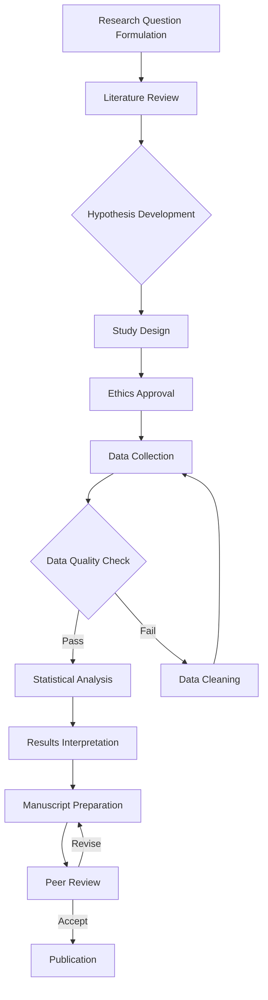

The diagram above, generated from the code block below, illustrates a complete research workflow from initial question formulation through publication. Such visualizations help readers understand complex processes at a glance and serve as valuable planning tools for research teams.

```markdown

```

### Example: Sequence Diagram for Research Collaboration

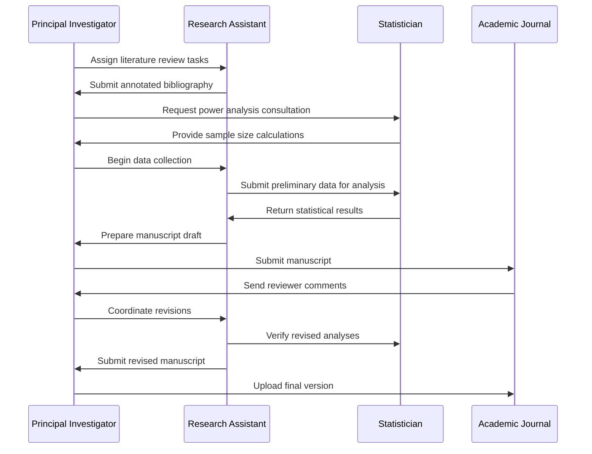

<br>

## 6. Integrating HTML and Multimedia Elements

While Markdown handles the vast majority of formatting needs for technical documentation, there are situations where precise control over layout, embedding, or styling requires the power of HTML. Markdown's design anticipates this need by allowing seamless HTML integration: any valid HTML within a Markdown document is passed through to the rendered output, enabling authors to leverage the full capabilities of web technologies when necessary.

### 6.1. Inline HTML for Enhanced Styling

HTML tags provide styling options beyond Markdown's native capabilities, such as underlining, subscript, superscript, and inline color changes.

```markdown
The chemical formula for water is H<sub>2</sub>O, while Einstein's famous equation is E=mc<sup>2</sup>.

This text includes <ins>newly inserted content</ins> that was added during revision.

The <span style="color: #2c3e50; font-variant: small-caps;">University Research Division</span> requires all submissions to follow formatting guidelines.
```

**Best Practice:** Use HTML styling judiciously and only when Markdown's native formatting is insufficient. Overreliance on HTML can make documents harder to maintain and may reduce portability across different Markdown processors. When using inline styles, ensure that content remains readable even if HTML is not processed.

### 6.2. Advanced Image Control with HTML

While Markdown's native image syntax suffices for basic needs, HTML `` tags provide precise control over image dimensions, alignment, spacing, and responsive behavior.

- **Image Size and Alignment Control:**

```html
<!-- Left-aligned image with specified width -->


<!-- Centered image with border and rounded corners -->
<p align="center">
  
</p>

<!-- Right-aligned image with caption using figure/figcaption -->
<figure style="float: right; width: 250px; margin-left: 20px;">
  
  <figcaption style="text-align: center; font-style: italic; color: #666;">Figure 1: Power analysis showing required sample sizes</figcaption>
</figure>
```

- **Responsive Images for Light and Dark Mode:** The HTML `<picture>` element combined with the `prefers-color-scheme` media feature enables images that adapt to user theme preferences, an increasingly important consideration for modern documentation.

```html
<picture>
  <source media="(prefers-color-scheme: dark)" srcset="/images/university-logo-dark.png">
  <source media="(prefers-color-scheme: light)" srcset="/images/university-logo-light.png">
  
</picture>
```

This technique ensures that logos, diagrams, and other visual elements remain clearly visible regardless of whether users have configured their systems for light or dark mode, improving accessibility and user experience.

- **Image Galleries with Horizontal Arrangement:**

```html
<div style="display: flex; justify-content: space-between; gap: 10px;">
  <div style="text-align: center;">
    
    <p><em>Phase 1: Planning</em></p>
  </div>
  <div style="text-align: center;">
    
    <p><em>Phase 2: Data Collection</em></p>
  </div>
  <div style="text-align: center;">
    
    <p><em>Phase 3: Analysis</em></p>
  </div>
</div>
```

### 6.3. Video Embedding for Multimedia Content

Documentation increasingly incorporates video content for tutorials, demonstrations, and presentations. HTML5 video tags enable native video playback directly within Markdown documents.

```html
<video width="100%" controls poster="/images/video-thumbnail.jpg">
  <source src="/videos/methodology-demo.mp4" type="video/mp4">
  <source src="/videos/methodology-demo.webm" type="video/webm">
  Your browser does not support the video tag. 
  <a href="/videos/methodology-demo.mp4">Download the video</a> instead.
</video>
```

For platform-specific video hosting, such as YouTube or Vimeo, embed codes can be inserted directly:

```html
<iframe width="560" height="315" src="https://www.youtube.com/embed/VIDEO_ID" 
        title="Research methodology tutorial" frameborder="0" 
        allow="accelerometer; autoplay; clipboard-write; encrypted-media; gyroscope; picture-in-picture" 
        allowfullscreen>
</iframe>
```

### 6.4. Collapsible Sections for Progressive Disclosure

The HTML `<details>` and `<summary>` tags implement collapsible sections, enabling progressive disclosure of information. This technique is invaluable for documentation that must serve both novice users (who may need basic information) and advanced users (who require detailed technical specifications).

```html
<details>
<summary><strong>Click to expand: Detailed Statistical Methodology</strong></summary>

<p>This section provides comprehensive details about the statistical approaches used in this research.</p>

<h4>Primary Analysis Methods</h4>
<ul>
  <li>Multivariate analysis of variance (MANOVA) for group comparisons</li>
  <li>Hierarchical linear modeling for nested data structures</li>
  <li>Structural equation modeling for latent variable analysis</li>
</ul>

<h4>Software and Parameters</h4>
<p>Analyses were conducted using R version 4.3.1 with the following packages:</p>
<pre><code>library(lavaan)    # For structural equation modeling
library(lme4)      # For hierarchical linear models
library(car)       # For MANOVA and diagnostic tests
</code></pre>

<p>All code and data required to reproduce these analyses are available in the <a href="https://github.com/university-research/reproducible-code">reproducible research repository</a>.</p>

</details>
```

**Important Note:** To ensure that Markdown within the collapsible section is rendered correctly, include a blank line after the `</summary>` tag. This tells the Markdown processor that subsequent content should be interpreted as Markdown rather than raw HTML.

<br>

## 7. Markdown in Professional Workflows and Version Control

The true power of Markdown emerges when it is integrated into professional workflows, particularly those involving version control, collaborative editing, and automated publishing. This section explores how Markdown functions as a cornerstone of modern documentation practices.

### 7.1. The Synergistic Relationship Between Markdown and Git

Git, the dominant version control system in research and software development, finds its ideal partner in Markdown. Their combination creates a documentation environment that surpasses traditional word processing in every dimension relevant to collaborative knowledge work.

- **Granular Change Tracking:** Git's `diff` functionality displays exactly what changed between document versions at the character and line level. When a collaborator revises a paragraph, Git shows precisely which words were added, which were removed, and how sentences were restructured. This granularity is impossible with binary formats like `.docx`, which appear as opaque blobs to version control systems. For research teams tracking the evolution of manuscripts, this transparency enables precise attribution of contributions and facilitates thorough review processes.

- **Branching and Parallel Development:** Git's branching model allows multiple team members to work on different aspects of documentation simultaneously without interfering with each other. A research assistant can create a branch to draft a new methodology section while the principal investigator simultaneously revises the introduction on a separate branch. These parallel streams of work can later be merged, with Git intelligently combining changes and flagging any conflicts for resolution. This capability fundamentally transforms collaborative writing from a sequential, lock-based process to a truly parallel endeavor.

- **Pull Request Collaboration:** Platforms like GitHub, GitLab, and Bitbucket build upon Git's foundation with pull request workflows that formalize the review and integration process. When a collaborator completes work on a documentation branch, they submit a pull request proposing that their changes be merged into the main document. Team members can then review the changes line by line, add comments, suggest improvements, and discuss modifications before the changes are finally integrated. This workflow, originally developed for software code review, has proven equally valuable for scholarly and technical documentation.

- **Complete Document History:** Git maintains the complete history of every document, enabling authors to revisit any previous version, understand how the document evolved, and revert changes when necessary. This historical record serves both practical needs (recovering accidentally deleted content) and scholarly purposes (documenting the development of ideas and arguments).

### 7.2. Static Site Generators: From Markdown to Web Presence

Static site generators (SSGs) represent one of the most powerful applications of Markdown, enabling the creation of sophisticated websites from simple Markdown source files. These tools combine Markdown content with templates and themes to generate complete static HTML sites that are fast, secure, and easily deployable.

| Static Site Generator | Primary Language | Key Strengths | Ideal Use Cases |
|:----------------------|:-----------------|:---------------|:-----------------|
| **Jekyll** | Ruby | Tight GitHub Pages integration, extensive plugin ecosystem | Personal blogs, project documentation, academic personal sites |
| **Hugo** | Go | Exceptional build speed, flexible content organization | Large documentation sites, multi-language sites, performance-critical applications |
| **Gatsby** | JavaScript/React | Dynamic capabilities, rich plugin ecosystem, optimal performance | Interactive documentation, modern web applications, sites requiring complex functionality |
| **Next.js** | JavaScript/React | File-based routing, hybrid static/dynamic rendering, excellent developer experience | Enterprise documentation, applications requiring both static and dynamic content |
| **MkDocs** | Python | Python ecosystem integration, designed specifically for documentation | Technical documentation, API references, project wikis |

**Workflow Overview:** A typical static site workflow begins with content creation in Markdown files, organized according to the SSG's content structure requirements. The author writes documentation using standard Markdown syntax, possibly enhanced with YAML frontmatter for metadata like titles, dates, and categories. The SSG processes these Markdown files, applies the selected theme or template, and generates a complete website comprising HTML, CSS, and JavaScript files. These static files can then be deployed to any web hosting service, from GitHub Pages to enterprise content delivery networks.

### 7.3. Pandoc: The Universal Document Converter

Pandoc stands as an indispensable tool in any serious Markdown user's arsenal. Developed by philosopher and programmer John MacFarlane, Pandoc can convert documents between virtually any markup format, with Markdown serving as a central hub in its translation network.

**Key Pandoc Capabilities:**

- **Multi-Format Conversion:** Pandoc reads Markdown and outputs to HTML, PDF (via LaTeX), Microsoft Word (.docx), OpenDocument (.odt), LibreOffice, EPUB, DocBook, JATS (for academic publishing), and dozens of other formats. This capability enables single-source publishing workflows where a Markdown master document generates all required output formats.

- **Academic Writing Support:** Pandoc includes sophisticated citation processing, working with CSL (Citation Style Language) files to format citations and bibliographies according to thousands of journal styles. Researchers can write in Markdown, manage references in BibTeX or other formats, and generate perfectly formatted papers ready for submission.

- **Template System:** Pandoc's template system allows complete control over output formatting. Users can create custom templates for PDFs, HTML pages, or Word documents, ensuring that generated output adheres to specific formatting requirements.

**Common Pandoc Commands:**

```bash
# Convert Markdown to PDF with default settings
pandoc manuscript.md -o manuscript.pdf

# Convert Markdown to Word document with custom reference styles
pandoc thesis.md --reference-doc=university-template.docx -o thesis.docx

# Convert multiple Markdown files to a single EPUB e-book
pandoc chapter1.md chapter2.md chapter3.md -o research-compendium.epub

# Generate HTML with table of contents and syntax highlighting
pandoc documentation.md --toc --highlight-style=pygments -o documentation.html

# Academic paper with citations and bibliography
pandoc paper.md --bibliography=references.bib --csl=apa.csl -o paper.pdf
```

### 7.4. Markdown for Project Documentation

Markdown's simplicity and version control compatibility make it the ideal format for various project management documents that benefit from collaborative editing and version tracking.

- **README Files:** The entry point for any software project, README files explain project purpose, installation procedures, usage examples, and contribution guidelines. GitHub and similar platforms automatically render README.md files on repository homepages, making them the first thing visitors see.

- **Changelogs:** Maintaining a changelog in Markdown provides a clear, readable history of project versions and changes. The format supports linking to issues, pull requests, and contributors, creating a comprehensive project narrative.

- **Meeting Minutes and Decision Records:** Research teams and project groups can maintain meeting minutes in Markdown, tracking decisions, action items, and discussion points with full version history. Architecture Decision Records (ADRs) document significant technical decisions with their context and consequences.

- **Project Proposals and Grant Applications:** Markdown's focus on content over formatting benefits proposal writing, allowing authors to concentrate on argumentation and evidence while maintaining consistent structure. Version control tracks how proposals evolve in response to feedback.

<br>

## 8. Markdown Learning Roadmap: A Structured Path from Beginner to Mastery

Mastering Markdown, like any significant skill, benefits from a structured approach to learning. The following roadmap outlines a progressive journey from complete novice to expert practitioner, with each phase building upon the foundations established in previous stages.


### Phase 1: Foundation (Beginner Level)

**Objective:** Understand what Markdown is, why it matters, and gain proficiency with core syntax elements through hands-on practice.

The foundation phase focuses on building a solid conceptual understanding and practical capability with Markdown's most essential features. Begin by exploring the philosophy behind lightweight markup languages and why plain text has become the preferred format for technical documentation. Install a Markdown editor appropriate for your operating system and preferences—options range from simple text editors with Markdown plugins to dedicated writing applications like Typora or Obsidian.

Master the core syntax elements that will form the basis of all your Markdown writing: headings for document structure, paragraphs and line breaks for text organization, emphasis for highlighting important concepts, lists for sequential and non-sequential information, links for connecting to resources, and images for visual content. Practice these elements by creating a simple personal document—perhaps a README for your professional profile, a set of research notes, or a personal knowledge base entry.

The goal of this phase is not merely to know the syntax but to internalize it to the point where formatting becomes automatic, allowing you to focus entirely on content creation. By the end of this phase, you should be able to create a well-structured, readable document without referring to documentation or examples.

### Phase 2: Skill Development (Intermediate Level)

**Objective:** Expand your syntax knowledge, explore different Markdown flavors, and apply your skills to practical documentation projects.

With the foundation established, Phase 2 introduces more sophisticated formatting elements that enable richer document structures. Learn to create and format tables for data presentation, use blockquotes effectively for citations and excerpts, implement inline and fenced code blocks with syntax highlighting, and understand the nuances of nested lists and complex list structures.

This phase also introduces the important concept of Markdown flavors—variations and extensions of the original specification. GitHub Flavored Markdown receives particular attention due to its widespread adoption, but you should also understand CommonMark (the standardized specification) and other flavors you may encounter. Explore how different platforms implement Markdown and what extensions they support.

Apply these expanded skills to a practical project. Create a technical documentation page for a process you understand well—perhaps software installation instructions, a laboratory protocol, or a research methodology guide. This project should demonstrate your ability to structure information effectively, use tables for data presentation, include code examples where appropriate, and create a professional-looking document that serves real users.

### Phase 3: Workflow Integration (Advanced Beginner to Intermediate)

**Objective:** Integrate Markdown with professional tools and workflows, including version control, document conversion, and static site generation.

Phase 3 marks the transition from using Markdown as a personal writing tool to leveraging it within professional workflows. Begin by learning Git basics—initializing repositories, committing changes, viewing history, and collaborating with remote repositories on platforms like GitHub. Practice version-controlling your Markdown documents, experimenting with branching and merging to understand how these capabilities transform collaborative writing.

Introduce Pandoc for document conversion, learning to transform your Markdown files into PDF, Word, HTML, and other formats. Experiment with Pandoc's template system to customize output, and if you work in academic contexts, explore its citation processing capabilities for research papers.

Finally, dip your toes into static site generation by building a simple website with Jekyll, Hugo, or another SSG of your choice. Create a few Markdown pages, apply a theme, and deploy the resulting site through GitHub Pages or another hosting service. This experience demonstrates how Markdown serves as the foundation for entire websites and documentation portals.

### Phase 4: Advanced Applications (Advanced Level)

**Objective:** Apply Markdown to professional documentation contexts, collaborate effectively in teams, and manage complex multi-page projects.

At the advanced level, focus shifts to applying Markdown in professional contexts with real-world constraints and requirements. Learn to write API documentation that clearly communicates interface specifications, parameters, and examples. Practice structuring research papers with proper citations, figures, and supplementary materials. Develop documentation that serves both novice and expert users through progressive disclosure and thoughtful organization.

Master team collaboration workflows involving pull requests, code reviews, and continuous integration. Establish documentation style guides that ensure consistency across team members and projects. Create reusable templates for common document types, reducing duplication of effort and maintaining uniformity.

Tackle a complex, multi-page project such as a complete software documentation set, a research compendium with multiple chapters, or a comprehensive knowledge base. This project should demonstrate your ability to manage cross-references, maintain consistent formatting across many files, and organize information for different user needs.

### Phase 5: Mastery and Community Contribution (Expert Level)

**Objective:** Achieve true mastery by applying Markdown to specialized domains, contributing to the community, and innovating in documentation practices.

The mastery phase represents the culmination of your Markdown journey, where you move from competent practitioner to expert capable of teaching others, solving novel problems, and contributing to the ecosystem. Explore specialized applications such as creating slide presentations with Marp or Reveal.js, authoring e-books for distribution, or building interactive documentation with modern JavaScript frameworks.

Engage with the Markdown community by contributing to open-source documentation projects, writing tutorials that help others learn, or answering questions on platforms like Stack Overflow or GitHub Discussions. Consider developing resources for specific communities—perhaps creating documentation templates for your academic department or leading workshops for colleagues.

At the highest level of mastery, you may innovate in documentation practices—designing workflows that combine Markdown with other tools in novel ways, creating custom templates or tools that address specific needs, or contributing to the development of Markdown specifications and processors. This phase recognizes that true expertise involves not just using tools effectively but also advancing how others use them.

<br>

## 9. Tools and Resources for Markdown Authors

The Markdown ecosystem offers a rich variety of tools supporting every stage of the writing and documentation process. This curated list represents the most valuable resources for Markdown authors at all skill levels.

### Markdown Editors and Writing Environments

| Tool | Platform | Key Features | Best For |
|:-----|:---------|:--------------|:---------|
| **Visual Studio Code** | Windows, macOS, Linux | Extensive extension marketplace, integrated terminal, Git integration, live preview, debugging support | Technical authors who also write code, users wanting a customizable environment |
| **Typora** | Windows, macOS, Linux | Minimalist interface, seamless live preview (WYSIWYM), focus mode, theme support, PDF/HTML export | Writers who prefer distraction-free environments with immediate visual feedback |
| **Obsidian** | Windows, macOS, Linux, iOS, Android | Bi-directional linking, graph visualization, knowledge base management, extensive plugin system | Researchers and knowledge workers building interconnected notes and personal wikis |
| **iA Writer** | Windows, macOS, iOS, Android | Focus mode with syntax highlighting, document statistics, library organization, seamless syncing | Professional writers and academics requiring clean, focused writing experience |
| **Zettlr** | Windows, macOS, Linux | Academic-focused features, citation management, Zettelkasten methodology support, Pandoc integration | Researchers and academics writing papers with extensive citations |
| **Dillinger** | Web-based | Browser-based editing, live HTML preview, cloud storage integration, export options | Beginners exploring Markdown, users needing quick access without installation |
| **HackMD / CodiMD** | Web-based | Real-time collaboration, slide mode presentations, version control, team workspaces | Teams collaborating on documents, meeting notes, and shared documentation |

### Conversion and Processing Tools

- **Pandoc:** The universal document converter, essential for any serious Markdown workflow. Converts between Markdown and dozens of formats including PDF, Word, HTML, EPUB, LaTeX, and JATS. Supports citations, custom templates, and complex document transformations.

- **Marp:** Converts Markdown to presentation slide decks in multiple formats. Supports themes, custom styling, and export to PDF, PowerPoint, and HTML. Ideal for researchers and educators creating presentation materials from Markdown source.

- **markdownlint:** A linter for Markdown files that enforces consistency and identifies potential issues. Available as a command-line tool and as extensions for most editors. Helps teams maintain style guide compliance.

- **Markdown Magic:** Automates generation and updating of Markdown content such as tables of contents, badges, and embedded examples. Particularly useful for maintaining large documentation sets.

### Learning and Reference Resources

- **The Markdown Guide ([www.markdownguide.org](https://www.markdownguide.org)):** A comprehensive, free reference covering basic and extended syntax with clear examples and explanations. Includes sections for specific tools and applications.

- **GitHub Guides: Mastering Markdown:** GitHub's official introduction to Markdown, focusing on GFM features and practical applications in software development contexts.

- **CommonMark Specification ([commonmark.org](https://commonmark.org)):** The official specification for standardized Markdown, providing definitive answers about correct syntax interpretation.

- **GitHub Flavored Markdown Specification:** Complete documentation of GFM extensions and their implementation details.

- **Pandoc User's Guide:** Comprehensive documentation for Pandoc, including all options, templates, and advanced features.

### Reference Books

- *The Markdown Guide* by Matt Cone: A practical, example-driven introduction to Markdown for writers and documentarians.
- *Mastering Markdown* by Z.Y. Mehta: Comprehensive coverage of Markdown syntax, flavors, and applications across domains.
- *Pandoc for Academics* by Anna P. Murray: Focused guide to using Pandoc for research writing, thesis preparation, and scholarly publishing.

<br>

## 10. Conclusion: The Future of Documentation with Markdown

Markdown represents far more than a syntax for formatting text—it embodies a philosophy about how written communication should function in the digital age. From its inception in 2004 as a personal tool for John Gruber and Aaron Swartz, Markdown has grown into a global standard that underpins the documentation practices of countless open-source projects, technology companies, academic institutions, and individual knowledge workers. Its longevity and widespread adoption attest to the enduring value of its core principles: simplicity, readability, accessibility, and future-proofing through plain text.

The future of Markdown appears intrinsically linked to the dominant trends in modern knowledge work. As collaboration becomes increasingly distributed and digital, the need for a universal, versionable, and platform-independent format only intensifies. We observe this in the explosive growth of Markdown-based knowledge management systems like Obsidian and Roam Research, which enable individuals to build interconnected personal knowledge bases. We see it in the continued dominance of static site generators for web publishing, where Markdown serves as the content foundation for millions of websites. And we witness it in the deep integration of Markdown into the platforms where technical and scholarly work happens—GitHub, GitLab, Stack Overflow, and countless academic journals now accepting Markdown submissions.

Emerging tools continue to extend Markdown's capabilities and accessibility. Browser-based editors with real-time collaboration capabilities bring Markdown to teams who might otherwise default to traditional word processors. Enhanced rendering engines support increasingly sophisticated diagrams, mathematical notation, and interactive elements. Integration with artificial intelligence tools promises to further streamline documentation workflows, suggesting improvements, generating examples, and maintaining consistency across large document sets.

For the individual writer, researcher, or documentarian, Markdown offers a path to greater productivity, reduced friction, and increased confidence that their work will remain accessible for decades to come. The time invested in learning Markdown pays dividends across virtually every writing task, from quick notes to complex technical documentation. By embracing Markdown, writers join a community committed to the principle that content should take precedence over presentation, that documents should be readable in any environment, and that knowledge should be preserved in formats that outlast the tools used to create them.

This guide has provided the foundational knowledge and advanced insights necessary to begin or deepen your journey with Markdown. The structured roadmap offers a path from novice to expert, while the comprehensive syntax reference ensures you always have the information needed for any documentation task. As you apply these lessons in your own work, remember that Markdown's greatest strength lies not in any single feature but in its coherent philosophy: that writing should be simple, durable, and focused on what matters most—the ideas themselves.

<br><br><br><br>

<h1 align="center">Using ASCII Characters in Markdown Documentation.</h1>

<br>

~~~
   ███     ██████   ██████  ████ ████       ███    ████████  ████████ 
  ██ ██   ██    ██ ██    ██  ██   ██       ██ ██   ██     ██    ██    
 ██   ██  ██       ██        ██   ██      ██   ██  ██     ██    ██    
██     ██  ██████  ██        ██   ██     ██     ██ ████████     ██    
█████████       ██ ██        ██   ██     █████████ ██   ██      ██    
██     ██ ██    ██ ██    ██  ██   ██     ██     ██ ██    ██     ██    
██     ██  ██████   ██████  ████ ████    ██     ██ ██     ██    ██
~~~

<br>

Despite the prevalence of sophisticated graphics, emojis, and interactive diagrams in modern documentation, ASCII characters—the foundational text-based symbols of computing—remain an indispensable tool for technical writers. ASCII assets, including structural dividers, arrows, status markers, and text-based diagrams, offer unique advantages in environments where rendering fidelity cannot be guaranteed. This section explores the strategic use of ASCII characters in Markdown documentation, providing practical patterns, best practices, and guidance for maintaining compatibility across diverse platforms.

### What Are ASCII Assets?

ASCII assets are text-renderable visual elements constructed from the 7-bit ASCII character set, though in practice many documentarians also include extended Unicode symbols for enhanced aesthetics while maintaining fallback strategies. These assets serve as lightweight, portable alternatives to images and complex formatting. Common examples include:

- **Structural dividers:** `---`, `===`, `***` for separating sections
- **Arrows and flow indicators:** `->`, `=>`, `-->` for representing direction
- **Status markers:** `[x]`, `[ ]`, `[!]`, `[i]` for indicating completion or importance
- **Text-based diagrams:** directory trees, simple architecture blocks, flowcharts
- **Boxes and frames:** `+---+`, `|   |` for creating visual containers
- **Progress indicators:** `[#####-----]` for showing completion percentages

The term "ASCII assets" traditionally refers to characters within the 7-bit range (0–127), which guarantees rendering across virtually any system. However, modern documentation often incorporates Unicode symbols where compatibility is assured, balancing expressiveness with portability.

### Why ASCII Still Matters in Contemporary Documentation

- **Universal Compatibility Across Environments:** ASCII characters render correctly in every conceivable environment where text appears—terminals, continuous integration and deployment logs, plain-text emails, Git diffs, code review interfaces, and minimal Markdown renderers. Unlike images or even Unicode emojis, which may display inconsistently across platforms or require specific font support, pure ASCII guarantees that your documentation remains readable regardless of the reader's setup. For open-source projects distributed globally, this universal compatibility ensures that contributors from diverse technical backgrounds can access and understand documentation without encountering rendering artifacts.

- **Version Control Friendliness:** Text-based visual elements produce clean diffs in version control systems, allowing collaborators to see precisely how diagrams or structural elements change over time. When you modify an ASCII diagram, Git displays the exact lines added, removed, or modified, making code reviews more transparent. Binary image formats, by contrast, appear as opaque blobs that cannot be meaningfully compared. ASCII assets also merge predictably when multiple contributors modify the same document, reducing the likelihood of conflicts that require manual resolution.

- **Minimal Overhead and Dependencies:** ASCII assets require no image generation tools, no asset pipelines, and no hosting infrastructure. They are self-contained within the Markdown file, making documentation portable and reducing the complexity of build processes. For teams working in constrained environments—such as air-gapped systems, legacy infrastructure, or resource-limited development containers—this low overhead is invaluable. Documentation remains functional without relying on external services or specialized rendering software.

- **Long-Term Accessibility:** ASCII text will remain readable for as long as humans understand written language. Unlike proprietary image formats or even widely used standards like PNG, which may become obsolete or require specific decoders, ASCII is the most enduring form of digital communication. Documents containing ASCII assets created decades ago remain perfectly intelligible today, a guarantee that cannot be made for more complex media.

### Core ASCII Patterns for Markdown Documentation

#### Section Dividers and Structural Elements

Dividers provide visual separation between major document sections, helping readers navigate long documents. Markdown natively supports horizontal rules created with three or more hyphens, asterisks, or underscores, but ASCII patterns can enhance this basic functionality.

```markdown
# Major Section

Content for the first major section.

---

## Subsection Within Major Section

Additional content.

==================================================

## Another Major Section

The double line of equal signs provides stronger visual separation than a single horizontal rule, useful for distinguishing top-level divisions.
```

For more elaborate structural headers, ASCII boxes can frame section titles, particularly in documentation intended for terminal display or code comments:

```markdown
+----------------------+
|   Configuration      |
+----------------------+

The configuration section below explains all available options.
```

####  Status Indicators and Checklists

Status indicators convey the state of tasks, features, or components at a glance. While Markdown task lists using `[ ]` and `[x]` are widely supported, additional ASCII markers can enrich status communication:

```markdown
- [x] Core functionality implemented
- [ ] Performance optimization pending
- [ ] Documentation in progress

[OK]   Build passes all tests
[FAIL] Integration tests failing
[WARN] Deprecated API in use
[INFO] Default configuration applied
```

These patterns are particularly effective in changelogs, release notes, and project roadmaps where readers need to quickly assess progress or identify issues.

#### ASCII Arrows for Flow Representation

Arrows provide intuitive visual cues for direction, sequence, and relationships. Simple ASCII arrows work across all platforms:

```markdown
Data Flow: User Input → Validation → Processing → Storage

Decision Path:
Start
  |
  v
Input Valid?
  | Yes
  v
Process → Save → Done
  |
  | No
  v
Display Error
```

For more complex flows, combinations of arrows and indentation can represent branching logic without requiring diagramming tools.

####  Simple Tables Using ASCII

While Markdown supports pipe-based tables, ASCII tables offer an alternative when maximum compatibility is required or when tables must remain readable in raw text:

```markdown
+----------------+------------------+------------------+
| Feature        | Status           | Version          |
+----------------+------------------+------------------+
| Authentication | Complete         | 2.1.0            |
| Authorization  | In Progress      | 2.2.0 (planned)  |
| API Rate Limit | Under Review     | 2.3.0            |
+----------------+------------------+------------------+
```

This format renders cleanly in any monospace environment and can be easily edited with standard text editors.

### ASCII Diagrams in Documentation

#### Directory Trees

File and directory structure visualization is one of the most common uses of ASCII in software documentation. The tree format, popularized by Unix commands and adopted by countless open-source projects, provides immediate understanding of project organization:

```markdown
project-root/
├── src/
│   ├── main.py
│   ├── utils.py
│   └── modules/
│       ├── auth.py
│       └── database.py
├── tests/
│   ├── test_main.py
│   └── test_utils.py
├── docs/
│   └── guide.md
├── README.md
└── LICENSE
```

This pattern requires no special tools—any text editor can create and maintain it, and it remains perfectly readable in version control diffs and code reviews.

####  Architecture Block Diagrams

For simple system architectures, ASCII block diagrams communicate component relationships effectively:

```markdown
+-------------+     +-------------+     +-------------+
|   Client    | --> |   Backend   | --> |  Database   |
|  (Browser)  |     |   (API)     |     |  (Postgres) |
+-------------+     +-------------+     +-------------+
                          |
                          v
                    +-------------+
                    |   Cache     |
                    |   (Redis)   |
                    +-------------+
```

Such diagrams are ideal when:
- The system architecture is straightforward and doesn't require precise visual rendering
- Documentation must remain functional in text-only environments
- Contributors need to suggest modifications through pull requests

####  Flowcharts and Process Diagrams

Simple flowcharts can be constructed using ASCII characters, though they require careful alignment:

```markdown
         +-----------------+
         | Start Request   |
         +-----------------+
                  |
                  v
         +-----------------+
         | Authenticate    |
         | User            |
         +-----------------+
                  |
         +--------+--------+
         |                 |
         v                 v
+-----------------+  +-----------------+
| Valid Token     |  | Invalid Token   |
| Proceed         |  | Return 401      |
+-----------------+  +-----------------+
         |                 |
         +--------+--------+
                  |
                  v
         +-----------------+
         | Process Request |
         +-----------------+
```

For more complex flows, dedicated diagramming tools like Mermaid (covered in Section 5) are preferable, but ASCII remains a reliable fallback.

### in Coding Workflows

#### Commit Message Conventions

Consistent ASCII prefixes in commit messages improve log readability and enable automated tooling:

```text
[FEAT] Add user authentication endpoint
[FIX]  Resolve null pointer exception in service layer
[DOCS] Update API examples in README
[TEST] Add integration tests for payment flow
[REF]  Simplify database connection handling
```

These tags, while simple, create scannable commit histories and can be parsed by scripts for changelog generation.

####  Command-Line Interface Help Output

ASCII formatting enhances the readability of terminal-based help text without requiring formatting libraries:

```text
USAGE
-----
  app [OPTIONS] <command>

COMMANDS
--------
  start    Launch the application server
  stop     Terminate running server
  status   Display current server status

OPTIONS
-------
  --config FILE   Specify configuration file
  --port NUMBER   Set listening port (default: 8080)
  --help          Show this help message
```

The consistent use of dividers and indentation creates a professional, organized appearance that respects terminal constraints.

####  Log Formatting

ASCII markers in log messages enable quick visual scanning and simple filtering:

```text
[INFO]  Server listening on port 8080
[WARN]  Configuration file not found, using defaults
[ERROR] Database connection timeout after 30 seconds
[DEBUG] Processing request ID: 12345
```

These prefixes survive log rotation, compression, and transport across systems, maintaining their utility in aggregated logging platforms.

####  Code Comments

ASCII can structure lengthy code comments, making them easier to navigate:

```python
# =====================================
# Authentication Module
# =====================================
# This module handles user authentication,
# token validation, and session management.

# -------------------------------------
# Token Generation
# -------------------------------------
def generate_token(user_id):
    # Implementation details...
    pass

# -------------------------------------
# Token Validation
# -------------------------------------
def validate_token(token):
    # Implementation details...
    pass
```

Such visual structuring aids developers working with large files and creates clear separation between logical sections.

###  Pure ASCII versus Unicode: A Decision Framework

While pure ASCII guarantees universal compatibility, Unicode symbols offer greater expressiveness and visual appeal. The choice depends on your documentation's target environment and audience.

| Use Case | Pure ASCII Recommended | Unicode Acceptable | Notes |
|:---------|:----------------------:|:------------------:|:------|
| CI/CD logs and terminal output | ✓ | | Logging systems may mishandle Unicode, causing garbled output |
| README files on GitHub/GitLab | | ✓ | GitHub fully supports Unicode, including emojis |
| Public package documentation | ✓ | | Users may view docs in various environments; ASCII ensures consistency |
| Internal team wikis | | ✓ | Team can standardize on Unicode if all members have compatible setups |
| Code comments | ✓ | | Comments should remain readable in any editor, including minimal terminals |
| Plain-text email distribution | ✓ | | Email clients vary widely in Unicode support |
| Scientific/technical papers | ✓ | | Publication pipelines may strip or mishandle Unicode |

When in doubt, prefer pure ASCII for critical structural elements and reserve Unicode for embellishments that do not affect comprehension if missing.

###  Best Practices for ASCII Usage in Markdown

- **Maintain Functional Purpose:** ASCII elements should enhance clarity and organization, not merely decorate. Avoid gratuitous use of symbols that distract from content. Every ASCII character should serve a purpose—guiding the reader, indicating status, or illustrating structure.

- **Establish Consistent Conventions:** Define and document standards for your team or project. Decide on specific symbols for status indicators (e.g., `[OK]` vs `✓`), divider styles, and diagram formats. Consistency reduces cognitive load and makes documentation more predictable.

- **Optimize for Raw Viewing:** Always preview your Markdown documents in plain text mode, without rendering. Ensure that tables align, diagrams remain coherent, and no critical information depends on visual rendering that may be absent. This practice guarantees that documentation remains useful even when accessed through minimal interfaces.

- **Respect Width Constraints:** Terminal windows and code review interfaces typically default to 80 characters width. Design ASCII diagrams and tables to remain readable within this limit, or ensure they wrap gracefully. Long lines that exceed typical widths become difficult to read and may require horizontal scrolling.

- **Test Across Environments:** If your documentation targets diverse platforms, test ASCII assets in a representative sample—GitHub's web interface, a terminal with monospace font, a mobile browser, and a plain text editor. Identify and address any rendering inconsistencies.

###  Limitations of ASCII in Documentation

- **Complexity Constraints:** ASCII diagrams become unwieldy for complex systems with many components or intricate relationships. Attempting to represent highly detailed architectures with ASCII often results in confusing, hard-to-maintain text art. For such cases, consider vector graphics or dedicated diagramming tools that can be included as images or embedded as Mermaid diagrams.

- **Lack of Responsive Layout:** ASCII diagrams are static and cannot adapt to different screen sizes or orientations. On mobile devices, they may appear tiny or require zooming. This limitation reinforces the importance of keeping ASCII simple and ensuring that textual descriptions accompany visual elements.

- **No Native Color or Styling:** ASCII provides no mechanism for color, font variation, or interactive elements. While this simplicity is a strength in constrained environments, it limits expressiveness. When color conveys essential information (e.g., red for errors, green for success), supplement ASCII indicators with explicit text.

- **Manual Maintenance Overhead:** Large ASCII diagrams require careful manual alignment and become difficult to update as systems evolve. Each modification demands attention to spacing and formatting, increasing the risk of errors. Automate diagram generation where possible, or establish periodic reviews to ensure accuracy.

### 1Example: A Clean README Skeleton Using ASCII

The following example demonstrates how ASCII elements can create a well-structured, professional README that renders beautifully both in rendered Markdown and raw text:

```markdown
# Project Name
==================================================

## Overview
------------
A brief description of what this project does and who it's for.

## Installation
----------------
- [ ] Clone the repository
- [ ] Install dependencies using `npm install`
- [ ] Configure environment variables
- [ ] Run `npm start` to launch the application

## Architecture
---------------
Client Application → API Gateway → Microservices → Database

+-------------+     +-------------+     +-------------+
|   React     | --> |   Express   | --> |  MongoDB    |
|   Frontend  |     |   Backend   |     |             |
+-------------+     +-------------+     +-------------+

## Status Indicators
--------------------
[OK]     Core functionality operational
[WARN]   Rate limiting not yet implemented
[INFO]   Version 2.0 scheduled for Q3

## Contributing
----------------
1. Fork the repository
2. Create a feature branch
3. Submit a pull request

## License
-----------
MIT
```

This structure remains clear and navigable in any environment, from GitHub's rendered view to a terminal running `cat README.md`.

###  Curated Collection of ASCII and Unicode Symbols for Reference

The following table provides a practical reference of symbols commonly used in documentation, categorized by function. For maximum compatibility, prefer symbols in the "ASCII" column when targeting diverse environments.

| Category | ASCII (7-bit) | Unicode (Extended) | Typical Usage |
|:---------|:--------------|:-------------------|:--------------|
| **Bullets** | `-`, `*`, `+`, `>` | `•`, `◦`, `▪`, `▸` | Unordered list items |
| **Arrows** | `->`, `<-`, `=>` | `→`, `←`, `⇒`, `➜` | Direction and flow |
| **Status** | `[ ]`, `[x]`, `[!]` | `✓`, `✗`, `⚠`, `ℹ` | Task completion, warnings, info |
| **Dividers** | `---`, `===`, `***` | `────────`, `════════` | Section separation |
| **Boxes** | `+---+`, `|   |` | `┌──┐`, `│  │`, `└──┘` | Creating visual containers |
| **Stars** | `*` | `★`, `☆`, `✦`, `✧` | Highlighting, ratings |
| **Faces** | `:)`, `:(` | `☺`, `☹`, `ಠ_ಠ` | Informal communication |
| **Trees** | `|`, `├`, `└`, `─` | Same as ASCII | Directory structure diagrams |

**Important Note:** Unicode symbols may render differently across operating systems, fonts, and applications. The smiling face `☺`, for example, appears as an emoji on some platforms and as a traditional symbol on others. Test Unicode usage thoroughly before deployment.

<br><br><br><br>


<h1 align="center">Obsidian: The Comprehensive Knowledge Management System.</h1>

<br><br>

## Introduction

Obsidian is a powerful, Markdown-based note-taking and knowledge management application that transforms scattered ideas into a cohesive, interconnected web of knowledge. Operating on an offline-first model with plain text files stored locally, it guarantees complete data ownership and privacy. Whether you are a student managing research, a writer outlining a book, a professional handling complex projects, or a researcher organizing citations, Obsidian provides the foundational tools and extensible architecture to build a personalized "second brain" that grows alongside your intellectual pursuits.

<br>

## Core Philosophy and Principles

Obsidian is built upon three foundational principles that distinguish it from conventional note-taking applications:

**Data Ownership and Control**: Obsidian prioritizes plain text files stored on your local file system. This approach ensures that your data remains accessible, portable, and editable in any text editor. You can back up your vault with Dropbox, use Git for version control, encrypt your disk for security, or employ any other file-system-based tool. Sync services are utilities for convenience, not the primary storage location.

**Links as First-Class Citizens**: Internal linking is central to the Obsidian experience. By connecting notes through `[[Note Title]]` syntax, users construct a densely networked knowledge base that mirrors the associative nature of human thought. This relational approach enables the discovery of patterns and connections that might otherwise remain hidden.

**Your Own Toolkit**: Note-taking is a deeply personal activity, and Obsidian does not impose a rigid, opinionated structure. Instead, it provides a robust foundation—the ability to view, edit, and search files—alongside numerous independent building blocks (core and community plugins) that users can selectively enable to craft their ideal workflow.

<br>

## Key Features

### Markdown-Based Note-Taking

Obsidian employs Markdown, a lightweight and intuitive formatting language, as its native syntax. This approach allows users to write in plain text while maintaining structured formatting that is both human-readable and machine-parseable. Obsidian's Markdown support extends to headings, lists, tables, code blocks, LaTeX mathematical expressions, and diagrams, making it a versatile tool for diverse content types.

### Linked Notes and Knowledge Graph

Obsidian's signature feature is its robust internal linking system, which enables users to create bidirectional connections between notes. The Graph View provides a dynamic, visual representation of these connections, displaying notes as nodes and links as lines. This visualization helps users identify relationships, patterns, and clusters within their knowledge base, fostering a deeper, more intuitive understanding of complex topics.

### Offline-First and Data Ownership

Unlike many cloud-dependent tools, Obsidian operates on an offline-first model. Your notes are stored locally as plain text Markdown files, ensuring that they remain accessible at all times, even without an internet connection. This architecture guarantees complete data ownership and privacy. For users who require synchronization across devices, Obsidian offers the optional, paid Obsidian Sync service with end-to-end encryption, selective sync, and version history. Third-party synchronization options, including self-hosted solutions, are also available.

### Plugin Ecosystem

Obsidian's thriving plugin ecosystem is a cornerstone of its flexibility and power. With over 1,000 community-developed plugins, users can extend the software's functionality to suit virtually any need. Plugins range from productivity tools and advanced data visualization to task management, calendar integration, and artificial intelligence-assisted note-taking. Developers can also create custom plugins using JavaScript, fostering a continuously evolving ecosystem.

### Obsidian Vault

An Obsidian vault is a designated folder on your file system that houses all your Markdown notes, attachments, and configuration files. This folder-based system ensures that your data remains organized, portable, and easily accessible. Vaults can be stored locally or synchronized using cloud services like Dropbox, Google Drive, or self-hosted solutions.

### Customizable Workspace

Obsidian's workspace is fully customizable, enabling users to design an environment that aligns with their workflow preferences. Features include:

- **Split Views**: Arrange multiple notes side by side for efficient reference and editing.
- **Themes**: Choose from a wide selection of community-developed themes or create custom CSS snippets.
- **Canvases**: Utilize infinite, spatial workspaces for visual note arrangement and brainstorming.
- **Command Palette**: Access virtually any action via keyboard shortcuts.

### Search and Backlinks

Obsidian provides powerful tools for information retrieval and discovery:

- **Advanced Search**: Filter notes by tags, links, metadata, or full-text content to locate specific information quickly.
- **Backlinks**: Automatically display notes that reference the current one, fostering a two-way exploration of ideas. This relational approach encourages deeper connections and a more holistic understanding of your knowledge base.
- **Quick Switcher**: Navigate between notes instantly using keyboard shortcuts.

### Visual and Map Integration

Visual thinkers benefit from Obsidian's Graph View, which provides an interactive representation of linked notes. Additionally, plugins like "Maps View" enable users to geotag notes, making Obsidian a valuable tool for researchers, travelers, and visual learners.

### Cross-Platform Access

Obsidian is available on Windows, macOS, Linux, iOS, and Android. Its cross-platform compatibility ensures that your notes are accessible anytime, anywhere. Synchronization features, whether through Obsidian Sync or third-party services, enable seamless transitions between devices without compromising offline accessibility.

<br>

## Advanced Features and Tools

### Canvas: Visual Thinking Workspace

Canvas is a core plugin that provides an infinite, spatial workspace for laying out notes and connecting them to other notes, attachments, and web pages. Unlike standard Markdown notes, Canvas files use the `.canvas` extension and are based on the open JSON Canvas format. Users can add three types of elements:

- **Cards**: Freeform text blocks created directly on the canvas by double-clicking anywhere.
- **Notes**: Existing notes from the vault, dragged in from the file explorer and editable directly on the canvas.
- **Media**: Images, PDFs, and other files that render directly on the canvas.

Connections between elements can be created by dragging from the edge of one element to another, with optional labels and arrow directions. Groups allow visual clustering of related elements. These connections exist only within the canvas to help visualize and map relationships without modifying the underlying notes. Canvas files are fully integrated with Obsidian's backlink and graph views.

### Dataview: Database-Like Querying

The Dataview plugin transforms your vault into a powerful, queryable database. With SQL-like query capabilities and dynamic filtering, Dataview enables the creation of sophisticated views such as task lists, project summaries, progress trackers, and dashboards. Users can generate dynamic tables, lists, and embedded queries based on note metadata, frontmatter, and content.

### Obsidian CLI

The Obsidian CLI (Command Line Interface), introduced in version 1.12, allows users to control Obsidian from their terminal for scripting, automation, and integration with external tools. This feature is particularly valuable for power users and developers seeking to incorporate Obsidian into broader automation workflows.

### Obsidian Sync

Obsidian Sync is the official, paid synchronization service offering:

- **End-to-End Encryption**: Ensures data privacy and security during transmission and storage.
- **Selective Sync**: Choose which folders or files to synchronize across devices.
- **Version History**: Access and restore previous versions of notes.

### Obsidian Web Clipper

The Obsidian Web Clipper is a browser extension that enables users to highlight and capture web content directly into their vault. It transforms Obsidian into a versatile tool for building recipe books, personal movie databases, travel planners, or read-it-later inboxes.

<br>

## Getting Started with Obsidian

### Installation and Vault Creation

To begin your Obsidian journey, visit [Obsidian.md](https://obsidian.md) and download the latest version compatible with your operating system. Follow the straightforward installation instructions to set up Obsidian on your device.

Upon first launch, you will be prompted to create or open a vault. A vault is simply a folder on your computer where all your notes will be stored. Choose a location that is easily accessible and regularly backed up. Consider the following best practices for vault setup:

- Prefer a single vault over multiple vaults to maintain a unified knowledge base.
- Minimize folder usage; rely on links, tags, and Maps of Content (MOCs) for structure.
- Avoid storing your vault in a random or hidden drive location.
- Implement regular backups, such as dragging your vault to an external drive or using Git.

### Familiarizing Yourself with the Interface

When starting with Obsidian, take time to familiarize yourself with its core interface components:

- **File Explorer**: Navigate and manage your notes and folders.
- **Editor**: Write and edit Markdown notes with Live Preview support.
- **Graph View**: Visualize connections between your notes.
- **Quick Switcher**: Rapidly navigate between notes using `Ctrl/Cmd-O`.
- **Command Palette**: Access all available commands via `Ctrl/Cmd-P`.

Experiment with note creation, Markdown syntax, and the interface to build a solid foundation. Document your learning process by taking notes on the features and techniques you discover. This practice reinforces understanding and creates a valuable resource for future reference.

### Note-Taking Practice and Workflow Development

As you navigate Obsidian, develop a personalized note-taking system that aligns with your goals and preferences:

- **Create Atomic Notes**: Focus on capturing a single idea or concept per note. This approach promotes clarity and flexibility, allowing you to build complex ideas by combining smaller, well-defined pieces of information.
- **Link Liberally**: Use internal links `[[Note Title]]` to connect related ideas. This practice builds your knowledge graph and facilitates discovery.
- **Use Templates**: Implement templates for consistent note structures, such as daily notes, meeting minutes, or project plans.
- **Leverage Tags**: Apply tags for categorization and filtering.
- **End Each Session with Cleanup**: Delete throwaway notes, correct names, and link the most important notes.

### Learning from Resources

Obsidian's official documentation and community forums are excellent resources for learning and support. Explore tutorials, guides, and tips shared by experienced users to accelerate your mastery of the platform. Engaging with the community provides inspiration and helps you discover new ways to use Obsidian effectively.

<br>

## The Power of Linking Notes

### Building Your Personal Wikipedia

By interlinking notes, you can build a comprehensive and easily navigable web of knowledge. This interconnected system acts as your personal encyclopedia, simplifying information retrieval and fostering deeper learning.

### Atomic Notes and Building Blocks

Focus on creating atomic notes that capture a single idea or concept. This approach promotes clarity and flexibility, allowing you to build complex ideas by combining smaller, well-defined pieces of information. Atomic notes serve as the foundation for larger projects, such as research papers, presentations, or creative works. By organizing your thoughts and ideas systematically, you unlock new levels of creativity and insight.

## Plugin Ecosystem: Essential Community Plugins

Obsidian's plugin ecosystem offers virtually unlimited customization. The following plugins are widely recommended for enhancing functionality:

| Plugin | Primary Function |
|--------|------------------|
| **Dataview** | Generate dynamic views and queries based on note metadata |
| **QuickAdd** | Speed up note creation with templates and predefined structures |
| **Omnisearch** | Enhanced search capabilities for finding notes |
| **Make.md** | Transform your vault into a more workspace-like environment |
| **Calendar** | Visual date-based note organization |
| **Kanban** | Task and project management with Kanban boards |
| **Excalidraw** | Create hand-drawn style diagrams and sketches |
| **Advanced Tables** | Enhanced Markdown table editing and management |
| **Icon Folder** | Add visual cues to folders and notes with custom icons |

### Getting Started with Plugins

To unlock the full potential of Obsidian, enable community plugins through the settings menu. After disabling restricted mode, browse the plugin library to discover tools that enhance your workflow. A recommended approach is to install a plugin only when you encounter a specific limitation, rather than installing many plugins simultaneously. Keep in mind that community plugins are independently developed, so their support and updates may vary.

## User Experience: A Structured Onboarding Approach

The following structured approach, based on a 7-day experimentation framework, facilitates effective adoption of Obsidian:

- **Day 1**: Familiarize yourself with the interface, explore themes, and learn hotkeys to navigate efficiently.
- **Day 2**: Import content from other platforms and begin organizing your ideas within Obsidian.
- **Day 3**: Plan the structure of your vault to prevent information overload and maintain clarity.
- **Day 4**: Research user workflows and implement templates to optimize your note-taking process.
- **Day 5**: Personalize your notes with unique structures that align with your objectives.
- **Day 6**: Apply techniques from foundational literature to refine your system and enhance its effectiveness.
- **Day 7**: Review your vault, evaluate the connections you've established, and identify opportunities for future growth.

After a week of dedicated use, users often report a profound sense of connection to their notes, deeper insights into their ideas, and a significant reduction in redundancy.

<br>

## Continuous Learning and Improvement

- **Stay Updated**: Keep up with the latest developments by following Obsidian's official changelog and community resources. Recent updates include a revamped Settings panel with built-in search and keyboard navigation, image resizing in Live Preview, automatic attachment cleanup, and the Obsidian CLI.
- **Read Foundational Books**: Enhance your knowledge management skills by reading "How to Take Smart Notes" by Sönke Ahrens and "Building a Second Brain" by Tiago Forte.
- **Apply What You Learn**: Continuously refine your note-taking techniques by applying new ideas and linking information in meaningful ways.
- **Join a Learning Community**: Connect with other Obsidian users to exchange resources, share progress, and overcome challenges together. Collaborative learning fosters growth and enriches your experience.

<br>

## Conclusion and Recommendations

Obsidian stands as a powerful and flexible tool for knowledge management, distinguished by its offline-first architecture, plain text data ownership, robust linking system, and extensive plugin ecosystem. Whether you are a casual note-taker or a seasoned professional, its extensive features and customizable options make it a worthy addition to your toolkit.

For new users, the recommended path forward is:

1. Download and install Obsidian from the official website.
2. Create a single vault in a well-backed-up location.
3. Familiarize yourself with the core interface and Markdown syntax.
4. Begin taking notes and linking them using `[[Note Title]]`.
5. Install plugins only as needs arise.
6. Engage with the community for support and inspiration.

<br>

> Obsidian transforms note-taking from a linear, isolated activity into a dynamic, interconnected process that mirrors and enhances natural thought. Download Obsidian today and explore its transformative potential for organizing your intellectual pursuits.

<br><br><br><br>

 
### Additional Resources

For more advanced tips and insights on Markdown, explore these resources:

- [GitHub Basic Writing and Formatting Syntax](https://docs.github.com/en/get-started/writing-on-github/getting-started-with-writing-and-formatting-on-github/basic-writing-and-formatting-syntax)
- [Quickstart for Writing on GitHub](https://docs.github.com/en/get-started/writing-on-github/getting-started-with-writing-and-formatting-on-github/quickstart-for-writing-on-github)
- [Organizing Information with Collapsed Sections](https://docs.github.com/en/get-started/writing-on-github/working-with-advanced-formatting/organizing-information-with-collapsed-sections)
- [Creating and Highlighting Code Blocks](https://docs.github.com/en/get-started/writing-on-github/working-with-advanced-formatting/creating-and-highlighting-code-blocks)
- [Autolinked References and URLs](https://docs.github.com/en/get-started/writing-on-github/working-with-advanced-formatting/autolinked-references-and-urls)
- [Advanced Markdown Guide by David Wells](https://github.com/DavidWells/advanced-markdown)
- [GitHub Flavored Markdown Specification](https://github.github.com/gfm/)
- [Comprehensive Markdown Guide](https://www.markdownguide.org/)

<br><br><br><br>

<h1 align="center">Using Markdown for Technical Documentation and Research.</h1>

<br><br>

## 1. Introduction

Markdown is a lightweight markup language that enables writers to format plain text documents using a simple and intuitive syntax. It has become a cornerstone of modern technical documentation and research workflows due to its versatility, accessibility, and compatibility with a wide range of tools and platforms.

This documentation provides a comprehensive overview of Markdown's capabilities, benefits, and applications in technical and research contexts. It serves as a guide for individuals and organizations seeking to adopt Markdown as their primary documentation format.

<br>

## 2. Core Philosophy

Markdown is built on three fundamental principles that make it suitable for technical documentation and research:

### 2.1 Simplicity
Markdown emphasizes minimal syntax to maximize readability. Documents remain accessible even to those unfamiliar with technical formatting, reducing cognitive load and allowing writers to focus on content rather than presentation. This approach makes Markdown an ideal choice for collaborative environments where contributors may have varying levels of technical expertise.

### 2.2 Portability
Markdown files are plain text documents that function seamlessly across all operating systems, including macOS, Windows, Linux, and mobile platforms. This cross-compatibility ensures longevity and ease of access, as documents can be opened and edited with any basic text editor or sophisticated development environment.

### 2.3 Extensibility
Markdown supports embedding HTML, LaTeX, and custom extensions, enabling advanced formatting capabilities when required. This flexibility allows users to adapt Markdown to specific documentation needs while maintaining the core simplicity of the format.

<br>

## 3. Why Markdown for Technical Documentation?

### 3.1 Platform Independence
Markdown files are simple text files that ensure compatibility across multiple operating systems without requiring proprietary software. Unlike formats such as PDF, which may require specific viewers, Markdown documents can be viewed and edited in basic text editors or integrated development environments.

### 3.2 Version Control Integration
Markdown is designed to work seamlessly with version control systems like Git. It allows granular tracking of changes, branching, and merging, which are essential for collaborative research, technical documentation, and academic publishing. Each revision is clearly documented, enabling teams to review historical changes and resolve conflicts efficiently.

### 3.3 Future-Proofing
As plain text, Markdown resists obsolescence. Unlike proprietary formats that may become incompatible over time, Markdown remains accessible, ensuring the long-term viability of documentation. Data stored in Markdown format can be read and processed well into the future.

### 3.4 Ease of Collaboration
Modern editors support real-time collaboration, allowing multiple authors to co-edit documents with synchronized previews and embedded comment systems. This streamlines feedback loops and accelerates the documentation process.

### 3.5 Consistency
Markdown enforces a uniform document structure through standardized syntax for headings, lists, code blocks, and other elements. This reduces formatting discrepancies and ensures documents maintain a polished and professional appearance regardless of who authored them.

<br>

## 4. Markdown vs. PDF: A Comparative Analysis

| Feature | Markdown | PDF |
|---------|----------|-----|
| Editable | Yes (plain text) | No (without specialized tools) |
| Version Control | Native Git support | Limited to file-level tracking |
| Accessibility | Screen-reader friendly (raw or HTML) | Depends on proper tagging |
| Interactive Elements | Supports HTML and JavaScript embeds | Static, non-interactive |
| Cross-Referencing | Hyperlinks and anchors for navigation | Bookmarks and internal links with limited flexibility |
| Multimedia Support | Embeds images, video, and audio with simple syntax | Embedded media, but less flexible |
| Output Flexibility | Convertible to HTML, PDF, DOCX, EPUB, and more | Fixed format, challenging to modify after creation |

<br>

## 5. Supported Extensions and Flavors

### 5.1 GitHub Flavored Markdown (GFM)
GFM enhances standard Markdown by adding features such as:
- Tables
- Task lists
- Strikethrough text
- Emoji support
- Automatic URL linking

This flavor is particularly well-suited for project documentation hosted on GitHub.

### 5.2 Pandoc Markdown
Pandoc Markdown is a powerful variant that supports:
- Citations and bibliographies
- LaTeX mathematical equations
- Footnotes
- Multi-format document exports

This flavor is ideal for academic and technical writing, as it enables seamless conversion to formats such as LaTeX, PDF, and Microsoft Word.

### 5.3 Markdown Extra
Markdown Extra introduces advanced features including:
- Classes and IDs for custom styling
- Definition lists
- Automatic table of contents generation
- Abbreviation definitions

These capabilities provide greater control over document structure and presentation.

<br>

## 6. Markdown in Research

### 6.1 Use Cases

| Application | Description |
|-------------|-------------|
| Lab Notebooks | Ideal for tracking experimental procedures, observations, timestamps, and embedding code snippets in an organized digital format. |
| Preprints and Papers | Enables collaborative academic writing with easy conversion to LaTeX and PDF formats via tools like Pandoc, streamlining submission to journals and conferences. |
| Data Documentation | Facilitates clear documentation of datasets, research methodologies, analytical pipelines, and APIs, promoting reproducibility and transparency. |
| Knowledge Repositories | Powers static site generators like Jekyll and MkDocs to create comprehensive knowledge bases, institutional repositories, and technical documentation websites. |

### 6.2 Advantages for Researchers

**Reproducibility:** Markdown integrates with computational notebooks like Jupyter and R Markdown, enabling researchers to combine narrative text with executable code for reproducible research outputs.

**Citations:** Reference management is simplified through integration with BibTeX and CSL styles using Pandoc, which automates citation formatting across multiple publication formats.

**Collaboration:** Git commit history tracks individual contributions, simplifying conflict resolution and enabling efficient teamwork in collaborative projects.

**Dynamic Content:** Markdown supports embedding interactive visualizations using libraries such as Plotly and Vega-Lite, enhancing research presentation capabilities in web-based reports.

### 6.3 Academic Paper Workflow

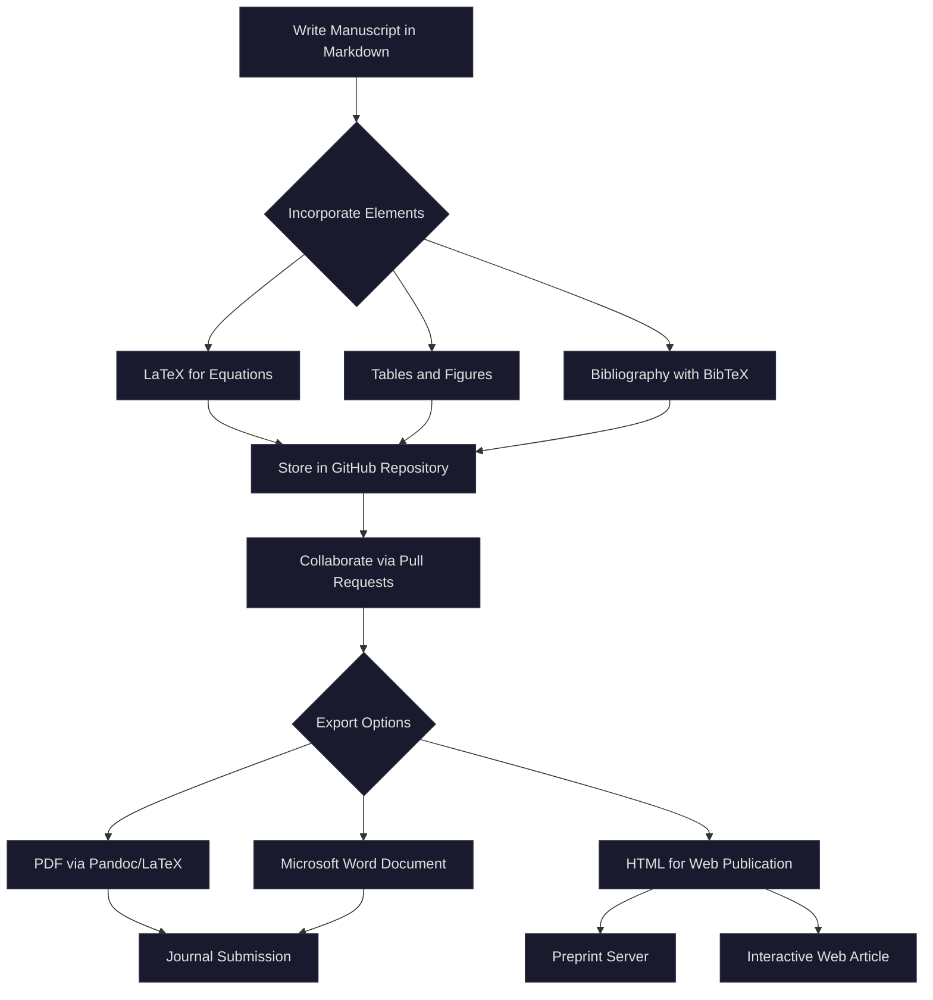

<br>

## 7. Integration with Research Tools

| Tool | Integration Capabilities |
|------|--------------------------|
| Jupyter Notebooks | Export computational notebooks to Markdown for documentation, sharing, or publication. |
| VS Code | Versatile code editor with live Markdown previews, LaTeX plugins, and extensive extension support. |
| Atom | Lightweight and customizable Markdown editor with a rich ecosystem of plugins for syntax highlighting, previewing, and collaboration. |
| Codium | Robust platform for collaborative Markdown documentation with real-time editing, version control integration, and content management features. |
| Zotero | Streamlines reference management and bibliography generation with BibTeX export capabilities for integration with Markdown workflows. |

<br>

## 8. Learning Roadmap: From Beginner to Expert

### Phase 1: Basics
- Master fundamental syntax including headings, lists, links, and emphasis
- Create simple documents such as blog posts, README files, or notes

### Phase 2: Intermediate
- Learn to format tables, insert code blocks, and embed multimedia or HTML elements
- Build structured project documentation with diagrams, flowcharts, and code annotations

### Phase 3: Advanced
- Integrate Markdown with static site generators (e.g., Jekyll, Hugo) to create professional websites
- Automate documentation workflows using CI/CD pipelines

### Phase 4: Mastery
- Contribute to open-source projects by improving documentation standards
- Develop custom Markdown extensions
- Publish complex academic and technical documents using Markdown-LaTeX pipelines

<br>

## 9. Future Trends

### 9.1 Enhanced Collaboration
Emerging tools will incorporate AI-driven suggestions, real-time grammar checks, and intelligent conflict resolution mechanisms to streamline collaborative writing.

### 9.2 Standardization
Initiatives like CommonMark and GitHub Flavored Markdown will continue to unify syntax rules, ensuring consistent behavior across platforms and editors.

### 9.3 Education
Markdown adoption will increase in online learning platforms, MOOCs, and open science initiatives, establishing it as a foundational skill for digital literacy.

### 9.4 Semantic Markdown
Growing support for semantic metadata, linked data, and knowledge graphs will enhance Markdown's capabilities in academic research, data science, and technical documentation.

<br>

## 10. Conclusion

Markdown represents a versatile and powerful approach to technical documentation and research writing. Its simplicity, portability, and extensibility make it an ideal choice for individuals and organizations seeking efficient, collaborative, and future-proof documentation solutions.

By adopting Markdown, researchers and technical writers can streamline their workflows, improve collaboration, and ensure their work remains accessible across platforms and over time. The continued evolution of Markdown and its ecosystem promises further enhancements that will solidify its role as a fundamental tool in the digital documentation landscape.

 
<br><br><br><br>
 
