<br><br><br><br>

<h1 align="center">SEER</h1>
<h1 align="center">EVERY MARKET -FORESEEN | EVERY SKILL - WITHIN REACH</h1>

<br><br><br><br>

<p align="center">
    <a href="https://github.com/advancedscientificcomputing" target="_blank" rel="noopener noreferrer">
        
    </a>
</p>

<br><br>
 
## Overview

SEER is a public repository that combines two things under one brand: a family of forecasting applications for financial markets, and a curated library of free learning resources. It is built for traders, developers, students, and researchers who want to understand markets and build with them.

The name SEER means "one who sees ahead." Every app in the family does exactly that — it takes a market instrument and produces a clear, forward-looking forecast. The repository adds the tools, documentation, and guides that help people learn the craft behind those forecasts.

<br>

## What the Repository Contains?

### 1. Forecasting Applications

A family of **Streamlit applications** per market instrument. Each app delivers:

- A live chart of the instrument
- A daily candlestick chart with a 20-day average
- A 15-minute intraday chart
- A Friday-to-Thursday forecast covering 1 to 5 trading days
- Export of the forecast as CSV, JSON, TXT, Markdown, or Excel

The applications are grouped by market family:

- **SEER Index** — Bank Nifty, Nifty, FinNifty, Midcap Nifty, Sensex
- **SEER Metals** — Gold, Silver, Copper, Zinc, Aluminium
- **SEER Energy** — Crude Oil, Natural Gas
- **SEER FX** — USDINR, EURINR, GBPINR, JPYINR, Dollar Index
- **SEER Crypto** — Bitcoin, Ethereum
- **SEER Global** — S&P 500, Nasdaq

### 2. Learning Resources

The repository also hosts a free library organised into clear categories:

- Peer-reviewed research documentation
- Step-by-step tutorials and technical guides
- Source code, scripts, and configuration files
- Video, image, and audio learning content
- Hardware deployment and safety manuals
- Browse the lab environments and resource catalogues
- Access public samples and open content
- Participate in community forums
- Track basic learning progress
- Try the test labs before any commitment
- Use every SEER forecasting app without restriction
- Downloadable source code and configuration files
- Extended multimedia library
- Priority access to new SEER apps as they ship


<br>

## The SEER Brand System

### Naming formula

Every product follows one pattern: **`<ASSET> SEER`**.

- Master brand: **SEER**
- Family: **SEER Index**, **SEER Metals**, **SEER Energy**, **SEER FX**, **SEER Crypto**
- Product: **BANKNIFTY SEER**, **GOLD SEER**, **USDINR SEER**
- Slug (for files, URLs, and Docker images): `banknifty-seer`, `gold-seer`, `usdinr-seer`

Rules:
- Uppercase in the user interface (`BANKNIFTY SEER`)
- Lowercase with hyphens in slugs (`banknifty-seer`)
- Never abbreviate the asset name
- Never use "SEER" alone in a product title

<br>

## Asset Registry

| Product | Code | Ticker | Family | Forecast Window |
|---|---|---|---|---|
| BANKNIFTY SEER | `BANKNIFTY` | `^NSEBANK` | Index | Friday to Thursday |
| NIFTY SEER | `NIFTY` | `^NSEI` | Index | Friday to Thursday |
| FINNIFTY SEER | `FINNIFTY` | `NIFTY_FIN_SERVICE.NS` | Index | Friday to Thursday |
| MIDCPNIFTY SEER | `MIDCPNIFTY` | `^NSMIDCP` | Index | Friday to Thursday |
| SENSEX SEER | `SENSEX` | `^BSESN` | Index | Friday to Thursday |
| GOLD SEER | `GOLD` | `GC=F` | Metals | Monday to Friday |
| SILVER SEER | `SILVER` | `SI=F` | Metals | Monday to Friday |
| COPPER SEER | `COPPER` | `HG=F` | Metals | Monday to Friday |
| ZINC SEER | `ZINC` | `ZNC=F` | Metals | Monday to Friday |
| ALUMINIUM SEER | `ALUMINIUM` | `ALI=F` | Metals | Monday to Friday |
| CRUDEOIL SEER | `CRUDEOIL` | `CL=F` / `BZ=F` | Energy | Monday to Friday |
| NATURALGAS SEER | `NATURALGAS` | `NG=F` | Energy | Monday to Friday |
| USDINR SEER | `USDINR` | `USDINR=X` | FX | Monday to Friday |
| EURINR SEER | `EURINR` | `EURINR=X` | FX | Monday to Friday |
| GBPINR SEER | `GBPINR` | `GBPINR=X` | FX | Monday to Friday |
| JPYINR SEER | `JPYINR` | `JPYINR=X` | FX | Monday to Friday |
| DXY SEER | `DXY` | `DX-Y.NYB` | FX | Monday to Friday |
| SPX SEER | `SPX` | `^GSPC` | Global | Monday to Friday |
| NASDAQ SEER | `NASDAQ` | `^IXIC` | Global | Monday to Friday |
| BTC SEER | `BTC` | `BTC-USD` | Crypto | Monday to Friday |
| ETH SEER | `ETH` | `ETH-USD` | Crypto | Monday to Friday |

<br>

## Security Note

The repository hosts a wide range of file types, including source code, documents, and multimedia. Some antivirus software may flag scripts or executables as potential threats. These are usually **false positives** caused by the nature of development and testing code.

- Always scan downloaded files with your own security tools.
- If you believe a file is genuinely unsafe, open an issue in the repository.
- Every report is reviewed and addressed promptly.


<br><br><br><br>

<h1 align="center">INDIAN STOCK MARKET - WEEKDAY OPERATIONS FOR INTRADAY TRADING</h1>
 
 
<br><br>

 
## 1. Introduction

The Indian stock market does not behave the same way on every weekday. Activity rises and falls in a rhythm that is shaped by expiry dates, news flow, global market timings and the behaviour of large institutions. A trader who does not understand this rhythm may mistake a normal weekly pattern for a sudden opportunity, or mistake an expiry-day swing for a lasting trend.

This document explains that weekly rhythm in simple language. It is written for beginners who want to understand how the Indian market operates from Monday to Friday, what drives activity on each day, and which parts of the day deserve the most attention. It also corrects several popular beliefs that are either outdated or simply inaccurate.

The document does not provide trading strategies. It provides the operating knowledge a beginner needs before studying any strategy: which instruments expire on which day, why certain sessions are busier, what to measure, and which claims should be treated with caution.

One rule should guide everything that follows: always verify the current contract calendar before acting. Expiry days can shift because of holidays or new exchange circulars, and market rules themselves have changed in recent years.

<br>

## 2. Why Weekdays Behave Differently

Five forces shape the weekly rhythm of the Indian market.

| Force | How it affects the market |
|---|---|
| Expiry cycles | Derivatives contracts expire on fixed weekdays. On and around those days, traders must close, roll or hedge positions, which concentrates activity. |
| Weekend news | News that arrives between Friday's close and Monday's open is absorbed at Monday's opening. This can create larger opening gaps. |
| Global market timing | The United States market closes after Indian trading hours. Its previous night's close becomes the first input for the Indian market the next morning, especially on Fridays. |
| Institutional flows | Large institutions roll positions from one contract month to the next near monthly expiry. This adds volume and can influence price. |
| Liquidity variation | Not every exchange and every instrument has the same depth. Thinner markets move more on the same order size. |

A beginner should understand that these forces interact. A Tuesday is not busy simply because it is Tuesday. It is busy because a large number of derivative contracts settle that day, and thousands of participants must act before settlement.

<br>

## 3. The Current Expiry Structure

### 3.1 Instrument-by-Instrument Calendar

The following table shows the current weekday structure. It is the single most important reference in this document.

| Instrument | Expiry type | Usual weekday | What it means for a beginner |
|---|---|---|---|
| Nifty 50 options | Weekly and monthly | Tuesday | Weekly contracts expire every Tuesday. The monthly contract expires on the last Tuesday of the month. |
| Sensex options | Weekly and monthly | Thursday | Weekly contracts expire every Thursday. The monthly contract expires on the last Thursday of the month. |
| Bank Nifty options | Monthly only | Generally the last Tuesday | There is no weekly expiry for Bank Nifty under the current schedule. |
| Bankex options | Monthly only | Generally the last Thursday | Monthly contracts only. |
| NSE individual-stock futures and options, including eligible stocks such as SBI | Monthly only | Generally the last Tuesday | Individual stock derivatives expire once a month, not every week. |
| NSE cash equities | No expiry | Monday to Friday, excluding holidays | Shares themselves never expire. Every trading day is a normal trading day for cash shares. |

Two distinctions matter here.

First, an index is not a stock. Nifty and Sensex are indices, and their options have their own expiry cycle. A share such as SBI is a cash-market instrument, and its derivatives have a separate monthly cycle. The expiry of a Nifty option does not mean that SBI shares expire on that day.

Second, weekly and monthly expiries are different events. Weekly expiries happen often and are relatively small events for the broader market. Monthly expiries involve larger rollovers and often carry more weight.

### 3.2 Rules That Can Change the Calendar

The expiry structure described above took effect on 1 September 2025, when the exchanges revised their schedules. Under the regulatory framework, exchanges may hold expiries on Tuesdays or Thursdays. The National Stock Exchange moved its expiry to Tuesday, while the Bombay Stock Exchange retained Thursday.

Expiry dates can also move because of holidays. If the usual expiry day is a market holiday, the contract typically expires on the previous trading day. A trader should check the exchange contract calendar each week rather than relying on memory.

The following flowchart helps identify which expiry rule applies to which instrument.

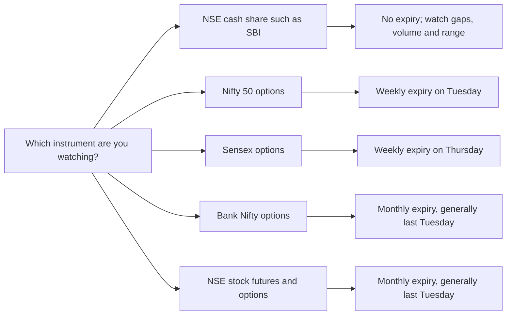

<br>

## 4. The Shift from Thursday to Tuesday

### 4.1 How the Old Thursday Pattern Worked

For many years, Thursday was the dominant expiry day in India. Weekly and monthly contracts on both major exchanges expired on the same weekday. This created a concentration of activity that traders came to expect.

Three mechanics drove the old Thursday behaviour.

- **Short covering.** Traders who had bet against the market were forced to buy back their positions before expiry. When many participants did this at the same time, prices could rise sharply and quickly.
- **Time decay.** Option premiums lost value fastest on the final day. Traders who had sold options could be forced to buy them back at a loss if the market moved against them, adding further pressure.
- **Institutional rollovers.** Large institutions moved their positions from the expiring contract to the next month. This coordinated shift added significant volume to the day.

The result was a recurring pattern of sharp, often unpredictable moves on Thursdays. Many traders still carry this belief today.

### 4.2 What Changed

The regulator introduced a rule allowing expiries only on Tuesdays or Thursdays, with the aim of reducing the extreme concentration of activity on a single day. The National Stock Exchange moved its weekly expiry to Tuesday. The Bombay Stock Exchange kept Thursday for Sensex and Bankex contracts.

### 4.3 What Did Not Change

The volatility did not disappear. It spread across the week. Expiry-driven activity now appears on Tuesday for NSE instruments and on Thursday for BSE instruments. The old idea of a quiet midweek lull is largely gone.

However, one correction is essential. The shift does not mean that every NSE-listed share becomes most volatile on Tuesday. It means that Nifty options activity concentrates on Tuesday. Whether a particular cash share such as SBI shows a Tuesday effect is a question that must be measured, not assumed.

<br>

## 5. The Weekday Operating Calendar

### 5.1 Monday: The Preparation Day

Monday carries two jobs at once. It absorbs weekend news, and it begins the build-up to the NSE's Tuesday expiry.

News that arrives between Friday's close and Monday's open is reflected in Monday's opening price. This can produce larger opening gaps than on other days. A gap is simply the difference between the previous close and the next open. Whether a gap continues or fills during the day is a question for research, not an assumption.

The second job is expiry preparation. Options that expire on Tuesday lose their remaining time value over the weekend. When trading resumes on Monday, those premiums have already repriced. Traders holding or considering positions in Tuesday-expiring contracts must manage this change, which makes Monday an active session.

A beginner should watch the first hour closely, because it reflects how the market has interpreted the weekend's information. The afternoon is useful for observing whether the opening direction persists or fades.

### 5.2 Tuesday: NSE Weekly Expiry Day

Tuesday is the main expiry day for Nifty weekly options. On the last Tuesday of the month, Bank Nifty options and NSE individual-stock derivatives also expire.

Activity on Tuesday is not evenly spread. It tends to concentrate in two periods.

- **The opening hour.** Overnight views and positions are expressed at the open, producing high volume.
- **The final hour.** Traders square off positions, hedge their exposure and roll contracts. This period can produce rapid price changes because so many participants are acting at once.

The final hour of an expiry day deserves particular respect. Positions that were comfortable earlier in the day can become exposed when the settlement price approaches. Rapid swings are possible, and stop orders may fill at unfavourable prices.

A useful research habit is to compare Tuesday behaviour with other weekdays, and to compare monthly-expiry Tuesdays with ordinary Tuesdays for stock derivatives. This separates the effect of expiry from the effect of the weekday itself.

### 5.3 Wednesday: The Transition Day

Wednesday sits between the NSE's Tuesday expiry and the BSE's Thursday expiry. It has two roles.

First, it absorbs the aftermath of the NSE expiry. Positions that were closed or rolled on Tuesday are replaced or adjusted on Wednesday.

Second, it is the final full trading day before the BSE's Thursday expiry. For Sensex and Bankex contracts, Wednesday is the equivalent of Monday for NSE contracts: a preparation day.

Activity is often moderate compared with Tuesday and Thursday. For a beginner studying weekly patterns, Wednesday is valuable as a control day. If Tuesday looks different from Wednesday, the difference is more likely to be caused by expiry rather than by random variation.

### 5.4 Thursday: BSE Weekly Expiry Day

Thursday is the weekly expiry day for Sensex options and, on the last Thursday of the month, for Bankex options.

The mechanics resemble the old NSE Thursday pattern: short covering, time decay and institutional rollovers can produce sharp moves, particularly in the final hour. One additional factor makes Thursday distinctive. The BSE generally has thinner liquidity than the NSE. When liquidity is thin, a large one-sided order can move prices further than it would in a deeper market.

The closing auction session on expiry days has been associated with extreme moves on the BSE. During this session, orders are matched at a single closing price rather than through continuous trading. If many participants want to trade in the same direction, the resulting price can differ sharply from the last traded price. Beginners should treat this window as high-risk and should not assume that normal stop-loss behaviour applies.

An important caution applies here. Thursday is the expiry day for Sensex and Bankex contracts. It is not the expiry day for a NSE-listed cash share such as SBI. A trader watching SBI should not automatically expect Thursday behaviour to match Sensex behaviour.

### 5.5 Friday: Global Cues and Positioning

Friday is shaped by two influences.

The first is global. The United States market closes after Indian trading hours. By the time the Indian market opens on Friday, participants have had time to react to the previous night's American close. This often produces a meaningful opening move.

The second is positioning. Friday is the start of the window for the following NSE Tuesday expiry. Some participants begin building positions for the next week. Others reduce risk before the weekend, because news can arrive while the market is closed.

Month-end and quarter-end effects can also appear on Fridays, when institutional flows are larger than usual.

### 5.6 Weekly Rhythm at a Glance

| Day | Main drivers | Windows worth studying | Caution |
|---|---|---|---|
| Monday | Weekend news; build-up for NSE Tuesday expiry | 9:15 to 10:15; afternoon trend continuation | Opening gaps can be large; do not assume they must reverse. |
| Tuesday | NSE weekly expiry for Nifty; monthly expiry for Bank Nifty and stock derivatives on the last Tuesday | Opening hour; final 60 minutes | Final-hour moves can be rapid and uneven. |
| Wednesday | Transition day; BSE expiry eve; midweek macro releases | Opening range; closing hour | Often moderate; useful as a comparison day. |
| Thursday | BSE weekly expiry for Sensex; monthly expiry for Bankex on the last Thursday | Opening hour; final hour; closing auction | Thinner BSE liquidity can amplify moves. |
| Friday | Global cues from the US close; pre-weekend risk reduction; month-end positioning | Opening hour; final hour | Weekend gap risk applies to positions held overnight. |

The following flowchart shows the weekly cycle.

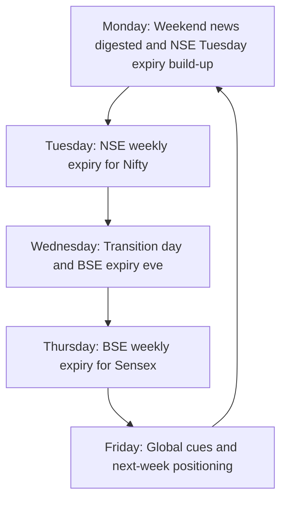

<br>

## 6. Intraday Time Windows

### 6.1 Window-by-Window Guide

Indian equity markets trade in continuous session from 9:15 AM to 3:30 PM Indian Standard Time. Within that session, different periods have different characters.

| Window | Name | What typically happens | What to measure |
|---|---|---|---|
| 9:15 to 9:30 | Opening discovery | Overnight orders and news are absorbed. Spreads are wider and prices can move quickly. | Opening gap, first fifteen-minute range, traded value, early direction. |
| 9:30 to 10:30 | Early session | The opening range forms. Trends may begin or fail. | Whether the opening range breaks, volume expansion, trend persistence. |
| 11:00 to 2:30 | Midday | Activity often reduces. Ranges may compress. | Range compression, relative volume, reversals. |
| 2:30 to 3:30 | Closing preparation | Participants adjust positions before the close. On expiry days, this can be the most active period. | End-of-day range expansion, order-book liquidity, changes near the close. |

These windows are study candidates, not guaranteed opportunities. Their behaviour varies by instrument and by market conditions.

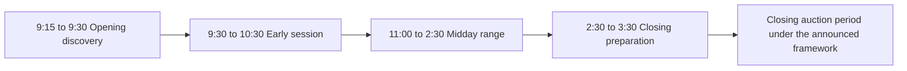

### 6.2 The Closing Auction and the Forthcoming Change

A closing auction is a separate matching process held at the end of the trading day. Instead of continuous trading, orders are collected and matched at a single closing price. This is intended to produce a fair closing price, but it can also produce sharp moves when order flow is one-sided.

The rules for the closing auction have been under revision. A revised framework was announced for implementation on 7 December 2026. Under the announced framework, the closing auction would run from 3:30 PM to 3:40 PM, and the final thirty-minute volume-weighted average price would be restored for derivatives settlement.

Until that change is implemented, the existing rules apply, and those rules should be checked before trading. A beginner should not assume that the auction behaves the same way under both regimes. Historical analysis should distinguish the period before the change from the period after it.

<br>

## 7. Expiry-Day Mechanics a Beginner Should Understand

### 7.1 Short Covering

A short seller is a participant who has sold a contract or share without owning it, expecting the price to fall. Before expiry, that position must be closed. Closing a short means buying back the instrument. When many short sellers buy at the same time, prices can rise quickly. This is called short covering. It is one of the main reasons expiry days can produce sharp upward moves.

### 7.2 Time Decay

An option premium has two parts: intrinsic value and time value. Time value reflects the possibility that the option becomes more valuable before expiry. As expiry approaches, time value falls. Over a weekend, this fall happens while the market is closed, so the premium is lower when trading resumes.

This does not mean that selling options before a weekend is a guaranteed profit. Time decay can be offset by changes in implied volatility, by movement in the underlying price, and by gap risk when the market reopens. A gap against a short option position can cause a loss much larger than the decay gained.

### 7.3 Institutional Rollovers

Institutions do not simply close positions at expiry. They move them to the next contract month. This process, called a rollover, involves a large coordinated shift of positions. Rollovers add volume and can influence prices around monthly expiry.

### 7.4 Hedging and Gamma

Option dealers hedge their exposure by trading the underlying instrument. As expiry approaches, the sensitivity of option prices to small underlying moves increases. This sensitivity is called gamma. When gamma is high, dealers may need to adjust hedges more frequently, which can amplify price moves in the underlying.

### 7.5 Liquidity Gaps in the Closing Auction

Liquidity is the ease with which an order can be executed without moving the price. The BSE is generally less liquid than the NSE. During the closing auction on an expiry day, a large one-sided order in a thin market can move the closing price far from the last continuous-session price. This is a structural risk, not a prediction. A beginner should treat the closing auction with caution and should understand that stop orders may not protect them in the way they expect.

<br>

## 8. What to Measure: The Beginner's Metric Set

Before forming any view about weekdays, a trader should collect data. The following metrics provide a starting set. They should be calculated separately for cash equities, index futures and options, and individual-stock derivatives.

| Metric | Definition | Why it matters |
|---|---|---|
| Average absolute return | Mean of the absolute percentage price change | Shows how much the instrument typically moves, without regard to direction. |
| Realised volatility | Standard deviation of intraday returns | Compares movement across weekdays and across different market regimes. |
| High to low range | The day's high minus the day's low, divided by the previous close, as a percentage | Measures the day's total price excursion. |
| Opening gap | The open minus the previous close, divided by the previous close, as a percentage | Measures overnight repricing. |
| First-hour range | The high minus the low between 9:15 and 10:15 | Quantifies opening-session opportunity and risk. |
| Final-hour range | The high minus the low over the final continuous-trading hour | Measures closing-session movement. |
| Relative volume | Interval volume divided by its historical average for the same time of day | Separates unusual activity from normal intraday volume patterns. |
| Traded value | Total traded quantity multiplied by transaction price, aggregated appropriately | Distinguishes high share volume from high monetary activity. |
| Open-interest change | Change in outstanding derivative contracts | Adds context on positioning, though it does not by itself indicate buying or selling direction. |
| Maximum adverse excursion | The worst movement against a defined hypothetical entry | Helps evaluate how much room a position needs before a stop is triggered. |

A beginner should note that open interest is often misunderstood. A rise in open interest does not automatically mean buyers are in control. It means new contracts have been created. Direction must be inferred from price behaviour and other context.

<br>

## 9. Common Misconceptions

Several widely repeated claims do not survive careful examination. The following table separates the popular claim from the more accurate position.

| Popular claim | What is accurate |
|---|---|
| Tuesday is the most volatile day for all NSE stocks. | Tuesday is the Nifty weekly expiry day, which concentrates activity in Nifty derivatives. It does not establish a universal volatility ranking for cash shares such as SBI. The effect must be measured for each instrument. |
| Bank Nifty has a weekly expiry. | Under the current schedule, Bank Nifty options are monthly, generally expiring on the last Tuesday. |
| Ninety percent of the day's volume comes in the final hour. | This figure is unverified. Volume concentration depends on the instrument, the period and how volume is measured. It should not be treated as a fixed rule. |
| The Sensex once moved about four thousand points in two minutes during an expiry auction. | Such reports require verification from primary exchange data. Even if accurate, an extreme one-off event should not be treated as a recurring characteristic. |
| Selling options before the weekend is a reliable way to collect time decay. | Time decay is real, but it can be offset by implied volatility changes, underlying price moves and weekend gap risk. It is not a guaranteed profit. |
| SBI shares expire on Tuesday. | Cash shares do not expire. Only derivative contracts expire. SBI's stock futures and options expire monthly, generally on the last Tuesday. |
| Thursday is the most volatile day of the week. | This was broadly true when the NSE held its expiry on Thursday. It is now accurate mainly for BSE instruments such as Sensex and Bankex. For NSE instruments, the focus has shifted to Tuesday. |
| Historical turnover figures prove how busy a day is. | Specific turnover numbers should be taken from current exchange data. Old figures may refer to a different market structure and should not be reused without checking. |

<br>

## 10. How to Test Weekday Patterns Yourself

A beginner can study weekday behaviour without advanced tools. The following sequence is a practical research method.

1. **Collect enough data.** Use at least one to two years of daily open, high, low, close and volume data for the instrument you care about. Intraday bars are better if available. A sixty-day sample produces only about ten to twelve observations per weekday, which is too small for reliable conclusions.

2. **Label every session.** Mark the weekday, whether it was near an exchange holiday, whether it was an expiry day, whether it was month-end, and whether a major scheduled event occurred.

3. **Calculate the metrics.** Use the metric set in Section 8 with consistent definitions. Compare volume at the same time of day, not total volume across different sessions.

4. **Compare like with like.** Compare expiry sessions with non-expiry sessions of the same weekday. Compare monthly-expiry days with ordinary days. Compare the instrument's behaviour with the index's behaviour.

5. **Split the sample by regime.** Treat the period before September 2025 separately from the period after it. When the December 2026 settlement change takes effect, treat the period after it as a separate regime as well.

6. **Control for market-wide conditions.** A busy Tuesday may simply have been a busy market day. Check whether the pattern survives after accounting for overall market volatility, large gaps and major news.

7. **Include costs.** Any observed pattern must be large enough to survive brokerage, taxes, bid-ask spreads and slippage. A pattern that exists only before costs is not a usable pattern.

A beginner should treat all results as evidence to be tested, not as proof that a pattern will continue.

<br>

## 11. Practical Operating Checklist

The following checklist summarises the operating knowledge in this document.

- Verify the contract calendar before each week. Expiry dates can move because of holidays or new circulars.
- Separate cash-market behaviour from derivatives behaviour. They follow different rules.
- Identify the correct exchange for the instrument. NSE and BSE have different expiry days.
- Remember that index expiry does not equal stock expiry.
- Expect larger opening gaps on Mondays and after long holidays.
- Treat the final hour of expiry days with caution. Rapid moves and poor fills are possible.
- Treat the closing auction on expiry days as a distinct risk environment.
- Track regulatory changes and separate historical data by regime.
- Measure before assuming. Popular weekday beliefs are often outdated.
- Record your observations in a log so that your own data improves over time.

<br>

## 12. Glossary

| Term | Meaning |
|---|---|
| Expiry | The date on which a derivative contract ends and settlement occurs. |
| Weekly expiry | A contract that expires every week. |
| Monthly expiry | A contract that expires once a month, usually on the last expiry weekday. |
| Futures and options (F&O) | Derivative contracts whose value is derived from an underlying asset. |
| Open interest | The number of derivative contracts currently outstanding. |
| Theta | The rate at which an option's time value falls as expiry approaches. |
| Implied volatility | The market's expectation of future price movement, reflected in option prices. |
| Short covering | Buying back a short position to close it. |
| Rollover | Moving a position from the expiring contract to the next contract month. |
| Closing auction session | A separate end-of-day matching process that determines the closing price. |
| Volume-weighted average price (VWAP) | The average price weighted by volume, often used for settlement. |
| Gamma | The rate at which an option's sensitivity to the underlying price changes. |
| Liquidity | The ease of executing an order without moving the price. |
| Slippage | The difference between the expected price and the executed price. |
| Gap | The difference between the previous close and the next open. |

<br>

## 13. Final Word

The Indian market's weekly rhythm is real, but it is not a simple calendar. It is the result of expiry schedules, news timing, global market hours, institutional behaviour and liquidity conditions. The old belief that Thursday is always the wild day is no longer accurate for NSE instruments. Tuesday now carries the NSE's weekly expiry, while Thursday remains the BSE's expiry day.

The most useful question for a beginner is not which weekday is inherently the most volatile. It is whether a particular weekday, time window and expiry condition produces a repeatable pattern in the specific instrument being studied. That question can only be answered with data, measured consistently, separated by regulatory regime, and tested after costs.

Understand the structure first. Measure second. Assume nothing.

<br>

## 14. Official Sources to Follow

For current rules, contract calendars and market data, consult the official exchanges and the regulator directly.

- **National Stock Exchange of India (NSE):** market timings, holidays, individual-stock derivatives, price and volume data.
- **Bombay Stock Exchange (BSE):** Sensex and Bankex contract specifications, closing auction rules.
- **Securities and Exchange Board of India (SEBI):** circulars on expiry days, settlement methodology and market structure.
- **Academic research on Indian intraday volatility:** useful for understanding documented opening-session, weekend, holiday and expiry-day effects. Treat preliminary or unpublished studies with appropriate caution.

<br><br><br><br>

<h1 align="center">INDIAN STOCK INDICES</h1>

<br><br><br><br>
 
## Legal Disclaimer

This document is provided for educational and informational purposes only. It does not constitute investment advice, trading recommendations, or an offer or solicitation to buy or sell any financial instrument.

Trading and investing in Indian stock indices, index futures, index options, and related derivatives involve substantial risk of loss and are not suitable for every person. Past performance of any index, security, or market segment is not indicative of future results. The value of investments can go down as well as up, and you may lose more than your original capital when using leveraged products.

The information in this document is believed to be accurate at the time of writing, but market rules, contract specifications, expiry schedules, lot sizes, settlement methodologies, and regulatory requirements change frequently. Always verify current details with the official National Stock Exchange (NSE), Bombay Stock Exchange (BSE), Securities and Exchange Board of India (SEBI), or your broker before making any trading or investment decision.

No representation or warranty, express or implied, is made regarding the completeness, accuracy, reliability, or suitability of the information contained herein. You are solely responsible for your own investment decisions and should consult a qualified financial adviser before acting on any information in this document.

<br>

## 1. Introduction to Stock Indices

A stock index is a basket of selected stocks that represents a specific segment of the stock market. It acts as a measuring stick for how that segment is performing. When people say "the market went up today," they usually mean a major index like the Nifty 50 or the BSE Sensex moved higher.

Indices serve several purposes for retail traders and investors:

| Purpose | What It Means |
|---|---|
| Market benchmark | Compare your portfolio's performance against the broader market |
| Market sentiment gauge | Understand whether the overall market is bullish or bearish |
| Sector tracking | See which industries are attracting money and which are losing it |
| Derivative underlying | Futures and options contracts are built on major indices |
| Investment product base | Index funds and ETFs track these indices |

India has two major stock exchanges: the National Stock Exchange (NSE) and the Bombay Stock Exchange (BSE). Both maintain their own families of indices. The NSE's indices carry the "Nifty" brand, while the BSE's flagship is the Sensex.

Understanding indices is the first step for any retail trader. You cannot trade index futures or options, select sector-specific stocks, or judge market breadth without knowing what each index contains and what it represents.

<br>

## 2. The Major Flagship Indices

### 2.1 Nifty 50

The Nifty 50 is India's primary large-cap benchmark. It tracks 50 large, liquid companies listed on the NSE across multiple sectors. The index was launched with a base date of 3 November 1995 and a base value of 1,000.

Key facts about the Nifty 50:

| Feature | Detail |
|---|---|
| Exchange | NSE |
| Number of constituents | 50 |
| Coverage | Large-cap companies across sectors |
| Base date | 3 November 1995 |
| Base value | 1,000 |
| Calculation | Real-time, free-float market capitalisation weighted |
| Derivatives available | Yes (futures and options) |

The Nifty 50 is widely used as the primary indicator of Indian equity market health. Its constituents represent a substantial portion of the free-float market capitalisation of all NSE-listed stocks. As of March 2026, the Nifty 50 covered approximately 53.73% of NSE's total free-float market capitalisation.

Index futures on the Nifty 50 began trading on 12 June 2000, and index options began on 4 June 2001.

### 2.2 BSE Sensex

The Sensex is the BSE's flagship index. It tracks 30 large, well-established companies listed on the Bombay Stock Exchange. While it has fewer constituents than the Nifty 50, it remains one of the most closely followed indices in India.

| Feature | Detail |
|---|---|
| Exchange | BSE |
| Number of constituents | 30 |
| Coverage | Large-cap companies |
| Derivatives available | Yes, but liquidity is concentrated on NSE products |

The Sensex and the Nifty 50 often move in similar directions because they track overlapping large-cap universes, but their constituent lists and weightings differ. Retail traders should not assume they are interchangeable.

### 2.3 Bank Nifty

The Bank Nifty is the NSE's banking-sector index. It was launched on 15 September 2003, with a base date of 1 January 2000 and a base value of 1,000. It tracks major, liquid Indian banking companies listed on the NSE.

| Feature | Detail |
|---|---|
| Exchange | NSE |
| Number of constituents | 14 (as of September 2026) |
| Coverage | Banking sector |
| Base date | 1 January 2000 |
| Base value | 1,000 |
| Calculation | Free-float market capitalisation weighted, periodically capped |
| Rebalancing | Semi-annually |
| Derivatives available | Yes (futures and options) |

The Bank Nifty is a concentrated index. Its largest constituents include HDFC Bank, ICICI Bank, State Bank of India, Kotak Mahindra Bank, and Axis Bank. Because of this concentration, a move in one or two heavyweights can dominate the index's direction.

A retail trader must understand a critical distinction: the Bank Nifty index is not the same thing as a Bank Nifty futures or options contract. The index is the underlying reference. Futures and options are separate tradable instruments with their own prices, liquidity, expiry dates, and costs.

### 2.4 Nifty Financial Services

The Nifty Financial Services index broadens the coverage beyond banking to include non-banking financial companies (NBFCs), insurance companies, and other financial-services firms. It is useful for tracking the financial sector as a whole rather than just banks.

### 2.5 Nifty Next 50

The Nifty Next 50 tracks the next tier of large companies after the Nifty 50. It is useful for identifying emerging large-cap leadership and for studying relative strength between the established blue chips and the challengers.

<br>

## 3. How Indices Are Constructed

Understanding index construction helps you interpret index movements correctly. An index is not simply an average of stock prices. It is a carefully designed calculation.

### 3.1 Free-Float Market Capitalisation

Most modern Indian indices use the free-float market capitalisation method. This means the index weight of each stock is based on the market value of only those shares that are available for public trading.

Shares held by promoters, government entities, or strategic investors are excluded from the free-float calculation. This prevents a stock with a small public float but a large total market value from dominating the index.

The following flowchart shows the general construction process:

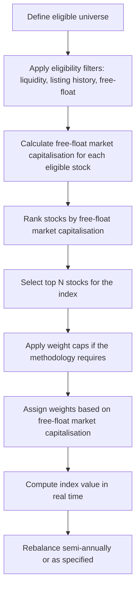

### 3.2 Capping and Rebalancing

Capping means limiting the maximum weight any single stock can have in the index. This prevents excessive concentration. Rebalancing means reviewing and updating the constituent list and weights on a scheduled basis, usually semi-annually.

For the Bank Nifty, the methodology uses a periodically capped free-float market-capitalisation approach with semi-annual rebalancing. The exact weights change over time, so historical analysis should use historical constituent weights rather than current ones.

### 3.3 The Concentration Risk in Sectoral Indices

Sectoral indices like Bank Nifty are inherently more concentrated than broad-market indices like Nifty 50. A practical implication for retail traders: do not treat a sectoral index as a collection of equally weighted companies. A move led by one or two heavyweights can look like broad sector strength when the remaining constituents are actually weak.

Always measure both index direction and constituent participation. If the index is up but most constituents are down, the move may be fragile.

<br>

## 4. The Index Family: Broad-Market Indices

Beyond the flagship Nifty 50 and Sensex, both NSE and BSE maintain a hierarchy of broad-market indices. These allow traders to track different market-cap segments.

### 4.1 NSE Broad-Market Indices

| Index | Coverage | Typical Use |
|---|---|---|
| Nifty 50 | 50 large, liquid companies | Primary large-cap benchmark |
| Nifty Next 50 | Next tier of large companies | Emerging large-cap leadership |
| Nifty 100 | Nifty 50 plus Nifty Next 50 | Broader large-cap participation |
| Nifty 200 | Large-cap and mid-cap coverage | Broad market confirmation |
| Nifty 500 | 500 companies across market caps | Broad market breadth and regime confirmation |
| Nifty Midcap 150 | Mid-cap universe | Mid-cap participation and risk appetite |
| Nifty Midcap 100 | Mid-cap companies | Mid-cap benchmark |
| Nifty Midcap 50 | Selected mid-cap companies | Concentrated mid-cap view |
| Nifty Smallcap 250 | Small-cap universe | Risk appetite and broader-market divergence |
| Nifty Smallcap 100 | Small-cap companies | Small-cap benchmark |
| Nifty Smallcap 50 | Selected small-cap companies | Concentrated small-cap view |
| Nifty Microcap 250 | Micro-cap segment | Speculative participation; not a default execution benchmark |
| Nifty Total Market | Broadest coverage | Entire-market representation |
| Nifty LargeMidcap 250 | Large-cap and mid-cap combination | Blended large and mid exposure |
| Nifty MidSmallcap 400 | Mid-cap and small-cap combination | Blended mid and small exposure |

The Nifty 500 represents approximately 92.04% of NSE-listed free-float market capitalisation, while the Nifty 50 represents about 53.73%. The difference between these two figures makes the pair useful for studying market breadth versus large-cap leadership.

### 4.2 BSE Broad-Market Indices

| Index | Coverage |
|---|---|
| BSE Sensex | 30 large-cap companies |
| BSE Sensex 50 | 50 large-cap companies |
| BSE Sensex Next 50 | Next tier of large companies |
| BSE Sensex Next 30 | Additional large companies |
| BSE Sensex Sixty | 60 large companies |
| BSE 100 | 100-company broad-market index |
| BSE 200 | Broad large and mid-cap market |
| BSE 500 | Broad BSE market benchmark |
| BSE 1000 | Broader coverage |
| BSE 150 MidCap | Mid-cap segment |
| BSE 250 SmallCap | Small-cap segment |
| BSE 250 LargeMidCap | Large and mid-cap combination |
| BSE 400 MidSmallCap | Mid and small-cap combination |
| BSE SmallCap 500 | Expanded small-cap coverage |
| BSE Next 500 | Next tier of companies |
| BSE 250 MicroCap | Micro-cap segment |
| BSE Next 250 MicroCap | Additional micro-cap coverage |
| BSE AllCap | Broadest BSE coverage |
| BSE MidSmallCap | Mid and small-cap combination |

<br>

## 5. Sectoral Indices

Sectoral indices track specific industries. They are essential for understanding which parts of the economy are attracting or losing money.

### 5.1 Major NSE Sectoral Indices

| Sector | Index Name | What It Tracks |
|---|---|---|
| Banking | Nifty Bank | Major Indian banking companies |
| Financial services | Nifty Financial Services | Banks, NBFCs, insurance, and other financial firms |
| Financial services (excluding banks) | Nifty Financial Services Ex Bank | Non-bank financial companies |
| Private banks | Nifty Private Bank | Private-sector banking companies |
| Public-sector banks | Nifty PSU Bank | Government-owned banks |
| NBFC | Nifty NBFC | Non-banking financial companies |
| Insurance | Nifty Insurance | Insurance companies |
| Information technology | Nifty IT | IT services and software companies |
| Telecommunications | Nifty Telecommunications | Telecom companies |
| Automobiles | Nifty Auto | Automobile manufacturers |
| Capital goods | Nifty Capital Goods | Industrial machinery and equipment |
| Construction | Nifty Construction | Construction companies |
| Cement | Nifty Cement | Cement manufacturers |
| Metals | Nifty Metal | Metals and mining companies |
| FMCG | Nifty FMCG | Fast-moving consumer goods companies |
| Consumer durables | Nifty Consumer Durables | Durable goods manufacturers |
| Consumer services | Nifty Consumer Services | Consumer service providers |
| Retail | Nifty Retail | Retail companies |
| Pharmaceuticals | Nifty Pharma | Pharmaceutical companies |
| Healthcare | Nifty Healthcare | Healthcare providers and related companies |
| Hospitals | Nifty Hospitals | Hospital chains |
| Oil and gas | Nifty Oil & Gas | Oil, gas, and energy companies |
| Power | Nifty Power | Power generation and distribution companies |
| Chemicals | Nifty Chemicals | Chemical manufacturers |
| Realty | Nifty Realty | Real-estate companies |
| REITs and realty | Nifty REITs & Realty | Real-estate investment trusts and realty firms |
| Housing finance | Nifty Housing Finance | Housing finance companies |

### 5.2 Major BSE Sectoral Indices

| Sector | Index Name |
|---|---|
| Banking | BSE BANKEX |
| Automobiles | BSE Auto |
| Capital goods | BSE Capital Goods |
| Consumer durables | BSE Consumer Durables |
| Metals | BSE Metal |
| Power | BSE Power |
| Realty | BSE Realty |
| Technology | BSE Teck |
| Public-sector undertakings | BSE PSU |
| Central public-sector enterprises | BSE CPSE |
| IT focus | BSE Focused IT |

### 5.3 How to Use Sectoral Indices

Sectoral indices help answer questions like:

- Is the banking sector leading or lagging the broad market?
- Is the IT sector diverging from the overall trend?
- Which sectors are attracting money during a market rally?
- Is the market breadth narrow (only a few sectors moving) or broad (most sectors participating)?

A retail trader should compare sectoral index performance against the Nifty 50 or Nifty 500 to identify leadership and lagging sectors. This is called relative strength analysis.

<br>

## 6. Thematic, Strategy, and Factor Indices

Beyond broad-market and sectoral indices, NSE and BSE maintain indices based on themes, investment strategies, and factors. These are useful for research and for understanding advanced market concepts, but they are not always directly tradable through futures and options.

### 6.1 Thematic Indices

Thematic indices track companies connected to a specific theme or trend.

| Theme | Index Examples |
|---|---|
| Defence | Nifty India Defence, Nifty India Defence Equal Weight |
| Digital | Nifty India Digital |
| Infrastructure | Nifty Infrastructure, Nifty India Infrastructure & Logistics |
| Manufacturing | Nifty India Manufacturing |
| Railways | Nifty India Railways PSU |
| Tourism | Nifty India Tourism |
| Energy | Nifty Energy |
| Consumption | Nifty India Consumption |
| Capital markets | Nifty Capital Markets |
| Commodities | Nifty Commodities |
| Conglomerates | Nifty Conglomerate 50 |
| CPSE | Nifty CPSE |
| Electric vehicles | Nifty EV & New Age Automotive |
| Internet | Nifty India Internet |
| IPO | Nifty IPO |
| MNC | Nifty MNC |
| Mobility | Nifty Mobility |
| PSE | Nifty PSE |
| REITs and InvITs | Nifty REITs & InvITs |
| SME | Nifty SME EMERGE |
| Transportation and logistics | Nifty Transportation & Logistics |
| ESG | Nifty100 ESG, Nifty100 ESG Sector Leaders |
| Ahimsa | Nifty500 Ahimsa |
| Corporate groups | Nifty India Select 5 Corporate Groups |

### 6.2 Strategy and Factor Indices

Strategy indices are built around systematic investment factors such as momentum, value, quality, low volatility, and equal weighting.

| Factor or Strategy | Index Examples |
|---|---|
| Equal weight | Nifty 50 Equal Weight, Nifty100 Equal Weight, Nifty500 Equal Weight |
| Momentum | Nifty 200 Momentum 30, Nifty Midcap150 Momentum 50, Nifty500 Momentum 50 |
| Alpha | Nifty Alpha 50, Nifty100 Alpha 30, Nifty200 Alpha 30 |
| Low volatility | Nifty Low Volatility 50, Nifty100 Low Volatility 30, Nifty500 Low Volatility 50 |
| Quality | Nifty100 Quality 30, Nifty200 Quality 30, Nifty500 Quality 50 |
| Value | Nifty50 Value 20, Nifty200 Value 30, Nifty500 Value 50 |
| Dividend | Nifty Dividend Opportunities 50 |
| High beta | Nifty High Beta 50 |
| Growth | Nifty500 Growth 50 |
| Multi-factor | Nifty Alpha Low Volatility 30, Nifty Alpha Quality Low Volatility 30, Nifty Quality Low Volatility 30 |
| Midcap and smallcap factors | Nifty Midcap150 Quality 50, Nifty Smallcap250 Quality 50, Nifty Smallcap250 Momentum Quality 100 |
| Total market factors | Nifty Total Market Momentum Quality 50 |
| Multicap factors | Nifty500 Multicap Momentum Quality 50 |

### 6.3 Volatility and Derivatives-Related Indices

| Index | Identifier | Purpose |
|---|---|---|
| India VIX | INDIAVIX | Market's expectation of near-term volatility |
| Nifty 50 Futures PR | NIFTY50 FUT PR | Futures price-return index |
| Nifty 50 Futures TR | NIFTY50 FUT TR | Futures total-return index |
| Nifty50 PR 1x Inverse | NIFTY50 PR 1X INV | Inverse exposure to Nifty 50 |
| Nifty50 PR 2x Leverage | NIFTY50 PR 2X LEV | Double leverage to Nifty 50 |
| Nifty50 TR 1x Inverse | NIFTY50 TR 1X INV | Inverse total-return exposure |
| Nifty50 TR 2x Leverage | NIFTY50 TR 2X LEV | Double leverage total-return exposure |
| Nifty50 Dividend Points | NIFTY50 DIV POINT | Dividend points accumulation |

<br>

## 7. India VIX: The Fear Gauge

India VIX is calculated from Nifty options prices. It represents the market's implied expectation of volatility over the next 30 calendar days.

Key points about India VIX:

| Feature | Detail |
|---|---|
| What it measures | Expected near-term volatility implied by Nifty options |
| Time horizon | Next 30 calendar days |
| Calculation basis | Nifty options prices |
| Interpretation | Higher values suggest higher expected volatility and often higher fear |
| Limitation | It is not a directional forecast and not a direct measurement of realised intraday volatility |

A retail trader can use India VIX as one input among many. A rising India VIX often accompanies falling markets, while a falling India VIX often accompanies stable or rising markets. However, this relationship is not mechanical and should not be treated as a trading signal on its own.

<br>

## 8. Index Tickers and Identifiers

One of the most confusing aspects of Indian indices for beginners is that there is no single universal ticker. The same index can have different identifiers depending on the data provider.

### 8.1 The Identifier Problem

An index can have several identifiers:

- The exchange's own symbol (NSE or BSE)
- A Yahoo Finance ticker
- A Bloomberg ticker
- A Refinitiv RIC (Reuters Instrument Code)
- A broker-specific symbol

For example, the Nifty 50 is known as:

| Provider | Identifier |
|---|---|
| NSE | NIFTY |
| Yahoo Finance | ^NSEI |
| Bloomberg | Nifty |
| Refinitiv | .NSEI |

### 8.2 NSE Index Symbols and Yahoo Finance Tickers

The following table lists the most commonly used NSE indices with their NSE symbols and Yahoo Finance tickers where available.

| Index | NSE Symbol | Yahoo Finance Ticker | Category |
|---|---|---|---|
| Nifty 50 | NIFTY | ^NSEI | Broad |
| Nifty Next 50 | NIFTYNXT50 | ^CNXJR | Broad |
| Nifty 100 | NIFTY100 | ^CNX100 | Broad |
| Nifty 200 | NIFTY200 | ^CNX200 | Broad |
| Nifty 500 | NIFTY500 | ^CNX500 | Broad |
| Nifty Midcap 50 | NIFTYM50 | ^NSMIDCP | Broad |
| Nifty Midcap 100 | NIFTY_MIDCAP_100 | ^CNXMDCP | Broad |
| Nifty Midcap 150 | NSEMD150 | Not confirmed | Broad |
| Nifty Midcap Select | MIDCPNIFTY | Not confirmed | Broad |
| Nifty Smallcap 50 | NSESM50 | Not confirmed | Broad |
| Nifty Smallcap 100 | NIFTY_SMLCAP_100 | ^CNXSC | Broad |
| Nifty Smallcap 250 | NSES250 | Not confirmed | Broad |
| Nifty Total Market | NTOTMKTP | Not confirmed | Broad |
| Nifty LargeMidcap 250 | NSELM250 | Not confirmed | Broad |
| Nifty MidSmallcap 400 | NSEMDSM | Not confirmed | Broad |
| India VIX | INDIAVIX | ^INDIAVIX | Volatility |
| Nifty Bank | BANKNIFTY | ^NSEBANK | Sectoral |
| Nifty Financial Services | FINNIFTY | ^CNXFIN | Sectoral |
| Nifty IT | NIFTYIT | ^CNXIT | Sectoral |
| Nifty Auto | NIFTYAUTO | ^CNXAUTO | Sectoral |
| Nifty Pharma | NIFTYPHARMA | ^CNXPHARMA | Sectoral |
| Nifty FMCG | NIFTYFMCG | ^CNXFMCG | Sectoral |
| Nifty Metal | NIFTYMETAL | ^CNXMETAL | Sectoral |
| Nifty Realty | NIFTYREALTY | ^CNXREALTY | Sectoral |
| Nifty Energy | NIFTYENERGY | ^CNXENERGY | Sectoral |
| Nifty PSU Bank | NIFTYPSUBANK | ^CNXPSUBANK | Sectoral |
| Nifty Media | NSEMED | ^CNXMEDIA | Sectoral |
| Nifty Consumer Durables | NISSCODU | Not confirmed | Sectoral |
| Nifty Oil & Gas | NISSOIL | Not confirmed | Sectoral |

Important: Yahoo Finance does not reliably expose all NSE indices. Some tickers are marked "not confirmed" or "verify" because they may not work consistently. For serious research, use the official NSE symbols or a professional data provider.

### 8.3 BSE Index Symbols

| Index | Common Identifier |
|---|---|
| BSE Sensex | SENSEX |
| BSE Sensex 50 | SENSEX50 |
| BSE Sensex Next 50 | SENSEXN50 |
| BSE Sensex Next 30 | SENSEXN30 |
| BSE Sensex Sixty | SENSEX60 |
| BSE 100 | BSE100 |
| BSE 200 | BSE200 |
| BSE 500 | BSE500 |
| BSE 1000 | BSE1000 |
| BSE 150 MidCap | BSE150MIDCAP |
| BSE 250 SmallCap | BSE250SMALLCAP |
| BSE 250 LargeMidCap | BSE250LARGEMIDCAP |
| BSE 400 MidSmallCap | BSE400MIDSMALLCAP |
| BSE SmallCap 500 | BSESMALLCAP500 |
| BSE Next 500 | BSENEXT500 |
| BSE 250 MicroCap | BSE250MICROCAP |
| BSE Next 250 MicroCap | BSENEXT250MICROCAP |
| BSE AllCap | BSEALLCAP |
| BSE MidSmallCap | BSEMIDSMALLCAP |
| BSE BANKEX | BANKEX |
| BSE Auto | BSEAUTO |
| BSE Capital Goods | BSECAPITALGOODS |
| BSE Consumer Durables | BSECD |
| BSE Metal | BSEMETAL |
| BSE Power | BSEPOWER |
| BSE Realty | BSEREALTY |
| BSE Teck | BSETECK |
| BSE PSU | BSEPSU |
| BSE CPSE | BSECPSE |
| BSE Focused IT | BSEFOCUSEDIT |

### 8.4 Yahoo Finance Conventions for Indian Stocks

For individual stocks, Yahoo Finance uses the following convention:

| Exchange | Suffix | Example |
|---|---|---|
| NSE | .NS | RELIANCE.NS |
| BSE | .BO | RELIANCE.BO |

For indices, Yahoo Finance uses the caret (^) prefix, but the coverage is inconsistent. Always verify a ticker before relying on it for data downloads or automated systems.

### 8.5 A Practical Note on Ticker Usage

If you are building a dataset for Python, TradingView, Yahoo Finance, or a broker API, do not assume that one ticker format works everywhere. Maintain separate fields for:

- Exchange symbol
- Yahoo Finance ticker
- Bloomberg ticker
- Refinitiv RIC
- Broker-specific symbol

This prevents errors when switching between data sources.

<br>

## 9. Index Derivatives: The Basics

Major Indian indices have derivative contracts (futures and options) that trade on the NSE. Understanding the basic contract structure is essential for any retail trader who wants to trade index products.

### 9.1 The Underlying Distinction

The index is the underlying reference. A futures contract or an options contract is a separate tradable instrument. They have their own prices, liquidity, expiry dates, and trading costs.

Do not confuse the index level with the futures price or the options premium.

### 9.2 Nifty 50 Derivatives: Current Specifications

| Parameter | Detail |
|---|---|
| Underlying symbol | NIFTY |
| Futures instrument type | FUTIDX |
| Options instrument type | OPTIDX |
| Weekly options | Four weekly expiries, excluding the monthly contract |
| Monthly expiry | Last Tuesday of the expiry month |
| Weekly expiry | Tuesday of the expiry week |
| Holiday adjustment | Previous trading day if the scheduled Tuesday is a trading holiday |
| Futures trading cycle | Three consecutive monthly contracts |
| Options style | European-style calls and puts |
| Options tick size | ₹0.05 |
| Settlement | Cash-settled |
| Current lot size | Read from the latest dated NSE contract master; do not hardcode an old lot size |

### 9.3 Bank Nifty Derivatives: Current Specifications

| Parameter | Detail |
|---|---|
| Index symbol | BANKNIFTY |
| Futures instrument type | FUTIDX |
| Options instrument type | OPTIDX |
| Futures cycle | Near, next, and far monthly contracts |
| Options cycle | Three monthly expiries plus quarterly expiries for March, June, September, and December |
| Expiry weekday | Last Tuesday of the expiry period; previous trading day if Tuesday is a holiday |
| Options exercise style | European-style, cash-settled |
| Option tick size | ₹0.05 |
| Current lot size | Read from the latest dated NSE contract master; do not hardcode an old lot size |
| Trading hours | Verify current NSE equity-derivatives market timings and any special-session circulars |

### 9.4 The Lot Size Warning

Lot sizes change. Do not hardcode an old lot size into any system or calculation. Always retrieve the current lot size from the applicable daily contract master published by the exchange.

### 9.5 Expiry History and Regime Changes

Index derivative expiries have changed several times in recent years. These changes matter because they affect contract behaviour, liquidity patterns, and settlement processes.

| Period | Expiry Regime |
|---|---|
| Before March 2024 | Monthly and quarterly expiries on Thursday |
| March 2024 onward | Monthly and quarterly expiries moved to Wednesday (per December 2023 circular) |
| 2025 onward | Relevant contracts moved to Tuesday (per 2025 expiry revision) |
| 2026 | Further settlement-rule changes introduced |

Old NSE pages or third-party websites may still display outdated expiry details. Always refer to the dated exchange circular and the actual historical contract master for the period you are analysing.

### 9.6 Index Underlyings for Derivatives

NSE currently lists the following indices as underlyings for its index futures and options framework:

- Nifty 50
- Nifty Bank
- Nifty Financial Services
- Nifty Midcap Select
- Nifty Next 50
- Nifty India FPI 150

Not every index in the NSE catalogue is directly tradable through futures and options. Some indices are useful only as signals or research benchmarks. Verify the current contract list and actual instrument liquidity before assuming an index is tradable.

<br>

## 10. Regulatory and Structural Changes

The Indian index landscape is not static. Regulatory changes affect how indices are calculated, how derivatives expire, and how settlement occurs. A retail trader must be aware of these changes because they can alter market behaviour.

### 10.1 Expiry Schedule Changes

As described in Section 9.5, expiry days have moved from Thursday to Wednesday and then to Tuesday. Each change creates a distinct market regime. Historical analysis that ignores these changes may produce misleading conclusions.

### 10.2 Settlement Regime Changes

SEBI has announced changes to the settlement methodology for expiring index derivatives. From 7 December 2026, expiring index derivatives will stop trading at 3:30 PM on expiry days, and expiry settlement will return to the volume-weighted average price (VWAP) of the final 30 minutes of regular trading.

This creates three distinct settlement regimes for research purposes:

| Period | Settlement Regime |
|---|---|
| Before 3 August 2026 | Pre-closing-auction regime |
| 3 August 2026 to 6 December 2026 | Closing-auction regime |
| From 7 December 2026 onward | Final-30-minute VWAP settlement regime |

The separate 3:30 PM to 3:40 PM closing auction determines closing prices for applicable cash-equity securities. This is a different process from index-derivative settlement.

### 10.3 Why These Changes Matter

For a retail trader, these changes affect:

- When expiring contracts stop trading
- How settlement prices are determined
- How closing prices are calculated
- Liquidity patterns near the close on expiry days
- The behaviour of options and futures in their final trading session

Do not treat the closing price, the settlement reference price, and the last tradable index-derivative price as interchangeable. They are different concepts.

### 10.4 The Regulatory Framework for Automation

SEBI's retail algorithmic-trading framework is a core design constraint for any automated trading system. The implementation framework became applicable to stock brokers from 1 April 2026, and NSE's current documentation references updated broker application requirements issued on 30 April 2026.

Before connecting any execution engine to a broker:

- Verify the broker's current API terms, authentication requirements, rate limits, and permitted order types.
- Confirm the applicable exchange registration, tagging, approval, and operational requirements for the specific retail-algo arrangement.
- Keep credentials out of source code and logs.
- Implement idempotent order handling, position reconciliation, rate-limit protection, and a manual kill switch.
- Review broker and exchange requirements again before production deployment.

<br>

## 11. Index Selection for Research and Analysis

With hundreds of indices available, a retail trader needs a practical way to decide which indices to follow. The following layered approach is useful.

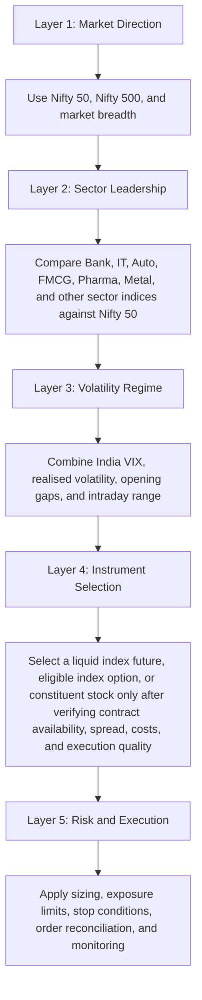

### 11.1 A Practical Core Universe for Beginners

For a retail trader starting to learn about Indian indices, the following core universe provides broad coverage without requiring constant monitoring of hundreds of specialized indices:

| Index | Why It Matters |
|---|---|
| Nifty 50 | Primary large-cap benchmark |
| BSE Sensex | BSE flagship; useful for cross-checking |
| Nifty Bank | Major sectoral index with highly liquid derivatives |
| Nifty Financial Services | Broader financial-sector view |
| Nifty Next 50 | Emerging large-cap leadership |
| Nifty 100 | Broader large-cap participation |
| Nifty 200 | Large and mid-cap combination |
| Nifty 500 | Broad market benchmark |
| Nifty Midcap Select | Tradable mid-cap index |
| Nifty Midcap 100 | Mid-cap benchmark |
| Nifty Smallcap 100 | Small-cap benchmark |
| India VIX | Volatility expectation gauge |
| Nifty IT | Major sector with global exposure |
| Nifty Pharma | Defensive sector |
| Nifty Auto | Cyclical sector |
| Nifty FMCG | Defensive consumer sector |
| Nifty Metal | Commodity-sensitive sector |
| Nifty PSU Bank | Public-sector banking view |
| Nifty Realty | Rate-sensitive sector |
| Nifty Energy | Energy-sector view |

This gives broad market plus large-cap plus mid-cap plus small-cap plus banking plus financials plus volatility plus major sectors, without the burden of tracking every specialized index.

### 11.2 The Principle of Instrument Suitability

An index can be useful as a market signal without being a suitable instrument to trade directly. Some indices have no futures or options, or have very low liquidity in their derivative contracts.

The correct sequence is:

1. Identify repeatable behaviour in the index.
2. Establish that the behaviour survives costs, changing constituents, expiry rules, and real-world execution.
3. Only then consider whether the index is directly tradable or whether a more liquid related instrument (such as a futures contract or a constituent stock) is a better expression of the view.

Never choose an index simply because it performed best in hindsight. That is a common research error that leads to unrealistic expectations.

<br>

## 12. Historical Context: Why Regime Labels Matter

Indian indices have passed through several distinct regimes. Labelling these periods correctly is essential for any historical analysis.

### 12.1 Nifty 50 Historical Regimes

| Period | Market Context | Research Relevance |
|---|---|---|
| 1995–2000 | Index base period and early benchmark history | Historical context; no live index-futures history before the futures launch |
| 2000–2008 | Derivatives expansion, technology boom, and global financial crisis | Trend, gap, and stress-period behaviour |
| 2009–2019 | Post-crisis recovery, changing sector weights, and expanding derivatives participation | Long-run trend and changing constituent concentration |
| 2020 | COVID-19 crash and recovery | Tail-risk and gap-stress analysis |
| 2021–2024 | Post-pandemic recovery, changing monetary conditions, and retail derivatives participation | Regime classification and volatility clustering |
| September 2025 onward | Revised NSE expiry schedule, including Tuesday weekly expiry for Nifty options | Compare expiry-day patterns before and after the structural change |
| August–December 2026 | Closing-auction and derivatives-settlement changes | Treat as a distinct execution and settlement regime |

### 12.2 Bank Nifty Historical Phases

| Period | Phase |
|---|---|
| 2000–2003 | Base period and launch |
| 2003–2019 | Banking and credit cycles |
| 2020 | COVID-19 shock |
| 2021–2024 | Recovery and changing market structure |
| 2025–2026 | New expiry and settlement regimes |

The base period should not be confused with the availability of a live, tradable index or derivatives contracts. The base date is a calculation reference, not a trading history.

Historical index levels alone are not enough for evaluating intraday behaviour. Any serious analysis must also account for the contract calendar, constituent changes, trading costs, market disruptions, and the rules in force at each point in time.

<br>

## 13. Understanding Index Performance Metrics

When you look at an index factsheet or a performance table, you will encounter several statistical measures. Each measures something different.

| Measure | What It Means |
|---|---|
| Price return | Change in the index level over a period, excluding dividends |
| Total return | Change in the index level including reinvested dividends |
| CAGR | Compound annual growth rate; the annualised rate of return over a period longer than one year |
| Annualised standard deviation | A measure of how much the index's returns vary; higher means more volatility |
| Beta | Sensitivity to a benchmark; a beta above 1 means the index tends to move more than the benchmark |
| Correlation | How closely the index's returns move together with another index's returns |
| Maximum drawdown | The largest peak-to-trough decline over a period |
| Tail loss | Extreme adverse moves at the 95th or 99th percentile |

Price returns and total returns are not the same. Total returns include dividends, while price returns do not. Always check which one a factsheet is reporting.

CAGR, standard deviation, beta, and correlation each describe different aspects of performance. A high CAGR with high standard deviation represents a different risk profile than a slightly lower CAGR with low standard deviation.

The annual factsheet does not provide intraday characteristics such as maximum intraday adverse excursion, gap risk, slippage, or performance after costs. These must be measured from actual intraday data.

<br>

## 14. Data Infrastructure for Index Research

The quality and resolution of your historical dataset is one of the most consequential research decisions you will make.

### 14.1 What to Collect

| Dataset | Minimum Useful Fields | Purpose |
|---|---|---|
| Index data | Timestamp, open, high, low, close, index value | Signal generation and index-level analysis |
| Futures data | Timestamp, OHLC, volume, open interest, expiry | Tradable-price validation and futures basis |
| Options data | Timestamp, strike, expiry, CE/PE, bid/ask, traded price, volume, OI | Contract selection, spread modelling, and Greeks |
| Constituent data | Historical prices, membership, and weights | Breadth, concentration, and attribution analysis |
| Session calendar | Weekday, holidays, expiry, special sessions | Correct session labels and settlement regimes |
| Event calendar | Scheduled time, event category, release timestamp | Event filters and gap analysis |
| Execution records | Signal time, order time, fill time, price, quantity, fees | Realised slippage and live-performance evaluation |

### 14.2 Data Resolution

For early experiments, five-minute bars can be sufficient to test simple concepts. Serious execution research requires higher-resolution data, realistic bid-ask spreads, and reliable contract metadata.

Do not assume that free historical downloads contain everything needed for a production-grade backtest. Free data often has missing bars, incorrect timestamps, stale prices, and incomplete contract metadata.

### 14.3 Data Quality Checks

Before using any historical dataset, check for:

- Missing bars
- Duplicate timestamps
- Incorrect expiry labels
- Price anomalies
- Contract-master changes
- Holiday and special-session misalignment

Data quality problems can silently corrupt your analysis. A single incorrect expiry label can make an entire backtest misleading.

<br>

## 15. Quick Reference Summary

### 15.1 Key Indian Indices at a Glance

| Index | Exchange | Type | Derivatives Available |
|---|---|---|---|
| Nifty 50 | NSE | Broad market | Yes |
| BSE Sensex | BSE | Broad market | Yes |
| Bank Nifty | NSE | Sectoral (banking) | Yes |
| Nifty Financial Services | NSE | Sectoral (financials) | Yes |
| Nifty Next 50 | NSE | Broad market | Yes |
| Nifty Midcap Select | NSE | Broad market (mid-cap) | Yes |
| Nifty 100 | NSE | Broad market | No (not a primary derivative underlying) |
| Nifty 200 | NSE | Broad market | No |
| Nifty 500 | NSE | Broad market | No |
| India VIX | NSE | Volatility | No (used as a signal) |
| Nifty IT | NSE | Sectoral (IT) | No |
| Nifty Auto | NSE | Sectoral (auto) | No |
| Nifty Pharma | NSE | Sectoral (pharma) | No |
| Nifty FMCG | NSE | Sectoral (FMCG) | No |
| Nifty Metal | NSE | Sectoral (metals) | No |
| Nifty PSU Bank | NSE | Sectoral (PSU banks) | No |
| Nifty Realty | NSE | Sectoral (realty) | No |
| Nifty Energy | NSE | Sectoral (energy) | No |

### 15.2 Index Family Tree

```mermaid
flowchart TD
    A[Indian Stock Indices] --> B[Broad Market]
    A --> C[Sectoral]
    A --> D[Thematic]
    A --> E[Strategy and Factor]
    A --> F[Volatility]
    
    B --> B1[Large Cap: Nifty 50, Sensex, Nifty Next 50]
    B --> B2[Large and Mid Cap: Nifty 100, Nifty 200, Nifty 500]
    B --> B3[Mid Cap: Nifty Midcap 50, 100, 150, Select]
    B --> B4[Small Cap: Nifty Smallcap 50, 100, 250]
    B --> B5[Micro Cap: Nifty Microcap 250]
    
    C --> C1[Banking: Bank Nifty, PSU Bank, Private Bank]
    C --> C2[Financials: Financial Services, NBFC, Insurance]
    C --> C3[IT and Telecom: Nifty IT, Nifty Telecommunications]
    C --> C4[Consumer: FMCG, Auto, Consumer Durables]
    C --> C5[Industry: Metal, Cement, Capital Goods, Construction]
    C --> C6[Defensive: Pharma, Healthcare, Hospitals]
    C --> C7[Rate-sensitive: Realty, Power, Oil and Gas]
    
    D --> D1[Defence, Digital, Infrastructure]
    D --> D2[Manufacturing, Railways, Tourism]
    
    E --> E1[Momentum, Alpha, Quality, Value]
    E --> E2[Low Volatility, Equal Weight, Dividend]
    
    F --> F1[India VIX]
```

### 15.3 Key Terms for Beginners

| Term | Simple Explanation |
|---|---|
| Constituent | A stock that is part of an index |
| Free-float market capitalisation | The market value of only those shares available for public trading |
| Capping | Limiting the maximum weight of any single stock in an index |
| Rebalancing | Periodically reviewing and updating the index constituents and weights |
| Expiry | The date on which a futures or options contract stops trading and settles |
| Lot size | The fixed quantity of the underlying that one derivative contract represents |
| VWAP | Volume-weighted average price |
| Settlement | The process of finalising the cash flow or delivery at expiry |
| Basis | The difference between the futures price and the spot index level |
| Open interest | The total number of outstanding derivative contracts |

<br>

## 16. Final Notes for Retail Traders

Indian stock indices are not just numbers on a screen. Each index has a specific construction methodology, a specific constituent list, and a specific role in the market ecosystem. Understanding these details separates informed analysis from guesswork.

The most important principles for a beginner are:

1. Know what an index contains. A sectoral index is not the same as a broad-market index.
2. Know how an index is weighted. Free-float market-cap weighting means large, heavily traded companies dominate the movement.
3. Know the difference between the index and its derivatives. The index is the reference; futures and options are separate instruments with their own costs and risks.
4. Know the regime. Expiry schedules, settlement rules, and regulatory frameworks change. Historical analysis must account for these changes.
5. Verify tickers and contract specifications from official sources. Ticker conventions differ between providers, and outdated lot sizes or expiry details can lead to serious errors.
6. Treat an index as a signal source separately from its tradability. Some indices are excellent market indicators but have no liquid derivative contracts.

Indian indices provide a rich framework for understanding market behaviour. Used carefully, they are powerful tools for research, analysis, and trading. Used carelessly, they can create a false sense of understanding. The difference lies in knowing what each index actually represents and how it is constructed.


<br><br><br><br>

<h1 align="center">INTRADAY TRADING FOR RETAIL TRADERS IN INDIA</h1>

<br><br><br><br>

 
## Document Purpose and Scope

This guide is a detailed, descriptive, and deployment-ready educational resource for retail traders who want to understand and participate in intraday trading in the Indian stock market. It explains what the stock market is, who a retail trader is, how intraday trading works, what strategies are commonly used, how risk should be managed, how psychology affects trading, what tools and brokers are available, and what the real-world outcomes of retail trading often look like.

<br>

## Educational Content Disclaimer

This document is provided strictly for educational and informational purposes only. It does not constitute investment advice, financial advice, trading advice, or any other form of professional advice. The content is intended to help readers understand the concepts, practices, and risks associated with intraday trading in the Indian stock market.

Trading in stocks, derivatives, and other financial instruments involves substantial risk of loss and is not suitable for all investors. Past performance does not guarantee future results. Readers should conduct their own research and consult with qualified financial advisors before making any investment decisions.

We welcome reviews, feedback, and corrections from our readers. If you notice any errors, outdated information, or areas that need clarification, please reach out to us. This document is a living resource that will be updated periodically to reflect changes in regulations, market conditions, and best practices.

<br>

## Table of Contents

1. Understanding the Stock Market
2. Who Is a Retail Trader?
3. Introduction to Intraday Trading
4. Intraday Trading vs. Regular (Delivery) Trading
5. Essential Terminology for Intraday Traders
6. Getting Started with Intraday Trading
7. Intraday Trading Strategies
8. Risk Management Techniques
9. Trading Psychology and Discipline
10. Online Trading Platforms and Tools
11. Choosing a Stockbroker
12. Regulatory Framework and Investor Protection
13. Risks and Performance Realities
14. Investment Wisdom for Traders
15. Online Trading Communities
16. Large Language Models in Retail Trading
17. Programming Languages for Trading
18. Mathematics for Trading
19. India-Specific Operational, Taxation, and Risk Topics
20. Glossary of Key Terms
21. Conclusion and Final Disclaimer

<br>

## Section 1: Understanding the Stock Market

### 1.1 What Is a Stock Market?

A stock market is a regulated marketplace where individuals and institutions buy and sell ownership shares, also called equity, in publicly listed companies. It is not a single building or a single website. It is a complex system of exchanges, brokers, clearing corporations, depositories, and regulators that work together so that buyers and sellers can trade shares in an organized, transparent, and efficient way.

When you buy a share of a company, you are buying a small piece of ownership in that company. If the company grows and becomes more valuable, the price of your share may increase. If the company struggles, the price of your share may decrease. The stock market is the place where these ownership pieces change hands millions of times every day.

The stock market performs two primary functions that are essential to a modern economy. First, it helps companies raise capital. When a company wants to expand, build factories, research new products, or pay off debt, it can issue shares to the public. The money raised goes directly to the company to fund its growth. Second, it provides liquidity. Investors who already own shares can sell them to other investors instead of waiting for the company to buy them back. This liquidity is what makes shares attractive to hold because investors know they can convert their holdings into cash when needed.

### 1.2 Primary Market vs. Secondary Market

The stock market has two main parts: the primary market and the secondary market. Understanding the difference between these two markets is essential for every retail trader.

In the primary market, companies issue new shares to the public for the first time. This is called an Initial Public Offering, or IPO. The money raised goes directly to the company. For example, when a company launches its first public share sale, it is operating in the primary market. The company sets a price range, investors apply for shares, and if the IPO is successful, the shares are allotted to investors and listed on the exchange.

In the secondary market, investors trade shares that have already been issued. The company does not receive money from these trades. Instead, one investor sells shares to another investor. Daily trading on the National Stock Exchange and the Bombay Stock Exchange happens in the secondary market. When you buy or sell shares through your broker after an IPO, you are participating in the secondary market.

| Market Type | Description | Example |
|---|---|---|
| Primary Market | Companies issue new shares through IPOs to raise capital | A company launching its first public share sale |
| Secondary Market | Investors trade already-issued securities among themselves | Daily trading on NSE and BSE |

The primary market is where companies raise fresh capital. The secondary market is where investors trade existing shares. Intraday trading happens exclusively in the secondary market.

### 1.3 Major Indian Stock Exchanges

India has two major stock exchanges that dominate the country's equity and derivatives markets. Both are regulated by the Securities and Exchange Board of India, known as SEBI.

The Bombay Stock Exchange, known as BSE, was established in 1875. It is the oldest exchange in Asia. Its key index is the Sensex, which tracks 30 major companies. Over 5,400 shares are listed on the BSE. The BSE has played a central role in the development of Indian capital markets and continues to be an important venue for trading.

The National Stock Exchange, known as NSE, was established in 1992. It introduced electronic trading and became a modern platform for Indian markets. Its key index is the Nifty 50, which tracks 50 large companies. Over 1,600 stocks are listed on the NSE. The NSE is also one of the largest derivatives exchanges in the world by number of contracts traded.

| Exchange | Established | Key Index | Notable Features |
|---|---|---|---|
| BSE | 1875 | Sensex (30 companies) | Oldest exchange in Asia |
| NSE | 1992 | Nifty 50 (50 companies) | Large derivatives exchange by contracts traded |

Both exchanges provide electronic trading platforms, clearing and settlement services, and market data. Retail traders can access both exchanges through SEBI-registered brokers.

### 1.4 History of Indian Stock Markets

Stock trading in India began in the 1850s during British colonial rule. In the 1860s, the Bombay Stock Exchange was formed as the first stock exchange in Asia. It was established in 1875 as "The Native Share & Stock Brokers' Association" in Mumbai. In 1956, BSE became a permanent stock exchange under the Securities Contracts (Regulation) Act. In 1986, BSE introduced the Sensex index. In 1995, BSE shifted to an electronic trading system called BSE On-Line Trading, or BOLT.

The National Stock Exchange was established in 1992 in Mumbai to provide a modern trading platform. It was recommended by the Pherwani Committee and became a modern electronic trading platform. In 1994, NSE introduced its electronic trading system, the National Exchange for Automated Trading, or NEAT. In 1996, NSE introduced the Nifty index. In 2000, NSE launched derivatives trading with index futures.

The Harshad Mehta scam of 1992 was a major catalyst for market reforms, and the NSE was part of a broader modernization effort. The scam exposed weaknesses in the existing system and led to significant regulatory changes that strengthened investor protection and market integrity.

Recent developments include the introduction of Unified Payments Interface, or UPI, as a mode of payment for retail investors in 2019. In 2020, NSE became one of the largest derivatives exchanges in the world by number of contracts traded.

### 1.5 How Stock Prices Move

Stock prices move because of supply and demand. If more people want to buy a company's shares and fewer people want to sell them, the price goes up. If many shares are available for sale but not many buyers are interested, the price goes down. This is the fundamental mechanism that drives all price movements in the stock market.

Many factors affect this demand and supply. Company performance and earnings matter because profitable companies attract more buyers. Economic conditions such as inflation, interest rates, and GDP growth matter because they affect corporate profitability and investor sentiment. Investor sentiment and market psychology matter because fear and greed can drive prices away from fundamental values in the short term. News events and corporate announcements matter because they change expectations about future cash flows. Global market trends also matter because India is integrated with the global economy.

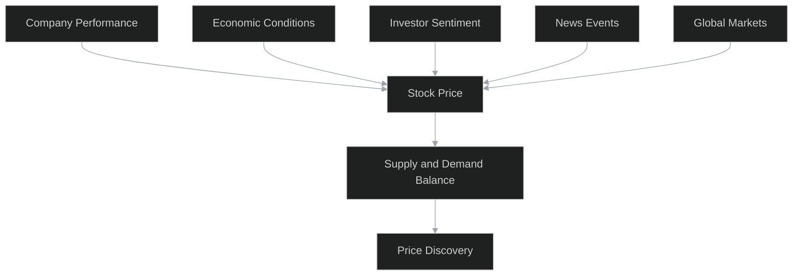

The interaction of all these factors creates a continuous process of price discovery. At any moment, the market price represents the collective judgment of all participants about the value of a share. As new information arrives, prices adjust to reflect changing expectations.

### 1.6 Functions of a Stock Market

The stock market performs several important functions that support economic growth and wealth creation.

| Function | Description |
|---|---|
| Capital Formation | Companies raise funds for growth and development |
| Liquidity | Investors can convert securities into cash easily |
| Price Discovery | Market forces determine fair stock prices |
| Investment Opportunities | Individuals can invest in various companies |
| Corporate Governance | Public ownership enforces transparency and accountability |

Capital formation allows companies to raise money for expansion, research, and debt repayment. Liquidity allows investors to buy and sell shares without significant delays or price concessions. Price discovery ensures that share prices reflect available information. Investment opportunities allow individuals to participate in the growth of companies. Corporate governance encourages transparency and accountability because public companies must disclose information and follow strict rules.

### 1.7 Significance of the Stock Market

The stock market is significant for several reasons. It supports economic growth by facilitating investment, job creation, and economic expansion. It helps in wealth creation because investors can generate returns through capital appreciation and dividends. It improves resource allocation by directing capital to productive sectors. It acts as an indicator of the economy because market indices reflect overall economic health. It also promotes financial inclusion by allowing individuals to participate in the growth of companies.

<br>

## Section 2: Who Is a Retail Trader?

### 2.1 Definition

A retail trader is an individual who buys and sells financial instruments in their own account, using their own money, usually through a broker or trading app. They are not trading on behalf of a bank, hedge fund, mutual fund, proprietary desk, or institution.

In simple terms, you and I trading from a laptop or phone through Zerodha, Groww, Upstox, Angel One, or similar platforms are retail traders. The term "retail" does not mean "dumb" or "unskilled." It simply means "non-institutional." A retail trader can be highly skilled, disciplined, and profitable.

### 2.2 Key Characteristics

Retail traders share several common characteristics that distinguish them from institutional traders.

| Characteristic | Description |
|---|---|
| Own Capital | Uses personal funds; profits and losses affect personal account |
| Broker Access | Trades through SEBI-registered brokers |
| Non-Institutional | Not a fund, bank, market maker, or exchange member |
| Smaller Scale | Trades far less capital than institutions |
| Price Taker | Accepts market prices rather than making markets |
| Limited Infrastructure | No direct exchange access or proprietary risk desk |
| Flexible Schedule | Can be part-time or full-time |
| Skill Level | Can be skilled or unskilled; retail means non-institutional |

Retail traders use their own capital, so profits and losses affect their personal account. They access exchanges through SEBI-registered brokers. They are not institutional entities such as a fund, bank, market maker, or exchange member. They usually trade far less capital than institutions. They are usually price takers, meaning they accept market prices rather than making markets. They have less infrastructure, with no direct exchange access, no colocation, and no proprietary risk desk. They can be part-time or full-time. They can be skilled or unskilled.

### 2.3 What Retail Traders Trade

Retail traders commonly trade a wide range of financial instruments. They trade stocks for delivery, intraday, and swing trading. They trade futures and options on Nifty, Bank Nifty, and individual stocks. They trade commodities such as gold, silver, and crude oil. They trade currency derivatives. They trade ETFs and mutual funds. They trade cryptocurrencies in India and globally. They also trade bonds, REITs, and InvITs, though less commonly.

### 2.4 Types of Retail Traders

There are many types of retail traders, each with different goals, time commitments, and areas of focus.

| Type | Description |
|---|---|
| Part-Time Trader | Trades around a job or business |
| Full-Time Trader | Trading is primary income source |
| Investor-Trader | Mostly invests long-term, trades occasionally |
| F&O Trader | Specializes in futures and options |
| Algo Trader | Uses Python, APIs, or bots but trades own money |
| Crypto Trader | Trades cryptocurrencies on exchanges |
| NRI Trader | Non-resident Indian trading Indian markets |

A part-time retail trader trades around a job or business. A full-time retail trader trades as their primary income. A retail investor-trader mostly invests long-term and trades occasionally. A retail F&O trader specializes in futures and options. A retail algo trader uses Python, APIs, or bots but still trades their own money. A retail crypto trader trades cryptocurrencies on exchanges. An NRI retail trader is a non-resident Indian trading Indian markets.

### 2.5 Retail Trader vs. Retail Investor

A retail investor usually has a long-term horizon. Their goal is wealth creation. They buy and hold. Examples include SIPs and long-term stocks. A retail trader usually has a short-to-medium-term horizon. Their goal is profit from price movements. They buy and sell frequently. Examples include intraday trading, F&O, and swing trading. In practice, the line is blurred. Many retail participants do both.

| Aspect | Retail Investor | Retail Trader |
|---|---|---|
| Time Horizon | Long-term (years) | Short-to-medium term |
| Primary Goal | Wealth creation | Profit from price movements |
| Activity Level | Buys and holds | Buys and sells frequently |
| Examples | SIP, long-term stocks | Intraday, F&O, swing trading |

### 2.6 Who Is Not a Retail Trader

A retail trader is not a mutual fund manager, hedge fund trader, bank proprietary desk trader, market maker, exchange member or broker-dealer, institutional investor such as FII or FPI, insurance company or pension fund, PMS manager trading a pooled portfolio, or a registered investment advisor giving advice to others.

A high-net-worth individual (HNI) can still be a retail trader if they trade their own money. However, in IPO or regulatory classification, they may be treated as a non-retail or NII or HNI category.

### 2.7 India-Specific Classifications

In IPOs, SEBI calls an individual applying up to Rs. 2 lakh a Retail Individual Investor, or RII. In F&O, a retail client is an individual non-institutional client trading through a broker. In broker KYC, clients are often classified as Retail, HNI, Corporate, NRI, and so on. Retail algo trading is allowed through brokers under SEBI's algo trading framework, but the person remains a retail client if trading their own funds.

### 2.8 Retail Trading vs. Institutional Trading

Retail trading differs from institutional trading in fundamental ways related to capital, scale, resources, regulatory oversight, and operational constraints.

| Aspect | Retail Trading | Institutional Trading |
|---|---|---|
| Capital Source | Personal funds | Pooled funds for institutions or clients |
| Trading Volume | Small trades | Large block trades |
| Market Impact | Minimal | Significant |
| Costs | Higher commissions and fees | Lower negotiated fees |
| Access | Limited | Broader access to IPOs, swaps, research |
| Regulation | More protective regulations | Fewer protective regulations |
| Risk Controls | Personal responsibility | Structured mandates and risk desks |
| Flexibility | High | Constrained by client obligations |

Retail traders enjoy advantages in flexibility, as they face no fiduciary duties or client reporting requirements and can make decisions independently without mandates. This allows them to pursue personal strategies and allocate funds freely. In contrast, retail traders face disadvantages including limited resources, higher relative costs, restricted access to certain markets and data, and less ability to negotiate favorable terms compared to institutional traders.

### 2.9 Historical Development of Retail Access

The rise of retail access to financial markets in the 1990s and early 2000s transformed individual trading from a niche activity into a widespread practice, primarily through technological and structural changes that lowered barriers to entry. The emergence of online brokerage firms played a central role. In the mid-1990s, pioneers such as E*TRADE and Ameritrade introduced internet-based trading platforms that allowed individuals to execute trades directly without intermediaries. These platforms shifted trading from phone-based or in-person orders to self-directed digital interfaces.

Discount commissions further accelerated adoption. Online brokers offered substantially lower fees than traditional full-service firms, making frequent trading economically viable for individuals. This cost reduction, combined with growing internet access, spurred millions of Americans to move their trading activities online by the late 1990s.

The shift culminated in 2001 with decimalization, when U.S. securities markets transitioned from fractional pricing to decimal increments. This change narrowed bid-ask spreads, reduced transaction costs, and improved liquidity for retail investors.

Advances in mobile technology and app-based platforms significantly transformed retail trading in the 2010s and beyond. The launch of Robinhood in 2013 introduced a highly accessible mobile-first interface combined with commission-free trading, which democratized market access for individual investors by removing traditional barriers such as account minimums and per-trade fees. This model prompted widespread adoption across the industry, as major brokers eliminated commissions to remain competitive, leading to a surge in retail trading activity.

<br>

## Section 3: Introduction to Intraday Trading

### 3.1 What Is Intraday Trading?

Intraday trading, also called day trading, involves buying and selling stocks within the same trading day. Positions are opened and closed before market close. Traders do not take ownership of shares overnight. For example, a trader purchases 100 shares at Rs. 1,000 in the morning and sells them at Rs. 1,050 before market close. The profit is Rs. 5,000, which is 100 shares multiplied by Rs. 50 gain.

The defining feature of intraday trading is that all positions are squared off before the market closes. You do not carry any position overnight. This means you are not exposed to overnight news, global market movements, or after-hours announcements.

### 3.2 Why Intraday Trading Appeals to Retail Traders

Intraday trading appeals to retail traders for several reasons. There is no overnight risk because positions are closed the same day, so overnight news does not affect open positions. Leverage is available, so traders can take larger positions than their available capital. Profit is possible in falling markets because short selling allows traders to profit from price declines. Returns are quick because profits or losses are realized immediately. Delivery is not required because traders do not need to pay full price for shares.

| Advantage | Description |
|---|---|
| No Overnight Risk | Positions closed same day; avoids overnight news impact |
| Leverage | Can trade larger positions than available capital |
| Profit in Falling Markets | Short selling allows profit from price declines |
| Quick Returns | Immediate realization of profits or losses |
| No Delivery Required | Does not require full payment for shares |

### 3.3 Who Should Consider Intraday Trading?

Intraday trading may suit individuals who can dedicate significant time to market analysis, have strong analytical and decision-making skills, can handle high-pressure situations, understand and accept substantial risk, have sufficient risk capital, and are disciplined and follow strict rules.

However, intraday trading is not suitable for everyone. Many traders, especially beginners, experience losses. It is important to be honest about your time, temperament, and financial capacity before starting.

### 3.4 Advantages and Disadvantages of Intraday Trading

Intraday trading has advantages and disadvantages. On the positive side, it offers immediate earnings and quick profit realization. Traders can choose to reinvest or withdraw profits. It mitigates overnight risk and avoids overnight fluctuations. It reduces exposure to news impact. It offers profit potential in bear markets because short selling allows traders to capitalize on price drops.

On the negative side, there is risk amidst volatile markets. Risk increases during high volatility. It requires vigilance and adaptability. It demands consistent effort and discipline. It necessitates a solid trading plan. Long-term success relies on adherence. There is capital loss risk. Losses can accumulate rapidly. Effective risk management is crucial.

| Advantages | Disadvantages |
|---|---|
| Immediate earnings; quick profit realization | Risk in volatile markets |
| Choice to reinvest or withdraw profits | Increased risk during high volatility |
| Mitigated overnight risk | Requires vigilance and adaptability |
| Avoids overnight fluctuations | Demands consistent effort and discipline |
| Reduces exposure to news impact | Necessitates a solid trading plan |
| Profit potential in bear markets | Long-term success relies on adherence |
| Ability to short sell | Capital loss risk |
| Not commonly available in other investments | Rapid accumulation of losses |

### 3.5 Trading vs. Investing

Trading and investing are distinct approaches. Trading has a short-term horizon. Its goal is profit from price movements. Its approach is technical analysis and momentum. Risk is higher. Activity is frequent. Investing has a long-term horizon. Its goal is wealth accumulation. Its approach is fundamental analysis and value. Risk is lower historically. Activity is infrequent.

| Aspect | Trading | Investing |
|---|---|---|
| Time Horizon | Short-term | Long-term |
| Goal | Profit from price movements | Wealth accumulation |
| Approach | Technical analysis, momentum | Fundamental analysis, value |
| Risk | Higher | Lower historically |
| Activity | Frequent | Infrequent |

Long-term value and growth investment strategies do not necessarily translate to success in intraday trading. While long-term investments aim to weather market volatility, day trading capitalizes on it to generate profits.

<br>

## Section 4: Intraday Trading vs. Regular (Delivery) Trading

### 4.1 Key Differences

Intraday trading is different from regular or delivery trading in several important ways. The holding period is the same day only for intraday, while delivery trading can last days to years. In intraday trading, there is no ownership of shares. In delivery trading, there is full ownership and shares are held in the Demat account. Intraday positions are squared off before market close, while delivery trades settle to Demat on a T+1 basis. Leverage is available in intraday trading, typically up to about 5x in equity under peak margin rules, while delivery trading usually requires full payment. Short selling is allowed in intraday trading but not typically in delivery trading. Margin required is lower in intraday due to leverage. Risk level is higher in intraday. Tax treatment is speculative business income for intraday, while delivery trading is treated as capital gains.

| Aspect | Intraday Trading | Regular (Delivery) Trading |
|---|---|---|
| Holding Period | Same day only | Days to years |
| Ownership | No ownership of shares | Full ownership; shares in Demat |
| Settlement | Squared off before market close | T+1 settlement to Demat |
| Leverage | Available, typically up to about 5x in equity under peak margin rules | Limited or none |
| Short Selling | Allowed for intraday in cash segment | Not typically allowed |
| Margin Required | Lower due to leverage | Full payment required |
| Risk Level | Higher | Lower without leverage |
| Tax Treatment | Speculative business income | Capital gains |

**Important Note:** Older guides often say equity intraday leverage is 5x to 20x. Under SEBI peak margin rules, equity intraday leverage is typically up to about 5x, depending on the stock and broker. F&O leverage depends on SPAN and exposure margin. Do not assume 20x leverage.

<br>

## Section 5: Essential Terminology for Intraday Traders

### 5.1 Order Types

An order is an instruction to buy or sell a security. A market order buys or sells immediately at the current market price. A limit order buys or sells only at a specified price or better. A stop loss order exits a position if the price reaches a trigger level. SL-M is a stop-loss market order that triggers a market order. SL-L is a stop-loss limit order that triggers a limit order. GTT means Good Till Triggered and remains valid until triggered or cancelled. AMO means After Market Order and is placed outside trading hours. A bracket order includes an entry with target and stop-loss and auto exits. A cover order includes an entry with mandatory stop-loss. IOC means Immediate or Cancel; it executes immediately and cancels unfilled quantity. FOK means Fill or Kill; it must execute fully immediately or cancel. A day order is valid only for the current trading day.

| Order Type | Description |
|---|---|
| Market Order | Buy or sell immediately at current market price |
| Limit Order | Buy or sell only at specified price or better |
| Stop Loss (SL) | Exit position if price reaches trigger level |
| SL-M | Stop-loss market order; triggers a market order |
| SL-L | Stop-loss limit order; triggers a limit order |
| GTT | Good Till Triggered; valid until triggered or cancelled |
| AMO | After Market Order; placed outside trading hours |
| Bracket Order | Entry with target and stop-loss; auto exits |
| Cover Order | Entry with mandatory stop-loss |
| IOC | Immediate or Cancel; execute immediately, cancel unfilled |
| FOK | Fill or Kill; execute fully immediately or cancel |
| Day Order | Valid only for the current trading day |

**Important Note:** In Indian equity markets, GTC (Good Till Cancelled) orders are generally not available. The correct term is GTT (Good Till Triggered). A GTT order remains valid until a trigger price is hit or the order is cancelled. Do not confuse GTC with GTT when placing orders.

### 5.2 Market Terminology

The bid is the highest price a buyer is willing to pay. The ask is the lowest price a seller is willing to accept. The spread is the difference between bid and ask. Volume is the number of shares traded in a period. Liquidity is the ease of buying or selling without affecting price. Volatility is the degree of price fluctuation. A circuit limit is the maximum daily price movement allowed. Upper circuit means the stock is locked at the maximum allowed gain. Lower circuit means the stock is locked at the maximum allowed fall. Open interest is the total outstanding derivative contracts. Market depth is the order book showing buy and sell quantities at different prices. The order book is the live list of pending buy and sell orders.

| Term | Definition |
|---|---|
| Bid | Highest price a buyer is willing to pay |
| Ask | Lowest price a seller is willing to accept |
| Spread | Difference between bid and ask |
| Volume | Number of shares traded in a period |
| Liquidity | Ease of buying or selling without affecting price |
| Volatility | Degree of price fluctuation |
| Circuit Limit | Maximum daily price movement allowed |
| Upper Circuit | Stock locked at maximum allowed gain |
| Lower Circuit | Stock locked at maximum allowed fall |
| Open Interest | Total outstanding derivative contracts |
| Market Depth | Order book showing buy and sell quantities at different prices |
| Order Book | Live list of pending buy and sell orders |

### 5.3 Position-Related Terms

A long position is buying expecting the price to rise. A short position is selling borrowed shares expecting the price to fall. Square off means closing an open position. Covering means buying back shorted shares. Averaging down means buying more as price falls to lower average cost. Pyramiding means adding to a winning position using unrealized profits. Rollover means moving an F&O position to the next expiry. Delivery means buying shares and taking them into Demat. BTST means Buy Today, Sell Tomorrow. STBT means Sell Today, Buy Tomorrow. Positional means holding for days or weeks based on trend. Swing trading means holding for days to weeks. Scalping means very short-term trading for small quick profits.

| Term | Definition |
|---|---|
| Long Position | Buying expecting price to rise |
| Short Position | Selling borrowed shares expecting price to fall |
| Square Off | Closing an open position |
| Covering | Buying back shorted shares |
| Averaging Down | Buying more as price falls to lower average cost |
| Pyramiding | Adding to a winning position using unrealized profits |
| Rollover | Moving F&O position to next expiry |
| Delivery | Buying shares and taking them into Demat |
| BTST | Buy Today, Sell Tomorrow |
| STBT | Sell Today, Buy Tomorrow |
| Positional | Holding for days or weeks based on trend |
| Swing Trading | Holding for days to weeks |
| Scalping | Very short-term trading for small quick profits |

### 5.4 Technical Analysis Terms

Support is a price level where buying may emerge. Resistance is a price level where selling may emerge. Trend is the overall direction: up, down, or sideways. An uptrend has higher highs and higher lows. A downtrend has lower highs and lower lows. Sideways or range means price is moving between support and resistance. A breakout means price moves above resistance. A breakdown means price moves below support. A pullback is a temporary counter-trend move. A reversal is a change in trend direction. A moving average is the average price over a specific period. SMA is Simple Moving Average. EMA is Exponential Moving Average. A Golden Cross occurs when a short moving average crosses above a long moving average. A Death Cross occurs when a short moving average crosses below a long moving average. VWAP is Volume Weighted Average Price. RSI is Relative Strength Index, a momentum oscillator. MACD is Moving Average Convergence Divergence. Bollinger Bands are volatility bands around a moving average. ATR is Average True Range, a volatility measure. ADX is a trend strength indicator. OBV is On-Balance Volume. Fibonacci levels include 38.2%, 50%, and 61.8%. Pivot Points are support and resistance from the previous day's range. A candlestick chart shows open, high, low, and close. A Doji is a candlestick with a small body. A Hammer is a bullish reversal candle. A Shooting Star is a bearish reversal candle. An Engulfing pattern is a two-candle reversal pattern. Head & Shoulders is a bearish reversal pattern. Double Top is a bearish reversal pattern. Double Bottom is a bullish reversal pattern. Cup & Handle is a bullish continuation pattern. A Flag is a short consolidation pattern. Divergence means price and indicator move differently. Overbought usually means RSI above 70. Oversold usually means RSI below 30.

| Term | Definition |
|---|---|
| Support | Price level where buying may emerge |
| Resistance | Price level where selling may emerge |
| Trend | Overall direction: up, down, or sideways |
| Uptrend | Higher highs and higher lows |
| Downtrend | Lower highs and lower lows |
| Sideways or Range | Price moving between support and resistance |
| Breakout | Price moves above resistance |
| Breakdown | Price moves below support |
| Pullback | Temporary counter-trend move |
| Reversal | Change in trend direction |
| Moving Average | Average price over a specific period |
| SMA | Simple Moving Average |
| EMA | Exponential Moving Average |
| Golden Cross | Short moving average crosses above long moving average |
| Death Cross | Short moving average crosses below long moving average |
| VWAP | Volume Weighted Average Price |
| RSI | Relative Strength Index; momentum oscillator |
| MACD | Moving Average Convergence Divergence |
| Bollinger Bands | Volatility bands around a moving average |
| ATR | Average True Range; volatility measure |
| ADX | Trend strength indicator |
| OBV | On-Balance Volume |
| Fibonacci | Retracement levels such as 38.2%, 50%, 61.8% |
| Pivot Points | Support and resistance from previous day's range |
| Candlestick | Chart showing open, high, low, close |
| Doji | Candlestick with a small body |
| Hammer | Bullish reversal candle |
| Shooting Star | Bearish reversal candle |
| Engulfing | Two-candle reversal pattern |
| Head & Shoulders | Bearish reversal pattern |
| Double Top | Bearish reversal pattern |
| Double Bottom | Bullish reversal pattern |
| Cup & Handle | Bullish continuation pattern |
| Flag | Short consolidation pattern |
| Divergence | Price and indicator move differently |
| Overbought | RSI usually above 70 |
| Oversold | RSI usually below 30 |

### 5.5 Derivatives Terminology

Futures are contracts to buy or sell at a future date at a set price. Options give the right, not the obligation, to buy or sell at a set price. A call option is the right to buy. A put option is the right to sell. Strike price is the fixed price for option exercise. Spot price is the current market price of the underlying. Premium is the price paid for an option. Expiry is the last day of a derivative contract. Lot size is the minimum quantity for F&O. ITM means In The Money. ATM means At The Money. OTM means Out of The Money. Intrinsic value is the real exercisable value of an option. Time value is premium minus intrinsic value. Greeks are Delta, Gamma, Theta, Vega, and Rho. Delta is sensitivity to underlying price. Gamma is the rate of change of Delta. Theta is time decay. Vega is sensitivity to volatility. Rho is sensitivity to interest rates. Implied volatility is the market's expected future volatility. Hedge means offsetting position to reduce risk. Speculation means betting on price movement. Arbitrage means profiting from price differences across markets.

| Term | Definition |
|---|---|
| Futures | Contract to buy or sell at future date at set price |
| Options | Right, not obligation, to buy or sell at set price |
| Call Option | Right to buy |
| Put Option | Right to sell |
| Strike Price | Fixed price for option exercise |
| Spot Price | Current market price of underlying |
| Premium | Price paid for an option |
| Expiry | Last day of a derivative contract |
| Lot Size | Minimum quantity for F&O |
| ITM | In The Money |
| ATM | At The Money |
| OTM | Out of The Money |
| Intrinsic Value | Real exercisable value of an option |
| Time Value | Premium minus intrinsic value |
| Greeks | Delta, Gamma, Theta, Vega, Rho |
| Delta | Sensitivity to underlying price |
| Gamma | Rate of change of Delta |
| Theta | Time decay |
| Vega | Sensitivity to volatility |
| Rho | Sensitivity to interest rates |
| Implied Volatility | Market's expected future volatility |
| Hedge | Offsetting position to reduce risk |
| Speculation | Betting on price movement |
| Arbitrage | Profiting from price differences across markets |

### 5.6 Fundamental and Valuation Terms

Revenue is total sales or the top line. EBITDA is earnings before interest, tax, depreciation, and amortization. PAT is Profit After Tax. EPS is Earnings Per Share. P/E Ratio is price divided by EPS, a common valuation measure. PEG Ratio is P/E divided by earnings growth. P/B Ratio is price divided by book value per share. EV/EBITDA is enterprise value divided by EBITDA. ROE is Return on Equity. ROCE is Return on Capital Employed. ROA is Return on Assets. Debt-to-Equity is total debt divided by shareholders' equity. Current Ratio is current assets divided by current liabilities. Quick Ratio is liquid assets divided by current liabilities. Free Cash Flow is operating cash flow minus capital expenditure. Book Value is net asset value per share. Face Value is nominal value of a share. Dividend is profit distributed to shareholders. Dividend Yield is annual dividend divided by price. Payout Ratio is dividends divided by net income. Bonus Issue is free extra shares to existing holders. Stock Split is dividing one share into multiple shares. Rights Issue is existing holders offered new shares at a discount. Buyback is when a company repurchases its own shares. Record Date is the date to be eligible for corporate action. Ex-Date is the date from which new buyers do not get the benefit. AGM is Annual General Meeting. EGM is Extraordinary General Meeting. Annual Report is the company's yearly financial report. Quarterly Results are three-month performance reports. Concall is an earnings conference call. Guidance is management's future outlook. Promoter Holding is the percentage of shares held by promoters. Pledged Shares are promoter shares pledged for loans. Corporate Governance is the quality of company management and controls. Balance Sheet is a statement of assets and liabilities. P&L is the Profit and Loss statement. Cash Flow Statement shows inflows and outflows of cash. Net Worth is shareholders' equity. Working Capital is current assets minus current liabilities. Capital Expenditure is money spent on long-term assets. Depreciation is accounting write-down of fixed assets. Amortization is write-down of intangible assets. Goodwill is intangible value from acquisitions. Contingent Liability is a potential future liability. Auditor is an independent financial examiner. Qualified Opinion means the auditor flags concerns.

| Term | Definition |
|---|---|
| Revenue | Total sales or top line |
| EBITDA | Earnings before interest, tax, depreciation, and amortization |
| PAT | Profit After Tax |
| EPS | Earnings Per Share |
| P/E Ratio | Price divided by EPS |
| PEG Ratio | P/E divided by earnings growth |
| P/B Ratio | Price divided by book value per share |
| EV/EBITDA | Enterprise value divided by EBITDA |
| ROE | Return on Equity |
| ROCE | Return on Capital Employed |
| ROA | Return on Assets |
| Debt-to-Equity | Total debt divided by shareholders' equity |
| Current Ratio | Current assets divided by current liabilities |
| Quick Ratio | Liquid assets divided by current liabilities |
| Free Cash Flow | Operating cash flow minus capital expenditure |
| Book Value | Net asset value per share |
| Face Value | Nominal value of a share |
| Dividend | Profit distributed to shareholders |
| Dividend Yield | Annual dividend divided by price |
| Payout Ratio | Dividends divided by net income |
| Bonus Issue | Free extra shares to existing holders |
| Stock Split | Dividing one share into multiple shares |
| Rights Issue | Existing holders offered new shares at a discount |
| Buyback | Company repurchases its own shares |
| Record Date | Date to be eligible for corporate action |
| Ex-Date | Date from which new buyers do not get the benefit |
| AGM | Annual General Meeting |
| EGM | Extraordinary General Meeting |
| Annual Report | Company's yearly financial report |
| Quarterly Results | Three-month performance reports |
| Concall | Earnings conference call |
| Guidance | Management's future outlook |
| Promoter Holding | Percentage of shares held by promoters |
| Pledged Shares | Promoter shares pledged for loans |
| Corporate Governance | Quality of company management and controls |
| Balance Sheet | Statement of assets and liabilities |
| P&L | Profit and Loss statement |
| Cash Flow Statement | Inflows and outflows of cash |
| Net Worth | Shareholders' equity |
| Working Capital | Current assets minus current liabilities |
| Capital Expenditure | Money spent on long-term assets |
| Depreciation | Accounting write-down of fixed assets |
| Amortization | Write-down of intangible assets |
| Goodwill | Intangible value from acquisitions |
| Contingent Liability | Potential future liability |
| Auditor | Independent financial examiner |
| Qualified Opinion | Auditor flags concerns |

<br>

## Section 6: Getting Started with Intraday Trading

### 6.1 Prerequisites

Before starting intraday trading, you need a Demat and trading account with a SEBI-registered broker. You need sufficient capital, and you should only use risk capital that you can afford to lose. You need knowledge of market mechanics and terminology. You need a well-defined trading plan. You need access to charts, indicators, and real-time data. You need time to monitor markets during trading hours.

### 6.2 Steps to Begin

The journey begins by opening a Demat and trading account. Then you learn market basics. Next you practice with a demo account. After that you develop a trading strategy. Then you start with small capital. You maintain a trading journal. You review and improve. Finally you scale up gradually.

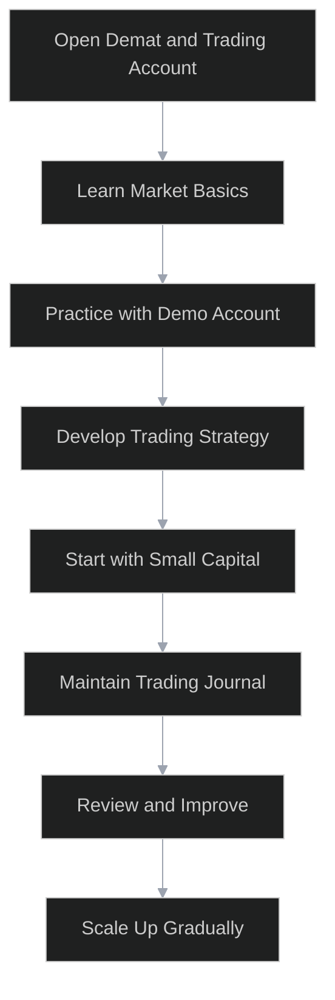

### 6.3 Market Timings

The pre-market session runs from 9:00 AM to 9:15 AM and allows order placement and modification. Regular trading runs from 9:15 AM to 3:30 PM and is continuous. The post-market session runs from 3:30 PM to 4:00 PM and allows order placement for the next day. AMO, or After Market Orders, can be placed outside these hours and are processed when the market opens. These orders are processed within a 5% price range of the closing price.

| Session | Time (IST) | Description |
|---|---|---|
| Pre-Market | 9:00 AM - 9:15 AM | Order placement and modification |
| Regular Trading | 9:15 AM - 3:30 PM | Continuous trading |
| Post-Market | 3:30 PM - 4:00 PM | Order placement for next day |

### 6.4 Basic Rules for Intraday Traders

Start small. Begin with minimum capital and increase gradually. Square off daily. Close all positions before market close. Stay alert. Monitor markets continuously during trading hours. Exit quickly. React swiftly when conditions turn unfavorable. Focus on few stocks. Concentrate on one or two stocks initially. Match capital to market. Choose markets appropriate for your capital. Establish routine. Trade at consistent times. Follow your strategy. Stick to your defined plan.

### 6.5 Stock Selection Criteria

Ideal stocks for intraday trading should have high liquidity, so they are easy to buy and sell without price impact. They should have moderate to high volatility, so there is sufficient price movement for profits. They should have good volume, so trading is active throughout the day. They should have clear trends, so directional movement is available for trend-following. Avoid stocks that frequently hit circuits. Beginners should initially focus on a limited number of stocks, potentially one or two.

| Criterion | Description |
|---|---|
| High Liquidity | Easy to buy or sell without price impact |
| Moderate-High Volatility | Sufficient price movement for profits |
| Good Volume | Active trading throughout the day |
| Clear Trends | Directional movement for trend-following |
| No Circuit Hits | Avoid stocks frequently hitting circuits |

### 6.6 What to Avoid

Avoid low liquidity stocks because they are hard to trade and you may struggle to find buyers or sellers. Avoid penny stocks because they are speculative and risky. Avoid companies with limited information because they are difficult to analyze. Avoid highly volatile stocks if you are a beginner because they can lead to significant losses. Consider avoiding trading during the initial hour because market volatility during this period can be challenging to predict.

| Avoid | Reason |
|---|---|
| Low Liquidity Stocks | Hard to trade; may struggle to find buyers or sellers |
| Penny Stocks | Speculative and risky |
| Companies with Limited Information | Difficult to analyze |
| Highly Volatile Stocks for Beginners | Can lead to significant losses |
| Trading During Initial Hour | Market volatility is challenging to predict |

### 6.7 Opening a Trading Account

The steps for online trading are as follows. Apply for a Demat and trading account through a Depository Participant. Complete all required documentation. Select a broker who is a registered member of all applicable stock exchanges and possesses SEBI certification. Before embarking on online trading, acquire a comprehensive understanding of stock market functioning. Stay abreast of financial news, websites, and podcasts to remain informed. Craft a plan and formulate a strategy. Practice with a demo trading account before committing real capital. Carefully deliberate on investment strategies and decide in advance the amount you intend to invest.

Preparatory steps include acquiring a Demat and trading account, choosing a brokerage that aligns with your needs, amassing ample knowledge, and conducting thorough analyses before executing trades. Consider opening a separate account for intraday trading to simplify tax calculations, as intraday trades are taxed differently.

### 6.8 What Constitutes Online Trading

Online trading has revolutionized the process of buying and selling shares, making it remarkably uncomplicated and efficient in terms of time. As the internet continues to spread globally, trading can be executed with just a few clicks, at any given moment and from any location. This practice holds significant importance in the life of a trader or investor. It facilitates the buying and selling of financial instruments like equities, bonds, NCDs, derivatives, stocks, and ETFs through online trading platforms.

In the pre-digital era, when an investor desired to purchase shares, they would contact their broker and express their intention to acquire stocks at a specific amount. Subsequently, after deliberating with the client regarding the prevailing market price of the shares, the broker would confirm the order. Following this cumbersome process, the order would be registered on the stock exchange.

### 6.9 Selecting the Right Online Trading Platform

When picking a trading platform, exercise caution. To maximize your benefits, opt for an interface that is user-friendly. Consider platforms with low brokerage fees. Choose platforms granting access to a wide array of financial instruments.

<br>

## Section 7: Intraday Trading Strategies

### 7.1 Overview of Common Strategies

Intraday strategies can be grouped into trend following, breakout or breakdown, reversal, scalping, range trading, and news-based trading. Trend following includes moving average crossover and momentum trading. Breakout includes gap and go and bull flag. Reversal includes pull back trading and pivot points.

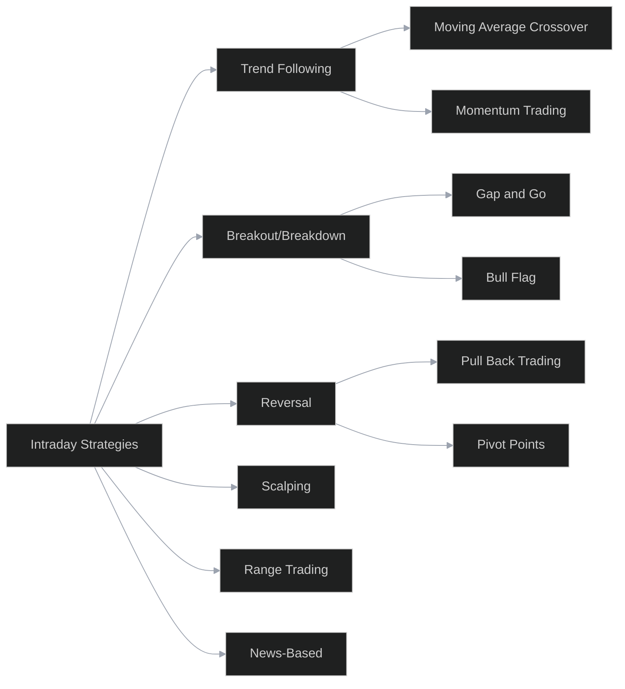

### 7.2 Detailed Strategy Descriptions

#### 7.2.1 Trend Following Strategy

The trend following strategy aligns positions with the prevailing trend. Identify stocks in a clear uptrend or downtrend. Enter long positions in uptrends and exit at target. Enter short positions in downtrends and cover at target. Indicators include moving averages, trendlines, and ADX. This strategy is best for trending markets with clear direction.

#### 7.2.2 Moving Average Crossover Strategy

The moving average crossover strategy uses intersections of two moving averages to identify entry and exit points. Plot a short-term moving average, such as a 9-period, and a long-term moving average, such as a 21-period. Buy when the short moving average crosses above the long moving average. This is called a Golden Cross. Sell when the short moving average crosses below the long moving average. This is called a Death Cross. The limitation is that moving averages are lagging indicators and may not catch exact tops or bottoms. This strategy is best for volatile and trending markets but may falter in ranging price scenarios.

#### 7.2.3 Breakout Strategy

The breakout strategy enters when price breaks through established resistance or support levels. Identify consolidation zones with clear support and resistance. Enter long when price breaks above resistance with volume. Enter short when price breaks below support with volume. Set stop-loss just below or above the breakout level. Use volume analysis to validate breakouts. This strategy is best for markets with strong trade signals anticipating impulsive movements.

#### 7.2.4 Reversal Strategy

The reversal strategy trades against the prevailing trend, anticipating a reversal. It is also known as pull back trading. Identify stocks at extreme highs, which may reverse down, or at extreme lows, which may reverse up. Look for reversal patterns such as hammer, shooting star, or engulfing. Enter position after confirmation of reversal. Set a tight stop-loss. This strategy has higher risk and requires precise timing.

#### 7.2.5 Gap and Go Strategy

The gap and go strategy trades stocks that gap up or down at market open. Use pre-market scanners to identify gapping stocks. If a stock gaps up, enter long if price continues upward. If a stock gaps down, enter short if price continues downward. Monitor volume for confirmation. This strategy is best for stocks with news catalysts.

#### 7.2.6 Scalping Strategy

The scalping strategy profits from small price fluctuations with high trade frequency. Hold positions for seconds to minutes. Target small profits, often 0.1% to 0.5% per trade. Execute many trades throughout the day. It requires fast execution and low brokerage. It also requires high attention, fast internet, and low latency. It is prominent in forex markets and is also applicable to liquid stocks.

#### 7.2.7 Range Trading Strategy

The range trading strategy trades between established support and resistance levels. Identify stocks moving sideways in a range. Buy near support and sell near resistance. Set stop-loss outside the range. This strategy is best for range-bound markets without clear trends.

#### 7.2.8 News-Based Trading

The news-based trading strategy capitalizes on volatility created by news events. Monitor news sources for market-moving events. Trade based on expected impact. Be prepared for rapid price movements. The risk is high volatility and the need for quick decision-making.

#### 7.2.9 Momentum Trading Strategy

The momentum trading strategy capitalizes on the vigor of price movements. Identify stocks exhibiting daily fluctuations. Trade stocks surging above moving averages with minimal resistance and elevated volume. Tailor holding periods to the stock's rate of movement. The profit-to-loss ratio is typically around 2:1.

#### 7.2.10 Bull Flag Trading Strategy

The bull flag trading strategy is a continuation chart pattern that facilitates the extension of uptrends. Identify strong price movement followed by a pullback. Look for a parallel high-low pattern formation. Enter when price resumes its upward trajectory. It is a bullish pattern. It is time-intensive to form but offers significant potential.

#### 7.2.11 Pivot Point Strategy

The pivot point strategy identifies critical support and resistance levels. Calculate pivot points from the previous day's range. Use them for range-bound trading entries. Identify breakout levels for breakout traders. This strategy is particularly useful in the forex market and is also applicable to stocks. Pivot points represent junctures where market sentiment shifts from bullish to bearish or vice versa.

#### 7.2.12 Opening Range Breakout (ORB)

The Opening Range Breakout strategy identifies the high and low of the first 15, 30, or 60 minutes after market open. A long signal is generated when price breaks above the opening range high with volume confirmation. A short signal is generated when price breaks below the opening range low. The VWAP is used as a filter: take longs only when price is above VWAP, and shorts only when price is below VWAP.

#### 7.2.13 VWAP Strategy

VWAP is the average price at which a stock has traded throughout the day, weighted by volume. It is used as a fair value reference. If price is above VWAP, the bias is bullish; if below, the bias is bearish. Traders often enter on a VWAP reclaim (price crossing back above VWAP after being below) or a VWAP rejection (price failing to break above VWAP).

**Note on CFD Strategy:** Contracts for Difference (CFDs) are not permitted for Indian retail traders. Do not include CFD trading as a domestic intraday strategy. It may only be relevant in some international markets.

### 7.3 Value Area Strategy

The value area strategy uses the previous day's high-volume price area to predict price movement. The value area is the price range where 70% of the previous day's trades occurred. If price opens below the value area and stays there for the first hour, there is a chance it will return to the value area. If price opens above the value area and stays below for the first hour, it is likely to fall to the value area. Use a stop-loss to limit losses if price does not behave as expected.

### 7.4 Strategy Comparison Table

| Strategy | Timeframe | Skill Level | Best Market Condition | Risk Level |
|---|---|---|---|---|
| Trend Following | Intraday | Beginner | Trending | Medium |
| MA Crossover | Intraday | Beginner | Volatile/Trending | Medium |
| Breakout | Intraday | Intermediate | Consolidation | Medium-High |
| Reversal | Intraday | Advanced | Extreme Highs/Lows | High |
| Gap and Go | Intraday | Intermediate | News Events | High |
| Scalping | Seconds-Minutes | Advanced | High Liquidity | High |
| Range Trading | Intraday | Beginner | Sideways | Low-Medium |
| News-Based | Intraday | Intermediate | News Events | High |
| Momentum | Intraday | Intermediate | Strong Trends | Medium-High |
| Bull Flag | Intraday | Intermediate | Uptrend | Medium |
| Pivot Point | Intraday | Beginner | Range-Bound | Low-Medium |
| ORB | Intraday | Intermediate | Opening Volatility | Medium-High |
| VWAP | Intraday | Beginner | Liquid Stocks | Medium |

### 7.5 Intraday Trading Tips for Success

Choose liquid shares that can be bought and sold effortlessly. Use stop-loss orders to limit potential losses. Avoid highly volatile stocks, especially if you are a novice. Research your wishlist diligently before executing trades. Align with market trends and avoid trading against them. Consider avoiding the initial trading hour. Allocate sufficient time to monitor markets and execute trades. Use technical indicators like RSI and ADX. Maintain a risk-reward ratio of at least 1:2 or 1:3. Close all open positions by the end of the trading day.

<br>

## Section 8: Risk Management Techniques

### 8.1 The Importance of Risk Management

Risk management is the most critical aspect of intraday trading. Without proper risk controls, even skilled traders can lose their entire capital quickly. Intraday trading carries amplified risk compared to conventional stock market investment. The majority of traders, especially novices, experience losses due to the volatile nature of stock markets.

### 8.2 Key Risk Management Rules

The 1% rule says risk no more than 1% to 2% of capital per trade. Position sizing means calculating quantity based on risk amount and stop-loss. Always use stop-loss orders to limit losses. Aim for a risk-reward ratio of at least 1:2 or 1:3. Diversify to spread risk across different assets. Set maximum drawdown limits, such as daily or weekly loss caps.

| Rule | Description |
|---|---|
| 1% Rule | Risk no more than 1-2% of capital per trade |
| Position Sizing | Calculate quantity based on risk amount and stop-loss |
| Stop-Loss Orders | Always use stop-loss to limit losses |
| Risk-Reward Ratio | Aim for at least 1:2 or 1:3 |
| Diversification | Spread risk across different assets |
| Maximum Drawdown | Set daily or weekly loss limits |

### 8.3 Position Sizing Formula

The position sizing formula is:

```
Position Size = Risk Amount / (Entry Price - Stop-Loss Price)
```

For example, if capital is Rs. 1,00,000, risk per trade is 1% which is Rs. 1,000, entry price is Rs. 500, and stop-loss is Rs. 490, then position size is 1,000 divided by 10, which equals 100 shares. This ensures that even if the stop-loss is triggered, the account loss remains within the chosen percentage limit, preventing overexposure on any one trade.

### 8.4 Risk-Reward Ratio

A 1:1 ratio means risking Rs. 1 to make Rs. 1. A 1:2 ratio means risking Rs. 1 to make Rs. 2, which is the recommended minimum. A 1:3 ratio means risking Rs. 1 to make Rs. 3, which is ideal. Higher risk-reward ratios improve profitability even with lower win rates.

| Ratio | Interpretation |
|---|---|
| 1:1 | Risk Rs. 1 to make Rs. 1 |
| 1:2 | Risk Rs. 1 to make Rs. 2 (recommended minimum) |
| 1:3 | Risk Rs. 1 to make Rs. 3 (ideal) |

### 8.5 Common Risks in Intraday Trading

Market risk is a general market decline affecting all stocks. Volatility risk is rapid price swings causing unexpected losses. Leverage risk is amplified losses due to borrowed funds. Liquidity risk is difficulty exiting positions in illiquid stocks. Execution risk is orders not executing at desired prices. System risk is technical failures in trading platforms. Industry risk is risks unique to a specific industry. Regulatory risk is new laws affecting businesses. Business risk is risks specific to an individual company.

| Risk Type | Description |
|---|---|
| Market Risk | General market decline affecting all stocks |
| Volatility Risk | Rapid price swings causing unexpected losses |
| Leverage Risk | Amplified losses due to borrowed funds |
| Liquidity Risk | Difficulty exiting positions in illiquid stocks |
| Execution Risk | Orders not executing at desired prices |
| System Risk | Technical failures in trading platforms |
| Industry Risk | Risks unique to a specific industry |
| Regulatory Risk | New laws affecting businesses |
| Business Risk | Risks specific to an individual company |

### 8.6 Risk Management Flowchart

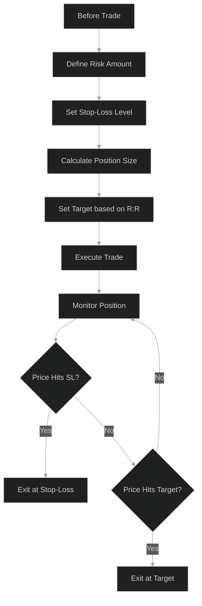

### 8.7 Risk Disclosure for Trading in Stocks and Derivatives

The stock exchanges and SEBI do not provide any assurance that information is complete, accurate, or sufficient. They do not endorse trading or suggest it is a favorable choice. Before engaging in trading, understand that stocks and derivatives come with risks. If you lack substantial funds or experience, this might not be suitable for you. Buying or selling derivatives does not guarantee profits or prevent losses. When trading with a broker on a stock exchange, adhere to the established rules. Stock exchanges do not offer advice or make promises. Avoid making trading decisions solely based on any single source of information.

Basic risks include higher price changes, which is volatility. There is difficulty in buying or selling, which is liquidity. There can be wide price differences, which are spreads. Risk-reducing orders might not work. News can affect prices. Do not believe rumors. System issues can occur.

Derivatives risks include leverage, also called gearing, and currency risks.

### 8.8 Mitigation Strategies

Diversification spreads investments across multiple stocks, sectors, and asset classes. Stop-loss orders automate sales at predetermined price thresholds. Position sizing calculates quantity based on risk amount and stop-loss. Maximum drawdown limits set daily or weekly loss caps. Rule-based systems predefine clear criteria for entries, exits, and risk limits.

| Strategy | Description |
|---|---|
| Diversification | Spread investments across multiple stocks, sectors, and asset classes |
| Stop-Loss Orders | Automate sales at predetermined price thresholds |
| Position Sizing | Calculate quantity based on risk amount and stop-loss |
| Maximum Drawdown Limits | Set daily or weekly loss caps |
| Rule-Based Systems | Predefine clear criteria for entries, exits, and risk limits |

### 8.9 Understanding Investment Disclaimers

Investment disclaimers are not to be taken lightly. They are more than mere formalities. They are your gateway to comprehending the risks tied to your investment choices.

The role of investment disclaimers includes legal protection and informed decision-making. Legal protection means they serve as a shield against potential lawsuits. Informed decision-making means they empower investors with knowledge to make informed decisions.

Decoding the language of risk warnings includes vague warnings that fail to quantify potential loss, complex warnings that use language not easily understood by non-experts, relative warnings that contextualize risk and provide options, and explicit warnings that clearly state potential for substantial losses.

Characteristics of an effective risk warning include quantification, clarity, signature requirement, online visibility, and personal explanations. Quantification means providing a quantifiable idea of potential losses. Clarity means using easily understandable language. Signature requirement underscores significance. Online visibility means being prominently displayed. Personal explanations mean seeking personalized advice if uncertain.

As a novice investor, your quest for knowledge is paramount. Request both verbal and written explanations until you are confident in your understanding of the risks. Do not settle for vague concepts. Ask until you are certain about the potential gains and losses. Remember that seeking professional advice is a sign of prudence, not ignorance.

<br>

## Section 9: Trading Psychology and Discipline

### 9.1 Common Behavioral Biases

Overconfidence is overestimating abilities, leading to excessive trading and higher costs. The disposition effect is selling winners early and holding losers, leading to reduced profits and larger losses. Recency bias is overweighting recent events, leading to chasing trends and buying high. FOMO is fear of missing out, leading to impulsive entries at high prices. Revenge trading is trading to recover losses, leading to escalating losses. Loss aversion is when losses loom larger than gains, leading to holding losers too long. Confirmation bias is seeking information that confirms existing beliefs, leading to ignoring contrary evidence. Herd mentality is following the crowd, leading to buying high and selling low.

| Bias | Description | Impact |
|---|---|---|
| Overconfidence | Overestimating abilities | Excessive trading, higher costs |
| Disposition Effect | Selling winners early, holding losers | Reduced profits, larger losses |
| Recency Bias | Overweighting recent events | Chasing trends, buying high |
| FOMO | Fear of missing out | Impulsive entries at high prices |
| Revenge Trading | Trading to recover losses | Escalating losses |
| Loss Aversion | Losses loom larger than gains | Holding losers too long |
| Confirmation Bias | Seeking information that confirms existing beliefs | Ignoring contrary evidence |
| Herd Mentality | Following the crowd | Buying high, selling low |

### 9.2 Building Trading Discipline

Maintain a trading journal to record all trades, rationale, and emotions. Use a rule-based system to predefine entry, exit, and position sizing rules. Practice mindfulness to stay calm and focused. Backtest strategies on historical data. Focus on process rather than outcomes.

| Practice | Description |
|---|---|
| Trading Journal | Record all trades, rationale, and emotions |
| Rule-Based System | Predefine entry, exit, and position sizing rules |
| Mindfulness | Practice staying calm and focused |
| Backtesting | Test strategies on historical data |
| Process Focus | Prioritize consistent execution over outcomes |

### 9.3 Emotional States and Their Impact

Fear leads to panic selling and missing opportunities. Greed leads to overtrading and holding too long. Hope leads to holding losers. Regret leads to revenge trading. All of these lead to losses.

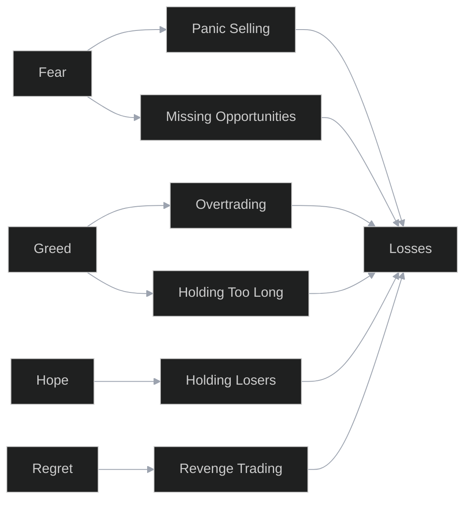

### 9.4 Tips for Maintaining Discipline

Follow your plan and stick to predefined rules regardless of emotions. Accept losses because they are part of trading and you can learn from them. Take breaks and step away after significant losses. Review regularly and analyze trades to identify patterns. Stay humble because markets can humble even experienced traders.

### 9.5 Trader Psychology and Discipline

Retail traders often struggle with emotional volatility that can lead to inconsistent decision-making. Developing psychological discipline is a critical factor in long-term performance. Many successful retail traders emphasize structured practices to cultivate mental resilience and maintain consistency in execution.

One widely adopted method is maintaining a detailed trading journal. Traders record not only trade details such as entry and exit points and rationale but also their emotional state and adherence to rules. This practice enhances self-awareness, helps identify recurring patterns in behavior, and reinforces accountability.

Adopting rule-based trading systems provides a framework that reduces reliance on real-time emotional judgments. By predefining clear criteria for trade entries, exits, position sizing, and risk limits, traders minimize discretionary interventions and build habits of objective execution.

Mindfulness meditation has been linked to enhanced discipline among traders. Research indicates that regular mindfulness practice correlates with higher trading discipline and lower frequency of panic selling.

Backtesting strategies on historical data serves as another key tool for building psychological confidence. By rigorously testing approaches in simulated environments, traders gain evidence of edge reliability, which strengthens conviction in following the plan during live market conditions.

A foundational principle in trader psychology is prioritizing process adherence over individual trade outcomes. Focusing on consistent execution of a well-defined methodology, rather than fixating on whether any single trade profits or loses, fosters emotional stability and long-term consistency.

<br>

## Section 10: Online Trading Platforms and Tools

### 10.1 Online vs. Offline Trading

Online trading allows traders to trade independently without a broker. It offers convenience because you can trade from anywhere with internet connectivity. Fees are lower, leading to higher profits. Execution is instant. Access is 24/7 to your account. Offline trading is broker-dependent and involves special instructions. It requires physical presence at the broker's office or calling the broker to trade. Fees are higher, impacting profit. Execution is slower. Access is limited to business hours.

| Aspect | Online Trading | Offline Trading |
|---|---|---|
| Ease | Trade independently | Broker-dependent |
| Convenience | Trade from anywhere | Physical presence required |
| Fees | Lower brokerage | Higher fees |
| Speed | Instant execution | Slower execution |
| Access | 24/7 account access | Limited to business hours |

### 10.2 Essential Trading Tools

Charting software is used for technical analysis. Examples include TradingView and MetaTrader. Stock screeners filter stocks by criteria. Examples include Screener.in and Chartink. Backtesting platforms test strategies. Examples include TradingView and Amibroker. News aggregators keep you informed. Examples include Economic Times and Moneycontrol. Order management tools execute trades. Examples include broker platforms.

| Tool Type | Purpose | Examples |
|---|---|---|
| Charting Software | Technical analysis | TradingView, MetaTrader |
| Stock Screeners | Filter stocks by criteria | Screener.in, Chartink |
| Backtesting Platforms | Test strategies | TradingView, Amibroker |
| News Aggregators | Stay informed | Economic Times, Moneycontrol |
| Order Management | Execute trades | Broker platforms |

### 10.3 Key Features to Look For

Look for real-time data and quotes. Look for advanced charting capabilities. Look for multiple order types. Look for technical indicators. Look for alerts and notifications. Look for mobile app access. Look for customer support. Look for Level 2 data, which is order book depth. Look for hotkeys for rapid order entry. Look for paper trading accounts.

### 10.4 Popular Platforms in India

Zerodha Kite is a broker platform with a simple interface and low costs. Upstox is a broker platform with fast execution and good charts. Angel One is a broker platform with research and advisory services. TradingView is a charting platform with advanced charts and social features. Chartink is a screener with custom scans and alerts. MetaTrader is a charting platform for forex and CFD trading.

| Platform | Type | Key Features |
|---|---|---|
| Zerodha Kite | Broker Platform | Simple interface, low costs |
| Upstox | Broker Platform | Fast execution, good charts |
| Angel One | Broker Platform | Research, advisory services |
| TradingView | Charting | Advanced charts, social features |
| Chartink | Screener | Custom scans, alerts |
| MetaTrader | Charting | Forex and CFD trading |

### 10.5 Essential Trading Software and Features

Retail traders frequently rely on supplementary software beyond their primary broker platforms to enhance analysis, strategy development, and execution efficiency. These tools focus on advanced visualization, opportunity identification, historical testing, and real-time monitoring, enabling more informed decision-making.

Charting platforms are central to retail trading workflows. TradingView stands out as one of the most widely used, offering extensive chart types, over 100 technical indicators, intelligent drawing tools, and support for custom scripting via Pine Script. It allows multi-chart layouts, synchronized analysis across timeframes, and integration with various brokers for direct trading. Other platforms, such as those from TradeStation or MetaStock, provide customizable indicators and pattern recognition.

Stock screeners and scanners help filter markets for potential opportunities based on technical criteria. These tools enable customizable searches using indicators like moving averages or RSI, often incorporating real-time data and comparative analysis. TradingView's integrated screeners cover stocks, ETFs, crypto, and more, with hundreds of filter fields across multiple exchanges.

Backtesting software permits evaluation of trading strategies against historical data, generating metrics on performance, risk, and optimization. Platforms like TradingView support strategy testing through Pine Script, while others such as TrendSpider offer visual backtesting and automated optimization. MetaTrader platforms also include built-in strategy testers for forex and CFD traders.

News aggregators deliver real-time feeds from sources like Reuters, aiding awareness of market-moving events. Economic calendars track scheduled releases that influence volatility.

Advanced retail traders may use APIs to connect custom tools, indicators, or automated systems to data feeds and brokers, facilitating personalized integrations. Common features across these tools include Level 2 data, which displays detailed order book depth beyond basic bid-ask quotes, revealing liquidity and potential price pressure from bids and asks at various levels. Hotkeys enable rapid order entry and management, while paper trading accounts provide simulated environments for risk-free practice with live market data.

<br>

## Section 11: Choosing a Stockbroker

### 11.1 Types of Brokers

A discount broker offers low-cost execution only and is best for self-directed traders. A full-service broker offers advisory, research, and support and is best for beginners and investors. A bank-based broker is integrated with banking and is best for bank customers. An online-only broker uses digital platforms only and is best for tech-savvy traders.

| Type | Description | Best For |
|---|---|---|
| Discount Broker | Low-cost execution only | Self-directed traders |
| Full-Service Broker | Advisory, research, support | Beginners, investors |
| Bank-Based Broker | Integrated with banking | Bank customers |
| Online-Only Broker | Digital platforms only | Tech-savvy traders |

### 11.2 Factors to Consider

Evaluate brokerage fees, including per trade and annual maintenance. Evaluate platform quality, including ease of use, reliability, and features. Evaluate execution speed, which is order execution time. Evaluate research and advisory, which is the quality of recommendations. Evaluate customer support, including responsiveness and availability. Evaluate regulatory compliance, including SEBI registration and complaint history.

| Factor | What to Evaluate |
|---|---|
| Brokerage Fees | Per trade, annual maintenance |
| Platform Quality | Ease of use, reliability, features |
| Execution Speed | Order execution time |
| Research & Advisory | Quality of recommendations |
| Customer Support | Responsiveness, availability |
| Regulatory Compliance | SEBI registration, complaint history |

### 11.3 Top Brokers by Active Clients

Broker data changes frequently. The table below is an approximate snapshot based on available FY25 data. Always verify current data from NSE before publishing.

| Rank | Broker | Approximate Active Clients | Market Share Trend |
|---|---|---|---|
| 1 | Groww | 12.9 million | Largest by active clients; market share around 26% |
| 2 | Zerodha | 7.1-7.3 million | Growth has plateaued; still a major player |
| 3 | Angel One | 6.1-6.9 million | Strong growth |
| 4 | ICICI Securities | Significant | One of the few top brokers to add clients in 2025 |
| 5 | Upstox | Significant | Facing decline in active clients |

The total number of active clients across all brokers stood at approximately 4.49 crore as of December 2025, down from 5.02 crore in December 2024. The decline reflects reduced retail trading activity after the post-COVID surge.

### 11.4 Broker Defaulter Analysis

Several brokers have been expelled. Examples include Karvy Stock Broking with 7,644 complaints and Anugrah Stock & Broking with 2,444 complaints. Always verify broker registration status with SEBI before opening an account.

| Broker | Status | Complaints |
|---|---|---|
| Karvy Stock Broking | Expelled | 7,644 |
| Anugrah Stock & Broking | Expelled | 2,444 |
| Action Financial Services | Expelled | 95 |
| Modex International Securities | Expelled | 89 |
| Conard Securities | Expelled | 66 |

### 11.5 Key Observations

Zerodha, Groww, Angel One, ICICI Securities, and Upstox are among the largest brokers. The top 10 brokers account for a large share of active clients. Always check current SEBI and NSE data before making decisions.

<br>

## Section 12: Regulatory Framework and Investor Protection

### 12.1 Regulatory Bodies

SEBI is the Securities and Exchange Board of India and is the primary regulator. RBI is the Reserve Bank of India and handles monetary policy. Exchanges are NSE and BSE and handle market operations. Depositories are NSDL and CDSL and handle electronic holdings. AMFI is the Association of Mutual Funds in India.

| Body | Role |
|---|---|
| SEBI | Securities and Exchange Board of India; primary regulator |
| RBI | Reserve Bank of India; monetary policy |
| Exchanges | NSE, BSE; market operations |
| Depositories | NSDL, CDSL; electronic holdings |
| AMFI | Association of Mutual Funds in India |

### 12.2 SEBI's Role

SEBI ensures fair practices in securities markets. It protects investor interests. It prevents fraud and market manipulation. It regulates intermediaries such as brokers and depository participants. It oversees Indian markets.

### 12.3 Investor Protection Measures

KYC means Know Your Customer verification. Segregated accounts mean client funds are kept separate from broker funds. Settlement guarantee means the clearing corporation guarantees trades. Investor compensation provides compensation for broker defaults, though it is limited. Dispute resolution includes arbitration and SEBI complaints. SCORES 2.0 is SEBI's grievance redressal system. SMART ODR is an Online Dispute Resolution platform. IPF is the Investor Protection Fund.

| Measure | Description |
|---|---|
| KYC | Know Your Customer verification |
| Segregated Accounts | Client funds kept separate from broker funds |
| Settlement Guarantee | Clearing corporation guarantees trades |
| Investor Compensation | Compensation for broker defaults, limited |
| Dispute Resolution | Arbitration and SEBI complaints |
| SCORES 2.0 | SEBI's grievance redressal system |
| SMART ODR | Online Dispute Resolution platform |
| IPF | Investor Protection Fund |

### 12.4 Risk Disclosure

Before trading, understand that stock exchanges and SEBI do not guarantee profits. Derivatives involve leverage and high risk. Past performance does not guarantee future results. You are responsible for your trading decisions.

<br>

## Section 13: Risks and Performance Realities

### 13.1 Realistic Success Rates

Research on retail trading performance shows that ESMA in the European Union found that 74% to 89% of retail CFD accounts lose money. A Brazil study found that only 3% of day traders were profitable over a year. A Taiwan study found that 81% of heavy day traders lost money.

| Study | Finding |
|---|---|
| ESMA (EU) | 74-89% of retail CFD accounts lose money |
| Brazil Study | Only 3% of day traders profitable over a year |
| Taiwan Study | 81% of heavy day traders lost money |

### 13.2 Common Pitfalls

Over-leveraging means using too much borrowed funds. Emotional trading means making decisions based on emotions. Ignoring costs means overlooking brokerage and spreads. Overtrading means trading too frequently. No stop-loss means not limiting potential losses. Revenge trading means trading to recover losses. Gamification means addiction-like behaviors from platform features.

| Pitfall | Description |
|---|---|
| Over-Leveraging | Using too much borrowed funds |
| Emotional Trading | Making decisions based on emotions |
| Ignoring Costs | Overlooking brokerage and spreads |
| Overtrading | Trading too frequently |
| No Stop-Loss | Not limiting potential losses |
| Revenge Trading | Trading to recover losses |
| Gamification | Addiction-like behaviors from platform features |

### 13.3 Typical Loss Rates

In one month, about 40% of day traders quit. In two years, about 80% of day traders quit. In five years, only about 7% remain active.

| Timeframe | Outcome |
|---|---|
| 1 Month | About 40% of day traders quit |
| 2 Years | About 80% of day traders quit |
| 5 Years | Only about 7% remain active |

### 13.4 Leverage and Margin Risks

Amplified losses mean small price moves cause large losses. Margin calls mean the broker demands additional funds. Forced liquidation means positions are closed without consent. Account blow-up means total loss of capital and possible debt.

| Risk | Description |
|---|---|
| Amplified Losses | Small price moves cause large losses |
| Margin Calls | Broker demands additional funds |
| Forced Liquidation | Positions closed without consent |
| Account Blow-Up | Total loss of capital and possible debt |

### 13.5 Detailed Performance Realities

Studies on retail trading performance consistently show that the majority of individual traders incur net losses, with loss rates often ranging from 70% to over 90% depending on the market, asset class, and time horizon examined.

In the European Union, regulatory data from the European Securities and Markets Authority indicate that 74% to 89% of retail investor accounts lose money when trading contracts for difference.

A comprehensive study of nearly 20,000 Brazilian day traders in the equity futures market from 2012 to 2017 found that only 3% were profitable over a year-long period, while 97% of those persisting beyond 300 trading days lost money net of fees. Just 1.1% earned more than the Brazilian minimum wage, and 0.5% exceeded the starting salary of a bank teller.

In Taiwan, research on over 450,000 day traders from 1992 to 2006 revealed that 81% of heavy day traders lost money in any given year, with aggregate net returns negative across the period.

These poor outcomes are compounded by high attrition and short average account lifespans. Approximately 80% of day traders quit within the first two years, with nearly 40% trading for only one month and only 7% remaining active after five years. Persistence does not substantially improve results for most, as the small minority who continue long-term rarely achieve consistent profitability net of costs.

### 13.6 Historical Crashes and Crises

The Wall Street Crash of 1929 saw an 89% decline due to speculation and margin trading. Black Monday in 1987 saw a 22.6% one-day decline due to program trading and portfolio insurance. The dot-com bubble from 2000 to 2002 saw a 75% NASDAQ decline due to overvaluation of tech stocks. The financial crisis of 2008 saw a decline of over 50% due to the subprime mortgage debacle. The COVID-19 crash in 2020 saw a 37% decline due to the pandemic and economic uncertainty.

Common patterns include high leverage magnifying losses when asset values fall. Panic selling creates self-reinforcing declines. Policy responses have evolved from liquidity injections to bailouts and quantitative easing. Markets are vulnerable to speculative excesses.

| Event | Year | Decline | Key Cause |
|---|---|---|---|
| Wall Street Crash | 1929 | 89% | Speculation, margin trading |
| Black Monday | 1987 | 22.6% in one day | Program trading, portfolio insurance |
| Dot-com Bubble | 2000-2002 | 75% NASDAQ | Overvaluation of tech stocks |
| Financial Crisis | 2008 | Over 50% | Subprime mortgage debacle |
| COVID-19 Crash | 2020 | 37% | Pandemic, economic uncertainty |

### 13.7 Professional and Career Implications

Perceptions in the finance industry vary. Top-tier hedge funds and major proprietary trading operations typically view retail trading experience with significant skepticism. Professionals often regard it as potentially attributable to luck rather than repeatable skill. Institutions frequently discount self-reported returns from small personal accounts. Smaller proprietary trading firms may view retail trading experience more favorably when candidates provide evidence of a structured approach.

Including retail experience on resumes can be done by framing it professionally as "Independent Trading" or "Personal Portfolio Management." Place it in a dedicated subsection such as "Relevant Experience" or "Projects." Focus on the trading process and systematic approach rather than raw returns. Highlight strategy development, backtesting methodologies, risk management protocols, and adherence to predefined trading rules. Use concise, quantifiable metrics only when they provide context and illustrate discipline. Limit the section to one or two bullet points to maintain brevity.

Transition paths from retail to professional trading usually require structured pathways. For traditional proprietary trading firms, entry generally occurs through competitive recruiting processes. Some retail traders pursue evaluation challenges offered by certain proprietary-style firms. For roles at hedge funds or traditional financial institutions, entry generally occurs through standard finance recruiting channels. Formal education plays a significant role, particularly advanced degrees in quantitative fields.

<br>

## Section 14: Investment Wisdom for Traders

### 14.1 Wisdom from Legendary Investors

Benjamin Franklin said, "An investment in knowledge pays the best interest." This means educate yourself before investing. Warren Buffett said, "Be fearful when others are greedy, and greedy when others are fearful." This means contrarian thinking. George Soros said, "It's not whether you're right or wrong, but how much money you make when you're right and how much you lose when you're wrong." This means risk-reward management. Phillip Fisher said, "The stock market is filled with individuals who know the price of everything, but the value of nothing." This means understand intrinsic value. Robert Arnott said, "In investing, what is comfortable is rarely profitable." This means step out of your comfort zone. Peter Lynch said, "Know what you own, and know why you own it." This means do your research. Sir John Templeton said, "The four most dangerous words in investing are: 'It's different this time.'" This means learn from history.

| Quote | Source | Lesson |
|---|---|---|
| "An investment in knowledge pays the best interest." | Benjamin Franklin | Educate yourself before investing |
| "Be fearful when others are greedy, and greedy when others are fearful." | Warren Buffett | Contrarian thinking |
| "It's not whether you're right or wrong, but how much money you make when you're right and how much you lose when you're wrong." | George Soros | Risk-reward management |
| "The stock market is filled with individuals who know the price of everything, but the value of nothing." | Phillip Fisher | Understand intrinsic value |
| "In investing, what is comfortable is rarely profitable." | Robert Arnott | Step out of comfort zone |
| "Know what you own, and know why you own it." | Peter Lynch | Do your research |
| "The four most dangerous words in investing are: 'It's different this time.'" | Sir John Templeton | Learn from history |
| "Wide diversification is only required when investors do not understand what they are doing." | Warren Buffett | Concentrate when confident |
| "The biggest risk of all is not taking one." | Mellody Hobson | Balance risk and return |
| "It's not how much money you make, but how much money you keep." | Robert Kiyosaki | Protect your capital |
| "Don't look for the needle in the haystack. Just buy the haystack!" | John Bogle | Consider index funds |
| "I don't look to jump over seven-foot bars; I look around for one-foot bars that I can step over." | Warren Buffett | Keep it simple |

### 14.2 Key Takeaways from Quotes

Investment wisdom emphasizes education first, contrarian thinking, risk management, long-term perspective, and self-awareness. These lead to better decisions and trading success.

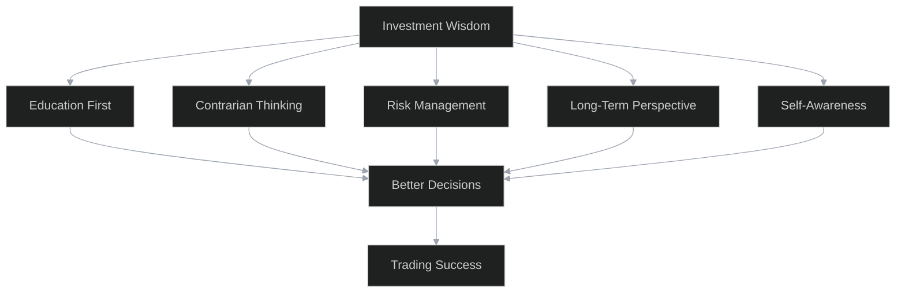

<br>

## Section 15: Online Trading Communities

### 15.1 What Are Online Trading Communities?

An online trading community is a digital platform or forum where investors, traders, and enthusiasts gather to discuss financial markets, share trading strategies, insights, and sentiments, and collectively influence price discovery through user-generated content and real-time collaboration. These communities leverage social media and specialized sites to facilitate interactions that blend analytical discourse with emotional and humorous elements. They enable participants to track stocks via tools like cashtags and memes while reducing barriers to market participation.

### 15.2 Key Characteristics

Online trading communities use natural language processing for sentiment analysis. AI aggregates posts to score conviction levels and predict trends. They often outperform traditional indicators like price momentum. They democratize access to trading information. They amplify risks such as herd behavior leading to volatility.

### 15.3 Evolution from Traditional Trading

Online trading communities trace their roots to traditional trading setups, including the physical floor trading pits of exchanges like the New York Stock Exchange, where brokers manually matched buy and sell orders through open outcry, and informal stockbroker networks that relied on telephone communications for sharing tips and executing trades.

In the 1980s, bulletin board systems emerged as early digital precursors to online communication, enabling hobbyists and enthusiasts to dial in via modems for asynchronous discussions and file sharing on personal computers.

A key motivational driver for this evolution was the democratization of trading access following the U.S. Securities and Exchange Commission's deregulation of fixed brokerage commissions on May 1, 1975, known as "May Day." Prior to this, high fixed rates, often hundreds of dollars per trade, restricted participation primarily to wealthy institutions and individuals.

### 15.4 History of Online Trading Communities

The foundations of online trading communities trace back to the late 1960s and 1970s, when electronic communication networks began revolutionizing securities trading by enabling automated, screen-based quote and order matching. Instinet, established in 1969 as the world's first ECN, initially served institutional investors by providing anonymous trading capabilities and real-time quotes.

The 1990s saw significant breakthroughs with the advent of consumer-accessible online brokerages, which integrated trading platforms with nascent discussion forums to foster trader interactions. E*TRADE, founded in 1992 for individual investors, enabled direct online stock purchases via dial-up connections.

The expansion of online trading communities in the 2000s was propelled by the recovery from the dot-com bubble burst in 2000. Platforms like Yahoo Finance message boards became central hubs for anonymous investor exchanges.

The 2010s marked an acceleration through deeper integration with social networks, enabling real-time trader interactions via features like Twitter hashtags. In 2008, StockTwits was founded, introducing the cashtag notation to facilitate stock-specific conversations on social media.

In the 2020s, the COVID-19 pandemic triggered a dramatic retail trading surge, with investors increasing weekly trading intensity significantly. This was amplified by meme stock phenomena, exemplified by the 2021 GameStop short squeeze.

### 15.5 Types of Communities

Formal trading communities represent structured, regulated online platforms and associations designed for professional traders, broker-dealers, and institutional participants in financial markets. These groups typically require paid memberships, identity verification of participants, and adherence to financial regulations.

Informal trading circles and portals represent unstructured, user-generated online spaces where individuals engage in casual discussions and exchanges related to trading activities, typically lacking formal oversight or institutional backing. These communities are characterized by free access and anonymous participation.

### 15.6 Notable Platforms

StockTwits is a social network with cashtag notation and sentiment analysis. Reddit r/WallStreetBets is a forum for high-risk trading, memes, and community coordination. TradingView is a charting and social platform with advanced charts, idea sharing, and Pine Script. eToro is a social trading platform with CopyTrader and a social feed. Binance Square is a crypto community with multilingual discussions and real-time news. Elite Trader is a professional forum with advanced topics and peer-reviewed discussions.

| Platform | Type | Key Features |
|---|---|---|
| StockTwits | Social Network | Cashtag notation, sentiment analysis |
| Reddit r/WallStreetBets | Forum | High-risk trading, memes, coordination |
| TradingView | Charting + Social | Advanced charts, idea sharing, Pine Script |
| eToro | Social Trading | CopyTrader, social feed |
| Binance Square | Crypto Community | Multilingual discussions, real-time news |
| Elite Trader | Professional Forum | Advanced topics, peer-reviewed discussions |

### 15.7 Notable Successes and Failures

One of the most prominent successes in online trading communities occurred during the 2021 GameStop short squeeze, where users on Reddit's r/wallstreetbets subreddit coordinated to buy shares of GameStop Corporation, driving the stock price from under $20 to a peak of $483 per share in January. This collective action, fueled by discussions exposing hedge funds' heavy short positions, resulted in a market capitalization surge exceeding $20 billion at its height.

In contrast, failures underscore the risks of such communities. The 2010 Flash Crash, a rapid market plunge where the Dow Jones Industrial Average dropped nearly 1,000 points in minutes before recovering, was triggered by high-frequency trading algorithms reacting to a large sell order. More recently, the 2022 collapse of FTX, a cryptocurrency exchange heavily promoted through online trading communities, exposed how hype-driven endorsements led to investor losses totaling over $8 billion.

### 15.8 Impacts and Challenges

Benefits include educational gains through diverse trading strategies, networking and professional connections, performance edges from shared signals, and psychological support from peers. Risks include market manipulation from echo chambers, cybersecurity threats, emotional trading biases, and herd mentality. Regulatory frameworks include MiFID II in the European Union, the Digital Services Act in the EU, SEC oversight in the United States, and MiCA regulation for crypto.

---

## Section 16: Large Language Models in Retail Trading

### 16.1 Overview

Large language models, or LLMs, in retail trading encompass the deployment of generative AI systems by individual investors to process natural language data for market insights, particularly through sentiment analysis of news, social media, and financial reports to inform strategies in stocks, forex, cryptocurrencies, and prediction markets. These models facilitate rapid extraction of sentiment signals from unstructured textual sources, enabling traders to detect market trends and emotional shifts that influence asset prices more efficiently than traditional methods.

Key benefits include the ability to handle vast volumes of diverse data in real time, supporting fundamental and technical analysis previously dominated by institutional resources, thus enhancing decision-making speed and pattern recognition for solo participants. By providing objective, data-driven perspectives, LLMs help mitigate human biases in interpretation while offering research assistance, though integration into trading workflows often requires validation against quantitative models to ensure reliability.

### 16.2 Definition and Core Concepts

Large language models are artificial intelligence systems trained on enormous corpora of text data to understand, generate, and analyze natural language in ways that mimic human-like reasoning and communication. These models leverage deep learning techniques to process sequences of text, predicting subsequent tokens based on contextual patterns learned during training.

At their core, LLMs rely on transformer architectures, which use self-attention mechanisms to weigh the importance of different words in a sequence, enabling efficient handling of long-range dependencies in text. Tokenization breaks down input text into smaller units, such as words or subwords, which are then embedded into numerical vectors for processing by the model. Prompt engineering involves crafting specific inputs to guide the model's output, allowing users to tailor queries for desired responses.

### 16.3 Historical Evolution

The development of large language models originated with foundational models like GPT-1, introduced by OpenAI in June 2018 as an early transformer-based architecture capable of generating coherent text from prompts. Subsequent advancements, including GPT-3 in 2020 and GPT-4 in 2023, expanded capabilities in natural language understanding and generation.

A pivotal shift occurred as open-source LLMs proliferated, facilitated by platforms like Hugging Face, which hosted thousands of pre-trained models by the early 2020s, transitioning advanced AI from exclusive institutional use to accessible tools for retail users. Integration of LLMs into retail trading bots accelerated in 2022-2023, aligning with crypto market turbulence.

### 16.4 Key Applications

Sentiment analysis from news and social media enables LLMs to process textual data from news articles, social media posts, and forums to classify content as positive, negative, or neutral. This approach leverages the models' contextual understanding to detect nuanced market moods.

Processing unstructured data for insights allows LLMs to excel at processing vast amounts of unstructured data, such as earnings reports, whitepapers, and market commentaries, through techniques including summarization, named entity recognition, and pattern detection.

Fundamental and technical analysis tools enable retail traders to generate fundamental valuation models by processing balance sheets, income statements, and economic indicators. In technical analysis, LLMs interpret chart patterns through descriptive prompts.

### 16.5 Advantages for Solo Retail Traders

Reduced human bias and objectivity: LLMs mitigate confirmation bias in solo retail trading by generating analyses grounded in aggregated historical data patterns, offering objective evaluations of trading scenarios that challenge preconceived notions.

Access to institutional-level capabilities: LLMs enable retail traders to access advanced risk models and portfolio optimization techniques traditionally reserved for institutions, such as generating alpha factors and ranking-based strategies for asset allocation.

Enhanced decision-making and risk management: LLMs serve as research copilots for retail traders, facilitating hypothesis testing by summarizing complex fundamental and technical data.

### 16.6 Challenges and Limitations

Dependence on human oversight: Despite their capabilities, LLMs lack genuine comprehension of market dynamics and are susceptible to hallucinations, generating plausible but inaccurate outputs, particularly during novel or unprecedented events.

Risks of over-reliance and errors: LLMs can perpetuate biases embedded in their training data, potentially leading to skewed interpretations of market sentiment or predictions that disadvantage retail traders relying solely on these outputs.

### 16.7 Future Directions

Integration with real-time market data: Future developments include APIs from brokers and market data providers that connect these models to live data from financial exchanges, enabling dynamic analysis of sentiment from news and social media alongside price feeds.

Emerging trends and ethical considerations: Emerging trends include multimodal LLMs capable of processing both text and visual data, such as charts and images, which could enable more comprehensive market analysis. Ethical considerations emphasize the need for transparency in AI-driven decisions.

<br>

## Section 17: Programming Languages for Trading

### 17.1 Quant Research, Data Science, and Backtesting

Python is used for quant research, backtesting, machine learning, data analysis, API trading, and automation. R is used for statistical research, time-series, and risk analytics. MATLAB is used for prototyping strategies and numerical computing. Julia is used for high-performance numerical computing. SQL is used for querying databases, reporting, factor data, and trade data. Kdb+/q is used for tick data, time-series analytics, and HFT research. C++ is used for performance-critical research libraries and pricing engines. CUDA and OpenCL are used for GPU acceleration for Monte Carlo, machine learning, and options pricing.

| Language | Common Use |
|---|---|
| Python | Quant research, backtesting, ML, data analysis, API trading |
| R | Statistical research, time-series, risk analytics |
| MATLAB | Prototyping strategies, numerical computing |
| Julia | High-performance numerical computing |
| SQL | Querying databases, reporting, factor data |
| Kdb+/q | Tick data, time-series analytics, HFT research |
| C++ | Performance-critical research libraries, pricing engines |
| CUDA / OpenCL | GPU acceleration for Monte Carlo, ML, options pricing |

### 17.2 Low-Latency, HFT, and Exchange Infrastructure

C++ is used for HFT, matching engines, order gateways, pricing, risk, and low-latency execution. C is used for embedded systems, kernel-level, FPGA drivers, and legacy exchange code. Rust is used for modern low-latency systems and crypto exchanges. Java is used for enterprise trading platforms, exchange systems, risk, and order management. Go is used for microservices, crypto exchanges, market data, and backend infrastructure. Erlang and Elixir are used for fault-tolerant messaging and telecom-style exchange systems. Assembly is used for ultra-low-latency hot paths. Verilog and VHDL are used for FPGA programming for nanosecond-level trading.

| Language | Common Use |
|---|---|
| C++ | HFT, matching engines, order gateways, pricing, risk |
| C | Embedded systems, kernel-level, FPGA drivers |
| Rust | Modern low-latency systems, crypto exchanges |
| Java | Enterprise trading platforms, exchange systems |
| Go | Microservices, crypto exchanges, market data |
| Erlang / Elixir | Fault-tolerant messaging |
| Assembly | Ultra-low-latency hot paths |
| Verilog / VHDL | FPGA programming for nanosecond-level trading |

**Note:** High-frequency trading is institutional, not a retail strategy.

### 17.3 Enterprise Trading, Risk, and Back Office

Java is used in investment banks, order management systems, risk engines, and exchanges. C# is used for .NET trading platforms, desktop apps, cTrader, and NinjaTrader. Scala is used for big data, Spark, Kafka, and quant platforms. Python is used for risk scripting, reporting, automation, and glue code. SQL is used for reporting, settlement, reconciliation, and regulatory queries. COBOL is used for legacy banking, settlement, and back-office systems. VBA is used for Excel models, macros, and trading desk spreadsheets.

| Language | Common Use |
|---|---|
| Java | Investment banks, order management, risk engines |
| C# | .NET trading platforms, cTrader, NinjaTrader |
| Scala | Big data, Spark, Kafka, quant platforms |
| Python | Risk scripting, reporting, automation |
| SQL | Reporting, settlement, reconciliation |
| COBOL | Legacy banking, settlement, back office |
| VBA | Excel models, macros, trading desk spreadsheets |

### 17.4 Retail Algo and Platform Scripting

Pine Script is used for TradingView indicators and strategies. MQL4 and MQL5 are used for MetaTrader expert advisors, indicators, and scripts. EasyLanguage is used for TradeStation strategies and indicators. AFL is used for AmiBroker Formula Language for scanning and backtesting. ThinkScript is used for Thinkorswim custom studies and scans. NinjaScript is used for NinjaTrader and is C#-based. Python is used for API trading with brokers like Zerodha, Upstox, and Interactive Brokers.

| Language / Script | Platform / Use |
|---|---|
| Pine Script | TradingView indicators and strategies |
| MQL4 / MQL5 | MetaTrader expert advisors |
| EasyLanguage | TradeStation strategies |
| AFL | AmiBroker Formula Language |
| ThinkScript | Thinkorswim custom studies |
| NinjaScript | NinjaTrader; C#-based |
| Python | API trading with brokers |

### 17.5 Most Common by Role

A retail trader commonly uses Python, Pine Script, MQL5, and Excel/VBA. A quant researcher uses Python, R, MATLAB, SQL, and C++. An algo developer uses Python, C++, Java, and C#. An HFT engineer uses C++, Rust, Assembly, and FPGA/Verilog. A risk analyst uses Python, SQL, R, Java, and C++. An exchange engineer uses C++, Java, Go, and Erlang. A crypto trader or developer uses Python, TypeScript, Solidity, Rust, and Go. A data engineer uses SQL, Python, Scala, Java, Spark, and Kafka. A back-office or reporting professional uses SQL, Python, VBA, and COBOL.

| Role | Languages You Will See Daily |
|---|---|
| Retail trader | Python, Pine Script, MQL5, Excel/VBA |
| Quant researcher | Python, R, MATLAB, SQL, C++ |
| Algo developer | Python, C++, Java, C# |
| HFT engineer | C++, Rust, Assembly, FPGA/Verilog |
| Risk analyst | Python, SQL, R, Java, C++ |
| Exchange engineer | C++, Java, Go, Erlang |
| Crypto trader/dev | Python, TypeScript, Solidity, Rust, Go |
| Data engineer | SQL, Python, Scala, Java, Spark, Kafka |
| Back-office/reporting | SQL, Python, VBA, COBOL |

### 17.6 Key Takeaway

Python is the default for research, backtesting, automation, and retail algo. C++ dominates low-latency and HFT. Java and C# dominate enterprise trading and risk. SQL and Kdb+/q dominate data and time-series. Pine, MQL, EasyLanguage, and AFL dominate retail platform scripting. Solidity, Rust, and Go dominate crypto and DeFi. Bash, PowerShell, and Python dominate automation and DevOps.

<br>

## Section 18: Mathematics for Trading

### 18.1 Basic Arithmetic and Percentages

Basic arithmetic includes addition and subtraction for profit and loss, account balance, and cash flow. Multiplication and division are used for quantity times price and position value. Percentages are used for returns, brokerage, taxes, and circuit limits. Percentage change is calculated as (New minus Old) divided by Old multiplied by 100. Ratios include P/E, P/B, debt-to-equity, and risk-reward. Averages include simple average, weighted average, and moving average. Rounding, tick size, and lot size calculations are also important.

### 18.2 Algebra and Equations

Linear equations are used for break-even, target, and stop-loss. Inequalities are used for margin call and stop-loss trigger conditions. Simultaneous equations are used for arbitrage and pair trading. Quadratic equations are used in some optimization and options problems. Exponents are used for compounding and growth. Logarithms are used for log returns and continuous compounding. Sequences and series are used for SIP, EMI, and annuities.

### 18.3 Time Value of Money

Present Value and Future Value are fundamental. NPV, IRR, XIRR, and CAGR are used for investment evaluation. Compounding and discounting are core concepts. Annuity and perpetuity are used for regular cash flows. The Rule of 72 estimates years to double money as 72 divided by the annual return percentage.

### 18.4 Statistics

Mean, median, and mode are measures of central tendency. Variance and standard deviation measure dispersion. Skewness and kurtosis measure distribution shape. Percentiles, quartiles, and z-scores are used for relative position. Correlation and covariance measure relationships. Regression and R-squared measure predictive power. Hypothesis testing, p-values, and confidence intervals are used for statistical inference. Stationarity and autocorrelation are important for time-series analysis.

### 18.5 Probability

Basic probability and conditional probability are foundational. Bayes' theorem updates probabilities based on new information. Expected value is the weighted average of outcomes. Distributions include normal, lognormal, binomial, Poisson, and t-distribution. Fat tails and extreme events are important in financial markets. Random walks and Markov chains model price movements. Monte Carlo simulation is used for complex scenarios.

### 18.6 Risk and Portfolio Math

Volatility, beta, and alpha are key risk measures. Sharpe, Sortino, Treynor, and Information ratio measure risk-adjusted returns. Maximum drawdown, VaR, CVaR, and ulcer index measure downside risk. Expected return and portfolio variance are used in portfolio construction. Covariance matrix and efficient frontier are used for optimization. Kelly criterion and position sizing help determine optimal bet size. Risk of ruin and probability of drawdown are important for capital preservation.

### 18.7 Derivatives and Options Math

Put-call parity relates call and put prices. Black-Scholes model prices options. Binomial tree pricing is an alternative method. Greeks include Delta, Gamma, Theta, Vega, and Rho. Implied volatility is derived from option prices. Ito's lemma, Brownian motion, and stochastic calculus are advanced topics. Risk-neutral valuation and martingale pricing are used in derivatives pricing. Monte Carlo methods are used for options pricing. Futures fair value, cost of carry, and basis are important for futures trading.

### 18.8 Common Trading Formulas

Return is calculated as (Sell Price minus Buy Price plus Dividends) divided by Buy Price multiplied by 100. CAGR is calculated as (End Value divided by Start Value) to the power of (1 divided by n) minus 1. Sharpe Ratio is (Rp minus Rf) divided by sigma p. Beta is Cov(Ri, Rm) divided by Var(Rm). Alpha is Rp minus [Rf plus beta times (Rm minus Rf)]. P/E is Price divided by EPS. EPS is PAT divided by Number of Shares. Position Size is Risk Amount divided by (Entry minus Stop Loss). Expectancy is (Win% times Avg Win) minus (Loss% times Avg Loss). Kelly Fraction is W minus (1 minus W) divided by R.

| Formula | Calculation |
|---|---|
| Return | (Sell Price − Buy Price + Dividends) / Buy Price × 100 |
| CAGR | (End Value / Start Value)^(1/n) − 1 |
| Sharpe Ratio | (Rp − Rf) / σp |
| Beta | Cov(Ri, Rm) / Var(Rm) |
| Alpha | Rp − [Rf + β(Rm − Rf)] |
| P/E | Price / EPS |
| EPS | PAT / Number of Shares |
| Position Size | Risk Amount / (Entry − Stop Loss) |
| Expectancy | (Win% × Avg Win) − (Loss% × Avg Loss) |
| Kelly Fraction | W − (1 − W) / R |

For retail trading, focus on percentages, ratios, averages, probability, risk-reward, position sizing, expectancy, drawdown, and compounding. For quant or derivatives trading, add calculus, linear algebra, statistics, stochastic calculus, optimization, and programming.

<br>

## Section 19: India-Specific Operational, Taxation, and Risk Topics

This section covers the practical, India-specific details that every retail intraday trader must understand before placing real money at risk. These topics are not optional reading. They directly affect how much capital you need, how much leverage you actually get, what your trades cost, how your profits are taxed, and what happens when things go wrong.

### 19.1 Product Types: MIS, CNC, NRML, CO, BO

When you place an order on an Indian broker platform, you must choose a product type. The product type determines whether your position is intraday or delivery, how much margin you need, and what happens if you do not square off before the cut-off time.

| Product Type | Full Form | Use Case | Ownership | Auto Square-Off | Margin |
|---|---|---|---|---|---|
| MIS | Margin Intraday Square-off | Intraday equity, F&O, commodity | No ownership | Yes, typically 3:15 PM to 3:20 PM | Lower, based on peak margin |
| CNC | Cash and Carry | Delivery buying of equity | Full ownership | No | Full payment required |
| NRML | Normal | Overnight F&O, currency, commodity | Contractual position | No | SPAN + Exposure margin |
| CO | Cover Order | Intraday entry with mandatory stop-loss | No ownership | Yes, if stop-loss triggers or at cut-off | Lower, stop-loss compulsory |
| BO | Bracket Order | Intraday entry with target and stop-loss | No ownership | Yes, when target or stop-loss triggers | Lower, target and stop-loss set in advance |

If an MIS, CO, or BO position is not squared off by the cut-off time, the broker may square it off automatically or convert it to a delivery or NRML position, which requires full margin. This conversion can lead to a margin shortfall and penalty.

**GTC vs. GTT**: In Indian equity markets, GTC (Good Till Cancelled) orders are generally not available. The correct term is GTT (Good Till Triggered). A GTT order remains valid until a trigger price is hit or the order is cancelled. Do not confuse GTC with GTT when placing orders.

### 19.2 Margin Mechanics: Peak Margin, SPAN, Exposure, Haircut, Pledge

Margin is the amount of money or collateral you must keep with your broker to open and maintain a position. Under SEBI's peak margin rules, brokers must collect the full exchange-mandated margin upfront. There is no unlimited intraday leverage.

| Margin Type | Description |
|---|---|
| Peak Margin | The highest margin required at any point during the trading day. Brokers take random snapshots of your positions. If your margin falls short at any snapshot, you face a penalty. |
| SPAN Margin | Risk-based initial margin for F&O positions, calculated by the exchange based on volatility. |
| Exposure Margin | Additional margin for F&O positions, over and above SPAN margin. |
| Haircut | A reduction applied to the value of collateral such as shares when you pledge them for margin. For example, if a share has a 20% haircut, a Rs. 1,00,000 holding counts as Rs. 80,000 collateral. |
| Pledge | Using shares you own as collateral to get margin for trading. The shares remain in your Demat account but are marked as pledged. |

For equity intraday trades, the minimum margin is typically 20% or more of the trade value, considering stock volatility, VaR, ELM, and adhoc margins from the exchange. This means the maximum intraday leverage is approximately 5x, not 20x as some older guides suggest.

**Practical implication**: If you want to buy Rs. 1,00,000 worth of intraday equity, you need at least Rs. 20,000 in margin. If you use more leverage than allowed, you will receive a margin penalty from the exchange.

### 19.3 Broker RMS: Auto Square-Off, Margin Call, Penalty, Liquidation

Every broker has a Risk Management System, or RMS, that monitors your positions and margin. The RMS can take action without prior notice.

| RMS Action | What Happens |
|---|---|
| Auto Square-Off | The broker automatically closes your intraday position if you do not square off by the cut-off time. For equity and F&O, this is typically between 3:15 PM and 3:20 PM IST. An auto square-off charge of Rs. 50 plus 18% GST may apply per position. |
| Margin Call | If your margin falls below the required level, the broker asks you to add funds or reduce positions. Some brokers make a margin call without prior intimation. |
| Margin Penalty | If you fail to maintain peak margin, the exchange imposes a penalty. This is charged by the broker to your account. |
| Forced Liquidation | If you do not meet the margin call, the broker may sell your positions without your consent, often at unfavorable prices. |

**Critical warning**: The broker is not responsible if your position hits a circuit limit and cannot be squared off. You bear the loss and any margin penalty. Always check your broker's RMS policy before trading.

### 19.4 Short Selling Rules: Auction, 150% Block, Delivery vs. Intraday

Short selling means selling shares you do not own, expecting to buy them back later at a lower price. In India, short selling is allowed only for intraday in the cash segment. You cannot carry a short position in the cash segment overnight.

If you short sell and fail to deliver the shares by settlement, the exchange conducts an auction to buy the shares. Until the auction settles, 150% of the sale value is blocked in your trading limits. For example, if you short-sell Rs. 10,000, your ledger will show a Rs. 15,000 debit. The extra 50% covers potential auction losses.

| Scenario | Consequence |
|---|---|
| Short sell and buy back same day | Normal intraday profit or loss |
| Short sell and fail to deliver | Auction, 150% block, possible auction loss and penalty |
| Short sell in delivery segment | Not allowed for retail in cash market |

The auction is conducted by the exchange, and the highest price from the trade day until the auction day, or 20% above the closing price on the auction day, whichever is higher, is used to determine your cost.

### 19.5 BTST and STBT Risks

BTST (Buy Today, Sell Tomorrow) and STBT (Sell Today, Buy Tomorrow) are trades that attempt to capture overnight moves without taking delivery.

| Trade | What It Means | Risk |
|---|---|---|
| BTST | You buy today and sell tomorrow before the shares are credited to your Demat account. | If the seller fails to deliver, you face auction and penalty. A minimum 40% margin may be levied on BTST trades. |
| STBT | You sell today and buy tomorrow. | Overnight gap risk: an unexpected positive development can cause the stock to gap up, resulting in a loss. |

NRIs are not permitted to do BTST or STBT trades.

### 19.6 Corporate Actions Impact

Corporate actions such as bonus issues, stock splits, dividends, and rights issues affect stock prices and your positions.

| Corporate Action | Impact on Price | Impact on Intraday Trader |
|---|---|---|
| Dividend | Stock price falls by the dividend amount on the ex-date. | If you hold an intraday position overnight by mistake, you may not receive the dividend, but the price adjustment still affects your position. |
| Bonus Issue | Number of shares increases; price decreases proportionally. | Your position quantity may change. If you have an open F&O position, the lot size and strike prices are adjusted. |
| Stock Split | Number of shares increases; price decreases proportionally. | Same as bonus issue. |
| Rights Issue | Existing shareholders get the right to buy new shares at a discount. | The stock price adjusts on the ex-date. |

Brokers typically square off positions one day before the ex-date for specific corporate actions to avoid complications.

### 19.7 Surveillance Measures: ASM, GSM, T2T, Circuit Filters

The exchanges place certain stocks under surveillance measures to protect investors from excessive volatility and manipulation.

| Measure | What It Means | Impact on Trading |
|---|---|---|
| ASM (Additional Surveillance Measure) | Extra checks on stocks with unusual price or volume activity. | Higher margin requirements, tighter circuit limits often plus or minus 5%, and possible restrictions on intraday trading. |
| GSM (Graded Surveillance Measure) | Graded restrictions on fundamentally weak, often very low-priced stocks. | Similar to ASM; may move to T2T segment. |
| T2T (Trade-to-Trade) | Every trade must result in delivery. | No intraday trading allowed. You must take or give delivery. |
| Circuit Filter | Daily price movement limit for a stock. | If the stock hits the circuit, trading may halt, and you may not be able to exit your position. |

Stocks under ASM or GSM often have a 5% circuit limit. Stocks in T2T have strict 5% limits.

### 19.8 Intraday Trading Cost Structure

Every intraday trade has multiple costs. These costs can easily wipe out small profits. You must calculate them before trading.

| Cost Component | Intraday Equity | Intraday F&O |
|---|---|---|
| Brokerage | Rs. 0 to Rs. 20 per order, depending on broker | Rs. 0 to Rs. 20 per order |
| STT (Securities Transaction Tax) | 0.025% on sell side only | Futures: 0.05% on sell side; Options: 0.15% on sell side of premium |
| Exchange Transaction Charges | NSE: 0.00297%; BSE: 0.00375% | NSE: 0.00173% futures; 0.03503% options |
| SEBI Turnover Fee | Rs. 10 per crore | Rs. 10 per crore |
| GST | 18% on brokerage + exchange charges + SEBI fee | 18% on brokerage + exchange charges + SEBI fee |
| Stamp Duty | 0.003% on buy side | 0.002% futures; 0.003% options on buy side |
| DP Charges | Not applicable for intraday | Not applicable for intraday |

For an intraday equity trade with a total trade value of Rs. 1,00,000, the total cost including brokerage, STT, exchange charges, GST, and stamp duty can range from Rs. 50 to Rs. 100 or more, depending on your broker and the exchange. For scalping, where you target 0.1% to 0.5% per trade, these costs can consume a significant portion of your profits.

### 19.9 Taxation of Intraday and F&O Trading

Taxation is one of the most misunderstood areas for retail traders. Intraday and F&O profits are not treated as capital gains. They are treated as business income.

| Trading Type | Tax Classification | Tax Rate | Loss Set-Off | Carry Forward |
|---|---|---|---|---|
| Intraday Equity | Speculative Business Income | Slab rate | Can be set off only against speculative income | 4 years |
| F&O | Non-Speculative Business Income | Slab rate | Can be set off against any income except salary | 8 years |
| Delivery Equity (short-term) | Short-Term Capital Gains | 20% | Can be set off against capital gains | 8 years |
| Delivery Equity (long-term) | Long-Term Capital Gains | 12.5% above Rs. 1.25 lakh | Can be set off against capital gains | 8 years |

Intraday trades are classified as speculative business income under Section 43(5) of the Income Tax Act. F&O transactions are classified as non-speculative business income.

**Tax audit**: If your trading turnover exceeds Rs. 10 crore, or if you have opted out of the presumptive taxation scheme, a tax audit may be required. Consult a chartered accountant.

**Advance tax**: If your total tax liability for the year exceeds Rs. 10,000, you must pay advance tax in quarterly installments. Non-payment attracts interest under Sections 234B and 234C.

### 19.10 Crypto Taxation in India

If you trade cryptocurrencies, you must understand the tax rules. They are different from stock market taxation.

| Aspect | Rule |
|---|---|
| Tax Rate | 30% flat on gains from Virtual Digital Assets, plus surcharge and 4% cess |
| TDS | 1% TDS on transactions exceeding specified thresholds |
| Loss Set-Off | Losses from crypto cannot be set off against any other income |
| Holding Period | No distinction between short-term and long-term; every gain is taxed at 30% |
| Reporting | Must be reported in ITR; CBDT has tightened reporting requirements |

The 30% tax and 1% TDS remain in force under the Income Tax Act, 2025.

### 19.11 F&O Practicalities: Lot Size, Expiry, Physical Settlement

Futures and options have specific rules that every retail trader must know.

| Concept | What It Means |
|---|---|
| Lot Size | The minimum quantity you can trade in F&O. For example, one lot of Reliance may be 250 shares. You cannot trade fewer than one lot. |
| Expiry | The last day of a derivative contract. Index options expire weekly; stock options and futures expire monthly. |
| Physical Settlement | If you hold an open stock F&O position on the expiry date, you must take or give delivery of the underlying shares. This requires full payment or delivery of shares. |
| Rollover | Moving your position from the current expiry to the next expiry. |
| STT on Options | STT is charged at 0.15% on the sell side of options premium and 0.15% on the buy side on exercise. |

**Critical warning**: If you hold a stock option that expires in-the-money, you will be assigned the obligation to buy or sell the shares. If you do not have the funds or shares, you face a short delivery auction and penalty. Always square off stock F&O positions before expiry unless you intend to take delivery.

### 19.12 Option Selling Risks: Unlimited Loss, Assignment, Pin Risk

Selling options is a popular strategy for generating premium income, but it carries significant risk.

| Risk | Description |
|---|---|
| Unlimited Loss | For a short call, the loss is theoretically unlimited because the stock price can rise without limit. For a short put, the loss can be very large if the underlying collapses. |
| Assignment Risk | If the option is in-the-money at expiry, you may be assigned the obligation to buy or sell the underlying shares. |
| Pin Risk | Near expiry, the underlying price may hover near the strike price, making it uncertain whether the option will expire in-the-money or out-of-the-money. This creates uncertainty about assignment. |
| Margin Requirements | Short option positions require SPAN + Exposure margin, which can be substantial. |

**Practical rule**: Never sell naked options unless you fully understand the risk and have sufficient margin. Prefer hedged strategies such as credit spreads or covered calls.

### 19.13 Opening Range Breakout and VWAP Strategies

Two important intraday strategies are widely used by professional and retail traders.

**Opening Range Breakout (ORB)**

The ORB strategy identifies the high and low of the first 15, 30, or 60 minutes after market open. A long signal is generated when price breaks above the opening range high with volume confirmation. A short signal is generated when price breaks below the opening range low. The VWAP (Volume Weighted Average Price) is used as a filter: take longs only when price is above VWAP, and shorts only when price is below VWAP.

**VWAP Strategy**

VWAP is the average price at which a stock has traded throughout the day, weighted by volume. It is used as a fair value reference. If price is above VWAP, the bias is bullish; if below, the bias is bearish. Traders often enter on a VWAP reclaim (price crossing back above VWAP after being below) or a VWAP rejection (price failing to break above VWAP).

### 19.14 Order Flow, Level 2, DOM, Tape Reading

Level 2 data (market depth) shows multiple layers of pending buy and sell orders beyond the best bid and ask. On NSE, Level 2 provides up to five best bid and ask prices. The Depth of Market (DOM) screen visualizes this data.

**Tape reading** is the skill of studying the Time and Sales (T&S) data and Level 2 order book to identify large block trades at the bid or ask, absorption, and iceberg orders. It is a skill-intensive discipline practised primarily by scalpers and intraday traders in liquid instruments like Nifty futures.

Retail traders can access Level 2 data through platforms like Zerodha Kite, which offers a 20-level market depth window.

### 19.15 Slippage, Liquidity, and Impact Cost

**Slippage** is the difference between the expected price of a trade and the actual fill price. It comes from volatility, low liquidity, and the bid-ask spread. When VIX rises, bid-ask spreads widen, and slippage increases.

**Impact cost** is the cost incurred when transacting an order size relative to the ideal market price. Shallow order books impose heavy impact costs on sizable positions. Blue-chip stocks like Reliance, HDFC Bank, and Infosys provide tight bid-ask spreads and minimal slippage.

For scalping, slippage and impact cost can make the strategy unviable. Capturing 0.5% to 0.8% moves may no longer offer favorable risk-reward after accounting for costs and slippage.

### 19.16 Backtesting, Paper Trading, and Journaling

Before risking real money, you should backtest your strategy and practice with paper trading.

| Practice | What to Do |
|---|---|
| Backtesting | Test your strategy on historical data. Record entry, exit, stop-loss, target, and outcome. Calculate win rate, average win, average loss, and expectancy. |
| Paper Trading | Trade with simulated money in real market conditions. This builds confidence without financial risk. |
| Journaling | Record every trade with date, time, entry, exit, rationale, emotional state, and adherence to rules. Review weekly to identify patterns and mistakes. |

Free Excel templates and online journals are available for Indian traders. These templates include fields for equity, F&O, and swing trades with Indian-specific fields.

### 19.17 Trading KPIs: Win Rate, Expectancy, Profit Factor, Drawdown

You must measure your performance objectively. Do not rely on feelings.

| KPI | Formula | What It Tells You |
|---|---|---|
| Win Rate | Winning trades divided by Total trades | Percentage of trades that were profitable. |
| Expectancy | (Win Rate times Average Win) minus (Loss Rate times Average Loss) | Average profit or loss per trade. Positive expectancy means your system is profitable. |
| Profit Factor | Gross Profit divided by Gross Loss | A profit factor above 1.5 is generally considered good. Above 2.0 is excellent. |
| Maximum Drawdown | Largest peak-to-trough decline in account equity | The worst loss you have experienced. This tells you how much pain you can endure. |
| Average R-Multiple | Average profit or loss in units of risk (R) | A positive average R means you are making more than you are risking. |

Measure these KPIs across at least 50 to 100 trades to get a meaningful sample.

### 19.18 Event Risk: RBI Policy, Budget, Earnings, Expiry

Certain events cause sharp volatility and should be treated with caution.

| Event | Impact |
|---|---|
| RBI Monetary Policy | Nifty and Bank Nifty can move 2-4% intraday. Rate-sensitive stocks such as banks, real estate, and auto are most affected. IV crush after the announcement can hurt option buyers. |
| Union Budget | Major policy announcements can cause sector-specific and index-wide volatility. |
| Earnings Announcements | Individual stocks can gap up or down based on results. If you hold an overnight position, you are exposed to this risk. |
| Weekly Expiry | Nifty and Bank Nifty weekly options expiry often sees elevated gamma and pin risk. Prices can swing sharply near the strike price. |

Avoid carrying positions through these events unless you are deliberately trading the event with a defined strategy.

### 19.19 Investor Protection: SCORES, ODR, IPF, KYC, Nomination, DDPI

SEBI provides several mechanisms to protect retail investors.

| Mechanism | What It Does |
|---|---|
| SCORES 2.0 | SEBI's centralized web-based grievance redressal system. You can file complaints against listed companies or intermediaries. |
| SMART ODR | Online Dispute Resolution platform for conciliation and arbitration. Investors can escalate unresolved SCORES complaints to ODR. |
| IPF (Investor Protection Fund) | A reserve maintained by exchanges and depositories to compensate investors in case of default by intermediaries. SEBI has revised the framework for IPF utilisation. |
| KYC | Know Your Customer verification. Mandatory for opening a Demat and trading account. |
| Nomination | You can nominate up to 10 persons in your Demat account. If you do not nominate, your legal heirs must go through a lengthy process to claim your securities. |
| DDPI | Demat Debit and Pledge Instruction. A one-time authorization to your broker for limited access to your Demat account for debit and pledge transactions. |

Always verify that your broker is registered with SEBI and that your funds are held in a segregated account.

### 19.20 SEBI Algo Trading Framework

SEBI has introduced a framework for retail algo trading, effective from August 1, 2025.

| Aspect | Rule |
|---|---|
| Who Can Use Algo | Retail investors can use algos through their broker's API. |
| Registration | Algos developed by tech-savvy retail investors must be registered with the exchange through their broker if they cross the specified order-per-second threshold. |
| Family Use | A registered algo can be used by the investor and their immediate family including self, spouse, dependent children, and dependent parents. |
| 2FA and Audit Trail | Brokers must implement two-factor authentication and maintain audit trails for algo orders. |

If you are a retail algo trader, ensure your algo is registered with the exchange through your broker. Unregistered algos may be blocked.

### 19.21 Updated Broker Data

Broker data changes frequently. The table below is an approximate snapshot based on FY25 data. Verify current NSE data before publishing.

| Rank | Broker | Approximate Active Clients | Market Share Trend |
|---|---|---|---|
| 1 | Groww | 12.9 million | Largest by active clients; market share around 26% |
| 2 | Zerodha | 7.1-7.3 million | Growth has plateaued; still a major player |
| 3 | Angel One | 6.1-6.9 million | Strong growth |
| 4 | ICICI Securities | Significant | One of the few top brokers to add clients in 2025 |
| 5 | Upstox | Significant | Facing decline in active clients |

The total number of active clients across all brokers stood at approximately 4.49 crore as of December 2025, down from 5.02 crore in December 2024. The decline reflects reduced retail trading activity after the post-COVID surge.

<br>

## Section 20: Glossary of Key Terms

### 20.1 Market Basics

| Term | Definition |
|---|---|
| Stock | Ownership in one or more companies |
| Share | One unit of ownership in a company |
| Equity | Ownership capital in a company |
| Market Cap | Total value of a company's shares = price × outstanding shares |
| Large-Cap | Top 100 companies by market cap; relatively stable |
| Mid-Cap | Rank 101-250 by market cap; higher growth, higher risk |
| Small-Cap | Rank 251+; early-stage/high-risk, high-return potential |
| Blue Chip | Large, well-established, trusted company |
| Penny Stock | Very low-priced stock, often speculative |
| Multibagger | Stock that multiplies investment several times |
| Bull Market | Rising market with optimism |
| Bear Market | Falling market with pessimism |
| Correction | Temporary fall of usually 10%+ from recent highs |
| Rally | Sharp rise in prices |
| Crash | Sudden, severe market fall |
| Volatility | How sharply prices move up and down |
| Liquidity | Ease of buying/selling without affecting price much |
| Volume | Number of shares traded in a period |
| Turnover | Total value of shares traded |
| Bid | Highest price a buyer is willing to pay |
| Ask | Lowest price a seller is willing to accept |
| Spread | Difference between bid and ask |
| Market Depth | Order book showing buy/sell quantities at different prices |
| Order Book | Live list of pending buy and sell orders |
| Circuit | Daily price movement limit for a stock |
| Upper Circuit | Stock locked at maximum allowed daily gain |
| Lower Circuit | Stock locked at maximum allowed daily fall |
| Circuit Breaker | Market-wide trading halt after a large index move |
| 52-Week High/Low | Highest/lowest price in the past year |
| ATH | All-Time High |
| ATL | All-Time Low |
| Index | Basket of stocks tracking market or sector performance |
| Sensex | BSE index of 30 major companies |
| Nifty / Nifty 50 | NSE index of 50 large companies |
| Bank Nifty | NSE index of major banking stocks |
| Sectoral Index | Index for a specific sector, e.g., IT, Pharma |
| India VIX | India's volatility/fear index |
| BSE | Bombay Stock Exchange |
| NSE | National Stock Exchange |
| SEBI | Securities and Exchange Board of India |
| RBI | Reserve Bank of India |
| AMFI | Association of Mutual Funds in India |
| NSDL / CDSL | India's two main depositories |
| DP | Depository Participant; agent for your Demat account |
| Demat Account | Electronic account holding shares, ETFs, bonds, etc. |
| Broker | Intermediary who executes trades |
| DII | Domestic Institutional Investor |
| FII | Foreign Institutional Investor |
| FPI | Foreign Portfolio Investor |
| HNI | High Net-worth Individual |
| Retail Investor | Small individual investor |
| Promoter | Founder/controlling shareholder group |
| Public Shareholding | Shares held by non-promoters |
| Free Float | Shares available for public trading |

### 20.2 Orders, Trading, and Settlement

| Term | Definition |
|---|---|
| Market Order | Buy/sell immediately at current price |
| Limit Order | Buy/sell only at a specified price or better |
| SL / Stop Loss | Order to exit if price falls below/rises above a trigger |
| SL-M | Stop-loss market order; triggers a market order |
| SL-L | Stop-loss limit order; triggers a limit order |
| GTT | Good Till Triggered; valid until triggered or cancelled |
| AMO | After Market Order; placed outside trading hours |
| Bracket Order | Entry with target and stop-loss; auto exit |
| Cover Order | Entry with mandatory stop-loss |
| IOC | Immediate or Cancel |
| FOK | Fill or Kill; must execute fully immediately |
| Day Order | Valid only for the current day |
| Delivery | Buying shares and taking them into Demat |
| Intraday | Buy and sell same day |
| BTST | Buy Today, Sell Tomorrow |
| STBT | Sell Today, Buy Tomorrow |
| Positional | Holding for days/weeks based on trend |
| Swing Trading | Holding for days to weeks |
| Scalping | Very short-term trading for small quick profits |
| Long | Buying expecting price to rise |
| Short | Selling borrowed shares expecting price to fall |
| Short Selling | Selling shares you do not own to profit from a fall |
| Covering | Buying back shorted shares |
| Square Off | Closing an open position |
| Average | Buying more at lower/higher prices to adjust cost |
| Averaging Down | Buying more as price falls to lower average cost |
| Pyramiding | Adding to a winning position using unrealized profits |
| Margin | Borrowed funds or collateral used to trade |
| Margin Trading | Borrowing from broker to buy stocks |
| Initial Margin | Upfront margin needed to open a position |
| Maintenance Margin | Minimum margin to keep a position open |
| Margin Call | Broker asks for more funds/collateral |
| Peak Margin | Minimum margin required at all times |
| Exposure Margin | Extra margin for derivatives |
| SPAN Margin | Risk-based initial margin for F&O |
| Haircut | Reduction applied to collateral value |
| Pledge | Using shares as collateral |
| Settlement | Process of transferring shares and funds |
| T+1 | Trade date + 1 business day settlement |
| Clearing Corporation | Guarantees trade settlement |
| Rollover | Moving F&O position to next expiry |
| Expiry | Last day of a derivative contract |
| Contract | Tradable F&O instrument |
| Lot Size | Minimum quantity for F&O |
| Open Interest | Total outstanding derivative contracts |
| Premium | Price paid for an option |
| Strike Price | Fixed price for option exercise |
| Spot Price | Current market price of underlying |
| Futures | Contract to buy/sell at future date at set price |
| Options | Right, not obligation, to buy/sell at set price |
| Call Option | Right to buy |
| Put Option | Right to sell |
| ITM | In The Money |
| ATM | At The Money |
| OTM | Out of The Money |
| Intrinsic Value | Real exercisable value of an option |
| Time Value | Premium minus intrinsic value |
| Greeks | Delta, Gamma, Theta, Vega, Rho |
| Delta | Sensitivity to underlying price |
| Gamma | Rate of change of Delta |
| Theta | Time decay |
| Vega | Sensitivity to volatility |
| Rho | Sensitivity to interest rates |
| Implied Volatility | Market's expected future volatility |
| Hedge | Offsetting position to reduce risk |
| Speculation | Betting on price movement |
| Arbitrage | Profiting from price differences across markets |

### 20.3 Technical Analysis Terms

| Term | Definition |
|---|---|
| Chart | Price graph over time |
| Candlestick | Chart showing open, high, low, close |
| Timeframe | Chart period: 1m, 5m, daily, weekly |
| Support | Price level where buying may emerge |
| Resistance | Price level where selling may emerge |
| Trend | Overall direction: up, down, sideways |
| Uptrend | Higher highs and higher lows |
| Downtrend | Lower highs and lower lows |
| Sideways / Range | Price moving between support and resistance |
| Breakout | Price moves above resistance |
| Breakdown | Price moves below support |
| Fakeout | False breakout/breakdown |
| Retest | Price returns to broken level |
| Pullback | Temporary counter-trend move |
| Retracement | Partial reversal of a move |
| Reversal | Change in trend direction |
| Continuation | Trend resumes after pause |
| Higher High | New peak above previous peak |
| Higher Low | New dip above previous dip |
| Lower High | New peak below previous peak |
| Lower Low | New dip below previous dip |
| Moving Average | Average price over a period |
| SMA | Simple Moving Average |
| EMA | Exponential Moving Average |
| Golden Cross | Short MA crosses above long MA |
| Death Cross | Short MA crosses below long MA |
| VWAP | Volume Weighted Average Price |
| RSI | Relative Strength Index; overbought/oversold |
| MACD | Moving Average Convergence Divergence |
| Stochastic | Momentum oscillator |
| Bollinger Bands | Volatility bands around moving average |
| ATR | Average True Range; volatility measure |
| ADX | Trend strength indicator |
| OBV | On-Balance Volume |
| Volume Profile | Volume by price level |
| Fibonacci | Retracement levels like 38.2%, 50%, 61.8% |
| Pivot Points | Support/resistance from previous day's range |
| Trendline | Line connecting highs or lows |
| Channel | Parallel trendlines |
| Gap | Price jump between sessions |
| Gap Up | Opens above previous close |
| Gap Down | Opens below previous close |
| Doji | Candlestick with small body |
| Hammer | Bullish reversal candle |
| Shooting Star | Bearish reversal candle |
| Engulfing | Two-candle reversal pattern |
| Morning Star | Bullish reversal pattern |
| Evening Star | Bearish reversal pattern |
| Head & Shoulders | Bearish reversal pattern |
| Double Top | Bearish reversal pattern |
| Double Bottom | Bullish reversal pattern |
| Cup & Handle | Bullish continuation pattern |
| Flag | Short consolidation pattern |
| Pennant | Small triangle consolidation |
| Triangle | Consolidation pattern |
| Wedge | Rising/falling wedge pattern |
| Divergence | Price and indicator move differently |
| Overbought | RSI usually above 70 |
| Oversold | RSI usually below 30 |
| Momentum | Speed of price movement |
| Breadth | Advance-decline participation |
| Advance-Decline | Ratio of rising to falling stocks |
| 200 DMA | 200-day moving average |
| 50 DMA | 50-day moving average |
| 20 DMA | 20-day moving average |

### 20.4 Fundamental and Valuation Terms

| Term | Definition |
|---|---|
| Revenue | Total sales/top line |
| EBITDA | Earnings before interest, tax, depreciation, amortization |
| PAT | Profit After Tax |
| EPS | Earnings Per Share |
| P/E Ratio | Price divided by EPS |
| PEG Ratio | P/E divided by earnings growth |
| P/B Ratio | Price divided by book value per share |
| EV/EBITDA | Enterprise value divided by EBITDA |
| ROE | Return on Equity |
| ROCE | Return on Capital Employed |
| ROA | Return on Assets |
| Debt-to-Equity | Total debt divided by shareholders' equity |
| Current Ratio | Current assets divided by current liabilities |
| Quick Ratio | Liquid assets divided by current liabilities |
| Free Cash Flow | Operating cash flow minus capex |
| Operating Cash Flow | Cash generated from core operations |
| Book Value | Net asset value per share |
| Face Value | Nominal value of a share |
| Dividend | Profit distributed to shareholders |
| Dividend Yield | Annual dividend divided by price |
| Payout Ratio | Dividends divided by net income |
| Bonus Issue | Free extra shares to existing holders |
| Stock Split | Dividing one share into multiple shares |
| Rights Issue | Existing holders offered new shares at discount |
| Buyback | Company repurchases its own shares |
| Record Date | Date to be eligible for corporate action |
| Ex-Date | Date from which new buyers do not get the benefit |
| AGM | Annual General Meeting |
| EGM | Extraordinary General Meeting |
| Annual Report | Company's yearly financial report |
| Quarterly Results | Three-month performance report |
| Concall | Earnings conference call |
| Guidance | Management's future outlook |
| Promoter Holding | Percentage shares held by promoters |
| Pledged Shares | Promoter shares pledged for loans |
| Corporate Governance | Quality of company management and controls |
| Balance Sheet | Statement of assets and liabilities |
| P&L | Profit and Loss statement |
| Cash Flow Statement | Inflows and outflows of cash |
| Net Worth | Shareholders' equity |
| Working Capital | Current assets minus current liabilities |
| Capital Expenditure | Money spent on long-term assets |
| Depreciation | Accounting write-down of fixed assets |
| Amortization | Write-down of intangible assets |
| Goodwill | Intangible value from acquisitions |
| Contingent Liability | Potential future liability |
| Auditor | Independent financial examiner |
| Qualified Opinion | Auditor flags concerns |

### 20.5 Trading Psychology and Common Jargon

| Term | Definition |
|---|---|
| FOMO | Fear Of Missing Out |
| Fear | Emotion that drives panic selling |
| Greed | Emotion that drives overtrading |
| Discipline | Sticking to a trading plan |
| Patience | Waiting for the right setup |
| Revenge Trading | Trading to recover losses emotionally |
| Overtrading | Trading too frequently |
| Paper Trading | Practice trading without real money |
| Demo Trading | Simulated trading |
| Backtesting | Testing strategy on historical data |
| Trading Plan | Rules for entries, exits, size, risk |
| Risk-Reward | Potential profit vs potential loss |
| Position Sizing | Deciding how much to invest/trade |
| Stop Loss Hunting | Market moving to trigger stops |
| Bull Trap | False breakout that traps buyers |
| Bear Trap | False breakdown that traps sellers |
| Dead Cat Bounce | Temporary bounce in a falling market |
| Melt-Up | Sharp, euphoric rally |
| Capitulation | Panic selling near bottoms |
| Bagholder | Investor stuck with a falling stock |
| Diamond Hands | Holding through volatility |
| Paper Hands | Selling at the first sign of trouble |
| Whale | Very large investor/trader |
| Operator | Alleged market manipulator |
| Pump and Dump | Artificial price inflation then crash |
| Insider | Person with non-public company info |
| Tip | Unofficial stock recommendation |
| Tenbagger | Stock that returns 10x |
| Blue Sky | Price with no historical resistance |
| Upper Circuit | Stock locked at maximum gain |
| Lower Circuit | Stock locked at maximum fall |
| Circuit Filter | Price band for a stock |
| Freeze | Exchange restricts trading in a stock |
| Ban | F&O stock temporarily barred for new positions |
| ASM | Additional Surveillance Measure |
| GSM | Graded Surveillance Measure |
| T2T | Trade-to-Trade segment |
| BE / BZ / EQ | Exchange series codes for different stock groups |

<br>

## Section 21: Conclusion and Final Disclaimer

Intraday trading offers opportunities for profit but comes with substantial risks. Success requires education, discipline, risk management, realistic expectations, and continuous learning. This guide provides a foundation for understanding intraday trading in the Indian context.

The information provided in this document is for educational purposes only and should not be considered as investment advice. Trading in stocks and derivatives involves substantial risk of loss and is not suitable for all investors. Past performance does not guarantee future results. Readers should conduct their own research and consult with qualified financial advisors before making any investment decisions.

The broker data, margin rules, tax rates, and regulatory frameworks presented are based on available information at the time of compilation and may change. Always verify information with official sources such as SEBI, NSE, BSE, and the Income Tax Department before making any decisions.

This document has covered the major conceptual pillars of intraday trading for retail traders. It has also addressed India-specific operational, taxation, and risk topics that are essential for practical trading. It has corrected common misunderstandings about leverage, order types, CFDs, high-frequency trading, and broker data. It is structured for website publication and is deployment-ready.

We welcome reviews, feedback, and corrections from our readers. If you notice any errors, outdated information, or areas that need clarification, please reach out to us. This document is a living resource that will be updated periodically to reflect changes in regulations, market conditions, and best practices.

<br><br><br><br>

<h1 align="center">NOTE</h1>
 
 
<br><br>
 
 
### What Is Included in the Current Document

| Feedback Area | Status in Current Document |
|---|---|
| Stock market basics, primary vs secondary market, BSE and NSE | Included |
| Retail trader definition, types, retail vs institutional | Included |
| Intraday trading meaning, advantages, disadvantages | Included |
| Intraday vs delivery, trading vs investing | Included |
| Order types, market terminology, position terms | Included |
| Technical analysis, derivatives, and fundamental terms | Included |
| Getting started, account opening, timings, stock selection | Included |
| Intraday strategies: trend, MA crossover, breakout, reversal, gap, scalping, range, news, momentum, bull flag, pivot, ORB, VWAP, value area | Included |
| Risk management: 1% rule, position sizing, risk-reward, stop-loss, drawdown, mitigation | Included |
| Trading psychology: biases, discipline, journaling, emotional states | Included |
| Platforms, tools, charting, screeners, backtesting | Included |
| Broker types, selection factors, active client data, defaulter list | Included |
| Regulation: SEBI, RBI, exchanges, depositories, investor protection | Included |
| Risks and performance realities, loss rates, historical crashes | Included |
| Investment wisdom and quotes | Included |
| Online trading communities | Included |
| Large language models in retail trading | Included |
| Programming languages for trading | Included |
| Mathematics for trading | Included |
| India-specific product types, margin mechanics, RMS, short selling, BTST/STBT, corporate actions, surveillance, costs, taxation, F&O practicalities, option selling risks, ORB/VWAP, order flow, slippage, KPIs, event risk, investor protection, SEBI algo framework, updated broker data | Included |
| Glossary of key terms | Included |
| Educational disclaimer welcoming feedback | Included |
| Corrections integrated; no internal revision notes | Included |

<br>

### What Is Excluded or Not Expanded in the Current Document

| Optional Area From Feedback | Status in Current Document |
|---|---|
| Broker-specific RMS and charges | Not included; only generic RMS and cost structures are covered |
| F&O margin calculation formulas | Not included; SPAN and exposure margin are defined but not calculated |
| Advanced order types such as iceberg and hidden orders | Not included |
| Backtesting pitfalls such as overfitting, look-ahead bias, survivorship bias, and data snooping | Not included |
| NRI taxation and compliance | Not included; NRI trading is mentioned only in passing |
| Full crypto legal status | Not included; crypto taxation is covered, but legal status is not |
| Exact SEBI algo registration thresholds | Not included; the framework is described without the exact order-per-second threshold |
| Market microstructure such as order matching, priority rules, and exchange architecture | Not included |
| Practical option Greeks usage and hedging adjustments | Not included; Greeks are defined only |
| Specific technical indicator settings | Not included; only broad examples such as RSI 70/30 and 9/21 moving averages are mentioned |
| Dedicated fundamental analysis for intraday trading | Not included |
| Detailed global markets, currency, and commodities coverage | Not included; these are mentioned but not detailed |
| Detailed REITs, InvITs, bonds, and ETFs coverage | Not included; these are mentioned in the glossary but not explored |
| Downloadable trading journal templates | Not included |
| Platform-specific step-by-step trade placement | Not included |
 

<br><br><br><br>

<h1 align="center">STOCK MARKET TERMINOLOGY</h1>
 
 
<br><br>
 
## Total Count Section

| Category | Unique Terms |
|---|---:|
| Market Basics, Instruments, and Participants | 95 |
| Orders, Trading, and Positions | 57 |
| Technical Analysis | 64 |
| Derivatives | 32 |
| Fundamental and Valuation Terms | 42 |
| Risk, Psychology, and Performance | 47 |
| Platforms, Brokers, and Online Trading | 16 |
| India-Specific Operational, Taxation, and Surveillance | 30 |
| **Total** | **383** |

<br>

## Refined Stock Market Terminology Table

### 1. Market Basics, Instruments, and Participants

| Term | Definition |
|---|---|
| Stock Market | Regulated marketplace where individuals and institutions buy and sell ownership shares in publicly listed companies. |
| Share Market | Marketplace where investors trade securities such as shares, bonds, mutual funds, and more. |
| Equity | Ownership capital in a company; in accounting, company assets minus liabilities. |
| Share | One unit of ownership in a company. |
| Stock | Collection of shares of one or multiple companies. |
| Primary Market | Market where companies issue new shares to the public for the first time through an IPO. |
| Secondary Market | Market where investors trade already-issued securities among themselves. |
| IPO | Initial Public Offering; process of a private company going public by offering shares. |
| Listed Company | Company whose shares are traded on a stock exchange. |
| Private Limited Company | Company owned by a small group; cannot sell shares to the public; fewer regulations. |
| Public Limited Company | Company owned by many people; sells shares to the public; follows more regulations. |
| Market Capitalization | Total value of a company's outstanding shares. |
| Large-Cap Stock | Stock of well-established companies with market capitalization above Rs. 20,000 crores. |
| Mid-Cap Stock | Stock of companies with market capitalization between Rs. 5,000 crores and Rs. 20,000 crores. |
| Small-Cap Stock | Stock of early startups and ventures; high risk, potential for high returns. |
| Blue Chip Stock | Company with stable earnings, reliable dividends, and a strong balance sheet. |
| Penny Stock | Very low-priced, speculative, and risky stock. |
| Multibagger | Stock that multiplies investment several times. |
| Defensive Stock | Stock less sensitive to economic cycles; considered safe. |
| Growth Stock | Stock expected to outperform the market due to strong earnings and growth potential. |
| Value Stock | Stock considered undervalued and expected to reach its true intrinsic value. |
| Dividend | Portion of company profits distributed to shareholders. |
| Bonus Issue | Free extra shares given to existing shareholders. |
| Stock Split | Dividing a company's shares into multiple shares. |
| Rights Issue | Existing shareholders offered new shares at a discount. |
| Buyback | Company repurchases its own shares. |
| Face Value | Nominal value of a share. |
| Book Value | Net asset value per share. |
| Intrinsic Value | Net present value of all expected future cash flows of a business. |
| Portfolio | Collection of investments owned by an investor. |
| Demat Account | Electronic account for holding financial assets such as shares, mutual funds, ETFs, and bonds. |
| Trading Account | Account used as the interface for executing trades. |
| Broker | Intermediary between the stock exchange and investors who facilitates trades for a commission. |
| Depository Participant | Agent through which an investor opens and maintains a Demat account. |
| Stock Exchange | Platform for buying and selling stocks. |
| BSE | Bombay Stock Exchange; oldest exchange in Asia, established in 1875. |
| NSE | National Stock Exchange; established in 1992, modern electronic trading platform. |
| Sensex | Index measuring top 30 companies on BSE. |
| Nifty 50 | Index measuring top 50 companies on NSE. |
| Bank Nifty | NSE index of major banking stocks. |
| Sectoral Index | Index for a specific sector such as IT, Pharma, or Auto. |
| India VIX | India's volatility or fear index. |
| Index | Composite of stock prices used to gauge market performance. |
| SEBI | Securities and Exchange Board of India; primary regulator of Indian stock markets. |
| RBI | Reserve Bank of India; handles monetary policy. |
| AMFI | Association of Mutual Funds in India. |
| NSDL / CDSL | India's two main depositories. |
| FII | Foreign Institutional Investor. |
| FPI | Foreign Portfolio Investor. |
| DII | Domestic Institutional Investor. |
| HNI | High Net-worth Individual. |
| Retail Investor | Small individual investor, usually investing for long-term wealth creation. |
| Retail Trader | Individual who buys and sells financial instruments in their own account using their own money. |
| Institutional Trader | Trader acting for a bank, hedge fund, mutual fund, proprietary desk, or institution. |
| Promoter | Founder or controlling shareholder group. |
| Public Shareholding | Shares held by non-promoters. |
| Free Float | Shares available for public trading. |
| Stockholder | Someone who owns shares in a company. |
| Stakeholder | Anyone with an interest in how the company performs, including employees, suppliers, and customers. |
| Bull Market / Bullish | Market condition in which stock prices are rising and investor confidence is high. |
| Bear Market / Bearish | Market condition in which stock prices are falling and investor confidence is low. |
| Correction | Temporary fall of usually 10% or more from recent highs. |
| Rally | Sharp rise in prices. |
| Crash | Sudden, severe market fall. |
| Volatility | Degree of price fluctuation in stocks. |
| Liquidity | Ease of buying or selling a stock without affecting its price significantly. |
| Volume | Number of shares traded in a period. |
| Turnover | Total value of shares traded. |
| Bid | Highest price a buyer is willing to pay. |
| Ask | Lowest price a seller is willing to accept. |
| Spread | Difference between bid and ask. |
| Market Depth | Order book showing buy and sell quantities at different prices. |
| Order Book | Live list of pending buy and sell orders. |
| Circuit Limit | Maximum percentage a stock's price can move in a day. |
| Upper Circuit | Stock locked at the maximum allowed daily gain. |
| Lower Circuit | Stock locked at the maximum allowed daily fall. |
| Circuit Breaker | Mechanism halting trading if stock prices rise or fall beyond a limit. |
| 52-Week High/Low | Highest or lowest price in the past year. |
| ATH | All-Time High. |
| ATL | All-Time Low. |
| Advance-Decline Ratio | Ratio of advancing stocks to declining stocks; gauges market movement. |
| Bottoming Out | Bear market phase where prices drop until they look cheap, leading to a rise. |
| Bankruptcy | Firm cannot meet financial obligations; creditors may take control and assets are sold. |
| Inflation | Rate at which the general price level of goods and services increases. |
| Capital Gains | Profit from selling a stock; can be short-term or long-term. |
| Absolute Returns | Rate of return on investment over a specific period. |
| CAGR | Compound Annual Growth Rate; annual rate of return compounded throughout investment duration. |
| IRR | Internal Rate of Return; rate at which future cash flows are discounted to achieve net present value of 0. |
| XIRR | Extended Internal Rate of Return; IRR accounting for inconsistent cash flows. |
| Active Return | Excess returns generated by a portfolio compared to a benchmark. |
| Alpha | Relative return compared to the market. |
| Beta | Measures stock price volatility compared to overall market movement. |
| Sharpe Ratio | Risk-adjusted return measure using excess return over risk-free rate divided by volatility. |
| Risk-Return Trade-off | Balance between risk and potential returns. |
| Diversification | Spreading investments across assets to manage risk. |

### 2. Orders, Trading, and Positions

| Term | Definition |
|---|---|
| Market Order | Buy or sell immediately at prevailing market prices. |
| Limit Order | Buy or sell only at a specified price or better. |
| Stop Loss | Order to sell or buy a stock if it falls or rises below or above a certain price. |
| SL-M | Stop-loss market order; triggers a market order. |
| SL-L | Stop-loss limit order; triggers a limit order. |
| GTT | Good Till Triggered; remains valid until triggered or cancelled. |
| GTC | Good Till Cancelled; generally not available in Indian equity markets. |
| AMO | After Market Order; placed outside trading hours. |
| Bracket Order | Entry with target and stop-loss; auto exits. |
| Cover Order | Entry with mandatory stop-loss. |
| IOC | Immediate or Cancel; executes immediately and cancels unfilled quantity. |
| FOK | Fill or Kill; must execute fully immediately or cancel. |
| Day Order | Valid only for the current trading day. |
| Intraday Trading | Buying and selling stocks within the same trading day. |
| Day Trading | Another term for intraday trading. |
| Delivery Trading | Buying shares and taking full ownership into the Demat account. |
| Regular Trading | Trading without same-day restriction; also known as delivery trading. |
| BTST | Buy Today, Sell Tomorrow. |
| STBT | Sell Today, Buy Tomorrow. |
| Positional Trading | Holding for days or weeks based on trend. |
| Swing Trading | Holding for days to weeks. |
| Scalping | Very short-term trading for small quick profits. |
| Long Position | Buying expecting the price to rise. |
| Short Position | Selling borrowed shares expecting the price to fall. |
| Short Selling | Selling shares not owned to profit from price declines. |
| Covering | Buying back shorted shares. |
| Square Off | Closing an open position. |
| Averaging Down | Buying more stock as its price declines to lower average cost per share. |
| Pyramiding | Increasing position size using unrealized profits as margin increases. |
| Rollover | Moving an F&O position to the next expiry. |
| Margin | Borrowed funds or collateral used to trade. |
| Margin Trading | Borrowing money from a broker to buy stocks. |
| Initial Margin | Mandatory amount transferred to borrow funds before purchasing securities on margin. |
| Maintenance Margin | Minimum amount required to maintain a position on margin. |
| Margin Call | Notification to add funds or sell assets if margin falls below maintenance margin. |
| Peak Margin | Minimum margin required at all times during the trading day. |
| SPAN Margin | Risk-based initial margin for F&O positions. |
| Exposure Margin | Additional margin for F&O positions over and above SPAN margin. |
| Haircut | Reduction applied to the value of collateral such as shares. |
| Pledge | Using shares as collateral to get margin for trading. |
| Settlement | Process of transferring shares and funds. |
| T+1 | Trade date plus one business day settlement. |
| Clearing Corporation | Guarantees trade settlement. |
| One-Sided Market | Market with only buyers or sellers at a given time. |
| Arbitrage | Simultaneously buying and selling the same securities in different markets to profit from price variations. |
| Speculation | Betting on price movement. |
| Hedge | Offsetting position to reduce risk. |
| Slippage | Difference between expected trade price and actual fill price. |
| Impact Cost | Cost incurred when transacting an order size relative to ideal market price. |
| Level 2 Data | Market depth showing multiple layers of pending buy and sell orders. |
| DOM | Depth of Market screen visualizing Level 2 data. |
| Tape Reading | Studying Time and Sales and Level 2 order book to identify large trades and order flow. |
| Pre-Market Session | 9:00 AM to 9:15 AM; allows order placement and modification. |
| Post-Market Session | 3:30 PM to 4:00 PM; allows order placement for the next day. |
| Auto Square-Off | Broker automatically closes intraday position if not squared off by cut-off time. |
| Forced Liquidation | Broker sells positions without consent if margin call is not met. |
| Margin Penalty | Exchange penalty if peak margin is not maintained. |

### 3. Technical Analysis

| Term | Definition |
|---|---|
| Support | Price level where buying may emerge. |
| Resistance | Price level where selling may emerge. |
| Trend | Overall direction: up, down, or sideways. |
| Uptrend | Higher highs and higher lows. |
| Downtrend | Lower highs and lower lows. |
| Sideways / Range | Price moving between support and resistance. |
| Breakout | Price moves above resistance. |
| Breakdown | Price moves below support. |
| Fakeout | False breakout or breakdown. |
| Retest | Price returns to broken level. |
| Pullback | Temporary counter-trend move. |
| Retracement | Partial reversal of a move. |
| Reversal | Change in trend direction. |
| Continuation | Trend resumes after pause. |
| Higher High | New peak above previous peak. |
| Higher Low | New dip above previous dip. |
| Lower High | New peak below previous peak. |
| Lower Low | New dip below previous dip. |
| Moving Average | Average price per share over a specific time frame. |
| SMA | Simple Moving Average. |
| EMA | Exponential Moving Average. |
| Golden Cross | Short moving average crosses above long moving average. |
| Death Cross | Short moving average crosses below long moving average. |
| VWAP | Volume Weighted Average Price. |
| RSI | Relative Strength Index; momentum oscillator. |
| MACD | Moving Average Convergence Divergence. |
| Stochastic | Momentum oscillator. |
| Bollinger Bands | Volatility bands around a moving average. |
| ATR | Average True Range; volatility measure. |
| ADX | Trend strength indicator. |
| OBV | On-Balance Volume. |
| Volume Profile | Volume by price level. |
| Fibonacci | Retracement levels such as 38.2%, 50%, and 61.8%. |
| Pivot Points | Support and resistance from previous day's range. |
| Trendline | Line connecting highs or lows. |
| Channel | Parallel trendlines. |
| Gap | Price jump between sessions. |
| Gap Up | Opens above previous close. |
| Gap Down | Opens below previous close. |
| Candlestick | Chart showing open, high, low, and close. |
| Doji | Candlestick with a small body. |
| Hammer | Bullish reversal candle. |
| Shooting Star | Bearish reversal candle. |
| Engulfing | Two-candle reversal pattern. |
| Morning Star | Bullish reversal pattern. |
| Evening Star | Bearish reversal pattern. |
| Head & Shoulders | Bearish reversal pattern. |
| Double Top | Bearish reversal pattern. |
| Double Bottom | Bullish reversal pattern. |
| Cup & Handle | Bullish continuation pattern. |
| Flag | Short consolidation pattern. |
| Pennant | Small triangle consolidation. |
| Triangle | Consolidation pattern. |
| Wedge | Rising or falling wedge pattern. |
| Divergence | Price and indicator move differently. |
| Overbought | RSI usually above 70. |
| Oversold | RSI usually below 30. |
| Momentum | Speed of price movement. |
| Breadth | Advance-decline participation. |
| 200 DMA | 200-day moving average. |
| 50 DMA | 50-day moving average. |
| 20 DMA | 20-day moving average. |
| ORB | Opening Range Breakout; uses first 15, 30, or 60 minutes high and low. |
| Value Area | Price range where 70% of previous day's trades occurred. |

### 4. Derivatives

| Term | Definition |
|---|---|
| Derivative | Financial instrument deriving value from underlying assets. |
| Futures | Contracts to buy or sell assets at a future date at a set price. |
| Forward Contract | Customized agreement for future buying or selling. |
| Options | Contracts providing the right, not obligation, to buy or sell assets at a set price. |
| Call Option | Buyer's right, not obligation, to buy an asset at a set price. |
| Put Option | Buyer's right, not obligation, to sell an asset at a set price. |
| Swap | Exchange of future cash flows, traded only in OTC markets. |
| Strike Price | Fixed price for option exercise. |
| Spot Price | Current market price of the underlying. |
| Premium | Price paid for an option. |
| Expiry | Last day of a derivative contract. |
| Lot Size | Minimum quantity for F&O. |
| Contract | Tradable F&O instrument. |
| Open Interest | Total number of unsettled derivative contracts. |
| ITM | In The Money. |
| ATM | At The Money. |
| OTM | Out of The Money. |
| Intrinsic Value | Real exercisable value of an option. |
| Time Value | Premium minus intrinsic value. |
| Greeks | Delta, Gamma, Theta, Vega, and Rho. |
| Delta | Sensitivity to underlying price. |
| Gamma | Rate of change of Delta. |
| Theta | Time decay. |
| Vega | Sensitivity to volatility. |
| Rho | Sensitivity to interest rates. |
| Implied Volatility | Market's expected future volatility. |
| Physical Settlement | Taking or giving delivery of underlying shares on expiry. |
| Assignment | Obligation to buy or sell underlying shares if option is in-the-money at expiry. |
| Pin Risk | Uncertainty near expiry when underlying price hovers near strike price. |
| Option Selling | Selling options to generate premium income. |
| Naked Option | Selling an option without holding the underlying or a hedge. |
| Covered Call | Selling a call option while holding the underlying shares. |
| Credit Spread | Hedged option strategy involving buying and selling options. |

### 5. Fundamental and Valuation Terms

| Term | Definition |
|---|---|
| Revenue | Total sales or top line. |
| EBITDA | Earnings before interest, tax, depreciation, and amortization. |
| PAT | Profit After Tax. |
| EPS | Earnings Per Share; portion of profit allocated to each outstanding share. |
| P/E Ratio | Compares a company's share price to its earnings per share. |
| PEG Ratio | P/E divided by earnings growth. |
| P/B Ratio | Price divided by book value per share. |
| EV/EBITDA | Enterprise value divided by EBITDA. |
| ROE | Return on Equity. |
| ROCE | Return on Capital Employed. |
| ROA | Return on Assets. |
| Debt-to-Equity | Total debt divided by shareholders' equity. |
| Current Ratio | Current assets divided by current liabilities. |
| Quick Ratio | Liquid assets divided by current liabilities. |
| Free Cash Flow | Operating cash flow minus capital expenditure. |
| Operating Cash Flow | Cash generated from core operations. |
| Dividend Yield | Annual dividend divided by price. |
| Payout Ratio | Dividends divided by net income. |
| Record Date | Date to be eligible for corporate action. |
| Ex-Date | Date from which new buyers do not get the benefit. |
| AGM | Annual General Meeting. |
| EGM | Extraordinary General Meeting. |
| Annual Report | Company's yearly financial report. |
| Quarterly Results | Three-month performance reports. |
| Concall | Earnings conference call. |
| Guidance | Management's future outlook. |
| Promoter Holding | Percentage of shares held by promoters. |
| Pledged Shares | Promoter shares pledged for loans. |
| Corporate Governance | Quality of company management and controls. |
| Balance Sheet | Statement of assets and liabilities. |
| P&L | Profit and Loss statement. |
| Cash Flow Statement | Inflows and outflows of cash. |
| Net Worth | Shareholders' equity. |
| Working Capital | Current assets minus current liabilities. |
| Capital Expenditure | Money spent on long-term assets. |
| Depreciation | Accounting write-down of fixed assets. |
| Amortization | Write-down of intangible assets. |
| Goodwill | Intangible value from acquisitions. |
| Contingent Liability | Potential future liability. |
| Auditor | Independent financial examiner. |
| Qualified Opinion | Auditor flags concerns. |
| IPO Grading | Rating assessing a company's strength before its IPO. |

### 6. Risk, Psychology, and Performance

| Term | Definition |
|---|---|
| Risk Management | Process of identifying, assessing, and controlling trading risks. |
| 1% Rule | Risk no more than 1% to 2% of capital per trade. |
| Position Sizing | Calculating quantity based on risk amount and stop-loss. |
| Risk-Reward Ratio | Potential profit compared to potential loss. |
| Maximum Drawdown | Largest peak-to-trough decline in account equity. |
| Market Risk | General market decline affecting security values. |
| Industry Risk | Risks unique to a specific industry. |
| Regulatory Risk | New laws affecting businesses. |
| Business Risk | Risks specific to an individual company. |
| Volatility Risk | Rapid price swings causing unexpected losses. |
| Leverage Risk | Amplified losses due to borrowed funds. |
| Liquidity Risk | Difficulty exiting positions in illiquid stocks. |
| Execution Risk | Orders not executing at desired prices. |
| System Risk | Technical failures in trading platforms. |
| Overconfidence | Overestimating abilities, leading to excessive trading. |
| Disposition Effect | Selling winners early and holding losers. |
| Recency Bias | Overweighting recent events. |
| FOMO | Fear Of Missing Out. |
| Revenge Trading | Trading to recover losses emotionally. |
| Loss Aversion | Losses loom larger than gains. |
| Confirmation Bias | Seeking information that confirms existing beliefs. |
| Herd Mentality | Following the crowd. |
| Trading Journal | Record of all trades, rationale, and emotions. |
| Mindfulness | Practice of staying calm and focused. |
| Backtesting | Testing strategies on historical data. |
| Paper Trading | Practice trading without real money. |
| Demo Trading | Simulated trading. |
| Overtrading | Trading too frequently. |
| Bull Trap | False breakout that traps buyers. |
| Bear Trap | False breakdown that traps sellers. |
| Dead Cat Bounce | Temporary bounce in a falling market. |
| Melt-Up | Sharp, euphoric rally. |
| Capitulation | Panic selling near bottoms. |
| Bagholder | Investor stuck with a falling stock. |
| Diamond Hands | Holding through volatility. |
| Paper Hands | Selling at the first sign of trouble. |
| Whale | Very large investor or trader. |
| Operator | Alleged market manipulator. |
| Pump and Dump | Artificial price inflation then crash. |
| Insider | Person with non-public company information. |
| Tip | Unofficial stock recommendation. |
| Tenbagger | Stock that returns 10x. |
| Freeze | Exchange restricts trading in a stock. |
| Ban | F&O stock temporarily barred for new positions. |
| ASM | Additional Surveillance Measure. |
| GSM | Graded Surveillance Measure. |
| T2T | Trade-to-Trade segment; every trade must result in delivery. |

### 7. Platforms, Brokers, and Online Trading

| Term | Definition |
|---|---|
| Discount Broker | Low-cost execution-only broker; best for self-directed traders. |
| Full-Service Broker | Offers advisory, research, and support; best for beginners and investors. |
| Bank-Based Broker | Integrated with banking services; best for bank customers. |
| Online-Only Broker | Digital platforms only; best for tech-savvy traders. |
| Online Trading | Buying and selling shares through digital platforms. |
| Offline Trading | Broker-dependent trading requiring physical presence or phone calls. |
| 3-in-1 Account | Combined bank, Demat, and trading account. |
| Charting Software | Tool for technical analysis. |
| Stock Screener | Tool to filter stocks based on criteria like valuations and market cap. |
| Backtesting Platform | Tool to test strategies on historical data. |
| News Aggregator | Tool that delivers real-time news feeds. |
| Order Management Tool | Tool to execute and manage trades. |
| Hotkeys | Keyboard shortcuts for rapid order entry. |
| API | Application Programming Interface; allows custom tools to connect to data feeds and brokers. |
| Algo Trading | Use of algorithms or bots to trade automatically. |
| HFT | High-Frequency Trading; institutional strategy using complex algorithms for brief inefficiencies. |

### 8. India-Specific Operational, Taxation, and Surveillance

| Term | Definition |
|---|---|
| MIS | Margin Intraday Square-off; intraday product type with auto square-off. |
| CNC | Cash and Carry; delivery buying of equity with full payment. |
| NRML | Normal; overnight F&O, currency, and commodity product type. |
| CO | Cover Order; intraday entry with mandatory stop-loss. |
| BO | Bracket Order; intraday entry with target and stop-loss. |
| RMS | Risk Management System used by brokers to monitor positions and margin. |
| Auction | Exchange process to buy shares if short sold shares are not delivered. |
| 150% Block | 150% of sale value blocked in trading limits until auction settles. |
| Corporate Action | Events such as bonus, split, dividend, or rights issue affecting stock price and positions. |
| STT | Securities Transaction Tax. |
| GST | Goods and Services Tax. |
| Stamp Duty | Tax on buy side of trades. |
| DP Charges | Depository Participant charges; not applicable for intraday. |
| Speculative Business Income | Tax classification for intraday equity profits. |
| Non-Speculative Business Income | Tax classification for F&O profits. |
| Tax Audit | Required if trading turnover exceeds Rs. 10 crore or certain conditions apply. |
| Advance Tax | Quarterly tax payment if total tax liability exceeds Rs. 10,000. |
| Crypto Tax | 30% flat tax on gains from Virtual Digital Assets, plus surcharge and cess. |
| SEBI Algo Framework | Rules for retail algo trading, including registration and audit trails. |
| SCORES 2.0 | SEBI's centralized grievance redressal system. |
| SMART ODR | Online Dispute Resolution platform. |
| IPF | Investor Protection Fund. |
| KYC | Know Your Customer verification. |
| Nomination | Option to nominate up to 10 persons in Demat account. |
| DDPI | Demat Debit and Pledge Instruction; one-time authorization to broker. |
| Event Risk | Risk from events like RBI policy, Union Budget, earnings, or weekly expiry. |
| RBI Policy | Monetary policy announcement affecting rate-sensitive stocks. |
| Union Budget | Major policy announcements causing sector-specific and index-wide volatility. |
| Earnings Announcement | Individual stocks can gap up or down based on results. |
| Weekly Expiry | Nifty and Bank Nifty weekly options expiry with elevated gamma and pin risk. |
 
<br>

## Disclaimer

This glossary is provided for educational and informational purposes only. It does not constitute investment advice, financial advice, trading advice, or professional advice. Stock market terms and regulatory definitions may change. Always verify current rules with SEBI, NSE, BSE, and other official sources before making decisions.

 
<br><br><br><br>

 
 

 
