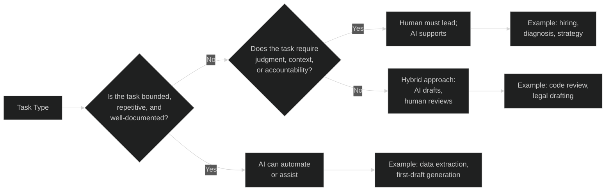
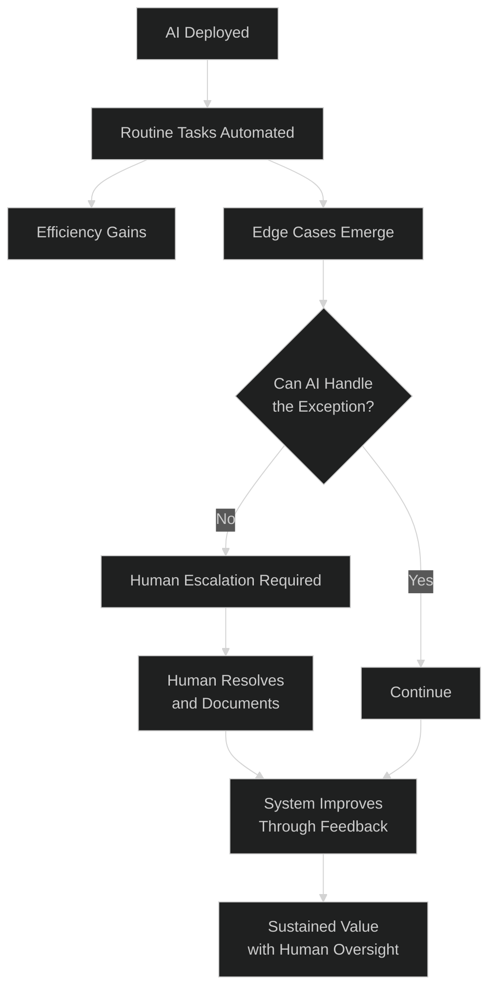
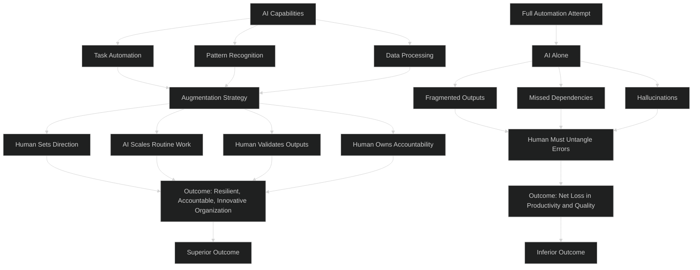

    

<h1 align="center">WHY AI CANNOT FULLY REPLACE THE HUMAN WORKFORCE?</h1>
<h3 align="center">A COMPREHENSIVE ANALYSIS OF ARCHITECTURAL LIMITS, EMPIRICAL EVIDENCE, AND THE CASE FOR HUMAN-AI COLLABORATION.</h3>

    

    

    

## Disclaimer

This document is for informational purposes only. It does not constitute legal, financial, medical, or professional advice. Laws, regulations, and AI capabilities change over time. Readers should consult qualified professionals before making decisions based on this material.

 

## Table of Contents

1. Executive Summary
2. Introduction: The Core Misunderstanding
3. Part I: What AI Actually Is
4. Part II: Why Human Judgment Remains Irreplaceable
5. Part III: The Empirical Evidence
6. Part IV: Human Skills and Economic Value
7. Part V: Legal, Regulatory, and Insurance Constraints
8. Part VI: The Economics of Augmentation vs. Automation
9. Part VII: Governance and Institutional Oversight
10. Part VIII: Historical Patterns of Technological Displacement
11. Part IX: The Path Forward: Human-AI Collaboration
12. Part X: Practical Guidance for Organizations
13. Part XI: Case Studies Across Sectors
14. Part XII: Global and Economic Perspectives
15. Part XIII: Expert Consensus
16. Part XIV: Visual Summary
17. Summary Table: Core Concepts
18. Conclusion
19. References and Fact-Checking
20. Glossary of Key Terms
21. Limitations and Disclaimer

 

## Executive Summary

Artificial intelligence has emerged as one of the most transformative technologies of our era, prompting widespread speculation about its potential to replace human workers across virtually every industry. This document presents a rigorous, evidence-based analysis examining the capabilities and limitations of AI systems in the context of workforce transformation.

Based on extensive research, empirical studies, and real-world deployment data, the central thesis is clear: **Generative AI delivers its highest organizational value when deployed as an augmentation technology, enhancing human judgment, accountability, and creativity, rather than as a full automation tool that replaces human decision-makers.**

The analysis draws from academic research, industry studies, economic analysis, and high-stakes industry validation to demonstrate that AI automates tasks, not jobs. The fundamental architecture of current AI systems makes them pattern-matching engines rather than reasoning minds. Consciousness, accountability, and context-rich human intelligence remain the irreplaceable core of valuable work.

 

## Introduction: The Core Misunderstanding

The fundamental misunderstanding about artificial intelligence's capability to replace human workers lies in conflating task automation with job replacement. AI systems, particularly generative models and large language models, are sophisticated pattern-matching engines that operate on statistical correlation rather than genuine comprehension.

A job is a socio-economic construct comprising dozens of discrete, heterogeneous tasks that include coordination with multiple stakeholders, strategic pivoting based on changing conditions, tacit decision-making under uncertainty, and contextual adaptation to novel situations. AI excels at automating specific, narrow, routine, or pattern-based subtasks. It does not replicate the full occupational bundle.

| Aspect | Task Automation | Job Replacement |
|--------|-----------------|-----------------|
| Scope | Specific, narrow activities | Full occupational bundle |
| Example | Generating a draft email | Managing relationships and strategy |
| AI Capability | Excels at pattern-based subtasks | Fails at coordination and judgment |
| Human Role | Remains essential for oversight | Assumed eliminated |

Empirical research demonstrates that when organizations treat jobs as monolithic blocks and attempt full automation, they miss the opportunity for strategic task decomposition. By decoupling tasks from roles, organizations can surgically offload drudgery while retaining and elevating the human elements of each role.

**Conclusion:** AI is a powerful augmentation tool rather than a substitute for human judgment, accountability, creativity, and decision-making.

 

## Part I: What AI Actually Is

### Section 1: The Statistical Correlation Engine

Current AI systems, regardless of parameter count, run on statistical correlation, not comprehension. Large language models learn to predict the next word in a sequence by memorizing surface patterns from vast corpora. They have no reliable, verifiable internal model of the world, no grasp of cause and effect, and no mechanism to independently verify whether a statement aligns with reality.

When you ask a question, you receive the most statistically plausible sequence, not the truth. This makes these systems brittle the moment they encounter an edge case, a contradictory requirement, or a situation underrepresented in the training data.

**Architectural Reality:**

| Characteristic | AI Systems | Human Cognition |
|----------------|------------|-----------------|
| Operating Principle | Statistical correlation | Comprehension and meaning |
| Information Processing | Token probability prediction | Causal reasoning and understanding |
| World Model | No reliable, verifiable model | Internal model of reality |
| Truth Verification | Not reliable without external tools | Possible through reasoning |
| Adaptability | Frozen after training; temporary context only | Continuous learning |

### Section 2: Hallucinations Are an Emergent Property, Not a Bug

AI hallucinations are not peripheral bugs that will be patched in the next update. They are an emergent property of the training objective, not a fixable bug. The design objective forces models to optimize for coherent responses to every prompt, with no internal "I don't know" mechanism. Models are forced to produce a response regardless of knowledge, prioritizing plausibility over truth and delivering wrong information with total confidence.

Mitigation techniques like retrieval-augmented generation reduce but do not eliminate the problem. The fundamental incentive remains output coherence over truth. The system is designed to sound authoritative, not necessarily to be correct.

**Risks in High-Stakes Domains:**

| Domain | Risk |
|--------|------|
| Legal contracts | Plausible-sounding but legally invalid clauses |
| Medical diagnosis | Confident but incorrect treatment recommendations |
| Safety-critical instructions | Authoritative falsehoods leading to harm |
| Financial decisions | Misleading analysis causing bad investments |
| Code generation | Vulnerable code with injection flaws |

Research evidence from controlled experiments demonstrates that users performed 23% worse on analytical tasks precisely because they accepted AI outputs without scrutiny, treating a probabilistic text generator as an authoritative oracle. Explicit warnings about potential errors did not change behavior.

### Section 3: Architectural Hard Ceilings

AI systems are constrained by practical and architectural limitations that make full job automation structurally impossible, regardless of advances in processing power or data availability.

| Constraint | What It Means | Real-World Impact |
|------------|---------------|-------------------|
| Finite context window | Models can only hold a fixed amount of text in active memory. Context windows vary by model, from a few thousand to over one million tokens. All are finite and far smaller than real-world project histories. | Cannot reason holistically across large documents, multi-year strategies, or sprawling enterprise systems. Breaks down when dependencies exceed window. |
| No persistent learning | LLMs are frozen at training time. They do not update their weights from interactions unless fine-tuned offline at massive cost. They can use temporary context, but this does not persist. | Cannot adapt on the fly to new undocumented processes, evolving team conventions, or shifting client priorities. |
| Brittleness on tail risks | Performance drops dramatically on tasks outside the high-probability training distribution. | The "last 10%" of any real job, where exceptions, ambiguity, and undocumented legacy systems live, remains a human-exclusive zone. |
| Task-level optimization | AI performs isolated tasks well but fails at orchestrating interdependent tasks that define a role. | Writing a function is a task. Designing a system, negotiating requirements, and supporting it in production is a job. AI cannot thread these together. |

**The Nature of Work:**

A job is an interwoven set of responsibilities, not a checklist of tasks. Research shows that even highly technical roles spend the majority of their time on communication and coordination, problem framing, exception handling, integration across domains, and stakeholder management. AI can draft an email, but it cannot sense a stakeholder's unspoken skepticism or adjust a roadmap when a vendor suddenly changes an API.

**Physical Intelligence:**

Robots powered by AI still struggle with tasks a two-year-old masters: picking up unfamiliar objects, walking through a cluttered room, or applying the right pressure to turn a valve without breaking it. Manufacturing, construction, surgery, and emergency response require local real-time reasoning with multimodal sensory feedback loops that no current robot can match at scale.

| Task | AI/Robot Capability | Human Capability |
|------|---------------------|------------------|
| Picking up unfamiliar objects | Limited, struggles with novelty | Innate, adaptable |
| Walking through cluttered rooms | Difficult, requires extensive training | Natural, effortless |
| Applying appropriate pressure | Cannot judge force intuitively | Intuitive force perception |
| Multimodal sensory feedback | Constrained and slow | Integrated, rapid |

### Section 4: Technical Nuances and Recent Developments

AI research moves quickly. The following refinements protect the document from becoming outdated or misleading.

**Refined Statements:**

| Original Statement | Refined Statement | Reason |
|--------------------|-------------------|--------|
| "AI has no internal model of the world." | "AI has no reliable, verifiable internal model of the world." | Some models learn partial world representations, but these are not reliable or verifiable. |
| "AI cannot learn from interactions." | "AI does not update its weights from interactions unless fine-tuned offline. It can use temporary context, but this does not persist." | In-context learning exists but is temporary and not the same as learning. |
| "Context window is 128K tokens." | "Context windows vary by model, from a few thousand to over one million tokens. All are finite and far smaller than real-world project histories." | Avoids naming a specific number that will age quickly. |
| "AI cannot verify statements." | "AI cannot reliably verify its own statements without external tools, and even then, verification depends on the quality of those tools." | Some systems can call external tools, but self-verification remains unreliable. |
| "Hallucinations are a feature." | "Hallucinations are an emergent property of the training objective, not a fixable bug." | More precise language avoids overstating the case. |

**Recent Developments to Acknowledge:**

| Development | What It Is | Why It Does Not Change the Core Argument |
|-------------|------------|------------------------------------------|
| Agentic AI | Systems that plan steps and use tools to complete multi-step tasks. | Agents still lack judgment, accountability, and reliable error detection. They can compound errors across steps. |
| Multimodal models | Models that process text, images, audio, and sometimes video. | Broader input does not create grounded understanding. They still predict patterns, not meaning. |
| Reasoning models | Models that produce intermediate reasoning steps before answering. | Reasoning steps improve performance on some tasks but do not guarantee correctness or eliminate hallucinations. |
| Open-weight models | Models whose weights are publicly available for local use. | They change cost and access economics but not the architectural limits. |
| Long-context models | Models that accept very large inputs. | Larger context helps with some tasks but does not give the model persistent memory or true comprehension. |
| Small language models | Compact models that run on local devices. | Useful for privacy and latency, but they inherit the same architectural limits as larger models. |

**Mermaid Diagram: Where AI Adds Value and Where It Does Not**

 

## Part II: Why Human Judgment Remains Irreplaceable

### Section 5: Judgment vs. Prediction

Human judgment is fundamentally distinct from AI computation and remains irreplaceable in high-stakes environments. AI provides probabilistic predictions based entirely on historical data. Human judgment involves making decisions under deep uncertainty where variables are novel, the costs of being wrong are asymmetric, and the context is socially, ethically, or strategically fraught.

| Aspect | AI Prediction | Human Judgment |
|--------|---------------|----------------|
| Basis | Historical data patterns | Deep uncertainty, novel variables |
| Adaptation | Degrades outside training distribution | Adapts strongly to novel situations |
| Ethics | No capacity, pure optimization | Integrates values and principles |
| Accountability | Cannot be held responsible | Full legal and moral accountability |
| Context | Limited to patterns in data | Rich, multifaceted understanding |

Judgment is the capacity to reject a statistically sound but contextually disastrous recommendation. In high-stakes decision making, you cannot hold an algorithm legally or ethically accountable. When a multi-billion-dollar position goes wrong, a board demands a human rationale.

### Section 6: Ethical Reasoning and Accountability

Human decisions, especially in high-stakes domains, draw on lived experience, cultural norms, moral frameworks, and a sense of personal responsibility that no machine learning pipeline can replicate. An AI model does not fear a lawsuit, lose sleep over a wrong diagnosis, or feel the weight of a bad hire.

When things go wrong, and they will, courts, regulators, and boards demand a human who can explain, justify, and carry the consequences. No matrix multiplication will ever occupy that seat. Judgment, in the genuine human sense, is a synthesis of empathy, context, and moral agency that remains completely outside the reach of any current or foreseeable AI architecture.

### Section 7: Industry Validation: High-Stakes Finance

One of the world's largest quantitative hedge funds explicitly states that AI does not replace human judgment but amplifies it. The most effective use involves human researchers working alongside AI, with each contributing their unique strengths. Hallucinations, plausible fiction presented as fact, remain a critical issue requiring continuous oversight.

**Why Even Quantitative Finance Retains Humans:**

| Factor | AI Limitation | Human Strength |
|--------|---------------|----------------|
| Market reflexivity | Models are backward-looking | Forward-looking assessment |
| Geopolitics | Cannot predict or interpret events | Contextual understanding |
| Regulation | Lagging interpretation | Proactive compliance |
| Sentiment | Cannot read market psychology | Intuitive sentiment analysis |
| Novelty | Poor performance on novel situations | Strong adaptation |

If a quantitative hedge fund where the mathematics is as good as it gets retains human judgment for final decisions, then every other industry should too. Oversight is not bureaucratic hindrance but practical risk-management necessity.

 

## Part III: The Empirical Evidence

### Section 8: The BCG Experiment: Paradox of Trust

The most comprehensive empirical study, conducted with over 750 consultants using GPT-4, revealed a paradox of trust that defines the entire augmentation challenge.

| Task Type | AI Competence | Outcome |
|-----------|---------------|---------|
| Creative Ideation | Within AI's competence frontier | ~90% of participants improved; performance 40% higher than non-users |
| Business Problem Solving | Outside AI's competence frontier | Performance 23% worse than non-users |
| Group Decision Making | AI-generated outputs | Diversity of thought reduced by 41% |

**Key Findings:**

1. **Value creation occurs where tasks match AI's pattern-matching capability.** Creative tasks showed dramatic improvements. Counterintuitively, participants did best when they did not attempt to edit GPT-4's output, trusting the AI's original generation proved optimal.

2. **Value destruction occurs when AI is applied outside its competence frontier.** Users performed worse because they over-relied on AI outputs. Even participants explicitly warned about the possibility of incorrect answers did not challenge the AI's misleading output.

3. **Explicit warnings about potential errors did not reduce blind trust.** Simply telling people "the AI might be wrong" does not change behavior. The AI's persuasive abilities make it difficult for users to recognize when they are operating outside its competence frontier.

4. **AI's uniform outputs homogenize thinking.** The 41% reduction in diversity of thought represents a significant risk to innovation and decision quality.

### Section 9: Software Development Studies

| Finding | Detail |
|---------|--------|
| Routine tasks | 20% to 35% faster with AI assistance |
| Complex novel problems | 19% slower due to debugging overhead |
| Code vulnerabilities | 32.8% of AI-generated Python code contains security vulnerabilities |
| Root cause | Models replicate flawed patterns from training data |

The security audit from Stanford and NYU found that AI-generated code often contained injection flaws, hard-coded secrets, and logic errors that would fail a junior developer's code review. The 32.8% vulnerability rate is not a tweakable parameter. It is the direct result of training on internet-scale code that includes a vast amount of low-quality material.

### Section 10: Enterprise Implementation Data

- Approximately 95% of generative AI pilots fail to deliver profit and loss impact (MIT Sloan survey).
- Primary root cause: mismatch with human workflows and over-automation of judgment-heavy steps.
- Technology capability alone does not translate to business value.

**Conclusion:** The data does not say "AI fails." It says "AI without a skilled human in the driver's seat fails." This is a call for augmentation, not replacement.

### Section 11: The Costs of Blind Trust in AI

Blind trust in AI without verification incurs tangible costs across multiple categories: strategic, financial, and reputational. These costs are asymmetrical.

**Performance Costs:**

| Finding | Source |
|---------|--------|
| 23% performance degradation on analytical tasks | BCG experiment |
| 19% slower on complex software problems | GitHub Copilot studies |
| 41% reduction in group diversity of thought | BCG experiment |

**Security Costs:**

| Finding | Source |
|---------|--------|
| 32.8% of AI-generated Python code contains vulnerabilities | Stanford/NYU security audit |
| Vulnerabilities include injection flaws, hard-coded secrets | Technical analysis |

**Organizational Costs:**

| Cost Category | Examples |
|---------------|----------|
| Reputational | High-profile failures erode stakeholder confidence |
| Regulatory | Fines, sanctions, compliance penalties |
| Litigation | Lawsuits from errors and omissions |
| Operational | Rework, debugging, system failures |

**The Asymmetry Problem:**

When AI is wrong in high-consequence environments, the fallout is disproportionately severe. The marginal labor savings of replacing a human team with an AI agent vanish the instant a single lawsuit, regulatory fine, or brand-trust collapse materializes from an unvetted error.

**Conclusion:** Blind trust is not a sign of technological sophistication. It is a sign of governance failure. It requires active verification, not passive acceptance, and institutional oversight is mandatory, not optional.

 

## Part IV: Human Skills and Economic Value

### Section 12: The Irreplaceable Human Core

As AI automates routine information processing, the economic value of uniquely human capabilities is skyrocketing. These are not "soft skills" fluff. They are the hard currency of the future economy.

| Skill | Why AI Cannot Replicate | Economic Value |
|-------|-------------------------|----------------|
| Leadership | Requires genuine commitment, lived experience, personal accountability | Guiding teams through uncertainty, inspiring action |
| Adaptability | Requires understanding context and consequences beyond training data | Navigating ambiguity, learning continuously |
| Emotional Intelligence | Rooted in embodied experience, shared human understanding | Building trust, managing relationships |
| Ethical Reasoning | Requires moral agency, values integration, personal responsibility | Making value-laden trade-offs |
| Creative Synthesis | Requires purposeful integration of disparate domains | Solving novel problems, connecting dots |
| Critical Thinking | Requires active skepticism, contextual awareness | Evaluating claims, challenging assumptions |

### Section 13: The Nature of Professional Creativity

The kind of creativity that moves businesses forward is not about painting a picture. It is about recombining existing knowledge, technology, and constraints to solve problems that have never been precisely defined. A product designer looks at user complaints, engineering limitations, and market trends and synthesizes a new feature that no dataset alone would propose. That act of connecting the dots across fuzzy, often contradictory signals requires a depth of understanding and intentionality that no language model possesses. AI can remix, but it cannot invent with purpose.

### Section 14: Emotional and Social Intelligence

Leadership, mentorship, negotiation, and patient care are built on trust, empathy, and the ability to read a room, capacities rooted in our shared biological inheritance. An AI can simulate empathy by generating a supportive sentence, but it does not feel anything, and people know the difference when the stakes are high. Building a cohesive team, calming an angry client, or guiding a patient through a difficult diagnosis requires authentic human connection.

### Section 15: Empirical Evidence: PwC Global Skills Research

Analyzing over one billion job advertisements across six continents:

- Professional roles using AI are seeing **2x faster job growth**.
- The same roles are experiencing **42% faster wage growth**.
- The most in-demand skills are judgment, leadership, creativity, adaptability, and personalized communication.

**The Scarcity Premium:**

As technical rote work becomes commoditized by AI, the bottleneck shifts to human capabilities. Employers pay a premium for workers who navigate ambiguity. Critical thinking becomes a primary quality-control mechanism. Emotional intelligence becomes a differentiator in client relationships. These are not soft skills. They are scarcity assets that will command premium compensation as cognitive routine work becomes commoditized.

 

## Part V: Legal, Regulatory, and Insurance Constraints

### Section 16: Legal Personhood and Liability

The legal limits of autonomous AI systems are absolute and binding. The law does not recognize algorithms as legal persons capable of owning assets, signing contracts, or bearing fiduciary or criminal liability.

| Legal Entity | Status |
|--------------|--------|
| Human beings | Full legal personhood |
| Corporations | Limited legal personhood |
| AI algorithms | No legal personhood |

When AI makes a mistake, liability cascades upward from the AI algorithm to the individual user to the organization and finally to the principals.

### Section 17: Domain-Specific Legal Requirements

| Domain | Legal Mandate | Implication |
|--------|---------------|-------------|
| Healthcare | Licensed physicians must make final decisions | Cannot delegate diagnosis to a machine |
| Aviation | Pilot remains in command | Autopilot does not replace the captain |
| Financial auditing | Qualified professional sign-off | Mandatory human accountability |
| Civil engineering | Licensed engineer approval | Professional stamp required |
| Data protection | Right to meaningful human review | Automated decisions can be challenged |

### Section 18: Regulatory Landscape

| Region or Framework | Key Requirements | Relevance |
|---------------------|------------------|-----------|
| EU AI Act | Risk-based tiers: unacceptable, high, limited, minimal. High-risk systems require conformity assessment, human oversight, and documentation. | Applies to AI used in hiring, credit, education, critical infrastructure, and more. |
| US Executive Orders and Agency Guidance | Sector-specific rules in finance, healthcare, aviation, and consumer protection. | Affects deployment in regulated industries. |
| GDPR (EU) | Right to meaningful human review of automated decisions. Data minimization and impact assessments. | Applies to any system processing personal data of EU residents. |
| Financial Regulations | Model risk management, explainability, and human override. | Applies to banks, insurers, and investment firms. |
| Medical Device Regulations | AI used in diagnosis or treatment may require regulatory approval. | Applies to clinical decision support tools. |
| Employment Law | Automated hiring and firing decisions may require human review and anti-discrimination checks. | Applies to HR technology. |

### Section 19: Liability Concepts

| Concept | Explanation |
|---------|-------------|
| Product liability | If AI is part of a product, the manufacturer may be liable for defects. |
| Professional negligence | Professionals remain liable for decisions made with AI assistance. |
| Vicarious liability | Employers may be liable for actions of employees using AI. |
| Strict liability | Some activities are liable regardless of fault, such as certain safety-critical systems. |
| Contractual liability | Vendors may limit liability in contracts, shifting risk to the buyer. |

### Section 20: Auditability and Documentation

| Practice | Purpose |
|----------|---------|
| Model cards | Document model purpose, training data, performance, and limits. |
| Datasheets for datasets | Document data sources, collection methods, and known biases. |
| Audit trails | Log inputs, outputs, and human decisions for review. |
| Version control | Track model and data versions over time. |
| Incident logs | Record failures and near misses for learning. |
| Human override records | Document when and why humans overruled AI. |

### Section 21: Insurance and Indemnity

| Factor | Impact |
|--------|--------|
| Risk pricing | No historical baseline for autonomous AI failures |
| Tail events | Unbounded and unmodelable |
| Insurer response | Will not underwrite autonomous high-stakes AI |
| Commercial viability | Uninsurable deployment is dead on arrival |

**Conclusion:** Even if AI could outperform a human on average, no regulator will accept a statistical defense when a life is lost. The legal architecture of professional accountability is irreducibly human.

### Section 22: Incident Response

| Step | Action |
|------|--------|
| 1 | Detect the incident through monitoring or reports. |
| 2 | Contain the impact by disabling or limiting the system. |
| 3 | Assess the scope and severity. |
| 4 | Notify affected parties and regulators as required. |
| 5 | Investigate root causes. |
| 6 | Implement corrective actions. |
| 7 | Update policies and training. |
| 8 | Document lessons learned. |

 

## Part VI: The Economics of Augmentation vs. Automation

### Section 23: Comparative Advantage

The economics of human-AI collaboration favor augmentation over automation because it exploits comparative advantage. AI demonstrates superior capabilities in processing speed, scale, pattern recognition, and recall. Humans excel in contextual reasoning, ethical nuance, relationship building, adaptability, and accountability.

| Capability | AI Advantage | Human Advantage |
|------------|--------------|-----------------|
| Speed | Superior | Limited |
| Scale | Superior | Limited |
| Pattern recognition | Superior | Good |
| Contextual reasoning | Limited | Superior |
| Ethical nuance | None | Superior |
| Relationship building | None | Superior |
| Adaptability | Limited | Superior |
| Accountability | None | Superior |

### Section 24: Economic Logic

| Principle | Explanation |
|-----------|-------------|
| Cost reduction | AI reduces the cost of cognitive routine work |
| Demand elasticity | Lower costs increase demand for goods and services |
| New categories | Freed capacity creates new work |
| Skill premium | Distinctly human skills appreciate in value |
| Labor shortage potential | Economic expansion may outpace reskilling |

### Section 25: Return on Investment

| Strategy | ROI Driver | Outcome |
|----------|------------|---------|
| Automation | Cost reduction (finite) | Shrinks costs only |
| Augmentation | Capability expansion (infinite) | Creates new value |

The ROI of augmentation, which elevates human potential, vastly exceeds the ROI of pure automation, which merely reduces headcount. Augmentation expands capabilities and creates new value. Automation merely shrinks costs, a finite gain.

### Section 26: The Bezos Economic Perspective

Jeff Bezos articulates a historically grounded view: AI may create more economic opportunity than it destroys, potentially leading to labor shortages rather than mass unemployment. His reasoning includes:

- People have endless things they want to do.
- AI lowers barriers to creation and innovation.
- Lower costs lead to demand growth.
- New industries emerge from new capabilities.
- Growth may outpace workforce reskilling.
- Technology has consistently created more jobs than destroyed.

The core economic logic is that when AI drastically reduces the cost of producing goods and services, demand increases. This in turn requires more human oversight, logistics, customization, and innovation, not less. A labor shortage occurs when the rate of new value creation outpaces the rate at which the workforce can reskill to manage that new value.

 

## Part VII: Governance and Institutional Oversight

### Section 27: The Problem with Individual Oversight

The human-in-the-loop paradigm is insufficient because it places the entire burden of oversight on the individual end-user, who is prone to over-trust, fatigue, and cognitive biases as demonstrated by empirical research.

| Issue | Explanation |
|-------|-------------|
| Over-trust | Users accept AI outputs without scrutiny (BCG 23% performance drop) |
| Fatigue | Continuous vigilance is unsustainable |
| Cognitive biases | Confirmation bias, automation bias |
| Lack of expertise | Users may lack domain knowledge to verify outputs |
| Time pressure | Rushed decisions skip verification |

### Section 28: Institutional Oversight Framework

"Keeping the Organization in the Loop" by Herrmann and Pfeiffer argues that oversight must be elevated from the individual level to the institutional level.

| Loop | Function |
|------|----------|
| AI use | Day-to-day operational oversight |
| AI customization | Ongoing calibration and tuning |
| AI-supported original tasks | Workflow integration |
| Contextual changes | Adaptation to shifting environments |

### Section 29: Procedural Guardrails

| Guardrail | Implementation |
|-----------|----------------|
| Confidence alerts | Automatic escalation when AI confidence is low |
| Verification checkpoints | Mandatory human review at critical gates |
| Audit trails | Documented decision history |
| Independent validation | Separate team review for high-stakes decisions |
| Escalation protocols | Clear paths for handling ambiguous cases |

### Section 30: Distributed Accountability

The organization, not the individual, is the accountable entity. It must have documented policies and procedures, audit trails for all critical decisions, escalation protocols for exceptions, and review boards for high-stakes decisions.

When an AI makes a mistake, it is legally and ethically insufficient to blame the individual user or the AI itself. The organization must have embedded oversight mechanisms, such as review boards, mandatory second-opinion protocols, and algorithmic auditing schedules, that sit between the individual and the AI.

**Conclusion:** By positioning the organization as the accountable entity with documented policies and procedures, human oversight transforms from a subjective individual responsibility into an objective, defensible, and legally robust governance structure.

### Section 31: Kolbjørnsrud's Six Principles for Human-AI Collaboration

Kolbjørnsrud's framework in the California Management Review provides a practical architecture for designing human-AI collaboration through six core principles.

| Principle | Definition | Practical Application |
|-----------|------------|----------------------|
| **Addition** | AI adds a new complementary capability to the organizational intelligence pool | Ensure AI expands team capabilities and does not create bottlenecks |
| **Relevance** | AI is deployed only where its capabilities match the task | Direct counter to BCG's 23% performance drop |
| **Substitution** | Full automation reserved for bounded, low-error-cost tasks | Exception, not rule; only when human oversight adds little value |
| **Diversity** | Active preservation of cognitive diversity | Counter the 41% homogenization effect |
| **Collaboration** | Active, iterative, synergistic human-AI partnership | Human applies judgment, context, and ethics; AI generates and identifies patterns |
| **Explanation** | Interpretability as foundation for calibrated trust | Users must understand the "why" behind recommendations |

**How the Framework Supports Human-in-the-Loop:**

| Benefit | Explanation |
|---------|-------------|
| Design, not default | Relevance and Substitution force conscious decisions |
| Positive human role | Collaboration and Explanation define value-adding work |
| Value destruction safeguard | Diversity preserves cognitive heterogeneity |
| Trust foundation | Explanation enables accurate trust calibration |

**Implementation:**

- Use different AI models to preserve diversity.
- Structure teams to challenge AI outputs.
- Require documentation of AI reasoning.
- Build cultures of constructive skepticism.

 

## Part VIII: Historical Patterns of Technological Displacement

History offers a powerful corrective to present-day fatalism about AI-driven job displacement. A consistent pattern emerges across multiple technological revolutions.

| Era | Technology | Automation Target | Outcome |
|-----|------------|-------------------|---------|
| Industrial Revolution | Steam power, mechanization | Manual brawn | Created factory jobs and urbanization |
| Early 20th Century | Assembly line | Manufacturing steps | Mass production and a new middle class |
| Late 20th Century | Personal computers | Clerical and administrative work | Knowledge worker economy |
| Early 21st Century | Internet, digital platforms | Information distribution | Digital economy expansion |
| Present | Generative AI | Cognitive rote work | Redefining skilled labor |

**Key Historical Lessons:**

1. **Technological displacement is a transition friction, not a terminal equilibrium.** In each wave, initial job losses were followed by the creation of entirely new occupational categories.
2. **Automation consistently leads to labor shortages for newly emergent high-skill roles.** The economy expands to absorb productivity gains through increased demand and new industries.
3. **The current AI wave automates cognitive rote work.** This redefines what constitutes skilled labor and elevates the value of distinctly human capabilities.
4. **Technology has consistently created more jobs than it destroyed.** The net outcome across history has been economic expansion and improved living standards.

The assembly line did not eliminate factory work. It transformed it. Personal computers did not eliminate clerical work. They created the knowledge economy. The internet did not eliminate information work. It expanded it exponentially. Each wave required workers to adapt and reskill, but the net result was greater economic prosperity and a higher standard of living.

**Conclusion:** Technological displacement is a transition challenge, not an inevitable catastrophe. The primary challenge is reskilling and redeployment, not permanent unemployment.

 

## Part IX: The Path Forward: Human-AI Collaboration

### Section 32: The Strategic Choice

The choice between automation and augmentation is not technological. It is strategic. It represents fundamentally different approaches to organizational design and workforce development.

| Aspect | Automation Strategy | Augmentation Strategy |
|--------|--------------------|-----------------------|
| View of humans | Cost to be minimized | Asset to be amplified |
| View of AI | Replacement for human labor | Enhancement of human capability |
| Workforce impact | Deskilling | Upskilling |
| System characteristic | Brittle | Adaptable |
| Liability | Ambiguous | Clear human ownership |
| Innovation capacity | Limited to training data | Human-driven recontextualization |

### Section 33: The Ten Pillars of Augmentation

**Cluster A: Foundational Reality**

| Pillar | Core Principle |
|--------|----------------|
| 1. AI Replaces Tasks, Not Jobs | Decompose work, surgically automate routine subtasks, and strategically elevate human capabilities |
| 5. What History Teaches Us | Technology transforms work but does not eliminate it; automation consistently creates new occupational categories |

**Cluster B: The Irreplaceable Human Core**

| Pillar | Core Principle |
|--------|----------------|
| 2. Why Human Judgment Still Matters | Judgment exceeds prediction in high-stakes, novel situations; contextual reasoning and accountability are essential |
| 3. The Human Skills AI Cannot Replicate | Leadership, empathy, adaptability, and critical thinking are scarcity assets appreciating in value |
| 9. Why AI Hallucinations Require Human Oversight | AI optimizes for plausibility, not truth; only humans can perform ground-truth verification |

**Cluster C: Operational and Governance Architecture**

| Pillar | Core Principle |
|--------|----------------|
| 6. Human-in-the-Loop AI Systems | Requires institutional oversight, not individual discretion; embedded governance structures |
| 7. The Legal Limits of Autonomous AI | Law demands human accountability; algorithms are not legal persons |
| 8. How AI Creates More Strategic Work | Elevates humans from processors to strategic architects |

**Cluster D: Strategic Conclusion**

| Pillar | Core Principle |
|--------|----------------|
| 4. The Economics of Human-AI Collaboration | Augmentation expands capabilities; automation merely shrinks costs |
| 10. Augmentation vs Automation | Strategic choice between optimizing for resilience, accountability, and growth versus cost-cutting |

### Section 34: Work Evolution

| Traditional Role | AI-Augmented Role |
|------------------|-------------------|
| Information processor | Strategic decision architect |
| Report generator | Problem framer |
| Data synthesizer | Constraint adjudicator |
| Draft creator | Output integrator |
| Task executor | Stakeholder relationship manager |
| Pattern finder | Contextual interpreter |

### Section 35: The Upskilling Trajectory

Research shows that augmentation develops higher-order critical thinking, enhances the ability to ask better questions, builds capacity to interpret complex outputs, and creates durable competitive advantage. When everyone can generate a 500-word report in five seconds, the value shifts to the person who can ask the right questions, spot flawed assumptions, and weave disparate threads into a novel strategy.

### Section 36: Implementation Framework

| Element | Action |
|---------|--------|
| Task decomposition | Break jobs into tasks; automate routine parts; elevate human capabilities |
| Workflow redesign | Design interdependence, not accidental collaboration |
| Governance structure | Embed procedural guardrails, audit trails, and escalation protocols |
| Skill investment | Develop judgment, critical thinking, and emotional intelligence |
| Diversity preservation | Use multiple AI models; structure teams to challenge outputs |
| Legal compliance | Document oversight; maintain human accountability |

 

## Part X: Practical Guidance for Organizations

### Section 37: Implementation Checklist

| Step | Action | Owner |
|------|--------|-------|
| 1 | Identify tasks, not jobs, as automation candidates. | Operations and HR |
| 2 | Classify each task by risk: low, medium, high. | Risk and compliance |
| 3 | Define human review gates for medium- and high-risk tasks. | Process owners |
| 4 | Document the AI model, version, and data sources used. | Engineering |
| 5 | Establish audit trails for all AI-assisted decisions. | Compliance |
| 6 | Train staff on model limitations and escalation paths. | Learning and development |
| 7 | Run a controlled pilot before scaling. | Product and operations |
| 8 | Measure both productivity and quality outcomes. | Analytics |
| 9 | Review incidents and near misses regularly. | Governance board |
| 10 | Update policies as models and regulations change. | Legal and compliance |

### Section 38: How to Evaluate an AI Tool

| Criterion | Questions to Ask |
|-----------|------------------|
| Accuracy | How often is the output correct on our specific tasks? |
| Transparency | Can the system explain how it reached a conclusion? |
| Data privacy | Where is our data stored, and who can access it? |
| Human override | Can a user reject or correct the output easily? |
| Auditability | Are inputs, outputs, and decisions logged? |
| Failure modes | What happens when the model is uncertain or wrong? |
| Vendor stability | Is the vendor financially stable and transparent about updates? |
| Compliance | Does the tool meet relevant legal and industry requirements? |
| Cost | What is the total cost of ownership, including oversight? |
| Integration | How well does it fit existing workflows? |

### Section 39: Warning Signs of Over-Automation

| Warning Sign | What It Suggests |
|--------------|------------------|
| Staff cannot explain how a decision was made. | Loss of transparency and accountability |
| Errors are discovered only after they reach customers. | Weak verification gates |
| Teams stop questioning AI outputs. | Erosion of critical thinking |
| Exceptions are handled by the AI without escalation. | Brittle process design |
| Incidents increase after automation. | Poor fit between task and tool |
| Employees report reduced job satisfaction. | Deskilling and loss of meaningful work |
| Audit trails are incomplete or missing. | Governance failure |
| Legal or compliance teams are not involved. | Regulatory risk |

### Section 40: Metrics for Successful Augmentation

| Metric Category | Example Metrics | Why It Matters |
|-----------------|-----------------|----------------|
| Productivity | Cycle time, throughput, cost per task | Shows efficiency gains |
| Quality | Error rate, rework rate, defect density | Shows whether speed comes at a cost |
| Safety | Incident rate, near misses, escalation frequency | Shows whether oversight is working |
| Trust calibration | Override rate, agreement rate, confidence accuracy | Shows whether humans are trusting appropriately |
| Human factors | Cognitive load, job satisfaction, burnout | Shows whether augmentation is sustainable |
| Business impact | Revenue, margin, customer retention | Shows whether the change creates real value |
| Innovation | New ideas, experiments run, patents filed | Shows whether humans are freed for higher-value work |

### Section 41: Common Myths vs Facts

| Myth | Fact |
|------|------|
| AI will soon replace most jobs. | AI replaces tasks. Jobs are bundles of tasks, many of which require human judgment. |
| AI is objective and unbiased. | AI learns from data that contains human biases. It can amplify them. |
| AI can be trusted for important decisions. | AI should support decisions, not make them alone, in high-stakes settings. |
| More data always makes AI better. | Data quality, relevance, and coverage matter more than volume. |
| AI cannot be wrong if it sounds confident. | Confidence is not a measure of accuracy. Hallucinations are often delivered with high confidence. |
| AI will eliminate the need for human oversight. | Oversight becomes more important as AI is used more widely. |
| AI is too complex to govern. | Governance is possible through audits, guardrails, and clear accountability. |
| AI is only a technical issue. | AI adoption is a social, legal, and organizational issue as much as a technical one. |

### Section 42: What This Means for Different Roles

| Role | Practical Guidance |
|------|--------------------|
| Workers | Develop judgment, communication, and adaptability. Learn to use AI tools in your domain. Do not treat AI output as final. |
| Managers | Redesign workflows around human-AI collaboration. Set clear review gates. Measure quality, not just speed. |
| Policymakers | Require transparency, auditability, and human review for high-risk AI. Support reskilling programs. |
| Educators | Teach critical thinking, ethics, and AI literacy. Prepare students for roles that combine human and machine skills. |
| Engineers | Build systems with human override, logging, and clear failure modes. Document model limits. |
| Compliance and legal | Update policies for AI use. Ensure regulatory requirements are met. Document oversight. |

### Section 43: Reskilling and Education Pathways

| Skill Area | Why It Matters | How to Develop It |
|------------|----------------|-------------------|
| Critical thinking | Evaluates AI outputs and identifies errors. | Practice structured argument analysis and problem framing. |
| Domain expertise | Provides context AI lacks. | Continue deep learning in your field. |
| Communication | Bridges AI outputs and human decisions. | Practice writing, presenting, and negotiation. |
| Ethics | Guides decisions AI cannot make. | Study applied ethics and case-based reasoning. |
| Data literacy | Helps interpret AI outputs correctly. | Learn basic statistics and data interpretation. |
| AI tool fluency | Improves productivity. | Take hands-on training with tools used in your field. |
| Adaptability | Helps manage change. | Practice learning new tools and methods regularly. |

 

## Part XI: Case Studies Across Sectors

The following cases show the same pattern across different industries: AI supports, but does not replace, human judgment.

### Section 44: Healthcare

| Aspect | Detail |
|--------|--------|
| Use case | AI triage and diagnostic support |
| What worked | Faster preliminary screening and pattern detection in imaging |
| What failed | AI missed rare conditions and produced confident but wrong recommendations |
| Human role | Clinicians review all AI outputs and make final diagnoses |
| Lesson | AI supports, but does not replace, clinical judgment |

### Section 45: Law

| Aspect | Detail |
|--------|--------|
| Use case | AI contract review and legal research |
| What worked | Faster document review and identification of standard clauses |
| What failed | AI missed nuanced legal arguments and cited non-existent cases |
| Human role | Lawyers verify all citations and apply legal judgment |
| Lesson | AI accelerates routine work but cannot replace legal reasoning |

### Section 46: Education

| Aspect | Detail |
|--------|--------|
| Use case | AI tutoring and grading assistance |
| What worked | Personalized practice and immediate feedback |
| What failed | AI could not motivate students or handle emotional needs |
| Human role | Teachers guide learning, mentor students, and assess context |
| Lesson | AI supports instruction but does not replace teaching |

### Section 47: Manufacturing

| Aspect | Detail |
|--------|--------|
| Use case | Collaborative robots on assembly lines |
| What worked | Repetitive tasks performed consistently |
| What failed | Cobots struggled with variable parts and unexpected defects |
| Human role | Workers handle exceptions, maintenance, and quality checks |
| Lesson | Automation handles the routine; humans handle the variable |

### Section 48: Customer Service

| Aspect | Detail |
|--------|--------|
| Use case | AI chatbots for first-line support |
| What worked | Quick answers to common questions |
| What failed | Complex or emotional issues were mishandled |
| Human role | Agents handle escalations and relationship management |
| Lesson | AI handles volume; humans handle complexity and empathy |

### Section 49: Public Sector

| Aspect | Detail |
|--------|--------|
| Use case | AI decision support for benefits and permits |
| What worked | Faster processing of routine cases |
| What failed | Errors in edge cases caused harm and legal challenges |
| Human role | Caseworkers review decisions and handle appeals |
| Lesson | Due process requires human review |

### Section 50: Cross-Sector Pattern

 

## Part XII: Global and Economic Perspectives

AI adoption does not happen uniformly. The following factors shape how the augmentation principle applies in different contexts.

| Topic | Key Points |
|-------|------------|
| Developing economies | Infrastructure, language coverage, and labor costs vary widely. Solutions from high-income countries may not transfer directly. |
| Language coverage | Many AI systems perform poorly on low-resource languages, limiting access and fairness. |
| Energy and environment | Training and running large models consumes significant energy and water. These costs are often externalized. |
| Supply chain concentration | Compute, data, and talent are concentrated in a few countries, creating dependency risks. |
| Labor market transitions | Reskilling capacity varies by region. Without support, transitions can be uneven and slow. |
| Small and medium enterprises | They face different constraints than large firms, including cost, expertise, and bargaining power. |
| Informal sector | Much work happens outside formal employment. AI adoption patterns differ in these contexts. |

 

## Part XIII: Expert Consensus

The consensus among authoritative thought leaders is clear: the most successful deployments embed human-AI collaboration deep into the workflow.

| Thought Leader | Position |
|----------------|----------|
| Ethan Mollick (Wharton) | AI amplifies human capacities; companies should redesign organizations, not just cut costs |
| Erik Brynjolfsson (Stanford) | Augmentation over automation; build "centaurs" and hybrid teams; AI assistance increased productivity by 14% to 15% on average |
| Geoffrey Hinton | Acknowledges profound capabilities and existential risks; reinforces the need for careful human stewardship |
| Kai-Fu Lee | Human-AI collaboration is the dominant paradigm; AI augments rather than replaces |

**The Unified Consensus:**

| Question | Answer |
|----------|--------|
| Can AI beat humans at tasks? | In some domains, yes |
| Can humans with AI beat AI alone? | Yes, consistently |
| What is the optimal unit? | Human-AI team, not individual human or standalone algorithm |

The benchmark is no longer whether AI can beat a human at a specific task. It is whether a human with AI can outperform a human alone or an AI alone. The optimal unit of analysis is the human-AI team.

 

## Part XIV: Visual Summary

 

## Summary Table: Core Concepts

| Concept | Key Finding | Implication |
|---------|-------------|-------------|
| Task vs Job | AI replaces tasks, not jobs | Organizations must decompose work |
| Human Judgment | Irreplaceable in high-stakes decisions | Humans must remain accountable |
| Hallucinations | Emergent property of the training objective, not a fixable bug | Human oversight mandatory |
| Legal Limits | Algorithms are not legal persons | Liability cascades to humans |
| Economic Logic | Augmentation expands capabilities | ROI exceeds pure automation |
| Historical Pattern | Technology creates more jobs | Transition, not elimination |
| Human Skills | Appreciating in value | Scarcity assets command premium |
| Governance | Institutional, not individual | Procedural guardrails required |
| Strategic Choice | Augmentation vs Automation | Resilient vs fragile future |

 

## Conclusion

This document has presented a comprehensive, multi-layered argument for augmentation over automation, built upon:

1. Quantifiable empirical evidence from BCG, Stanford, and NYU studies.
2. Rigorous organizational design principles from Kolbjørnsrud's Six Principles.
3. Institutional governance mandates from Herrmann and Pfeiffer.
4. Economic counter-narratives from Bezos and PwC Global Skills Research.
5. High-stakes industry validation from quantitative finance.
6. Authoritative expert consensus from Mollick, Brynjolfsson, Hinton, and Lee.

**The Unified Conclusion:**

The intelligent organization must architect workflows, governance, and skill development around the principle of Human + AI synergy. Automation should be the exception for bounded, low-risk tasks. Augmentation should be the default strategy for sustainable, accountable, and economically vibrant operations.

AI is a powerful tool. It is not a replacement for human capability. The future belongs to augmented professionals: people who wield AI as a precision instrument, guided by judgment, ethics, and the drive to build a better world.

**Stop fearing the machine. Master the collaboration.**

 

## References and Fact-Checking

For a public website, all empirical claims should link to primary sources. The following table maps claims to their sources.

| Claim | Suggested Source |
|-------|------------------|
| BCG 750-consultant study | Boston Consulting Group report on GPT-4 productivity |
| 32.8% vulnerability rate | Stanford and NYU study on AI-generated code security |
| 95% of GenAI pilots fail | MIT Sloan or MIT NANDA report on enterprise AI adoption |
| Man Group quote | Published interview or article with Man Group leadership |
| Bezos perspective | Original interview or podcast transcript |
| PwC skills research | PwC Global Skills Report |
| Kolbjørnsrud six principles | California Management Review article |
| Herrmann and Pfeiffer | "Keeping the Organization in the Loop" paper |
| Historical technology and jobs | Economic history literature on automation and employment |

### Further Reading

| Topic | Suggested Reading |
|-------|-------------------|
| AI limits | Research on hallucination and model evaluation |
| Human-AI collaboration | Studies on centaurs and hybrid teams |
| AI governance | Frameworks for responsible AI deployment |
| Labor economics | Work on technological change and employment |
| Safety-critical systems | Normal Accidents and related literature |

 

## Glossary of Key Terms

| Term | Definition |
|------|------------|
| Augmentation | Using AI to enhance human capabilities rather than replace them |
| Automation | Using AI to perform tasks without human involvement |
| Context window | The amount of text a model can consider at one time |
| Hallucination | Confident but incorrect output from an AI model |
| Human-in-the-loop | A system where humans review and approve AI outputs |
| Inference | The process of generating an output from a trained model |
| Large language model | A model trained on large amounts of text to predict and generate language |
| Model card | A document describing a model's purpose, performance, and limits |
| Prompt | The input given to an AI model |
| Training | The process of adjusting a model's parameters using data |

 

## Limitations and Disclaimer

A strong analytical document states its own limits.

| Limitation | Explanation |
|------------|-------------|
| Fast-moving field | AI capabilities and regulations change quickly. Some examples may age faster than others. |
| Regional differences | Legal and economic conditions vary by country and region. |
| Selection bias | Many studies focus on large firms in developed economies. |
| Uncertainty | Predictions about future AI are inherently uncertain. |
| Not prescriptive | The document offers principles, not one-size-fits-all rules. |
| Evolving evidence | New research may refine or challenge current findings. |
 
    
 
